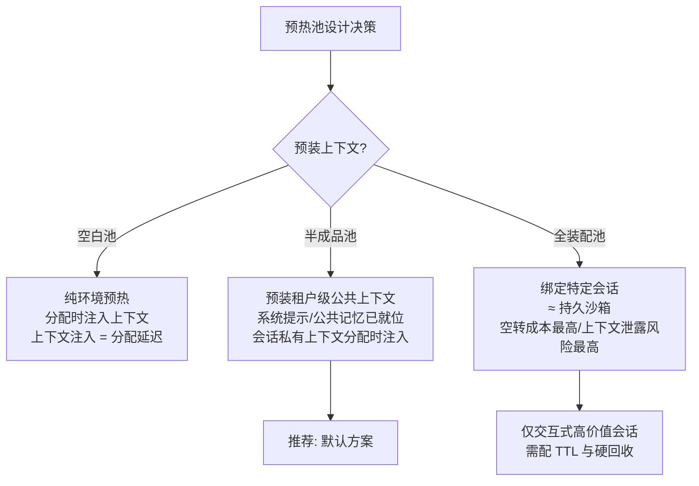

# 02 FaaS 冷启动 → Agent 沙箱供给

> **系列**：云基础设施 → Agent 执行层：能力迁移 · 第 2 篇
> **定位**：供给与冷启动域
> **前置阅读**：[总纲](./00-overview) · [01 K8s 资源模型](./01-k8s-resource-model)

> 迁移核心问题：Agent 执行环境如何做到"既要隔离强度、又要秒级供给、还要成本可控"的不可能三角——FaaS 十年前就在解这个三角，只是顶点权重不同。

## 摘要

FaaS 把冷启动从秒级压到毫秒级，沉淀了进程复用、预热池、快照恢复三条路线。Agent 沙箱的供给问题与之同构，但成本结构反转（冷启动不再是延迟主项，而是体验下限来源）、约束更苛刻（代码不可信成为默认假设、供给还包含上下文注入）。本文给出供给 SLA 分级、半成品预热池、原子绑定协议与分层快照四个迁移设计。

## 1. 当年的机制：冷启动时间的解剖

一次 FaaS 冷启动的时间预算可拆为四段：

```
T_total = T_image_pull + T_container_create + T_init + T_runtime_ready
```

| 时间段 | 占比（典型） | 优化手段 | 代表实践 |
|---|---|---|---|
| 镜像拉取 | 最大头 | 层共享、P2P 分发、懒加载、镜像预取 | eStargz 按需解压、节点镜像预热 |
| 容器/VM 创建 | 中 | 轻量运行时 | FireCracker MicroVM：125ms 级创建 |
| 语言运行时 init | 中 | 快照恢复代替执行初始化 | CRIU 检查点/恢复、JVM Snap Start |
| 应用/框架 init | 中 | 快照点后移 | Snap Start 把 JVM 冷启动砍掉 ~10× |

三条主流路线由此形成：

1. **进程/容器复用**：实例常驻，请求热分配——最快但隔离最弱，仅适用于**可信代码**；
2. **预热池（Warm Pool）**：预拉起一批"初始化完成、尚未绑定请求"的实例，请求到达时秒级绑定——用常驻资源换延迟；
3. **快照恢复**：把 init 完成后的内存状态做成快照，冷启动 = 恢复快照——隔离与速度兼得，但快照体积与状态"新鲜度"是工程难点。

选型的底层逻辑：**隔离强度 × 供给速度 × 密度成本**，三者最多取二，然后用工程手段把"取二"的边界往外推。

## 2. Agent 沙箱：同构问题，反转的成本结构

### 2.1 三个更苛刻的新约束

1. **代码不可信成为默认假设**：prompt 注入可以让 Agent 执行攻击者诱导的代码（威胁模型见 [04 篇](./04-multi-tenant-isolation)），FaaS 的路线 1（进程复用）基本出局——除非平台明确声明"仅执行平台自有工具，无任意代码执行"；
2. **供给不只是拉起环境，还要注入上下文**：FaaS 实例 init 后是白纸；Agent 沙箱就绪后还要装载会话上下文（系统提示、记忆检索结果、任务状态）——这一步与状态层（[03 篇](./03-state-externalization)）强耦合；
3. **冷启动成本占端到端延迟的比重反转**：FaaS 时代冷启动是全部延迟；Agent 场景一次用户感知延迟 = LLM 推理（数秒）+ 工具执行 + 沙箱供给。**沙箱供给不再是延迟主项，但仍是体验下限的来源**——用户能忍受 3 秒等模型思考，容忍不了"先卡 2 秒拉沙箱再开始转圈"的双重等待。

### 2.2 分级供给：按会话类型设定供给 SLA

| 会话类型 | 供给 SLA | 推荐策略 | 成本容忍 |
|---|---|---|---|
| 交互式（用户在线等待） | < 2s | 预热池 + 会话亲和绑定 | 高（可接受 30–50% 产能空转） |
| 后台 Deep Research | < 30s | 冷启动即可，甚至用 Spot/低优先级资源 | 低 |
| 批处理任务 | 分钟级 | 完全冷启动 + Bin Packing 到廉价资源池 | 极低 |

这套分级的调度入口在 [01 篇](./01-k8s-resource-model)的 QoS 绑定，此处是它的冷启动对偶。

## 3. 迁移改造：预热池的隔离边界是第一设计问题

### 3.1 预热池：从"空白实例"到"半成品会话"

FaaS 的 Warm Pool 是空白实例池。Agent 的 Warm Pool 必须回答一个 FaaS 从未面对的问题：**预热的沙箱里要不要预装上下文？**



半成品池是甜点位：租户级公共上下文（系统提示、该租户的记忆索引）在预热阶段注入，会话私有数据在分配时注入——把"分配延迟"压到只传输私有上下文的量级，同时把泄露面控制在一个租户内。

### 3.2 预热池的隔离边界：预热的实例凭什么属于这个会话

这是本系列的试金石问题之一。空白 FaaS 实例天然可复用；携带上下文的预热实例不可复用，必须设计**绑定协议**：

1. **预留即绑定**：调度器为会话预留某个预热实例的瞬间写入绑定记录（分布式 KV + 租约 TTL），任何后续分配请求检查该记录；
2. **绑定原子性**：预留与上下文注入必须构成事务（注入失败 → 解除绑定 → 实例回收或销毁），否则会出现"带 A 上下文的实例被分给 B"——多租户下这是安全事故而非性能事故；
3. **回收时的数据清除证明**：实例解绑后重新入池前，必须验证上下文清除（内存清零 + 临时卷销毁 + [04 篇](./04-multi-tenant-isolation)的凭据回收）。无法证明的实例宁可销毁重建——一次销毁的成本远低于一次跨会话上下文投毒。

### 3.3 快照恢复：内容从"运行时状态"变成"会话状态"

CRIU/Snap Start 的快照内容是运行时初始化状态。Agent 场景的快照应做分层恢复：

| 快照层 | 内容 | 恢复成本 | 可否池间共享 |
|---|---|---|---|
| L1 基础镜像快照 | OS + 运行时 + 工具链 | 秒级，一次制作全员复用 | 可（只读） |
| L2 会话状态快照 | Checkpoint 恢复后的上下文驻留 | 秒级 | 不可（敏感性与一致性） |

冷启动路径 = L1 快照恢复（池化共享）+ L2 按需注入（从状态层拉取，走 [01 篇](./01-k8s-resource-model)的调度亲和把会话放到离状态近的节点）。**与 FaaS 的本质差异：FaaS 的快照是私有优化，Agent 的快照必须与状态层 API 对齐**——快照格式即 Checkpoint 格式，否则会出现"快照能恢复运行时、但任务语义断裂"的隐性 bug。

### 3.4 MicroVM vs 容器：供给速度与隔离强度的再权衡

[04 篇](./04-multi-tenant-isolation)详细对比技术栈；此处只给冷启动视角结论：FireCracker 级 MicroVM 的创建时间（125ms）+ 每实例 MB 级内存底噪，使"每会话一个 MicroVM"从性能上可行——**冷启动问题在 2026 年的技术条件下已不是沙箱选型的否决项**，真正决定选型的是密度成本与隔离边界。这与 2018 年（MicroVM 创建秒级、内存底噪 GB 级）是完全不同的决策环境，选型时不要引用过时的压测数据。

## 4. 迁移清单

1. 供给 SLA 是否按会话类型分级（交互式 < 2s / 后台 < 30s / 批处理分钟级）？
2. 预热池采用哪一层（空白/半成品/全装配）？半成品池是否把泄露面收敛到租户内？
3. 绑定协议是否原子（预留+注入事务化、失败回收）？
4. 回收入池是否有数据清除证明？无法证明是否销毁重建？
5. 快照格式是否与 Checkpoint 格式统一？冷启动路径是否分层（L1 池化共享 + L2 状态亲和拉取）？
6. 是否复用了 FaaS 的容量模型（峰值到达率 × 供给延迟 → 池深公式），并为上下文注入成本单独建模？

## 5. 下一篇

沙箱供给解决"环境就位"；但供给完成后，Agent 的工作模式是"可能跑很多小时、随时可能死"——轮到 Serverless 状态外置教条登场。见 [03 Serverless 状态外置 → Agent Checkpoint](./03-state-externalization)。
