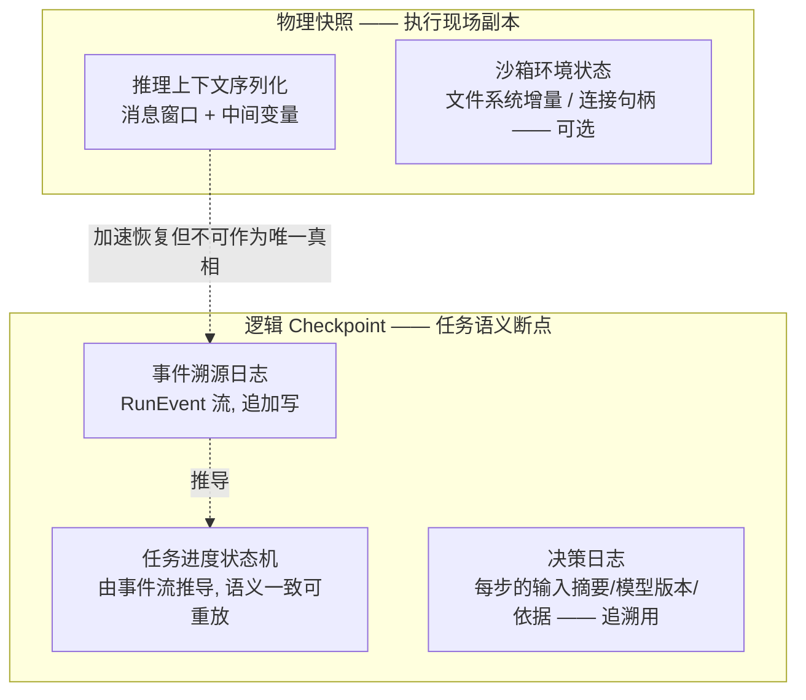

# 03 Serverless 状态外置 → Agent Checkpoint

> **系列**：云基础设施 → Agent 执行层：能力迁移 · 第 3 篇
> **定位**：状态与持久化域
> **前置阅读**：[总纲](./00-overview) · [02 FaaS 冷启动](./02-faas-cold-start)

> 迁移核心问题：Serverless 说"实例随时会死，所以状态不能跟着实例走"。Agent 说"会话随时会死，所以状态不能跟着沙箱走"——同一句话，但状态从一层变成了三层，且其中混进了不可重放的 LLM 输出。

## 摘要

"计算无状态、状态外置"的 Serverless 教条在 Agent 场景依然成立，但 Agent 状态有推理上下文、任务进度、长期记忆三层，生命周期各异；更关键的是 LLM 输出不可重放，动摇了事件溯源"可复现"的根基。本文的核心设计推论：逻辑 Checkpoint 是唯一真相源，物理快照降格为加速器；审计目标从"复现"正式降级为"追溯"。

## 1. 当年的机制：状态外置的三件套

### 1.1 教条本身

Serverless 的第一设计原则：计算与状态分离。实例随时可能被回收、漂移、缩容，因此函数内不留任何不可再生的状态。这条教条衍生出三件套：

1. **外部存储分层**：会话亲和 KV（热状态，毫秒级访问）→ 对象存储（冷归档）→ 日志流（审计事实）；
2. **事件溯源（Event Sourcing）**：状态不是被"更新"的，是被事件流"重放"出来的——当前状态 = f(事件历史)。任何实例死了，重放事件即可原地满血；
3. **乐观并发控制**：多实例并发推进同一实体时，用版本号 + CAS（Compare-And-Set）检测冲突，而不是用分布式锁阻塞吞吐。

这三件套在 Workflow 引擎（Temporal 系、AWS Step Functions）中达到成熟形态：**把状态机本身作为服务托管，业务代码只写 handler，状态迁移、重试、补偿由引擎负责**。

### 1.2 Workflow 引擎的关键设计

Temporal 类引擎把"活动（Activity）"的执行结果与"决策"分开存储：

- 活动结果（外部副作用的事实：调用了什么工具、返回了什么）→ 事件日志，追加写入；
- 工作流进度（决策点的状态机位置）→ 由事件日志重放推导；
- **重放一致性**：同一段工作流代码 + 同一份事件日志 → 永远得到同样的状态机位置。

记住这个"永远"，它是本篇的转折点。

## 2. Agent 状态：三层生命周期与一个致命差异

### 2.1 三层状态模型

| 层 | 内容 | 生命周期 | 存储选型 | 大小量级 |
|---|---|---|---|---|
| **推理上下文**（短期） | ReAct 循环的消息窗口、工具调用历史 | 单轮~单任务 | 会话亲和 KV（内存层） | 100KB~数 MB |
| **任务进度状态**（中期） | 断点语义："完成 3/5 个子目标，第 4 步进行中" | 任务（小时~天） | 事件日志 + 逻辑 Checkpoint | KB 级 |
| **长期记忆**（长期） | 用户偏好、沉淀知识、历史结论 | 租户（月~年） | 向量库 + 结构化记录 + 写入审计 | 持续增长 |

### 2.2 致命差异：不可重放性

Workflow 引擎的重放一致性建立在**确定性代码**上。Agent 的状态流里混进了 LLM 输出：重放同一份事件日志，决策点的状态机位置可以一致（结构性一致），但**下一轮推理的走向无法一致**（语义性发散）。温度、模型版本升级、检索结果的时间敏感性，都会让"同一输入不同输出"成为常态。

由此得出本篇最重要的设计推论：**Agent 的 Checkpoint 体系必须把审计目标从"复现"降级为"追溯"**。你无法让系统重演出同样的推理，但必须能回答"它当时为什么这么做"——决策日志（输入摘要、模型版本、检索命中、决策依据）是比状态快照更重要的资产。

## 3. 迁移设计：逻辑 Checkpoint 与物理快照的边界

### 3.1 两类 Checkpoint 的定义

**边界铁律**：

1. **逻辑 Checkpoint 是唯一真相源**（source of truth）：恢复执行、审计追溯都以它为准；
2. **物理快照是加速器，不是真相**：它让恢复"快"，但快照与事件日志冲突（并发推进分叉）时，以事件日志为准，快照作废；
3. **物理快照的引用必须记入事件日志**：每次快照写入 = 一条"已快照"事件（含快照 ID 与覆盖范围），否则恢复路径无法选择起点。

### 3.2 并发控制：CAS 的迁移

单 Agent 会话天然单线程推进？不——多 Agent 协作（Supervisor 派工、并行子任务汇总）会引入真正的并发写：

- **会话状态推进用乐观锁**：RunEvent 流上做条件追加（`If version == N then append`），多写入者冲突时只有一个胜出，败者读取新状态后重试或分叉；
- **工具副作用不回滚、只补偿**：Agent 调用外部工具产生真实副作用（发了邮件、写了库），状态回退到 Checkpoint 不能假装副作用没发生——恢复路径必须检查"该事件之后是否有未补偿的外部副作用"，这需要工具调用与状态推进在同一事件流上对齐。

### 3.3 恢复路径：上下文重建的三种策略

物理快照可用时，恢复 = 拉快照（快路径）。快照不可用/过期时，从事件日志重建上下文：

| 策略 | 做法 | 成本 | 适用 |
|---|---|---|---|
| 全量窗口重放 | 重放所有消息历史 | O(历史长度)，token 成本高 | 短会话 |
| 压缩重建 | 用历史事件流生成结构化摘要 + 最近 K 轮原文 | 中，摘要质量决定恢复质量 | 长会话主流方案 |
| 断点续推 | 从逻辑断点直接续跑，接受上下文变薄 | 低，但 Agent 可能"失忆式重复劳动" | 降级兜底 |

注意压缩重建引入了一个 Serverless 时代不存在的失败模式：**摘要损耗**——重建后的上下文丢了关键细节，Agent 重复执行已完成步骤（工具副作用二次发生）。缓解手段：任务进度状态里显式记录"已完成清单 + 结果引用"，重建时先加载清单再续推，把"失忆重复"变成"查表跳过"。

### 3.4 长期记忆：写入审计是状态外置的新扩展

长期记忆层（向量库）是 Serverless 没有的新层，但它必须继承状态外置的老原则并加一条：

- **继承**：记忆不驻留沙箱，检索式使用（RAG），沙箱死后记忆无损；
- **新增——写入审计**：记忆写入是最高危的状态变更（记忆投毒 = 持久化的 prompt 注入）。每次写入必须记录来源（哪次会话、什么证据、经什么校验），高危写入（跨会话结论、用户画像变更）走审核队列。

这条在多 Agent 协作场景尤其致命：子 Agent A 的错误结论若直接写入共享记忆，会污染所有后续会话——写入权限按 Agent 角色 + 证据强度分级，是 [04 篇](./04-multi-tenant-isolation)身份系统在状态层的投影。

## 4. 迁移清单

1. 三层状态是否分别建模（推理上下文/任务进度/长期记忆）？存储选型是否与生命周期对齐？
2. 逻辑 Checkpoint 是否被确立为唯一真相源？物理快照是否降格为加速器且引用入事件日志？
3. 事件流是否同时覆盖状态推进与工具副作用？恢复时是否检查未补偿副作用？
4. 并发推进是否用 CAS？多 Agent 协作的分叉-合并语义是否定义？
5. 上下文重建是否分三档（全量/压缩/断点续推）？是否有"已完成清单"防失忆重复？
6. 记忆写入是否有来源审计与分级审核？是否考虑了多 Agent 记忆投毒路径？
7. 决策日志是否记录模型版本与输入摘要——审计目标是否已从"复现"正式降级为"追溯"？

## 5. 下一篇

状态外置解决"会话死了能复活"；但复活的前提是"死了不伤及无辜"——多租户与主动攻击者把隔离问题推向台前。见 [04 多租户隔离 → Agent 沙箱选型与边界](./04-multi-tenant-isolation)。
