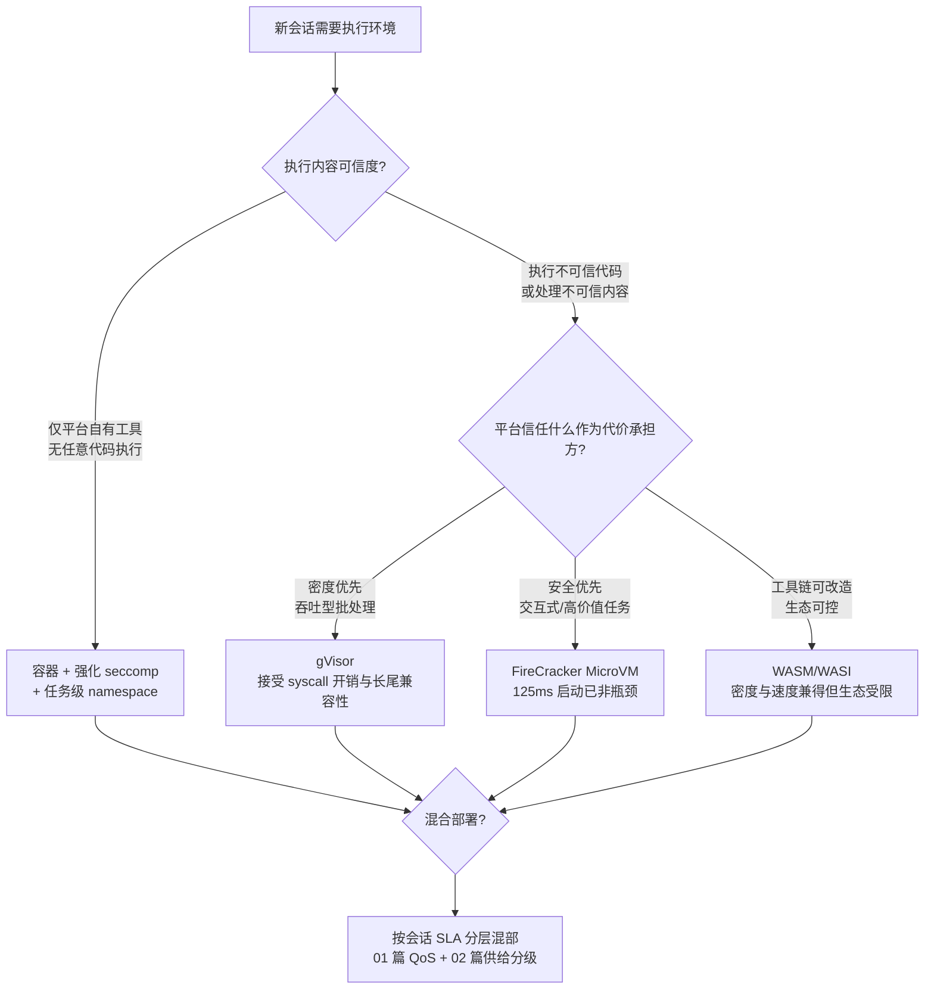

# 04 多租户隔离 → Agent 沙箱选型与边界

> **系列**：云基础设施 → Agent 执行层：能力迁移 · 第 4 篇
> **定位**：隔离与安全域（子系列收官）
> **前置阅读**：[总纲](./00-overview) · [02 FaaS 冷启动](./02-faas-cold-start) · [03 状态外置](./03-state-externalization)

> 迁移核心问题：隔离技术栈十年没变（namespace/cgroups → gVisor → MicroVM），可以直接搬；变了的是威胁模型和隔离粒度——这是本系列里"旧答案最完整、新约束最凶险"的一篇。

## 摘要

Agent 场景的隔离技术栈可以直接平移（gVisor/FireCracker 的选型边界与压测数据依然适用），但威胁模型从"防过失与好奇"升级为"防主动攻击"（prompt 注入使沙箱成为安全下限），隔离粒度从租户级细化到任务级/调用级，且必须与身份系统联动（凭据作用域 ≤ 沙箱作用域）。本文给出选型决策树与三份必须成文的边界协议。

## 1. 当年的机制：隔离技术栈与三角权衡

### 1.1 三个隔离目标

传统多租户隔离回答三个问题：

1. **故障隔离**：租户 A 的崩溃/资源失控不影响租户 B——cgroups 资源上限 + 驱逐机制；
2. **信息隔离**：租户 A 看不到租户 B 的数据——namespace（PID/网络/挂载）+ 访问控制；
3. **资源公平**：吵闹邻居不挤占别人——CPU 份额、IO 权重、带宽限速。

### 1.2 技术栈与三角权衡

| 技术栈 | 隔离原理 | 隔离强度 | 启动速度 | 密度 | syscall 兼容性 | 密度成本 |
|---|---|---|---|---|---|---|
| 容器 + 强化配置 | namespace/cgroups/seccomp | 弱（共享内核） | 毫秒 | 极高 | 完整 | 极低 |
| gVisor（用户态内核） | 拦截 syscall 在用户态重实现 | 中（内核面缩小 ~80%） | 亚秒 | 中 | ~90%（长尾不兼容） | 中 |
| FireCracker MicroVM | KVM 硬件级虚拟化 | 强（独立内核） | ~125ms | 中低 | 完整 | 中高（MB 级底噪/实例） |
| WASM（WASI） | 线性内存沙箱 | 中强（语言级验证） | 毫秒 | 极高 | 受限（生态早期） | 极低 |

三角权衡的本质：**隔离强度 × 密度成本 × 兼容性**，最多取二。当年的选择逻辑是按"负载可信度"分层：自有代码跑容器，第三方代码跑 gVisor/MicroVM。

## 2. Agent 时代：威胁模型的三重升级

### 2.1 从"防过失"到"防主动攻击"

传统多租户的威胁模型是**过失与好奇**：bug 导致的越界、侧信道窥探。Agent 场景的威胁模型是**主动攻击**，且攻击入口是平台自己提供的：

```
被污染的网页/文档/工具输出
    → prompt 注入（ASI 系列风险的核心入口）
    → Agent 被"说服"执行攻击者指定的代码/调用
    → 沙箱成为最后一道防线
```

关键认知：**prompt 注入在可预见的未来无法在推理层根治**（指令与数据同载体是 LLM 的结构性缺陷）。所以执行层的定位从"合规隔离"升级为"安全兜底"——**平台安全的下限由沙箱决定，而不是由对齐技术决定**。OWASP Agentic Top 10 里过半风险（任意代码执行、越权工具调用、凭据滥用）最终都收敛到"沙箱 + 身份是否兜得住"。

### 2.2 隔离粒度：从租户级到任务级

第二个升级是粒度：

- **租户级**（老边界）：A 公司与 B 公司互不可见——依然必要但不充分；
- **任务级**（新主边界）：同一用户的两次 Research 任务之间也应隔离——防**上下文投毒跨任务传播**（任务 1 被注入的恶意指令不应影响任务 2）与**记忆污染回写**（[03 篇](./03-state-externalization)）；
- **调用级**（最小边界）：单次高风险工具调用（执行不可信代码、访问外部数据源）应在其专属的短命沙箱内完成。

推论：**沙箱生命周期与隔离边界必须同构**——任务级边界意味着沙箱随任务生灭，这直接强化了 [02 篇](./02-faas-cold-start)供给能力的必要性（供给速度不足会倒逼平台"复用沙箱省时间"，等于亲手拆隔离）。

### 2.3 与状态的耦合：隔离边界 × 凭据作用域

第三个升级是把隔离从"计算域"问题变成"计算域 × 身份域"联合问题：

- 沙箱内进程持有的凭据必须**只在当前隔离边界内有效**（任务级沙箱 → 任务作用域凭据，随沙箱销毁立即失效）；
- 若沙箱复用但凭据是租户级长期 Token，则隔离形同虚设——**凭据作用域必须 ≤ 沙箱作用域**，这是选型时最容易违背的铁律；
- 短生命周期凭据 + 任务级 RBAC + 权限随任务衰减（任务结束即回收），构成 NHI 治理在执行层的完整落地。

## 3. 选型决策树



决策要点：

1. **威胁模型先于技术选型**：先回答"要防什么"（过失/好奇/主动攻击），再进决策树。跳过威胁模型直接选技术是 L0 平台的典型症状；
2. **混合部署是常态而非妥协**：交互式高价值任务 MicroVM、批处理 gVisor、自有工具容器——按会话 SLA 分层混部；
3. **不要用过时压测数据决策**：2026 年的 FireCracker（125ms 创建、MB 级底噪）与 2018 年的 MicroVM 是两种东西。

## 4. 边界设计协议：三份必须存在的文档级协议

### 4.1 沙箱生命周期协议

定义沙箱从创建到销毁各阶段的安全动作：创建（模板硬编码、无种子密钥）→ 绑定（[02 篇](./02-faas-cold-start)的原子绑定）→ 运行（凭据最小化注入）→ 解绑（数据清除）→ **销毁验证**。协议要点：**默认销毁，复用是例外且需清除证明**——销毁是唯一"保证"信息不泄露的操作。

### 4.2 出口管控协议（Egress Policy）

沙箱隔离了"进来"，还必须管"出去"——被注入的 Agent 常见攻击是数据外带（把读到的敏感内容发到攻击者控制的端点）：

- 沙箱网络出口默认全拒绝，白名单按工具需求开（域名级，不是 IP 级）；
- 外发内容做敏感数据扫描（L1 AC 自动机初筛 → L2 轻量分类器 → L3 LLM 深度研判三级递进）；
- 高危外发（大数据量、目标不在任务语义内）阻断 + 告警进决策日志（[03 篇](./03-state-externalization)）。

### 4.3 资源与时间预算协议

主动攻击下的新风险面——攻击者通过 Agent 消耗平台资源（挖矿、无限循环调用付费 API、上下文膨胀攻击）：

- 每任务 CPU/内存/网络硬顶（[01 篇](./01-k8s-resource-model)相位契约的对抗性版本）；
- **令牌与工具调用预算**：LLM token 与外部 API 调用次数是 Agent 特有的"资源"维度，必须计费与限额——传统 cgroups 不认识的新资源类型；
- 任务墙钟时间上限：防"永动任务"式的资源占用。

## 5. 迁移清单

1. 威胁模型是否成文？是否明确承认 prompt 注入不可在推理层根治、沙箱是安全下限？
2. 隔离边界是否细到任务级/调用级？沙箱生命周期是否与边界同构？
3. 凭据作用域是否 ≤ 沙箱作用域？是否短生命周期 + 任务级 RBAC + 随任务衰减？
4. 选型是否按会话类型混合分层（MicroVM/gVisor/容器），而非一刀切？
5. 沙箱生命周期协议是否"默认销毁、复用需清除证明"？
6. 出口管控是否有白名单 + 敏感数据扫描 + 决策日志告警？
7. 是否引入了 token/API 调用预算这类 Agent 特有的资源维度？

## 6. 收官：四域收敛

至此四篇拼图闭环：**调度（01）决定沙箱放哪，供给（02）决定沙箱多快就位，状态（03）决定沙箱死了会话能否复活，隔离（04）决定沙箱里的混乱不外溢**。它们不是四个模块，是同一枚硬币的四面——调度器想引用隔离强度做放置决策，供给想引用状态层做快照分层，隔离想引用身份系统做凭据作用域。

2026 年 Agent 执行层的竞争，不在于谁先把四域各自做出来，而在于**谁先让四域互相引用、联合优化**。云基础设施用了十年把这套协同打磨成熟；Agent 平台的窗口期，比当年短得多——这正是"做过云基础设施的人"在这个时间点最值钱的原因。

## 7. 下一篇

沙箱管住了"里面的混乱"；但 Agent 与工具、记忆、子 Agent 之间的每一次交互，还需要在流量层被验证——微隔离与 Service Mesh 的能力迁移，见 [05 微隔离 → Agent 东西向治理](./05-microisolation-east-west)。

---

*系列：[总纲](./00-overview) | [01 K8s 资源模型](./01-k8s-resource-model) | [02 FaaS 冷启动](./02-faas-cold-start) | [03 状态外置](./03-state-externalization) | [04 多租户隔离](./04-multi-tenant-isolation) | [05 东西向治理](./05-microisolation-east-west) | [06 身份治理与鉴权](./06-zero-trust-agent-identity)*

*姊妹系列：[生产级 Agent 平台架构 2026](/series/agent-platform-2026/00-overview)*
