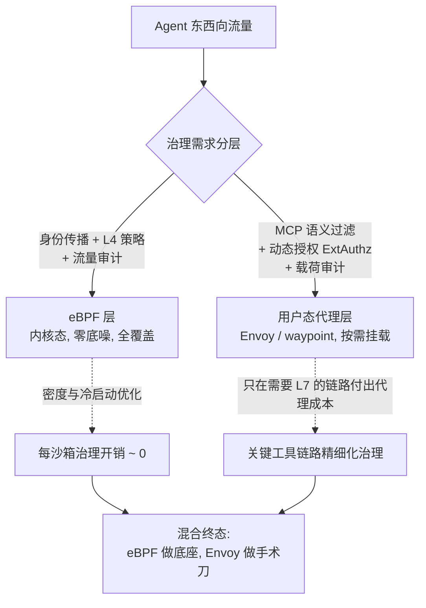
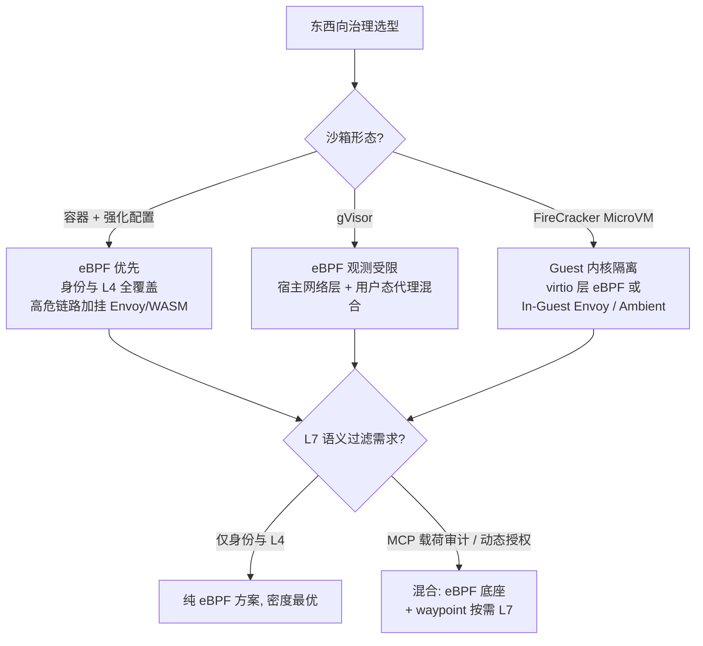

# 05 微隔离 → Agent 东西向治理：Envoy、eBPF 与任务级身份

> **系列**：云基础设施 → Agent 执行层：能力迁移 · 第 5 篇
> **定位**：流量治理与零信任域（五域收官）
> **前置阅读**：[总纲](./00-overview) · [04 多租户隔离](./04-multi-tenant-isolation)

> 迁移核心问题：微服务时代，Pod 高频生灭迫使安全锚点从 IP 迁移到身份；Agent 是史上生灭最快的计算实体，所以这个迁移要再走一遍——且密度和载荷语义都要重做。

## 摘要

Agent 与工具之间的东西向流量（MCP 调用、记忆访问、子 Agent 协作）是 OWASP Agentic Top 10 风险的主要落地现场，而当前多数 Agent 平台对这条链路是裸奔的。微隔离的成熟方法论——身份先于连接、策略与数据面分离、L7 实时授权——可直接迁移：Envoy 做执行面，ExtAuthz 做决策面，任务级身份做锚点。但 Sidecar 模式与 Agent 沙箱的密度模型冲突，催生两条新路线：Ambient Mesh（节点级 ztunnel + 按需 waypoint）与 eBPF（内核态身份与 L4 执行）。本文给出三路线的选型决策与 MCP 语义过滤这个共同的未完成项。

## 1. 当年的机制：微隔离的三个技术支柱

### 1.1 坑的形状：IP 锚点的失效

云原生环境里 Pod 生命周期以分钟计，IP 频繁变更；一个应用的副本分散在数十个节点上；传统基于 IP 的 ACL 表项规模爆炸且永远滞后于现实。微隔离的立项判断由此而来：**当计算实体开始高频生灭，安全锚点必须从网络位置（IP）迁移到身份**。

### 1.2 三个支柱

| 支柱 | 机制 | 解决的问题 |
|---|---|---|
| **身份锚点** | 以应用身份（而非 IP）为 ACL 主体，身份随 Pod 调度实时传播 | 策略表规模与漂移问题 |
| **数据面拦截** | Envoy Sidecar 劫持全部出入流量，L7 粒度执行策略 | 策略执行的统一收口 |
| **策略与数据面分离** | ExtAuthz 外部鉴权 + xDS 动态下发 | 策略可独立演进、实时生效 |

配套机制：Stream Filter 做载荷级审计（可编程扩展点）、mTLS 做传输层身份验证、Sidecar 模式的可观测性（全链路 L7 指标）。规模化后的已知代价：每 Pod 一个 Sidecar 的资源底噪、每跳两次额外代理的延迟、Sidecar 自身的生命周期管理。

### 1.3 Sidecar 的规模化之痛与两条替代路线的起点

正是这些代价，催生了 2022 年后的两条路线：**Ambient Mesh**（Istio 无 Sidecar 模式：节点级 ztunnel 承载 mTLS 与 L4，按需给"需要 L7 的命名空间"挂 waypoint 代理）与 **eBPF 数据面**（Cilium 系：身份与执行下沉内核态）。记住这个背景——Agent 场景会把同样的选择压力放大十倍。

## 2. Agent 时代：东西向流量成为主战场

### 2.1 坑的新形状

```
Agent ⇄ MCP 工具      ——工具调用即东西向流量
Agent ⇄ 记忆/向量库    ——高敏感数据面
Agent ⇄ 子 Agent      ——多 Agent 协作流量
沙箱 ⇄ 外部数据源     ——不可信内容的出入口
```

ASI 系列风险的落地现场几乎都在这些链路上：越权工具调用、凭据滥用、数据外带、跨会话污染。当前多数 Agent 平台的治理现状：工具注册即信任、调用无授权检查、出口无内容审计、身份是"平台级全局凭据"（04 篇已判定为不及格设计）。

### 2.2 与微隔离的三个同构

1. **生灭速度**：Pod 分钟级 → Agent 沙箱分钟~小时级且会话粒度更细，锚点必须再上移一级：从应用身份到**任务身份**（凭据作用域 ≤ 沙箱作用域，04 篇铁律在流量面的实现）；
2. **授权时机**：注册时静态信任 → 调用时动态授权。ExtAuthz 模式天然支持按请求下发决策：同一个 Agent，任务 A 授权访问数据库，任务 B 自动无权——**权限随任务衰减的零信任闭环**；
3. **不可改造性**：第三方 MCP 工具无法改代码，策略必须在基础设施层生效——这正是 Mesh 方法论（策略与业务解耦）的核心价值。

### 2.3 与 MCP 2026 授权基线的拼图关系

MCP 授权基线（OAuth 2.1、PRM 元数据发现）解决的是"工具**声明**自己是什么"；网格的服务身份（mTLS、SPIFFE 系密码学验证）解决的是"工具**确实**是谁"。声明 + 验证拼起来才是完整的工具信任链。微隔离的方法论（身份先于连接）在这里原样成立。

## 3. 迁移改造一：Envoy 体系的角色重定义

| Envoy 组件（旧角色） | Agent Infra 角色 | 对应风险 |
|---|---|---|
| Sidecar（流量劫持） | Agent↔工具调用统一拦截：路由、限流、熔断 | 越权调用、资源滥用 |
| ExtAuthz（外部鉴权） | 每次工具调用的实时授权决策（任务作用域） | 过度代理 |
| Stream Filter（L7 过滤） | 载荷审计：外发数据扫描、回传内容检查、敏感度分级 | 数据外带、记忆投毒入口 |
| 健康检查/重试/熔断 | 工具调用的容错语义（LLM 长尾延迟下的重试预算） | 可用性 |

其中 ExtAuthz 的决策输入要扩展一个 Mesh 从未有过的维度：**会话状态**。授权决策不再是"身份 × 资源"二元组，而是"任务身份 × 资源 × 任务进度状态"三元组——例如任务已进入收尾阶段时，写类工具调用自动收紧（最小权限的时间维度化）。

**未完成项：MCP 语义过滤**。Mesh 原生检查的是 HTTP 语义；工具调用载荷是结构化 MCP 消息，且外发流可能是流式 LLM 响应。Stream Filter 必须升级为面向 MCP 语义的过滤（工具名、参数 schema、载荷敏感度分级）——Envoy WASM 扩展是新战场，传统 Mesh 团队和 Agent 团队都还没做熟，这是 2026 年可观测的基础设施工程机会。

## 4. 迁移改造二：eBPF 治理方案

### 4.1 eBPF 在治理栈里的真实位置

eBPF 不是 Envoy 的全量替代，而是把**身份传播与 L4 执行**下沉到内核态的分工方案。Cilium 系的治理栈：

| 层 | eBPF 能力 | 治理价值 |
|---|---|---|
| **身份** | 从 CRI 运行时（containerd/CRI-O）事件直接提取身份标签，BPF map 维护身份表 | 无需 Sidecar 参与，身份随沙箱创建即刻生效——匹配 Agent 沙箱分钟级生灭 |
| **L3/L4 执行** | TC/XDP hook 级网络策略：CiliumNetworkPolicy 以身份为主体 | 内核态 enforcement，零额外跳数，密度成本近零 |
| **L4 可观测** | socket 级 trace、流级 map | 无采样损耗的东西向流量审计 |
| **L7 过滤** | 部分支持（envoy on eBPF / socket-level LB），成熟度远低于用户态 Envoy | **eBPF 的能力边界所在** |

### 4.2 eBPF 路线的三个决定性优势（对 Agent 场景）

1. **密度**：无 Sidecar 底噪。"每会话一个 MicroVM + 一个 Sidecar"的内存模型会崩溃（04 篇），eBPF 把每沙箱的治理开销压到内核里几条 map 项——这是 Agent 平台密度上限的关键解锁；
2. **生命周期解耦**：治理能力不在沙箱的启动路径上（没有 Sidecar 进程要拉起、没有证书要注册到 Sidecar）——02 篇冷启动 SLA 不被治理组件拖累；
3. **审计无死角**：内核态观测不依赖应用配合，沙箱里"逃逸到网络层"的行为也逃不出 map——对 04 篇的主动攻击威胁模型是天然补充。

### 4.3 eBPF 路线的三个限制

1. **L7 语义薄弱**：MCP 消息是 TLS 加密的 HTTP 载荷，eBPF 看不到解密后内容——**内容级审计（敏感数据扫描、参数检查）仍需要用户态代理**（Envoy/waypoint）参与；
2. **MicroVM 内核边界**：FireCracker MicroVM 有独立内核，宿主机 eBPF 观测不到 Guest 内部流量（只能看到 virtio 层面）——gVisor（用户态内核）与 MicroVM 的 eBPF 观测深度完全不同，选型时要与 04 篇沙箱选型联动；
3. **跨平台一致性**：eBPF 能力随内核版本与云厂商定制内核波动，混合云（02 篇背景里的 ASI + K8s 混合云就是典型）要做能力探测与降级路径。

### 4.4 收敛：混合架构是终态



设计原则：**eBPF 做底座（身份、L4、审计），Envoy/waypoint 做手术刀（按需 L7）**——与 Ambient Mesh 的分层直觉同构（ztunnel 底座 + waypoint 按需），只是底座从节点级用户态代理进一步下沉到内核。对 Agent 平台，这个混合模型的密度优势是决定性的：治理不再是每沙箱的固定开销，而是按链路风险等级的边际开销。

## 5. 三路线选型决策



| 维度 | Sidecar 全量 | Ambient Mesh | eBPF 优先 |
|---|---|---|---|
| 每沙箱开销 | 高（进程 + 内存底噪） | 中（节点级摊薄） | 近零（内核 map 项） |
| L7 语义能力 | 完整（Envoy 原生） | 完整（waypoint 按需） | 弱，需回退用户态 |
| 冷启动耦合 | Sidecar 拉起 + 证书注册 | 低 | 近零 |
| MicroVM 内深度 | In-Guest 可行 | In-Guest 可行 | 宿主视角受限 |
| 成熟度（2026） | 最高 | 中 | 快速上升 |

**务实结论**：容器沙箱为主体的平台选 eBPF 优先 + 高危链路 L7；MicroVM 为主体的平台 In-Guest Ambient（ztunnel 思路）；任何形态都不要选择"全量 Sidecar"——它对 Agent 密度模型的破坏是结构性的。

## 6. 迁移清单

1. 锚点是否从应用身份上移到任务身份（凭据作用域 ≤ 沙箱作用域）？ExtAuthz 决策是否包含任务进度状态这个新维度？
2. 授权是否做到调用时动态（而非注册时静态）？第三方 MCP 工具的治理是否不依赖改造工具代码？
3. 是否评估了三路线（Sidecar/Ambient/eBPF）与沙箱形态（容器/gVisor/MicroVM）的匹配矩阵？
4. eBPF 底座是否覆盖身份传播、L4 策略、流级审计三件事？MicroVM 场景是否明确 eBPF 观测边界与替代观测点？
5. L7 层是否规划了 MCP 语义过滤（WASM/waypoint）？还是停留在 HTTP 语义？
6. 混合云场景是否做了 eBPF 能力探测与降级路径？
7. 工具信任链是否拼齐"MCP 声明（PRM/OAuth 2.1）+ 网格验证（mTLS 身份）"两半？

## 7. 五域收官

至此能力迁移系列五个域闭环：**调度（01）决定会话放哪，供给（02）决定沙箱多快就位，状态（03）决定会话死了能否复活，隔离（04）决定沙箱里的混乱不外溢，东西向治理（05）决定 Agent 与外界的每一次交互都被验证**。

五域共享同一个锚点——任务级身份：调度用它做亲和（01），预热池用它做绑定（02），事件流用它做并发仲裁（03），沙箱用它切凭据作用域（04），网格用它做授权决策（05）。这不是巧合：**身份是零信任在执行层的投影轴**，一个平台的五域设计是否共享同一个身份体系，是 L2 与 L3 成熟度的分界（总纲第 4 节）。

云基础设施用十年把这五域打磨成熟；Agent 平台的窗口期短得多——因为五域的坑不需要重新发现，只需要重新开挖。这正是能力迁移方法论的意义所在。

## 8. 下一篇

五域共享的"任务级身份"锚点，值得单独一篇深拆——它自己的构造（mTLS 通道身份 + OAuth 2.1 行为授权 + 委托链）是零信任能力迁移的完整一域。见 [06 零信任 → Agent 身份治理与鉴权](./06-zero-trust-agent-identity)。

---

*系列：[总纲](./00-overview) | [01 K8s 资源模型](./01-k8s-resource-model) | [02 FaaS 冷启动](./02-faas-cold-start) | [03 状态外置](./03-state-externalization) | [04 多租户隔离](./04-multi-tenant-isolation) | [05 东西向治理](./05-microisolation-east-west) | [06 身份治理与鉴权](./06-zero-trust-agent-identity)*

*姊妹系列：[生产级 Agent 平台架构 2026](/series/agent-platform-2026/00-overview)*
