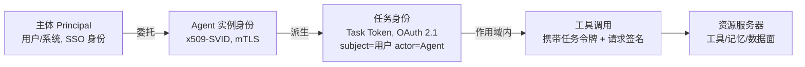

# 06 零信任 → Agent 身份治理与鉴权：mTLS 与 OAuth 2.1 全案

> **系列**：云基础设施 → Agent 执行层：能力迁移 · 第 6 篇
> **定位**：身份与授权域（05 篇锚点的展开）
> **前置阅读**：[总纲](./00-overview) · [04 多租户隔离](./04-multi-tenant-isolation) · [05 东西向治理](./05-microisolation-east-west)

> 迁移核心问题：微服务时代零信任交付了两件东西——mTLS 证明"你是谁"（通道身份），OAuth 授权"你能干什么"（行为授权）。Agent 时代这两件东西都要，但身份从服务级细化到任务级，且 Agent 同时是用户、服务和被审计对象。

## 摘要

Agent 是 NHI（非人类身份）问题最尖锐的载体：一个 Agent 同时代表用户行动、作为服务调用工具、作为被审计对象留痕。本篇给出完整的身份治理与鉴权方案：四层身份模型（主体 → Agent → 任务 → 调用）、凭据派生链（Token Exchange）、mTLS 承载基础设施面通道身份（短周期证书 + 自动轮换 + 密钥不出沙箱）、OAuth 2.1 承载工具面行为授权（PKCE + 作用域 + 权限衰减 + 令牌绑定）。mTLS 与 OAuth 2.1 不是竞争而是分层：mTLS 回答"连接的对方是谁"，OAuth 回答"这次请求能做什么"。

## 1. 当年的机制：零信任给基础设施留下的两件资产

### 1.1 零信任的三条工作假设

1. **网络位置不可作为信任凭据**：内网不比外网更可信，每次访问都验证（never trust, always verify）；
2. **身份先于连接**：信任锚点从 IP/网络段迁移到可密码学验证的工作负载身份；
3. **最小权限与持续验证**：授权按请求粒度评估，随上下文（任务进度、风险信号）动态收紧或放宽。

### 1.2 mTLS：机器身份的密码学实现

微服务零信任的落地形态是 SPIFFE/SPIRE 一族：给每个工作负载一个 **SVID**（SPIFFE Verifiable Identity Document，x509-SVID 或 JWT-SVID），mTLS 通道双向出示。四个工程要点：

| 要素 | 内容 | 设计理由 |
|---|---|---|
| **身份格式** | `spiffe://<trust-domain>/ns/<ns>/sa/<serviceaccount>` 类 URI | 身份与调度位置（IP）解耦，与 K8s 对象对齐 |
| **信任根** | 每个信任域一个根 CA，trust bundle 分发到验证方 | 跨域联邦可控，撤销信任域 = 换根 |
| **生命周期** | 证书 TTL 默认小时级（SPIFFE 推荐可低至分钟），到 70% 自动轮换 | **短 TTL 优于吊销**：CRL/OCSP 在大规模高频生灭场景下不可运维 |
| **密钥边界** | 私钥由节点 Agent（attest 后）签发进工作负载，永不出安全边界 | 防工作负载凭据外泄后长期可用 |

TLS 1.3 之下 mTLS 的性能代价已可接受：握手 1-RTT、会话恢复（PSK）复用连接后近零开销——这解决了"每沙箱一个证书"的可行性。

### 1.3 OAuth 2.0 → 2.1：给不可信客户端收紧的授权框架

OAuth 2.1（draft 稳定多年，2026 年已成事实基线——MCP 授权基线直接引用）相对 2.0 的关键收紧：

| 变化 | 内容 | 针对的攻击 |
|---|---|---|
| **PKCE 全场景强制** | 所有客户端（含机密客户端）必须携带 code_verifier/code_challenge | 授权码拦截 |
| **隐式流程废除** | 不再返回 token 到前端 URL | token 泄露进浏览器历史/Referer |
| **密码授予废除** | 不再允许应用代收用户密码 | 凭据钓鱼面 |
| **redirect_uri 精确匹配** | 禁止通配/前缀匹配 | 开放重定向劫持 |
| **Bearer 令牌使用收紧** | 明确 token 仅作授权凭据、不得假设端点真实性 | 混淆代理问题 |
| **鼓励 AS 元数据发现**（RFC 8414） | 客户端动态发现授权服务器能力 | 配置漂移 |

配套的三个关键 RFC 构成本篇方案的支柱：

- **RFC 8693 Token Exchange（令牌交换）**：用已有令牌换"更小作用域"的派生令牌，携带 `subject`（代表谁）与 `actor`（实际执行者）——这是**委托链**的标准化表达；
- **RFC 8705 mTLS-Bound Token**：把 access token 与客户端证书绑定（证书指纹进 token），token 被盗离原连接即失效；
- **RFC 9126 DPoP**：令牌持有者对每个请求签名证明持有私钥，HTTP POST 时代的" possession proof"，适合无法全程保持 mTLS 的场景。

## 2. Agent 时代：三重身份与 NHI 的尖锐化

### 2.1 Agent 的三重身份

一个生产 Agent 同时是三种角色，任何单一身份模型都覆盖不住：

1. **用户代理人**（On-Behalf-Of）：代表用户行动，授权来自用户的委托——需要 OBO 语义（用户 → Agent 的令牌交换）；
2. **服务身份**：作为系统组件调用工具与数据面——需要工作负载身份（mTLS/SVID）；
3. **被审计对象**：其行为需要不可抵赖的追责链——需要全程决策日志与身份链存证（03 篇审计目标"追溯"）。

MCP 2026 授权基线（OAuth 2.1 + PRM 元数据发现）覆盖的只是"Agent ↔ 工具服务器"这一段的声明与授权格式；一个完整的方案还要覆盖"用户 → 平台 → Agent → 任务 → 工具"的全链。这正是零信任资产（1.2/1.3）与 MCP 基线的拼接处。

### 2.2 与微服务时代的三个差异

1. **粒度再上移**：服务身份（月级）→ 任务身份（小时级），凭据 TTL 与轮换周期必须再压一个数量级——SPIFFE 分钟级 TTL 从"激进"变成"必需"；
2. **委托链成为一等公民**：微服务调用链上的身份传递（forwarding）在 Agent 场景升级为语义化委托——不仅传递"谁在调用"，还要表达"以谁的授权范围、在什么任务边界内调用"；
3. **不可信客户端成为默认**：Agent 沙箱可能被注入，持有长期凭据等于给攻击者留后门——OAuth 2.1 的全部收紧（PKCE、绑定令牌）恰好是为"不可信客户端"设计的。

## 3. 方案：四层身份模型与凭据派生链

### 3.1 身份分层



| 层 | 身份载体 | 有效期 | 用途 |
|---|---|---|---|
| 主体 | IdP 签发的用户身份（SSO/OIDC） | 会话级 | 委托源，一切授权的最终解释权 |
| Agent 实例 | x509-SVID（信任域内 CA 签发） | 分钟~小时 | mTLS 通道身份：基础设施面（记忆、网关、控制面）的"你是谁" |
| 任务 | OAuth 2.1 access token（Token Exchange 派生） | 任务生命周期 | 行为授权："这个任务能做什么"，随任务结束失效（04 篇权限衰减） |
| 调用 | 任务令牌 + 每请求证明（DPoP 签名或 mTLS 绑定） | 单请求 | 防令牌在沙箱内被盗用 |

### 3.2 凭据派生链（控制面）

```
1. 任务受理：平台校验用户授权 → 以用户令牌为 subject、Agent 为 actor，
   经 RFC 8693 Token Exchange 派生 Task Token（scopes = 任务声明的能力集）
2. 沙箱就绪：节点身份服务（SPIRE 类）向沙箱 attest 后签发 SVID 私钥（不出沙箱）
3. Task Token 与 SVID 绑定：mTLS-Bound（8705）或 DPoP 公钥登记（9126）
4. 每次工具调用：SVID 建 mTLS 通道（通道身份）→ Task Token 随请求（行为授权）
   → 网关 ExtAuthz（05 篇 PDP）实时评估
5. 任务终态：Task Token 吊销/自然过期，SVID 随沙箱销毁，委托链留档进决策日志
```

关键设计：**每一层的凭据都由上一层签发且作用域严格收缩**——用户不会签发超过自己权限的委托，平台不会签发超过任务声明的能力集，任务令牌绑定的密钥无法在沙箱外使用。这就是"权限随任务衰减"的完整密码学实现。

### 3.3 mTLS 与 OAuth 2.1 的分工边界

| 维度 | mTLS（通道身份） | OAuth 2.1（行为授权） |
|---|---|---|
| 回答的问题 | 对方是谁 | 这次能做什么 |
| 适用面 | 基础设施面：Agent↔记忆、沙箱↔网关、控制面 RPC | 工具面：MCP 调用、跨租户资源访问 |
| 粒度 | 连接级 | 请求级（scopes + PDP 决策） |
| 性能 | TLS 1.3 会话恢复后近零 | 令牌验证 + 每请求签名，可本地校验（JWT 签名） |
| 失效方式 | 证书 TTL 到期 / 信任域换根 | 令牌过期 / 吊销 / 任务终态 |

**两者缺一不可**：只有 mTLS 没有授权 = 知道对方是谁但不知道他能干什么；只有授权令牌没有 mTLS = 令牌可被任意中间人转用。mTLS-Bound Token（RFC 8705）是两者的焊接点。

## 4. mTLS 落地细节

1. **签发**：沙箱启动时由节点身份服务（attest 沙箱的调度记录 = 02 篇的绑定记录）签发 SVID；TTL 与任务预算对齐（交互式任务 15–60 分钟），到 70% 自动轮换——轮换不进冷启动关键路径，密钥更新在连接保持态完成；
2. **验证**：数据面组件（记忆网关、工具网关）只信 trust bundle，不维护 IP 白名单——05 篇 eBPF 身份表与此同源（BPF map 的身份条目与 SVID 一一对应，内核态 L4 策略可以直接以 SVID 为主体）；
3. **防降级**：工具调用通道强制 TLS 1.3 + mTLS，拒绝降级协商——主动攻击威胁模型（04 篇）下，协议降级是经典入口；
4. **沙箱密钥边界**：SVID 私钥通过 Workload API 注入沙箱进程，沙箱销毁即消失；FireCracker MicroVM 场景密钥经 vsock 注入 Guest，宿主机不留副本；
5. **审计**：每个 SVID 的签发/轮换/销毁事件进决策日志（03 篇），与任务身份关联——事后可回答"哪个任务在哪个沙箱里持有什么身份做过什么"。

## 5. OAuth 2.1 落地细节

1. **Agent 是公共客户端**：沙箱不可保密（可被注入），按公共客户端对待——PKCE 强制、无 client_secret、令牌短 TTL + refresh 受限；
2. **作用域 = 工具能力集**：scope 建模到工具动词粒度（`tools:ndr-query:read`），平台在 Token Exchange 时按任务声明裁剪——工具服务器只验证 scope，PDP 网关负责更细的策略（05 篇三元组决策）；
3. **令牌绑定三选一**：mTLS-Bound（基础设施面，首选）/ DPoP（工具面 HTTP 场景）/ 裸 Bearer（明确拒绝——沙箱内一切凭据默认假设可被窃取）；
4. **权限衰减的时间化**：PDP 在任务进度状态变化时主动收缩令牌能力（任务收尾 → 写类工具拒绝），衰减事件回写授权服务器，令牌内 capability 哈希随之失效；
5. **PRM 发现 + mTLS 验证拼图**（05 篇结论）：PRM 元数据声明工具"自称"的能力与授权端点，mTLS 通道验证工具"确实是"声明的主体——声明与验证互补，缺一即为信任缺口。

## 6. 迁移清单

1. 身份是否四层建模（主体/Agent 实例/任务/调用）？每层凭据是否由上层签发且作用域严格收缩？
2. 委托链是否用 Token Exchange（RFC 8693）语义化表达（subject/actor 分离）？审计链能否回答"哪个任务代表谁做过什么"？
3. mTLS：SVID TTL 是否分钟级？轮换是否不进冷启动关键路径？沙箱密钥是否只活在沙箱内？eBPF 身份表与 SVID 是否同源？
4. OAuth 2.1：Agent 是否按公共客户端处理（PKCE 强制、无长期 secret）？令牌是否绑定（mTLS-Bound/DPoP）？是否还存在裸 Bearer？
5. 权限衰减是否时间化（任务进度驱动）？衰减是否回写授权面？
6. 工具信任链是否拼齐"PRM 声明 + mTLS 验证"两半？
7. 三重身份（用户代理/服务/审计对象）是否各有对应凭据与日志路径？

## 7. 结语：身份是执行层的投影轴

本系列六域至此在身份处汇合：调度（01）以任务身份做亲和，供给（02）以绑定记录锚定预热实例，状态（03）以身份仲裁并发写，隔离（04）以任务身份切凭据作用域，流量（05）以任务身份做 ExtAuthz 决策，而本篇给出这个锚点本身的完整构造。零信任十年沉淀的资产——mTLS 的通道身份与 OAuth 2.1 的行为授权——在 Agent 执行层不是被替换，而是被**细化一层**：从服务到任务。迁移的全部工作量，就在"细化"二字。

---

*系列：[总纲](./00-overview) | [01 K8s 资源模型](./01-k8s-resource-model) | [02 FaaS 冷启动](./02-faas-cold-start) | [03 状态外置](./03-state-externalization) | [04 多租户隔离](./04-multi-tenant-isolation) | [05 东西向治理](./05-microisolation-east-west) | [06 身份治理与鉴权](./06-zero-trust-agent-identity)*

*姊妹系列：[生产级 Agent 平台架构 2026](/series/agent-platform-2026/00-overview)*
