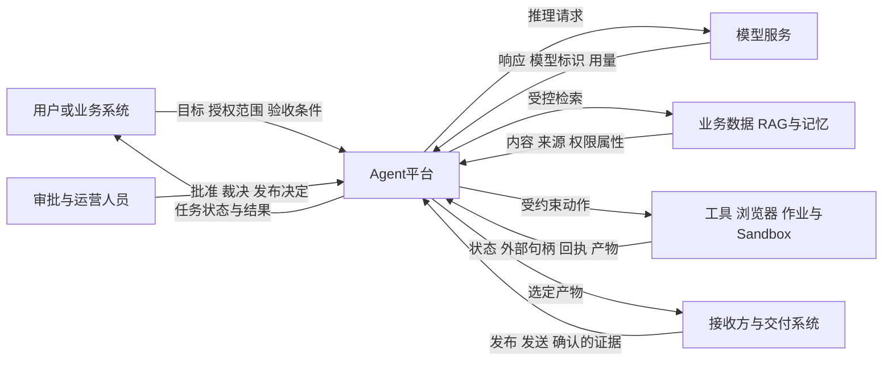
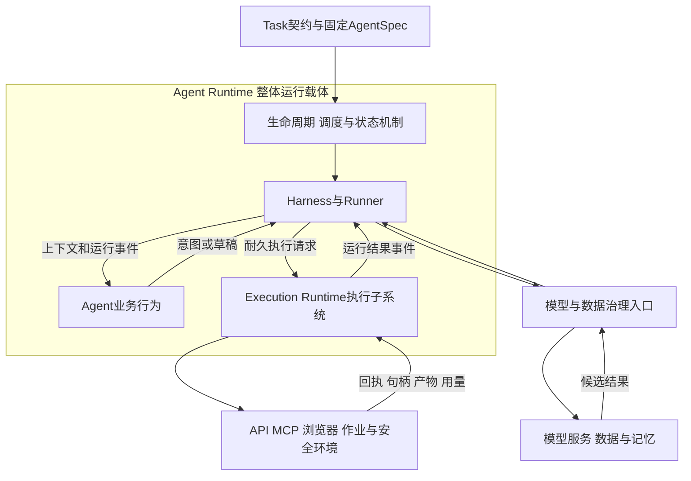
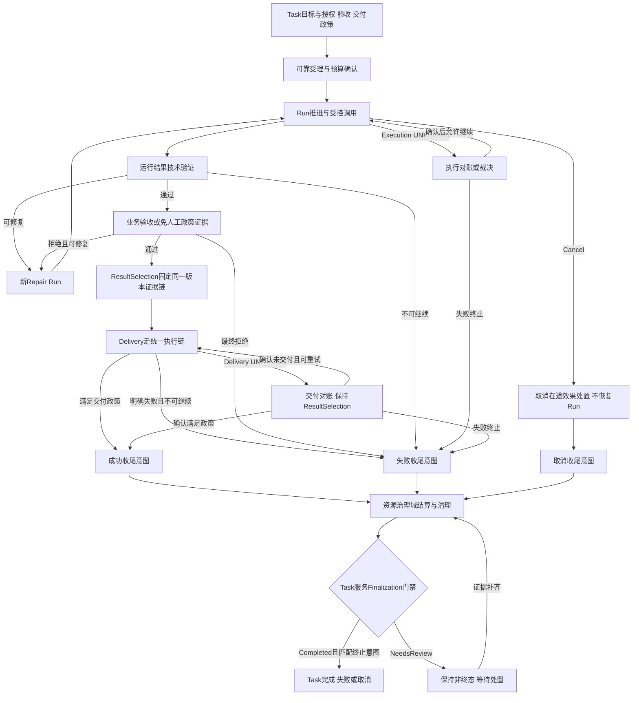
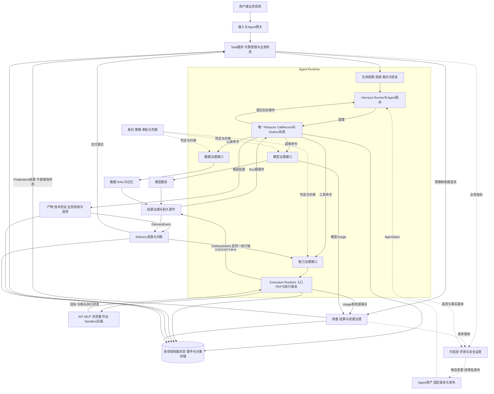
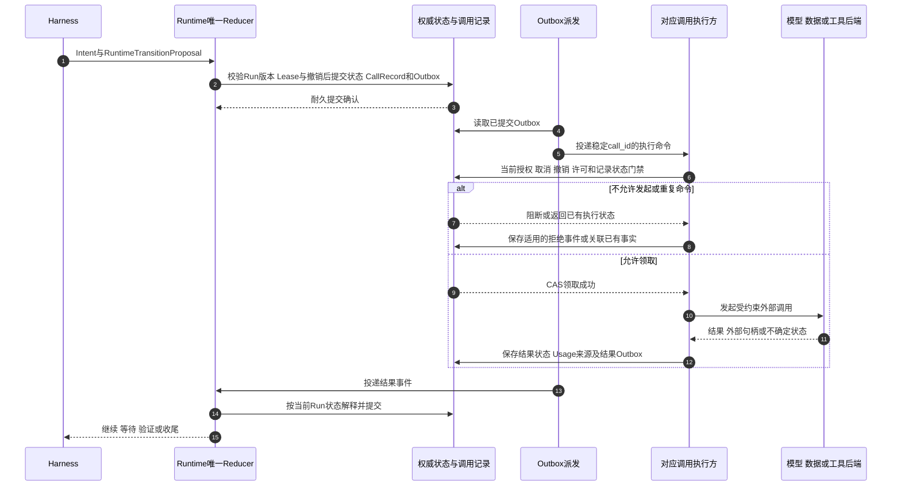
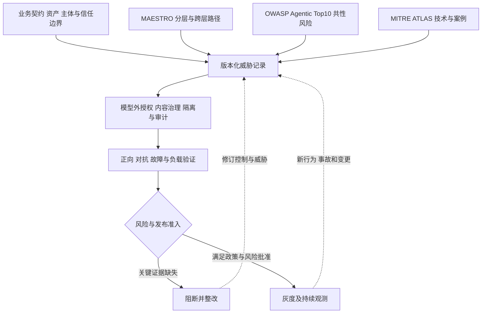
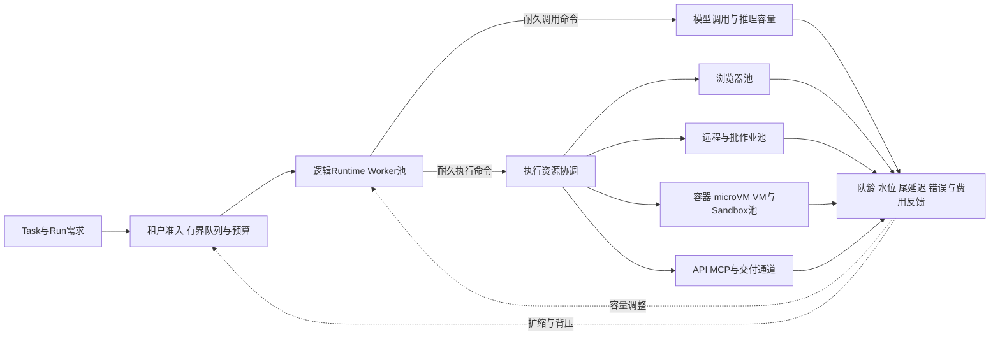
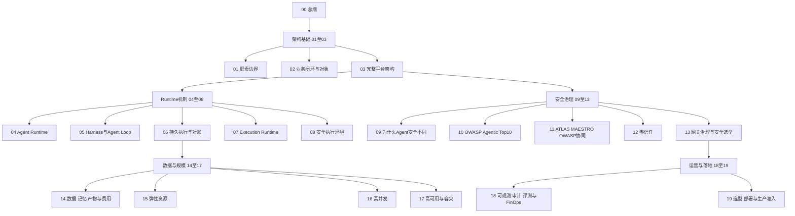

# 从模型推理到生产运行：2026 年 Agent、Harness 与 Runtime 总体架构

> **系列**：生产级 Agent 平台架构 2026 · 第 0 篇（总纲）  
> **定位**：公开技术参考文章 · 全系列入口  
> **版本**：总纲重构版  
> **关键词**：Agent、Harness、Agent Runtime、业务闭环、零信任、OWASP、MITRE ATLAS、MAESTRO、安全执行环境、弹性与可靠性

## 摘要

模型能够推理，Agent 能够提出行动，并不意味着一个业务任务能够安全、可靠地完成。进入生产后，系统还必须知道请求何时被可靠受理，哪些动作获得了授权，状态怎样跨实例延续，执行结果未知时如何处理，以及产物通过什么证据被验收、交付和结算。

本系列提出一套不绑定特定厂商或产品的生产参考架构：Agent 定义行为，Harness 组织与约束行为，Agent Runtime 承载并驱动行为，执行后端完成具体动作。Runtime 是包含生命周期、Agent Loop、上下文、状态、调度、中断恢复、执行治理及可观测机制的整体运行载体；Sandbox 只是其中一种执行后端。

架构以 Task 业务闭环为目标，以耐久调用和模型外授权建立执行边界，以 ResultSelection 固定结果证据链，以 Finalization 门禁约束任务终态。安全采用零信任原则，并结合 OWASP Agentic Top 10 2026、CSA MAESTRO 与 MITRE ATLAS 建立从威胁识别到控制验证的工作流；弹性则通过可替换的计算、模型、浏览器、作业和隔离资源池实现。

本文是总纲，回答为什么这样设计、整体如何运作、哪些边界不能省略以及如何继续阅读。第 3 篇深入功能域与接口，其他专题分别展开内部机制。本系列的 20 篇文章是一套参考设计与验证方法，不是已达到某项性能、认证或零风险标准的运行证明。

## 1. 为什么 Agent 需要生产运行体系

### 1.1 从一次回答到一项业务责任

一个 Agent Demo 可以在一个函数内完成模型请求、工具解析和结果回填。此时任务通常短、用户在线、结果可见，模型给出最终回答就足以结束演示。生产任务的时间、权限和事实却分散在多个系统中：用户可能退出会话，审批可能耗时数小时，浏览器可能在提交后断开，远程作业可能继续运行，模型供应商还可能在超时之后计费。

本系列采用一个贯穿案例：Agent 读取授权数据，生成报告，在必要审批后发布到指定业务系统。这个场景看似普通，却同时包含数据读取、模型推理、文件生成、权限委托、人类批准、外部写入和最终交付。只要其中一段没有明确责任，“任务完成”就会变成不同组件各自的猜测。

例如，发布接口返回超时，不能说明报告未发布；模型输出“已经完成”，不能说明报告使用正确数据；用户点击取消，也不能说明已经送达外部系统的请求被撤销。生产架构需要保存这些差异，并在证据不足时进入等待、对账或人工裁决，而不是统一执行重试。

### 1.2 系统上下文先于组件选择

这是一张系统上下文图，箭头代表逻辑交互，不表示允许 Agent 直接访问任何外部端点。真正的模型、检索、工具和交付调用将在平台内部经过治理与耐久执行链。

不同系统提供不同事实。模型服务证明返回了什么，目标业务系统证明动作是否生效，审批人证明批准了哪种规格，交付系统证明消息被接受或送达。平台负责把这些事实组织为 Task 生命周期，不代替下游系统宣称它们尚未证明的结果。

### 1.3 2026 年的技术背景与设计边界

国内外 Agent 框架已经提供 Runner、事件、上下文以及中断恢复等抽象；托管运行服务提供应用承载、身份、隔离和弹性；MCP 与 A2A 等协议改善工具或 Agent 之间的互操作；OWASP Agentic Top 10 2026 将多步自主行为的安全风险纳入公共讨论。这些进展使生产平台能够复用成熟组件，但也更需要辨别组件边界。

框架检查点不自动等于业务容灾，托管会话隔离不自动等于外部操作可恢复，协议认证不自动等于参数级授权。本文先定义能力和事实，再引用产品作为实现选项，不以“支持 Agent”或“支持某安全框架”的宣传替代工程验证。

## 2. Agent、Harness、Runtime 与执行后端

### 2.1 一个共同命题

Agent 定义行为，Harness 组织与约束行为，Agent Runtime 承载并驱动行为，执行后端完成具体动作。

Agent 表达业务推理与计划生成，输出模型调用意图、检索意图、工具调用意图或结果草稿。Harness 选择本轮上下文，组织模型—工具循环，协调策略、审批、预算和验证。Runtime 实际装载程序，承载 Runner、状态提交、调度、租约、暂停恢复、取消、流式事件和执行子系统。模型推理服务是受治理依赖，提供认知计算而非业务授权。

这张图表达逻辑包含与协作，不规定进程或微服务部署。Harness、Runner 和 Execution Runtime 并不是与 Agent Runtime 平行的三个平台。它们可以独立部署，但对一个 Run 必须形成一致的推进和执行契约。

### 2.2 三种容易混淆的生命周期

RuntimeInstance 是承载代码的进程、Pod、虚拟机或托管实例；Invocation 是一次请求或事件唤醒及其响应通道；Run 是 Task 的一次耐久运行。一个 Run 可以跨多次 Invocation 和多个 Instance 延续。Session 则是可选交互上下文，不是业务任务或执行记录。

| 对象 | 判断的问题 | 不能替代的对象 |
|---|---|---|
| Session | 当前用户交互包含什么历史 | Task 目标、Run 状态 |
| Task | 业务目标是否按政策被完成 | 模型输出、Invocation 结果 |
| Run | 一次执行推进到了哪里 | 交付成功、Task 终态 |
| Invocation | 本次请求或唤醒处理到哪里 | 整个 Run 生命周期 |
| RuntimeInstance | 当前代码在哪个实例运行 | 可恢复的运行事实 |

实例退出和客户端断流都不应被隐式解释为 Task 失败或取消。是否继续、暂停或终止，要由持久命令和运行政策决定。选择“断连即取消”的产品模式时，也必须转化为 Cancel 命令，而不是依赖网络连接关闭的瞬时信号。

### 2.3 分工而非互相推责

Harness 可以协调授权，但身份、PDP、审批和凭据由相应治理服务拥有；Runtime 保存 Run 事实，但 Task 服务拥有业务终态；Execution Runtime 收集回执，但目标系统拥有外部副作用事实。清晰分工不是把责任全部拆散，而是让每次跨边界请求都有明确输入、输出与失败处理。

沙箱只限制某类代码的运行环境。API 调用发生在远端服务，浏览器操作发生在目标站点，批作业状态存在于作业平台。统一的是执行治理，不是把所有工具机械地放入同一种容器。

职责、对象和完整能力分别在第 1、2、4 篇展开。

## 3. 业务闭环与核心不变量

### 3.1 “技术完成”与“业务完成”分开

Run 成功表示本次运行的候选结果通过技术验证。Task 还可能等待业务验收、选定结果、发布、发送、确认或收尾。技术验证可以检查 Schema、格式、来源和确定性规则；业务验收则按 Task 契约由明确策略或人员决定。模型评分是辅助证据，不自动代替验收。

本系列用 ResultSelectionRecord 固定 Task 选中的 Run、Artifact 版本和 Acceptance 证据。Delivery 只引用该选择。修复通过新 Repair Run 产生新产物，不能让迟到的旧版本验收或交付事件覆盖当前证据链。

这张闭环图刻意分开执行、交付与取消对账。无法确定的外部效果不能进入一个统一“重试”节点。取消来源不能恢复 Run；交付重试不能重新生成报告或改变 ResultSelection。人工裁决前的未决状态需要责任人、期限和证据，并不保证所有任务自动终结。

### 3.2 谁能提交终态

Task 服务先固化成功、失败或取消的 terminal_disposition，再请求用量结算与资源治理域处理收尾。资源治理只提供 FinalizationCompleted 或 FinalizationNeedsReview 等事实，不能自行把 Task 改为完成。Task 服务还要核对 ResultSelection、验收、交付、未决副作用及保留政策，才允许提交对应终态。

失败和取消不要求成功路径中的业务验收，但同样需要副作用裁定、已确认费用结算、资源释放和保留记录。政策允许的非阻断未决费用可以保留显式责任；关键 UNKNOWN 或阻断性清理失败不能被一句“任务结束”掩盖。

### 3.3 核心对象只保留必要轮廓

| 对象组 | 总纲中需要理解的关系 |
|---|---|
| Task、Run、Step、Attempt | 目标、一次运行、逻辑步骤、实际尝试不同 |
| CallRecord、ExecutionRecord、ExecutionAttempt | 外部调用有耐久记录；同一副作用可被多次尝试或查询，不是一对一 |
| ApprovalRecord、AuthzDecision、ReleaseGrant | 人工决定、策略判断、单次执行许可不同 |
| Artifact、Acceptance、ResultSelection、Delivery | 产物、验收、版本选择、交付证据形成同一链 |
| Usage、Settlement、Cleanup | 用量事实、费用处理、资源和数据收尾不同 |

Task 拥有业务产物集合，Run 记录产物来源。Attempt 与 ExecutionRecord 通过参与事实关联，而不是一旦重试就生成新的业务动作。详细基数、状态机和 ID 设计在第 2 篇展开；总纲不再用一张大 ER 图代替这些关键语义。

## 4. 总体架构：功能域与端到端主链

### 4.1 十个顶层功能域，一个执行子域

平台以业务闭环组织功能，不以产品品牌或纯垂直技术层组织。十个顶层功能域分别是接入与任务、Agent 资产与版本、Agent Runtime、身份策略与审批、模型服务、数据与记忆、产物验收与交付、用量结算与资源治理、状态持久化与账本基础、可观测评测与运营。

Execution Runtime 属于 Agent Runtime 内部执行子域。它可以因权限、负载和隔离要求独立部署，但不能再被当作与 Agent Runtime 平行的另一个完整运行平台。

总图中的治理接口表示逻辑路径，网络出口、协议适配和数据授权在下文概述。图中的模型和工具箭头不是“先外呼后补记账”：调用必须在 CallRecord 与 Outbox 耐久提交后，由对应执行方验证再发出。权威存储也不表示所有对象共用一个巨大事务，而是要求每个领域明确事实所有权及本地提交边界。

### 4.2 三类责任不能合并

领域所有者定义业务语义，持久化基础保证记录，运营域消费证据。Task 服务拥有 Task 终态，Runtime 拥有 Run 推进，Execution Runtime 拥有执行记录，产物交付域拥有验收与 Delivery，用量资源域拥有结算与清理。数据库保存了某个对象，不等于数据库平台拥有它的业务决定权。

同样，Trace 用于排障，不能替代审批、许可消费和 ExecutionRecord；指标看板可以展示费用估算，不能代替 Settlement。跨领域通过命令和事件协作，而不是让运营系统读取日志后直接更改 Task 状态。

### 4.3 网关是逻辑强制点，不是八个必选产品

本系列区分八类逻辑网关：接入、Agent、模型、数据与记忆、能力调用、MCP/A2A 协议、执行、网络出口。它们分别治理入口任务、模型数据、检索范围、工具意图、协议身份、物理动作和出向连接，可以在物理上归并，但策略语义不能丢。

MCP/A2A 协议网关只承接相应协议；普通 API、浏览器和 Sandbox 不需要机械经过 MCP。网络出口治理覆盖需要外部连接的模型、数据、工具、浏览器和作业。内部链路仍有服务身份、对象授权和网络策略，不因“内网”而免审。

总纲只强调治理路径必须存在。完整网关输入、顺序、归并方式和失败矩阵在第 3、13 篇展开。

## 5. Runtime：状态、调度、持久执行与恢复

### 5.1 提案与权威提交分开

Harness 组织 Agent Loop：读取目标与上下文，恢复 Agent Step，接收意图，提出下一步状态变化。Runtime 唯一 Reducer 核对 Run 版本、租约、撤销和控制意图后提交权威事实。它们共享一套 Run 状态推进语义，而不是各持一套独立状态机。

AgentSpec 在创建 Run 时固定。装载、恢复和滚动发布不能临时选“最新版本”；紧急撤销则按策略暂停、撤权或终止，不代表系统可以无条件把旧 Run 迁移到新版本。

### 5.2 外呼之前先形成耐久事实

本系列采用耐久调用原则：模型、数据、工具和交付调用先建立对应 CallRecord，并与调度命令可靠关联，再真正外呼。Outbox 解决本地状态与消息发送之间的窗口，重复投递通过执行记录和幂等消费处理。Outbox 一旦合法提交，Publisher 不因为后续 Lease 变化而把它丢弃。

已提交不代表永远允许执行。命令等待期间出现取消、许可过期或撤销，真正外呼前仍需阻断。已发送的请求不能被本地门禁追回，其结果要进入对应对账。末端校验不承诺跨远端系统原子取消，必要时还需目标服务的条件更新、资源版本或事务能力。

### 5.3 Lease 控制新推进，不抹掉历史

当前 Worker 提出的新状态和动作必须匹配当前 RunLease。已合法提交的延迟命令则根据稳定记录、授权来源、许可与当前取消/撤销状态处理，不能仅因为创建它的 Worker 已经退出就丢弃。另一方面，旧 Worker 不能借一个历史 epoch 伪造尚未登记的新动作。

这个区别是等待资源释放的基础。Run 进入 WAITING 后可以释放 Worker 和 Lease，审批、回调或定时器到达时再调度新持有者；对应外部调用、作业或费用责任仍有记录，不能随着实例退出消失。

### 5.4 可恢复不是可回滚

逻辑 Checkpoint 保存恢复所需状态、版本、游标和未决调用引用；物理快照保存特定环境支持的进程或文件状态。二者都不撤销远端发布、支付、数据写入或模型计费。

接管先读取历史，再查询在途记录。Execution UNKNOWN 必须确定动作是否生效，Delivery UNKNOWN 必须保持原 ResultSelection 核对交付，Cancellation 必须保留取消意图收尾。不能把三者送回一个通用“继续运行”节点。

Runtime 能力、Harness 组织、持久执行及适配器机制分别在第 4、5、6、7 篇展开。总纲不再重复完整状态机与快照选型表。

## 6. 安全治理：零信任与三框架协同

### 6.1 风险从内容延伸到行为

Agent 不仅输出文本，还选择工具、读取数据、委托任务、保存记忆并触达真实业务系统。一个污染文档可能诱导合法工具错误使用；一个过度授权的子 Agent 可能将局部错误扩大；一次未审核的总结可能跨会话固化污染。

因此，输入输出检测依然必要，但不是完整安全方案。内容扫描有误报和漏报，来源签名只说明完整性，结构化参数只说明格式。真正的权限、目标、数据、预算和副作用边界必须由模型外控制实施。

### 6.2 零信任是整个运行过程的约束

用户身份、Agent 工作负载身份、Worker 身份、工具对端、模型服务、数据资源和运行镜像都需要显式验证。认证成功不代表所有输入可信；工具注册不代表所有调用被允许；同集群或同 VPC 不代表可以横向访问。

AuthzDecision 表达当前策略判断，ApprovalRecord 表达人对固定动作规格的决定，ReleaseGrant 表达执行许可，下游短期凭据表达目标系统认可的权限。执行回执是动作发生后的报告，不能在执行前拿来证明“已成功”。审批等待后仍需重授权；参数或目标变化时旧批准不再适用。

沙箱外代理持有下游凭据是高风险场景优先模式。必须让工具直接拿到令牌时，采用短期、最小范围和受众约束，并如实称为“无长期密钥、最小化短期暴露”。不能把短期注入说成绝对零凭据。

### 6.3 OWASP、MAESTRO 与 ATLAS 各有主要用途

OWASP Agentic Top 10 2026 提供共性高影响风险与缓解实践；MAESTRO 提供架构分层威胁分析；MITRE ATLAS 提供 AI 系统对抗战术、技术与案例。三者都可以帮助防御，主要使用方式互补，但并非互斥分工，也没有联合发布的固定一一映射。

上述流程是本系列的设计方法，不代表框架认证。MAESTRO 原始七层参照中，Security and Compliance 是纵向跨层，Agent Ecosystem 是第 7 层；不应把本平台自定义分层冒充其官方定义。具体版本与证据限制在第 9、11 篇说明。

ATLAS 技术要结合适用范围、版本和实际证据。合法工具调用不能仅凭 Tool Invocation 技术名被判为攻击，普通 RAG 或记忆污染不自动等于 Training Data Poisoning；无法映射的业务威胁仍保留本地编号。OWASP 清单也不能替代具体系统的威胁模型。

安全治理需要同时验证模型反应、PEP 阻断、检测告警和实际业务效果。这是四种不同证据。红队与影子验证必须使用授权隔离环境，不能为测试检测而关闭生产门禁。版本化威胁报告、验证结果和风险接受进入发布准入，后续变化需要回归和复审。

安全背景、OWASP 解读、三框架方法、零信任与网关选型分别由第 9 至 13 篇独立展开。

## 7. 执行环境：容器、虚拟机、Sandbox 与资源边界

### 7.1 环境安全不只是选择一种隔离介质

强化容器、gVisor、Kata、microVM、完整 VM、WASM 和托管 Sandbox 解决不同兼容性、设备、成本与隔离问题。风险决定隔离档位，实际内核、镜像、网络和设备决定兼容范围。不能仅凭一个冷启动数字选择介质，也不能在强隔离不可用时默认降为共享宿主内核。

环境建设必须覆盖创建、镜像依赖、资源限制、网络、文件与运行时安全。运行时选择受控 ExecutionProfile，分配干净环境，绑定租户和执行对象，应用 CPU、内存、PID、IO、时间和产物限额；网络默认拒绝非必要访问，禁止未经批准的私网、元数据和直接出网；文件采用独立工作区、挂载范围和制品出口。

### 7.2 依赖安装也是安全行为

Agent 生成“安装一个包”并不意味着生产环境应任意联网下载。构建与执行应分离：构建使用受控依赖来源与最小权限，输出可校验的版本或依赖层；执行使用固定摘要，不拥有任意改变平台镜像的权限。下载包、解压文件和生成制品都受资源、路径和来源限制。

实例复用要以清理验证为前提。模板快照只能含可共享初始化状态；凭据、租户内容、连接、随机源和时间相关状态需要正确重新建立。异常环境不能仅清空目录后重新进入热池，取证、隔离和恢复责任必须明确。

### 7.3 本地隔离不覆盖远端世界

浏览器提交的交易、API 发布和远程作业都有独立业务事实。Sandbox 限制进程，不保证生成代码业务正确；签名守护进程证明来源和通信完整性，不证明它报告的外部效果真实。Artifact 通过受控出口进入产物域，stdout 不能充当许可或业务回执。

第 8 篇独立研究环境生命周期、镜像依赖、资源、网络、文件与运行时安全；第 7 篇说明这些后端如何接入统一执行契约。总纲只保留选型与信任边界，不展开底层配置命令。

## 8. 弹性、高并发与高可靠

### 8.1 状态独立于实例，资源按类型分别治理

会话数、活跃 Run、模型并发、浏览器上下文、作业句柄和 Sandbox 数量不是同一个指标。WAITING Run 不应持续占满 Harness Worker，但远端作业可能仍占计算资源或产生费用；释放本地线程不代表释放了全部业务责任。

本图表达容量与调度，不新增绕过调用治理的直连。每个池都接收受约束命令，模型和数据有对应调用门禁，工具和交付有 Execution Gateway。新实例同样需要工作负载身份、版本验证和权限约束，不能因为弹性创建就获得默认信任。

### 8.2 计算底座可替换

通用服务可以使用 Kubernetes、虚拟机、Serverless Container 或托管 Runtime；高风险代码、浏览器、GPU 和批处理可用专用资源池。Kubernetes 负责资源编排，虚拟机提供计算承载，消息平台负责投递，状态库负责持久化；没有任何一个名称自动等同完整 Agent Runtime。

Kafka 或 ECS 这样的产品只是候选例子，不是强制方案。选型先从任务时长、依赖、设备、隔离等级、驻留、运维和成本出发。底层实现可以更换，但调用记录、Run 状态、证据链和取消语义必须稳定。

### 8.3 高并发不能靠无限排队

队列需要容量、最长等待、deadline、优先级和租户公平性。扩容信号不仅是 CPU，还包括队龄、Token 速率、模型首响应、Sandbox 申领、清理速度、GPU 显存与费用消耗。平均容量可初步估算，但尾延迟、突发、资源回收和供应商限流需要联合压测。

展示流可以合并进度、截断 Token 或断开慢订阅；耐久事件和关键审计不能被当作可丢增量。性能优化减少不必要同步操作，不跳过必要安全检测或取消关键事实提交。

### 8.4 可靠性先声明故障范围

多可用区、Cell 和资源池 bulkhead 限制传播，状态复制、Outbox、检查点和对账支持恢复。事件溯源提供重建表达，不自动保证 RPO 为零。区域内实例故障、单区故障和区域灾难的 RPO/RTO 应分别定义并验证。

降级收缩自治和资源能力，不收缩授权。敏感出口检测或许可检查失败时，暂停或阻断受影响调用；非关键遥测故障可缓冲，关键执行和费用事实不能一起丢弃。恢复不是简单把所有池扩到满容量，还要验证在途调用和权限状态。

资源、并发和高可用分别在第 15、16、17 篇深入研究。

## 9. 运营、技术选型与生产准入

### 9.1 运行、事实和审计各自有职责

Trace、Metric 和 Log 帮助定位“哪里慢、哪里错”；RunEvent、ExecutionRecord、Approval、Delivery 和 Settlement 描述“实际发生了什么”；安全审计记录“谁在什么条件下允许、使用和变更了什么”。它们可以相互投影，但不能互相替代。

OpenTelemetry GenAI 语义可以帮助统一遥测命名，实际采用时固定版本并评估演进影响。它不决定审计耐久性，也不要求把原始 Prompt 或客户数据无条件写入日志。高基数业务 ID 适合事件和 Trace，不能默认塞进全部指标标签。

成本也有估算与结算差异。实时预算水位用于控制调用，Usage 是追加事实，Settlement 核对消费和调整。供应商超时可能已经收费，未知费用需要显式未决责任；不能为了关闭 Task 就静默归零。

### 9.2 先能力契约，再技术候选

| 选型问题 | 应比较的内容 | 总纲不预设的答案 |
|---|---|---|
| Agent 与 Runner 如何承载 | 事件、上下文、中断和扩展接口 | 某一个框架天然等于平台 |
| 状态怎样耐久 | 事务、条件更新、重放、复制与恢复 | 消息或缓存足以保存全部事实 |
| 如何调度资源 | 任务期限、驻留、隔离、设备和成本 | 全部必须上 Kubernetes 或虚拟机 |
| 如何实施安全 | 模型外授权、内容、出口、供应链和证据 | 采购一个“支持三框架”的产品即可 |
| 如何运营和验证 | 事实关联、正向样本、对抗、故障与负载 | 演示通过就是生产通过 |

框架如 Eino ADK、Google ADK 或 LangGraph 提供相关 Agent 编程与运行抽象；持久工作流系统提供历史、定时器及恢复机制；托管 Runtime 提供实际承载和资源能力。这些能力可以组合，但同一个 Run 不能同时拥有多个相互竞争的权威推进系统。

总纲不罗列全部产品评分。综合选型、部署模式和 ADR 方法由第 19 篇给出，领域专题补充相应候选与契约。

### 9.3 发布凭证据，不凭架构复杂度

上线必须有业务契约、资产与威胁模型、控制责任、运行与执行证据、验收交付记录及恢复测试。测试需要涵盖重复受理、旧 Worker 提交、取消与审批竞争、工具执行成功但回执丢失、旧 Artifact 迟到事件、Delivery UNKNOWN、清理失败及必要安全控制不可用。

关键不变量测试未通过时，不能被普通任务的大量成功平均掉。测试集、框架映射和通过比例必须声明适用范围，不能宣称完全防注入、任意外部副作用恰好一次或已经取得认证。

运营形成候选规则和版本，回归与风险负责人审批后才能灰度；事故对账不重新执行生产未知动作。第 18 篇说明可观测、审计、评测及 FinOps，第 19 篇说明选型、三种部署与准入门禁。

## 10. 系列地图与阅读路线

### 10.1 从总到分，而不是每篇重复总图

本系列共 20 篇：第 0 篇总纲与 19 篇专题。总纲建立问题、共同命题和主链；基础篇定义职责、对象和完整功能域；Runtime 篇解释运行机制；安全篇解释风险与治理；资源篇解决规模与可靠性；运营与落地篇最终提供证据和选择方法。

各篇保持共同术语、事实和权限边界，但只研究一个中心问题。上下文、图示和案例逐步细化，而不是在每篇复制全平台大图。

### 10.2 全系列目录

| 篇号 | 文章主题 | 主要问题 |
|---|---|---|
| 00 | 从模型推理到生产运行 | 整体设计为什么成立，如何继续阅读 |
| 01 | Agent、Harness 与 Runtime 职责边界 | 谁负责行为、运行、权限和动作 |
| 02 | 从 Task 到交付：业务闭环与领域对象 | 完成事实和生命周期如何建模 |
| 03 | 生产级 Agent 平台总体架构 | 功能域、网关和主链如何组合 |
| 04 | Agent Runtime 完整能力模型 | 实例、调用、Run、状态与调度如何承载 |
| 05 | Harness 与 Agent Loop | 上下文、循环、Hook 和控制如何组织 |
| 06 | 持久执行、Checkpoint 与副作用对账 | 故障后怎样恢复而不重复未知动作 |
| 07 | 统一 Execution Runtime 与多后端 | 如何统一 API、MCP、浏览器、作业和 Sandbox |
| 08 | Agent 安全执行环境 | 生命周期、镜像依赖、资源、网络、文件和运行时安全 |
| 09 | 为什么 Agent 安全不同 | 资产、主体和信任边界在哪里 |
| 10 | OWASP Agentic Top 10 2026 解读 | 共性风险怎样映射到控制与残余风险 |
| 11 | 攻击知识库与三框架协同 | ATLAS 与 MAESTRO 如何接入测试、检测和选型 |
| 12 | 零信任 Agent 架构 | 身份、委托、授权和凭据怎样贯穿动作 |
| 13 | Agent 网关、安全治理与能力选型 | 逻辑强制点怎样部署、失效和治理 |
| 14 | 数据、记忆、产物与费用 | 内容、证据、保留和结算怎样形成闭环 |
| 15 | 弹性资源架构 | 不同资源池怎样独立建模与扩缩 |
| 16 | 高并发 Agent 平台 | 队列、公平、背压及尾延迟如何验证 |
| 17 | 高可用 Agent 平台 | 故障域、降级、复制和容灾怎样取舍 |
| 18 | 可观测、审计、评测与 FinOps | 如何解释行为、成本与持续改进 |
| 19 | 技术选型、部署模式与生产准入 | 怎样选择实现并以证据进入生产 |

### 10.3 按角色选择路线

架构与产品读者可先阅读 00、01、02、03，掌握业务完成与平台边界，再进入 19 理解取舍。平台工程读者在基础篇之后沿 04 至 08 研究运行和执行，再阅读 15 至 17 解决规模化。安全读者先看 01、03、08，再沿 09 至 13 建立风险、知识、授权与治理，最后以 18、19 连接检测和准入。数据与运营读者从 02、14 进入证据与费用，再阅读 18，并以 16、17 理解负载和故障背景。

这些是推荐阅读路线，不是上线能力分期。安全门禁、耐久状态、未知副作用处置和必要审计不能因为所在专题排在后面就推迟到生产之后。

### 10.4 发布与复用方式

系列内引用使用篇号与文章主题的纯文本，不依赖本地 Markdown 路径。确定各网站正式 URL 之后，可以另行建立发布目录，不必把某个平台地址写死到所有正文。

图示是逻辑表达，没有独立总标题，不代表全部节点必须拆成微服务。图能解析与架构成立是两项检查：读者应同时核对信任边界、权威事实、异常出口和恢复责任。总纲和专题的机制投影保持一致，详细规范以相应专题为准，不能用简图抹掉其中的控制前提。

## 结语

生产级 Agent 的价值在于让业务目标能够持续运行，而不只是给模型更多工具。模型推理的不确定性需要明确的授权、状态、资源和证据边界；一次调用失败需要可解释的对账，而不是无限重试；任务完成需要业务事实，不是一个最终 Token。

本系列的共同命题保持不变：Agent 定义行为，Harness 组织与约束行为，Agent Runtime 承载并驱动行为，执行后端完成动作。变化的是总纲表达：以完整业务闭环和平台主链为中心，领域细节下沉专题，让读者先理解为什么设计、哪些责任不能混淆，再决定怎样实现。

ResultSelection 保护同一版本证据，Finalization 保护业务终态，耐久调用保护动作事实，零信任保护授权边界，隔离资源池限制执行影响，威胁建模与持续验证识别控制盲区。它们共同支持可运营的平台，但不承诺消除全部风险。只有明确适用范围并在真实故障条件下验证，参考架构才有资格成为具体生产方案。

## 附录：全系列术语表

以下术语在全系列 20 篇中含义唯一。各篇首次出现时可简写，但不得引入第二种含义。

**角色与机制层**

| 术语 | 定义 | 不得混淆 |
|---|---|---|
| Agent | 定义行为的运行内容：指令、目标解释与推理 | 不是平台，不直接持有授权 |
| Harness | 组织与约束行为的机制层：Loop、校验、Hook、预算与协调 | 不是 Runtime，不持有权威状态 |
| Harness Runner（Harness Worker） | 承载 Agent 循环运行的进程组件，图中原生标注为 Harness Runner | 不等于框架的 Runner 概念 |
| Runner（框架语境） | Eino ADK、Google ADK 等框架内的执行入口抽象 | 引用框架时保留原名，不当作平台组件 |
| Agent Runtime | 承载并驱动行为的整体运行载体，持有权威状态与恢复职责 | 不是托管服务的同义词 |
| Execution Runtime | Agent Runtime 内部负责动作落地的执行子域 | 不是与 Agent Runtime 平行的平台 |
| 执行后端 | 完成具体动作的承载：API/MCP 适配器、浏览器、远程作业、Sandbox、托管 Code Interpreter 等 | Sandbox 只是其中一种 |

**生命周期对象**

| 术语 | 定义 | 关键边界 |
|---|---|---|
| Session | 用户交互上下文，可关联多个 Task | 不承载业务终态 |
| Task | 业务目标、范围、验收、交付、预算与截止时间的聚合 | Run 成功 ≠ Task 完成 |
| Run | Task 的一次执行（INITIAL/REPAIR/REPLAY/MIGRATION） | 与已退役 OpenAI Assistants Run 同名不同义（第 2 篇 6.1） |
| Step | Run 内稳定的逻辑节点 | 重复投递只产生新 Attempt |
| Attempt | Step 的一次实际调度尝试 | 一个 Step 可有多个 Attempt |
| Invocation | Run 的一次唤醒推进 | 与 Run、RuntimeInstance 分层（第 4 篇） |
| RuntimeInstance | Worker 进程级实例 | 可被 WAITING Run 释放 |

**事实与账本对象**

| 术语 | 定义 | 关键边界 |
|---|---|---|
| CallRecord | 外部调用登记的统称，含 ModelCallRecord、DataRequest、MemoryWriteRecord、ExecutionRecord 四类 | 先登记后外呼 |
| ExecutionRecord | 一次逻辑外部副作用的执行事实，十态状态机（PREPARED…NEEDS_REVIEW） | 终态只能由证据到达 |
| ExecutionAttempt | ExecutionRecord 的一次提交尝试 | 与 Step 的 Attempt 是不同聚合 |
| ApprovalRecord | 人对固定动作规格（action_digest + 条件）的决定 | 参数变化旧批准失效 |
| AuthzDecision | 策略引擎对当前调用的判断 | 可缓存、可过期，不是许可 |
| ReleaseGrant | 一次性执行许可，唯一消费 | 不等于 AuthzDecision |
| Artifact / ArtifactManifest | 不可变版本产物及其清单（digest、来源、扫描状态） | 版本不可变，替换靠新版本 |
| AcceptanceRecord | 对 Run 结果或 Artifact 版本的技术/业务验收事实 | 绑定具体 Artifact 版本 |
| ResultSelectionRecord | 固定 Task 采用的 Run + Artifact 版本 + Acceptance 证据链 | 全系列统一用全称，无缩写变体；更换选择须产生新记录 |
| DeliveryRecord | 对选定结果的交付记录，与 ExecutionRecord 同族状态机 | 只引用当前 ResultSelectionRecord |
| delivery_intent_id / delivery_execution_id | 交付意图的业务幂等键 / 单次交付提交的技术句柄 | 前者防重复交付，后者对账用，不互换（第 2 篇 11.4） |
| UsageRecord / SettlementRecord | 追加式用量事实 / 核对消费与调整的结算 | Usage 不可改，未知费用不归零 |
| CleanupRecord | 凭据撤销、资源释放、数据清理事实 | 清理失败阻断 Finalization |

**协议与门禁**

| 术语 | 定义 |
|---|---|
| Outbox | 与状态同事务提交的耐久外发队列，Publisher 至少一次投递 |
| 统一末端门禁 | 外呼前最后校验：control_intent、revocation epoch、授权与摘要、记录状态 |
| terminal_disposition | Task 终态处置的裁决记录 |
| Finalization 门禁 | Task 进入终态前的检查：验收、交付、结算、清理齐备（FinalizationCompleted / FinalizationNeedsReview） |
| 三类 UNKNOWN 对账 | Execution UNKNOWN、Delivery UNKNOWN、Cancellation 收尾，互不合并 |

## 参考资料与适用边界

以下链接说明协议、框架和治理方法的公开能力。本文的领域对象、功能划分、三框架工作流及准入门禁是参考设计，不是官方联合标准。动态资料应固定实际采用版本；未在本文核验的性能、市场份额和法规生效细节不作为设计依据。

[OWASP Top 10 for Agentic Applications 2026](https://genai.owasp.org/resource/owasp-top-10-for-agentic-applications-for-2026/)：共性风险与缓解实践。

[OWASP Agentic AI Threats and Mitigations](https://genai.owasp.org/resource/agentic-ai-threats-and-mitigations/)：威胁与控制参照。

[MITRE ATLAS](https://atlas.mitre.org/)及[官方 2026.09 版本数据](https://atlas.mitre.org/atlas-data/dist/v6/ATLAS-2026.09.yaml)：技术名称、范围和版本应按官方数据核对；技术映射不等于攻击归因。

[CSA MAESTRO 原始文章](https://cloudsecurityalliance.org/blog/2025/02/06/agentic-ai-threat-modeling-framework-maestro)：分层威胁模型参照。原文直读受限、层名证据范围及作者映射限制详见第 9、11 篇。

[Google ADK Event Loop](https://adk.dev/runtime/event-loop/)：Runner、Agent 和事件处理；服务实现决定状态保存边界。

[CloudWeGo Eino Agent Runner](https://www.cloudwego.io/docs/eino/core_modules/eino_adk/agent_extension/)：运行入口、事件和中断恢复；存储实现决定耐久性。

[LangGraph Durable Execution](https://docs.langchain.com/oss/python/langgraph/durable-execution)：检查点与重放，不自动保证外部副作用恰好一次。

[Temporal Workflow Execution](https://docs.temporal.io/workflow-execution)：历史与持久工作流；Activity 的外部效果独立治理。

[Amazon Bedrock AgentCore Runtime](https://docs.aws.amazon.com/bedrock-agentcore/latest/devguide/agents-tools-runtime.html)：Agent 应用承载、身份、资源和隔离能力；不替代业务 Task 契约。

[MCP Authorization](https://modelcontextprotocol.io/specification/2026-07-28/basic/authorization)：日期化规范示例；授权本身可选，企业远程准入要求是平台设计选择，实际版本需固定。

[A2A Protocol](https://a2a-protocol.org/)：Agent 互操作，不替代业务委托与授权。

[OpenTelemetry GenAI Semantic Conventions](https://github.com/open-telemetry/semantic-conventions-genai)：持续演进的遥测约定，不承担关键审计耐久性。
