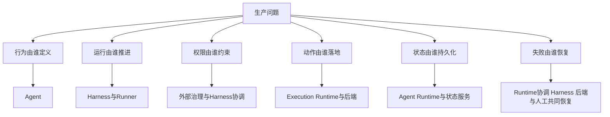
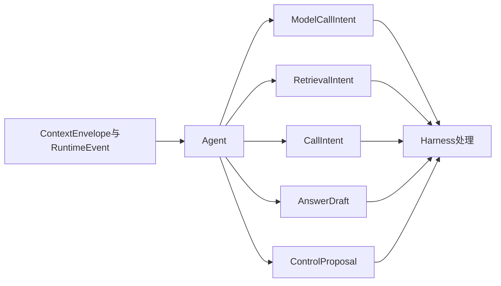
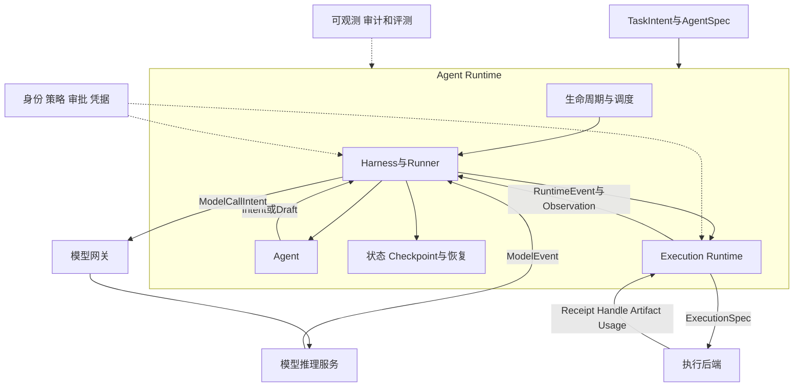
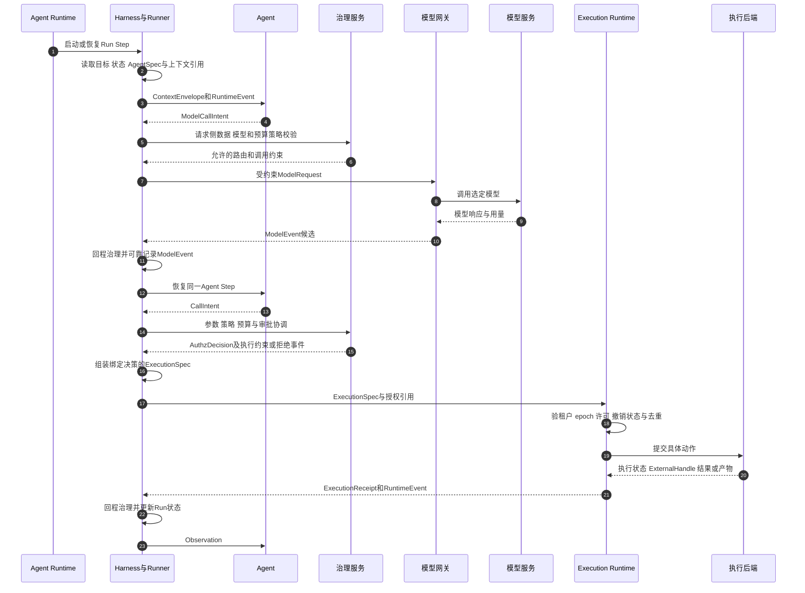
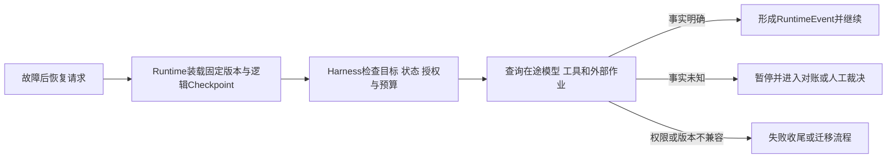
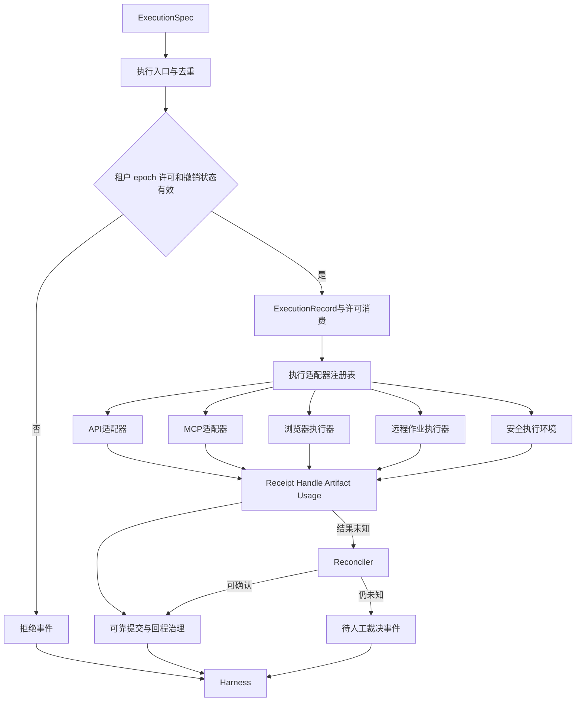
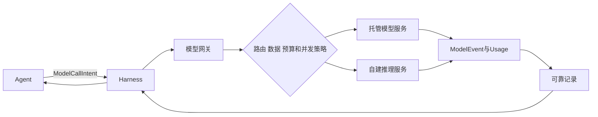
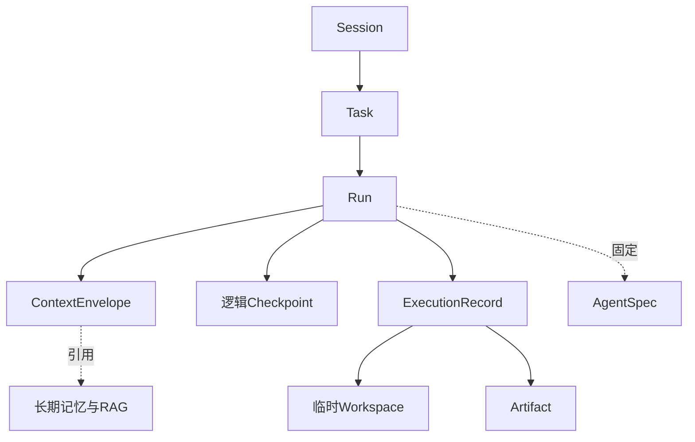
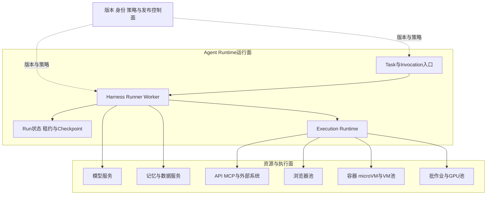

# Agent、Harness 与 Runtime：生产级 Agent 平台的职责边界

> **系列**：生产级 Agent 平台架构 2026 · 第 1 篇  
> **定位**：架构基础篇  
> **版本**：闭环修订版  
> **更新时间**：2026-10-12  
> **前置阅读**：第 0 篇《从模型推理到生产运行：2026 年 Agent、Harness 与 Runtime 总体架构》  
> **关键词**：Agent、Harness、Agent Runtime、Runner、Execution Runtime、模型服务、Sandbox

## 摘要

Agent、Harness、Runtime、模型服务和 Sandbox 经常出现在同一张架构图中，却被不同框架、云产品和技术文章赋予不同含义：有的把 Runtime 等同于事件循环，有的把它定义为托管运行环境，有的又把代码沙箱称为 Runtime；Harness 有时只是工具封装，有时却包含状态机、审批和可观测；Agent 则可能既指业务逻辑，又指一个常驻进程或完整服务。

如果不先澄清职责，系统很容易出现两类问题：一类是能力重复，例如 Orchestrator、Harness、Runtime 和工作流引擎各自维护一套状态机；另一类是责任空洞，例如大家都声称支持恢复，却没有组件对外部副作用、版本兼容和验收负责。

本文建立一套面向生产平台的统一定义：**Agent 定义行为，Harness 组织与约束行为，Agent Runtime 承载并驱动行为，模型推理服务提供认知计算，执行后端完成具体动作。** Agent 和 Harness 是运行内容与机制；Runtime 是整体运行载体；Execution Runtime 是 Runtime 内部负责动作落地的子系统；容器、虚拟机、microVM、浏览器和托管 Code Interpreter（如 AWS Bedrock AgentCore Code Interpreter）都只是执行后端。

这套划分并不要求每个概念对应独立微服务。它的价值在于建立稳定的输入输出、权限和失败责任，使同一套业务 Agent 可以在本地进程、Kubernetes、虚拟机或托管 Runtime 中运行，而不会因为底层实现变化而失去业务语义和安全边界。

---

## 1. 为什么职责边界比组件名称更重要

在最小 Agent Demo 中，所有能力可以写在一个函数里：组装 Prompt、调用模型、解析工具调用、执行工具、回填结果并继续循环。此时，“Agent”“Runner”“Runtime”只是代码组织方式，边界模糊不会立即造成问题。

进入生产后，同一段代码将面对异步审批、跨进程恢复、多租户并发、模型供应商故障、工具副作用、Sandbox 隔离、状态持久化和版本升级。原本隐藏在函数调用中的假设会变成分布式系统责任：

- 谁决定下一步做什么？
- 谁判定这个步骤是否符合用户目标？
- 谁保存运行状态，并在进程重启后恢复？
- 谁负责模型重试，谁负责工具重试？
- 谁确保旧 Worker 不能继续执行？
- 谁创建 Sandbox，又由谁决定是否需要 Sandbox？
- 谁能签发凭据，谁能真正使用凭据？
- 工具已经执行但响应丢失时，哪个组件负责对账？
- Runtime 更新后，未结束的 Run 使用旧版本还是新版本？

如果答案只是“平台负责”或“Runtime 负责”，架构还没有形成可实现的契约。

因此，本文不从产品名称出发，而从责任出发定义概念。产品可以组合多个责任，也可以只实现其中一部分；架构评审要看它实际兑现了哪些契约，而不是名称里是否包含“Agent”“Runtime”或“Platform”。

---

## 2. 五个核心对象

### 2.1 Agent：业务行为定义

Agent 是围绕目标做出推理和行动建议的业务行为单元。它接收受约束的上下文和运行事件，产生以下一类输出：

- `ModelCallIntent`：希望调用某个模型，并声明消息、参数和响应要求；
- `RetrievalIntent`：希望读取某类记忆、知识或业务数据；
- `CallIntent`：希望调用某个工具、Agent 或外部能力；
- `AnswerDraft`：认为当前 Run 已经形成可验证的结果草稿；
- `ControlProposal`：建议暂停、委托子任务或结束当前步骤。

Agent 的输出是**提案**，而不是已经授权的命令。即使模型使用结构化输出生成了完整工具参数，这些参数仍需经过 Harness 和模型外策略执行点校验。

Agent 负责业务策略，例如选择分析步骤、组合工具结果、判断是否需要补充信息；它不负责签发生产凭据、突破预算、修改平台策略、绕过审批或直接声明业务交付完成。

“Agent 无物理权限”是一种推荐的逻辑边界，而不是说 Agent 进程在操作系统层面一定什么都不能访问。如果 Agent 与 Harness 同进程运行，平台仍应通过 API 封装、工作负载身份和执行网关保证 Agent 代码不能自行绕开治理路径。

### 2.2 Harness：行为组织与约束机制

Harness 是围绕 Agent 的一组运行规则和协调机制。它回答的是“Agent 的提案如何被组织成一次受控运行”。典型职责包括：

- 读取 Task 目标、Run 状态和 AgentSpec；
- 组装本轮可用上下文；
- 启动或恢复 Agent Step；
- 调度模型调用并把结果转化为事件；
- 校验检索和工具调用意图；
- 协调授权、审批和预算；
- 接收工具结果并形成 Observation；
- 校验结果草稿，决定继续、暂停或收尾；
- 在安全点请求 Checkpoint 或取消。

Harness 包含确定性的控制逻辑，也可能包含策略客户端、中间件和 Hook。它不能仅依赖 Prompt 告诉模型“不要越权”，因为 Prompt 属于可被模型解释的上下文，而不是模型外强制边界。

Harness 也不应成为万能安全系统。身份认证、策略判定、凭据托管、网络出口和物理隔离可以由独立平台服务实现；Harness 负责在正确的运行阶段调用这些服务，并根据结果推进状态。

### 2.3 Runner：Harness 的执行入口，而不是新的平面

Runner 常被框架用来表示一次 Agent 调用的入口和事件循环协调器。它可能完成会话加载、上下文初始化、Agent 调用、事件提交、中断恢复和流式输出。

Runner 不应被建模为与 Harness、Runtime 并列的第四个平面。更准确的关系是：

> Runner 是 Harness 运行机制的一种实现形式；Harness 定义组织规则，Runner 驱动这些规则执行。

例如，Google ADK 的 Runner 处理用户请求、调用 Agent、消费事件，并通过 SessionService 提交状态变化；CloudWeGo Eino ADK 要求 Agent 经 Runner 运行，并围绕事件流、Checkpoint 和 Resume 提供扩展。它们证明了 Runner 在 Agent 循环中的重要性，但并不自动提供分布式租约、多可用区状态、企业级授权或外部副作用 exactly-once。

### 2.4 Agent Runtime：整体运行载体

Agent Runtime 将 Agent 和 Harness 转化为实际运行。本文将其定义为覆盖以下能力的整体载体：

- AgentSpec 和依赖的装载、验签与版本固定；
- Agent 实例与 Run 的启动、运行、暂停、恢复和终止；
- Harness/Runner 事件循环；
- Context、Session 引用和 Run 状态管理；
- 调度、队列、租约、fencing、取消和接管；
- 逻辑 Checkpoint 与恢复；
- Execution Runtime 及其适配器协调；
- 流式事件和结果交付；
- 运行时身份、审计、遥测和资源协调。

Runtime 可以是自建平台，也可以使用托管环境承载部分能力。AWS AgentCore Runtime 的官方定义包括 Agent 或工具代码托管、会话隔离、身份、流式协议、扩缩和长任务；但 Agent Loop 仍可由用户代码或所选框架实现。换言之，托管 Runtime 提供运行承载，不替代业务 Agent 和 Harness。

### 2.5 执行后端：完成具体动作

执行后端在受约束的`ExecutionSpec`下完成动作，包括：

- 企业 API 或 MCP 工具；
- 浏览器和桌面自动化；
- 远程批作业或数据任务；
- 内部确定性函数；
- 容器、虚拟机、microVM、WASM 或托管 Code Interpreter（AWS 与 OpenAI 均有同名托管服务，隔离机制与计费模型不同，文中实指 AWS Bedrock AgentCore Code Interpreter）。

执行后端不决定 Task 目标和后续步骤。它需要报告提交状态、外部句柄、结果、产物和用量，并声明自身是否支持幂等、查询、取消、补偿或快照。

Code Interpreter、容器和 microVM 因此不能代表完整 Agent Runtime。它们解决的是某种代码执行和隔离问题，不承担 Agent 的业务循环、审批恢复、Task 终态和交付结算。

---

## 3. 概念之间是包含、协作和依赖关系

五个对象并非平行服务。逻辑关系如下：Agent 与 Harness 作为运行内容和机制被装载进 Agent Runtime；Execution Runtime 属于 Agent Runtime 的执行子系统；模型推理服务和执行后端是被 Runtime 治理调用的依赖。

这里需要区分三种关系：

1. **逻辑包含**：Harness、Agent、状态机制和 Execution Runtime 属于 Agent Runtime 的完整能力模型；
2. **运行协作**：Agent 产生提案，Harness 协调治理，Execution Runtime 落地动作，结果再回到 Harness；
3. **外部依赖**：模型、身份、策略、存储、执行资源和可观测可以由独立服务提供。

逻辑包含不代表同进程部署。大型平台可能将 Harness Worker、状态服务和 Execution Runtime 拆成多个服务；托管 Runtime 也可能把会话隔离和资源供应封装起来。无论怎样拆分，对外契约和事实归属应保持稳定。

---

## 4. 一次 Agent 调用如何跨越这些边界

下面用参考场景说明一次模型—工具循环。用户要求 Agent 读取授权数据并生成报告。Task 已经被可靠受理，当前 Run 由 Runtime Worker 持有有效租约。

这条时序揭示了几个重要边界：

- Agent 并不是“先完成推理再调用模型”，而是通过`ModelCallIntent`请求 Harness 调用模型；模型响应成为事件后，Agent 才继续执行；
- Harness 不直接执行工具，而是将经治理的动作转成`ExecutionSpec`交给 Execution Runtime；
- Execution Runtime 验证执行时状态，但不重新决定业务目标；
- 工具结果不是下一轮系统指令，而是携带来源和风险属性的 Observation；
- 状态提交和模型/工具网络调用不属于同一个分布式原子事务。

框架可以在同一进程中把这些步骤封装成看似简单的调用，但生产架构仍需保留其语义边界。

---

## 5. Harness 与 Runtime 的边界：规则与机制如何分工

Harness 与 Runtime 最容易出现职责重叠。可以用“规则”和“机制”来区分：Harness 定义运行应该如何组织，Runtime 提供运行得以持续发生的机制。

| 领域 | Harness 主要职责 | Runtime 主要职责 |
|---|---|---|
| 版本 | 声明当前 Run 使用哪个 AgentSpec 及兼容约束 | 装载、验签、缓存并固定具体版本 |
| 上下文 | 选择本轮需要的消息、记忆和工具描述 | 提供 Session/Context 访问、大小限制和事件传递 |
| Agent Loop | 规定何时调用 Agent、模型、工具或验证器 | 驱动 Runner、流式事件和步骤调度 |
| 授权 | 发起策略判定、审批和预算协调 | 确保未授权命令无法到达执行后端 |
| 状态 | 定义 Run 如何转移及何时形成 Checkpoint | 可靠提交、租约、定时器、接管和恢复 |
| 取消 | 决定哪些子步骤应停止及后续业务语义 | 传播 CancelToken、停止资源并接收迟到结果 |
| 执行 | 协调治理判定，组装绑定 AuthzDecision 及约束的 ExecutionSpec，并处理 Observation | 对 ExecutionSpec 做执行时复核，调度适配器、资源和执行账本 |
| 验收 | 判断结果是否满足技术验证和 Task 政策 | 保存产物、验证记录和后续事件 |

这一区分也解释了为什么“把 Harness 做成无状态”并不等于平台无状态。Harness Worker 可以是可替换进程，但它操作的 Run 状态、事件、租约和执行账本必须持久化到外部权威服务。

同样，“Runtime 负责恢复”也不是说 Runtime 能够自动恢复任意业务。Runtime 可以恢复 Agent 步骤和逻辑状态；Harness 定义恢复后应重新验证哪些条件；外部工具则需要通过幂等键、状态查询、ExternalHandle 或人工裁决确定已发生的副作用。

---

## 6. Execution Runtime 的边界：从调用意图到物理动作

Execution Runtime 是 Agent Runtime 内部负责动作落地的子系统。它建立一条不可旁路的执行路径，使 API、MCP、浏览器、作业和代码执行遵循共同的执行事实模型。

本节只界定它与 Harness、Agent 及执行后端的职责契约；适配器接口与 Sandbox 工程将在第 7、8 篇展开，执行账本状态机与 UNKNOWN 对账在第 6 篇展开。

其主要职责包括：

- 接受已经过 Harness 治理的`ExecutionSpec`；
- 验证 tenant、run、execution、租约 epoch 和执行许可；
- 创建或读取唯一`ExecutionRecord`；
- 选择声明了能力的执行适配器；
- 管理提交、超时、取消和外部句柄；
- 限制资源、网络、文件、凭据和输出；
- 收集`ExecutionReceipt`、`ArtifactManifest`和`UsageRecord`；
- 对 PENDING 或 UNKNOWN 动作启动查询和对账；
- 把执行事实转成`RuntimeEvent`返回 Harness。

它不负责重新解释用户目标，也不根据工具输出自行追加步骤。

并非所有动作都必须进入 Sandbox。API 和 MCP 的副作用在远端系统发生；浏览器需要隔离页面和登录态；远程作业需要保存句柄并轮询；任意代码才需要容器、microVM 或 VM。统一的是执行契约和治理路径，而不是底层运行介质。

Execution Runtime 也不能承诺外部操作恰好一次。它能确保平台执行许可和本地执行记录唯一消费，能使用幂等键避免已知重复，但外部业务事实仍取决于目标系统的事务、查询和去重能力。

---

## 7. 模型服务与 Runtime 的边界

模型推理服务常被称为“模型 Runtime”，但它与本文的 Agent Runtime 不在同一个职责层次。

模型服务负责：

- 接收模型请求并生成响应；
- 管理模型版本、实例、批处理和流式输出；
- 管理 GPU、显存、KV Cache 或供应商配额；
- 返回 Token 用量、模型标识和调用状态。

Agent Runtime 负责：

- 判断何时需要模型调用；
- 选择符合数据、成本和能力约束的模型路由；
- 记录 ModelCallIntent 与 ModelEvent；
- 在模型超时或切换时保持 Run 状态；
- 将已记录模型结果交给 Agent 继续执行；
- 不因模型切换扩大数据和工具权限。

模型网关可以处理路由、输入最小化、必要的内容治理、超时和用量，但它不决定 Task 是否完成，也不执行工具。模型响应经过检测仍不是业务事实；Agent 需要结合来源、工具结果和验收规则形成结果。

---

## 8. 状态归属：哪些状态属于谁

职责混乱通常首先表现在状态混乱。Session、Run、模型上下文、记忆、Checkpoint、Sandbox 文件和外部作业句柄具有不同生命周期，不能都写入一个“AgentState”对象。

本节只确定状态所有权；完整领域模型、Task/Run 状态机和验收交付协议将在第 2 篇展开，Checkpoint 和副作用恢复机制将在第 6 篇展开。

| 状态 | 主要所有者 | 生命周期与边界 |
|---|---|---|
| Session | 会话服务 | 用户交互上下文，可包含多个 Task 引用 |
| Task | 业务任务服务 | 从可靠受理到验收、交付和收尾 |
| Run/Step/Attempt | Runtime 状态服务 | 一次运行及其步骤和尝试，可暂停接管 |
| ContextEnvelope | Harness/Context Manager | 当前 Step 可见内容及来源引用 |
| 长期记忆 | Memory Service | 跨 Run 或跨 Session，受独立授权和保留策略约束 |
| AgentSpec | 版本注册服务 | Agent、Prompt、工具、插件和模型路由版本集合 |
| Checkpoint | Runtime 状态/快照服务 | 逻辑恢复点；物理快照为可选加速 |
| ExecutionRecord | Execution Runtime 账本 | 一次动作提交、状态、句柄、结果和对账 |
| Workspace | 安全执行环境 | 任务或执行级临时文件，受清理策略约束 |
| Artifact | 制品服务 | 受管理输出，独立权限、版本和保留周期 |

Agent 可以读取这些状态的受限视图，但不能成为它们的唯一权威持有者。否则 Agent 进程终止、上下文压缩或模型重试都会导致业务事实丢失或矛盾。

特别需要区分逻辑 Checkpoint 和物理快照。逻辑 Checkpoint 保存 Run 推进所需的权威引用；物理快照保存特定执行环境的内存或文件状态。后者受运行介质、内核、设备和网络连接限制，也不覆盖远端副作用。

---

## 9. 控制面、运行面与执行面的部署关系

职责边界不应被误读成固定部署拓扑。同一逻辑架构可以采用单进程、分布式平台或托管 Runtime。

### 9.1 单进程或小规模部署

Agent、Harness 和 Runner 可同进程；Task/Run 状态使用外部数据库；工具调用通过统一客户端或执行服务；高风险代码使用独立 Sandbox。适合早期闭环和低并发场景。

### 9.2 自建分布式平台

Harness Worker 无状态或弱状态部署，权威 Run 状态、队列、租约、执行账本和产物外置；Execution Runtime 独立扩缩；Sandbox、浏览器、GPU 和批作业使用专用资源池。Kubernetes 或虚拟机只是部署实现。

### 9.3 托管 Runtime

托管服务承载 Agent 或工具代码、会话隔离、协议入口和资源弹性；业务仍需确认托管边界是否包括持久状态、Checkpoint、身份委托、外部副作用、产物和审计。不能仅凭产品名假设所有能力已具备。

部署评审应同时画逻辑图和物理图。逻辑图说明职责和事实，物理图说明进程、网络、资源和故障域。用物理组件反推逻辑职责，容易得出“用了 Kubernetes 就有 Runtime”“用了消息队列就有持久执行”之类错误结论。

---

## 10. 失败责任：每层必须知道自己不能保证什么

生产架构不仅要写“负责什么”，还要明确“失败时负责到哪里”。

| 故障场景 | Agent | Harness | Agent Runtime | 执行后端/外部系统 |
|---|---|---|---|---|
| 模型超时 | 不自行假设响应 | 决定重试、切换或终止策略 | 记录调用状态、预算和事件 | 模型服务报告已知状态及用量 |
| Worker 崩溃 | 无责任 | 提供可重放的确定性组织规则 | 租约接管、装载 Checkpoint、拒绝旧 epoch | 保留可查询执行句柄 |
| 审批等待 | 不持续占用循环 | 固化动作规格并处理决定 | 持久等待、释放资源、事件唤醒 | 无 |
| 工具响应丢失 | 不直接重试 | 根据能力声明决定对账路径 | 扫描 PENDING/UNKNOWN 并调度 Reconciler | 支持幂等查询或返回外部事实 |
| Sandbox 异常 | 不绕过执行继续 | 决定 Run 失败、重试或降级 | 隔离资源、撤销凭据、保存证据 | 报告资源和执行状态 |
| 取消 | 不再产生新动作 | 定义子步骤停止和业务收尾 | 传播取消、接收迟到结果、保持对账 | 报告取消请求、确认或不支持 |
| 版本升级 | 不主动切换 | 声明迁移和兼容策略 | 固定旧 Run 版本或执行显式迁移 | 保留适配器兼容信息 |

几个边界尤其重要：

- Agent 不应自行把超时解释为失败；
- Harness 不应把重放等同于重新执行所有工具；
- Runtime 不应把租约过期解释为远端动作未发生；
- ExecutionReceipt 不应被当作业务系统独立验收；
- Sandbox 退出不代表远程副作用已经取消；
- 模型或框架升级不应自动接管旧 Run。

这些“不能保证什么”构成了架构的真实边界，也决定后续需要哪些状态、对账和人工裁决机制。

---

## 11. 框架与产品如何映射到这套模型

本节只说明职责映射，不做产品排名。相同产品可能覆盖多个层次，也可能只提供某一部分能力。

| 实现 | 可映射的主要职责 | 不能据此直接推导 |
|---|---|---|
| CloudWeGo Eino ADK Runner | Agent 执行入口、事件流、上下文初始化、Checkpoint Store 和协作式中断恢复 | 分布式 HA、外部副作用 exactly-once、企业 IAM 和物理隔离 |
| Google ADK Runner/Event Loop | Agent 事件循环、Session/Event 协调、状态增量提交、工具循环 | 托管资源平台、默认跨进程耐久、所有工具安全重试 |
| LangGraph Runtime | 图执行、superstep、基于 checkpointer 的状态与重放 | 企业级授权、托管隔离、节点副作用 exactly-once |
| Temporal/Cadence 类工作流 | 耐久状态机、Activity、定时器、重试和长任务恢复 | Agent 语义、模型安全、外部业务副作用自动去重 |
| AgentCore Runtime | Agent/工具代码托管、协议入口、会话隔离、身份、扩缩和观测 | 自动生成业务 Agent Loop、Task 验收、任意工作流 Checkpoint |
| Claude Agent SDK | query()承载 agent loop、内置工具、subagents、hooks、permission modes、sessions 恢复 | 跨进程耐久 Task、分布式租约、企业授权链和副作用对账 |
| OpenAI Agents SDK | Agent/Tool/Handoff/Guardrail/Sessions/Tracing 原语 | 托管编排与恢复（需 Agents API）、Task 终态、结算与 UNKNOWN 对账 |
| 托管 Code Interpreter/托管 Sandbox（AWS AgentCore 等） | 隔离代码执行、文件和资源环境 | 完整 Agent 生命周期、Harness 治理和持久业务状态 |
| Kubernetes/虚拟机 | 进程和资源承载、调度、网络与部署基础 | Agent Task 状态机、业务授权、外部副作用恢复 |

产品选型时不应问“哪个就是 Agent Runtime”，而应问：

1. 哪些 Runtime 责任由它实现？
2. 哪些责任由框架、平台或业务系统补齐？
3. 它的状态是临时还是耐久？
4. 它的恢复是事件重放、Checkpoint 还是物理快照？
5. 工具调用和外部副作用采用什么语义？
6. 版本、身份、凭据、审计和隔离的边界是什么？

### 11.1 与厂商对象模型的概念对照

系列核心对象（Session/Task/Run/Step/Attempt、ExecutionRecord）是平台侧业务语义，与各家 SDK 或托管服务的对象命名并不一一对应。下表帮助来自不同技术栈的读者定位自己；"—"表示该对象模型中**没有对应物，相应语义必须由平台自建**。

| 系列对象 | OpenAI（Responses/Conversations） | 阿里云百炼 Managed Agents | Eino ADK | Claude Agent SDK |
|---|---|---|---|---|
| Session（多轮业务会话） | Conversation（前身 Thread） | Session（idle/running 状态机） | —（进程内会话由应用自管） | sessions（客户端侧恢复语义） |
| Task（业务任务与终态） | — | — | — | — |
| Run（一次执行） | Response（前身 Assistants Run，已退役） | —（Session 内的执行段） | Runner.Run 的一次迭代 | query() 的一次调用 |
| Step（治理下单步推进） | Item（前身 Run Step） | Event | AgentEvent 序列中的事件 | loop 内单轮 |
| Attempt（Step 的一次尝试） | — | — | — | — |
| ExecutionRecord（副作用账本） | — | — | — | — |

三点判读规则：其一，凡对照表中的"—"，就是第 19 篇托管边界核对清单要求企业自建的格子，不能由"托管服务功能很多"反推已被覆盖；其二，托管侧的对象（Conversation、Session、sessions）只能作为上下文与恢复缓存，不能充当 Task/Run 的权威事实；其三，同名不等于同义——已退役 Assistants API 的 Run/Step 与本文 Run/Step 的语义差异见第 2 篇 6.1 节的命名消歧。

只要答案完整，自建、托管或混合架构都可以成立。

---

## 12. 常见反模式

### 12.1 把 Runtime 等同于 Sandbox

结果是 API、MCP 和浏览器调用绕过统一执行记录，Agent Loop、状态和恢复无人负责。正确做法是将 Sandbox 放入 Execution Runtime 的执行后端集合。

### 12.2 把 Orchestrator、Harness 和工作流引擎都当主状态机

多个组件都能推进 Run，会导致状态冲突、重复执行和恢复不一致。一个 Run 只能有一个权威状态机；其他组件通过命令和事件协作。

### 12.3 让 Agent 直接持有工具客户端和生产凭据

模型或 Agent 代码可以绕过策略、审批和审计。正确做法是 Agent 只产生 CallIntent，执行前由模型外治理生成 ExecutionSpec 和短期凭据。

### 12.4 把 Session 当 Task

会话结束就丢失任务状态，或者一个会话中的多个业务目标互相污染。Task、Run 和 Session 必须分开。

### 12.5 把框架 Checkpoint 当完整灾难恢复

框架可能只保存图状态或协作式中断点，不覆盖进程内任意位置、远端 API、浏览器交易和 Sandbox 设备状态。恢复能力需要逐层声明。

### 12.6 把事件回放当工具 exactly-once

重放 Harness 状态不等于重复外部动作是安全的。外部操作仍需幂等、查询、补偿或人工裁决。

### 12.7 用部署平台名称替代架构

“Kubernetes + Kafka + Redis”描述的是候选技术，不说明谁持有权威状态、谁推进 Run、谁授权执行和谁负责未知结果。

---

## 13. 架构评审清单

在评审 Agent 平台时，可以用以下问题检查职责是否闭合：

### Agent

- Agent 的输入和输出对象是否明确？
- Agent 输出是否始终被视为提案，而非已授权命令？
- Agent 能否绕过 Harness 直接访问模型、数据、工具或凭据？
- Agent 版本、Prompt、工具描述符和模型路由是否组成固定 AgentSpec？

### Harness 与 Runner

- 谁组装上下文并保留来源？
- 谁驱动模型—工具循环，模型响应如何转成事件？
- 审批、预算、验证和取消在什么阶段发生？
- Harness 故障后，哪些步骤可以安全重放？

### Agent Runtime

- Task 服务是否持有业务目标、验收、交付和终态，而 Runtime 只推进 Task 关联的 Run/Step/Attempt？
- 谁维护 Run/Step/Attempt、租约和 fencing epoch？
- 状态、事件、Outbox 和 Checkpoint 存在哪里？
- 如何暂停、恢复、接管和拒绝旧 Worker？
- Runtime 版本升级如何影响在途 Run？
- 长时间等待是否释放计算资源但保留唤醒责任？

### Execution Runtime

- 所有副作用路径是否经过同一个执行入口？
- 适配器是否声明 idempotent、queryable、cancellable 和 compensatable？
- PENDING 和 UNKNOWN 执行如何扫描与对账？
- 执行结果、产物和用量是否可靠提交？

### 模型与执行后端

- 模型服务是否被误认为业务状态机？
- Sandbox 是否只是执行后端，而非完整 Runtime？
- 远程 API 和浏览器的事实由哪个系统确认？
- Checkpoint 是否错误覆盖了远端副作用？

如果这些问题没有明确答案，增加更多组件通常不能解决根因。

---

## 14. 本篇结论与后续专题

职责边界的核心不是创造更多层次，而是建立稳定契约：

> **Agent 定义行为，Harness 组织与约束行为，Agent Runtime 承载并驱动行为，模型服务提供认知计算，执行后端完成具体动作。**

Harness 和 Runner 属于 Runtime 的逻辑运行机制；Execution Runtime 属于 Runtime 的执行子系统；模型推理服务和执行后端是受治理依赖；Sandbox 只是执行后端之一。逻辑包含不等于固定部署，物理上可以同进程、分布式或托管，但权威状态、权限和失败责任不能随部署方式漂移。

有了这组边界，后续问题才有清晰归属：业务完成语义进入第 2 篇，整体功能域进入第 3 篇，Runtime 内部能力进入第 4 篇，Harness 与 Agent Loop 进入第 5 篇，持久执行与副作用对账进入第 6 篇，多执行后端进入第 7 篇，安全执行环境则在第 8 篇展开。

下一篇将进一步回答：**一次 Agent 任务如何从 TaskIntent 出发，经 Run、Step、Attempt、产物验收和交付结算形成完整业务闭环。**

---

## 参考资料

以下资料用于说明框架和托管平台的实际职责边界；具体能力会随版本变化，落地时应固定版本并验证。

1. [Google ADK Event Loop](https://adk.dev/runtime/event-loop/)
2. [Google ADK Resume Agents](https://adk.dev/runtime/resume/)
3. [CloudWeGo Eino Agent Runner and Extension](https://www.cloudwego.io/docs/eino/core_modules/eino_adk/agent_extension/)
4. [CloudWeGo Eino Human-in-the-Loop](https://www.cloudwego.io/docs/eino/core_modules/eino_adk/agent_hitl/)
5. [LangGraph Pregel Runtime](https://docs.langchain.com/oss/python/langgraph/pregel)
6. [LangGraph Checkpointers](https://docs.langchain.com/oss/python/langgraph/checkpointers)
7. [LangGraph Durable Execution](https://docs.langchain.com/oss/python/langgraph/durable-execution)
8. [Temporal Workflow Execution](https://docs.temporal.io/workflow-execution)
9. [Amazon Bedrock AgentCore Runtime](https://docs.aws.amazon.com/bedrock-agentcore/latest/devguide/agents-tools-runtime.html)
10. [Amazon Bedrock AgentCore Code Interpreter](https://docs.aws.amazon.com/bedrock-agentcore/latest/devguide/code-interpreter-tool.html)
