# 从 Task 到交付：Agent 业务闭环与领域对象设计

> **系列**：生产级 Agent 平台架构 2026 · 第 2 篇  
> **定位**：架构基础篇  
> **版本**：闭环修订版  
> **更新时间**：2026-10-12  
> **前置阅读**：第 0 篇《从模型推理到生产运行：2026 年 Agent、Harness 与 Runtime 总体架构》 · 第 1 篇《Agent、Harness 与 Runtime：生产级 Agent 平台的职责边界》  
> **关键词**：Task、Run、Step、Attempt、ExecutionRecord、验收、交付、幂等、取消、UNKNOWN

## 摘要

生产级 Agent 平台最容易被低估的问题，不是如何调用模型，而是如何定义“任务完成”。模型给出最终回答、Agent Loop 停止、工具返回成功、文件生成完毕，分别只代表局部阶段结束。对一个需要读取数据、生成报告并发布到业务系统的任务而言，真正的完成还涉及技术验证、业务验收、交付证据、费用结算、资源释放以及未知副作用的处置。

本文以 Task 为业务目标聚合，以 Run 表示一次运行，以 Step 表示逻辑步骤，以 Attempt 表示实际调度尝试，并将 ExecutionRecord、Approval、Artifact、Acceptance、Delivery、Usage、Settlement 和 Cleanup 建模为独立事实。其核心观点是：**Run 成功只表示产生了通过技术验证、可进入业务验收或交付的候选结果，Task 终态由业务闭环决定；执行结果未知不能被直接视为失败，取消也不等于已经撤销外部副作用。**

文章将正常运行、修复运行、审批、取消、超时、UNKNOWN 对账、人工裁决、验收交付、费用调整和清理统一到一套对象、状态与命令—事件协议中。该模型不绑定特定工作流框架或消息系统，可由数据库状态机、持久工作流平台或自研 Runtime 实现。

---

## 1. “Agent 回答完了”为什么不等于任务完成

假设用户要求 Agent 读取一组授权数据，完成分析报告，并发布到指定业务系统。运行过程中可能出现以下事实：

- 模型已经生成完整报告，但报告使用了过期数据；
- 报告技术校验通过，但业务负责人拒绝验收；
- 验收通过，发布接口却返回超时；
- 发布动作已经在目标系统生效，但平台没有收到响应；
- 任务被取消时，远程作业仍在运行；
- 产物已经交付，但模型供应商费用尚未完成对账；
- Task 已失败，但临时凭据、Sandbox 和工作目录尚未清理。

这些情况说明“完成”至少包含多个层次：

| 层次 | 代表什么 | 不代表什么 |
|---|---|---|
| Agent 结束本轮输出 | Agent 暂时没有更多提案 | 工具动作已确认、结果正确 |
| Step 成功 | 一个逻辑节点达到预期 | 整个 Run 或 Task 成功 |
| Run 成功 | 本次运行产生通过技术验证的候选结果 | 业务已经验收、产物已经交付 |
| Artifact 发布 | 产物已经进入受管理存储并可访问 | 指定接收方已收到或接受 |
| Delivery 发送 | 交付渠道接受了发送请求 | 最终送达或人工确认 |
| Task 完成 | 验收与交付政策满足，关键结算和清理已处理 | 所有非关键分析数据都必须立即删除 |

因此，业务系统不能以 Agent 输出中的“已完成”、最后一个工具的 HTTP 200 或 Runner 事件流结束作为 Task 终态依据。

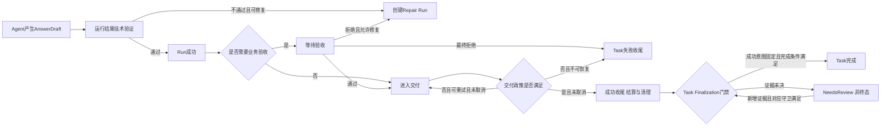

本文将“Task 完成”定义为业务终态，而不是运行终态。Task Finalization 门禁验证固定的`terminal_disposition`、验收交付证据、关键副作用、结算与清理；图中的 NeedsReview 是收尾证据未决标记，保持对应 FINALIZING 状态且非终态，不是跳回§5 的运行期 NEEDS_REVIEW。裁决只补齐证据，不改写收尾意图。失败和取消同样需要明确收尾，但它们不要求执行成功路径中的业务验收。图中的正常推进、重试和 Repair Run 创建均受`control_intent != CANCEL`守卫约束。

---

## 2. 从系统上下文识别业务事实

在领域建模之前，先看一次任务与哪些主体和外部系统交互。

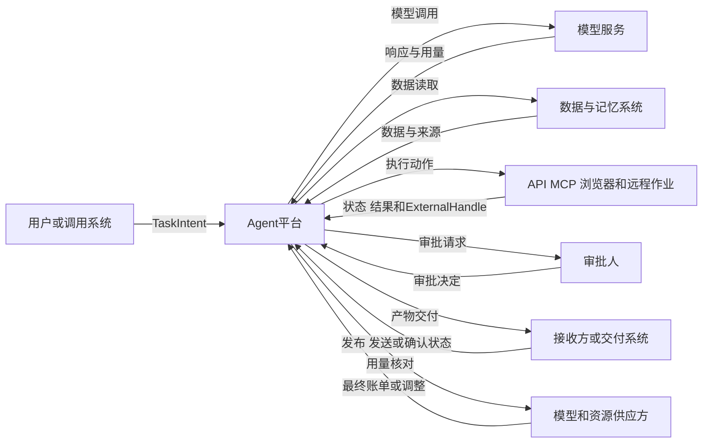

不同外部主体提供不同类型的事实：

- 用户提供目标、范围和验收政策，但不能直接声明系统已经执行；
- 模型服务提供响应和模型用量，不提供业务完成事实；
- 执行后端提供执行状态和句柄，但执行回执可能仍需与目标系统对账；
- 审批人对固定动作规格作出决定，不能批准一个之后被修改的动作；
- 接收系统提供发布、发送或确认状态；
- 供应方账单可能晚于 Run 结束，需要后续调整。

因此，平台需要保存多个事实对象，而不是把所有信息塞进一条 Conversation 或一个 AgentState。

---

## 3. 领域对象：从 Session 到 Cleanup

### 3.1 核心对象定义

| 对象 | 定义 | 典型生命周期 |
|---|---|---|
| Session | 用户交互上下文，可关联多个 Task | 对话或连接周期 |
| Task | 业务目标、范围、验收、交付、预算和截止时间的聚合 | 从可靠受理到业务终态 |
| Run | Task 的一次执行，包含初始运行或修复运行 | QUEUED/RUNNING/WAITING 等至 SUCCEEDED/FAILED/CANCELLED（第 4 篇） |
| Step | Run 内稳定的逻辑节点 | 从待执行到完成或终止 |
| Attempt | Step 的一次实际调度尝试 | 从领取到成功、失败、超时或丢失 |
| ExecutionRecord | 一次逻辑外部副作用的执行事实 | PREPARED 经 SUBMITTING/PENDING/UNKNOWN 等至 SUCCEEDED/FAILED/CANCELLED/NEEDS_REVIEW（第 6 篇） |
| ApprovalRecord | 对规范化动作摘要和条件的人工决定 | CREATED/PENDING 至 APPROVED/REJECTED/TIMEOUT_DENIED/REVOKED/STALE/CONSUMED（第 13 篇） |
| Artifact | 不可变版本的受管理产物 | 创建、验证、发布、归档或删除 |
| AcceptanceRecord | 对 Run 结果或 Artifact 版本的技术/业务验收事实 | 待判定、通过、拒绝、过期 |
| ResultSelectionRecord | 固定 Task 最终采用的 Run、Artifact 版本及 Acceptance 证据链 | 选定、被新选择替代或终止 |
| DeliveryRecord | 对选定结果向目标位置交付的记录 | 与 ExecutionRecord 同族：PREPARED 经 SUBMITTING/PENDING/UNKNOWN 等至 SUCCEEDED/FAILED/CANCELLED/NEEDS_REVIEW（§11.4） |
| UsageRecord | 追加式模型、工具和资源用量事实 | 采集、去重、核对 |
| SettlementRecord | 预算预留、消费、退款、释放与调整 | 从预留到最终结算或未决 |
| CleanupRecord | 凭据撤销、资源释放、临时数据处理事实 | 待清理、处理中、完成或异常 |

### 3.2 聚合关系

总纲给出共同对象轮廓，本篇进一步细化基数和事实归属：Task 拥有业务产物，Run 记录产物来源；Attempt 与 ExecutionRecord 通过关联事实连接，而不是固定一一对应。

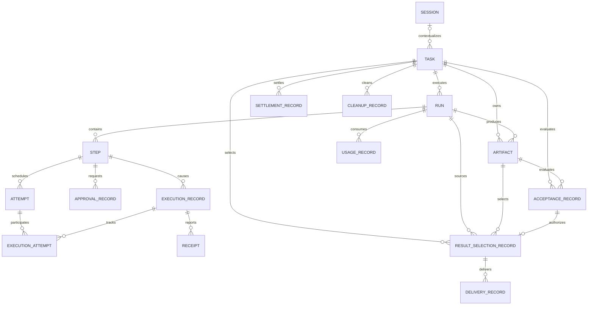

这里有四个关键设计：

1. **Attempt 与 ExecutionRecord 不是一一对应。** 同一个逻辑副作用可能因 Worker 故障产生多个 Attempt，但仍必须关联同一 ExecutionRecord 和稳定业务幂等键；一个 Attempt 也可能只执行模型调用或确定性计算，不产生外部 ExecutionRecord。图中的`ExecutionAttempt`只记录某次 Attempt 对某个 ExecutionRecord 的提交、查询、取消或对账参与事实。
2. **Task 拥有业务产物，Run 记录产物来源。** Artifact 是某个 Run 产生的不可变输出，同时属于 Task 的产物集合；Acceptance 是对 Task 目标或特定 Artifact 版本的独立判断。验收拒绝不改写 Run 历史；如果允许修复，应创建新的 Run 和 Artifact 版本。
3. **交付只能引用被选定的结果证据链。** ResultSelectionRecord 固定同一个 Task 下被采用的`run_id + artifact_id/version + acceptance_id`。Delivery 必须引用该选择，迟到的旧 Run 或旧 Artifact 事件不能替换已选结果。
4. **Usage 与 Settlement 分开。** Usage 是观测到的用量事实，Settlement 是预算和账务处理；供应方晚到调整不应篡改原 Usage 事件。

### 3.3 避免巨型 Task 聚合

Task 是业务语义上的根，但不意味着所有对象必须在一笔数据库事务中更新。高并发平台通常将 Task、Run、Execution、Approval、Artifact/Delivery、Settlement 和 Cleanup 作为独立事务边界，通过命令和事件协作。

同一聚合内部使用版本号和条件更新保证并发一致；跨聚合使用 Outbox、幂等消费和补偿流程。试图用一个超大事务同时覆盖数据库、消息、模型、审批和外部系统，既不可实现，也会隐藏副作用的不确定性。

---

## 4. 标识、版本与幂等键

生产系统需要区分“对象 ID”“请求幂等键”“业务动作幂等键”和“观测 Trace”。

### 4.1 ID 体系

| 标识 | 用途 | 稳定范围 |
|---|---|---|
| `session_id` | 关联交互上下文 | Session 生命周期 |
| `task_id` | 唯一业务任务 | Task 全生命周期 |
| `run_id` | 一次运行 | 单个 Run |
| `step_id` | 一个逻辑步骤实例 | 单个 Run |
| `attempt_id` | 一次实际调度尝试 | 单次 Attempt |
| `execution_id` | 一个逻辑外部动作 | 跨重试 Attempt 稳定 |
| `artifact_id/version` | 受管理产物版本 | 产物生命周期 |
| `trace_id/span_id` | 调用链排障 | 单次或关联 Trace |
| `correlation_id` | 跨聚合关联同一 Task/Run | 业务流程范围 |
| `causation_id` | 指向触发当前事件的命令或事件 | 事件因果链 |

TraceID 不承担业务去重。跨审批和长时间等待可以切换 Trace，但`task_id`、`run_id`和`execution_id`保持业务关联。

### 4.2 幂等键设计

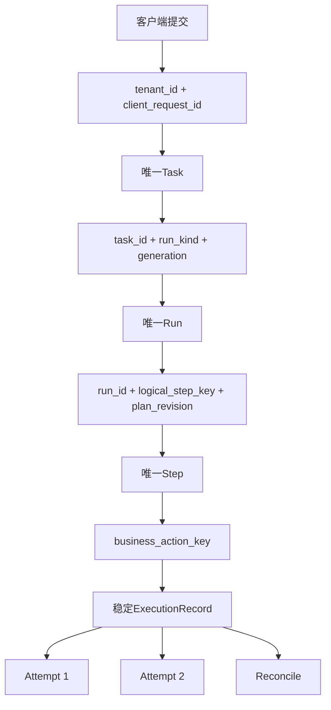

建议的关键规则：

- 受理幂等键限定在租户和调用方范围，避免不同用户碰撞；
- 修复运行使用新的`run_id`和 generation，不复用旧 Run；
- Step 的逻辑键包含计划版本，计划变化后创建新 Step；
- 同一逻辑外部动作跨 Attempt 保持`execution_id`和业务幂等键；
- 参数、目标资源或业务意图发生变化时，不应继续复用旧动作幂等键；
- Delivery 可以按`task_id + delivery_intent_id + artifact_digest + destination + delivery_policy_version`去重，避免两个独立交付意图被误合并；
- Usage 使用供应方调用 ID、执行 ID 和生产者事件 ID 去重，但保留后续调整事件。

幂等键只能在接收方真正按该键去重且保留期覆盖重试窗口时生效。客户端自己生成一个字符串，并不能让外部系统自动具备幂等能力。

### 4.3 聚合版本

每个聚合维护单调版本，例如`task_version`、`run_version`。命令执行采用 compare-and-set：只有期望版本匹配时才能转移状态。这样可处理审批、超时、取消和回调的竞争，防止迟到事件复活已经结束的对象。

---

## 5. Task 生命周期：业务终态的唯一入口

Task 状态表达的是业务任务处于哪个阶段，不描述每个模型或工具细节。可靠受理事务同时创建 Task、首个 INITIAL Run、预算预留和 Outbox；`ACCEPTED`不是“尚未创建 Run”，而是这些事实已经提交、首个 Run 尚未开始推进。

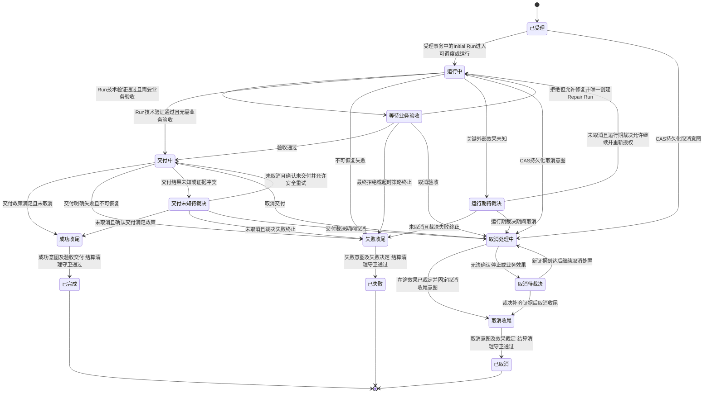

三个 review 节点均为非终态：`NEEDS_REVIEW`只承接运行期裁决，`DELIVERY_REVIEW`只承接交付 UNKNOWN 裁决，`CANCEL_REVIEW`只承接取消专用裁决。所有尚未固化收尾意图的状态接受取消时，必须先以 CAS 持久化`control_intent=CANCEL`并进入`CANCELLING`，未知效果再进入`CANCEL_REVIEW`；重复取消幂等。图中所有正常推进、修复、交付及普通 review 转移均验证当前 Task 未取消。取消裁决绝不能回到 RUNNING、DELIVERING 或普通 review；即便迟到确认执行或交付先前成功，也只记录事实后继续取消收尾。

Task 进入三个收尾状态时同时固化`terminal_disposition`（成功、失败或取消）；Finalization 入口以聚合版本校验相应业务决定与取消守卫并固化意图，终态提交再次验证版本、固定意图及对应条件。成功要求未取消及§5.1 完成证据，失败要求明确失败决定，取消要求持久取消意图及在途效果裁定；三种终态提交均验证结算、清理及未决责任政策，条件未齐时保持收尾中而非提前终态。意图已固定后不得切换，新的取消命令也不能覆盖已固定的成功或失败收尾意图，只记录迟到请求及必要处置。`control_intent=CANCEL`一旦接受就不能被裁决、Resume 或迟到事件清除，并禁止自动重试、新 Run、新 Step 及新 Delivery；允许的是既有动作对账和受控收尾，而非恢复业务推进。

### 5.1 Task 完成条件

`COMPLETED`至少要求：

- 存在当前有效的 ResultSelectionRecord，固定一个成功 Run、通过技术验证的 Artifact 版本及适用的 AcceptanceRecord；
- 需要人工业务验收时，ResultSelectionRecord 引用的 AcceptanceRecord 必须是对同一 Artifact 版本的有效通过决定；
- 所有计入完成条件的 DeliveryRecord 均引用该 ResultSelectionRecord，且 DeliveryPolicy 规定的发布、发送或确认条件已满足；
- 当前未取消且固定的 terminal_disposition 为成功；关键 ExecutionRecord 效果已裁定，不存在 PREPARED、SUBMITTING、PENDING、UNKNOWN、NEEDS_REVIEW、CANCELLING 或 CANCEL_REVIEW 未决记录；
- 已确认费用完成结算，未知费用已形成显式未决责任；
- 必须撤销的凭据和必须释放的资源已经处理；
- 需要保留的数据有明确期限、责任人和访问控制。

### 5.2 Task 失败与取消

FAILED 和 CANCELLED 不要求业务验收，但必须：

- 固化失败或取消原因；
- 停止创建新 Run 和 Step；
- 对在途模型、工具、浏览器和远程作业发出取消请求；
- 对不能确认停止的副作用继续查询；取消来源进入 CANCEL_REVIEW，非取消的运行期或交付来源分别进入 NEEDS_REVIEW 或 DELIVERY_REVIEW，未决时不冒充终态；
- 结算已确认用量；
- 处理凭据、资源、临时数据和证据保留。

终态不可被迟到回调直接复活。迟到事实可以创建费用调整、安全事件、补偿任务或人工案件，但不能把已完成、已失败或已取消的 Task 原地改回 RUNNING。

---

## 6. Run、Step、Attempt 与 Execution 的关系

### 6.1 Run：一次执行，不是业务任务

> **命名消歧。** 本文的 Run/Step 与已退役的 OpenAI Assistants API（2026-08-26 关停）中的 Run/Run Step **同名不同义**：Assistants 的 Run 是一次托管执行的产物（近似本文 Run 与 Invocation 的混合体），Run Step 是其内部记录项；本文的 Run 是平台侧承载完整生命周期的执行实体，Step 是 Harness 治理下的单步推进，Attempt 是 Step 的一次尝试。已退役 API 的概念映射见其继任者 Responses/Conversations API：Thread→Conversation、Run→Response、Run Step→Item。下文的 Task、Attempt、ExecutionRecord 在该对象模型中**没有对应物，必须由平台自建**。

一个 Task 可能有：

- `INITIAL` Run：首次执行；
- `REPAIR` Run：验收拒绝或技术验证失败后的修复；
- `REPLAY`或`MIGRATION` Run：仅在平台明确支持且业务政策允许时使用。

每个 Run 固定`AgentSpec`、计划版本、模型路由约束和工具版本集合。Run 执行过程中不应无审计地漂移到最新版本。Run 只有在候选 Artifact 和运行结果通过技术验证、未接受取消且运行收尾满足政策后才进入`SUCCEEDED`；技术验证失败使当前 Run 在失败决定和运行收尾成立后进入`FAILED`。Task 策略仅在未取消时可以据此创建新的 Repair Run，不能把原 Run 继续标记为成功。

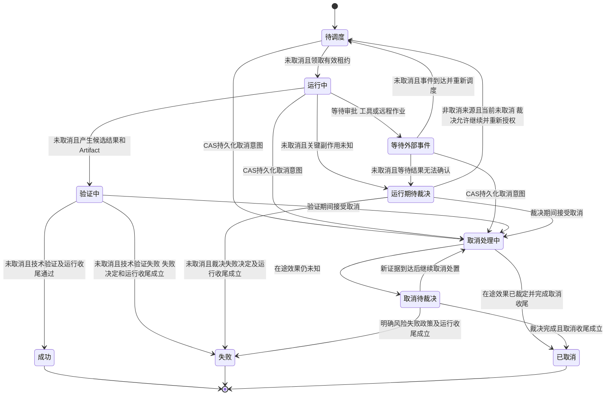

Harness 只提出状态转移，Runtime 唯一 Reducer 按`run_version`、有效 RunLease/lease epoch 及最新取消意图 CAS 提交。`CANCELLING`和`CANCEL_REVIEW`保留不可清除的`control_intent=CANCEL`，不能借普通 review、迟到验证成功或审批回到 QUEUED、RUNNING、VERIFYING 或 SUCCEEDED；只能完成取消收尾，或按明确风险失败政策完成失败收尾。后者不撤回 Task 取消意图，也不授权新 Run。普通 review 恢复必须同时验证非取消来源与当前 Task/Run 未取消；Run 成功仍须技术验证，Run 失败不能用一条未知回执代替失败决定及收尾。

默认情况下，同一 Task 同一 generation 只允许一个顶层 Run 处于非终态，通过唯一约束和 Task 版本条件更新防止审批、定时器或重复事件创建多个 Repair Run。并行检索或多 Agent 协作应建模为 Run 内的并行 Step 或显式子 Run。如果业务确实允许多个候选 Run 并行竞争，必须增加候选选择和验收仲裁策略，不能共用默认 Task 状态机。

### 6.2 Step：逻辑进度节点

Step 表达 Run 中的逻辑节点，例如“检索授权数据”“生成报告草稿”“发布报告”。它携带：

- 稳定逻辑键和计划版本；
- 输入引用和预期输出；
- 前置依赖；
- 风险等级和预算；
- 重试策略和截止时间；
- 是否可能产生外部副作用。

### 6.3 Attempt：调度事实

Attempt 表示某个 Worker 或执行器对 Step 的一次尝试。基础设施故障、超时或租约丢失可能产生新 Attempt。Attempt ID 每次变化，但逻辑 Step 和 ExecutionRecord 不一定变化。

### 6.4 ExecutionRecord：外部副作用事实

ExecutionRecord 记录一个逻辑动作，例如“向系统 X 发布 artifact Y”。Runtime 必须在外呼前将 PREPARED ExecutionRecord 与执行 Outbox 原子提交，再由 Publisher 投递并经 Execution Gateway 末端门禁领取，不能由 Worker 直接调用外部副作用。它包含：

- 规范化动作摘要；
- 目标资源与条件版本；
- 授权、审批和 ReleaseGrant 引用；
- 稳定业务幂等键；
- 当前状态和 ExternalHandle；
- Attempt 历史；
- Receipt、Artifact 和 Usage 引用；
- 对账与人工裁决记录。

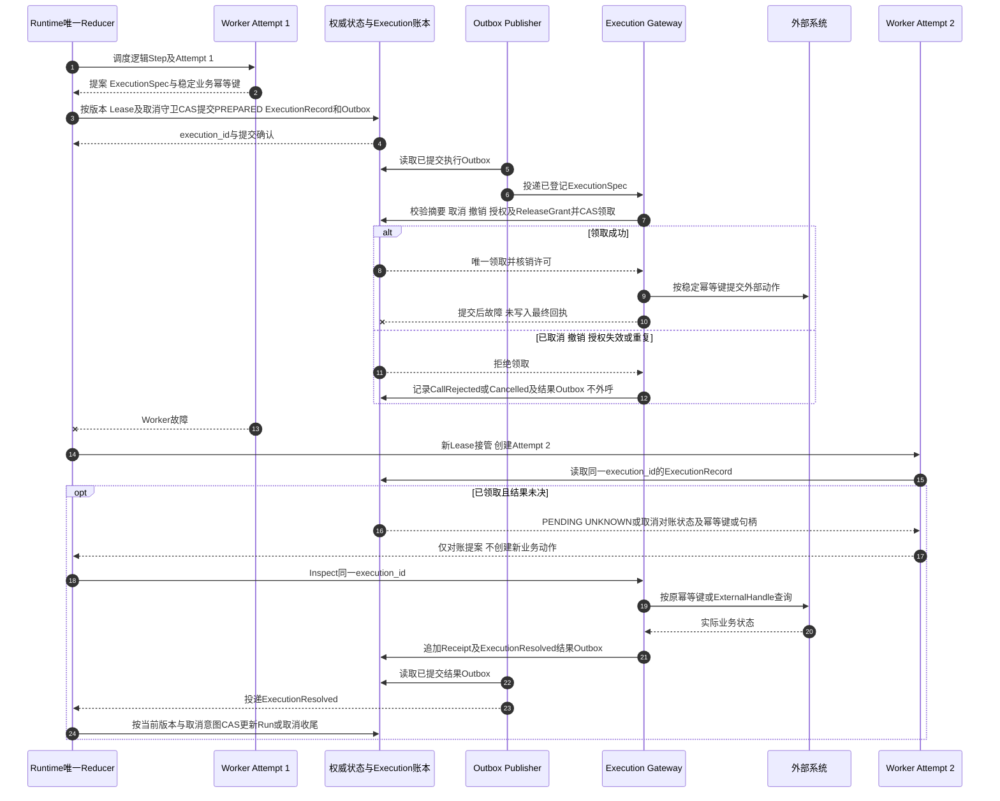

如果 Attempt 2 直接创建新的 ExecutionRecord 并重提动作，平台就失去了跨重试识别同一业务副作用的能力。故障接管只沿同一`execution_id`查询或对账，不需要新增业务副作用。已合法提交的 Outbox 不能因原 Lease 失效而被 Publisher 丢弃；延迟命令在 Gateway 校验记录的`authorized_epoch`、ExecutionSpec 摘要、最新取消/撤销、授权和 ReleaseGrant 并 CAS 领取，不要求原 RunLease 继续存活。取消先于领取则不外呼，外呼已开始则记录真实结果并进入取消对账。

---

## 7. Repair Run：修复必须保留历史

技术验证或业务验收失败后，常见错误是修改原 Run 状态和产物，仿佛第一次运行从未发生。这样会破坏审计、费用和结果可追溯性。

正确方式是保留原 Run 和 Artifact；仅当前 Task 未取消且修复守卫成立时，创建新的 Repair Run。图中的每次修复创建和交付都须由权威聚合 CAS 校验`control_intent != CANCEL`，取消后只保留拒绝事实并收尾：

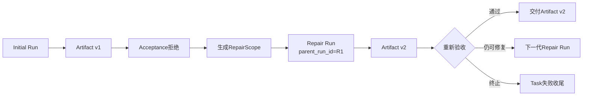

Repair Run 应记录：

- `parent_run_id`；
- `repair_generation`；
- 原验收记录和拒绝原因；
- 允许修改的范围；
- 是否允许复用原数据和中间产物；
- 新预算和截止时间；
- 固定的新 AgentSpec 或明确继承的旧版本。

修复不意味着所有步骤重跑。可以复用已验证且仍有效的产物引用，但复用决策要显式记录。若数据时效、权限或工具版本已变化，应重新获取或重新授权。

Task 的 Run 数量必须受预算和策略限制，避免“验收—修复”形成无限自主循环。

---

## 8. Approval：批准的是固定动作，不是抽象意图

审批记录必须绑定可验证的动作摘要，而不是只写“允许发送邮件”或“允许执行工具”。建议至少包含：

- `call_intent_id`和规范化参数摘要；
- 工具全限定名和版本；
- 目标资源、接收方和数据范围；
- 预期业务影响和可逆性；
- 当前策略版本和资源条件版本；
- 审批人、审批时间、有效期和一次/多次使用限制；
- dry-run、差异或产物摘要；
- 批准、拒绝、撤销或过期原因。

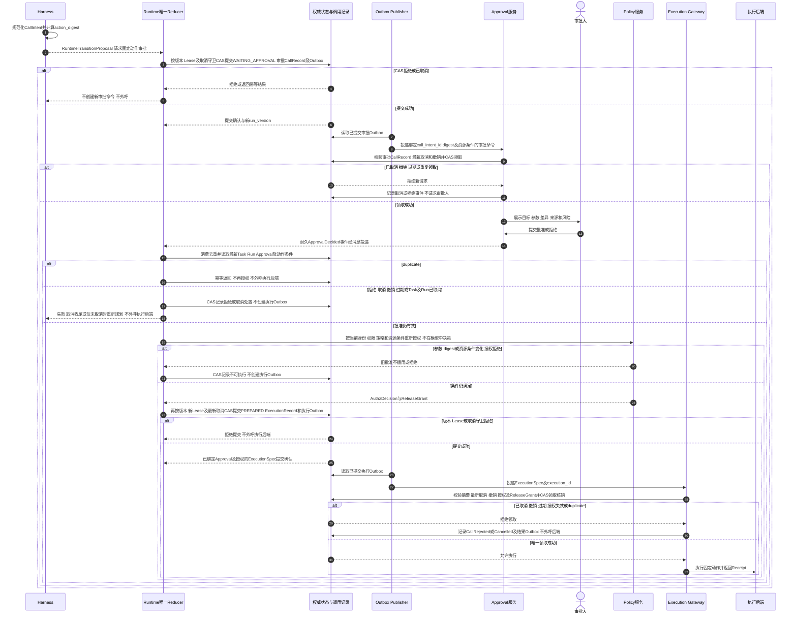

`WAITING_APPROVAL`是 Run 的 WAITING 等待原因，审批 CallRecord 登记审批服务请求，ApprovalRecord 保存人工决定，ExecutionRecord 登记实际业务动作，三者不能混用。Harness 只提供 CallIntent 和状态提案，Runtime 唯一 Reducer 持久提交；批准事件由 Runtime 消费后在模型之外重新授权，因为等待期间用户权限、目标资源、数据等级或策略可能变化。ApprovalRecord 不是长期业务凭据，也不能被另一个参数不同的动作复用；ExecutionSpec 持续绑定同一`call_intent_id`、`action_digest`、规范化参数、目标资源条件、ApprovalRecord、AuthzDecision、ReleaseGrant 及固定 AgentSpec 引用。

拒绝、取消、撤销、过期和 duplicate 不得触发新的业务外呼或执行 Outbox；重新授权之后、Gateway 领取之前再次取消也必须拒绝执行。已经合法提交的 Outbox 仍由 Publisher 投递，不因 Lease 变化丢弃，末端按§6.4 的记录与授权规则 CAS 领取。等待结束后 Runtime 推进需要新有效 RunLease；迟到批准不能清除`control_intent=CANCEL`或重新调度已取消 Run。

---

## 9. UNKNOWN：未知不是失败，也不是成功

外部副作用最危险的状态不是 FAILED，而是 UNKNOWN：平台无法确认动作是否生效。

### 9.1 Execution 状态机

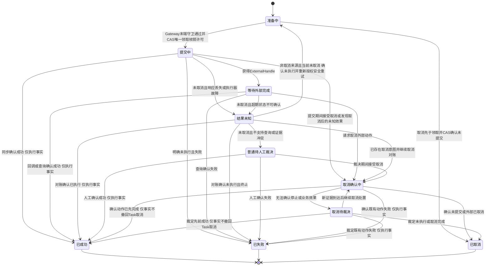

`CANCELLING`表达平台已经持久化取消意图并正在确认外部效果，不等于外部动作已经停止。取消后的未知效果必须隔离到`CANCEL_REVIEW`，不能经 UNKNOWN 或普通 review 回到 PREPARED。UNKNOWN 重试守卫同时要求非取消来源、当前 Task/Run 未取消、证据确认未执行、预算与策略允许以及重新授权；Gateway 领取时再次检查，`control_intent=CANCEL`禁止自动重试、新增业务动作、新 Run 和新 Delivery。

ExecutionRecord 保存执行事实：取消对账若发现先前动作成功，仍记`SUCCEEDED`、Receipt 和 Usage，但 Task/Run 只继续取消收尾，不撤回取消意图、不恢复后续 Step。对账不是“禁止所有外呼”：在授权范围内沿同一`execution_id`执行 inspect 和取消请求仍可进行；需要补偿时必须另建经新授权、必要审批的独立补偿任务及 ExecutionRecord，不得复用原取消 Task 作为正常业务恢复入口。禁止的是新增原业务动作，而非事实查询和受控收尾。无法查询且不可逆的动作必须裁决，不能依赖重试次数碰运气。

### 9.2 人工裁决事实

人工裁决应记录：

- 可用证据和查询结果；
- 决策人和权限；
- 对业务效果的认定；
- 是否需要补偿、通知或风险接受；
- 费用和产物如何处理；
- 仅非取消来源且当前未取消时，是否允许 Task 继续；取消裁决只决定效果认定与取消收尾责任；
- 后续改进或安全事件编号。

人工裁决不是修改历史，而是新增权威事实；不得清除持久取消意图或改变已固定的 terminal_disposition。

---

## 10. 取消和超时：停止请求不等于停止完成

取消具有传播性，也具有不确定性。用户取消 Task 时，平台需要持久化`control_intent=CANCEL`，停止创建新 Run、Step 和 Delivery，撤销待审批及未用许可，向模型请求、工具、浏览器、子 Run 和远程作业传播取消。但外部系统可能不支持取消，或在收到取消前已经完成动作。

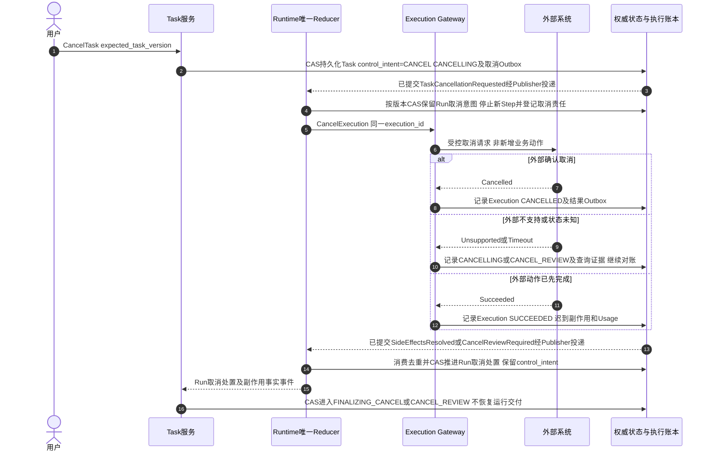

超时也不等同于取消。需要区分：

- Attempt 执行超时；
- Step 截止时间；
- Run 截止时间；
- Task 业务截止时间；
- Approval 有效期；
- ReleaseGrant 有效期；
- 外部系统幂等和查询保留期。

短期执行超时可以终止 Attempt，但不能抹掉可能已发生的外部效果。Task 超时后也可能需要继续对账和费用结算。

取消命令与超时事件竞争时，聚合版本决定唯一状态转移。迟到回调不能让终态 Task 重新运行，但可以产生迟到副作用事件、费用调整或补偿任务。

---

## 11. Artifact、Acceptance 与 Delivery：产物不是一段字符串

Agent 平台的输出可能是报告、代码、配置、图片、数据文件或业务变更。应通过 Artifact 管理，而不是把所有结果直接放进消息正文。

### 11.1 Artifact

Artifact 至少包含：

- 不可变`artifact_id`和版本；
- 内容摘要、大小、类型和存储引用；
- 产生它的 task/run/step；
- 来源数据和 AgentSpec 引用；
- 安全扫描、敏感数据和质量验证状态；
- 可见性、保留期限和删除策略；
- 派生 Artifact 关系。

### 11.2 Acceptance

Acceptance 分为：

- **技术验证**：格式、Schema、来源覆盖、确定性规则、安全扫描；
- **业务验收**：业务负责人确认内容或结果满足 TaskIntent；
- **自动质量评测**：可作为证据，但除非 Task 政策明确允许，不自动等同业务接受。

### 11.3 ResultSelection：固定同一版本证据链

技术验证、业务验收和交付不能分别引用不同 Run 或 Artifact 版本。Task 在进入交付前创建 ResultSelectionRecord，至少固定：

- `task_id`；
- `selected_run_id`；
- `selected_artifact_id/version/digest`；
- 技术验证记录；
- 适用的业务`acceptance_id`，或“不需要人工验收”的政策依据；
- 选择策略版本和聚合版本。

创建或替代 ResultSelection、Repair Run 及 Delivery 均须 CAS 验证当前 Task/Run 未取消；取消后的验收、技术验证或旧交付回执只新增事实，不触发下图的修复、结果选定或新交付。如果 Repair Run 产生 Artifact v2，原 Artifact v1 的迟到验收或交付事件不能覆盖当前选择。更换选择必须产生新的 ResultSelectionRecord 并显式替代旧选择；已开始的旧 Delivery 需要取消、对账或保留为历史，不能静默改绑到新 Artifact。

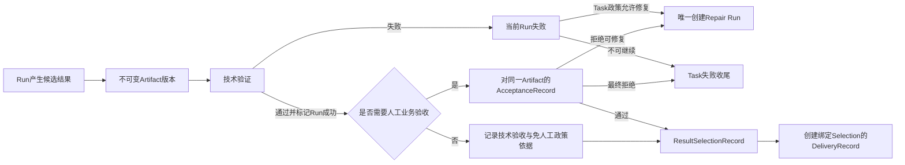

### 11.4 Delivery：交付同样需要 UNKNOWN 与对账

DeliveryRecord 引用 ResultSelectionRecord，并通过`delivery_intent_id`区分两个独立交付意图。交付渠道的状态超时与普通外部动作一样可能产生 UNKNOWN，因此建议复用 ExecutionRecord 的提交、查询、取消和人工裁决协议；DeliveryRecord 保存的是交付业务语义和证据等级。两个标识的职责必须区分：`delivery_intent_id`是交付意图的业务幂等键，同一意图的重试与对账共享它，用于防止重复交付；`delivery_execution_id`是一次具体交付提交的技术句柄，每次重新提交生成新值，用于与渠道消息 ID 和回执对账。简记：intent 标识“要交付什么”，execution 标识“这是第几次交付动作”。

Delivery 成功时还应记录`evidence_level`：

- `PUBLISHED`：产物已发布到受管理位置；
- `SENT`：交付渠道已接受发送请求；
- `CONFIRMED`：目标系统或人工确认收到。

Task 的 DeliveryPolicy 决定哪一级证据足以完成，不应把三者混成同一个状态。

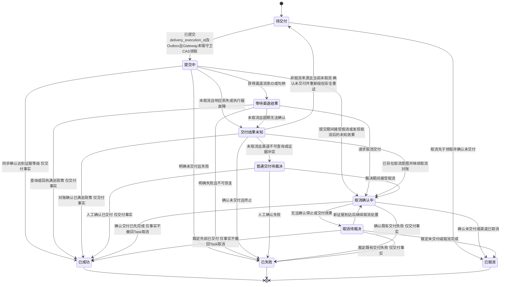

DeliveryRecord 的普通 NEEDS_REVIEW 在 Task 层对应 DELIVERY_REVIEW；取消来源必须进入 CANCEL_REVIEW，不能回到 UNKNOWN、PREPARED 或普通 review。Runtime 先提交关联的 PREPARED ExecutionRecord 及执行 Outbox，再由 Publisher 投递，Gateway 按最新取消、撤销、授权和许可 CAS 领取。取消后确认先前已交付仍记录 Delivery 及关联 Execution 的`SUCCEEDED`事实和证据等级，但不触发 Task 成功 Finalization、不清除`control_intent=CANCEL`，只继续取消收尾。

仅在 Task/Run 未取消、预算与策略允许且重新授权通过时，交付失败才可重试交付，而不是重新运行模型、重新生成 Artifact 或重新执行先前业务动作。只有产物本身失效或验收政策要求重新生成且未取消时，才创建 Repair Run。`control_intent=CANCEL`禁止自动重试、新 Run 及新 Delivery；既有交付可沿同一`delivery_execution_id`、渠道消息 ID、目标记录或接收方证据 inspect/取消并对账，不能盲目重发。独立补偿须新授权，不能以对账为名新增原业务动作。

---

## 12. Usage、Settlement 与 Cleanup：任务的最后一公里

### 12.1 Usage 是事实，Settlement 是处理

UsageRecord 以追加方式记录：

- 模型输入输出 Token 和供应商调用 ID；
- Sandbox CPU、内存、磁盘、网络和时间；
- 浏览器、GPU、远程作业和第三方 API 用量；
- Artifact 存储和交付资源；
- 记录来源、时间和去重键。

SettlementRecord 记录：

- Task 预算预留；
- Step 额度分配；
- 已确认消费；
- 未使用额度释放；
- 退款、补充计费和供应方账单调整；
- 无法立即确认的费用责任。

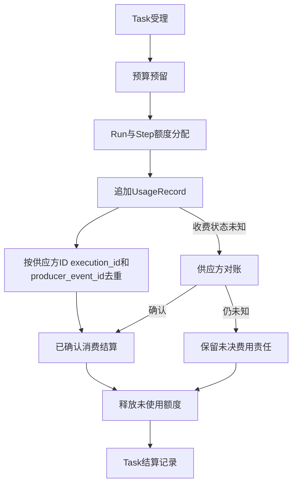

Task 可以在政策允许时带着“已披露的非阻断未决费用”进入业务终态，但不能把未知费用静默记为零。涉及财务准确性或额度风险的未决项可以被定义为终态阻断条件。

### 12.2 Cleanup 是独立事实

Cleanup 不应只是`finally`代码块。它包括：

- 撤销短期凭据和未使用 ReleaseGrant；
- 关闭 Sandbox、浏览器上下文和远程会话；
- 释放租约、临时资源和配额；
- 清理临时工作区、缓存和中间文件；
- 按保留策略归档或删除 Checkpoint、日志和产物；
- 验证跨租户残留不存在；
- 对清理失败发出告警并隔离资源。

CleanupRecord 应记录每个资源的动作、结果、策略版本、执行者和证据。部分资源因审计、法律保留或人工裁决需要继续存在时，应记录保留原因、期限和访问控制，而不是标记“全部清理成功”。

---

## 13. 命令、事件与 Outbox：把意图和事实分开

领域系统中，命令表示“希望发生什么”，可以被拒绝；事件表示“已经发生什么”，应当不可变。

| 类型 | 示例 |
|---|---|
| 命令 | `CreateTask`、`StartRun`、`ApproveAction`、`CancelRun`、`DeliverArtifact` |
| 事件 | `TaskAccepted`、`RunStarted`、`ActionApproved`、`ExecutionUnknown`、`ArtifactDelivered` |

建议的消息信封包括：

- `command_id/event_id`；
- `tenant_id`；
- `aggregate_type/id/version`；
- `idempotency_key`；
- `correlation_id`；
- `causation_id`；
- `occurred_at`；
- `schema_version`；
- `actor/producer`；
- `payload`与必要的安全标签。

CloudEvents 等规范可以统一事件上下文和信封格式，但它们不提供消息队列、顺序或 exactly-once 语义。

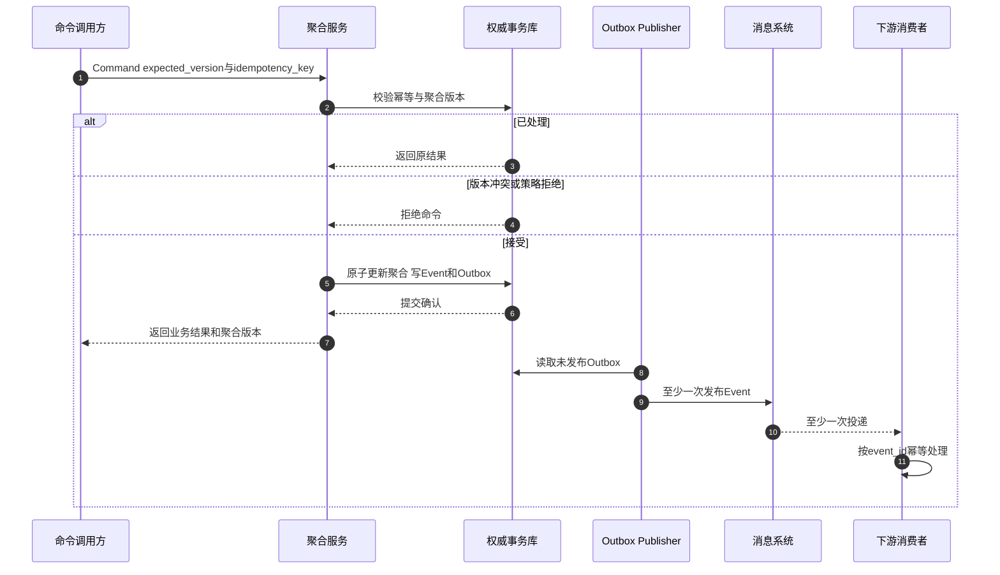

数据库状态与 Outbox 在同一事务提交，解决“状态已经更新但事件未发布”的窗口。Outbox 到消息系统仍可能重复发布，所以消费者必须幂等。消息系统是事件运输，不应成为 Task 或 Execution 当前状态的唯一权威来源。

---

## 14. 并发、顺序与一致性边界

Agent 任务可能同时收到模型结果、工具回调、用户取消、审批决定和定时器事件。平台需要明确顺序范围，而不是追求全局总顺序。

建议：

- Task 状态按`task_id`串行或使用聚合版本条件更新；
- Run 状态按`run_id`维护租约和单调 epoch；
- Execution 按`execution_id`去重和裁定；
- Delivery 按 artifact、destination 和 policy 维护顺序；
- Usage 可并行追加，结算时按去重键归并；
- 跨聚合不要求单一事务，以 Saga 或事件协调。

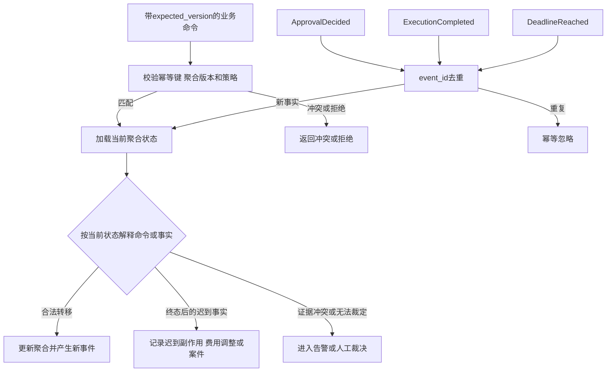

`expected_version`用于调用方对目标聚合发出的命令；外部聚合产生的事实事件通常只携带自身事件 ID、来源版本和因果信息，接收方不能仅因来源版本早于当前状态就丢弃事实。它应按`event_id`去重，再结合目标聚合当前状态判断正常转移、迟到处置或人工裁决。

终态不可复活并不意味着迟到事件被丢弃。迟到的执行成功可能需要记录真实副作用、追加 Usage、通知用户或创建补偿任务，只是不能直接重开原 Task。

---

## 15. 常见错误建模

### 15.1 用 Session 代替 Task

Session 关闭后任务无法继续；同一会话中的多个业务目标、权限和验收条件互相污染。Session 只提供上下文引用。

### 15.2 Run 成功即 Task 完成

忽略业务验收、交付、费用和清理。Run 成功只能让 Task 进入验收或交付阶段。

### 15.3 Attempt 与 ExecutionRecord 一一对应

Worker 重试会创建新的外部动作，导致重复支付、发布或删除。ExecutionRecord 必须跨 Attempt 稳定。

### 15.4 把 UNKNOWN 改成 FAILED 再自动重试

无法确认动作是否发生时盲重试，可能重复不可逆副作用。UNKNOWN 必须先对账。

### 15.5 Approval 只绑定工具名

批准“调用邮件工具”之后，收件人、附件和内容可以被替换。审批必须绑定规范化动作摘要和资源条件。

### 15.6 取消等于回滚

取消只是停止请求。外部动作可能已经完成、正在执行或不支持取消，需要继续对账。

### 15.7 修改原 Run 完成修复

破坏产物、审计、用量和验收历史。修复应产生新的 Repair Run 和 Artifact 版本。

### 15.8 Usage 直接作为最终账单

供应方延迟、重复或调整会造成误结算。Usage 与 Settlement 分离。

### 15.9 终态被迟到事件复活

导致完成任务重新运行或取消任务继续执行。迟到事实应生成独立事件和处置，不改变终态。

### 15.10 使用消息队列作为唯一状态库

事件可以回放，但当前状态、条件更新、审批竞争和 Execution 对账仍需要明确权威存储和一致性规则。

---

## 16. 验证业务闭环的故障测试

领域模型是否成立，需要通过并发和故障测试验证。

| 测试场景 | 期望结果 |
|---|---|
| 同一 client_request_id 并发提交 | 只产生一个 Task 并返回同一受理结果 |
| Initial Run 成功但需要人工验收 | Task 进入 WAITING_ACCEPTANCE，不直接完成 |
| 验收拒绝但允许修复 | 保留旧 Run/Artifact，创建新 Repair Run |
| Repair Run 选中 Artifact v2 后收到 v1 迟到验收 | 不改变 ResultSelection，不交付旧 Artifact |
| ResultSelection 被新选择替代时旧 Delivery 仍在途 | 未完成的旧 Delivery 进入取消与对账，不伪装成从未发生；已完成交付不撤销；后续交付只引用新选择 |
| 同一 Step 重复投递 | 可产生新 Attempt，不产生重复逻辑 Step |
| Worker 在外部提交后崩溃 | 新 Attempt 读取同一 ExecutionRecord 并先对账 |
| 执行响应丢失 | Execution 进入 UNKNOWN，不自动改成 FAILED |
| 审批通过与取消同时发生 | Runtime 按版本、Lease 与取消 CAS 提交；若取消先于 Gateway 领取则无业务外呼，已开始则对账，不复活 Task |
| WAITING_APPROVAL 接受取消后或 CANCEL_REVIEW 期间收到迟到批准 | 去重记录决定但不重新授权、不建执行 Outbox、不外呼；保留 control_intent=CANCEL，不重新调度 Run |
| 拒绝、撤销、过期或 duplicate ApprovalDecided | 无新增 ExecutionRecord、执行 Outbox 或业务外呼；重复事件幂等且不重复核销 ReleaseGrant |
| 审批后参数变化 | action_digest 失配，旧 Approval 失效 |
| Harness 提出调用后、CallRecord 与 Outbox 提交前崩溃 | 不发生模型、数据、审批服务或工具调用；恢复后重新解释原事件，不出现未登记外呼 |
| ExecutionRecord 与 Outbox 提交后、Gateway 领取前取消 | Publisher 仍投递，Gateway 按最新取消拒绝 CAS 领取并记录 CallRejected/Cancelled，无业务外呼 |
| 合法 Outbox 提交后原 Lease 到期并接管 | Publisher 不丢弃；未取消命令按 authorized_epoch 及记录摘要/授权/许可唯一领取，旧 Worker 新提案被 fencing 拒绝 |
| Task 所有可取消状态及 Run VERIFYING 期间取消 | CAS 进入 CANCELLING，未知效果进入 CANCEL_REVIEW；迟到验证不得提交 Run SUCCEEDED |
| Task/Run 取消裁决确认未执行且普通重试政策允许 | 仍只取消收尾，不能回 RUNNING、DELIVERING 或 QUEUED；control_intent 不可清除，无自动重试、新 Run 或 Delivery |
| Execution/Delivery CANCEL_REVIEW 裁定先前成功或未执行 | 成功保留 SUCCEEDED 事实但 Task 取消不撤回；未执行只取消收尾，不经 UNKNOWN 回 PREPARED；对账沿原 execution_id |
| 取消后远程作业完成 | 记录迟到成功、副作用和费用，不继续后续 Step |
| Delivery 明确发送失败 | 仅未取消且重新授权通过时在交付预算内重试，不重新执行 Run |
| Delivery 提交成功但回执丢失 | 进入 UNKNOWN 并按渠道句柄对账，禁止盲目重发 |
| 重复 Usage 事件 | 按唯一键去重，仍保留合法调整事件 |
| Cleanup 部分失败 | Task 按策略阻断终态或显式记录隔离和待处理责任 |
| 三类 Finalization 使用错误意图、旧版本或缺失结算清理证据提交终态 | CAS 拒绝；成功额外验证同版本验收交付及关键效果，取消验证持久取消与效果裁定，失败验证失败决定；未齐保持非终态 |
| Finalization 意图固化后收到取消、迟到成功或普通裁决 | 不改写 terminal_disposition；已接受的 control_intent=CANCEL 不可清除，不切换成功/失败/取消收尾，review 不冒充终态 |
| 终态后收到迟到事件 | 记录新事实或案件，不修改终态 |
| Outbox 重复发布 | 下游按 event_id 幂等处理 |

测试不仅检查最终状态，还要检查事件序列、聚合版本、ExecutionRecord 数量、费用、Artifact 版本和清理证据。

---

## 17. 本篇结论与后续专题

Agent 业务闭环的核心不是画一条“用户—模型—工具—答案”的链路，而是把不同阶段的事实拆开：

- Session 承载交互，Task 承载业务目标；
- Run 表示一次执行，Step 表示逻辑进度，Attempt 表示基础设施尝试；
- ExecutionRecord 跨 Attempt 稳定地记录外部副作用；
- Run 成功产生通过技术验证的候选结果，Acceptance 决定是否接受；
- ResultSelection 固定最终采用的 Run、Artifact 版本和 Acceptance 证据链；
- Delivery 只交付选定结果，并对提交超时使用 UNKNOWN、查询和人工裁决；
- Usage 记录消费事实，Settlement 处理预算和费用；
- Cleanup 记录凭据、资源和数据收尾；
- UNKNOWN 必须对账，取消必须处置迟到副作用，终态不能被迟到事件复活。

这套模型让 Agent 的不确定推理运行在确定的业务状态和事实协议之上。它既可以由数据库状态机和 Outbox 实现，也可以映射到持久工作流平台，但不能把框架的 Run ID、Session 或 Event History 直接等同于完整业务 Task。

下一篇将从这些领域对象向外展开，给出生产级 Agent 平台的总体功能域、主数据流、控制面与执行面架构。

---

## 参考资料

1. [Temporal Workflow Execution](https://docs.temporal.io/workflow-execution)
2. [Temporal Workflow Execution Chain](https://docs.temporal.io/workflow-execution/workflow-execution-chain)
3. [Temporal Workflow ID](https://docs.temporal.io/workflow-execution/workflowid-runid)
4. [CloudEvents](https://cloudevents.io/)
5. [CloudEvents Specification](https://github.com/cloudevents/spec)
6. [Google ADK Events](https://adk.dev/events/)
7. [Google ADK Sessions](https://adk.dev/sessions/)
