# 生产级 Agent 平台总体架构：从主链到功能域

> **系列**：生产级 Agent 平台架构 2026 · 第 3 篇  
> **定位**：架构基础篇  
> **版本**：闭环修订版  
> **前置阅读**：第 0 篇《从模型推理到生产运行：2026 年 Agent、Harness 与 Runtime 总体架构》 · 第 1 篇《Agent、Harness 与 Runtime：生产级 Agent 平台的职责边界》 · 第 2 篇《从 Task 到交付：Agent 业务闭环与领域对象设计》  
> **关键词**：Agent 平台、功能域、Agent Runtime、网关、控制面、执行面、主数据流

## 摘要

生产级 Agent 平台不能以“模型、向量库、MCP、工作流和 Sandbox”的组件清单来定义。组件说明系统拥有什么，却没有说明任务如何可靠进入、Agent 意图如何被治理、动作如何不可旁路地执行、结果如何形成权威事实，以及失败后由谁恢复。

本文在前两篇职责边界和领域模型的基础上，给出一套完整逻辑架构。平台包含接入与任务、Agent 资产与版本、Agent Runtime、身份策略与审批、模型、数据与记忆、产物验收与交付、用量结算与资源治理、状态持久化与账本基础、可观测评测与运营十个顶层功能域；Execution Runtime 作为 Agent Runtime 内部具有独立权限与扩缩特征的执行子域单列说明。Run 期的模型、检索和工具结果均转化为 RuntimeEvent 或 Observation 回到 Harness；DeliveryEvent 回到产物验收与交付域。API、MCP、浏览器、远程作业、交付和 Sandbox 的外部副作用均经统一执行入口和执行账本；Task 终态仍由验收、交付、结算和清理共同决定。

架构逻辑上可从控制面、运行协调面和执行面观察：控制面管理版本、能力、身份和策略；运行协调面由 Agent Runtime 承载生命周期、Harness、状态和恢复；执行面由 Execution Runtime 协调适配器与资源后端。三者是职责视角，不等同于固定微服务数量。八类逻辑网关可以物理归并，但任何归并都不能形成模型、数据或工具旁路。

本文只建立平台级功能域、主链和依赖关系。Runtime 内部算法与能力模型（第 4 篇）、Harness 与 Agent Loop（第 5 篇）、持久执行（第 6 篇）、Execution Runtime 与多执行后端（第 7 篇）、安全执行环境（第 8 篇）、零信任（第 12 篇）、网关与安全治理（第 13 篇）、弹性与高可用（第 15–17 篇）将在后续专题中展开。

---

## 1. 从系统上下文开始，而不是从技术栈开始

仍沿用系列统一场景：用户要求 Agent 读取授权数据，形成分析报告，在必要审批后发布到指定业务系统。

这一任务至少连接八类外部主体：用户或调用系统、企业身份系统、模型服务、数据与记忆系统、业务工具和 MCP Server、审批人、交付系统以及模型和资源供应方。每个主体提供的事实不同：模型提供响应，数据系统提供来源，工具提供外部业务状态，审批人提供动作决定，交付系统提供发布或送达证据，供应方提供用量和账单。

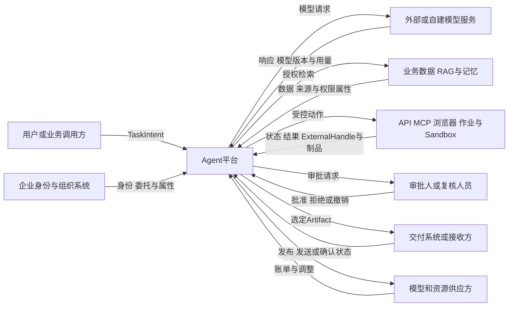

平台是这些交互的协调者，不替代外部系统的事实权威：

- 模型响应不是业务事实；
- ExecutionReceipt 不是外部系统效果的独立证明；
- 审批通过不是权限永久有效；
- 网络超时不代表动作没有发生；
- 文件生成不代表业务已验收；
- 发送请求成功不一定等于最终送达。

因此，总体架构必须围绕事实归属和信任边界组织，而不是按产品 Logo 堆叠。

---

## 2. 总体架构的五条原则

### 2.1 一条主链

Run 期用户输入、模型响应、检索结果和工具输出由同一个权威 Run 状态机解释；DeliveryEvent 由交付域解释。不存在由工具回调直接唤起模型、由 MCP 结果直接生成下一次工具调用、或由 Sandbox 输出直接触发生产动作的旁路。外部事实先登记、去重，再在当前状态下解释，不能借迟到事件复活被取消的 Run。

### 2.2 意图、权威提交与动作分离

Agent 只产生`ModelCallIntent`、`RetrievalIntent`、`CallIntent`或`AnswerDraft`。Harness 结合 Task 目标、策略、审批和预算产生受约束的调用提案及`RuntimeTransitionProposal`，不直接修改权威 Run 状态。Runtime 唯一 Reducer 按 Run 版本、租约、取消和撤销约束提交状态、调用记录与 Outbox，执行方消费已登记命令后再验证当前授权并真正外呼。

模型和数据调用分别使用 ModelCallRecord 及 DataRequest/MemoryWriteRecord；工具和交付副作用使用 ExecutionRecord。后者经 Execution Gateway 和 Execution Runtime 完成。即使同进程实现，也必须保持“先耐久提交、后调用”，不能调用结束后再补记录。

### 2.3 状态与计算分离

Task、Run、Execution、Approval、Artifact、Delivery、Usage 和 Cleanup 的权威事实独立于 Agent 进程、Worker、Pod、虚拟机和 Sandbox。计算实例可以替换，业务状态不能依赖实例存活。

### 2.4 零信任贯穿调用

身份已经认证、服务位于内网、工具已注册、模型输出结构化或内容已扫描，都不能自动获得信任。每次高影响动作都要结合当前主体、资源、参数、策略、审批、预算和撤销状态重新验证。

### 2.5 能力优先于产品

架构先定义能力、契约和故障语义，再选择框架、消息、数据库、容器平台或托管服务。Kubernetes、虚拟机、Kafka、Temporal 或某个云 Runtime 都是候选实现，不是架构本身。

---

## 3. 平台首先要闭合业务生命周期

总体架构必须覆盖从 TaskIntent 到业务终态的全部阶段：

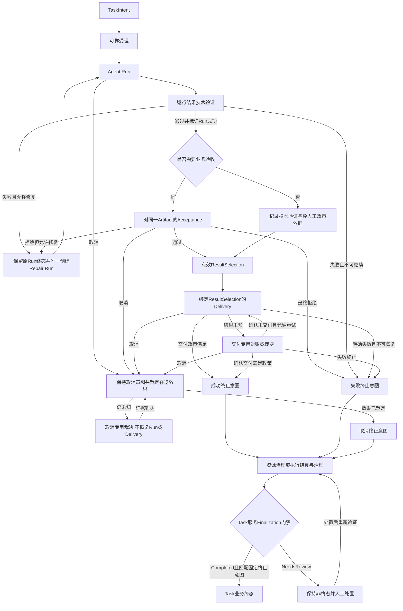

这条链路决定了平台不能只建设“Agent 执行域”。至少还需要可靠受理、验收交付、费用结算和清理能力。Run 成功只是候选结果通过技术验证；Task 完成需要固定同一`Run—Artifact—Acceptance—Delivery`证据链，且关键 UNKNOWN 已经处置。

失败、取消和超时也进入收尾：失败不要求业务验收，但要停止新步骤、裁定在途副作用、结算已确认用量并处理资源与数据；取消是持久意图，不等于外部动作已经撤销。Task 服务先固化成功、失败或取消的`terminal_disposition`；用量结算与资源治理域只返回`FinalizationCompleted`或`FinalizationNeedsReview`，不能自行改变 Task 状态。只有 Completed 且与固定终止意图一致时，Task 服务才能提交终态。

---

## 4. 十个顶层功能域与一个执行子域

功能域按责任、权威事实和扩缩特征划分，不要求每个域对应独立产品。Execution Runtime 在逻辑上属于 Agent Runtime，但因权限边界、后端协议和扩缩模式显著不同，作为内部执行子域单独描述；这种“单列”不表示它与 Agent Runtime 平行。

| 功能域 | 核心职责 | 主要事实或输出 |
|---|---|---|
| 接入与任务域 | 接收请求、认证入口、租户路由、风险分级、可靠受理 | Task、首 Run、Reservation、Outbox |
| Agent 资产与版本域 | 管理 AgentSpec、Prompt、工具描述符、插件、模型路由及发布 | 不可变版本、兼容策略、发布清单 |
| Agent Runtime 域 | 生命周期、Harness/Runner、Agent Loop、调度、Checkpoint 和恢复 | RuntimeEvent、Run/Step/Attempt 状态 |
| 身份策略与审批域 | 工作负载身份、委托、PDP、HITL、凭据与预算 | AuthzDecision、Approval、ReleaseGrant |
| 模型服务域 | 模型路由、请求治理、推理、流式响应和模型用量 | ModelEvent、模型版本和 Usage |
| 数据与记忆域 | RAG、业务数据、短期上下文、长期记忆及来源治理 | DataResult、MemoryRecord、来源与风险属性 |
| Execution Runtime 执行子域（属于 Agent Runtime） | 执行入口、账本、适配器、取消、回执、对账和资源边界 | ExecutionRecord、Receipt、ExternalHandle |
| 产物验收与交付域 | Artifact、技术验证、业务验收、结果选择和交付 | ResultSelection、Acceptance、Delivery |
| 用量结算与资源治理域 | 预算预留、Usage 归集、Settlement、凭据与资源释放、数据清理协调 | Reservation、Usage、Settlement、Cleanup |
| 状态持久化与账本基础域 | 为各领域权威事实提供事务存储、事件、Outbox、定时器和归档基础 | 聚合版本、事件、Outbox、定时器与归档引用 |
| 可观测评测与运营域 | Trace、指标、审计、安全监测、评测、红队、FinOps 和发布反馈 | 告警、评测报告、候选策略和版本 |

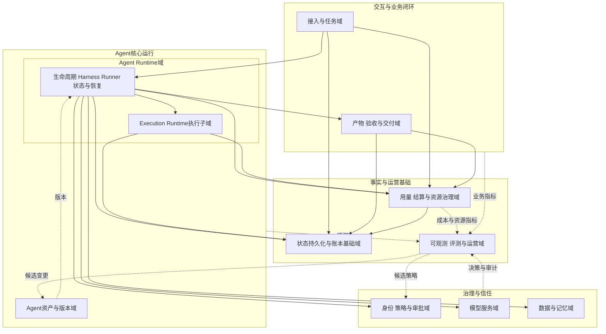

状态持久化与账本基础域不是“统一大数据库”的同义词。Task、Run、Execution、Approval、Artifact 和 Settlement 可以拥有不同物理存储，但各自领域所有者、事务边界和跨域事件必须明确。

---

## 5. 总体逻辑架构

下面把十个顶层功能域及 Agent Runtime 内部执行子域放入一条受治理主链中。为保持可读性，总体逻辑架构拆为两张图：图 5-1 聚焦请求执行主链与回程对账，图 5-2 聚焦控制面、验收交付、用量结算与事实基础。两图中同名节点（如 DB、OP、TASK、HR、RD、PDP）为同一逻辑组件；图 5-2 中 MAIN 节点的入出边是对图 5-1 主链各节点的归并表示（如 LIFE 与 XP 的状态写入、模型/数据/执行三类 Usage、LIFE 与持久队列的交互）。

**图 5-1 受治理执行主链（接入 → 执行 → 回程对账）**

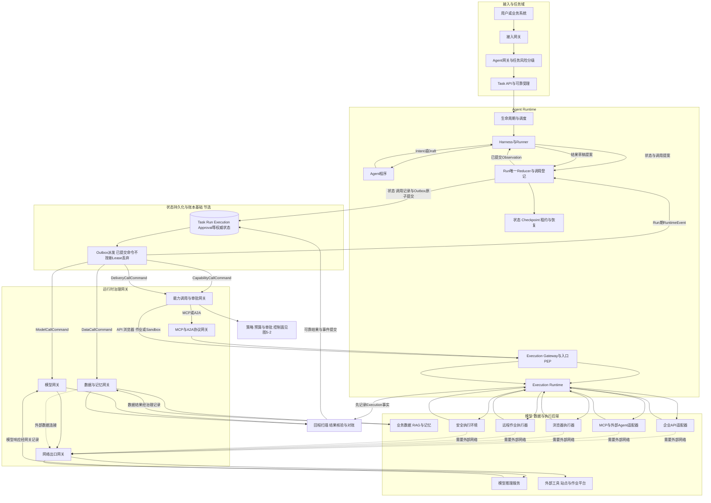

**图 5-2 控制面、验收交付、用量结算与事实基础**

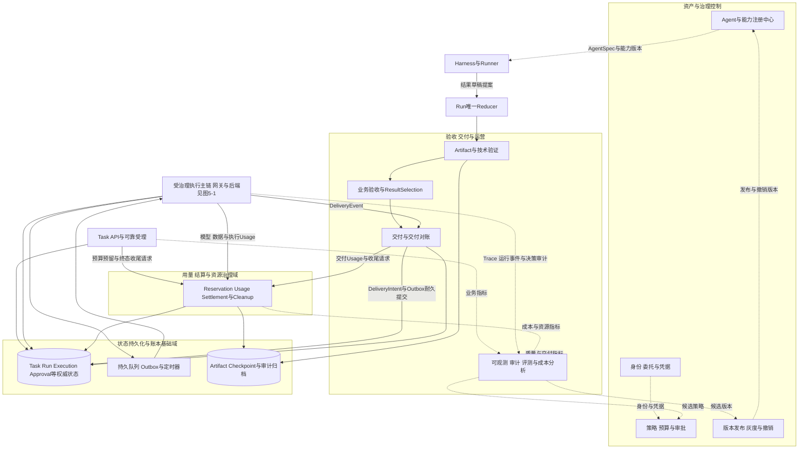

图中的 Execution Gateway/PEP 是八类逻辑网关之一，同时也是 Execution Runtime 对外暴露的强制入口，因此逻辑所有权属于 Agent Runtime 执行子域；它可以独立部署，但不存在绕过该入口直达适配器的内部通道。交付域先登记 DeliveryIntent、绑定 ResultSelection 并提交 Outbox，再复用执行链，Delivery 结果经耐久事件返回交付域完成对账。

模型、数据和 Execution 调用执行方都须在真正外呼前校验调用记录、规范化摘要、当前授权、许可有效期、control_intent 及 revocation epoch，并以条件更新领取调用记录；取消、撤销或重复投递不能直接触发新动作。已提交 Outbox 不会因原 Worker 租约释放而丢弃：延迟命令验证已登记调用记录的授权来源，而当前 Worker 新增提案仍须校验当前 Lease。读取控制状态与领取记录应使用明确的一致性协议；即使本地门禁原子，远端提交前后仍有不可消除的故障窗口，需目标条件更新和副作用对账。

图中的数据库是逻辑存储集合。只有处于同一事务边界的 Run 状态、调用意图和 Outbox 才承诺原子提交；独立的 Execution 或审批服务通过稳定 call_id、幂等命令和耐久响应事件关联，不宣称跨服务数据库或远端 API 共同原子。

### 5.1 不可旁路规则

架构必须满足：

1. Agent 不能直接调用模型服务，模型请求经 Harness 和模型网关；
2. Agent 不能直接读取长期记忆或业务数据，检索经数据与记忆网关；
3. Agent 不能直接调用工具，CallIntent 经能力治理、协议适配和执行入口；
4. MCP/A2A 协议网关只处理相应协议，不能成为 API、浏览器和 Sandbox 的错误必经点；
5. 所有外部副作用，包括产物发布与交付，最终进入 Execution Runtime 和 ExecutionRecord；
6. 需要外部网络的模型、数据连接和执行调用经过网络出口控制；内部数据与工具调用仍受服务身份、对象授权和网络策略约束，写入操作保留变更审计；
7. Run 期的模型、检索和工具结果回到 Harness 形成 RuntimeEvent 或 Observation；DeliveryEvent 回产物验收与交付域。两类结果都不能由执行器直接触发下一轮 Agent 行为或 Task 终态；
8. 运营系统只能产生候选版本和策略，不能绕过发布审批直接修改生产权限。

### 5.2 图中未表达的物理细节

逻辑总图不规定具体数据库、消息系统、容器平台和云产品，也不表示所有箭头都是同步网络调用。关键状态提交可能同步，审计归档和评测采样可以异步；PDP 可以使用本地签名策略包加速，身份和撤销状态仍要符合执行时要求。

---

## 6. 控制面、运行协调面与执行面

从平台运行视角，可将能力抽象为三个平面和两个横向基础域。

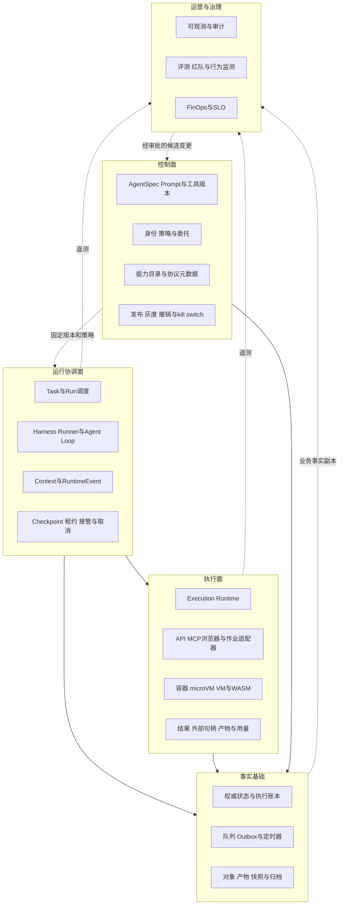

### 6.1 控制面

控制面管理相对低频、影响全局的定义和版本：AgentSpec、Prompt、模型路由、工具描述符、策略、身份委托、镜像、执行 Profile 及发布清单。控制面故障不应导致运行面自动扩大权限；已运行 Task 要么使用固定且仍有效的版本继续，要么按策略暂停或降级。

### 6.2 运行协调面

运行协调面由 Agent Runtime 承载，负责高频业务推进：读取 Run 状态、启动 Harness/Runner、调用 Agent、协调模型和工具、等待审批、持久化事件、恢复与接管。它管理逻辑运行，但不直接假定外部动作已发生。

### 6.3 执行面

执行面由 Execution Runtime 及其后端组成，负责把已授权 ExecutionSpec 落到 API、MCP、浏览器、作业或 Sandbox。它实施执行时验证、资源限制、凭据使用、状态查询、回执和对账，不重新决定 Task 目标。

### 6.4 事实与运营基础

事实基础提供耐久状态和跨实例恢复；运营域消费遥测和事实副本用于监测、评测和成本分析。普通 Trace 不能代替执行账本，安全告警也不能代替动作阻断。

三个平面可以同进程、同集群或跨服务部署，但每个 Run 只能有一套权威推进语义，每个外部动作只能有一条受治理执行路径。

---

## 7. 八类逻辑网关

网关是信任边界上的策略执行点，不一定都是独立网络代理。

| 逻辑网关 | 控制对象 | 核心职责 | 不负责 |
|---|---|---|---|
| 接入网关 | HTTP/API 入口 | 认证接入、WAF、协议限制、租户限流 | Agent 语义和工具授权 |
| Agent 网关 | TaskIntent | Agent 路由、风险分级、自治等级、任务大小和范围 | 模型推理和物理执行 |
| 模型网关 | ModelCallIntent | 模型路由、数据最小化、预算、流式治理和用量 | Task 验收与工具执行 |
| 数据与记忆网关 | RetrievalIntent/MemoryWrite | 数据授权、来源、租户隔离、检索和记忆写入治理 | 将检索结果证明为真实无害 |
| 能力调用网关 | CallIntent | 工具版本、参数、目标、预算、审批和 AuthzDecision | 直接运行任意后端 |
| MCP/A2A 协议网关 | MCP/A2A 消息 | 企业本地准入目录、协议转换、对端认证、版本和描述符/Agent Card 治理 | 替代业务授权、全局信任准入（MCP 官方 Registry 仅为发现层）和执行账本 |
| 执行网关 | ExecutionSpec | 执行时身份、epoch、许可、撤销、去重和 ExecutionRecord | 重新解释 Agent 目标 |
| 网络出口网关 | 出向连接 | 默认拒绝、目标和协议控制、DNS、重定向、流量审计 | 判断完整业务语义 |

协议网关中的准入目录和对端治理是企业平台能力，不是 MCP 或 A2A 天然提供的全局目录。MCP 的 HTTP 授权覆盖客户端到 MCP Server 这一协议边界，不替代下游业务授权、参数级策略和 ExecutionRecord；stdio 等传输也采用不同凭据边界。A2A 的 Agent Card 用于描述 Agent 端点和能力，实际调用仍需逐请求认证授权。

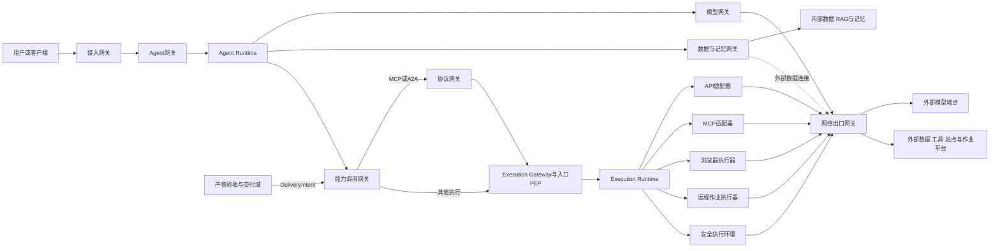

### 7.1 物理归并

小规模系统可将逻辑网关归并为少量部署单元，例如：

- 边界接入单元：接入网关；
- Agent 访问单元：Agent 网关、模型网关；
- Data Gateway：数据与记忆网关；
- Capability Gateway：能力调用、MCP/A2A 协议治理；
- Execution & Egress：执行入口和网络出口。

归并的前提是策略顺序、权限和审计仍可区分。把所有职责塞进一个“AI Gateway”并不能消除边界，只会让变更、扩缩和故障影响相互耦合。

---

## 8. 三类 Intent 如何分流并重新汇聚

Agent 的输出不能直接映射为网络调用。Harness 首先把提案归类，再交给不同治理路径。

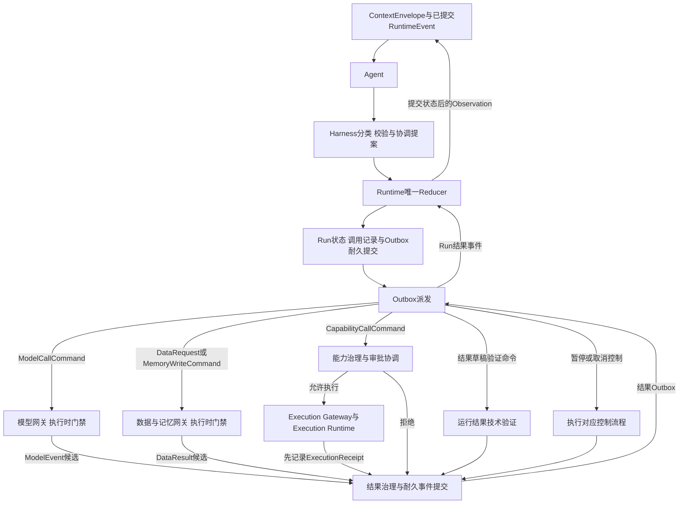

几条路径有不同语义：

- 模型调用可以在明确未提交时重试，但供应方可能已经计费；
- 检索通常是只读，却仍受数据权限、成本和来源污染约束；
- 工具调用可能产生不可逆副作用，需要审批、许可、执行账本和 UNKNOWN；
- AnswerDraft 需要技术验证，并不直接完成 Task；
- ControlProposal 只是 Agent 建议，Runtime 状态机决定实际暂停、委托或终止。

Run 期结果先形成耐久事实和事件，由 Runtime 唯一 Reducer 在当前 Run 状态、控制意图及版本下解释；状态提交后，Harness 才将带来源的 Observation 交给 Agent。DeliveryEvent 由交付域消费，不重新启动 Agent。新增调用前后都需保留 CallRecord 和 Outbox，回程事实不能补写成先前未存在的授权。

---

## 9. 端到端正常主链

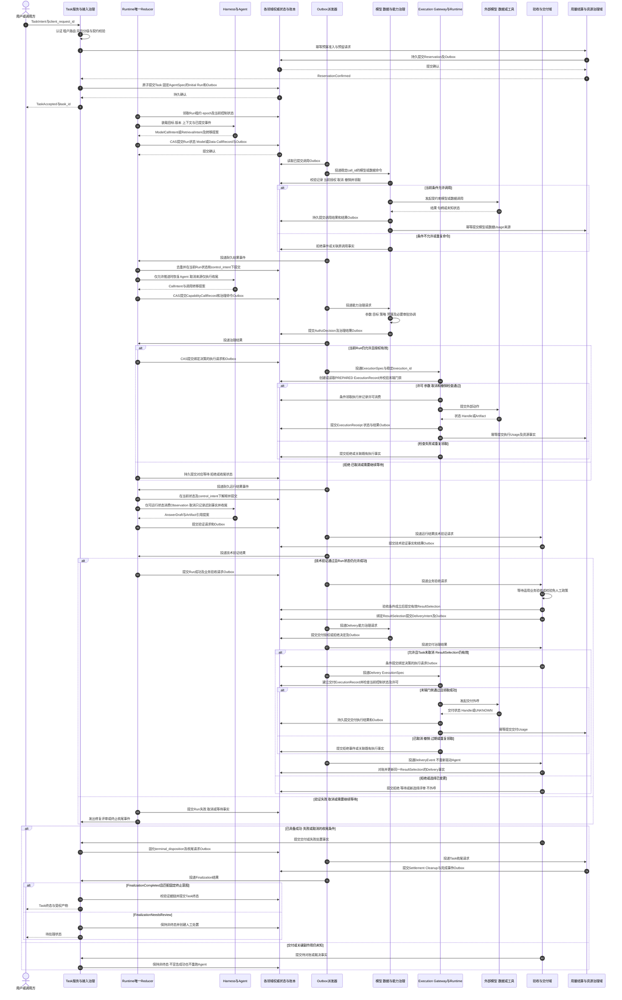

正常主链中也不存在跨全系统的单一事务。每个关键事实先在自身事务边界提交，再通过事件推进下一阶段。预算预留成功但 Task 提交失败时，通过同一 client_request_id 和 Reservation 引用幂等释放或重试受理，不能遗留不可追踪预留。模型、数据和执行调用失败时，不回滚已经提交的受理事实，而是进入相应重试、降级、对账或收尾路径。

---

## 10. 异常与恢复主链

总体架构必须把异常视为正常输入，而不是统一抛给“重试机制”。

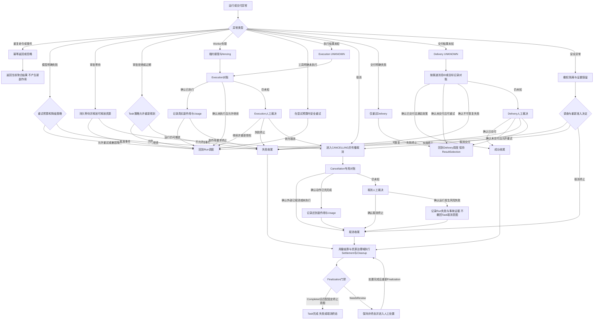

### 10.1 不同异常不能共用同一重试策略

- 模型超时涉及费用和非确定性响应，重试可能得到不同内容；
- 检索超时通常可重试，但数据版本和授权需要重新验证；
- API 提交超时可能已经产生副作用，必须先查询；
- 浏览器页面超时不能证明表单没有提交；
- 远程作业取消可能异步生效；
- Sandbox 故障只说明本地环境异常，不代表远端请求未发生；
- Delivery 响应丢失可能已经送达，不能盲目重发。

### 10.2 接管不是重放全部动作

新 Worker 接管 Run 后读取权威历史、固定版本和 ExecutionRecord，先对账在途动作，再决定继续。租约和 fencing 保证旧 Worker 不能继续提交新的平台执行命令，但不能撤回已经送到外部系统的请求。

取消、普通 Execution UNKNOWN 和 Delivery UNKNOWN 必须保留各自来源语义：取消对账即使发现动作已先完成，也只能记录迟到副作用后进入取消收尾，不能恢复 Run；Delivery 对账始终绑定原 ResultSelection，只能恢复 Delivery 或进入交付终态，不能重新执行 Agent。

异常图中任何“回到 Run 调度”“回到 Delivery 调度”或“可恢复”出口，都只是候选恢复决定，必须经相应领域的条件更新确认当前 control_intent 不是 CANCEL、对象非终态、授权和版本仍有效。已经进入取消专用裁决的对象不允许使用这些出口；调查、模型降级或迟到批准也不能清除持久取消意图。

---

## 11. 数据与状态归属

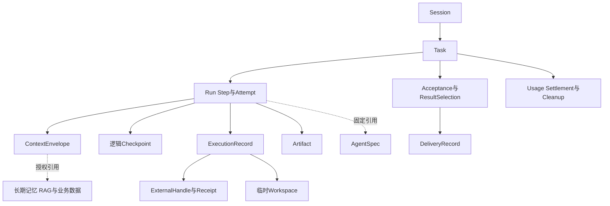

领域所有者定义状态转移、命令和事实语义；状态持久化与账本基础域提供事务、事件、对象和归档等持久化能力，但不会因为保存了记录就自动拥有业务决策权。二者可以部署在同一数据库，也必须保持逻辑区分。

| 状态或数据 | 领域所有者（定义语义） | 典型持久化基础 | 不应由谁单独持有 |
|---|---|---|---|
| Session | 接入与任务域中的会话服务 | 会话存储与事件历史 | 浏览器连接或单个 Worker 内存 |
| Task 与业务终态 | 接入与任务域中的 Task 服务 | 事务状态库与 Task 事件 | Agent、模型或 Run 状态机 |
| Run/Step/Attempt | Agent Runtime 域 | Runtime 状态库、队列与 Checkpoint | 单个 Runner 进程 |
| AgentSpec | Agent 资产与版本域 | 版本注册库与对象存储 | 动态 Prompt 拼接结果 |
| ContextEnvelope | Agent Runtime 中的 Harness/Context 服务 | 状态引用与受控对象存储 | 模型上下文窗口本身 |
| 长期记忆与 RAG | 数据与记忆域 | 数据库、向量索引与对象存储 | Agent 自生成文本 |
| Approval 与 ReleaseGrant | 身份策略与审批域 | 审批/授权账本 | Agent 或 Sandbox |
| ExecutionRecord | Agent Runtime 中的 Execution Runtime 子域 | 执行账本 | 工具 stdout 或普通 Trace |
| Artifact、Acceptance 与 ResultSelection | 产物验收与交付域 | 对象存储和事务状态库 | 对话消息正文 |
| Delivery | 产物验收与交付域 | Delivery 状态库及关联 ExecutionRecord | “发送接口返回 200”的临时变量 |
| Usage 与 Settlement | 用量结算与资源治理域 | 追加式用量账本与结算库 | Redis 计数器或供应方单次响应 |
| Cleanup | 用量结算与资源治理域协调各资源所有者，Task 服务消费完成事实 | Cleanup 账本、资源清单与归档 | finally 代码块 |

### 11.1 数据流和状态流分离

Artifact、大型工具结果和数据集通过对象引用流转，不复制进所有事件和模型上下文。状态事件保存摘要、引用和版本；访问 Artifact 或数据时重新授权。

### 11.2 遥测和事实分离

Trace、Metric 和 Log 用于观测；它们可以采样、延迟或受保留周期影响。授权决定、许可消费、ExecutionRecord、Acceptance、Delivery 和 Settlement 属于业务事实，不应只存在普通遥测管道中。

---

## 12. 从逻辑架构映射到部署模式

逻辑域可以映射到不同物理形态。

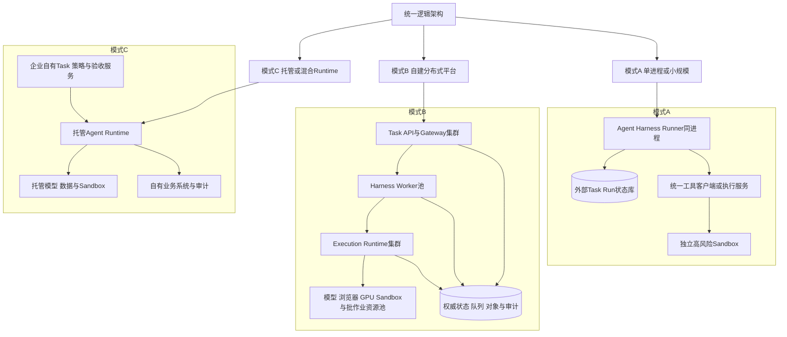

### 12.1 单进程模式

适合验证最小业务闭环。即使 Agent、Harness 和 Runner 同进程，也应把 Task/Run 状态放入耐久存储，并让高风险代码执行与业务进程隔离。规模小不等于可以省略 ExecutionRecord 和 UNKNOWN 语义。

### 12.2 自建分布式平台

通用 Gateway 和 Harness Worker 可部署在容器平台或虚拟机；Execution Runtime 根据后端类型独立扩缩；模型、浏览器、GPU、Sandbox 和批作业使用专用资源池。消息、数据库、缓存和对象存储按能力选择，不预设具体产品。

### 12.3 托管或混合 Runtime

托管服务可以承担 Agent 代码托管、协议入口、会话隔离和弹性，企业保留 Task、策略、审批、验收、交付和审计控制。选型时逐项确认托管边界，不能把“支持 Checkpoint”自动理解为业务 Task 可恢复，也不能把“隔离会话”理解为已经解决所有工具权限和外部副作用。

Google ADK、Eino ADK 和 LangGraph 等框架可以提供 Runner、事件循环、图执行或 Checkpoint 抽象；Temporal 等持久工作流可提供耐久状态机、定时器和 Activity；AgentCore Runtime 等托管服务可提供运行承载、隔离和弹性。这些官方能力都不能单独证明本文全部控制面、审批、ExecutionRecord、业务验收或外部副作用恢复已经实现。

### 12.4 Cell 与故障域

大规模部署可将一组 Task API、Harness Worker、Execution Runtime、局部队列和配额组成 Cell。租户或 Task 归属特定 Cell，控制单点故障的传播范围。跨 Cell 控制面只分发签名版本和策略，不在故障时自动扩大权限。

---

## 13. 非功能能力如何落入总体架构

| 非功能目标 | 主要架构落点 |
|---|---|
| 高并发 | 有界队列、分类型 Worker 与资源池、租户公平、背压和异步等待 |
| 高可靠 | 权威状态、Outbox、租约、fencing、Checkpoint、对账和多可用区 |
| 安全 | 工作负载身份、逐调用授权、八类网关、安全执行环境和行为监测 |
| 可观测 | Task/Run/Step/Execution 关联、Trace Link、阶段指标和审计证据 |
| 弹性 | 状态与实例分离，模型、浏览器、GPU、Sandbox 和批作业独立扩缩 |
| 成本 | 预算预留、Usage、Settlement、资源池水位和模型路由 |
| 合规 | 数据来源、目的授权、保留删除、审批证据、版本和发布记录 |
| 可演进 | AgentSpec 固定、兼容策略、影子运行、灰度、回滚和 kill switch |

这些目标不是由单个组件实现。例如，高可靠不仅是数据库多副本，还包括外部副作用对账；安全不仅是 WAF 或 Prompt 过滤，还包括执行许可和资源边界；弹性不仅是 Pod 数量，还包括等待状态是否释放资源以及不同后端是否独立扩缩。

---

## 14. 常见总体架构反模式

### 14.1 以产品清单代替架构

“Kubernetes、Kafka、Redis、向量库和大模型”没有说明 Task、Run、权限和副作用的归属。先定义功能域和契约，再映射产品。

### 14.2 所有能力都塞进 Orchestrator

单体 Orchestrator 同时负责 Prompt、模型、工具、审批、状态、资源和审计，最终成为不可扩缩、不可替换且权限过大的中心。Harness 协调流程，但权威事实和强制控制由专门领域承担。

### 14.3 网关自环或孤立

模型网关只在图中自调用，MCP 网关没有接入主链，或 Sandbox 直接访问外网，说明治理路径并未真正落地。每个网关都要有明确上游、下游和失败策略。

### 14.4 模型、数据或 MCP 旁路 Harness

Run 期外部结果直接送回 Agent，会使间接注入、来源、状态提交和取消语义无法统一。模型、检索和工具结果应先形成 RuntimeEvent 或 Observation；DeliveryEvent 则回交付域完成对账，不能直接推进 Agent 或 Task 终态。

### 14.5 把 Sandbox 当 Runtime

API、浏览器和远程作业绕过执行账本，Agent Loop 和状态恢复无人负责。Sandbox 只是执行后端。

### 14.6 把消息系统当权威状态库

消息可以重复、延迟和乱序。当前 Task、Run、Execution、Approval 和 Delivery 状态仍需明确聚合和版本规则。

### 14.7 用 Trace 代替审计和账本

Trace 可以采样或过期，不适合作为许可消费、审批、外部副作用和结算的唯一证据。

### 14.8 统一重试所有失败

模型、检索、API、浏览器、作业和交付具有不同副作用。必须按能力声明和已知事实决定重试、查询、补偿或人工裁决。

---

## 15. 总体架构评审清单

### 系统上下文

- 外部主体和信任边界是否完整？
- 每类外部响应由谁认定为业务事实？
- 是否明确平台不能替代哪些下游事实？

### 业务闭环

- Task 完成是否绑定 Run、Artifact、Acceptance 和 Delivery 的同一证据链？
- 失败、取消、超时、UNKNOWN 和人工裁决是否有出口？
- 结算和清理是否有独立事实？

### Runtime 主链

- Agent 是否只产生 Intent 和 Draft，Harness 是否只向 Runtime 提交转移提案？
- 模型、数据、工具和交付是否在真实外呼前已有耐久调用记录及 Outbox，执行方是否进行最新取消、撤销、授权和领取检查？
- Run 期模型、数据和工具结果是否先可靠登记，再由唯一 Reducer 解释并交给 Harness，DeliveryEvent 是否回到交付域？
- 一个 Run 是否只有一个权威状态机，已提交 Outbox 是否不会被后续 Lease 变化静默丢弃？
- 状态是否独立于 Worker 和 Sandbox？
- 是否测试 CallRecord 提交前崩溃时没有外呼、提交后崩溃时可安全派发，以及取消后的迟到结果只能记录事实和收尾？

### 网关与安全

- 八类逻辑职责是否存在，物理归并后是否仍可区分？
- MCP/A2A 协议网关是否只处理对应协议？
- 所有副作用是否经执行入口和 ExecutionRecord？
- 外部网络是否经出口治理？
- 是否存在“内部服务默认可信”的旁路？

### 状态与数据

- Session、Task、Run、Execution 和 Artifact 是否分开？
- 消息、缓存、Trace 和权威状态的边界是否明确？
- 大产物是否引用传递并按访问重新授权？

### 部署与非功能

- 逻辑图和物理图是否分开？
- 资源池是否按模型、浏览器、Sandbox、GPU 和批作业独立建模？
- 故障域、RPO/RTO 和 fail-open/fail-closed 是否按场景声明？
- 控制面故障是否可能导致运行面自动扩权？

只要存在绕过 Harness 的模型或工具调用、绕过 Execution Runtime 的副作用、没有权威状态的恢复、或没有对账的自动重试，就不能认为总体架构已经闭环。

---

## 16. 本篇结论与后续专题

生产级 Agent 平台的总体架构可以概括为：

> **以 Task 业务闭环为目标，以 Agent Runtime 为运行载体，以 Harness 为行为组织机制，以 Execution Runtime 为统一动作通道，以领域事实和零信任网关约束模型、数据和工具，再通过可观测、评测和发布治理形成运营闭环。**

平台不是越多组件越成熟。成熟度来自边界清晰：谁定义行为、谁推进 Run、谁做策略决定、谁执行动作、谁保存事实、谁处理 UNKNOWN、谁验收交付、谁结算清理。逻辑职责明确后，组件可以合并、拆分或替换，业务语义仍然稳定。

本篇完成了从领域对象到平台功能域的外扩。下一篇将深入 Agent Runtime 本身，展开生命周期、版本装载、Agent Loop、Context、状态、调度、暂停恢复、取消和资源协调的完整能力模型。

---

## 参考资料

1. [Google ADK Agent Runtime](https://adk.dev/runtime/)
2. [Google ADK Event Loop](https://adk.dev/runtime/event-loop/)
3. [CloudWeGo Eino ADK Overview](https://www.cloudwego.io/docs/eino/core_modules/eino_adk/agent_preview/)
4. [CloudWeGo Eino Agent Runner and Extension](https://www.cloudwego.io/docs/eino/core_modules/eino_adk/agent_extension/)
5. [LangGraph Pregel Runtime](https://docs.langchain.com/oss/python/langgraph/pregel)
6. [Temporal Workflow Execution](https://docs.temporal.io/workflow-execution)
7. [MCP Authorization Specification](https://modelcontextprotocol.io/specification/2026-07-28/basic/authorization)
8. [A2A Protocol v1.0 Announcement](https://a2a-protocol.org/latest/blog/2026/03/12/a2a-protocol-ships-v10-production-ready-standard-for-agent-to-agent-communication/)
9. [Amazon Bedrock AgentCore Runtime](https://docs.aws.amazon.com/bedrock-agentcore/latest/devguide/agents-tools-runtime.html)
10. [CloudEvents Specification Repository](https://github.com/cloudevents/spec)
