# Agent Runtime：从生命周期到执行治理的完整能力模型

> **系列**：生产级 Agent 平台架构 2026 · 第 4 篇  
> **定位**：Runtime 机制篇  
> **版本**：闭环修订版  
> **更新时间**：2026-10-12  
> **前置阅读**：第 0 篇《从模型推理到生产运行：2026 年 Agent、Harness 与 Runtime 总体架构》 · 第 1 篇《Agent、Harness 与 Runtime：生产级 Agent 平台的职责边界》 · 第 2 篇《从 Task 到交付：Agent 业务闭环与领域对象设计》 · 第 3 篇《生产级 Agent 平台总体架构：从主链到功能域》  
> **关键词**：Agent Runtime、RuntimeInstance、Invocation、Run、Scheduler、Lease、Checkpoint、Streaming

## 摘要

Agent Runtime 经常被简化为“托管 Agent 代码的容器”或“运行 Python 的沙箱”。这种定义遗漏了生产系统最关键的能力：Agent 如何从一个版本化程序变成可持续推进的 Run，如何跨请求和实例保存状态，如何在 Worker 故障后接管，如何暂停等待审批并释放资源，如何恢复时重新验证版本和权限，如何把流式输出与耐久事件分开，以及如何协调模型、工具、浏览器、作业和安全执行环境。

本文将 Agent Runtime 定义为：**装载固定版本 AgentSpec，承载 Harness 与 Agent，推进 Run 生命周期，并提供调度、状态、中断恢复、Execution Runtime 协调、身份、可观测和资源治理接口的整体运行载体。** Sandbox 是 Runtime 调度的执行后端；模型推理服务是外部依赖；Task 业务终态仍由 Task 服务根据验收、交付、Finalization 和固定终止意图提交。

文章重点区分三个经常混用的对象：`RuntimeInstance` 是承载代码的进程或实例，`Invocation` 是一次入口请求、事件唤醒及其响应流，`Run` 是可以跨 Invocation、跨 Worker 和跨实例持续存在的耐久运行。RuntimeInstance 退出或流式连接断开，不等于 Run 失败；Invocation 完成，也不等于 Task 完成。

本文只讨论 Runtime 的能力模型和运行边界。Harness 内部如何规划将在第 5 篇展开，持久执行、Outbox 与副作用恢复在第 6 篇展开，Execution Adapter 和安全执行环境则分别在第 7、8 篇展开。

---

## 1. Runtime 为什么需要成为独立架构层

最小 Agent 应用只需要一个函数：读取消息、调用模型、执行工具、返回结果。在这个范围内，Runtime 似乎只是 Python 或 Go 进程。

生产环境增加了四类时间跨度：

- **毫秒到秒级**：事件分发、状态提交、模型流式输出；
- **秒到分钟级**：工具、浏览器和 Sandbox 执行；
- **分钟到小时级**：长任务、审批等待、远程作业；
- **天级甚至更长**：暂停恢复、业务验收、在途 Run 版本兼容。

同时还增加了多种故障：请求断连、模型超时、Worker 失联、租约接管、工具回调迟到、权限撤销、版本下线、状态迁移失败和资源池不可用。

因此，Runtime 必须将 Agent 程序与具体进程解耦。它需要保证：

1. AgentSpec 可以被准确装载并固定到 Run；
2. 同一 Run 在任一时刻只有有效持有者推进；
3. Invocation 断开后，Run 按策略继续、等待或暂停；
4. 状态在事件确认后形成耐久事实；
5. 暂停、恢复和取消是持久控制意图，而不是线程信号；
6. 模型和执行后端的等待不长期占用逻辑 Worker；
7. 旧 Worker 和旧版本不能在接管后继续提交动作；
8. 外部副作用未知时进入对账，而非由重放自动重复执行。

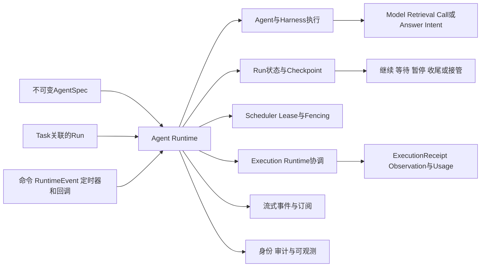

Runtime 因此不是“在哪里运行代码”这么简单，而是“如何把 Agent 代码持续、可控地运行起来”。

---

## 2. Runtime 的输入、输出与非目标

### 2.1 主要输入

Agent Runtime 接收的不是任意 Prompt，而是已经形成业务事实或平台命令的输入：

| 输入 | 含义 |
|---|---|
| `StartRunCommand` | 启动已可靠创建的 Run |
| `RuntimeEvent` | 模型、检索、工具、审批、定时器或子 Run 事件 |
| `PauseRunCommand` | 请求在安全点暂停 Run |
| `ResumeRunCommand` | 请求从逻辑 Checkpoint 恢复 Run |
| `CancelRunCommand` | 停止新步骤并传播取消 |
| `AgentSpecRef` | 固定 Agent、Prompt、插件、工具描述符和模型路由版本 |
| `RunLease` | 当前 Worker 推进 Run 的租约和单调 epoch |
| `ContextRef` | 受授权的上下文、Artifact 和数据引用 |

### 2.2 主要输出

| 输出 | 含义 |
|---|---|
| `RuntimeEvent` | 一次已提交的运行事实 |
| `ModelCallIntent` | 交给模型治理链的调用提案 |
| `RetrievalIntent` | 交给数据与记忆治理链的读取/写入提案 |
| `CallIntent` | 交给能力调用治理链的动作提案 |
| `ExecutionSpec` | Harness 协调治理后，交给 Execution Runtime 的执行规格 |
| `CheckpointRef` | 可恢复逻辑状态引用 |
| `InvocationStream` | 面向客户端的流式增量和状态通知 |
| `UsageRecord` | 模型和 Runtime 资源用量事实 |
| `RunResultCandidate` | 供技术验证的候选结果和 Artifact 引用 |

### 2.3 Runtime 不负责什么

Runtime 不应：

- 代替 Task 服务决定业务终态；
- 把模型响应直接当作已授权动作；
- 自动批准高风险 CallIntent；
- 把流式文本当作权威状态；
- 假设 Checkpoint 可以回滚外部系统；
- 保证任意工具副作用 exactly-once；
- 因 Worker 租约过期就推断远端动作没有发生；
- 允许资源池根据工具输出自行创建新的 Agent 步骤；
- 因滚动升级而让在途 Run 无审计地漂移到新 AgentSpec。

这组非目标避免 Runtime 演变成既负责业务、又负责安全、还负责基础设施的“万能黑盒”。

---

## 3. Runtime 完整能力地图

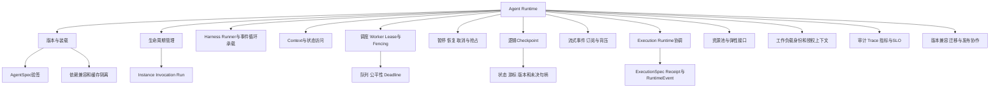

这些能力可以由框架、平台服务、托管 Runtime 和基础设施共同实现。例如，Runner 负责事件循环，状态服务保存 Run，Scheduler 分配 Worker，托管 Runtime 提供隔离实例。但对上层而言，Agent Runtime 需要提供一致的生命周期和事实契约。

### 3.1 框架能力不能自动放大为平台保证

| 实现 | 官方能力可支持的部分 | 仍需平台明确的边界 |
|---|---|---|
| Google ADK Runner/Event Loop | Runner 协调 Agent、SessionService 和 Event；事件中的状态增量经处理后提交 | 恢复依赖持久化 Session/Event 实现；流式 partial 事件不是耐久状态；不自动提供跨 Worker 租约和副作用去重 |
| CloudWeGo Eino ADK Runner | Query/Run 事件迭代、中断、CheckpointStore 扩展、Resume 及组合取消 | CheckPointStore 实现决定是否跨进程耐久；Cancel 不等于回滚外部动作；不自动提供多可用区 HA |
| LangGraph Runtime | 图执行、thread/checkpointer 状态快照和基于重放的恢复 | 节点可能从开头重放；外部副作用要幂等；thread_id 不是安全隔离或租户授权 |
| Temporal | Event History、耐久工作流、定时器和 Activity 协调 | 采用 History Replay 而非通用物理 Checkpoint；Activity 外部副作用仍需幂等和对账 |
| AgentCore Runtime | Agent/工具托管、协议入口、会话隔离、扩缩、身份、流式和可观测 | Agent Loop 由用户代码/框架实现；持久文件系统需显式配置；会话存储与文件持久化不等于业务 Run Checkpoint 和 Task 恢复 |

因此，正文中的 Runtime 能力是平台目标模型，不是声称任一单独框架已完整实现全部能力。

---

## 4. RuntimeInstance、Invocation 与 Run

这是 Runtime 设计中最重要的三个概念。

### 4.1 RuntimeInstance

RuntimeInstance 是实际承载 Agent/Harness 代码的进程、Pod、容器、microVM 或托管实例。它有实例生命周期、健康状态、版本缓存和资源限制，可以随时被替换。

### 4.2 Invocation

Invocation 是一次入口请求或事件唤醒。它可以由用户消息、定时器、审批事件、工具回调或恢复命令触发。一次 Invocation 可能包含多次模型调用和工具事件，也可能只处理一个回调后立即进入等待。

### 4.3 Run

Run 是 Task 的一次耐久运行。它可以跨越多个 Invocation、多个 RuntimeInstance 和多条 Trace 持续存在。Run 有固定 AgentSpec、状态版本、租约 epoch、Checkpoint、Step 和 Attempt。

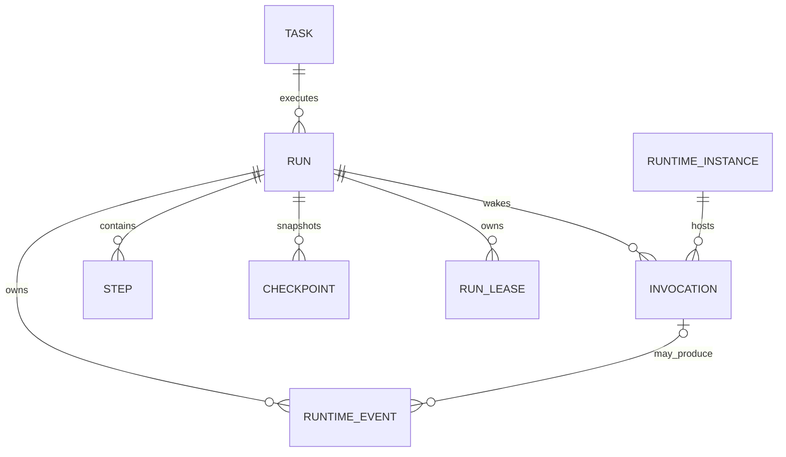

### 4.4 三者不能混用

| 情况 | Instance | Invocation | Run |
|---|---|---|---|
| 用户断开流式连接 | 可继续存在 | 可结束或转后台 | 不一定结束 |
| Worker 进程崩溃 | 终止 | 中断 | 由新 Instance 接管 |
| 等待审批数小时 | 可释放 | 已结束 | 保持 WAITING |
| 工具回调到达 | 任意 Instance 接收 | 创建新 Invocation | 恢复原 Run |
| 滚动发布 | 旧 Instance 排空 | 新 Invocation 按规则路由 | 在途 Run 默认固定旧 AgentSpec |
| Task 取消 | Instance 继续服务其他 Run | 产生取消 Invocation | 进入 CANCELLING |

将 Invocation 等同 Run 会导致请求超时就误判任务失败；将 Instance 等同 Run 会导致 Pod 重启后任务丢失；将 Session 等同 Run 则会让多个业务目标共享错误的状态和权限。

---

## 5. AgentSpec 的装载、固定与撤销

AgentSpec 是 Runtime 装载 Agent 的不可变清单。其 digest 必须在 Task 可靠受理或创建 Run 的事务中固定；RuntimeInstance 收到的只是已经绑定版本的 Run，装载阶段负责验证和实现该绑定，不能临时选择“当前最新版本”。AgentSpec 通常包含：

- Agent 代码或入口标识；
- Prompt 和上下文模板版本；
- Harness 配置和 Hook 顺序；
- 模型路由约束；
- 工具/MCP 描述符及版本；
- 数据与记忆访问声明；
- ExecutionProfile 和资源要求；
- 依赖清单、镜像或包摘要；
- 事件 Schema 和 Checkpoint 版本；
- 兼容性、迁移和撤销元数据。

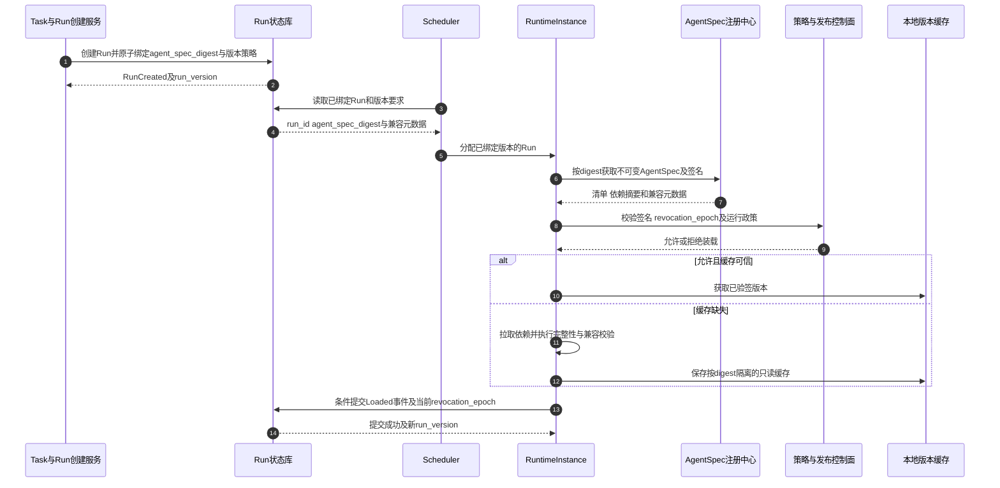

### 5.1 Run 启动后固定版本

在途 Run 默认固定到启动时的 AgentSpec。新版本发布只影响新 Run。原因包括：

- 新 Prompt 可能改变决策；
- 工具 Schema 可能改变参数；
- 新模型可能产生不同输出；
- Checkpoint 结构可能不兼容；
- 事件重放需要相同逻辑。

### 5.2 紧急撤销

固定版本不意味着被攻陷版本必须继续运行。控制面可递增`revocation_epoch`并撤销 AgentSpec，触发策略：

- 阻止新 Run；
- 暂停受影响在途 Run；
- 撤销工具和网络权限；
- 转人工裁决或失败收尾；
- 仅在存在显式迁移计划时切换版本。

Runtime 在装载、续租、关键状态提交和 Execution Gateway 执行前校验适用的 revocation epoch，避免只依赖长 TTL 缓存。撤销是安全控制，版本迁移是业务状态变换，两者不能简单等同。

---

## 6. RuntimeInstance 生命周期

RuntimeInstance 面向计算资源，而不是业务终态。

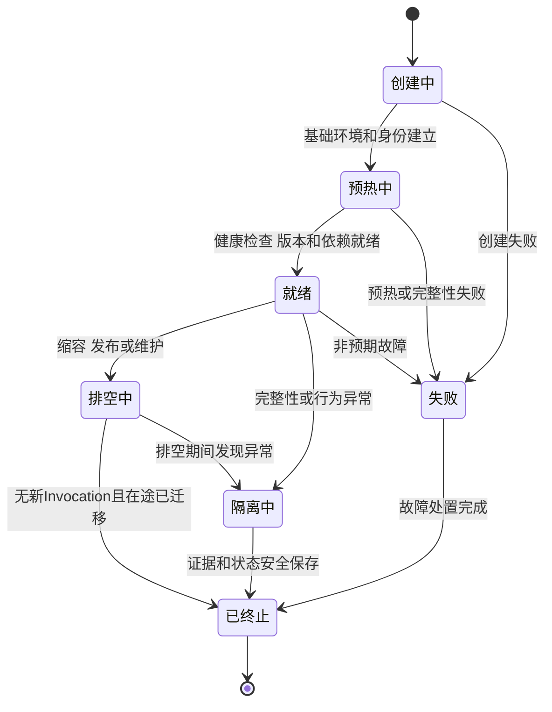

### 6.1 READY 不等于拥有 Run 权限

实例就绪只表示可以接受调度。它必须取得 RunLease、tenant 上下文和工作负载身份后，才能推进具体 Run。

### 6.2 DRAINING 不等于立即杀死

排空期间停止接收新 Invocation。对于可安全迁移的 Invocation，先提交事件和 Checkpoint；对在途外部动作，保存 ExecutionRecord 和 Handle 后再释放。无法确认状态的动作进入对账，而不是随 Instance 一起被遗忘。

### 6.3 QUARANTINED

当实例出现完整性、凭据或逃逸风险时，Runtime 停止新命令、撤销身份和网络，保存必要证据，并把 Run 移交安全接管流程。隔离实例不能重新进入普通热池。

---

## 7. Invocation 生命周期

Invocation 表示一次运行入口和响应通道，不是业务 Run。

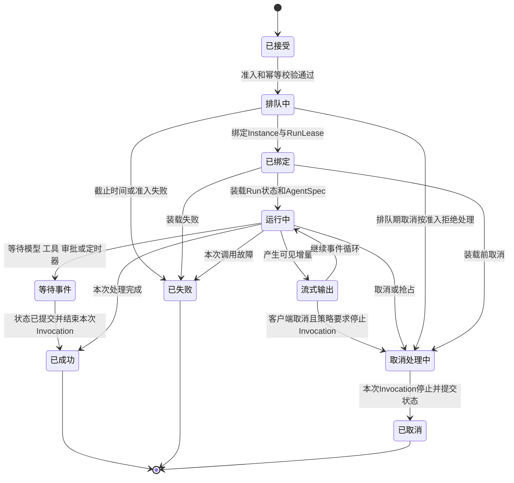

Invocation 的`SUCCEEDED`只表示本次入口处理完成，Run 可能进入 WAITING、QUEUED、VERIFYING 或其他状态。客户端断开 Streaming 也只影响订阅；是否取消 Invocation 或 Run 由显式策略决定。

一次 Invocation 应携带：

- `invocation_id`；
- `task_id/run_id`；
- `runtime_instance_id`；
- `lease_epoch`；
- `agent_spec_digest`；
- `deadline`；
- `trace_id`与前序 Trace Link；
- 事件读取游标和响应流游标；
- 用户/Agent/Runtime 身份链。

---

## 8. 事件循环承载：Runtime 负责推进，Harness 决定语义

Agent Runtime 需要提供事件循环承载，但不应把 Harness 的业务策略硬编码进基础设施。

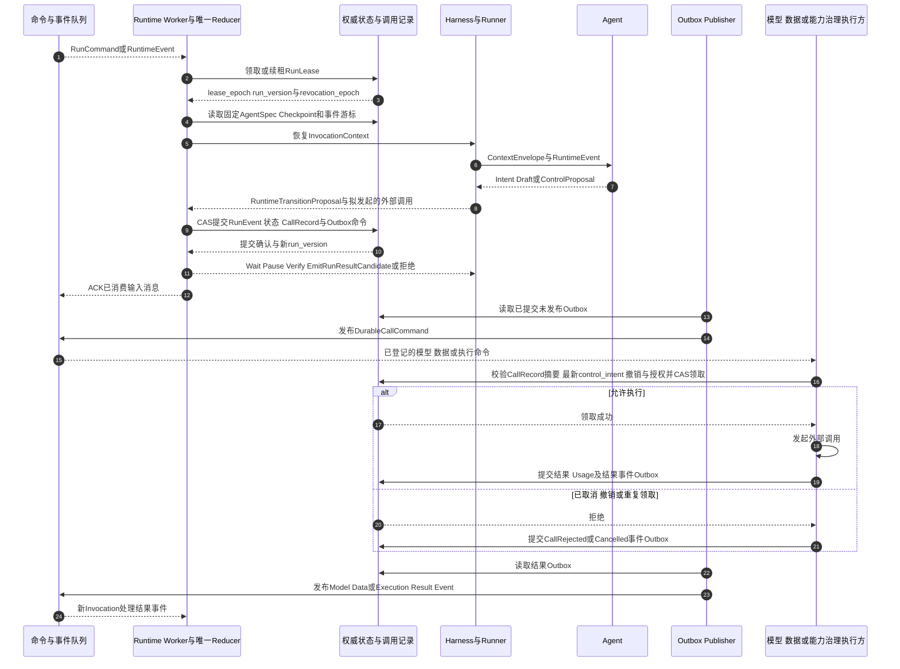

Runtime 负责：

- 事件去重、路由和顺序范围；
- RunLease、聚合版本和撤销状态校验；
- 装载状态、Checkpoint 和事件游标；
- 承载 Runner 并把 Harness 提案送入唯一 Reducer；
- 在任何外部模型、数据或工具调用前，通过 CAS 原子提交 RunEvent、状态变化、ModelCall/Request/ExecutionRecord 及 Outbox 命令；
- 在提交后确认输入消息；
- 由独立 Outbox Publisher 发布已提交命令、事件和定时器。

Harness 负责：

- 当前事件在业务语义下意味着什么；
- 如何组装上下文；
- 何时提出模型、数据或工具调用提案；实际外部调用只能在相应 CallRecord 和 Outbox 耐久提交后发生；
- 何时请求审批、暂停或验证；
- 产生`RuntimeTransitionProposal`和拟提交的 RunEvent，而不是直接改写权威状态。

二者可以同进程，但不能各维护一套互相独立的 Run 状态机。Runtime 的 Reducer 是权威状态转移入口；Harness 定义提案语义。已与状态原子提交的 Outbox 是耐久事实，Publisher 不得因为后续 lease epoch 变化而丢弃它；fencing 发生在状态/Outbox 写入事务和各外部调用执行方，而不是发布阶段。

统一末端门禁适用于 ModelCallRecord、DataRequest/MemoryWriteRecord 和 ExecutionRecord：命令即使在 Cancel 或撤销前已经进入 Outbox，真正外呼前仍须校验最新`control_intent`、revocation epoch、授权约束和记录状态，并以 CAS 从 PREPARED 领取。取消或撤销后拒绝的新调用必须产生耐久`CallRejected/Cancelled`事件；已经开始的模型、数据或工具调用则记录 PENDING/UNKNOWN 和 Usage，进入对应对账或收尾，不能伪装成“从未调用”。

---

## 9. Context 与状态边界

Runtime 处理多种状态，但它们不应混成一个`AgentState`。

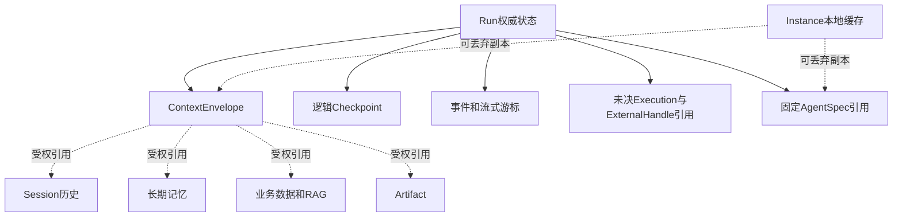

### 9.1 ContextEnvelope

ContextEnvelope 是本次 Step 允许 Agent 看到的内容和引用集合，包含来源、租户、风险、时效和授权上下文。它不是全量 Session，也不是长期记忆本身。

### 9.2 Run 状态

Run 状态是权威业务运行进度，包括当前 Step、等待原因、版本、租约、预算引用和终止意图。它不应只存在于 Runner 内存。

### 9.3 Instance 缓存

模型客户端、AgentSpec、Prompt 模板和只读依赖可以缓存，但缓存命中不改变权威版本。Instance 故障后可重新获取，不能因缓存内容丢失而丢失 Run 事实。

### 9.4 大对象

Artifact、数据集和文件只在状态中保存摘要和受控引用。读取时重新授权，避免大对象在消息、事件和上下文间复制，也避免旧授权随 Checkpoint 无限延续。

---

## 10. Scheduler、Worker、Lease 与 Fencing

Scheduler 负责选择何时、由哪个 Worker 推进 Run；它不决定 Agent 下一步业务动作。

### 10.1 调度输入

- 可运行 Run 队列；
- tenant 和 Agent 配额；
- 优先级、deadline 和队龄；
- AgentSpec 和资源 Profile；
- 数据驻留与故障域；
- Worker 健康、版本和缓存命中；
- Runtime 及下游资源水位；
- 暂停、取消和安全隔离标记。

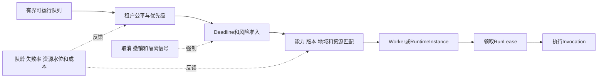

### 10.2 Lease 不是锁住远端世界

RunLease 保证平台侧同一时刻只有有效持有者推进 Run。Lease 包含到期时间和单调 epoch。状态变更与 Outbox 写入的原子事务、续租都验证当前 epoch 和适用的 revocation epoch，拒绝旧 Worker。Outbox 一旦与合法状态提交原子写入，后续发布不再依赖当前 Lease。

Execution Gateway 对两类命令采用不同校验：当前 Worker 同步提交的新动作必须匹配当前 RunLease；已经在合法 Lease 下创建`PREPARED ExecutionRecord`并通过 Outbox 耐久调度的延迟命令，则校验 ExecutionRecord 中的`authorized_epoch`、ExecutionSpec 摘要、ReleaseGrant、撤销版本和当前`control_intent`，并以 CAS 唯一领取该 ExecutionRecord，而不是要求原 RunLease 仍然存活。否则 Run 进入 WAITING 并释放 Lease 后，合法延迟命令会被错误拒绝。

如果 Cancel 或紧急撤销发生在 Outbox 提交之后、命令执行之前，Publisher 仍可投递这个耐久命令，但对应调用执行方必须根据最新`control_intent=CANCEL`或 revocation epoch 拒绝外呼，并提交`CallRejected/Cancelled`事件与可审计记录；工具动作由 Execution Gateway 执行该门禁。若外部调用已经开始，则进入相应取消/费用/结果对账，不能把 Publisher 丢弃消息当作取消完成。

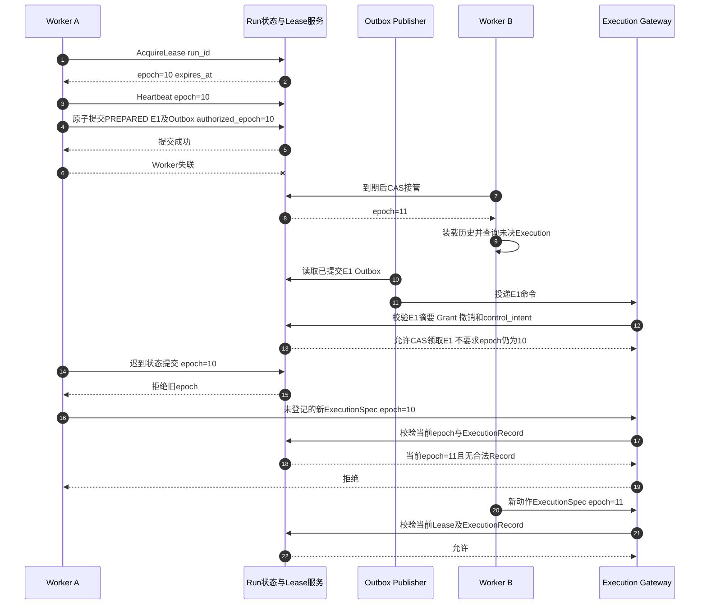

Fencing 阻止旧 Worker 继续产生新的平台动作，但不能撤回已经发送给外部系统的请求。接管后必须先读取 ExecutionRecord 和 ExternalHandle，不能把 Lease 失效等同于动作失败。

### 10.3 公平与饥饿

高优先级任务不能无限挤压普通租户。可采用分租户队列、加权公平、最大并发、队龄提升和预算配额。具体算法在高并发专题展开，Runtime 至少要暴露相关调度属性和指标。

### 10.4 WAITING 与 Lease 释放

等待审批、远程作业或长定时器时，Runtime 先原子提交`WAITING`状态、等待条件、ExternalHandle 和 Outbox，再确认输入消息并释放 RunLease 与 Harness Worker。回调、定时器或审批事件到达后，只负责把 Run 重新放入可运行队列；新 Worker 必须重新领取新的 lease epoch，才能创建 Invocation 并推进状态。

短时间模型 I/O 是否保留 Lease 可由平台策略决定，但必须设置上限，避免大量 WAITING Run 占满 Worker。无论是否暂时保留 Lease，外部结果都要先成为耐久事件，不能由回调线程直接恢复 Agent。

---

## 11. Pause、Resume、Cancel 与 Preempt

这些控制动作经常被当作同义词，实际语义不同。

| 动作 | 目标 | 后续 |
|---|---|---|
| Pause | 在安全点停止推进并保存可恢复状态 | 等待 Resume |
| Resume | 重新验证条件后继续暂停 Run | 新 Invocation 推进 |
| Cancel | 停止新动作并终止 Run 意图 | 对在途副作用继续对账并收尾 |
| Preempt | 为高优先级或资源原因临时抢占 | 通常形成 Pause 或重新排队 |
| Terminate Instance | 结束计算实例 | 不自动改变 Run 业务状态 |

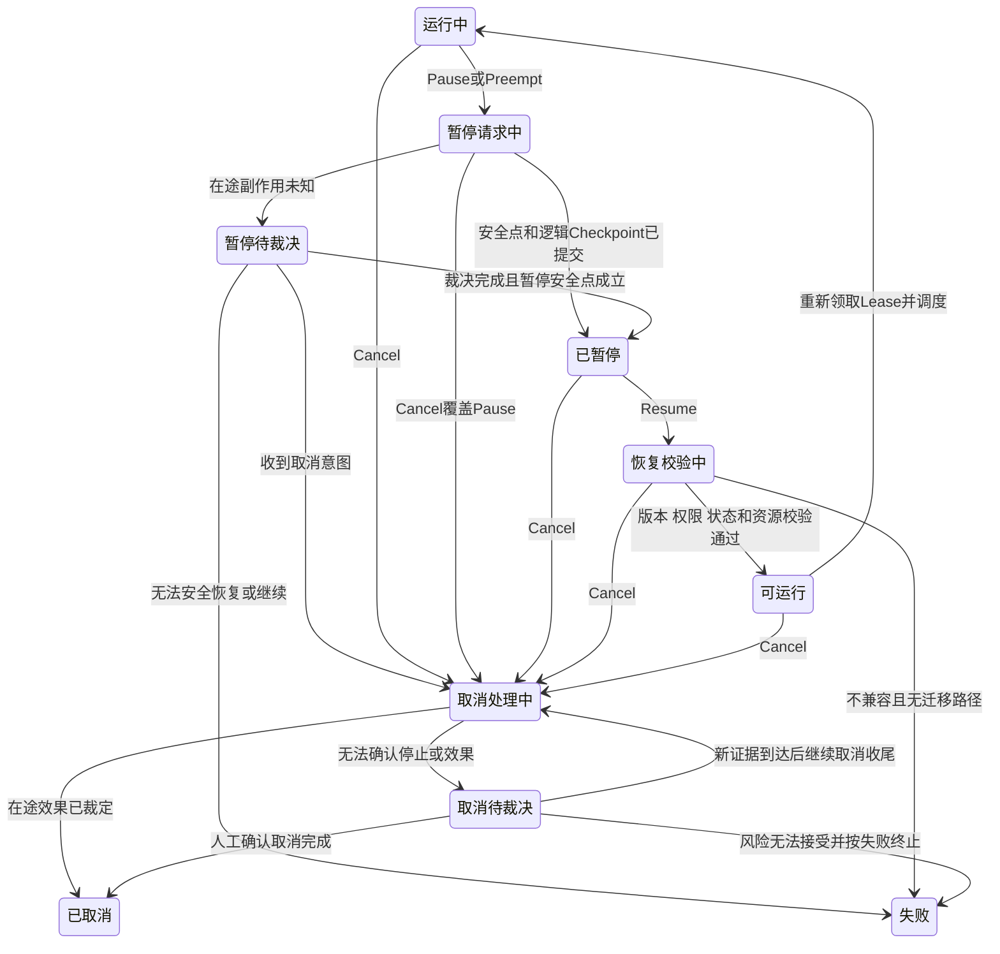

该图是 Run 控制意图的细化视图，与第 2 篇 Run 业务状态机使用同一权威聚合和 Reducer，不是第二套平行状态机。进入`CANCELLING`或`CANCEL_REVIEW`后，持久化的`control_intent=CANCEL`不能被 Pause 裁决、迟到回调或普通 Resume 清除；只能进入取消终态或按明确失败政策终止。

### 11.1 Pause 安全点

安全点至少要求：

- 当前耐久事件已提交；
- Run 状态版本已更新；
- 已发出的外部动作存在 ExecutionRecord 和 Handle 或 UNKNOWN；
- 必要 Context 和 Artifact 引用已保存；
- 无法恢复的进程局部状态已经显式处理。

Pause 不是简单冻结线程。审批等待通常采用逻辑暂停并释放 Worker，不需要保留进程。

### 11.2 Resume 重新验证

恢复时应重新验证：

- AgentSpec 是否仍允许运行；
- Checkpoint Schema 是否兼容；
- 用户委托、工具和数据权限是否仍有效；
- 审批是否适用于当前动作；
- deadline 和预算是否允许继续；
- 未决 Execution 和 Delivery 是否已对账；
- 目标资源版本是否变化。

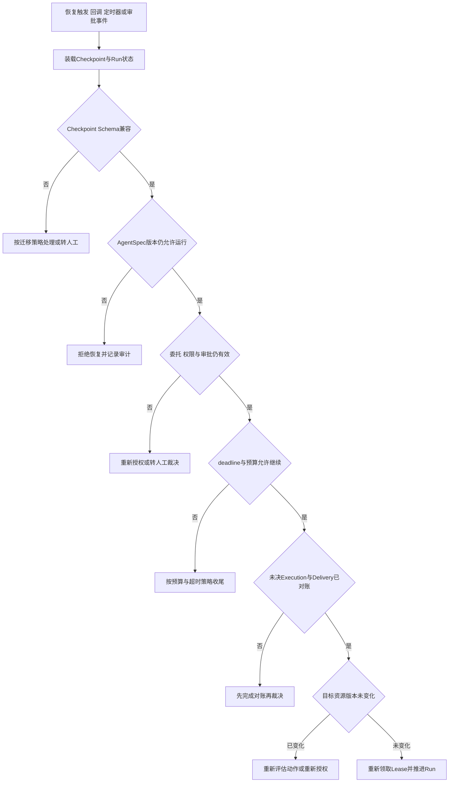

任何一项重验证失败都不会静默继续：失败的检查项决定后续处置路径——重新授权、先对账、迁移处理或终止收尾，且每一步都留下审计记录。

### 11.3 Cancel 不是回滚

Cancel 持久化终止意图，停止创建新 Step 并传播 CancelToken。外部系统可能不支持取消，也可能已完成动作。Runtime 仍需接收迟到结果、记录 Usage 并进入取消专用对账，不能恢复正常 Run 推进。

---

## 12. Checkpoint 的内容与边界

逻辑 Checkpoint 用于重建 Run 执行上下文，不是任意进程内存镜像。

### 12.1 推荐内容

- `run_id/run_version`；
- `agent_spec_digest`和事件 Schema 版本；
- 当前 Step 和计划修订号；
- 已提交事件游标；
- ContextEnvelope 引用；
- Session、Memory、Artifact 引用及摘要；
- 未决 Approval、ModelCallRecord、Execution 和 ExternalHandle 引用；
- 对可能已计费但响应丢失的模型调用，保存稳定调用 ID、供应方状态、Usage 对账引用和允许的后续处置策略；
- 调度、deadline 和预算引用；
- 确定性的 Harness 局部状态；
- Checkpoint 自身摘要、签名和创建原因。

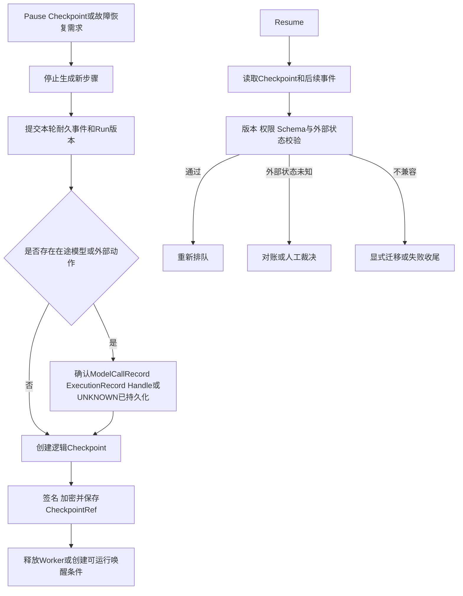

### 12.2 不应假设保存的内容

逻辑 Checkpoint 不能自动保存：

- 未提交的外部 API 副作用；
- 远程数据库事务；
- 浏览器站点已经提交的表单；
- 模型供应商已经计费但未响应的调用；
- 未登记的本地线程、Socket 或设备状态；
- 已过期或撤销的业务凭据。

物理快照可以保存特定执行环境的内存和文件，但只是加速恢复的可选后端，需要与逻辑 Checkpoint、ExecutionRecord 和版本兼容性共同使用。具体机制在持久执行和安全执行环境专题展开。

---

## 13. Streaming、事件订阅与背压

Runtime 既要支持用户实时看到模型增量，也要保证权威状态不会被慢消费者拖垮。

### 13.1 两类流

| 流类型 | 示例 | 耐久性 |
|---|---|---|
| 耐久事件流 | StepStarted、ToolCallCommitted、RunPaused、ArtifactCreated | 必须可靠提交，可重放 |
| 展示增量流 | Token、进度文本、临时调试信息 | 可合并、截断或丢弃，不作为权威状态 |

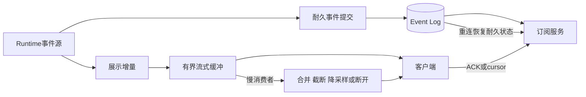

### 13.2 序号与游标

耐久事件以 Run 事件序号和事件 ID 去重。展示增量可以有独立序号，不保证完全重放。客户端重连时先获取权威 Run 快照和耐久事件游标，再继续新的展示流，而不是要求 Runtime 重放所有 Token。

### 13.3 背压策略

- 每 Invocation 和每订阅使用有界缓冲；
- Token 增量可以批量合并；
- 高频进度仅保留最新值；
- 慢消费者可降级为轮询或断开；
- 关键事件不得因流式通道拥塞而丢失；
- 默认平台策略应将客户端断开解释为订阅结束而非 Run 取消；若产品选择“断连即取消”，必须显式持久化 CancelRunCommand，不能依赖连接关闭的瞬时信号；
- Token 和进度增量均标记为 provisional，只有对应耐久事件提交后才能用于业务状态判断；
- 输出大小、速率和敏感内容治理在流式路径中同样生效。

---

## 14. Execution Runtime 与资源池协调

Agent Runtime 通过 Execution Runtime 调度 API、MCP、浏览器、远程作业和安全执行环境。本篇只定义协调边界，不展开适配器协议和 Sandbox 实现。

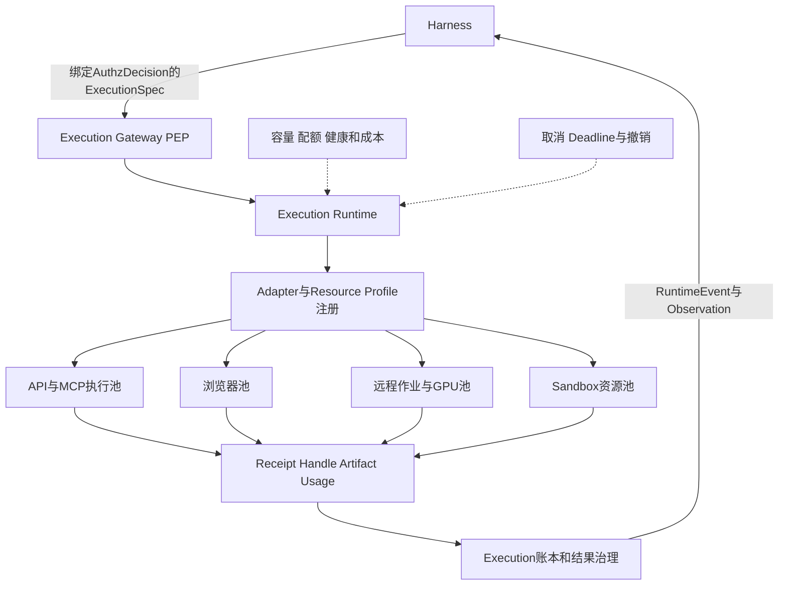

Runtime 向资源池需要的通用能力包括：

- `acquire(profile, tenant, run, deadline)`；
- `renew(resource_handle)`；
- `release(resource_handle)`；
- `cancel(execution_handle)`；
- `inspect(execution_handle)`；
- 能力、隔离等级、容量、健康和费用信号。

资源池不理解完整 Task 目标，也不能根据 stdout 或工具结果自行追加 Agent 步骤。它只执行 Execution Runtime 下发的受约束规格。

等待远程作业或浏览器事件时，Run 可以进入 WAITING 并释放 Harness Worker；Execution Runtime 保留 ExternalHandle、定时查询和取消责任。资源本身是否继续计费，由资源治理域记录和结算。

---

## 15. 身份、授权上下文与审计关联

Runtime 需要维护从用户到具体 Instance 和执行后端的委托链：

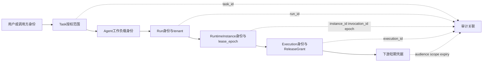

Runtime 自身不应长期保存用户或下游凭据。它通过身份和凭据服务获得短时材料，或让沙箱外代理代为调用。Checkpoint 只保存凭据引用或重新兑换所需上下文，不保存可长期复用的明文密钥。

审计记录至少关联：tenant、task、run、step、attempt、invocation、instance、lease epoch、agent spec、execution、approval、policy 和 trace。敏感 Prompt 和结果按数据策略处理，不能因为“全链路审计”就无条件记录原文。

---

## 16. 版本升级、兼容与迁移

Runtime 升级涉及三个不同版本：

1. Runtime 平台版本；
2. AgentSpec 版本；
3. 状态、事件和 Checkpoint Schema 版本。

### 16.1 默认策略

- 新 Runtime 实例可以运行兼容的旧 AgentSpec；
- 新 Run 使用当前发布的 AgentSpec；
- 在途 Run 固定原 AgentSpec；
- 事件消费者向前兼容已发布 Schema；
- Checkpoint 不兼容时不静默恢复；
- 紧急撤销触发暂停或失败收尾，不自动迁移。

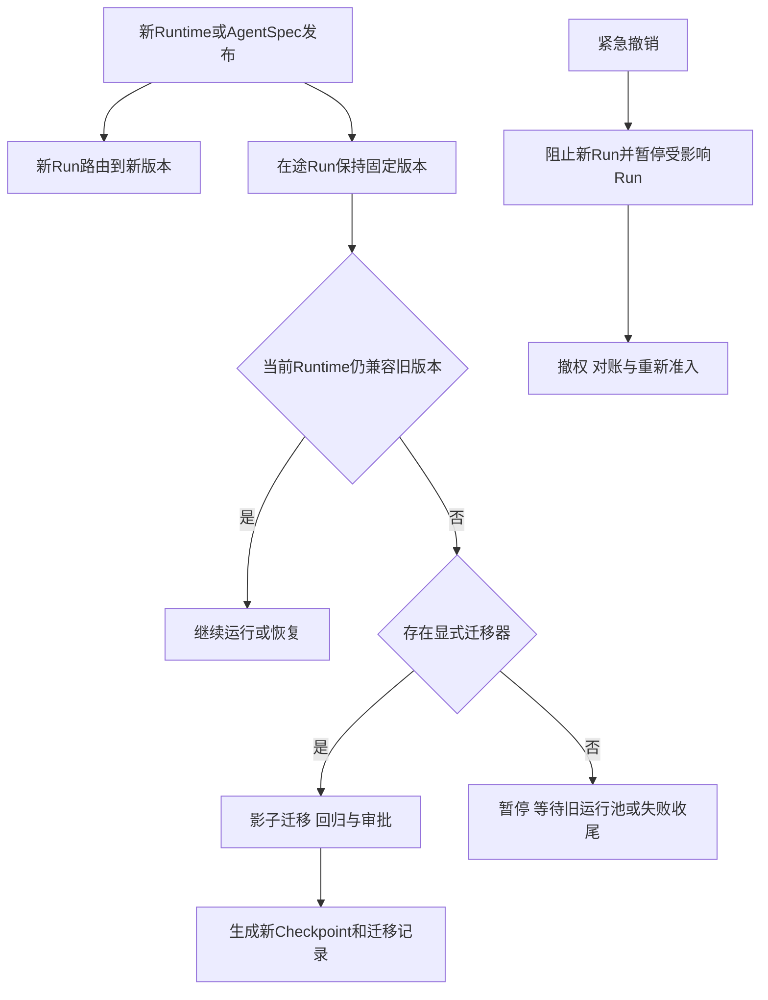

### 16.2 迁移证据

迁移需要记录原/目标版本、状态摘要、迁移器版本、验证结果、审批和回滚策略。迁移后生成新的 Checkpoint，不覆盖旧记录。

### 16.3 Runtime 排空

滚动升级先将旧实例标记 DRAINING，停止新 Invocation；完成或转移在途 Invocation，确认状态提交后终止实例。不能以进程重启作为 Run 版本迁移方法。

---

## 17. Runtime SLO 与容量指标

Runtime 的 SLO 不能只看 API 可用率。建议按以下阶段度量：

| 指标 | 测量边界 | 说明 |
|---|---|---|
| Command 接受延迟 | 命令进入到持久接受/拒绝 | 不包含业务执行 |
| 调度延迟 | Run 可运行到 Worker 取得 Lease | 按 tenant 和优先级分组 |
| Instance 就绪延迟 | 创建到 READY | 按运行介质和缓存命中分组 |
| Invocation 启动延迟 | 领取 Lease 到 Harness 开始执行 | 包含版本和状态装载 |
| 耐久事件提交延迟 | Harness 产生事件到权威提交确认 | 与展示流分开 |
| Checkpoint 创建延迟 | 安全点到 CheckpointRef 持久化 | 不含审批等待 |
| Resume 延迟 | Resume 命令到 Run 重新可执行 | 包含兼容、权限和对账 |
| 接管时间 | Lease 到期到新 Worker 可安全推进 | 不能忽略 UNKNOWN 查询 |
| Cancel 传播延迟 | Cancel 接受到可取消子动作收到请求 | 不等于业务回滚完成 |
| Streaming 首事件/断流率 | Invocation 到首展示事件及连接质量 | 不等于 Run 完成时延 |
| Fencing 拒绝数 | 旧 epoch 状态或执行提交被拒绝 | 用于发现双写和抖动 |
| 等待释放率 | WAITING Run 释放逻辑 Worker 的比例 | 衡量长任务资源效率 |

Runtime 可用性还要区分：命令可接受、Run 可调度、事件可提交、执行可协调、恢复可完成。P99 不能用各阶段 P99 简单相加；需要固定负载模型、AgentSpec、Context 大小和资源池条件做联合测试。

---

## 18. Runtime 生产验证

| 测试场景 | 预期结果 |
|---|---|
| Instance 在外部调用提案产生后、CallRecord 提交前崩溃 | 不发生模型、数据或工具调用；恢复后重新解释原事件 |
| CallRecord 与 Outbox 提交后、外部调用前崩溃 | Outbox 最终投递一次或多次，执行方按 CallRecord 幂等领取，不产生未登记调用 |
| Instance 在事件提交后 ACK 前崩溃 | 重复消息被幂等处理，不重复 Step |
| 两个 Worker 同时持有旧/新 Lease | 状态服务拒绝旧 epoch 的新状态/动作；已合法提交的 Execution Outbox 按 ExecutionRecord 继续处理 |
| Cancel 发生在 Model/Data/Execution 调用 Outbox 提交后、发布前 | Publisher 仍投递；相应调用执行方按最新 control_intent 和 revocation 拒绝，形成可审计取消/拒绝事件且不外呼 |
| Invocation 流式连接断开 | 按显式产品策略结束订阅；未持久化 CancelRunCommand 时 Run 不被隐式取消 |
| 等待审批数小时 | 释放 Worker，保留 Run 状态和唤醒条件 |
| Resume 时权限已撤销 | 不恢复动作，进入拒绝、暂停或收尾 |
| AgentSpec 被紧急撤销 | 阻止新 Run，受影响在途 Run 暂停并撤权 |
| Checkpoint Schema 不兼容 | 显式迁移或失败，不静默使用错误状态 |
| 工具提交后 Worker 崩溃 | 接管者查询 ExecutionRecord，不盲目重放 |
| Cancel 后外部动作迟到成功 | 记录真实副作用和 Usage，继续取消收尾，不恢复 Run |
| Streaming 消费者过慢 | 合并/截断展示增量，耐久事件提交不受阻塞 |
| Runtime 滚动升级 | 旧实例排空，在途 Run 保持固定 AgentSpec |
| 本地版本缓存损坏 | 验签失败并隔离实例，从可信源重新装载 |
| 资源池容量耗尽 | 有界排队、背压或明确拒绝，不无限占用 Worker |
| 遥测系统不可用 | 有界缓冲非关键遥测，关键状态和审计事实仍可靠提交 |

验证应同时检查状态、事件序列、lease epoch、Checkpoint 引用、执行次数、Usage 和审计关联，不只检查最终回答是否正确。

---

## 19. 常见反模式

### 19.1 把 RuntimeInstance 等同 Run

Pod 或进程重启导致任务丢失，等待审批必须一直占用实例。Run 必须独立于 Instance 持久存在。

### 19.2 把 Invocation 等同 Run

HTTP 请求超时或流式断开就判任务失败。Invocation 只是 Run 的一次唤醒和响应通道。

### 19.3 Runtime 与 Harness 各维护一套状态机

两个组件都能推进 Run，导致重复 Step 和恢复冲突。Harness 定义语义，Runtime 提供唯一持久推进机制。

### 19.4 Lease 过期后旧 Worker 仍可提交

只有锁没有 fencing，旧 Worker 恢复后仍可能写状态或执行动作。状态提交和 Execution Gateway 都必须校验 epoch。

### 19.5 Pause 只是冻结线程

无法跨实例恢复，仍占用资源，也无法处理外部副作用。Pause 必须形成逻辑安全点和 Checkpoint。

### 19.6 Cancel 等于回滚

外部动作可能已发生或不支持取消。取消需要持久意图、传播、迟到结果和专用对账。

### 19.7 Checkpoint 包含未记录副作用

恢复后不知道工具是否执行，导致重复动作。外部提交前后必须有 ExecutionRecord 或 UNKNOWN。

### 19.8 Streaming 事件代替权威事件

Token 流可能丢失、合并或被截断，不能承载状态转移和审计事实。

### 19.9 滚动升级漂移在途 Run

旧 Run 在新 Prompt、新工具 Schema 或新模型下恢复，重放结果不可预测。Run 应固定 AgentSpec 或走显式迁移。

### 19.10 资源池理解业务目标

Sandbox 或浏览器根据输出自主追加步骤，绕过 Harness。资源池只执行受约束 ExecutionSpec。

---

## 20. Runtime 架构评审清单

### 对象与版本

- RuntimeInstance、Invocation、Run 和 Session 是否分开？
- Run 是否固定 AgentSpec 和 Schema 版本？
- 撤销与迁移是否分开？

### 状态与推进

- 权威 Run 状态是否独立于 Instance？
- Harness 和 Runtime 是否共用一套 Run 状态机？
- 状态提交、Outbox 和消息 ACK 顺序是否明确？

### 调度与接管

- 队列是否有界并支持 tenant 公平？
- Lease 是否具有单调 epoch？
- 状态服务和 Execution Gateway 是否共同执行 fencing？
- 接管前是否查询未决 Execution？

### 控制动作

- Pause 是否形成逻辑安全点？
- Resume 是否重新验证版本、权限、预算和外部状态？
- Cancel 是否传播且不被解释为回滚？
- Preempt 是否有明确恢复路径？

### Checkpoint 与事件

- Checkpoint 是否只引用已持久化状态？
- 物理快照是否被错误当成业务事务？
- 耐久事件与展示增量是否分流？
- 慢消费者是否会阻塞 Run 推进？

### Execution 与资源

- Runtime 是否只通过 Execution Gateway 调用后端？
- 等待外部作业时是否释放 Harness Worker？
- 资源池是否只理解 Profile 与 ExecutionSpec？
- UNKNOWN 是否进入对账而非盲重试？

### 身份、观测与 SLO

- 用户、Agent、Run、Instance 和 Execution 身份是否可追踪？
- Checkpoint 是否保存长期凭据？
- Trace 是否与权威状态和审计分开？
- SLO 是否覆盖调度、接管、恢复、取消和长尾？

---

## 21. 本篇结论与后续专题

Agent Runtime 不是 Agent 代码外面的一层容器，也不是一个 while 循环。它是让 Agent 在不可靠进程、异步事件、多种执行后端和持续版本变化中仍能受控运行的整体载体。

Runtime 的关键设计可以归纳为：

- 用不可变 AgentSpec 固定运行内容；
- 区分 RuntimeInstance、Invocation 和 Run；
- 用 Harness 定义语义，用 Runtime 提供唯一持久推进机制；
- 用 Scheduler、Lease 和 fencing 防止双写；
- 用逻辑 Checkpoint 支持跨实例恢复；
- 把 Pause、Resume、Cancel 和 Preempt 建模为持久控制协议；
- 区分耐久事件与可丢弃展示流；
- 通过 Execution Runtime 协调多执行后端；
- 让状态和身份独立于计算实例；
- 用显式兼容与迁移处理版本演进；
- 用故障和恢复 SLO 验证生产能力。

Runtime 能够恢复运行，但不能单独恢复整个业务世界。Task 终态仍由业务闭环决定；外部副作用仍需 ExecutionRecord 和对账；Sandbox 仍只是执行后端；模型服务仍是受治理依赖。

下一篇将深入 Harness 和 Agent Loop，讨论 Context 如何构造、模型—工具循环如何推进、Hook 与中间件如何组织，以及如何保持确定性控制与 Agent 自主性的边界。

---

## 参考资料

1. [Google ADK Agent Runtime](https://adk.dev/runtime/)
2. [Google ADK Event Loop](https://adk.dev/runtime/event-loop/)
3. [Google ADK Resume Agents](https://adk.dev/runtime/resume/)
4. [CloudWeGo Eino Agent Runner and Extension](https://www.cloudwego.io/docs/eino/core_modules/eino_adk/agent_extension/)
5. [CloudWeGo Eino Human-in-the-Loop](https://www.cloudwego.io/docs/eino/core_modules/eino_adk/agent_hitl/)
6. [LangGraph Pregel Runtime](https://docs.langchain.com/oss/python/langgraph/pregel)
7. [LangGraph Persistence](https://docs.langchain.com/oss/python/langgraph/persistence)
8. [LangGraph Checkpointers](https://docs.langchain.com/oss/python/langgraph/checkpointers)
9. [LangGraph Durable Execution](https://docs.langchain.com/oss/python/langgraph/durable-execution)
10. [Temporal Workflow Execution](https://docs.temporal.io/workflow-execution)
11. [Amazon Bedrock AgentCore Runtime](https://docs.aws.amazon.com/bedrock-agentcore/latest/devguide/agents-tools-runtime.html)
12. [Amazon Bedrock AgentCore Runtime Sessions](https://docs.aws.amazon.com/bedrock-agentcore/latest/devguide/runtime-sessions.html)
13. [Amazon Bedrock AgentCore Filesystem Configurations](https://docs.aws.amazon.com/bedrock-agentcore/latest/devguide/runtime-filesystem-configurations.html)
