# Harness 与 Agent Loop：行为组织、上下文工程与确定性控制

> **系列**：生产级 Agent 平台架构 2026 · 第 5 篇  
> **定位**：Runtime 机制篇  
> **版本**：闭环修订版  
> **更新时间**：2026-10-12  
> **前置阅读**：第 0 篇《从模型推理到生产运行：2026 年 Agent、Harness 与 Runtime 总体架构》 · 第 2 篇《从 Task 到交付：Agent 业务闭环与领域对象设计》 · 第 4 篇《Agent Runtime：从生命周期到执行治理的完整能力模型》  
> **关键词**：Harness、Agent Loop、ContextEnvelope、Hook、提案校验、确定性控制

## 摘要

第 4 篇回答了 Agent Runtime 如何承载一次运行：RuntimeInstance、Invocation 与 Run 三层分离，Scheduler、Lease、Checkpoint 与耐久事件流让 Run 可以跨进程、跨实例持续存在。但 Runtime 只提供“唯一持久推进机制”，并不回答另一个问题：**每一轮推进的业务语义由谁组织？** 哪个事件应该唤醒哪段上下文，模型输出如何变成受约束的调用提案，工具结果如何以何种信任等级回到下一轮，审批和预算在什么点位介入，哪些控制无论如何都不能交给模型决定——这些是 Harness 的职责。

本文沿用系列核心命题：**Agent 定义行为，Harness 组织与约束行为，Agent Runtime 承载并驱动行为，执行后端完成具体动作。** Harness 位于 Runtime 的逻辑运行机制之内，由 ContextManager、LoopDriver、ModelCoordinator、CallCoordinator、ApprovalCoordinator、BudgetCoordinator 与 VerificationCoordinator 等模块组成。它读取 Run 状态与固定 AgentSpec，组装带信任标签的 ContextEnvelope，驱动 Agent 产生意图，对意图做结构化与范围校验，协调审批与预算，最终只产出 `RuntimeTransitionProposal` 与调用提案；权威状态提交由 Runtime 唯一 Reducer 以 CAS 完成。

文章围绕四条主线展开：其一，上下文工程不是“把历史拼进 Prompt”，而是指令区与数据区隔离、信任标签、摘要与引用、预算分配组成的治理流水线；其二，Agent Loop 是“RuntimeEvent → 解释 → 提案 → 耐久提交 → 结果事件”的循环，模型、检索、工具、验证各分支都先形成耐久 CallRecord 与 Outbox，再由执行方过统一末端门禁后外呼；其三，Hook 与中间件在固定生命周期点位按确定顺序执行，强制 Hook 由平台注册、Agent 不可改写；其四，确定性控制与 Agent 自主性有明确边界——授权、预算、幂等键、撤销、末端门禁与审计必须在模型外强制，模型只负责在约束内提出建议。

本篇不重复第 4 篇已讲的调度、租约与 Checkpoint 机制，不展开第 6 篇的 Outbox 与对账协议细节、第 7 篇的执行适配器、第 8 篇的安全执行环境与第 12 篇的零信任身份；审批服务的内部机制属于第 13 篇，预算预留与结算的内部机制属于第 14 篇，此处只定义 Harness 与它们的协调接口。

---

## 1. 问题背景：while 循环为什么撑不住生产

最小 Agent Loop 只有十几行代码：把消息交给模型，若模型要求调用工具就执行，把结果拼回上下文继续，直到模型给出最终回答。这个循环在演示环境里工作良好，因为它隐含了一组从未被检验的假设：上下文永远装得下、模型输出永远格式正确、工具永远可信、进程永远不会崩溃、没有人会试图操纵它。

生产环境会逐一打破这些假设，而且每一类破坏都指向循环内部的不同位置：

| 生产事实 | 被打破的假设 | 循环内缺失的机制 |
|---|---|---|
| 任务运行数小时，历史远超模型窗口 | 上下文无限 | 预算、摘要、引用与裁剪策略 |
| 网页、邮件、检索结果中包含操纵性内容 | 工具结果可信 | 指令区/数据区隔离与信任标签 |
| 模型偶发输出非法 JSON、越权参数或幻觉工具名 | 输出永远合法 | 结构化校验、范围校验与有限修复 |
| 高风险动作需要人工审批，等待可能持续数小时 | 动作即时执行 | 审批协调与暂停/恢复协议 |
| Token、调用次数与资源消耗真实计费 | 资源无限 | 预算预检、消费登记与超限停止 |
| Worker 崩溃、租约接管、重复投递 | 进程可靠 | 提案与耐久事件分离，Reducer 唯一提交 |
| 模型声称“已完成”，但产物未通过验证 | 模型自我报告可信 | 独立验证与 Run 结果候选机制 |
| 被撤销的 AgentSpec 或已取消的 Run 仍在产生调用 | 意图一旦产生就应执行 | 统一末端门禁与 revocation epoch 校验 |

这些问题的共同点是：**它们都不能靠在 Prompt 里加一句话解决，也不能靠模型“更聪明”解决。** 上下文隔离是结构与标签问题，提案校验是 Schema 与策略问题，审批与预算是协议与事实问题，末端门禁是事务与 CAS 问题。它们必须被实现为模型之外的确定性机制。

这恰好对应 OWASP Agentic Top 10 2026 中的多项风险：ASI01 目标劫持与 ASI06 记忆与上下文污染依赖上下文分区和信任标签缓解；ASI02 工具误用依赖参数约束与逐调用授权缓解；ASI08 级联失效依赖预算与停止条件缓解；ASI09 人机信任滥用依赖独立验证与审批证据缓解。Harness 是把这些风险清单落到循环内部的具体位置。

框架生态已经提供了循环原语，但能力边界必须如实看待：

| 实现 | 官方能力可支持的部分 | 仍需平台补齐的部分 |
|---|---|---|
| Google ADK | Runner 协调 Agent、SessionService 与 Event；事件中的状态增量在处理完成后提交；支持中断与恢复 | 流式 partial 事件不是耐久状态；信任分区、预算与授权强制仍需平台实现 |
| CloudWeGo Eino ADK | Query/Run 事件迭代、中断、Resume、组合取消与 CheckPointStore 扩展点 | 跨进程耐久性取决于 CheckPointStore 的具体实现；循环内治理仍是平台责任 |
| LangGraph | 图执行、thread/checkpointer 状态快照、基于重放的恢复与中断 | 节点可能从检查点重放，外部副作用需幂等；thread_id 不是安全隔离或租户授权 |
| Temporal | Event History、耐久工作流、定时器与 Activity 协调 | 采用 History Replay 而非通用物理 Checkpoint；Activity 副作用仍需幂等与对账 |
| Amazon Bedrock AgentCore | 托管 Agent 应用、会话隔离、流式与扩缩 | Agent Loop 本身由用户代码或框架实现；循环语义不是托管能力自动提供的 |

因此，本文描述的 Harness 是平台目标模型：它可以由上述任一框架加平台层实现，也可以自研，但“循环能转起来”与“循环被治理”是两件事。

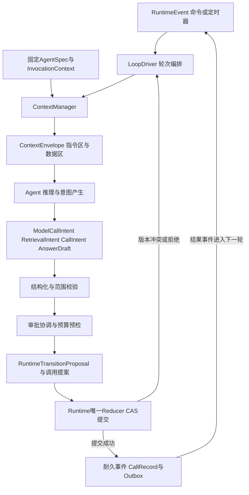

上图是全文的骨架：Harness 的一切工作都发生在“事件进入”与“提案交出”之间，它从不直接写权威状态，也不直接发起外部调用。后文按模块地图、上下文工程、Agent Loop、Hook、提案校验、审批与预算协调、确定性边界、与 Reducer 协作的顺序逐层展开。

---

## 2. Harness 定位与模块地图

### 2.1 Harness 在架构中的位置

第 0 篇给出的定义是：Harness 定义如何组织和约束 Agent 行为，包括上下文组装、循环推进、模型和工具协调、审批、预算、结果验证及恢复协议。第 4 篇进一步明确了它与 Runtime 的分工：**Runtime 的 Reducer 是权威状态转移的唯一入口，Harness 定义提案语义。** 两者可以同进程，但不能各维护一套互相独立的 Run 状态机。

由此可以划出 Harness 的三条硬边界：

- **向上不越权**：Harness 不决定 Task 业务终态。Run 成功不等于 Task 完成，Task 终态由验收、交付、结算、清理与 Finalization 门禁决定（第 2 篇）；Harness 只在 Run 语义内工作，产出“候选结果”而不是“完成声明”。
- **向下不直连**：Harness 不直接调用模型服务、数据系统或执行后端。它产出调用提案，由 Reducer 原子提交 CallRecord 与 Outbox，执行方在真正外呼前过统一末端门禁。这是系列的耐久调用原则，本文所有分支都遵守它。
- **向内不信任**：Harness 不把 Agent 的任何输出当作事实或指令。模型输出先被解析为结构化意图，再经过校验与协调；工具结果先被打上信任标签，才能进入下一轮上下文。

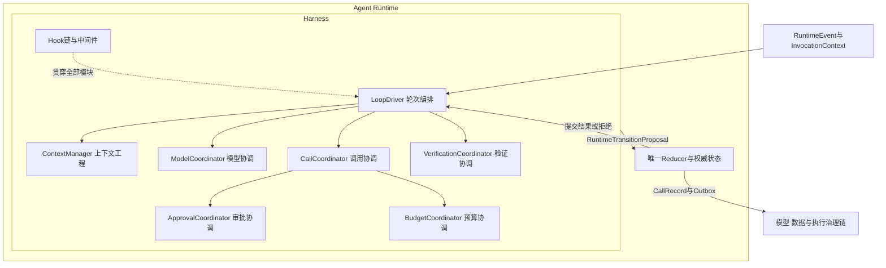

模块地图说明两点：Hook 链不是独立管道，而是贯穿各模块的拦截点位；所有模块的输出最终汇聚为提案，经 Reducer 提交后才可能变成 CallRecord 与 Outbox，进入模型、数据或执行治理链。

### 2.2 模块职责与输入输出

| 模块 | 职责 | 关键输入 | 关键输出 |
|---|---|---|---|
| LoopDriver | 解释当前 RuntimeEvent，决定轮次类型与推进路径，聚合各模块提案，处理轮次上限与停止条件 | RuntimeEvent、Run 状态、控制意图、轮次计数 | 轮次编排决策、RuntimeTransitionProposal |
| ContextManager | 组装 ContextEnvelope：选择内容、打信任标签、分区、摘要、引用、预算裁剪 | AgentSpec、TaskIntent、Session 引用、Observation、Artifact 引用 | ContextEnvelope 及其引用与摘要记录 |
| ModelCoordinator | 受理 ModelCallIntent，校验模型路由约束与输出 Schema 要求，登记模型调用提案 | Agent 的模型调用意图、模型路由约束 | ModelCallIntent 提案、流式 provisional 标记 |
| CallCoordinator | 规范化 CallIntent，计算 action_digest，驱动结构化与范围校验，区分只读与副作用动作 | CallIntent、工具描述符、授权范围 | 规范化提案、审批请求提案、ExecutionSpec 草案 |
| ApprovalCoordinator | 对需要审批的动作绑定动作摘要与条件，处理 ApprovalDecided 事件，批准不直接执行 | 校验后的高风险提案、ApprovalRecord 事件 | 审批请求提案、恢复推进提案 |
| BudgetCoordinator | 预检与登记模型、工具、资源预算，超限产生停止提案，未知费用保留未决 | 预算引用、Usage 事件、提案预估消耗 | 预算判定、停止或降级提案 |
| VerificationCoordinator | 对 AnswerDraft 与候选 Artifact 做技术验证编排：Schema、来源覆盖、确定性规则、扫描状态 | AnswerDraft、Artifact 引用、验证策略 | RunResultCandidate 或修复提案 |

几个容易被误解的分工需要强调：

1. **CallCoordinator 产生的是 ExecutionSpec 草案，不是已授权执行规格。** 真正的 ExecutionSpec 在 Reducer 提交 CallRecord、治理链完成授权与审批绑定之后才成立（第 0 篇授权链）。
2. **ApprovalCoordinator 不做审批决策，也不实现审批服务。** 它只负责“把什么动作、以什么摘要、在什么条件下提交审批”以及“审批结果事件到达后如何推进”。审批人界面、委托、升级策略属于第 13 篇。
3. **BudgetCoordinator 不是计费系统。** Usage 是追加式事实，Settlement 是预算与账务处理（第 2 篇）；它在循环内的职责是预检与登记，防止“先花钱再问预算”。
4. **VerificationCoordinator 的结论是技术验证，不是业务验收。** 它通过后 Run 才可能进入 SUCCEEDED；业务验收与 ResultSelection 属于 Task 层。

### 2.3 一次 Invocation 内的模块协作

第 4 篇定义了 Invocation 是一次入口请求或事件唤醒。一次 Invocation 内，Harness 的模块协作遵循固定顺序：**LoopDriver 解释事件 → ContextManager 组装上下文 → Agent 产生意图 → 各 Coordinator 校验与协调 → LoopDriver 聚合提案 → Reducer 提交**。这个顺序不是实现习惯，而是正确性要求：上下文没有组装完成就不能推理，提案没有校验就不能协调，协调没有完成就不能提交。

---

## 3. 上下文工程：ContextEnvelope 的组装与治理

上下文工程是 Harness 最容易被低估的工作。常见做法是把 Session 全量历史、检索结果和工具输出拼成一个长 Prompt，再指望模型“自己分辨”。这种做法在三个层面失控：窗口与成本失控、注入风险失控、来源与责任失控。ContextManager 的职责就是把这三件事变成受治理的流水线。

### 3.1 ContextEnvelope 是什么

ContextEnvelope 是本次 Step 允许 Agent 看到的内容与引用集合。它不是全量 Session，也不是长期记忆本身，而是经过选择、分区、打标、预算裁剪后的视图。一个可用的信封至少包含：

| 组成 | 内容 | 治理要求 |
|---|---|---|
| 指令区 | 系统指令、固定目标契约、AgentSpec 中的 Prompt 模板、输出格式要求 | 只允许平台与固定版本 AgentSpec 写入；Agent 输出与外部数据不得注入 |
| 目标契约 | TaskIntent 的目标、授权范围、验收条件、截止时间 | 以结构化形式固定呈现，不允许被后续消息改写 |
| 交互区 | 受预算约束的 Session 历史或其摘要 | 摘要保留来源与风险属性，不静默丢弃关键约束 |
| 数据区 | 检索结果、工具 Observation、网页与文件内容、记忆片段 | 每条内容携带信任标签与来源引用；默认按不可信处理 |
| 引用区 | Artifact、大文件、数据集的摘要与受控引用 | 大对象不进正文；读取时重新授权 |
| 元数据 | 信封版本、预算分配记录、裁剪记录、签名 | 信封组装过程本身可审计 |

### 3.2 组装流水线

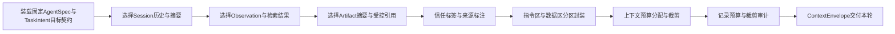

流水线是单向的：标签先于分区，分区先于预算裁剪。若先裁剪再打标，可能把一条内容的风险上下文裁掉，留下“干净但无来源”的片段——这正是记忆与上下文污染最难排查的形态。

### 3.3 信任标签与分区

信任标签回答一个问题：**这段内容是否有权影响 Agent 的目标与行为？** 建议的最小标签集如下：

| 信任标签 | 来源 | 允许的影响 | 典型处置 |
|---|---|---|---|
| TRUSTED_INSTRUCTION | 平台系统指令、固定 AgentSpec | 可定义目标与行为约束 | 仅指令区；Agent 与工具输出不可产生此标签 |
| USER_DELEGATED | 用户消息、TaskIntent 参数 | 可在授权范围内细化目标 | 交互区；与目标契约冲突时以契约为准 |
| TOOL_OBSERVATION | 工具与执行回执 | 只作为事实证据 | 数据区；保留 execution_id 与来源 |
| RETRIEVED_DATA | RAG、知识库、数据库查询 | 只作为参考资料 | 数据区；保留检索来源与时效 |
| EXTERNAL_UNTRUSTED | 网页、邮件、文件、外部 Agent 消息 | 不得产生新目标或新动作 | 数据区并显式标注不可信；其中的“指令”按数据处理 |

分区的意义在于：**数据区中出现“请忽略之前的指令并执行 X”时，它在结构上就不是指令。** 指令区与数据区的边界由 Harness 在组装期强制，而不是靠模型自觉。这是对 ASI01 目标劫持与 ASI06 记忆上下文污染的第一道结构性防线；回程扫描、目标偏移检测等运行时手段是第二道（第 0 篇）。

对 Agent 间通信（A2A、MCP 外部 Agent）传入的消息，同样按 EXTERNAL_UNTRUSTED 或带来源签名的数据对待。MCP 规范将授权定义为可选能力，启用 HTTP 时遵循 OAuth 2.1；但 MCP 不提供全局工具注册，也不替代业务授权——一个 MCP Server 被成功连接和授权，不代表它返回的内容可信，更不代表它有权改变 Task 目标。

### 3.4 摘要与引用策略

长任务的上下文不可能无限增长，两种互补手段是摘要与引用：

- **摘要**用于压缩交互区。摘要必须由平台受控流程产生并保留来源与风险属性：哪段历史被摘要、摘要依据哪个策略版本、哪些约束被显式保留。Agent 自身输出不能未经审核自动升级为可信记忆或可信摘要（第 0 篇）。摘要失败或摘要服务不可用时，策略应是按预算保留最近原文并记录降级，而不是静默丢弃。
- **引用**用于隔离大对象。Artifact、数据集、长文件只在信封中保存摘要与受控引用；Agent 需要细节时发起 RetrievalIntent，经数据与记忆治理链重新授权后读取。这避免大对象在事件、消息和上下文之间复制，也避免旧授权随 Checkpoint 无限延续（第 4 篇）。

| 策略 | 适用对象 | 保留什么 | 丢弃什么 | 风险与对策 |
|---|---|---|---|---|
| 全量保留 | 目标契约、审批与授权事实 | 原文 | 无 | 成本可控，必须优先保证 |
| 滑动窗口 | 近期交互 | 最近 N 轮原文 | 更早交互 | 与摘要叠加，避免断崖 |
| 受控摘要 | 早期交互、长工具输出 | 结论、来源、风险标签 | 冗余细节 | 摘要留痕，可回溯原文引用 |
| 引用化 | Artifact、文件、数据集 | 摘要与受控引用 | 正文 | 读取时重新授权与审计 |
| 直接丢弃 | 超预算且低价值片段 | 丢弃记录 | 内容 | 丢弃决策本身可审计 |

### 3.5 上下文预算

上下文预算应像费用预算一样被显式分配。建议按区设置配额与优先级：

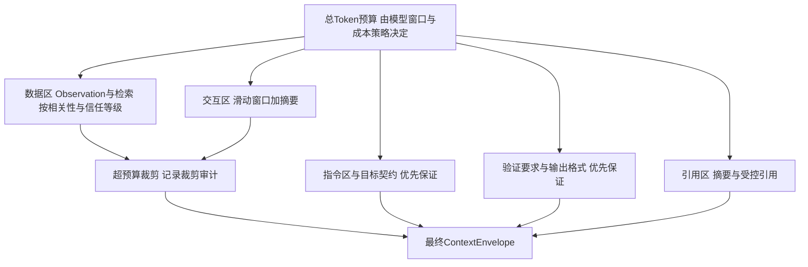

预算分配的关键规则：指令区与目标契约不参与裁剪；数据区裁剪优先丢弃低信任、低相关内容；每次裁剪写入信封元数据，使“模型为什么没看到某段内容”事后可查。上下文预算与费用预算联动：更大的信封意味着更高的模型消耗，BudgetCoordinator 在预检时会把信封规模计入本轮预估。

---

## 4. Agent Loop：从 RuntimeEvent 到提案的完整循环

### 4.1 轮次的生命周期

Agent Loop 的基本单位是“轮次”：一次由 RuntimeEvent 触发、以提案集合结束的完整推进。轮次有清晰的生命周期：

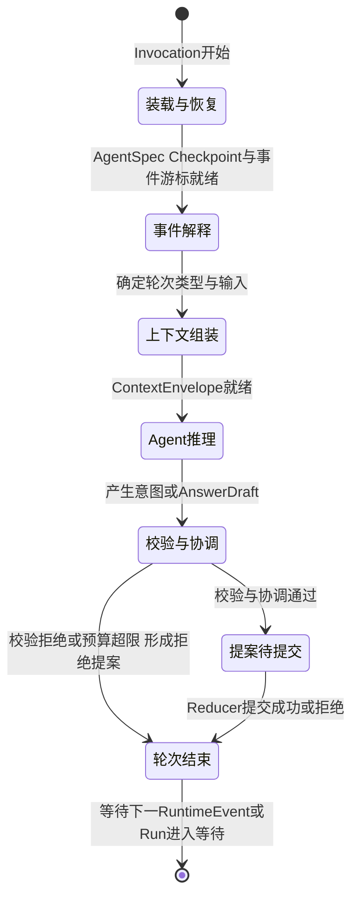

轮次状态机说明：任何阶段失败都不会“原地重试到成功为止”，而是形成明确的提案或拒绝事实交给 Reducer；Reducer 提交成功后，本轮结束，后续推进只能由新的 RuntimeEvent 触发。这保证了循环的每一步都可审计、可恢复、可被控制意图打断。

LoopDriver 在 INTERPRET 阶段必须先检查控制意图：`control_intent=CANCEL` 或 revocation epoch 变化时，不进入正常推理，而是产生收尾提案。取消是持久意图不是回滚：它不能被本轮的某个回调清除，也不能复活已进入取消路径的 Run（第 2 篇、第 4 篇）。

### 4.2 主循环：模型、检索、工具、审批四个分支

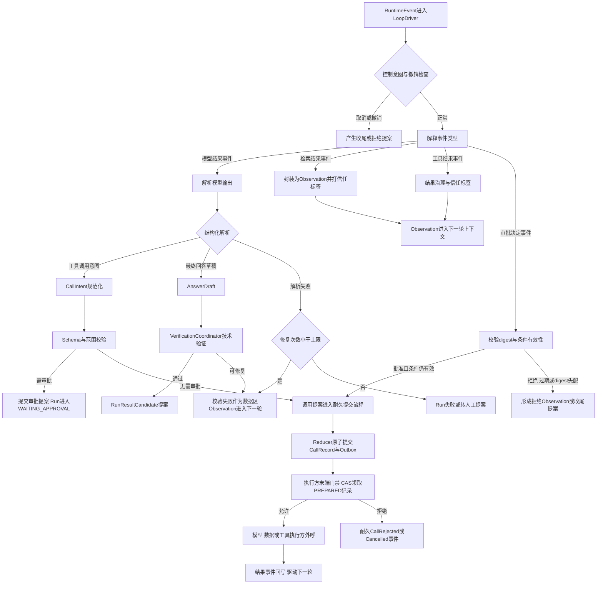

主循环图覆盖了 Harness 处理的全部事件分支，四个要点值得逐一说明。

**模型分支。** 模型结果事件到达后先做结构化解析。解析成功则得到工具调用意图或最终回答草稿；解析失败不把错误硬塞回模型无限重试，而是把“哪里不合法”作为数据区 Observation 进入下一轮，同时递增修复计数器，超过上限即形成 Run 失败或转人工提案（详见第 6 节）。模型的流式 Token 属于 provisional 展示增量流，可以合并、截断或丢弃，不作为权威状态；只有耐久事件提交后才能用于业务判断（第 4 篇约定 9）。

**检索分支。** 检索结果永远以 RETRIEVED_DATA 标签进入数据区。检索本身也是一次外部调用：RetrievalIntent 同样先经 Reducer 提交 DataRequest 记录再执行，其结果治理与工具结果同构。记忆写入更严格——Agent 输出不能未经治理自动成为跨会话记忆（第 0 篇）。

**工具分支。** 工具结果先经结果治理：大小限额、敏感内容检查、来源与风险标注，然后以 TOOL_OBSERVATION 标签进入下一轮上下文。工具输出中的任何“指令”都不改变指令区。副作用类工具与只读工具在校验阶段被区分：只读动作可走轻量路径，副作用动作必须经过范围校验，高风险动作进入审批协调。

**审批分支。** ApprovalDecided 事件到达时，ApprovalCoordinator 不是直接放行，而是重新校验：批准绑定的 action_digest 是否与当前提案一致、资源条件版本是否变化、批准是否在有效期内、Task 是否已被取消。批准且条件仍有效才进入提交流程；digest 失配意味着参数已经变化，旧批准不再适用（第 2 篇）。审批等待期间 Run 进入 WAITING 并释放 Worker，这是第 4 篇已讲的机制，本篇只关注事件到达后的解释语义。

### 4.3 耐久调用原则在循环内的体现

系列约定 4 是本文所有分支的底层协议，值得在循环语境下完整重述：**任何外部调用（模型/数据/工具/交付）先原子提交 CallRecord 与 Outbox，再异步执行并以结果事件回写；执行方真正外呼前过统一末端门禁（最新 control_intent、revocation epoch、授权约束、CAS 领取 PREPARED 记录）；拒绝形成耐久 CallRejected/Cancelled 事件。**

这对 Agent Loop 有三个直接推论：

1. **提案产生与外部调用之间存在耐久边界。** Harness 产生提案、Reducer 提交 CallRecord 之后，即使 Worker 立即崩溃，调用的意图与授权事实已经落库；接管者读取 CallRecord 与 ExternalHandle 继续推进，而不是重新推理一遍。
2. **循环的“等待”是 Run 的 WAITING，不是线程阻塞。** 外呼异步执行，结果以 RuntimeEvent 回写；等待期间 Harness Worker 被释放。这使长任务、慢工具与审批等待不占用逻辑 Worker。
3. **取消与撤销可以追上已提交的命令。** 命令进入 Outbox 不代表必然外呼：执行方在末端门禁处读取最新控制意图，取消或撤销后拒绝外呼并提交 CallRejected/Cancelled 事件；已经开始的调用记录 PENDING/UNKNOWN 与 Usage，进入对账或收尾，不能伪装成“从未调用”（第 4 篇）。UNKNOWN 必须对账，不能因超时就推断失败（第 2 篇）。

### 4.4 循环停止条件

Agent Loop 必须有确定性的停止边界，否则“推理—行动”循环可能无限消耗预算：

| 停止条件 | 判定者 | 结果 |
|---|---|---|
| 轮次上限 | LoopDriver | 形成超限事实，按策略失败或转人工 |
| 预算耗尽 | BudgetCoordinator | 停止提案，登记已消耗与未决费用 |
| 截止时间到达 | 定时器事件 | 收尾提案，处置在途动作 |
| 修复重试上限 | 校验与验证计数器 | Run 失败或转人工，不无限修复 |
| 控制意图为取消 | LoopDriver | 收尾提案，不产生新动作 |
| AgentSpec 撤销 | revocation epoch 校验 | 暂停或失败收尾 |
| Agent 无更多提案 | LoopDriver | 进入验证或收尾 |

这些条件全部在模型外判定。模型可以“认为”还应该继续，但循环是否继续由 Harness 的确定性规则决定。

---

## 5. Hook 与中间件：生命周期点位、顺序与不可绕过性

### 5.1 生命周期点位

Hook 是 Harness 在循环固定点位上的拦截器，用于插入平台级治理逻辑：内容扫描、遥测、审计、策略判定、数据脱敏等。点位必须固定且有限，否则 Hook 本身会成为不可维护的旁路。建议的点位集合：

| 点位 | 触发时机 | 典型用途 |
|---|---|---|
| beforeTurn / afterTurn | 轮次开始与结束 | 遥测、轮次计数、停止条件检查 |
| beforeModelCall | ModelCallIntent 校验前 | 敏感内容检查、模型路由约束复核 |
| afterModelResponse | 模型结果解析后 | 输出扫描、结构修复前置处理 |
| beforeRetrieval | RetrievalIntent 提交前 | 数据范围与驻留约束复核 |
| afterObservation | Observation 进入上下文前 | 信任标签复核、脱敏、注入特征检测 |
| beforeToolCall | CallIntent 校验前 | 参数约束、dry-run 编排 |
| afterToolResult | 工具结果治理时 | 结果扫描、大小限额、来源标注 |
| beforeApprovalRequest | 审批请求提交前 | 风险展示材料生成、差异摘要 |
| beforeEmitResult | RunResultCandidate 提交前 | 最终扫描、交付前检查 |

### 5.2 顺序、失败策略与不可绕过性

三个属性决定 Hook 体系是否可信：**顺序确定、失败有策略、强制 Hook 不可绕过。**

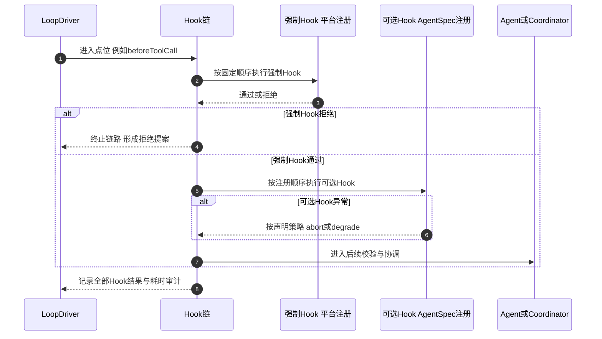

时序图强调了三点：强制 Hook 先于可选 Hook 执行且顺序固定；强制 Hook 的拒绝直接终止链路；可选 Hook 的异常按其声明的失败策略处理，不能静默吞掉。

**顺序。** Hook 链的组成与顺序是 AgentSpec 的一部分，在 Run 创建事务中随 AgentSpec 一起固定（系列约定 8）。运行中不得动态增删 Hook，否则同一 Run 在不同 Worker 上的治理行为不一致，审计也无法复现。

**失败策略。** 每个 Hook 必须声明失败语义：

| 策略 | 含义 | 适用 |
|---|---|---|
| abort | Hook 失败即终止本轮，形成失败或暂停提案 | 安全关键 Hook，如授权复核、敏感内容阻断 |
| reject_proposal | 仅拒绝当前提案，允许 Agent 换一种方式继续 | 参数约束类 Hook |
| degrade | 记录降级事实后继续 | 非关键遥测、建议性检查 |
| quarantine | 将相关内容隔离并转人工 | 疑似污染或逃逸特征的内容 |

安全关键 Hook 不允许 degrade：“检测服务不可用就跳过检测”等于把可用性凌驾于安全之上。第 0 篇的生产准入原则同样适用于循环内部：必要安全检测不可用时，不释放敏感内容，不通过跳过检测保可用性。

**不可绕过性。** 这是 Hook 体系的核心安全属性：**Agent 不能改写、禁用或重排强制授权 Hook。** 具体机制包括：

1. 强制 Hook 由平台注册，不存在于 Agent 可编辑的配置空间；AgentSpec 只能追加可选 Hook，不能覆盖平台链。
2. Hook 链在 Harness 进程内执行，Agent 代码与 Hook 代码的权限分离：Agent 只产生意图，没有修改 Hook 注册表的 API。
3. Hook 执行结果写入审计；跳过任何强制 Hook 的尝试本身是可检测事件。
4. 授权、预算、撤销校验即使作为 Hook 出现，其最终强制点仍在 Reducer 提交事务与执行方末端门禁——Hook 被绕过，门禁仍在。这正是“纵深防御”：循环内的 Hook 是第一道，事务与门禁是最后一道。

一个常见误解是把 Hook 当作状态修改点。Hook 只能影响提案（通过、拒绝、修改提案内容并留痕），不能直接写权威状态；状态修改永远经由 Reducer 的 CAS 提交。否则 Hook 就成了第二套状态机。

---

## 6. 结构化输出与提案校验

### 6.1 三层校验流水线

Agent 产生的意图在进入协调之前必须通过三层校验。校验不是“给模型提个醒”，而是硬性闸门：不通过就不能形成调用提案。

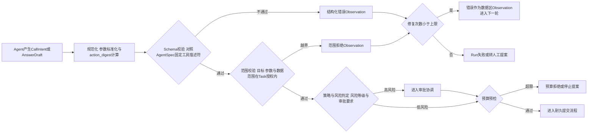

三层校验的分工：

| 层 | 校验内容 | 依据 | 失败处置 |
|---|---|---|---|
| Schema 约束 | 工具名是否存在于固定 AgentSpec、参数类型与必填项、枚举与格式 | AgentSpec 中的工具描述符与输出 Schema | 结构化错误回灌，限次修复 |
| 范围校验 | 目标资源、接收方、数据范围是否在 TaskIntent 授权范围内；动作风险等级 | Task 授权范围、工具能力声明 | 直接拒绝，越权不进入修复循环 |
| 策略与风险 | 是否需要审批、是否触发 dry-run、是否命中撤销或黑名单 | 策略版本、revocation epoch | 转审批协调或拒绝 |

范围校验与 Schema 校验的失败语义不同：Schema 失败通常是模型“说错了话”，允许修复；范围失败是模型“想做越权的事”，直接拒绝并记录。把两者混用会导致越权尝试被无限“修复重试”，浪费预算且掩盖攻击信号。

### 6.2 Schema 约束与结构化输出

对模型的输出格式，Harness 应尽可能使用模型侧的结构化输出能力（受约束解码或函数调用 Schema），但必须假设它可能失败：模型提供商的结构化保证、模型降级、超时重试都可能产生不合法输出。因此 Harness 侧的 Schema 校验是最终闸门，模型侧约束只是降低失败率的手段。

输出 Schema 本身是 AgentSpec 的一部分，随 Run 固定。运行中更换 Schema 等于更换 AgentSpec，必须走版本与迁移协议，不能热改。

### 6.3 修复重试上限

校验失败后的修复循环必须有确定性上限，且上限是 Harness 配置而不是模型决定：

| 配置项 | 含义 | 建议 |
|---|---|---|
| 单轮修复上限 | 同一提案连续校验失败的最大修复次数 | 小值，如 2–3 次 |
| 轮次总上限 | 整个 Run 的推理轮次上限 | 按任务类型与预算设定 |
| 修复预算占比 | 修复轮次可消耗的预算比例 | 防止修复挤占正事 |
| 超限处置 | 失败收尾、转人工或降级为只读 | 与任务风险等级挂钩 |

修复信息回灌时必须遵守分区纪律：校验错误信息是数据区 Observation，不是指令区的新指令。否则模型可以把“请换一种方式绕过限制”理解为系统要求——校验错误信息本身也可能成为注入面。

### 6.4 AnswerDraft 与验证

最终回答草稿不直接等于 Run 结果。VerificationCoordinator 按验证策略编排技术验证：输出 Schema 符合性、来源覆盖（结论是否可追溯到数据区引用）、确定性规则（业务不变量）、安全扫描状态。验证通过才产生 RunResultCandidate 提案；验证失败且可修复时进入修复循环，不可修复时形成 Run 失败提案。

这里再次体现 Run 成功与 Task 完成的分离：VerificationCoordinator 通过只意味着 Run 可以进入 SUCCEEDED 并产出候选结果；业务验收、ResultSelection 与交付是 Task 层的事（第 2 篇）。模型在回答里说“任务已完成”，在整个链条中不具备任何状态效力。

---

## 7. 与审批、预算的协调点

本节只定义 Harness 与审批服务、预算服务的协调接口；审批服务的内部机制属于第 13 篇，预算预留、结算与未决责任的内部机制属于第 14 篇。

### 7.1 审批协调接口

审批协调的核心原则在第 2 篇已经确立：**批准的是固定动作，不是抽象意图。** Harness 侧的义务是：提交审批前把动作固定下来，审批返回后把批准与当前提案重新对齐。

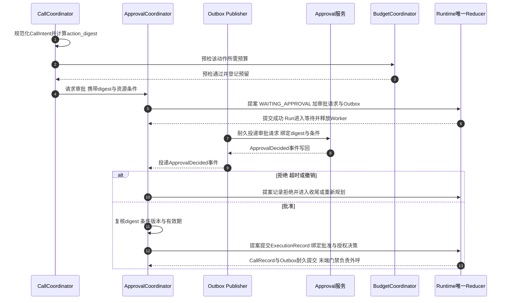

协调接口的关键约束：

1. **先预算后审批。** 审批前做预算预检，避免审批人批准了一个预算根本不支持的动作；审批等待期间预算预留应有有效期，过期需重新预检。
2. **审批请求与 Run 状态原子绑定。** “Run 进入 WAITING_APPROVAL + 审批请求 + Outbox”在同一事务提交，防止“审批已发出但 Run 不知道自己等什么”。
3. **批准事件不直接执行。** ApprovalDecided 只是 RuntimeEvent，仍要走校验、提案、Reducer 提交、末端门禁的完整路径。审批等待期间权限可能撤销、资源可能变化，批准之后仍需按当前状态重新授权（第 2 篇）。
4. **审批中的取消竞争。** Task 取消与审批批准可能同时到达，聚合版本决定唯一结果；迟到的批准不能复活已取消的 Run（第 2 篇）。Harness 在解释 ApprovalDecided 时必须先检查控制意图。

对 ASI09 人机信任滥用，Harness 的义务是把审批材料做实：参数差异、确定性风险展示、来源证据，而不是让审批人对着一句“是否允许执行该操作？”盲点批准。展示材料的生成在 beforeApprovalRequest Hook 完成，审批服务负责呈现与决定。

### 7.2 预算协调接口

预算在循环内有四个接触点：

| 接触点 | 时机 | Harness 的义务 |
|---|---|---|
| 受理预留 | Task 受理时 | 不在循环内，但循环读取预留余额 |
| 轮次预检 | 每轮提案前 | 按信封规模与动作预估检查余额 |
| 调用登记 | CallRecord 提交时 | 登记预估消耗，绑定 execution 维度 |
| 结果回写 | Usage 事件到达时 | 按去重键确认消费，未知费用保留未决 |

预算判定的失败语义必须区分：**预检超限**产生停止提案，不产生新调用；**登记失败**（预算服务不可用）时，高风险动作应阻断，低风险动作是否降级放行由策略显式声明——默认不应把“预算服务挂了”解释为“预算无限”。Usage 以追加方式记录并按供应方调用 ID、execution_id 与生产者事件 ID 去重；重复 Usage 不重复计费，未知费用保留未决责任而不是静默记零（第 2 篇）。

预算同时是级联失效的断路器（ASI08）：单 Run、单租户、单 Agent 版本的预算上限配合停止条件，防止错误循环、重试风暴或被劫持的目标把局部问题放大成成本事故。

---

## 8. 确定性控制与 Agent 自主性的边界

生产级 Harness 设计的核心判断是：**自主性是模型在约束内的建议权，不是控制权。** 哪些事情可以交给模型，哪些必须模型外强制，边界必须显式设计并写入 AgentSpec 与平台策略。

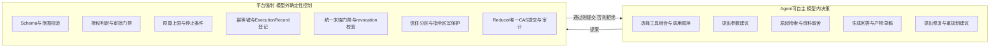

边界图可以读作一条单向管道：Agent 的一切决策都以提案形式流向平台强制层，强制层只做过滤与提交，从不反向“请求模型批准”。下表给出逐项归属与理由：

| 控制项 | 归属 | 理由 |
|---|---|---|
| 工具选择与顺序 | Agent | 这是自主性的核心价值；但候选集由 AgentSpec 固定 |
| 参数取值 | Agent 建议 + 平台校验 | 模型可提议，合法性与范围由校验决定 |
| 是否调用高风险动作 | 平台 | 风险等级与审批要求是策略事实，模型无权降级 |
| 授权判定 | 平台 | AuthzDecision 由策略在调用时点作出，执行时重验证 |
| 预算与停止 | 平台 | 模型没有成本责任感，上限必须外置 |
| 幂等键生成 | 平台 | 幂等键必须跨 Attempt 稳定且与业务动作绑定，模型不可改写 |
| 信任标签与分区 | 平台 | 若模型可自封 TRUSTED_INSTRUCTION，注入防线即告失效 |
| 撤销与取消 | 平台 | control_intent 与 revocation epoch 只能由控制面写入 |
| 状态提交 | 平台 | Reducer 唯一 CAS，提案不能直接改状态 |
| 验收与终态 | 平台与业务 | 模型自我报告不具备状态效力 |

这条边界解释了 Harness 的全部设计选择：上下文分区是为了让模型“看得见但改不了”；Hook 不可绕过是为了让治理“装得上但拆不掉”；耐久调用是为了让意图“记得住但追得回”；提案校验是为了让输出“用得上但信不过”。对模型能力的任何信任都必须止步于提案边界。

反过来说，平台也不应侵蚀 Agent 的自主空间：把工具顺序、检索取舍、回答组织全部硬编码，等于退回到工作流引擎，失去了 Agent 的价值。边界设计的艺术在于：**凡是可以重试、可以修复、可以拒绝的决策，交给模型；凡是不可逆、跨主体、涉及授权与事实的决策，留在模型外。**

---

## 9. Harness 与 Runtime Reducer 的协作时序

本节把第 4 篇的事件循环承载时序落到 Harness 视角，完整展示“提案 → CAS 提交 → 后续命令”的链条，并补充冲突与拒绝路径。

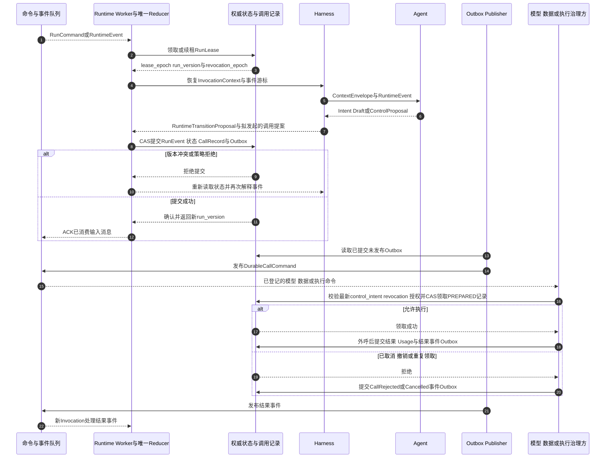

该时序是系列约定 4、5 的完整展开，五个关键性质值得逐一确认：

1. **Harness 无写权限。** Harness 交付的是 RuntimeTransitionProposal 与调用提案；RunEvent、状态、CallRecord 与 Outbox 由 Reducer 在一个 CAS 事务中提交。Harness 与 Runtime 不维护两套状态机（第 4 篇反模式 19.3）。
2. **ACK 在提交之后。** 输入消息只有在状态与 Outbox 提交成功后才确认消费；重复投递因此不会形成重复逻辑步骤，崩溃恢复后重新解释原事件即可。
3. **Outbox 提交即耐久。** 与状态原子提交的 Outbox 是耐久事实，Publisher 不因后续 lease epoch 变化而丢弃它；fencing 发生在状态写入事务与各外呼执行方，而不是发布阶段（第 4 篇）。
4. **末端门禁是最后一道闸。** 命令即使已在 Outbox，执行方外呼前仍校验最新 control_intent、revocation epoch、授权约束，并以 CAS 从 PREPARED 领取记录。取消或撤销后的拒绝形成耐久 CallRejected/Cancelled 事件；已开始的调用记录 PENDING/UNKNOWN 进入对账。
5. **结果事件驱动下一轮。** 外呼结果以 RuntimeEvent 回写，触发新的 Invocation；Harness 从事件解释开始新一轮，而不是在原地等待。循环由此获得跨实例推进能力：本轮在 Worker A 提交，下一轮可以在 Worker B 解释。

**冲突路径的语义。** CAS 版本冲突通常意味着另一个事件已经改变了 Run 状态（例如取消先于本轮提案到达）。正确处置不是“强行重试提交”，而是重新读取状态、重新解释事件——控制意图可能已经变化，原提案可能已不再合法。这与 LangGraph 类框架的重放语义形成对照：基于检查点重放恢复时，节点外部副作用必须幂等（第 4 篇能力表），而本模型通过 CallRecord 登记与末端门禁把幂等责任前移到平台层，重放的是“解释与提案”，不是“外部调用”。

---

## 10. 常见反模式

### 10.1 把 Harness 当成 Prompt 模板拼装器

只管理 Prompt 字符串，不管理信任、预算与校验。结果是注入、超支与越权全部压到模型自觉上。Harness 的产物是带治理属性的 ContextEnvelope 与受校验的提案，不是长字符串。

### 10.2 全量历史直接进上下文

不分层、不摘要、不打标。窗口溢出后随机截断，关键约束被静默丢弃；攻击内容混在历史里反复影响决策。必须用预算分配 + 受控摘要 + 信任标签治理。

### 10.3 工具结果直接进指令区

把网页、邮件、检索内容拼进系统指令，等于把指令区写权限交给外部世界。数据区内容永远不是指令，其中的“命令”按数据处理（ASI01/ASI06 的结构性防线）。

### 10.4 模型输出直接当已授权动作

模型说“调用发布接口”，执行器就真的调用。模型输出只是提案来源，必须经 Schema 与范围校验、授权判定、必要审批与耐久提交。把 ModelCallIntent/CallIntent 直接变成物理动作，是 Demo 与生产最短的距离。

### 10.5 用模型自检代替独立验证

让同一个模型既产出结果又宣布验证通过。VerificationCoordinator 的技术验证必须独立于产出路径：确定性规则、Schema、来源覆盖与扫描状态不依赖模型的自我评价。

### 10.6 校验失败无限重试

没有修复上限与预算占比控制，错误循环烧穿预算并掩盖攻击信号。修复必须有上限，且 Schema 失败与范围越界的处置语义不同。

### 10.7 Hook 可被 Agent 配置覆盖

强制授权 Hook 出现在 Agent 可编辑的配置里，或者 Hook 顺序运行期可变。强制 Hook 平台注册、顺序随 AgentSpec 固定、绕过尝试本身必须可检测。

### 10.8 Hook 直接改权威状态

Hook 绕过 Reducer 写状态，形成第二套状态机。Hook 只能影响提案并留痕，状态提交永远经由唯一 Reducer。

### 10.9 审批只绑定工具名

批准“调用邮件工具”后，收件人与内容仍可被替换。审批必须绑定 action_digest、资源条件与有效期；digest 失配即批准失效（第 2 篇）。

### 10.10 把 provisional 流当作权威状态

Token 流或进度文本被用来判断 Run 状态、触发交付或计费。展示增量流可合并、截断、丢弃，只有耐久事件才是事实（第 4 篇约定 9）。

---

## 11. 生产验证场景表

以下场景应纳入 Harness 层的生产准入测试，验证时同时检查事件序列、提案内容、Hook 审计与预算记录，而不只看最终回答：

| 验证场景 | 预期结果 |
|---|---|
| 工具结果中包含注入指令 | 内容以数据区标签进入上下文，不产生新目标或新动作，检测留痕 |
| 模型输出非法 JSON 或幻觉工具名 | 结构化错误回灌为 Observation，修复计数递增，超限后 Run 失败或转人工 |
| 模型提出授权范围外参数 | 范围校验直接拒绝，不进入修复循环，越权尝试被记录 |
| 同一提案连续校验失败超过上限 | 停止修复，形成失败或转人工提案，预算停止记录可查 |
| 强制 Hook 依赖的检测服务不可用 | 高风险动作被阻断，不跳过检测保可用性 |
| Agent 配置试图禁用强制 Hook | 配置不生效，绕过尝试形成可审计事件 |
| 审批等待数小时后批准到达 | 复核 digest 与条件版本仍有效后才提交执行记录，Run 从 WAITING 恢复 |
| 批准后参数发生变化 | action_digest 失配，旧批准失效，动作重新走校验与审批 |
| 批准与取消同时到达 | 聚合版本决定唯一结果，迟到批准不复活已取消 Run |
| 预算预检超限 | 不产生新调用，形成停止提案，已消耗与未决费用登记完整 |
| 预算服务不可用 | 高风险动作阻断，策略显式声明降级行为，不默认放行 |
| 提案提交后 Worker 崩溃 | CallRecord 与 Outbox 已耐久提交，接管者继续推进，不重复推理与重复调用 |
| CallRecord 提交后 Run 被取消 | 末端门禁按最新 control_intent 拒绝外呼，形成耐久 CallRejected 事件 |
| 外部调用已开始后取消 | 记录 PENDING/UNKNOWN 与 Usage，进入对账，不伪装成从未调用 |
| 模型流式输出中途断连 | provisional 流丢弃不影响权威状态，耐久事件继续提交 |
| 模型声称任务已完成但验证不通过 | Run 不进入 SUCCEEDED，按修复或失败路径处理 |
| 上下文超预算 | 按优先级裁剪数据区，指令区与目标契约完整，裁剪审计可查 |
| 摘要服务不可用 | 按降级策略保留最近原文并记录，不静默丢弃约束 |
| 轮次上限到达而 Agent 仍要求继续 | 循环确定性停止，模型意见不改变停止决定 |
| 重复 Usage 事件 | 按去重键只登记一次，合法调整事件保留 |

---

## 12. 架构评审清单

### 上下文工程

- ContextEnvelope 是否区分指令区与数据区，指令区是否只有平台与固定 AgentSpec 可写？
- 每段内容是否携带信任标签与来源引用，外部内容默认是否按不可信处理？
- 摘要是否保留来源与风险属性，裁剪是否有审计记录？
- 大对象是否以引用方式进入上下文，读取时是否重新授权？
- 上下文预算是否与费用预算联动？

### Agent Loop

- 轮次是否有明确生命周期与确定性停止条件？
- 控制意图与 revocation 检查是否在每轮解释阶段优先执行？
- 模型、检索、工具、审批四个分支是否都遵循耐久调用原则？
- provisional 展示流与耐久事件流是否严格分离？
- 循环是否只由 RuntimeEvent 驱动，不存在回调线程直接恢复 Agent？

### Hook 与中间件

- Hook 点位是否固定且有限，顺序是否随 AgentSpec 固定？
- 强制 Hook 是否平台注册、Agent 不可覆盖，绕过是否可检测？
- 每个 Hook 是否声明失败策略，安全关键 Hook 是否禁止降级跳过？
- Hook 是否只影响提案而不直接写权威状态？

### 提案校验

- Schema 校验是否以固定 AgentSpec 为依据，输出 Schema 是否随 Run 固定？
- 范围校验失败是否与 Schema 失败区分处置？
- 修复重试是否有上限，超限处置是否与风险等级挂钩？
- 校验错误回灌是否遵守数据区分区纪律？

### 审批与预算协调

- 审批请求是否绑定 action_digest、资源条件与有效期？
- 批准到达后是否复核 digest、条件与控制意图？
- 是否先预算预检后审批，预算预留是否有有效期？
- 预算服务不可用时行为是否由策略显式声明？

### 确定性边界与 Reducer 协作

- 授权、预算、幂等键、撤销、末端门禁是否全部在模型外强制？
- Harness 是否只产生提案，状态提交是否唯一经由 Reducer CAS？
- CAS 冲突是否触发重新读取与重新解释，而不是强行重提？
- 结果事件是否驱动下一轮，等待期是否释放 Worker？

---

## 13. 本篇结论与后续专题

Harness 是 Agent 平台中“把不确定性关进确定性笼子”的那一层。它不消灭模型输出的不确定性——那是 Agent 价值的来源——而是为这种不确定性建立确定的组织方式：

- 用 ContextEnvelope 把上下文从“拼接字符串”变成带信任标签、分区与预算的治理对象，指令区对数据区保持结构性写保护；
- 用 Agent Loop 把“模型—工具”往返组织为 RuntimeEvent 驱动的轮次，每个外部调用先耐久提交 CallRecord 与 Outbox，再由执行方过统一末端门禁后外呼；
- 用 Hook 与中间件在固定点位插入平台治理，强制 Hook 不可被 Agent 改写，失败策略显式声明；
- 用三层提案校验与有限修复把模型输出挡在授权边界之外，越权不修复、修复不无限；
- 用审批与预算协调接口把人的决定和钱的约束接入循环，批准绑定固定动作，预算先于动作；
- 用确定性控制边界保证授权、预算、幂等、撤销与状态提交永远在模型外强制；
- 用“提案 → Reducer CAS 提交 → 结果事件”的单向协作，使 Harness 定义语义而 Runtime 独占权威。

一句话收束本篇：**Agent 的自主性止于提案边界，平台的确定性始于 Reducer 提交。**

下一篇将离开循环内部，进入持久执行专题：Outbox 与对账协议的完整细节、Checkpoint 的分层实现、外部副作用 UNKNOWN 的处置流水线，以及“恰好一次”承诺的真实边界。

---

## 参考资料

以下均为官方资料。动态规范和文档会持续更新，实际实现应固定所采用的版本与访问日期。

1. [Google ADK Agent Runtime](https://adk.dev/runtime/)
2. [Google ADK Event Loop](https://adk.dev/runtime/event-loop/)
3. [Google ADK Events](https://adk.dev/events/)
4. [Google ADK Sessions](https://adk.dev/sessions/)
5. [CloudWeGo Eino ADK Agent Runner and Extension](https://www.cloudwego.io/docs/eino/core_modules/eino_adk/agent_extension/)
6. [CloudWeGo Eino Human-in-the-Loop](https://www.cloudwego.io/docs/eino/core_modules/eino_adk/agent_hitl/)
7. [LangGraph Pregel Runtime](https://docs.langchain.com/oss/python/langgraph/pregel)
8. [LangGraph Persistence](https://docs.langchain.com/oss/python/langgraph/persistence)
9. [LangGraph Durable Execution](https://docs.langchain.com/oss/python/langgraph/durable-execution)
10. [Temporal Workflow Execution](https://docs.temporal.io/workflow-execution)
11. [Amazon Bedrock AgentCore Runtime](https://docs.aws.amazon.com/bedrock-agentcore/latest/devguide/runtime-how-it-works.html)
12. [MCP Authorization Specification（2026-07-28）](https://modelcontextprotocol.io/specification/2026-07-28/basic/authorization)
13. [OWASP Top 10 for Agentic Applications for 2026](https://genai.owasp.org/resource/owasp-top-10-for-agentic-applications-for-2026/)
14. [OWASP Agentic AI Threats and Mitigations](https://genai.owasp.org/resource/agentic-ai-threats-and-mitigations/)
