# 持久执行、Checkpoint 与副作用对账

> **系列**：生产级 Agent 平台架构 2026 · 第 6 篇  
> **定位**：Runtime 机制篇  
> **版本**：闭环修订版  
> **前置阅读**：第 0 篇《从模型推理到生产运行：2026 年 Agent、Harness 与 Runtime 总体架构》 · 第 2 篇《从 Task 到交付：Agent 业务闭环与领域对象设计》 · 第 4 篇《Agent Runtime：从生命周期到执行治理的完整能力模型》  
> **关键词**：持久执行、事件溯源、Outbox、幂等、UNKNOWN 对账、Checkpoint、物理快照

## 摘要

Agent 平台的可靠性问题不在于某个进程能否一直存活，而在于一个无法回避的事实：**进程随时可能终止，而已经发生的副作用不会随之消失。** Worker 崩溃、租约到期、滚动发布、模型超时、回调丢失、审批等待数小时，都会让“平台认为的状态”与“外部世界真实的状态”出现裂缝。弥合这条裂缝，靠的不是更谨慎的代码，而是一整套持久执行协议。

本文沿系列命题展开：**Agent 定义行为，Harness 组织与约束行为，Agent Runtime 承载并驱动行为，执行后端完成动作。** 持久执行正是 Runtime 的核心机制篇。文章先建立权威状态与事件溯源：RunEvent 追加式记录运行事实，聚合版本与条件更新阻止并发双写，Runtime 唯一 Reducer 做 CAS 提交；再讨论 Outbox：状态与待发布命令原子提交后即为耐久事实，Publisher 不得因后续 lease 变化丢弃，重复发布由消费方按 event_id 幂等消化；随后给出覆盖受理、动作、交付与用量的幂等键体系。

文章的核心是外部副作用治理。ExecutionRecord 完整状态机涵盖 PREPARED、SUBMITTING、PENDING、UNKNOWN、CANCELLING、CANCEL_REVIEW、NEEDS_REVIEW 与三个终态，每条转移都有守卫；**UNKNOWN 不是失败也不是成功，必须先对账。** 对账按幂等键、ExternalHandle、供应方状态、人工裁决逐级升级；不可逆且不可查询的动作必须限制自主性或转人工。已计费未响应的 ModelCallRecord 进入模型对账；Saga 补偿被建模为需要新授权、同样走状态机与对账的受治理执行。

Checkpoint 部分严格区分两层：**逻辑 Checkpoint 是恢复的依据，物理快照只是可选的加速。** CRIU、runsc checkpoint、Firecracker microVM 快照是三套机制、三种隔离等级、三组限制，谁也不能把已发生的远端副作用纳入本地回滚承诺。恢复遵循统一协议：租约接管、读取历史、对账在途、决定继续或裁决。最后讨论持久工作流引擎能承载什么、平台仍须补什么，并给出反模式、生产验证场景与评审清单。

本篇不展开 Harness 循环推进（第 5 篇）、执行适配器实现（第 7 篇）、沙箱工程（第 8 篇）与多可用区容灾（第 17 篇）。

---

## 1. 问题背景：进程会死，副作用不会

第 4 篇确立了 RuntimeInstance、Invocation、Run 三层分离：RuntimeInstance 是承载代码的进程或实例，Invocation 是一次入口请求与响应流，Run 是跨 Invocation、跨 Worker、跨实例持续存在的耐久运行。这一分离回答了“进程死了任务去哪了”的第一半——Run 的状态独立于实例存在。但还有第二半：**Run 推进过程中已经发出去的外部动作怎么办？**

考虑一次最普通的外部调用：执行器向业务系统提交“发布报告”请求。把时间轴拉开，故障可能落在至少四个窗口：

| 故障窗口 | 平台视角 | 外部世界视角 | 错误处理 | 正确处理 |
|---|---|---|---|---|
| 调用意图刚产生，尚未登记 | 什么都没发生 | 什么都没发生 | 直接重试提案 | 先原子提交 CallRecord 与 Outbox |
| 命令已耐久提交，尚未外呼 | 有一条待发布命令 | 什么都没发生 | 因 Worker 崩溃丢弃命令 | Outbox 继续投递，执行方 CAS 领取 |
| 外呼已发出，响应丢失 | 不知道结果 | 动作可能已生效 | 超时即判失败并重试 | 进入 UNKNOWN，先对账 |
| 外部已生效，结果提交前崩溃 | 没有记录 | 动作已生效 | 当作未发生重新执行 | 接管者读取记录，按句柄对账 |

这四个窗口对应四类典型错误：超时推断失败（动作其实已生效，重试就是重复发布、重复扣款、重复删除）；重试制造新动作（接管后不复用原 ExecutionRecord，平台失去跨重试识别同一副作用的能力）；快照冒充回滚（本地内存回去了，远端数据库里的行不会回去）；取消当作完成（外部系统可能不支持取消，或已在收到取消前完成动作）。它们在缺少持久执行协议的系统里反复出现，细节见第 13 节反模式清单。

系列第 0 篇已经给出总原则：**持久工作流或事件重放不等于外部副作用 exactly-once。** 安全自动重试至少依赖稳定幂等键、足够长的去重窗口、可查询状态或明确补偿协议。本篇把这组原则展开为可实现的机制：权威状态与事件溯源（第 2 节）、Outbox（第 3 节）、幂等键（第 4 节）、ExecutionRecord 状态机（第 5 节）、对账协议（第 6、7 节）、补偿（第 8 节）、Checkpoint 与物理快照（第 9、10 节）、恢复流程（第 11 节），以及与现成工作流引擎的边界（第 12 节）。

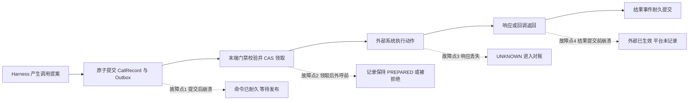

图中四个故障点正是持久执行协议要逐一覆盖的对象。这条链上的每一步都遵循耐久调用原则：**任何外部调用先原子提交 CallRecord（ModelCallRecord、DataRequest、MemoryWriteRecord 或 ExecutionRecord）与 Outbox，再异步执行；执行方在外呼前过统一末端门禁。** 调用从未登记变成“先斩后奏”，是绝大多数重复副作用事故的根源。

---

## 2. 权威状态与事件溯源

### 2.1 唯一权威状态库

Run 的权威状态必须存在于比任何 Worker 都长寿的存储中。第 4 篇已经说明：Run 状态是权威业务运行进度，包括当前 Step、等待原因、版本、租约、预算引用和终止意图，不应只存在于 Runner 内存。权威状态库通常由事务型关系数据库承担，因为它同时提供事务原子性（状态、事件、Outbox 同一事务提交）、条件更新（聚合版本 compare-and-set）、唯一约束（幂等键与未决记录的去重防线）以及复制与故障切换。

消息队列、缓存和对象存储都不适合这个角色：队列提供传输而非当前状态的可查询权威，缓存可丢失，对象存储缺少条件更新语义。第 2 篇的结论在这里继续成立：**消息系统是事件运输，不应成为 Task 或 Execution 当前状态的唯一权威来源。**

### 2.2 RunEvent：追加式运行事实

事件溯源的核心是把“已经发生什么”以追加方式记录下来。RunEvent 是 Run 的耐久运行事实，常见类型包括：

| 事件类别 | 示例 | 说明 |
|---|---|---|
| 生命周期 | RunStarted、RunPaused、RunResumed、RunFinished | 状态转移的证据 |
| 步骤推进 | StepStarted、StepCompleted、StepFailed | 逻辑进度 |
| 调用登记 | ModelCallCommitted、ExecutionCommitted | CallRecord 已耐久提交 |
| 调用结果 | ModelCallResolved、ExecutionResolved、CallRejected | 含被门禁拒绝的耐久事实 |
| 控制意图 | CancelRequested、RevocationApplied | 取消与撤销是持久意图 |
| Checkpoint | CheckpointCreated | 逻辑恢复点引用 |
| 对账 | ReconciliationStarted、ReconciliationConcluded | 对账本身也是事实 |

RunEvent 至少携带：`event_id`、`run_id`、单调事件序号、`run_version`（本事件提交后的聚合版本）、`occurred_at`、`schema_version`、`causation_id` 与 `correlation_id`、actor 与 lease epoch 信息。事件一经提交不可修改；对同一事实的更正以新事件表达，与第 2 篇“人工裁决不是修改历史，而是新增权威事实”的原则一致。

### 2.3 聚合版本与条件更新

每个聚合维护单调版本号，如 `run_version`、`task_version`。所有状态转移采用条件更新：

```text
UPDATE run_state
   SET status = :new_status,
       run_version = run_version + 1
 WHERE run_id = :run_id
   AND run_version = :expected_version
```

只有期望版本匹配，转移才生效。这组机制处理的是真实生产中的竞争：审批决定与取消命令同时到达、定时器与回调同时唤醒、两个 Worker 因时钟偏差短暂重叠。版本条件更新保证**只有一个提案能形成状态转移**，其余收到冲突并被幂等忽略或重新解释。

需要区分两类版本语义，第 2 篇已有结论，此处沿用：

- `expected_version` 用于调用方对目标聚合发出的**命令**：命令表达“希望发生什么”，可以被拒绝；
- 外部聚合产生的**事实事件**只携带自身事件 ID、来源版本和因果信息，接收方按 `event_id` 去重后，结合目标聚合当前状态判断是正常转移、迟到处置还是人工裁决，不能仅因来源版本早于当前状态就丢弃事实。

迟到事实不因版本机制被抹掉：终态 Run 收到的迟到执行成功，仍要记录真实副作用、追加 Usage、必要时创建补偿任务——只是不能把终态对象原地改回运行中。这与系列约定一脉相承：**Run 成功不等于 Task 完成，Task 终态由 Finalization 门禁决定，Task 服务固化 terminal_disposition**；终态是业务决定，不是可以被回调随意拨动的开关。

### 2.4 事件溯源的两种落地

“事件溯源”在工程上有两种常见形态，选型时必须分清：

| 形态 | 权威表示 | 恢复方式 | 代表 |
|---|---|---|---|
| 全量重放 | 事件历史本身 | 从首个事件重放至当前 | Temporal 的 Event History Replay |
| 快照加尾部事件 | 周期快照加后续事件 | 读最近快照再应用尾部事件 | 数据库状态机加 RunEvent 追加表 |

两者是权衡而非优劣：全量重放避免快照与事件不一致，但要求处理逻辑严格确定且重放成本随历史增长；快照加尾部事件恢复更快，但要求快照生成与事件提交在同一事务并管理快照兼容性。Agent 平台的 Run 通常事件量有限而恢复时延敏感，**快照加尾部事件**更常见。无论哪种形态，外部副作用都不能靠重放解决——重放只能重建平台侧认知，不能重建外部世界。

### 2.5 唯一 Reducer：Harness 只产生提案

第 4 篇确立了事件循环承载方式：Harness 读取事件、组装上下文、运行 Agent，产生 `RuntimeTransitionProposal` 与拟发起的外部调用提案；Runtime 的唯一 Reducer 负责校验租约、聚合版本与撤销状态，把提案通过 CAS 原子提交为 RunEvent、状态变化、CallRecord 与 Outbox 命令。**Harness 只产生提案，Runtime 唯一 Reducer 做 CAS 提交**——在持久执行语境下这意味着状态转移入口唯一：正常推进、恢复、对账、补偿任何路径都必须经过同一套版本校验与事实登记，不存在绕过状态机直接改库的后门。

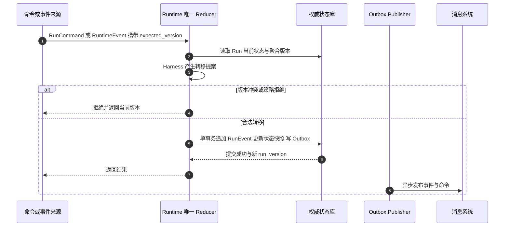

---

## 3. Outbox：与状态原子提交的耐久事实通道

### 3.1 双写问题

状态库与消息系统是两个独立系统。任何“先写库再发消息”或“先发消息再写库”的代码，都存在一个故障窗口：前者可能状态已更新而事件永远未发布，后者可能消息已发出而状态回滚。Transactional Outbox 的解法直接而朴素：**把待发布的消息作为行写入状态库的 Outbox 表，与状态变更在同一事务提交**，再由独立的 Publisher 异步发布。

由此得到的关键性质是：**状态与 Outbox 一旦原子提交，就是耐久事实。** 命令会不会被执行、何时被执行，是 Publisher 与执行方的责任；命令是否存在，已经是不可争议的事实。

### 3.2 发布语义

Outbox 到消息系统的发布是**至少一次**语义：Publisher 扫描未发布行、发布、标记已发布，任何一步失败都会导致重发。因此消费方必须幂等（见 3.3）；Publisher 的进度以 Outbox 行的发布标记为准，而不是以消息系统的 ACK 为唯一依据；发布延迟应被监控，长期未发布的 Outbox 行是明确的故障信号。

与 lease 的关系是本篇必须钉死的约定：**已与状态原子提交的 Outbox 是耐久事实，Publisher 不得因为后续 lease epoch 变化而丢弃它。** 一种看似合理的错误实现是：Worker A 提交 Outbox 后失联，Worker B 接管后发现“这不是我产生的命令”，于是跳过发布——这会把合法延迟命令静默吞掉，例如 Run 已进入 WAITING 并释放 lease 后，此前耐久调度的执行命令仍必须被投递。正确做法是：**fencing 发生在状态与 Outbox 写入事务、以及各外部调用的执行方，而不是发布阶段。** Publisher 只管忠实投递；命令是否应该真正外呼，由执行方的末端门禁依据最新 control_intent、revocation epoch、授权和记录状态决定。

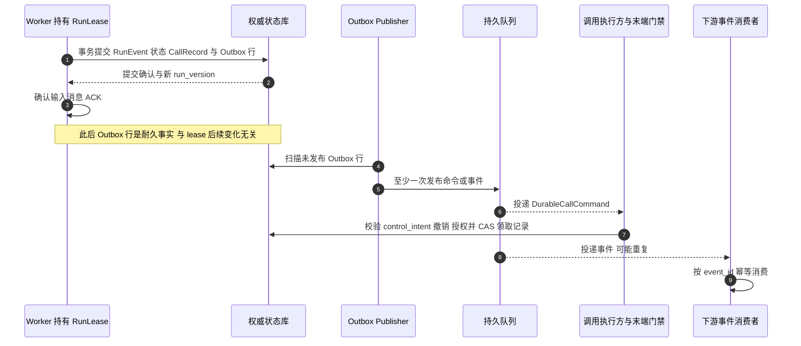

### 3.3 重复发布与幂等消费

至少一次发布必然产生重复。消费方的处理规则按消息性质区分：

| 消息性质 | 去重键 | 重复时的行为 |
|---|---|---|
| 耐久命令 | 命令携带的 CallRecord 标识 | CAS 领取已被占用则忽略，不重复外呼 |
| 事实事件 | `event_id` | 幂等忽略，不重复产生下游副作用 |
| 定时器唤醒 | run_id 加定时器标识 | 重新入队即可，推进时按当前状态解释 |

“重复消息不会自动变成重复逻辑步骤”是第 0 篇可靠受理模型就承诺的性质，其实现正是这里：重复投递到达时，Reducer 读取当前聚合状态，发现对应转移已经发生，于是幂等确认。

### 3.4 Outbox 与取消、撤销的竞争

取消或撤销发生在 Outbox 提交之后、命令执行之前，是持久执行中最微妙的竞争之一。系列约定给出的答案分三段：**Publisher 仍投递**，耐久命令不因控制意图变化而被发布方丢弃；**执行方拒绝外呼**，统一末端门禁发现 `control_intent=CANCEL` 或 revocation epoch 已变化，拒绝执行并提交 `CallRejected/Cancelled` 耐久事件；**已开始的不假装没发生**，若外部调用已经开始，记录 PENDING 或 UNKNOWN 与 Usage，进入取消专用对账，不能把“Publisher 没投递”或“门禁拒绝”当作取消完成。

这三段保证了取消语义的完整性：**取消是持久意图，不是回滚**；取消的完成以在途副作用全部裁定为准，而不是以命令是否还在队列为准。

### 3.5 工程要点

- **分区与顺序**：Outbox 按聚合分区（如 run_id），同一聚合的命令保持发布顺序；跨聚合不承诺全局顺序，与第 2 篇的顺序范围结论一致；
- **保留与清理**：已发布行按审计策略保留后归档，未发布行的堆积触发告警而不是静默清理；
- **发布方式**：轮询扫描实现简单，延迟取决于轮询间隔；基于数据库变更日志的 relay 延迟更低、复杂度更高。两者都满足语义要求，按规模选择；
- **与定时器合一**：延迟命令、对账扫描触发、审批超时都可建模为 Outbox 中的定时行，统一由 Publisher 投递，避免多套定时机制各自为政。

---

## 4. 幂等键体系

幂等是持久执行的去重基石，但“生成一个 UUID”不等于幂等。幂等键必须回答三个问题：**谁生成、在哪个范围稳定、接收方按它去重多久。** 平台的幂等键体系覆盖六个层面。

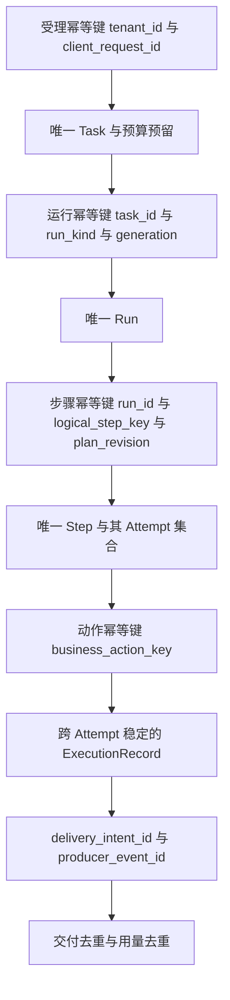

### 4.1 受理幂等键

受理幂等键由调用方提供、限定在租户范围内：`tenant_id + client_request_id`。它保证同一业务请求在重复提交、网络重试、客户端超时重发时只创建一个 Task、只预留一次预算。要点：

- 键的命名空间必须含租户，避免不同租户的调用方互相碰撞或被猜测；
- 受理返回应缓存首次受理结果，重复提交返回同一结果而不是冲突错误；
- 键的生命周期覆盖业务重试窗口即可，不需要永久保留，但保留期必须显式声明。

### 4.2 动作幂等键

动作幂等键（business_action_key）标识**一个逻辑外部副作用**，是 ExecutionRecord 跨 Attempt 稳定的关键。第 2 篇的规则继续有效：

- 同一逻辑动作跨 Attempt、跨 Worker 接管保持同一 `execution_id` 与同一动作幂等键；
- 参数、目标资源或业务意图发生变化时，不得复用旧键——那是另一个动作；
- 修复创建新 Run（系列约定：修复创建 Repair Run），Repair Run 中的动作是否复用旧键，取决于业务语义是“重试同一动作”还是“执行修正后的新动作”，必须显式判断，不能默认。

动作幂等键的价值只有在**接收方按该键去重**时才完全成立。外部系统支持幂等键时，平台应将其传递并依赖其去重窗口；外部系统不支持时，平台只能依赖查询与对账，这正是第 6.5 节讨论不可逆且不可查询动作的原因。

### 4.3 delivery_intent_id

交付层面的去重比“按 artifact 去重”更细：同一 Artifact 可能存在两个正当的独立交付意图（例如先交付草稿接收方、再交付正式接收方；或更换交付渠道重发）。因此 DeliveryRecord 按 `task_id + delivery_intent_id + artifact_digest + destination + delivery_policy_version` 去重，其中 `delivery_intent_id` 区分交付意图本身。这与系列约定一致：**Delivery 对账保持 ResultSelection**——交付永远引用被选定的 Run—Artifact—Acceptance 证据链，交付 UNKNOWN 后的重试仍然是对同一 Selection 的交付，而不是重新选择结果。

### 4.4 producer_event_id

Usage 与用量结算的去重依赖 `producer_event_id`：用量事实的生产者（模型网关、资源池、执行适配器）为每条用量事件分配稳定 ID，结算侧按“供应方调用 ID + execution_id + producer_event_id”去重。供应方晚到的调整不篡改原 Usage 事件，而是新增调整事件——Usage 是事实，Settlement 是处理，两者分离是第 2 篇的既定模型。

### 4.5 幂等键速查表

| 幂等键 | 生成方 | 稳定范围 | 去重对象 | 失效条件 |
|---|---|---|---|---|
| 受理幂等键 | 调用方 | 租户内 | Task 创建与预算预留 | 超过声明的受理重试窗口 |
| 运行幂等键 | 平台 | Task 内 | Run 创建 | Task 终态 |
| 步骤幂等键 | 平台 | Run 内 | Step 创建 | 计划版本变化则新键 |
| 动作幂等键 | 平台 | 跨 Attempt | 外部副作用提交 | 业务意图或参数变化则新键 |
| delivery_intent_id | 平台 | Task 内 | 交付提交 | Selection 更换则重新评估 |
| producer_event_id | 用量生产者 | 全局 | 用量记录 | 不去重调整事件 |

最后重申第 2 篇的告诫：**幂等键只能在接收方真正按该键去重、且保留期覆盖重试窗口时生效。** 平台在接入每个执行后端时，必须登记该后端的幂等能力、查询能力与去重窗口，作为对账协议和自主性策略的输入。

---

## 5. ExecutionRecord 完整状态机

ExecutionRecord 是外部副作用的权威载体。第 2 篇给出了它的基础状态机，本篇补全为包含 CANCEL_REVIEW 的完整版本，并明确每条转移的守卫。

### 5.1 状态与转移

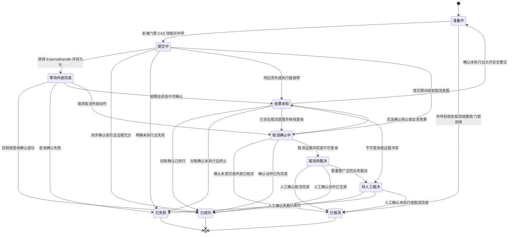

### 5.2 状态语义

| 状态 | 语义 | 常见误解 |
|---|---|---|
| PREPARED | 意图已耐久登记，尚未外呼 | 误以为还未创建记录 |
| SUBMITTING | 正在外呼，结果未定 | 误以为外部已受理 |
| PENDING | 外部已受理或已有句柄，等待完成 | 误以为一定会成功 |
| UNKNOWN | 平台无法确认动作是否生效 | 误当作失败或成功 |
| CANCELLING | 取消意图已持久化，正在确认外部效果 | 误以为外部已停止 |
| CANCEL_REVIEW | 取消是否完成存在证据冲突或不可查询 | 误以为取消已生效 |
| NEEDS_REVIEW | 需要人工裁决业务效果 | 误以为系统故障 |
| SUCCEEDED / FAILED / CANCELLED | 有证据支撑的终态 | 误以为可被回调推翻 |

两个状态值得特别说明。**UNKNOWN** 是整套协议的重心：它不是失败也不是成功，是必须被对账消解的未决责任；任何把 UNKNOWN 超时自动改成 FAILED 再重试的实现，都在拿不可逆副作用碰运气。**CANCEL_REVIEW** 刻画取消特有的困境：外部系统对取消请求的响应同样可能丢失或不支持，取消本身也需要对账与裁决——“停止请求不等于停止完成”。

### 5.3 转移守卫

每条转移都必须由 CAS 条件更新守护，防止并发与迟到事件造成非法转移：

| 转移 | 守卫条件 |
|---|---|
| PREPARED → SUBMITTING | 末端门禁全部通过：control_intent 非取消、revocation epoch 未撤销、授权与 ReleaseGrant 有效、ExecutionSpec 摘要匹配；且以 CAS 从 PREPARED 唯一领取 |
| PREPARED → CANCELLED | 尚未外呼；control_intent 为取消或授权被撤销；提交 CallRejected/Cancelled 耐久事件 |
| SUBMITTING → PENDING | ExternalHandle 已持久化到记录 |
| SUBMITTING → SUCCEEDED | 同步响应携带充分证据，且响应与登记的摘要匹配 |
| SUBMITTING → FAILED | 供应方明确拒绝或给出确定的未执行证据 |
| SUBMITTING → UNKNOWN | 响应丢失、超时或执行器故障；禁止以超时推断 FAILED |
| SUBMITTING → CANCELLING | 提交期间收到取消意图；control_intent 已持久化，已发出的调用不假装未发生 |
| PENDING → SUCCEEDED / FAILED | 回调或查询结果携带句柄或幂等键匹配证明 |
| PENDING → UNKNOWN | 超过查询窗口仍无法确认；进入对账队列 |
| PENDING → CANCELLING | 取消意图已持久化；向外部发起取消请求但不假定其生效 |
| UNKNOWN → SUCCEEDED / FAILED | 对账取得匹配证据：句柄、幂等键或供应方记录证明已执行，或未执行且已终止 |
| UNKNOWN → PREPARED | 有“动作未执行”的确认证据，且策略允许安全重试，且重试预算未耗尽 |
| UNKNOWN → NEEDS_REVIEW | 目标不可查询、证据冲突或动作不可逆 |
| UNKNOWN → CANCELLING | 已存在取消意图且对账仍在继续；转入取消确认流程，禁止改走重试 |
| CANCELLING → CANCELLED | 有未提交或外部已取消的确认证据 |
| CANCELLING → SUCCEEDED | 证据表明动作在取消前已完成；记录迟到副作用与费用 |
| CANCELLING → UNKNOWN | 无法确认外部是否停止或业务效果是否发生；进入取消专用对账 |
| CANCELLING → CANCEL_REVIEW | 取消结果不可查询或证据冲突 |
| NEEDS_REVIEW / CANCEL_REVIEW → 终态 | 人工裁决记录完整：证据、决策人、认定、后续处置 |

守卫的公共前提：**终态只能由证据到达，不能由超时到达；终态不可被迟到回调推翻。** 迟到的成功可以新增副作用记录、Usage 与补偿任务，不能把 CANCELLED 改回 SUCCEEDED，也不能让已取消的 Run 复活——取消对账不能复活 Run 是系列约定，其实现正是这里的转移守卫。

### 5.4 与 Run、Task 状态机的关系

ExecutionRecord、Run 与 Task 状态机是三个不同聚合的状态机，通过事件协作而非嵌套调用：ExecutionRecord 终态产生 `ExecutionResolved` 事件，唤醒 Run 继续推进或进入裁决；Run 的取消意图传播为 ExecutionRecord 的取消请求，但不代替其状态机；Task 的 Finalization 门禁要求关键 ExecutionRecord 没有未决 UNKNOWN 才允许进入完成终态。三层各自有自己的终态判据：ExecutionRecord SUCCEEDED 不等于 Run 成功，Run 成功不等于 Task 完成。

---

## 6. 对账协议

对账（Reconciliation）是平台侧认知与外部世界事实重新对齐的协议。它不是异常路径的补丁，而是持久执行的一等公民：**任何 PENDING、UNKNOWN、CANCELLING、CANCEL_REVIEW 记录，都天然处于对账责任之下。**

### 6.1 触发时机

| 触发源 | 场景 | 说明 |
|---|---|---|
| 定时扫描 | 超期的 PENDING 与 UNKNOWN | 对账器按记录年龄、风险等级排优先级 |
| 租约接管 | 新 Worker 接管 Run | 先对账在途，再决定推进，见第 11 节 |
| 取消收尾 | CANCELLING 记录需要裁定 | 取消完成以在途裁定为准 |
| Finalization 门禁 | Task 申请终态 | 未决 UNKNOWN 阻断完成终态 |
| 供应方通知 | 账单、故障通告、状态推送 | 被动触发的定向对账 |

### 6.2 查询路径

对账按证据可得性逐级降级：**按业务幂等键查询**是最强证据，它能区分“这个动作是否发生过”，而不只是“某个句柄的现状”；**按 ExternalHandle 查询**可确认该次受理的状态，但要求平台在提交时已持久化句柄；**供应方状态核对**（账单、用量记录、管理接口）是旁证，证据强度低于前两者，用于交叉验证或兜底；以上均不可得或互相冲突时，进入**人工裁决**。

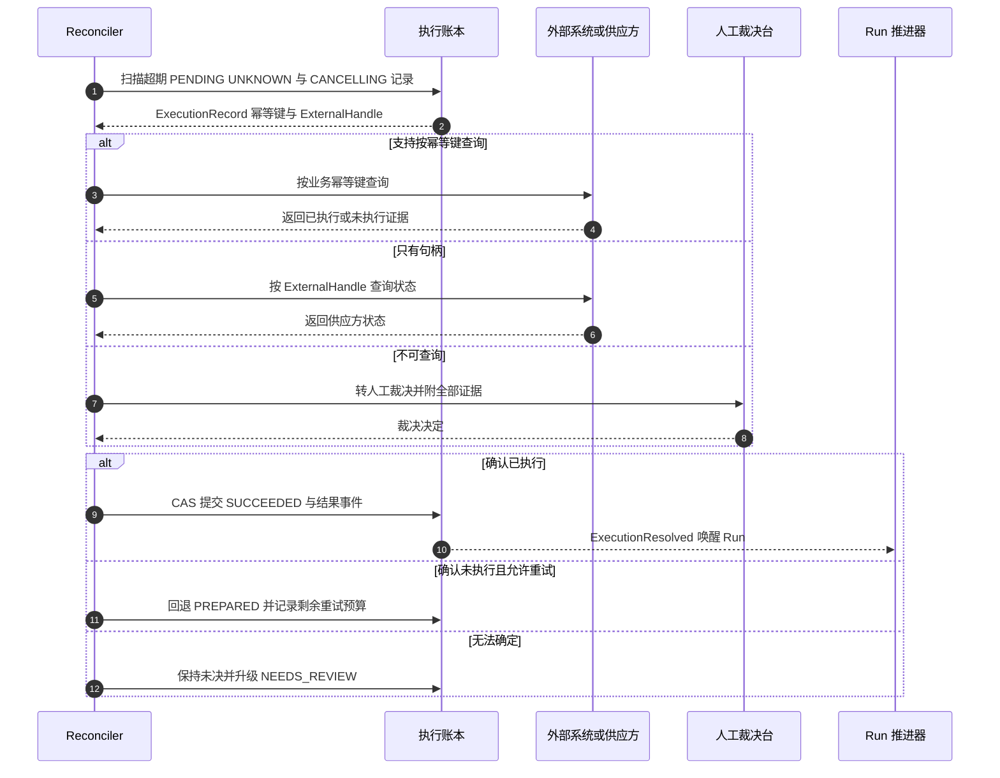

### 6.3 证据等级

对账结论必须标注证据等级，供后续门禁与审计使用：

| 证据等级 | 来源 | 可支撑的转移 |
|---|---|---|
| 直接证据 | 幂等键查询返回业务事实 | 任意终态转移 |
| 句柄证据 | ExternalHandle 状态查询 | 终态转移，冲突时降级 |
| 旁证 | 账单、用量、日志推断 | 费用认定可用；业务终态需人工确认 |
| 人工认定 | 裁决记录 | 任意终态转移，附裁决依据 |

### 6.4 人工裁决

人工裁决记录至少包含：可用证据与查询结果、决策人与权限、对业务效果的认定、是否需要补偿或通知、费用与产物如何处置、是否允许 Task 继续、后续改进或安全事件编号。裁决是新增权威事实，不是修改历史。对高风险动作（不可逆、跨租户、涉资金），裁决应默认双人复核。OWASP Agentic Top 10 2026 将 Agent 风险分为十类：目标劫持、工具误用、身份权限滥用、供应链、意外代码执行、记忆上下文污染、智能体间通信、级联失效、人机信任滥用、失控智能体——本篇的对账与裁决机制同时服务于其中多项：UNKNOWN 不受控重试是工具误用与级联失效的放大器，把“人确认过”当作免检通行证则是人机信任滥用的典型形态。

### 6.5 不可逆且不可查询动作的处置

这是自主性策略的边界条件。对既不支持幂等键查询、又不支持状态查询、且效果不可逆的动作（典型如向外部发送邮件、调用无幂等能力的第三方写接口），平台的正确姿态是：**事前**在执行适配器注册时登记其幂等与查询能力，此类动作默认限制自主执行，要求人工确认或降级为草稿；**事中**结果一旦 UNKNOWN 禁止自动重试，直接进入 NEEDS_REVIEW；**事后**裁决结论附风险接受记录，同类动作重复出现应触发能力改造或策略收紧。用重试次数碰运气，等于把“是否重复副作用”交给概率分布决定。

### 6.6 对账器自身的幂等与防护

对账器是特权组件，它自身也可能重复、并发或过期：对账结论的提交同样走 CAS，只有记录仍处于未决状态时结论才能落库；多个对账器并发处理同一记录时以记录版本仲裁，败者幂等退出；对账查询本身只读，不产生新的外部副作用，若裁决要求补发动作，那是一次新的受治理执行；对账活动产生 ReconciliationStarted 与 ReconciliationConcluded 事件进入审计。

---

## 7. 模型调用对账

模型调用没有业务侧不可逆副作用，但有真实的费用与上下文后果，因此同样适用耐久调用原则：ModelCallRecord 与 Outbox 先原子提交，模型网关在外呼前过末端门禁，拒绝形成 CallRejected 耐久事件，已开始的调用记录 PENDING 或 UNKNOWN 与 Usage。

### 7.1 已计费未响应：模型对账的核心场景

流式响应中断、网关超时、供应商侧故障，都可能造成“供应商已经计费，平台没有拿到响应”。此时 ModelCallRecord 处于 PENDING 或 UNKNOWN，处置协议如下：

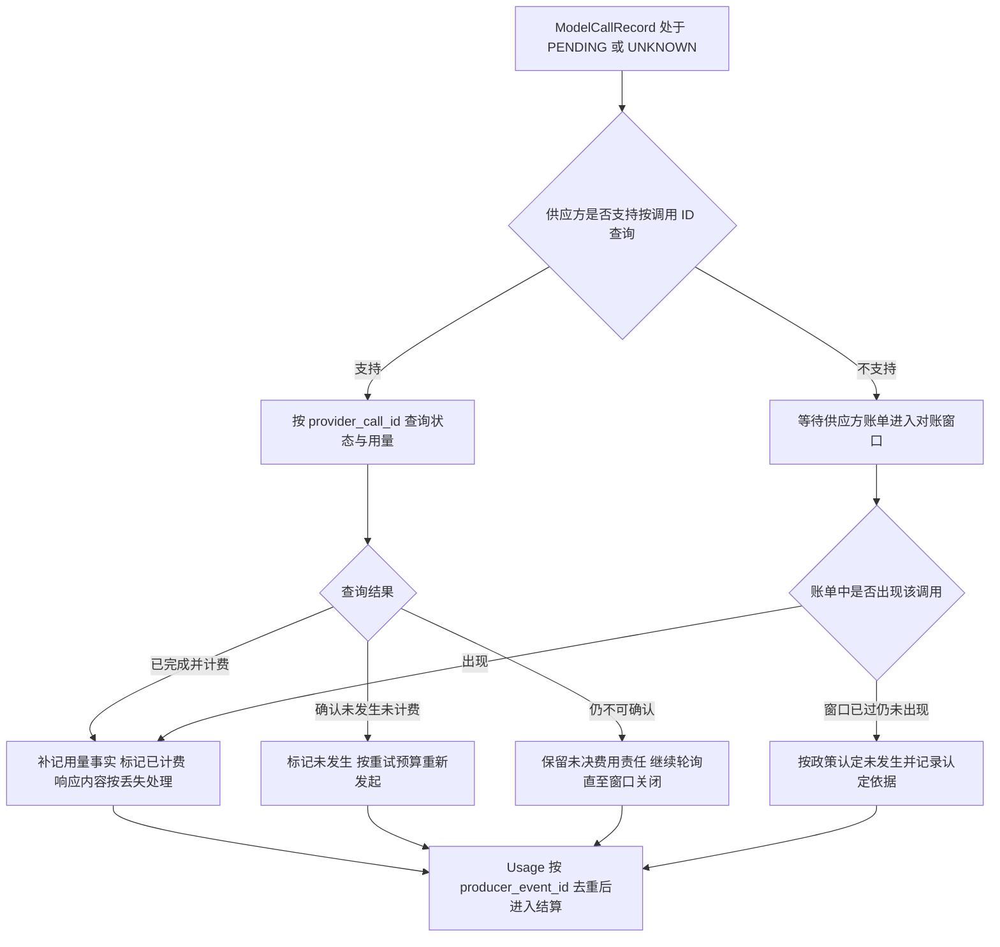

几个关键判断：**响应内容不可恢复，费用事实可以对账**——对账解决“这次调用是否发生、是否计费”，不是找回丢失的 Token 流，响应丢失就是丢失，Harness 按策略决定是否重新发起调用；**重试是安全的，但受预算约束**——模型调用不产生外部业务副作用，UNKNOWN 后重新发起不会重复业务动作，但会重复消耗 Token，因此受调用预算与截止时间约束；**未决费用不得静默归零**——窗口关闭前无法确认的调用保留显式未决责任，与第 2 篇结算原则一致；**Checkpoint 应保存对账上下文**——第 4 篇已约定，对可能已计费但响应丢失的模型调用，Checkpoint 保存稳定调用 ID、供应方状态、Usage 对账引用和后续处置策略，使恢复后的 Worker 能继续对账而不是重新猜测。

### 7.2 与 Run 推进的衔接

模型调用 UNKNOWN 不阻断 Run 的状态安全——Run 始终可以从最近的耐久状态继续——但会阻断当前 Step 的推进。Harness 的处置选项按策略排列：重新发起同一调用、降级到备选模型路由（AgentSpec 允许时）、将 Step 标记失败并交由 Run 策略决定修复或终止。无论哪种选项，ModelCallRecord 的对账责任都独立于 Step 的命运继续存在：**Step 可以失败，账不能不认。**

---

## 8. Saga 与补偿

Agent 任务的多个外部动作之间常常存在业务依赖：先创建资源、再写入数据、最后发布。当后续步骤失败或裁决终止时，前序已确认的副作用是否需要撤销？这就是 Saga 补偿问题。平台必须避免两个极端：假装一切可以自动回滚，或假装什么都不用管。

### 8.1 补偿是新动作，需要新授权

补偿不是时光倒流，而是一个方向相反的新动作：退款接口、撤回发布、删除资源。因此：**补偿动作有自己的 ExecutionSpec 与动作幂等键**，不复用原动作的键——它们是不同的业务动作；**补偿需要重新授权**，原审批绑定的是原动作的规范摘要与资源条件，补偿时的身份、权限、资源状态都可能已变化，高风险补偿同样可能触发人工审批；**补偿范围以已确认副作用为限**，只有 SUCCEEDED 或经对账确认已执行的动作才谈得上补偿，UNKNOWN 动作先对账——对 UNKNOWN 盲目补偿可能造成“动作其实没发生，补偿却真的执行了”的反向事故。

### 8.2 补偿本身也是受治理执行

补偿动作走完整的耐久调用链：创建补偿 ExecutionRecord、提交 Outbox、末端门禁校验、外呼、结果登记——它同样可能 PENDING、UNKNOWN，同样需要对账，甚至可能需要“补偿的补偿”。因此补偿必须有预算与深度上限，超出上限转人工案件，而不是无限递归。

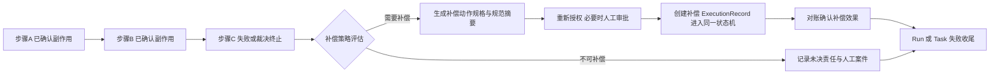

### 8.3 补偿与取消的边界

取消与补偿的语义必须分开：**取消面向未来**——停止新动作、裁定在途动作，取消对账不能复活 Run；**补偿面向过去**——处置已确认的副作用。一个被取消的 Task 可能同时需要补偿（已确认副作用存在）与对账（在途动作未知），两者在取消收尾阶段并行推进，全部裁定后 Task 才能固化 terminal_disposition 进入终态。

---

## 9. 逻辑 Checkpoint

### 9.1 内容

逻辑 Checkpoint 是 Run 的可恢复状态引用，其内容沿用第 4 篇的清单并强调三点：**只引用已持久化的事实**——run_id 与 run_version、agent_spec_digest 与事件 Schema 版本、当前 Step 与计划修订号、已提交事件游标、ContextEnvelope 引用、Session 与 Memory 与 Artifact 的引用及摘要、未决 Approval 与 ModelCallRecord 与 Execution 与 ExternalHandle 引用、调度与预算引用、确定性的 Harness 局部状态、Checkpoint 自身摘要与签名和创建原因；**不保存不可恢复之物**——未登记的外部副作用、远端数据库事务、浏览器已提交的表单、已计费未响应的模型调用本身、进程局部的 Socket 与线程状态、已过期或撤销的业务凭据，都不在承诺范围内；**凭据只存引用**——保存凭据引用或重新兑换所需上下文，不保存可长期复用的明文密钥，避免旧授权随 Checkpoint 无限延续。

### 9.2 创建时机：安全点

Checkpoint 只能在安全点创建。安全点的判据：

1. 当前耐久事件已提交，Run 状态版本已更新；
2. 已发出的外部动作都有 ExecutionRecord 与 Handle，或已标记 UNKNOWN——不存在“未登记的在途动作”；
3. 必要的 Context 与 Artifact 引用已保存；
4. 无法恢复的进程局部状态已显式处理（释放或声明可重建）。

典型创建时机包括：Pause 与 Preempt 落暂停时、进入 WAITING 释放 Worker 前、高风险动作提交前后、计划内滚动发布排空实例时、以及按事件间隔或时间间隔的周期性快照。两个时机的权衡值得注意：**高风险动作前创建 Checkpoint** 让恢复者能精确知道“动作尚未发生”；**高风险动作后创建 Checkpoint** 让恢复者能直接读到结果。两者之间的窗口正是 UNKNOWN 的来源，因此高风险动作的提交必须与 ExecutionRecord 原子关联，把窗口收窄为状态机内的一个转移。

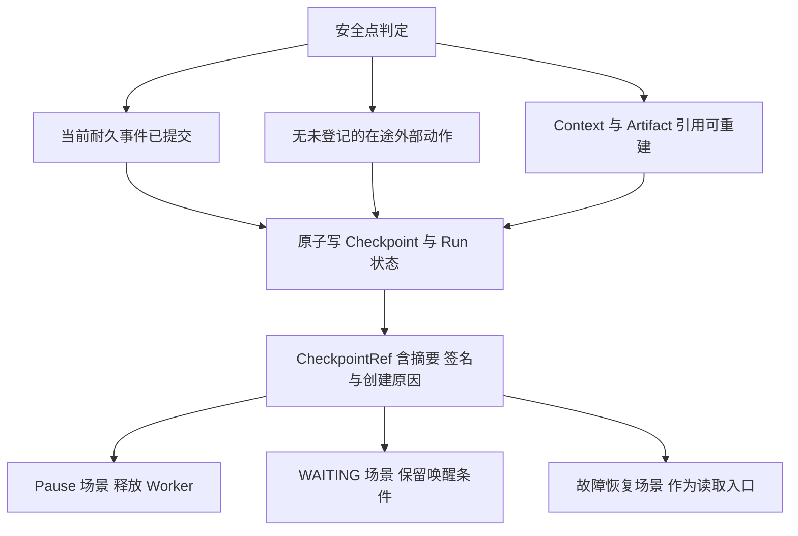

### 9.3 与物理快照的关系

一句话界定：**逻辑 Checkpoint 是恢复的依据，物理快照只是可选的加速。** 逻辑 Checkpoint 回答“Run 应该从哪里、以什么身份、带着什么未决责任继续”；物理快照回答“某个执行环境的进程内存能否更快复活”。前者是权威协议，后者是性能优化；前者覆盖所有 Run，后者只覆盖特定执行环境；前者与执行后端无关，后者与隔离技术强绑定。任何把物理快照当作业务恢复机制、或指望它覆盖远端副作用的设计，都混淆了这两层。

### 9.4 版本与兼容

Checkpoint 携带 Schema 版本与 agent_spec_digest。恢复时若 Schema 不兼容，不静默恢复：存在显式迁移器则走影子迁移与审批，否则暂停等待或失败收尾。

---

## 10. 物理快照机制对比

物理快照有三套主流机制，分别对应三种执行环境。它们的共同点是：**都只快照本地计算状态，都不覆盖远端副作用。**

### 10.1 CRIU：普通容器进程的 Checkpoint/Restore

CRIU 将用户态进程的内存、寄存器、文件描述符等状态冻结为镜像文件，再从镜像恢复，适用于普通容器内运行的进程，典型用途是加速冷启动与迁移长驻进程。限制必须如实声明：**GPU 与设备状态受限**，CUDA 上下文、GPU 显存中的模型状态通常无法被完整捕获，依赖 GPU 的 Agent 工作负载基本不在其适用范围；**复杂 Socket 与内核资源受限**，部分 TCP 连接状态、特殊文件描述符、内核对象无法完美冻结恢复；**操作特权要求高**，checkpoint 本身是需要治理的特权操作。

### 10.2 runsc checkpoint：gVisor 沙箱

gVisor 的 runsc 支持将整个沙箱（sentry 内核态模拟层加应用状态）checkpoint 并 restore。相比 CRIU，它以沙箱为单位，与 gVisor 的系统调用拦截模型天然契合，适合多租户 Sandbox 场景的暂停与恢复。限制同样存在：沙箱内设备模型、特定系统调用与外部连接的处理能力有边界；它只适用于 gVisor 承载的执行环境，不是通用容器方案。

### 10.3 Firecracker microVM 快照

Firecracker 支持把 microVM 的内存与设备状态快照并从快照恢复，配合预热可以实现极快的启动，适用于强隔离执行环境的快速恢复与克隆。限制包括：快照体积与内存规模成正比；网络与磁盘后端在恢复时需要重新接驳或按快照时状态处理；快照与 microVM 版本、设备模型强绑定，跨版本恢复受兼容性约束。

### 10.4 对比与选择

| 维度 | CRIU | runsc checkpoint | Firecracker 快照 |
|---|---|---|---|
| 适用环境 | 普通容器进程 | gVisor 沙箱 | microVM |
| 隔离等级 | 容器级 | 用户态内核沙箱 | 虚拟机级 |
| 快照内容 | 进程内存与描述符 | 沙箱整体状态 | 虚拟机内存与设备状态 |
| GPU 支持 | 受限，通常不可用 | 受限 | 不适用，设备模型受限 |
| 复杂 Socket | 受限 | 有边界 | 需恢复时重新接驳 |
| 典型用途 | 进程迁移与冷启动加速 | 多租户 Sandbox 暂停恢复 | 强隔离环境快速启动与克隆 |
| 版本耦合 | 内核与应用敏感 | sentry 版本敏感 | VMM 与设备模型敏感 |
| 远端副作用 | 不覆盖 | 不覆盖 | 不覆盖 |

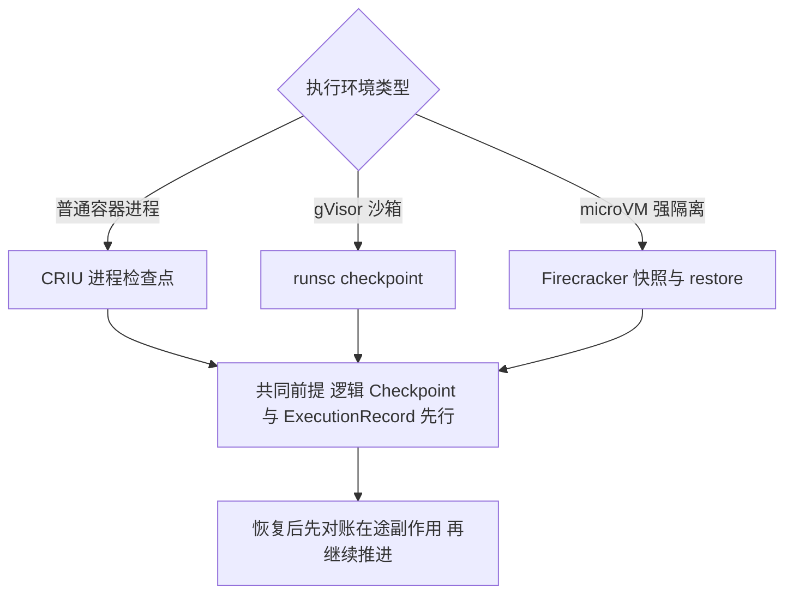

选择建议：物理快照是**按执行环境分别决策的性能特性**，不是平台级恢复协议的一部分；是否启用取决于工作负载特征（是否依赖 GPU、连接复杂度、恢复时延要求）与运维成本。沙箱工程细节在第 8 篇展开。

### 10.5 共同边界

三套机制无论差异多大，边界完全一致：不能回滚已经发生的远程 API 调用、数据库事务、外部作业与已发送消息；不能替代 ExecutionRecord——快照恢复后的进程不知道自己“快照之后是否发过请求”，这个知识只存在于账本；不能替代授权重验——快照时刻的凭据与授权可能已过期或撤销；不能替代版本兼容检查——快照与 AgentSpec、Schema 版本的绑定关系必须显式管理。

因此，物理快照的正确使用姿势是：**在逻辑 Checkpoint 与 ExecutionRecord 已经建立的前提下**，缩短特定执行环境的复活时间；恢复完成后，第一件事仍然是对账，而不是继续执行。

---

## 11. 恢复流程

把前述机制串起来，Run 的恢复遵循统一四步协议：**租约接管、读取历史、对账在途、决定继续或裁决。**

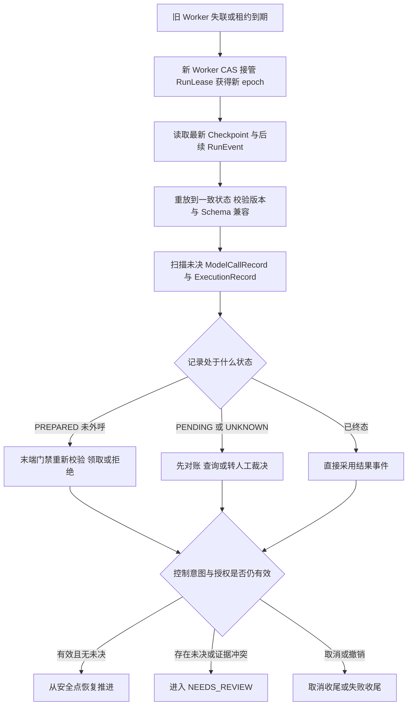

### 11.1 各步骤要点

**第一步：租约接管。** 接管者通过 CAS 获得 RunLease 与新的单调 epoch，旧 Worker 的任何迟到提交都会因 epoch 过期被拒绝。注意系列约定的双轨校验：接管者对**新动作**要求当前 lease；对**已耐久调度的延迟命令**，则校验 ExecutionRecord 中的 authorized_epoch、ExecutionSpec 摘要、ReleaseGrant、撤销版本与当前 control_intent，并以 CAS 唯一领取记录——不要求原 lease 仍然存活，否则 Run 进入 WAITING 并释放 lease 后，合法延迟命令会被错误拒绝。

**第二步：读取历史。** 读取最新 Checkpoint 与其后的 RunEvent，重放到一致状态，并校验 agent_spec_digest 与 Schema 版本：不兼容则走显式迁移或失败收尾，不静默恢复。

**第三步：对账在途。** 这是恢复与“简单重启”的本质区别：PREPARED 记录交给末端门禁重新裁决；PENDING 与 UNKNOWN 记录先对账再谈推进；已终态记录直接采用其结果事件。第 4 篇的告诫在此落地：**不能把 Lease 失效等同于动作失败，接管前必须查询未决 Execution。**

**第四步：决定继续、裁决或失败。** 三种出口：控制意图有效且无未决责任，从安全点继续推进；存在未决 UNKNOWN 或证据冲突，进入 NEEDS_REVIEW；控制意图已是取消或授权被撤销，进入取消收尾或失败收尾——恢复流程本身不能推翻已持久化的取消意图。

### 11.2 恢复 SLO

恢复质量应被显式度量：接管时间（lease 到期到新 Worker 可安全推进，不能忽略 UNKNOWN 查询）、Resume 延迟（含兼容、权限与对账检查）、对账消解时间（UNKNOWN 产生到终态或裁决）。把“接管完成”定义为“拿到 lease”而不是“在途已对账”，会让恢复 SLO 看起来很好而事故照旧。

---

## 12. 与持久工作流引擎的边界

持久工作流引擎是构建持久执行的现成选项。选型时必须清楚它们承载什么、不承载什么。

### 12.1 Temporal

Temporal 提供耐久工作流执行：Workflow 代码在 Worker 故障后通过 **Event History Replay** 重建进度——这是事件历史重放，不是对进程内存的通用物理 Checkpoint。Workflow 代码必须确定性；Activity 负责具体副作用，其执行是至少一次的，重试、超时、心跳由平台协调。必须明确的事实边界：**Activity 的外部副作用仍需幂等键与对账，Temporal 不提供、也不应被表述为任意外部动作的 exactly-once。** 定时器、信号、查询可以承载 Run 的推进骨架，但业务幂等键、授权审批语义、验收交付与结算仍属于平台。

### 12.2 LangGraph

LangGraph 按 **thread 与 checkpointer** 保存图状态快照，支持从快照恢复；故障后**节点可能从头重放**，因此节点内的外部副作用必须幂等。两个事实必须钉死：其一，checkpointer 的存储后端决定快照的跨进程耐久性，内存实现不抗进程重启；其二，**thread_id 只是状态标识，不是安全隔离或租户授权边界**——把 thread 当作租户隔离机制，会在授权与数据边界上留下真实漏洞。

### 12.3 框架 Checkpoint 与托管 Runtime

CloudWeGo Eino 的 Runner 提供中断、Resume 与 CheckPointStore 扩展，其**跨进程耐久性由 CheckPointStore 的具体实现决定**，选型时必须核对。Amazon Bedrock AgentCore 一类托管 Runtime 提供会话存储与文件持久化等托管能力，但**会话存储与文件持久化不等于业务 Run Checkpoint 与 Task 恢复**：它们承载会话与文件事实，不是平台的 Run 状态机、执行账本与 Finalization 门禁。

### 12.4 MCP 授权可选的影响

当工作流引擎或框架直接承载 MCP 调用时，还有一个容易被忽略的事实：**MCP 规范中的授权机制是可选的**，服务器完全可以不实现授权。平台不能假设“走了 MCP 就有授权”，统一末端门禁、CallRecord 登记与对账必须覆盖 MCP 调用路径。

### 12.5 边界速查表

| 能力 | Temporal 类引擎 | LangGraph 类框架 | 平台必须补齐 |
|---|---|---|---|
| 耐久调度与定时器 | 提供 | 部分提供 | 与业务截止时间对齐 |
| 状态持久化 | Event History | thread 快照，依赖 checkpointer | 业务权威状态与 Finalization |
| 故障恢复 | 历史重放 | 快照加重放，节点可能从头执行 | 在途副作用对账协议 |
| 外部副作用治理 | Activity 至少一次 | 节点重放 | 幂等键体系与 ExecutionRecord 账本 |
| 授权与审批 | 不提供业务语义 | 不提供 | AuthzDecision、Approval、ReleaseGrant |
| 验收交付结算 | 不提供 | 不提供 | Acceptance、ResultSelection、Delivery、Settlement |
| 安全隔离 | 不提供 | thread_id 非隔离边界 | 租户隔离、零信任与沙箱 |

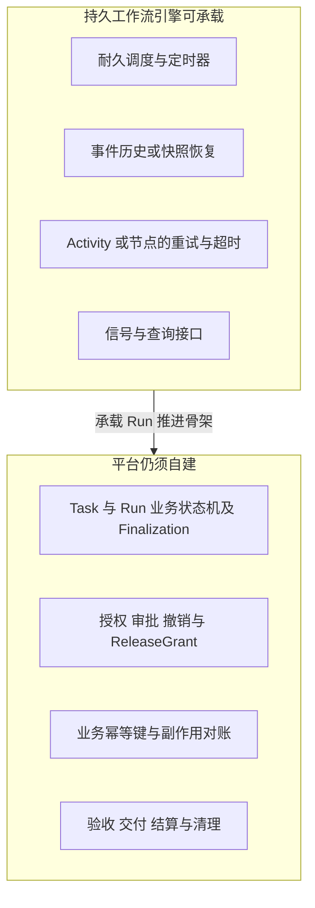

结论是清晰的：**工作流引擎可以承载 Run 的推进骨架，不能替代平台的业务事实协议。** 把引擎的 Workflow ID 或 thread_id 直接当作业务 Task，等于把验收、结算与对账的责任悬空。

---

## 13. 常见反模式

| 编号 | 反模式 | 后果 | 正确做法 |
|---|---|---|---|
| 1 | 超时即判失败并自动重试 | 重复不可逆副作用 | UNKNOWN 先对账，重试需要“未执行”证据 |
| 2 | Publisher 按 lease 变化丢弃 Outbox | 合法延迟命令被静默吞掉 | Outbox 是耐久事实，门禁在执行方 |
| 3 | 接管后新建 ExecutionRecord 重提动作 | 平台失去跨重试去重能力 | 复用稳定 execution_id 与动作幂等键 |
| 4 | 把物理快照当作业务回滚 | 远端副作用被误认为已撤销 | 快照只加速本地恢复，副作用靠对账 |
| 5 | 用消息队列充当唯一权威状态 | 条件更新与审批竞争无处安放 | 权威状态在事务库，队列只做传输 |
| 6 | 对账器无幂等防护 | 重复对账造成重复结论或重复补发 | 对账结论走 CAS，补发是新受治理执行 |
| 7 | 补偿复用原审批与旧凭据 | 授权语义失效，补偿越权 | 补偿重新授权，必要时重新审批 |
| 8 | 从 Checkpoint 恢复后直接继续执行 | 未登记的在途动作被重复执行 | 恢复四步协议，先对账在途 |
| 9 | 把工作流重放当作副作用幂等 | 重放重复触发外部动作 | 幂等键与 ExecutionRecord 独立于引擎 |
| 10 | 交付 UNKNOWN 后改绑新 Artifact 重发 | 破坏 ResultSelection 证据链 | 交付重试仍引用既定 Selection |
| 11 | 取消对账发现动作成功后复活 Run | 取消语义失效，终态可被回调拨动 | 记录迟到副作用与费用，继续取消收尾 |
| 12 | 已计费未响应的模型调用静默吞掉 | 费用失实，预算核算失真 | 模型对账，未决费用显式保留 |

---

## 14. 生产验证场景表

持久执行协议的正确性只能由故障注入验证。以下场景应纳入发布准入：

| 验证场景 | 预期结果 |
|---|---|
| CallRecord 与 Outbox 提交后、外呼前 Worker 崩溃 | Outbox 继续投递，执行方 CAS 领取，不产生未登记调用 |
| 外呼成功但响应丢失 | ExecutionRecord 进入 UNKNOWN，对账确认后转 SUCCEEDED，不盲目重试 |
| 外呼成功但结果提交前 Worker 崩溃 | 接管者读取记录与 ExternalHandle，对账后采用真实结果 |
| 两个 Worker 短暂同时持有旧新 lease | 旧 epoch 的状态提交与新动作被拒绝，已登记的延迟命令按记录继续 |
| Cancel 发生在 Outbox 提交后、发布前 | Publisher 仍投递，执行方按 control_intent 拒绝外呼并形成耐久拒绝事件 |
| 取消后外部动作迟到成功 | 记录迟到副作用与 Usage，继续取消收尾，Run 不被复活 |
| 取消请求发出后外部响应丢失 | 进入 CANCELLING 与 CANCEL_REVIEW，对账或人工裁决后才允许取消终态 |
| 工具不支持幂等与查询且结果 UNKNOWN | 禁止自动重试，进入 NEEDS_REVIEW，自主性策略收紧 |
| 模型调用已计费但响应丢失 | ModelCallRecord 对账，Usage 按 producer_event_id 去重，未决费用显式保留 |
| 同一受理幂等键并发重复提交 | 只创建一个 Task，重复请求返回同一受理结果 |
| 同一 Step 重复投递 | 可产生新 Attempt，不产生重复逻辑 Step 与重复 ExecutionRecord |
| 审批等待数小时后恢复 | Worker 已释放，恢复时重新验证授权与资源条件，旧批准按 digest 失配则失效 |
| Checkpoint Schema 不兼容时恢复 | 显式迁移或失败收尾，不静默使用错误状态 |
| 物理快照恢复后立即继续执行 | 被流程拦截：必须先对账在途记录 |
| Task 存在未决 UNKNOWN 时申请完成终态 | Finalization 门禁阻断，直至对账或裁决完成 |
| 补偿动作执行 | 重新授权生效，补偿走完整状态机，补偿 UNKNOWN 同样进入对账 |
| Outbox 重复发布同一事件 | 下游按 event_id 幂等消费，不产生重复副作用 |

验证不仅检查最终状态，还要检查事件序列、聚合版本、lease epoch、ExecutionRecord 数量与状态、Usage 去重结果与审计关联。

---

## 15. 架构评审清单

### 权威状态与事件

- Run 权威状态是否独立于任何 RuntimeInstance？
- RunEvent 是否追加不可变，更正是否以新事件表达？
- 所有状态转移是否经过聚合版本条件更新与唯一 Reducer？
- 迟到事实是否有明确的处置路径而不是被丢弃或复活终态？

### Outbox 与发布

- 状态、CallRecord 与 Outbox 是否同一事务提交？
- Publisher 是否承诺不因 lease 变化丢弃已提交命令？
- fencing 是否位于写入事务与调用执行方，而不是发布阶段？
- 消费方是否按 event_id 或 CallRecord 标识幂等？

### 幂等键

- 受理、运行、步骤、动作、交付、用量六类键是否各有明确生成方与稳定范围？
- 动作幂等键是否跨 Attempt 稳定且随业务意图变化而更换？
- 每个执行后端的幂等与查询能力是否已登记并影响自主性策略？

### ExecutionRecord 与对账

- 状态机是否覆盖 UNKNOWN 与 CANCEL_REVIEW，转移是否全部有守卫？
- UNKNOWN 是否绝不超时自动转 FAILED？
- 对账是否按幂等键、ExternalHandle、供应方状态、人工裁决逐级降级？
- 不可逆且不可查询动作是否默认限制自主执行？
- 对账器自身是否幂等并受 CAS 保护？

### 模型调用

- ModelCallRecord 是否先耐久提交再外呼？
- 已计费未响应的调用是否有对账路径与未决费用处理？
- 模型重试是否受预算与截止时间约束？

### 补偿

- 补偿是否建模为新授权、新幂等键的受治理执行？
- 补偿是否只对已确认副作用发起？
- 补偿预算与深度上限是否定义？

### Checkpoint 与快照

- 逻辑 Checkpoint 是否只在安全点创建且只引用已持久化事实？
- 物理快照是否明确定位为可选加速，且不与远端副作用承诺混淆？
- CRIU、runsc checkpoint、Firecracker 快照的适用环境与限制是否分别评估？
- Checkpoint 是否携带 Schema 版本并执行兼容性检查？

### 恢复

- 接管是否遵循租约接管、读历史、对账在途、决定出口四步？
- 延迟命令是否按 authorized_epoch 与 ExecutionRecord 校验而非原 lease？
- 恢复 SLO 是否以对账完成为口径？

### 工作流引擎边界

- 引擎承载推进骨架的同时，业务状态机、授权、对账、验收交付结算是否由平台显式承担？
- 是否避免了把 Workflow ID 或 thread_id 当作业务 Task 或隔离边界？
- MCP 调用路径是否纳入统一门禁与账本？

---

## 16. 本篇结论与后续专题

持久执行不是一项单点技术，而是一组互相咬合的协议。本篇的结论可以归纳为五条主线：**事实先于动作**——任何外部调用先原子提交 CallRecord 与 Outbox 再异步执行，末端门禁在外呼前校验控制意图、撤销、授权并 CAS 领取记录，被拒绝的调用也留下耐久事件；**状态独立于进程**——权威状态与 RunEvent 存在于比 Worker 长寿的存储中，聚合版本与条件更新让并发竞争只有一个赢家，Outbox 原子提交后即为耐久事实，发布至少一次、消费按幂等消化；**UNKNOWN 是责任不是结论**——ExecutionRecord 状态机把外部副作用的全部可能性显式化，UNKNOWN 必须先对账，不可逆且不可查询的动作限制自主性，已计费未响应的模型账必须认；**恢复是协议不是重启**——逻辑 Checkpoint 定义安全恢复点，CRIU、runsc checkpoint、Firecracker 快照只是按执行环境分别决策的加速手段，都不覆盖远端副作用，恢复遵循租约接管、读历史、对账在途、决定出口的统一流程；**引擎承载骨架，平台承担事实**——Temporal 的事件历史重放、LangGraph 的 thread 快照可以承载 Run 推进，但业务幂等键、授权审批、副作用对账、验收交付结算始终是平台不可外包的责任。

当每个外部动作都有耐久登记，每个未知结果都有对账路径，每次恢复都先厘清在途责任，Agent 平台才敢把“自主执行”交给不可靠的进程与不可靠的网络。

下一篇进入统一 Execution Runtime：执行适配器如何注册与声明能力，ExecutionSpec 如何被多类执行后端消费，回执、句柄与用量如何回流账本——本篇建立的 ExecutionRecord 与对账协议，正是那一层的地基。

---

## 参考资料

以下均为官方资料。动态文档会持续更新，实际实现应固定所采用的版本与访问日期。

1. [Temporal Workflow Execution](https://docs.temporal.io/workflow-execution)
2. [Temporal Activity Retry Policy](https://docs.temporal.io/encyclopedia/retry-policies)
3. [LangGraph Persistence](https://docs.langchain.com/oss/python/langgraph/persistence)
4. [LangGraph Checkpointers](https://docs.langchain.com/oss/python/langgraph/checkpointers)
5. [LangGraph Durable Execution](https://docs.langchain.com/oss/python/langgraph/durable-execution)
6. [CloudWeGo Eino ADK Agent Runner and Extension](https://www.cloudwego.io/docs/eino/core_modules/eino_adk/agent_extension/)
7. [Amazon Bedrock AgentCore Runtime](https://docs.aws.amazon.com/bedrock-agentcore/latest/devguide/runtime-how-it-works.html)
8. [CRIU](https://criu.org/Main_Page)
9. [gVisor Checkpoint and Restore](https://gvisor.dev/docs/user_guide/checkpoint_restore/)
10. [Firecracker Snapshot Support](https://github.com/firecracker-microvm/firecracker/blob/main/docs/snapshotting/snapshot-support.md)
11. [MCP Authorization Specification](https://modelcontextprotocol.io/specification/2026-07-28/basic/authorization)
12. [OWASP Top 10 for Agentic Applications for 2026](https://genai.owasp.org/resource/owasp-top-10-for-agentic-applications-for-2026/)
13. [CloudEvents Specification](https://github.com/cloudevents/spec)
