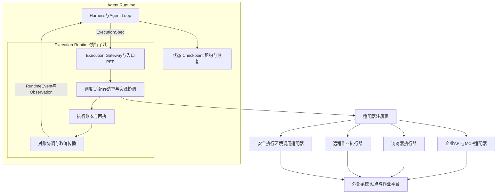
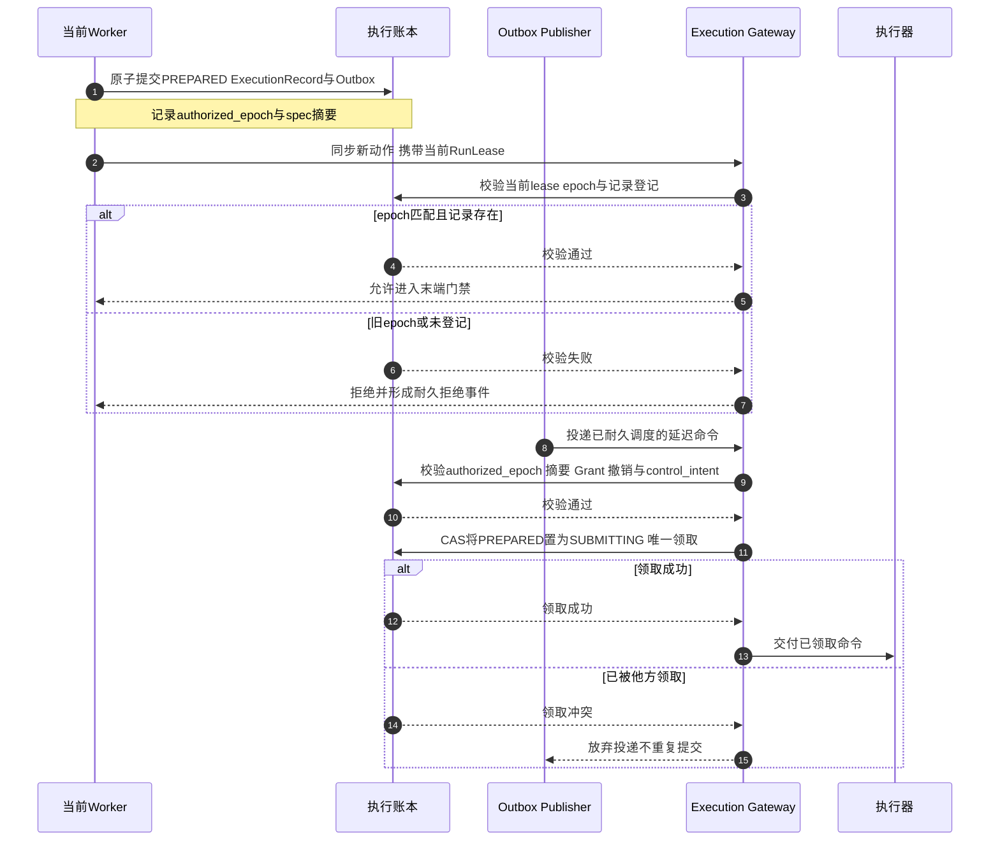
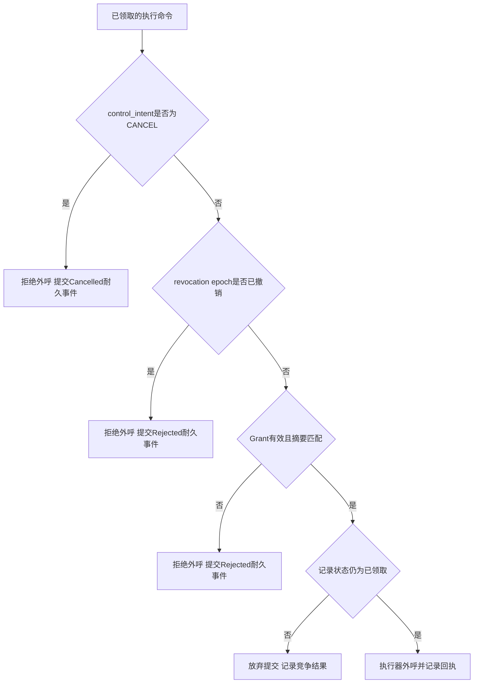
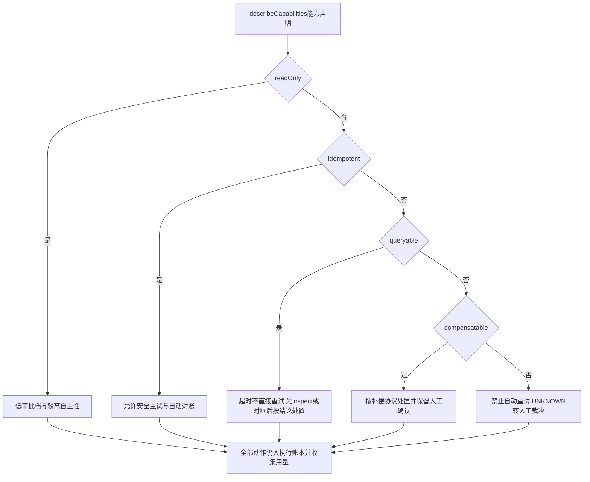
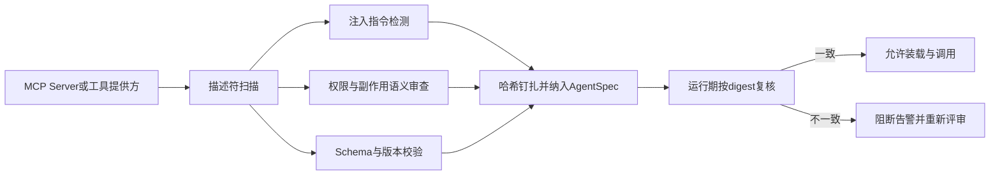
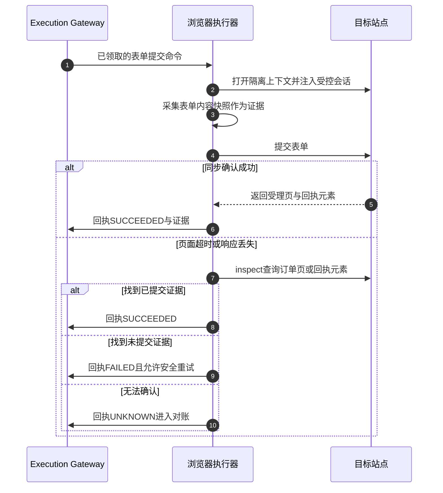
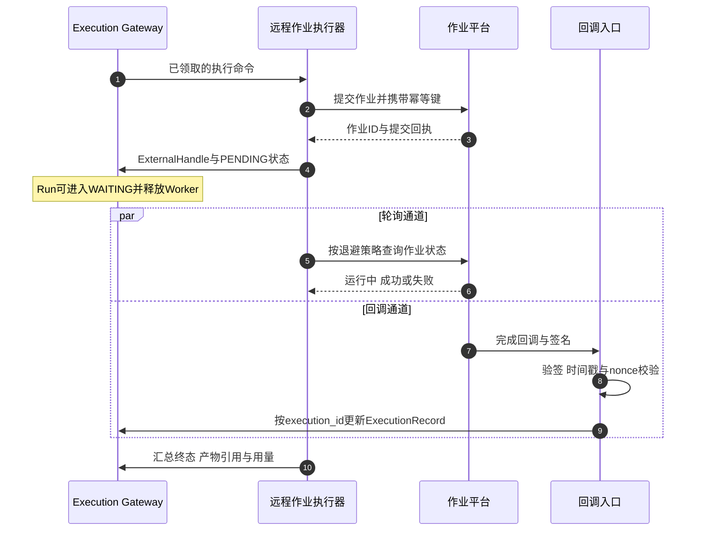
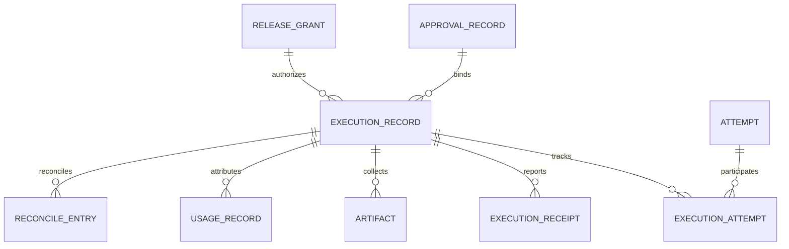
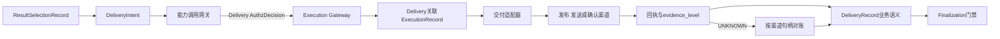
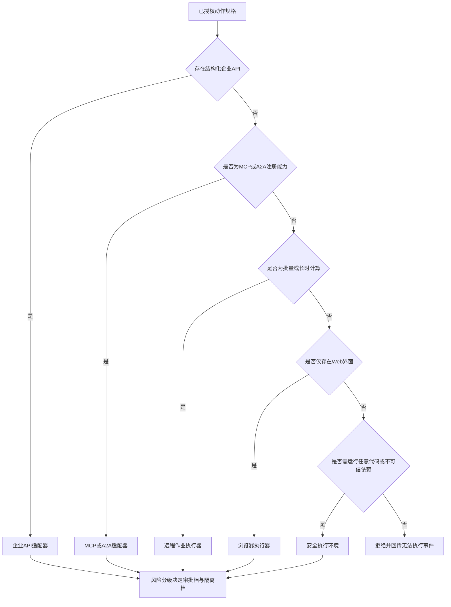

# 统一 Execution Runtime 与多执行后端

> **系列**：生产级 Agent 平台架构 2026 · 第 7 篇  
> **定位**：Runtime 机制篇  
> **版本**：闭环修订版  
> **更新时间**：2026-10-12  
> **前置阅读**：第 0 篇《从模型推理到生产运行：2026 年 Agent、Harness 与 Runtime 总体架构》 · 第 2 篇《从 Task 到交付：Agent 业务闭环与领域对象设计》 · 第 4 篇《Agent Runtime：从生命周期到执行治理的完整能力模型》  
> **关键词**：Execution Runtime、执行网关、适配器契约、MCP、浏览器执行器、远程作业、资源池

## 摘要

前几篇已经确立了业务闭环与领域对象、十个顶层功能域、Agent Runtime 的完整能力模型，以及“外部调用先原子提交 ExecutionRecord 与 Outbox、外呼前过统一末端门禁”的耐久调用原则。本篇向下钻取 Agent Runtime 内部最容易被简化、也最容易失控的部分：**Execution Runtime 执行子域**。

本文的核心观点是：**Execution Runtime 不是与 Agent Runtime 平行的平面，而是 Agent Runtime 内部负责把已授权 ExecutionSpec 落实为物理动作的执行子域；Sandbox 只是它可调度的执行后端之一，与企业 API、MCP、浏览器和远程作业并列。** 所有外部副作用，包括产物交付，都必须经过同一条不可旁路的执行路径：Execution Gateway 校验与领取、适配器提交、执行账本记录、回执与用量收集、UNKNOWN 对账与取消传播。

文章依次给出：执行子域的定位与职责清单；Execution Gateway 的两类命令校验、CAS 领取与统一末端门禁；统一适配器契约与能力声明驱动的策略推导；企业 API 与 MCP、浏览器、远程作业、安全执行环境调用四类适配器的设计要点；执行账本、资源池接口、Delivery 执行链，以及风险分级与后端选择策略。

Outbox 与对账协议的完整细节在第 6 篇已经展开，本篇只做引用；安全执行环境的六个控制面在第 8 篇展开；零信任身份体系在第 12 篇展开；网关的物理归并在第 13 篇展开。本篇只回答一个问题：**当 Harness 说“执行这个动作”之后，平台如何保证这个动作被受控地提交、如实地记录、可靠地查询、可审计地收尾。**

---

## 1. 问题背景：会调用工具，不等于有执行架构

在 Demo 阶段，一次工具调用就是一段代码：组装参数、发起请求、读取响应、回灌模型。但生产任务的动作集合远不止“调用一个函数”：

- 向企业发布系统提交一次不可撤回的发布；
- 通过 MCP Server 调用第三方工具，传输可能是 HTTP 也可能是 stdio；
- 在浏览器里登录业务站点、填写表单并点击提交；
- 向批作业平台提交一个运行数小时的数据处理作业；
- 在安全执行环境里运行 Agent 生成的代码；
- 把最终产物发布到知识库、推送到消息渠道或写入对象存储。

这些动作的时间尺度从毫秒到天级不等，副作用位置分布在平台外部，失败模式各不相同：API 响应可能丢失，浏览器页面可能超时，作业回调可能迟到或被伪造，沙箱可能崩溃，MCP 工具描述符可能被投毒。如果每类后端各写一套重试、超时、取消和记录逻辑，平台会迅速出现以下问题：

| 问题 | 没有统一执行层时的典型表现 |
|---|---|
| 副作用无账可查 | 工具是否执行过只存在于 Worker 内存或日志，接管后无法确认 |
| 重试语义混乱 | 不可幂等的删除接口被超时重试，造成重复删除 |
| 未知结果被误判 | 响应丢失被直接当作失败，自动重试产生第二次真实副作用 |
| 取消不传播 | Task 已取消，远程作业和浏览器会话仍在运行并持续计费 |
| 授权在执行时失效 | 审批通过后数小时才执行，期间权限已撤销，动作仍然发出 |
| 旧 Worker 继续外呼 | 租约已被接管，旧 Worker 恢复后仍向外部系统提交动作 |
| 用量与审计断链 | 浏览器、作业和沙箱的用量无人收集，费用无法归因到 Task |
| 交付绕过治理 | 产物发布走独立通道，没有执行记录、没有 UNKNOWN 语义 |

这些问题的共同根源是：**动作的“意图”和“事实”之间缺少一个强制、统一、耐久的执行层**。Execution Runtime 的职责就是在两者之间建立不可旁路的受控通道：每一个物理动作先有账本记录、后有外呼行为，每一个结果都以回执形式回到权威状态。

本篇的范围明确如下：

- **覆盖**：执行子域定位、Execution Gateway 与末端门禁、适配器契约、四类适配器设计、执行账本、资源池接口、Delivery 执行链、风险分级与后端选择；
- **不覆盖**：Outbox 与对账协议细节见第 6 篇；安全执行环境六个控制面见第 8 篇；零信任身份与委托链见第 12 篇；网关物理归并见第 13 篇。

---

## 2. Execution Runtime 定位：Agent Runtime 的执行子域

### 2.1 不是平行平面，而是内部子域

系列贯穿的核心命题是：**Agent 定义行为，Harness 组织与约束行为，Agent Runtime 承载并驱动行为，执行后端完成动作。** 在这个命题下，Execution Runtime 的位置是明确的：它是 Agent Runtime 内部的执行子系统，负责把 Harness 交付的、已绑定授权决定的 ExecutionSpec 转化为对具体后端的受控调用，并把结果转化为耐久的执行事实和 RuntimeEvent。

第 3 篇在十个顶层功能域之外将 Execution Runtime 执行子域单列说明，因为它直接面对外部系统、持有短期凭据引用、按后端类型独立扩缩。**但单列不表示平行**：Execution Runtime 不拥有 Run 状态机，不决定 Agent 下一步做什么，不裁定 Task 终态；输入来自 Harness，事实回到 Harness 和账本。

### 2.2 职责清单

Execution Runtime 的完整职责可以归纳为九项：

| 职责 | 说明 | 关键对象 |
|---|---|---|
| 入口强制 | 所有外部动作经 Execution Gateway 进入，无直达适配器的通道 | ExecutionSpec |
| 执行时校验 | 校验 lease 或 authorized_epoch、记录登记、Grant、撤销与 control_intent | RunLease、ExecutionRecord |
| 领取与去重 | CAS 唯一领取 PREPARED 记录，防止重复提交 | ExecutionRecord 状态 |
| 适配器选择与路由 | 按能力声明、风险分级、资源画像和健康度选择适配器 | AdapterProfile |
| 账本记录 | 提交前落账，记录摘要、授权引用、幂等键、句柄和状态 | ExecutionRecord |
| 回执与收集 | 收集执行状态、产物引用和用量，经回程治理后形成事件 | ExecutionReceipt、UsageRecord |
| 取消传播 | 把持久取消意图翻译为对各后端的取消请求，并继续确认外部效果 | CancelExecution |
| 对账协调 | 对 UNKNOWN 与 PENDING 记录触发 inspect 与 reconcile，见第 6 篇 | ReconcileTrigger |
| 资源与信号 | 与资源池交互，上报容量、健康与成本信号 | ResourceHandle |

### 2.3 不负责什么

同样重要的是明确 Execution Runtime 不承担的职责：

| 不负责 | 原因 |
|---|---|
| 不决定业务目标与后续步骤 | 目标由 Task 定义，步骤由 Harness 推进 |
| 不做策略决定 | AuthzDecision 由身份策略与审批域给出，执行层只复核其是否仍有效 |
| 不裁定 Task 终态 | Task 终态由 Finalization 门禁依据验收、交付、结算与清理决定 |
| 不承诺外部动作恰好一次 | 平台只保证执行许可与账本记录的唯一消费 |
| 不解释后端输出语义 | stdout、页面内容和作业日志是数据，不能驱动新的 Agent 步骤 |
| 不管理沙箱内部机制 | 安全执行环境的六大能力属于第 8 篇范围 |
| 不长期持有凭据 | 短期凭据经凭据服务获取并受众绑定，Checkpoint 只保存引用 |

### 2.4 输入与输出

- **输入**：`ExecutionSpec`——参数规范化、授权引用、资源约束与截止时间的执行规格；`CancelExecution`——对指定执行记录的取消意图；`ReconcileTrigger`——定时器或对账器触发的查询与对账命令；`CallbackEnvelope`——需验签与防重放后才可入账的外部回调信封。
- **输出**：`ExecutionReceipt`——执行状态、句柄、结果摘要、产物引用与用量；`RuntimeEvent`——提交、完成、失败、未知、取消等耐久执行事件；`UsageRecord`——各后端的资源用量事实；`ReconcileRequest`——无法自动裁定的 UNKNOWN 转人工裁决请求。

一句话定位：**Execution Runtime 是意图与事实之间的强制关口。关口之前，动作只是建议；关口之后，动作要么被账本证明发生过，要么被账本证明没有发生，要么以 UNKNOWN 形式保留未决责任。**

---

## 3. Execution Gateway 与末端门禁

Execution Gateway 是八类逻辑网关中的执行网关，也是 Execution Runtime 对外暴露的唯一强制入口。它可以独立部署，也可以与其他网关物理归并，但逻辑上不存在绕过它直达适配器的路径。核心工作分为三段：两类命令校验、CAS 领取、统一末端门禁。

### 3.1 两类命令，两种校验

进入 Execution Gateway 的命令分为两类，校验口径不同：

| 命令类型 | 产生方式 | 校验内容 | 为什么这样校验 |
|---|---|---|---|
| 同步新动作 | 当前 Worker 持有 RunLease 时提交新 ExecutionSpec | 匹配当前 RunLease epoch，ExecutionRecord 已耐久登记，并校验 spec 摘要、ReleaseGrant、撤销版本与 control_intent | 新动作是当前推进者产生的新外部意图，必须用当前租约 fencing，防止旧 Worker 外呼 |
| 延迟命令 | 已在合法 lease 下创建 PREPARED 记录并通过 Outbox 耐久调度 | 校验记录中的 authorized_epoch、spec 摘要、ReleaseGrant、撤销版本与当前 control_intent，CAS 领取该记录；不要求原 RunLease 存活 | Run 可能已 WAITING 并释放租约；若要求原 lease 存活，合法延迟命令会被错误拒绝 |

这一区分是第 4 篇确立的规则，在执行层的落地含义是：**fencing 的对象是“谁有权产生新动作”，而不是“谁有权完成已登记动作”。** 已登记动作的合法性由记录本身承载：authorized_epoch 证明它曾在合法租约下被批准，spec 摘要证明内容未被篡改，Grant 与撤销校验证明授权仍然有效。

### 3.2 CAS 领取：一条记录只能被一个执行方提交

PREPARED 状态的 ExecutionRecord 是“已登记但未提交”的动作。Outbox 至少一次投递、Worker 接管、对账器触发，都可能让同一记录被多个执行方同时看到。Execution Gateway 用条件更新完成领取：只有把记录从 PREPARED 原子置为 SUBMITTING 的那一方获得提交权，其余各方收到“已被领取”的拒绝。

CAS 领取解决的是平台内部的重复提交竞争，不能替代外部系统的幂等：目标系统按业务幂等键去重时，平台仍应传递该键；目标系统不支持幂等与查询时，能力声明必须如实标注，策略层据此禁止自动重试。两者是不同层次的防线。

### 3.3 统一末端门禁：外呼前的最后一次校验

命令被领取之后、执行器真正外呼之前，还必须通过统一末端门禁。这是第 4 篇耐久调用原则的组成部分，适用于 ModelCallRecord、DataRequest、MemoryWriteRecord 和 ExecutionRecord 四类外部调用，在执行链上的具体检查项是：

1. **control_intent**：Run 或 Task 是否已经持久化为取消意图。取消是持久意图，不能被迟到回调或普通恢复清除；
2. **revocation epoch**：AgentSpec、工具描述符或执行能力是否已被紧急撤销；
3. **授权约束**：ReleaseGrant 是否仍在有效期、是否已被消费、绑定的动作摘要是否匹配；
4. **记录状态**：记录是否仍处于已领取且未终止的状态，防止与对账结果竞争。

末端门禁的关键语义有三条：

- **拒绝必须形成耐久事件。** 取消或撤销发生在 Outbox 提交之后、外呼之前时，Publisher 仍会投递这条耐久命令，执行方必须按最新 control_intent 或 revocation epoch 拒绝外呼，并提交 `CallRejected` 或 `Cancelled` 事件。静默丢弃会让审计链出现“命令存在但无下文”的空洞；
- **已开始的调用不能伪装成从未调用。** 外呼已发生后才收到取消或撤销的，动作进入取消确认、PENDING 或 UNKNOWN 对账，如实记录 Usage；
- **门禁失效时高风险动作应阻断。** 撤销或授权服务不可用时按风险分级阻断高风险动作，而不是 fail-open 放行；降级保可用性不能以绕过安全为代价。

### 3.4 与 Outbox 和对账协议的边界

Execution Gateway 消费的是已经耐久提交的命令，不关心 Outbox 如何发布、重复投递如何去重、定时器如何触发对账——这些协议细节在第 6 篇展开。本篇只依赖两个事实：**与状态原子提交的 Outbox 是耐久事实，Publisher 不因后续 lease 变化而丢弃它；fencing 发生在状态写入事务和各外部调用的执行方，而不是发布阶段。**

---

## 4. 统一适配器契约

### 4.1 为什么需要统一契约

四类执行后端的时间尺度和失败模式差异极大：API 以毫秒到秒计，浏览器以秒到分钟计，远程作业以分钟到小时计。如果 Harness 或 Gateway 为每类后端单独处理超时、句柄、查询和取消，执行语义会迅速碎片化。统一契约的目标是：**后端可以不同，但平台看到的接口、状态和证据格式必须相同。**

契约由两部分组成：能力声明 `describeCapabilities` 告诉平台“这个后端能做什么、不能做什么”；七个操作定义平台“可以要求后端做什么”。

### 4.2 describeCapabilities：能力声明

能力声明在适配器注册时提交，纳入 AdapterProfile 并参与调度、策略与审批决定。运行期适配器不得夸大能力；能力降级必须显式上报并重新注册。

| 能力 | 含义 | 主要消费方 |
|---|---|---|
| `readOnly` | 不产生外部副作用，只读取状态 | 审批策略、风险分级 |
| `idempotent` | 目标系统保证重复提交不产生额外效果 | 重试策略 |
| `queryable` | 提交后可按句柄或幂等键查询真实状态 | 对账策略、UNKNOWN 处置 |
| `cancellable` | 支持在完成前请求停止，且停止结果可确认 | 取消传播 |
| `compensatable` | 存在经确认的补偿协议，可抵消已发生效果 | 补偿策略、失败收尾 |
| `snapshotCompatible` | 执行环境支持物理快照并可在快照上继续，见第 8 篇 | Checkpoint 与恢复策略 |
| `dryRunSupported` | 支持预演并返回差异或影响评估 | 审批证据、前置检查 |
| `progressObservable` | 可提供进度信号 | 长任务观测 |
| `usageReportable` | 可报告资源用量或计费维度 | 用量归集与 FinOps |

能力声明是事实承诺，不是营销文案。把不可查询的接口声明为 queryable，会把本应人工裁决的 UNKNOWN 变成自动对账失败后的盲目重试；把不可幂等的接口声明为 idempotent，会直接造成重复副作用。因此声明应附带验证证据，纳入适配器注册评审和生产准入测试。

### 4.3 七个操作

| 操作 | 输入 | 输出 | 语义与不变量 |
|---|---|---|---|
| `submit` | ExecutionSpec、幂等键 | 同步结果或 ExternalHandle | 只能在记录被 CAS 领取后调用；响应丢失返回 UNKNOWN 而不是报错重试 |
| `inspect` | ExternalHandle 或幂等键 | 当前状态与证据 | 只读查询；查询失败本身也可能是 UNKNOWN |
| `cancel` | ExternalHandle | 取消受理或拒绝 | 取消是请求不是事实；不支持取消时如实返回 |
| `collect` | ExternalHandle | 产物引用、输出摘要、用量 | 大产物以引用加 digest 交付；用量按去重键追加 |
| `reconcile` | ExecutionRecord 引用 | 对账结论与证据 | 用于 UNKNOWN 与 PENDING 超期记录；结论只有确认成功、确认未执行、仍未知三类 |
| `compensate` | ExecutionRecord 引用 | 补偿结果 | 仅当 compensatable 为真；补偿本身同样入账 |
| `describeCapabilities` | 适配器标识 | 能力声明与版本 | 注册与变更时提交，运行期可被复核 |

七个操作覆盖一个外部动作从提交到收尾的完整生命周期。注意 `reconcile` 与 `inspect` 的区别：inspect 是单次状态查询，reconcile 是携带账本上下文的裁定过程，可能组合多次 inspect、目标系统凭证核对与证据比对。

### 4.4 能力声明如何驱动策略

能力声明的价值在于让重试、对账、审批和取消策略成为可推导的规则，而不是每个适配器各写一套：

典型的推导规则如下表：

| 能力组合 | 重试策略 | 对账策略 | 审批与证据要求 |
|---|---|---|---|
| readOnly | 可自由重试 | 一般无需对账 | 低审批档，仍记录账本 |
| idempotent 且 queryable | 幂等键下安全重试 | 自动对账可确认 | 按风险分级 |
| queryable 但非 idempotent | 超时不直接重试，先 inspect | 自动对账后按结论处置 | 按风险分级 |
| 非 queryable 且非 idempotent | 禁止自动重试 | UNKNOWN 转人工裁决 | 高审批档，建议 dry-run 证据 |
| cancellable 为假 | 不适用 | 取消只停止等待，外部效果继续对账 | 取消预案须在审批时披露 |
| compensatable 为真 | 失败可走补偿路径 | 补偿动作单独入账 | 补偿协议需评审与演练 |

这套推导把第 2 篇的原则落成机器可执行的策略：**UNKNOWN 必须对账；无法对账的不可逆动作，要么限制自主性，要么转人工裁决。** 任何框架或产品都不提供任意外部动作的恰好一次语义，能力声明正是平台在“至少一次投递”的现实上构建安全执行策略的依据。

### 4.5 契约不变量与适配器注册

无论后端如何实现，所有适配器必须遵守同一组不变量：

1. 不持有长期业务凭据，短期凭据经凭据服务按受众和时效获取；
2. 不根据后端输出自行产生二次动作，stdout、页面内容和回调负载都是数据；
3. 不直接调用 Harness 或修改 Run 状态，一切结果经回执和账本回到 RuntimeEvent；
4. 能力声明、版本和健康状态在注册表管理，变更走发布流程；
5. 故障不导致账本丢失：提交前状态在账本，提交后句柄在账本，进程重启后按记录恢复。

适配器注册表是执行子域的控制面资产：保存每个适配器的契约版本、能力声明、后端清单、资源画像引用、健康探针和撤销状态。紧急情况下，控制面可以单独撤销某个适配器或某个 MCP Server 的注册，而不影响其他执行路径。

---

## 5. 四类适配器设计

### 5.1 企业 API 与 MCP 适配器

#### 5.1.1 企业 API 适配器

企业 API 是最理想的执行后端：契约明确、语义结构化、通常支持幂等键与条件请求。适配要点包括：

- **契约先行**：以 OpenAPI 或等价契约定义参数 Schema、错误码与超时，参数规范化在能力调用网关完成；
- **幂等键传递**：把 ExecutionRecord 的稳定业务幂等键传递给目标系统；只有接收方真正按键去重且去重窗口覆盖重试窗口时它才有效；
- **条件请求**：资源写操作尽量使用条件头或资源条件版本，使陈旧写入被目标系统拒绝；
- **响应丢失即 UNKNOWN**：提交后响应丢失不能推断为失败，按 queryable 能力对账。

#### 5.1.2 MCP 适配器与协议网关边界

MCP 为企业工具接入提供了标准化协议，但它改变的是互操作方式，不改变执行治理要求：

- **协议治理归 MCP/A2A 协议网关**：企业本地准入目录、协议版本、消息校验、对端认证和描述符治理由协议网关承担。**MCP 协议不内建全局信任准入目录**：官方 Registry（registry.modelcontextprotocol.io，2025-09 起以 preview 上线）提供发现与命名空间验证，但不做执行治理与信任背书；企业准入目录仍是平台自建能力；
- **执行事实归执行链**：MCP 工具调用与其他后端一样，经能力调用网关形成 ExecutionSpec，经 Execution Gateway 领取和末端门禁，在执行账本留下记录，不能成为绕过账本的特殊通道；
- **协议授权不替代业务授权**：MCP 授权覆盖的是客户端到 MCP Server 这一协议边界，且**是可选能力而非强制要求**；即使启用，也不替代下游业务系统的授权、参数级策略和执行时复核。

#### 5.1.3 HTTP 传输的 OAuth 对齐

当 MCP 启用 HTTP 传输时，其授权模型遵循 OAuth 2.1 的架构约束，平台在集成时必须对齐以下事实：

| 要求 | 含义 |
|---|---|
| 资源服务器与授权服务器分离 | MCP Server 作为 OAuth 资源服务器，不兼任授权服务器 |
| Protected Resource Metadata 发现 | 客户端通过资源元数据发现授权服务器与要求，而非硬编码 |
| resource 参数 | 令牌请求携带 resource 参数，把受众绑定到目标 MCP Server |
| 受众校验 | MCP Server 校验令牌受众指向自身，防止混淆代理 |
| Bearer 凭据位置 | Bearer 令牌仅通过 Authorization 头传递，不出现在查询参数或正文中 |

对平台而言，这些约束意味着 MCP 适配器应作为受控的 OAuth 客户端运行：令牌获取、刷新和受众绑定由适配器或凭据服务完成，短期令牌不进入 Agent 上下文，不落入 Checkpoint。

#### 5.1.4 stdio 传输的凭据边界

stdio 传输采用完全不同的凭据边界：它不经过 OAuth 流程，信任边界是进程与主机本身。stdio MCP Server 由平台作为受管子进程拉起，可用凭据只能通过平台注入的环境或本地代理提供。相应要求是：注入凭据最小化、可审计、随进程生命周期撤销；出站流量同样受出口网关约束；跨租户复用 stdio 进程必须经过隔离评审。把 stdio 当作“内网可信组件”而跳过凭据治理，是常见的隐性旁路。

#### 5.1.5 描述符治理：防投毒与哈希钉扎

工具描述符是进入模型上下文的内容，因此是攻击面。**工具描述符可能被投毒**：攻击者在工具名称、描述或参数说明中隐藏指令，诱导模型以特定参数调用工具、泄露上下文或绕过审批。平台侧控制包括：

- **描述符扫描**：注册时做注入模式检测、权限语义审查和 Schema 校验，高风险表述进入人工评审；
- **哈希钉扎**：通过扫描的描述符计算 digest 并钉扎进 AgentSpec；运行期装载与调用前按 digest 复核，未审计的变化阻断调用并告警；
- **展示隔离**：描述符在上下文中作为数据处理，与用户指令、系统约束分区呈现。

#### 5.1.6 A2A 与 Agent Card

当执行后端是另一个 Agent 时，A2A 协议提供互操作框架。**A2A v1.0 于 2026 年春发布，由 Linux Foundation 治理，获得 150 多个组织支持。** 其 Agent Card 用于描述对端 Agent 的端点、能力与协议要求，是发现与协商的输入。但必须明确：**Agent Card 是能力描述，不是信任凭证；实际调用仍需逐请求认证授权**，并同样经过执行链的校验、账本与对账。把 Agent Card 声明的能力直接当作已授权动作，等于把发现机制误当成授权机制。

### 5.2 浏览器执行器

浏览器执行器处理“只有 Web 界面、没有可用 API”的场景：业务站点操作、表单填报、证据采集。它是副作用位置最特殊的一类后端——真实动作发生在目标站点的服务器上，平台能控制的只是驱动浏览器的过程。

#### 5.2.1 隔离上下文

浏览器上下文是凭据、Cookie 和站点数据的载体，必须按租户和 Run 隔离：

| 隔离对象 | 策略 | 收尾 |
|---|---|---|
| Cookie 与会话 | 每 Run 独立上下文，禁止跨租户共享 | 任务结束或取消后销毁并验证 |
| 本地存储与缓存 | 上下文级隔离，不落宿主共享目录 | 随上下文销毁 |
| 下载文件 | 定向到受控工作区，经 Artifact Broker 收集 | 按产物策略归档或清理 |
| 凭据注入 | 由凭据代理在提交动作时注入 | 会话随上下文终止 |

#### 5.2.2 登录态治理

登录态本质上是一类业务凭据。平台应从凭据库获取受管账号凭据，以短期会话形式注入浏览器上下文；Agent 和模型不能看到明文密码，双因素认证需要预授权机制或人工协同环节。登录态撤销必须传播为上下文销毁；账号权限变化应在执行时复核，而不是依赖浏览器里仍然有效的旧会话。

#### 5.2.3 表单提交确认

表单提交往往是不可逆业务动作。执行器在点击提交之前必须：

1. 确认该动作绑定了有效的 ApprovalRecord 或 ReleaseGrant，动作摘要覆盖目标表单与关键字段；
2. 采集表单内容快照作为提交前证据，与审批时展示的动作摘要比对，参数漂移即中止；
3. 提交后采集受理页、回执元素或错误信息作为提交后证据。

#### 5.2.4 页面超时不等于未提交

浏览器执行最容易犯的错误是把页面加载超时或网络超时解释为“动作没有发生”。事实上，提交请求可能已经到达站点服务器并生效，只是响应没有回来。正确语义是：

- 提交点击已执行而响应丢失，动作进入 UNKNOWN；
- inspect 通过查询订单页、回执元素、站内消息或站点提供的查询接口确认实际状态；
- 只有在找到明确的未提交证据且策略允许时，才可安全重试；否则进入对账或人工裁决。

#### 5.2.5 回程治理

网页内容是不可信数据，可能包含针对模型的注入指令。浏览器执行器回传的页面文本、截图摘要在进入 Agent 上下文前必须经过回程扫描与来源标注；执行器本身不得因为页面中出现“请继续执行某操作”之类的文本而发起新动作。

### 5.3 远程作业执行器

远程作业执行器面向批作业平台、数据处理管道和外部计算系统。作业的时间尺度从分钟到天级，远超单次 Invocation，核心机制是句柄、轮询与回调的组合。

#### 5.3.1 提交与 ExternalHandle

提交作业时，执行器把 ExecutionRecord 的幂等键传递给作业平台，并把返回的作业 ID、队列信息和提交回执写入 ExternalHandle。Handle 是跨 Worker、跨 Invocation 恢复作业跟踪的唯一依据：Run 可以进入 WAITING 并释放租约和 Harness Worker，执行子域保留 Handle、定时查询和取消责任。

#### 5.3.2 轮询

轮询是 inspect 的作业版实现。要点包括：指数退避加抖动，避免查询风暴压垮作业平台；设置轮询预算并与 Step 截止时间对齐；尊重作业平台限流；轮询结果每次按事件入账，形成可审计的状态轨迹。

#### 5.3.3 回调与验签

作业平台通常支持完成回调。回调入口是平台的对外暴露面，必须按零信任处理：

| 校验项 | 目的 |
|---|---|
| 签名验证 | 确认回调来自作业平台 |
| 时间戳窗口 | 拒绝过旧回调，压缩重放窗口 |
| nonce 防重放 | 同一回调只被消费一次 |
| execution_id 关联 | 回调必须落到确定的 ExecutionRecord，找不到记录即隔离审查 |
| 状态竞争 | 回调与轮询按记录版本条件更新，先到者生效，后到者幂等忽略 |

回调只能改变 ExecutionRecord 的状态，不能直接驱动 Agent Loop。回调负载中的任何文本都是数据，需经回程治理后才能进入上下文。

#### 5.3.4 异步取消

作业取消是异步语义：cancel 发出后，作业可能在取消生效前已经完成。取消的结果有三种——确认停止、确认已先完成、无法确认。已先完成的作业要如实记录迟到副作用和 Usage；无法确认的进入取消专用对账。这与第 2 篇“取消不等于回滚”的原则一致。

### 5.4 安全执行环境调用适配器

当动作是“运行一段代码”——Agent 生成的 Python、Shell、数据处理脚本或不可信依赖——执行后端是安全执行环境。本篇只定义执行子域与它的接口边界；环境生命周期、镜像与依赖、资源限制、网络控制、文件隔离和运行时安全六大能力在第 8 篇展开。

接口契约上，安全执行环境调用适配器提交的 ExecutionSpec 额外包含：

| 字段 | 含义 |
|---|---|
| 镜像或运行时引用 | 固定 digest 的镜像与依赖层，经签名验证 |
| 入口与参数 | 代码引用、入口命令与参数 |
| ExecutionProfile | CPU、内存、PID、IO、时间与磁盘上限 |
| 网络策略 | 默认拒绝出站、受控目标清单与出口代理引用 |
| 挂载清单 | 只读根、独立工作区与挂载 allowlist |
| 输出限制 | 产物数量、大小与制品上限 |

回执则包含退出状态、文件差异、产物引用、资源用量和运行时遥测摘要。凭据边界上，**沙箱内不保存长期业务凭据**：高风险外部调用优先由沙箱外代理持有凭据并代为执行；若工具必须使用短期令牌，应明确为“最小化短期凭据暴露”，而不是声称零凭据。

能力声明上，安全执行环境可以声明 `snapshotCompatible`，表示支持物理快照以加速恢复。但必须反复强调：物理快照只能恢复特定执行环境的本地状态，**不能回滚已经发生的远程 API 调用、数据库事务或外部作业**。快照能力与 ExecutionRecord、逻辑 Checkpoint 必须共同使用，这一边界在第 8 篇继续展开。

最后，沙箱守护进程只接收经过授权的执行规格，不根据 stdout、网页内容或模型文本自行产生二次动作——这是执行子域与资源池共同遵守的不变量。

---

## 6. 执行账本

### 6.1 ExecutionRecord：跨 Attempt 稳定的副作用事实

执行账本是执行子域的权威事实存储。ExecutionRecord 记录一个逻辑外部动作，其字段在第 2 篇已经定义，从执行层视角再完整列出一遍：

| 字段组 | 内容 |
|---|---|
| 标识 | execution_id、tenant_id、task/run/step 引用、稳定业务幂等键 |
| 规格 | 规范化动作摘要、ExecutionSpec digest、目标资源与条件版本 |
| 授权 | AuthzDecision、ApprovalRecord、ReleaseGrant 引用、authorized_epoch |
| 状态 | 当前状态与聚合版本、control_intent 快照、ExternalHandle |
| 历史 | ExecutionAttempt 列表、对账记录、人工裁决引用 |
| 结果 | Receipt、Artifact、Usage 引用 |

记录的状态机以第 6 篇补全的完整版为准：PREPARED、SUBMITTING、PENDING、CANCELLING、CANCEL_REVIEW、UNKNOWN、NEEDS_REVIEW、SUCCEEDED、FAILED、CANCELLED 十态（第 2 篇给出基础九态，第 6 篇增加 CANCEL_REVIEW 以分离取消裁决），本篇不再重画。执行层的两个专属责任是：**PREPARED 是外部动作入账的唯一起点，任何外呼必须先有 PREPARED 记录；SUBMITTING 只能由 CAS 领取产生，领取失败的一方不得外呼。**

### 6.2 ExecutionRecord 与 ExecutionAttempt：多对一

同一个逻辑副作用可能因 Worker 故障、接管或重试产生多次实际尝试。ExecutionAttempt 记录某次 Attempt 对某个 ExecutionRecord 的参与事实——是提交、查询、取消还是对账参与，结果如何。两者的关系是多对一：

这个模型直接决定接管行为：新 Worker 接管 Run 后，不是创建新的 ExecutionRecord 重新提交动作，而是读取同一记录，按幂等键或句柄先查询外部系统的真实状态，再决定继续、对账或裁决。如果每次尝试都新建记录，平台就失去了跨重试识别同一业务副作用的能力，重复支付、重复发布和重复删除都会随之而来。

### 6.3 回执：ExecutionReceipt

ExecutionReceipt 是适配器对一次执行的结构化报告，至少包含：

| 字段 | 说明 |
|---|---|
| 状态结论 | SUCCEEDED、FAILED、UNKNOWN、PENDING 或 CANCELLED 之一 |
| ExternalHandle | 后续查询、取消和对账的依据 |
| 结果摘要 | 经脱敏和大小限制的结果概要 |
| 产物引用 | Artifact 引用与 digest，不内联大对象 |
| 用量 | 后端报告的资源用量与计费维度 |
| 证据等级 | 回执来源是同步响应、查询确认还是回调 |
| 来源标识 | 回调类回执必须可验证来源 |

必须反复强调第 0 篇确立的判断：**ExecutionReceipt 不是外部效果的独立证明。** 回执说成功，表示执行器观察到成功；业务系统是否真正生效，仍可能需要按业务状态对账。回执的价值在于把“观察到的事实”耐久化，而不是替代外部系统的事实权威。

### 6.4 产物与用量收集

`collect` 操作负责把后端产生的产物和用量收归平台管理。三条规则：大产物只保存引用与 digest，访问时重新授权，避免在事件和上下文中复制；敏感输出先经扫描和脱敏再进入可观察范围；用量按供应方调用 ID、execution_id 和生产者事件 ID 去重后追加，晚到的供应方调整以新事件表达，不篡改原 Usage。小结果以摘要进入回执，大产物以对象引用加 digest 入账，两者都经回程治理后才形成 RuntimeEvent。

### 6.5 账本与审计

执行账本天然承担审计职责：谁在什么 epoch 下登记了动作、哪条 Grant 被消费、领取方是谁、回执证据是什么、对账结论如何，全部可追溯。账本记录应防篡改、按保留策略归档，并与 Trace 关联但彼此分离——Trace 可以采样和过期，许可消费、副作用事实和裁决记录不能依赖普通遥测管道。

---

## 7. 资源池接口

### 7.1 五个通用操作

执行后端运行在各类资源池中：API 与 MCP 执行池、浏览器上下文池、作业与 GPU 池、隔离执行池。第 4 篇已列出 Runtime 对资源池的通用能力要求，本篇将其固化为接口契约：

| 操作 | 输入 | 语义 |
|---|---|---|
| `acquire` | Profile、tenant、run 引用、deadline | 按执行画像申请资源，返回 ResourceHandle；容量不足时有界排队或明确拒绝 |
| `renew` | ResourceHandle | 为长任务续期资源持有，受配额与策略约束 |
| `release` | ResourceHandle | 释放资源并触发清理验证；不自动终止已提交的外部动作 |
| `cancel` | ExecutionHandle | 在具体资源上取消执行中的动作 |
| `inspect` | ExecutionHandle | 查询资源上的执行状态，供轮询与对账 |

### 7.2 能力、配额与健康度信号

资源池向执行子域上报三类信号，供调度与准入消费：**能力信号**——隔离等级、支持的后端协议、快照能力、GPU 与设备类型；**配额信号**——租户配额余量、当前占用、有界队列长度；**健康度信号**——错误率、延迟分布、容量水位、成本速率。这些信号是弹性和高并发专题的输入，执行子域的责任是如实采集和转发，而不是自行决定扩缩。

### 7.3 资源池不理解业务目标

这是执行面最重要的边界之一：**资源池不理解完整 Task 目标，不解释后端输出，也不根据 stdout、网页内容或工具结果自行追加 Agent 步骤。** 它只执行 Execution Runtime 下发的受约束规格并报告状态。一旦资源池开始“理解业务”，例如沙箱根据代码输出自行调用下一个工具，执行链就被旁路了：授权、账本、取消和对账全部失效。

另一个边界是费用：资源释放不等于计费终止。作业平台上的作业可能在 release 之后继续运行并计费。资源是否继续计费由用量结算与资源治理域记录和结算，执行子域负责在释放时如实报告“动作是否已确认停止”。

---

## 8. Delivery 执行链：交付复用同一条执行路径

产物交付是外部副作用：发布到知识库、推送到消息渠道、写入对象存储、调用接收方接口。如果交付走独立于执行链的通道，会立刻复制出执行层已经解决的全部问题——重复交付、未知结果、取消不传播、用量无归因。因此系列的既定约定是：**DeliveryIntent 经能力治理进入 Execution Gateway，交付动作创建 Delivery 关联的 ExecutionRecord，走同一套提交、查询、取消、对账和人工裁决协议。**

执行链与交付域的分工如下：

| 关注点 | 执行链承担 | 交付域承担 |
|---|---|---|
| 提交与领取 | CAS 领取、末端门禁、外呼 | 校验 DeliveryIntent 引用的 ResultSelection 仍有效 |
| 状态事实 | ExecutionRecord 状态与回执 | DeliveryRecord 的业务语义与证据等级 |
| UNKNOWN | 按渠道句柄对账或转人工裁决 | 依据裁决结果更新交付证据 |
| 重试 | 在能力声明允许范围内重试提交 | 决定是否需新的交付意图，保持 ResultSelection 不变 |
| 用量 | 交付资源用量入账 | 纳入 Task 结算 |

交付成功时的证据等级沿用第 2 篇的三级定义：`PUBLISHED` 表示产物已发布到受管理位置，`SENT` 表示交付渠道已接受发送请求，`CONFIRMED` 表示目标系统或人工确认收到。Task 的 DeliveryPolicy 规定哪一级证据足以满足完成条件，三级证据不能混用。

两条推论值得重复：交付失败应只重试交付，而不是重新运行模型或重新执行业务动作；交付 UNKNOWN 不能盲目重发，必须先按渠道消息 ID 或目标系统记录对账。迟到的旧 Run 或旧 Artifact 事件不能替换已选结果，因为 Delivery 始终绑定 ResultSelectionRecord 固定的证据链。

---

## 9. 执行风险分级与后端选择

### 9.1 风险分级

执行风险分级决定审批档、隔离档、网络出口和证据要求。建议按动作的可逆性与影响范围分为四级：

| 级别 | 特征 | 典型动作 | 审批与证据要求 |
|---|---|---|---|
| R0 只读查询 | 无副作用 | 数据检索、状态查询、页面浏览 | 低审批档，账本记录不可少 |
| R1 可逆写入 | 副作用可撤销 | 草稿保存、可撤回消息、临时资源 | 策略授权即可，建议 dry-run |
| R2 不可逆写入 | 副作用难以撤销 | 发布、删除、对外发送、资金操作 | 绑定动作摘要的审批，执行时复核 |
| R3 高危批量与任意代码 | 影响大或行为不可预测 | 批量变更、任意代码、不可信依赖 | 高审批档、强隔离、输出限额与全程证据 |

风险分级在能力注册时初步确定，在执行时结合参数、目标资源和数据范围重新评估。关键规则是：**风险只能升级不能被参数改写降级**——把“删除生产数据”拆成十条“删除一条记录”不会降低风险等级，参数规范化摘要必须反映聚合影响。

> 本节按“可逆性与影响范围”的四级（R0–R3）用于执行治理与后端选择；第 8 篇按“自主性、权限、数据敏感度、可逆性、暴露面”五维度分档（低/中/中高/高/最高）用于隔离介质选型。两者是不同用途的互补分级：R2/R3 级动作通常对应第 8 篇中高以上的隔离档。

### 9.2 后端选择策略

后端选择的第一原则是：**能用结构化接口就不要用界面，能用受控接口就不要运行任意代码。** 决策路径如下：

“什么动作进沙箱、什么动作走 API”的常见划分：

| 动作类型 | 首选后端 | 理由 |
|---|---|---|
| 结构化业务写操作 | 企业 API 或 MCP | 契约明确、可幂等、可查询、可对账 |
| 批量数据处理 | 远程作业 | 时间尺度匹配，平台有调度与配额能力 |
| 仅有 Web 界面的操作 | 浏览器执行器 | 无 API 时的受控替代，需证据采集 |
| Agent 生成的代码执行 | 安全执行环境 | 行为不可预测，必须隔离 |
| 不可信依赖的安装与运行 | 安全执行环境 | 供应链风险需要强隔离与网络控制 |
| 文档解析、文件转换 | 安全执行环境 | 解析器漏洞面大，输出需限额 |
| 跨 Agent 协作调用 | A2A 适配器 | 协议互操作，逐请求认证授权 |

需要纠正两种极端：“所有动作都进沙箱”，把 API 调用也包进代码执行，徒增隔离成本并让副作用离开结构化对账能力；“所有动作都绕过沙箱”，让模型生成的代码直接在业务进程里运行，失去资源限制与逃逸防护。正确做法是按动作性质选择后端，按风险分级决定隔离强度：低风险结构化调用走 API 与 MCP，高风险的任意代码、不可信依赖与文件解析进安全执行环境，长时批量计算进作业平台，无 API 的界面操作才使用浏览器并配套证据采集。

---

## 10. 常见反模式

### 10.1 把 Execution Runtime 画成与 Agent Runtime 平行的平面

平行平面意味着执行层独立于 Run 状态机存在，最终演变成第二个编排器：解释目标、决定步骤、维护自己的任务状态。正确模型是内部子域：输入来自 Harness，事实回到账本，推进权始终在 Runtime 的唯一 Reducer。

### 10.2 适配器绕过 Gateway 直连后端

“这个工具很简单，直接调就行”是执行链旁路的开端。一旦存在内部直连通道，末端门禁、撤销传播和账本记录对它全部失效。简单工具的正确做法是实现一个轻量适配器，而不是跳过关口。

### 10.3 能力声明缺失或失真

不声明能力，策略层只能按最保守或最乐观假设处理；声明失真则直接造成重复副作用。能力声明必须注册时验证、运行期复核、变更走发布流程。

### 10.4 把 MCP 授权当作业务授权，或期待 MCP 提供全局目录

MCP 授权是可选的协议边界能力，HTTP 传输下遵循 OAuth 2.1；它不替代下游业务授权与参数级策略，协议本身也不内建全局信任准入目录（官方 Registry 仅为发现层，不构成企业准入）。企业准入目录、描述符治理和执行账本都是平台自建能力。

### 10.5 页面超时即判定未提交

浏览器提交后响应丢失，动作可能已在站点生效。直接重试会造成第二次真实提交。正确语义是 UNKNOWN 加 inspect 确认。

### 10.6 回调不验签，或回调直接驱动 Agent

不验签的回调是伪造副作用的入口；回调直接唤起模型则绕过了状态提交、取消语义和回程治理。回调只能更新 ExecutionRecord，结果经 RuntimeEvent 回到 Harness。

### 10.7 资源池理解业务目标

沙箱或浏览器根据输出自行追加步骤，等于在授权体系之外建立第二条行动链。资源池只执行受约束规格。

### 10.8 Delivery 走独立通道

交付绕过执行链会失去 UNKNOWN 语义和对账能力，“已发送”与“已送达”混为一谈，重复交付无法识别。DeliveryIntent 必须复用执行链。

### 10.9 延迟命令要求原 lease 存活

Run 进入 WAITING 并释放租约后，合法登记的延迟命令若因原 lease 失效被拒绝，审批后执行、定时执行都会系统性失败。延迟命令校验的是记录中的 authorized_epoch 与授权约束，不是原 lease。

### 10.10 stdio MCP 跳过凭据治理

stdio 没有 OAuth 流程，不代表没有凭据边界。注入子进程的凭据同样要最小化、可审计、随生命周期撤销，出站流量同样受出口网关约束。

---

## 11. 生产验证场景

执行层的设计是否成立，要用故障条件下的行为验证。以下场景应纳入生产准入测试：

| 验证场景 | 预期事实 |
|---|---|
| Worker 提交外部动作后崩溃，响应未回 | 新 Attempt 读取同一 ExecutionRecord，先按句柄对账，不新建记录重提 |
| 两个执行方同时领取同一 PREPARED 记录 | CAS 只允许一方进入 SUBMITTING，另一方被拒且不外呼 |
| 旧 epoch Worker 提交未登记的新动作 | Gateway 校验当前 lease 失败，拒绝并形成耐久拒绝事件 |
| Run 已 WAITING，Outbox 投递延迟命令 | 按 authorized_epoch 与记录校验通过后 CAS 领取，不因原 lease 失效拒绝 |
| 取消发生在 Outbox 提交后、外呼前 | 末端门禁按 control_intent 拒绝外呼，提交 Cancelled 耐久事件 |
| 外呼已开始后收到取消 | 进入取消确认或对账，如实记录已发生效果与 Usage |
| API 提交成功但响应丢失 | 记录 UNKNOWN，按 queryable 能力自动对账，不直接改判 FAILED |
| 工具不支持幂等与查询且结果未知 | 禁止自动重试，进入 NEEDS_REVIEW 人工裁决 |
| MCP 描述符在运行期被篡改 | digest 复核失败，阻断调用并告警，不降级使用新描述符 |
| stdio MCP Server 请求超范围凭据 | 凭据注入拒绝并审计，进程按策略重启或隔离 |
| 浏览器表单提交后页面超时 | inspect 查询回执元素或订单状态，按证据给出相应结论 |
| 作业回调签名错误或 nonce 重复 | 回调被拒绝并隔离审查，记录状态不被污染 |
| 取消后远程作业仍然完成 | 记录迟到成功、真实副作用与费用，继续取消收尾，不恢复 Run |
| Delivery 提交成功但回执丢失 | 进入 UNKNOWN 并按渠道句柄对账，禁止盲目重发 |
| 资源池容量耗尽 | acquire 有界排队或明确拒绝，等待不长期占用 Harness Worker |
| 末端门禁依赖的撤销服务不可用 | 高风险动作阻断，低风险动作按降级策略处理并告警 |

验证时不仅检查最终状态，还要检查 ExecutionRecord 数量、Attempt 轨迹、epoch、回执证据、Usage 归因和审计链完整性。

---

## 12. 架构评审清单

### 定位与入口

- Execution Runtime 是否被建模为 Agent Runtime 内部子域，而非平行平面？
- 是否存在绕过 Execution Gateway 直达适配器的通道，包括测试通道？
- Delivery 是否复用同一执行链并创建关联 ExecutionRecord？

### Gateway 与门禁

- 同步新动作是否校验当前 RunLease，延迟命令是否按 authorized_epoch 与 PREPARED 记录校验？
- CAS 领取是否保证一条记录只有一个提交方？
- 末端门禁是否覆盖 control_intent、revocation epoch、授权约束与记录状态？
- 拒绝是否形成耐久事件，已开始调用是否如实进入对账？

### 适配器契约

- 每个适配器是否注册了完整能力声明，声明是否有验证证据？
- 非幂等且不可查询的动作是否被禁止自动重试？
- 适配器是否不持有长期凭据、不产生二次动作、不直连 Harness？

### 后端专项

- MCP：HTTP 传输是否对齐 OAuth 2.1 的资源服务器分离、元数据发现、resource 参数与受众校验；stdio 是否有独立凭据治理；描述符是否扫描并哈希钉扎？
- A2A：Agent Card 是否只用于发现，调用是否逐请求认证授权？
- 浏览器：上下文是否按租户与 Run 隔离；登录态是否受控注入；表单提交是否有前后证据；超时是否按 UNKNOWN 处理？
- 远程作业：回调是否验签、防重放；轮询是否有预算；取消是否按异步语义对账？
- 安全执行环境：是否只通过受控接口接收规格；沙箱内是否无长期凭据；快照能力是否被误当作业务回滚？

### 账本与资源

- ExecutionRecord 是否跨 Attempt 稳定，ExecutionAttempt 是否只记录参与事实？
- 回执是否区分证据等级，且不被当作外部效果的独立证明？
- 资源池接口是否齐备 acquire、renew、release、cancel、inspect；资源池是否不解释业务目标？

### 风险与选择

- 风险分级是否在执行时重新评估，且不可被参数改写降级？
- 后端选择是否遵循结构化接口优先，任意代码执行必进隔离环境？

---

## 13. 本篇结论与后续专题

本篇把 Agent Runtime 的执行子域展开为一个完整的工程对象。核心结论可以归纳为六条：

1. **Execution Runtime 是 Agent Runtime 的内部执行子域。** 它建立不可旁路的执行路径，使 API、MCP、浏览器、远程作业和安全执行环境遵循同一套执行事实模型。Sandbox 只是这条路径上的一类后端，不是执行架构本身；
2. **Execution Gateway 用两类校验和末端门禁守住动作边界。** 同步新动作匹配当前租约，延迟命令按 authorized_epoch 与 PREPARED 记录校验并以 CAS 领取；末端门禁让取消和撤销能在最后一刻阻断动作，拒绝也留下耐久证据；
3. **统一适配器契约让策略可推导。** describeCapabilities 声明能力事实，七个操作覆盖动作全生命周期，重试、对账、审批和取消策略由能力组合推导，而不是逐后端硬编码；
4. **四类后端各有专属风险，但共享同一账本。** MCP 需要 OAuth 对齐与描述符治理，浏览器需要隔离上下文与“超时不等于未提交”的纪律，远程作业需要句柄、轮询与验签回调，安全执行环境需要受控规格与凭据边界；
5. **账本是执行子域的权威。** ExecutionRecord 跨 Attempt 稳定，回执是观察事实而非外部效果的独立证明，UNKNOWN 必须对账，取消必须处置迟到副作用；
6. **风险分级决定后端选择与隔离强度。** 结构化接口优先，任意代码必进隔离环境；风险只能升级不能被参数改写降级。

执行层能够受控地提交和如实地记录，但不能单独保证业务正确：Task 终态仍由验收、交付、结算与清理经 Finalization 门禁决定；外部业务事实仍取决于目标系统的事务与查询能力；任何框架和产品都不提供任意外部动作的恰好一次承诺。

后续专题继续向外展开：**第 8 篇** 深入安全执行环境内部，讨论镜像与依赖、资源限制、网络控制、文件系统隔离、运行时安全与凭据模式六个控制面；**第 12 篇** 展开零信任 Agent 架构，补齐从用户身份到下游凭据的完整委托链；**第 13 篇** 讨论八类逻辑网关的物理归并、审批服务与部署模式、安全选型。Outbox、对账协议与 Checkpoint 的完整细节参见第 6 篇。

---

## 参考资料

以下均为官方资料。动态规范会持续更新，实际实现应固定所采用的版本与访问日期。

1. [Model Context Protocol Specification](https://modelcontextprotocol.io/specification)
2. [MCP Authorization Specification（2026-07-28）](https://modelcontextprotocol.io/specification/2026-07-28/basic/authorization)
3. [MCP Transports Specification（2026-07-28）](https://modelcontextprotocol.io/specification/2026-07-28/basic/transports)
4. [A2A Protocol v1.0 Announcement（2026 年春）](https://a2a-protocol.org/latest/blog/2026/03/12/a2a-protocol-ships-v10-production-ready-standard-for-agent-to-agent-communication/)
5. [A2A Protocol Specification](https://a2a-protocol.org/latest/specification/)
6. [OAuth 2.1（IETF draft-ietf-oauth-v2-1）](https://datatracker.ietf.org/doc/draft-ietf-oauth-v2-1/)
7. [RFC 9728：OAuth 2.0 Protected Resource Metadata](https://www.rfc-editor.org/rfc/rfc9728)
8. [RFC 8707：Resource Indicators for OAuth 2.0](https://www.rfc-editor.org/rfc/rfc8707)
9. [RFC 6750：The OAuth 2.0 Authorization Framework: Bearer Token Usage](https://www.rfc-editor.org/rfc/rfc6750)
10. [OWASP Top 10 for Agentic Applications for 2026](https://genai.owasp.org/resource/owasp-top-10-for-agentic-applications-for-2026/)
