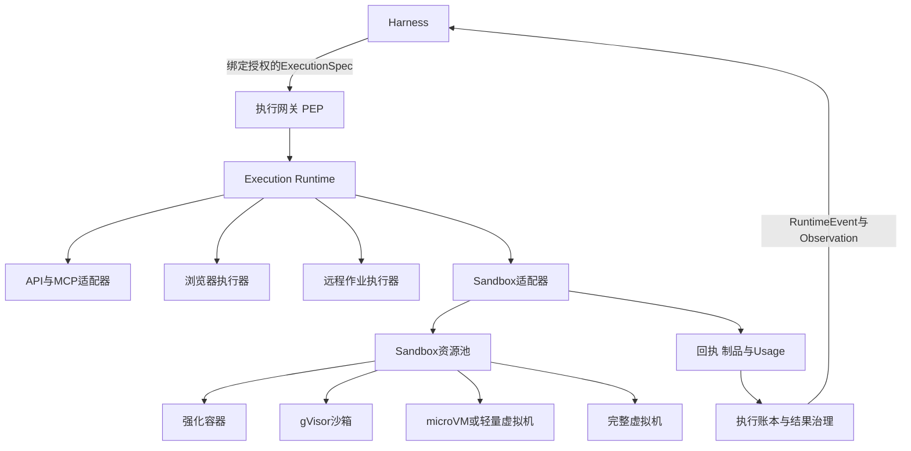
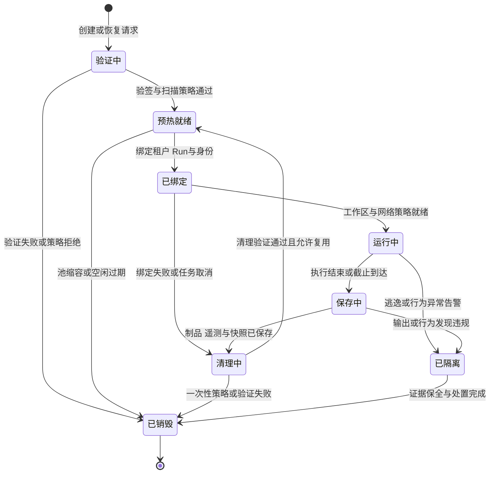
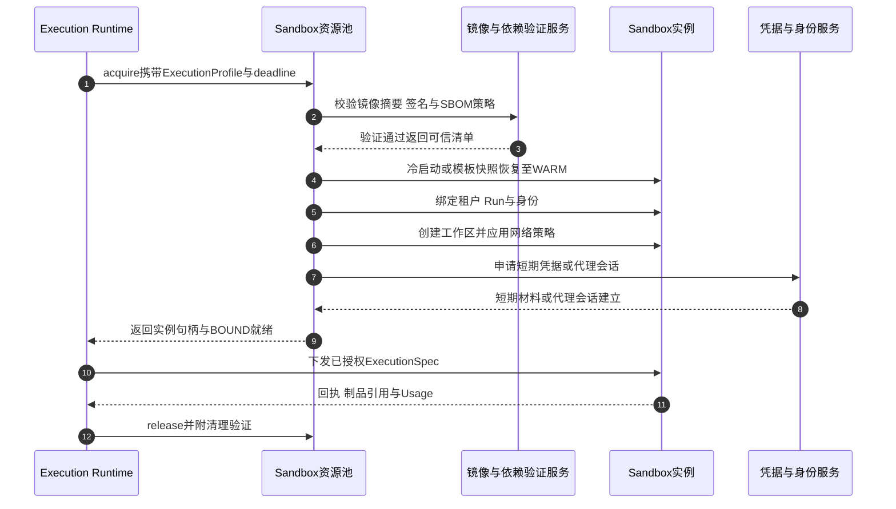
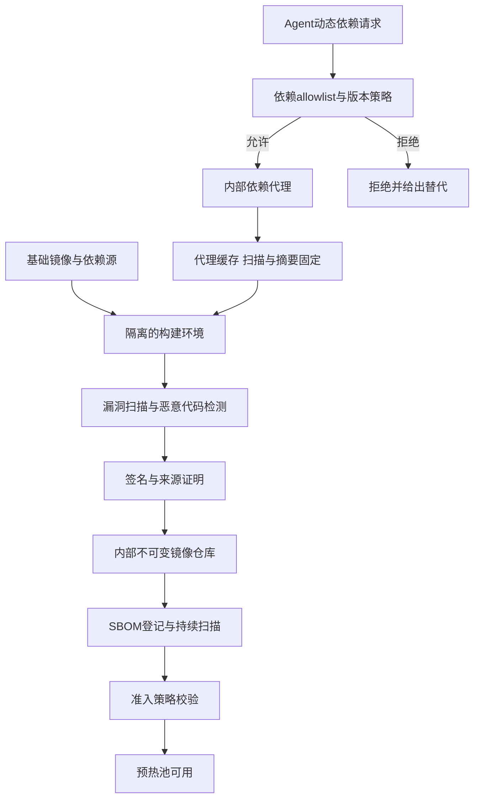
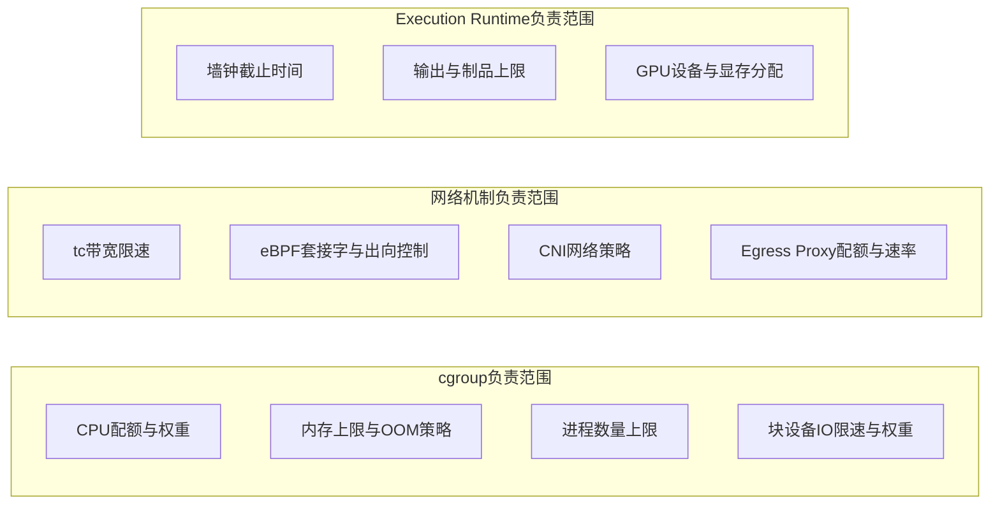
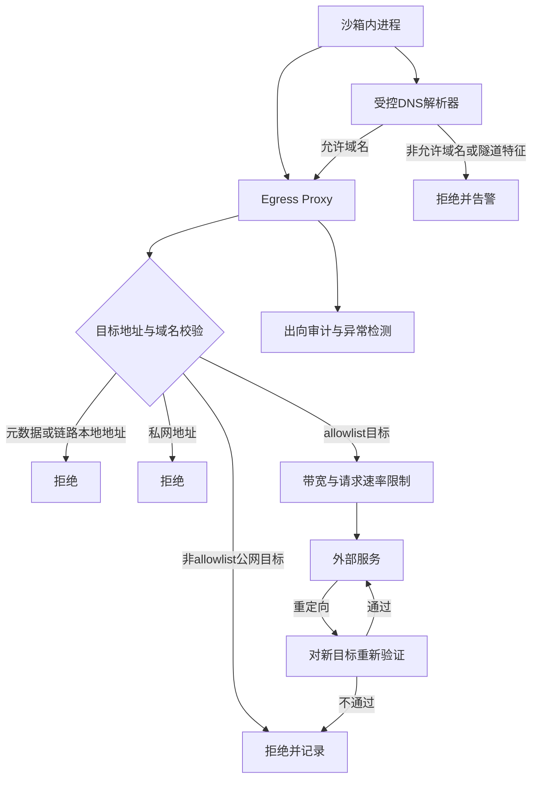
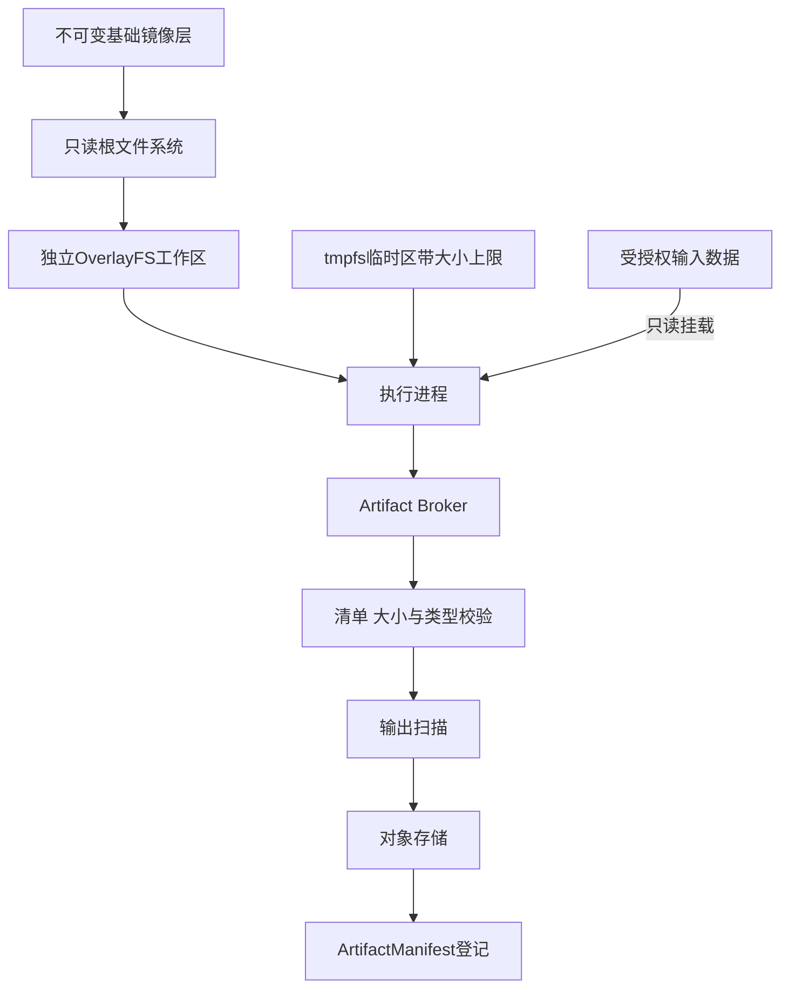
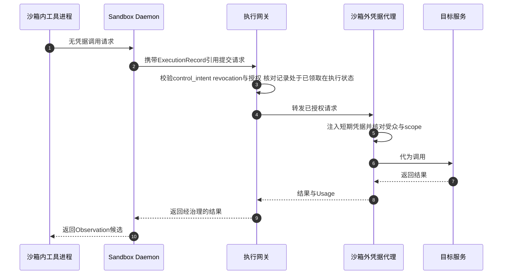
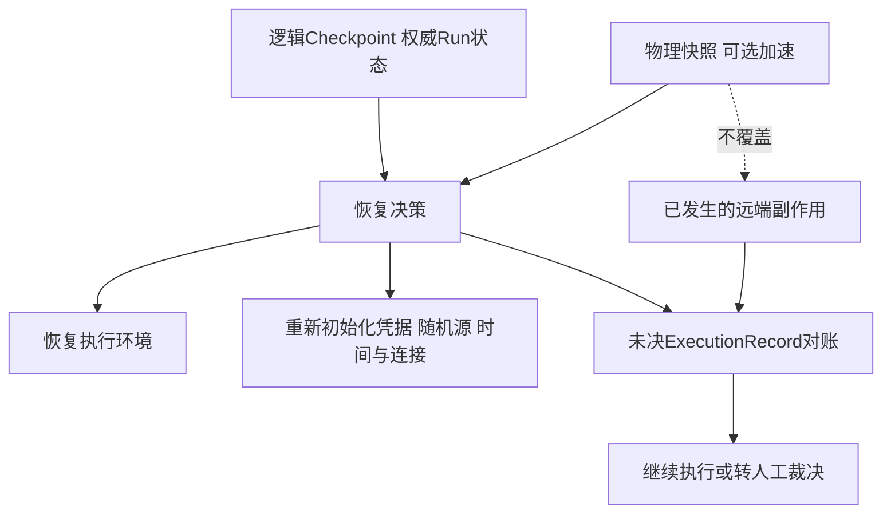
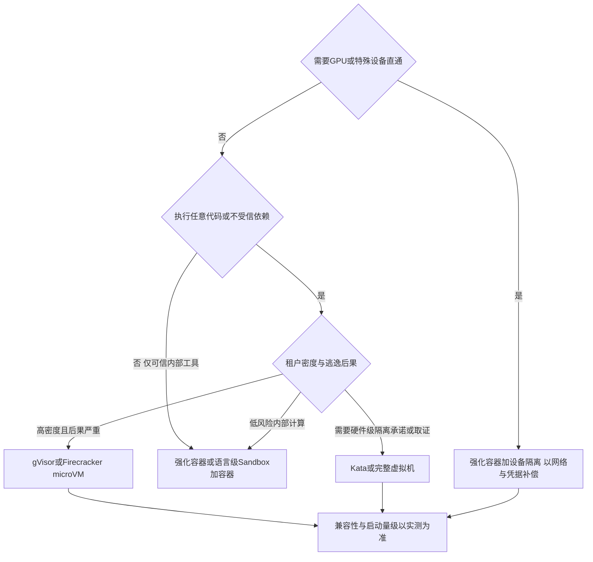

# Agent 安全执行环境：容器、虚拟机与轻量 Sandbox

> **系列**：生产级 Agent 平台架构 2026 · 第 8 篇  
> **定位**：Runtime 机制篇  
> **版本**：闭环修订版  
> **前置阅读**：第 0 篇《从模型推理到生产运行：2026 年 Agent、Harness 与 Runtime 总体架构》 · 第 2 篇《从 Task 到交付：Agent 业务闭环与领域对象设计》 · 第 4 篇《Agent Runtime：从生命周期到执行治理的完整能力模型》  
> **关键词**：安全执行环境、沙箱、gVisor、Firecracker、Kata、出向控制、镜像供应链

## 摘要

当 Agent 需要运行模型生成的代码、Shell 命令、数据处理脚本和不受信的第三方依赖时，平台实际上把执行权交给了自己无法完全预测的内容。安全执行环境（Sandbox）就是承接这类执行的执行后端：它在 Execution Runtime 的调度下提供隔离的计算、文件与网络边界，并在约束内交回收执、制品与用量。但它不是 Agent Runtime 本身——不承担 Agent Loop，不持有 Task 状态，不参与审批决策。

本文依次展开：威胁模型——沙箱内代码默认不受信，平台须保护宿主内核、邻接租户、平台凭据与用户数据；环境生命周期八态状态机与清理验证、复用条件；镜像与依赖治理、资源限制、网络控制、文件系统隔离、运行时安全与凭据模式六个控制面；CRIU、gVisor checkpoint、Firecracker microVM 快照三套物理快照机制与逻辑 Checkpoint 的关系——快照只加速环境恢复，不覆盖远端副作用，凭据、随机源、时间相关状态与连接必须在恢复后重新初始化；最后是七类隔离介质的选型对比与按动作风险分级的选择方法。

本篇的核心判断：安全执行环境的安全性不来自单一技术，而来自“可信的输入、有界的资源、受控的出口、隔离的文件、最小化的运行时、无长期密钥的凭据模式、可验证的清理”的叠加；它只约束本地计算与访问，既不能证明输出真实，也不能回滚已发生的远程交易。适配器契约见第 7 篇，副作用对账见第 6 篇，零信任身份体系见第 12 篇。

---

## 1. 问题背景与威胁模型

### 1.1 为什么 Agent 执行环境必须按“不受信”设计

传统容器化部署的信任假设是：镜像由自己的构建流水线产出，代码经过评审，运行行为基本可预测；容器隔离主要用于资源管理与部署便利，安全边界是“防误伤”而非“防攻击”。Agent 执行环境打破了这个假设，它要运行的内容至少包括四类：

- **模型生成的代码**：由模型即时产生，平台无法在执行前完全理解其行为；提示注入与目标劫持（OWASP ASI01）可能使其携带恶意意图；
- **不受信的第三方依赖**：Agent 可能引入公共仓库中的包，可能存在恶意包、拼写抢注、依赖混淆或被接管的维护账号，属于供应链风险（OWASP ASI04）；
- **注入产生的动作**：网页、文档、邮件中埋藏的对抗性指令可能诱导执行环境发起外联、读取数据或安装工具；动作使用“合法能力”，但意图来自不可信输入；
- **工具误用放大**：参数错误、循环调用、无限重试（OWASP ASI02 工具误用）会转化为真实的资源消耗与外部请求。

因此，安全执行环境的设计起点必须是：**沙箱内运行的代码默认不受信，攻击者已经获得沙箱内的任意代码执行能力**。平台要回答的不是“如何防止坏代码进来”——这只能降低概率——而是“坏代码进来之后，如何把后果限制在一次执行的范围内”。这正是 OWASP Agentic Top 10 2026 中 ASI05（Unexpected Code Execution，意外代码执行）对应的控制域：执行入口策略强制、静态检测、安全执行环境以及网络与文件隔离共同构成防线，本篇聚焦后者。

### 1.2 攻击者能力模型

| 能力 | 平台假设 | 说明 |
|---|---|---|
| 沙箱内任意代码执行 | 必然具备 | 执行代码的自然结果 |
| 读写沙箱内文件 | 必然具备 | 含注入的输入数据 |
| 发起网络请求 | 受控具备 | 仅达允许目标且被审计 |
| 操纵依赖安装 | 可能具备 | 尝试装恶意包或从非受控源下载 |
| 利用内核与运行时漏洞 | 必须假设可能 | 隔离介质决定逃逸成本 |
| 长时间潜伏 | 必须假设可能 | 复用与快照放大风险 |
| 直接访问宿主或其他租户 | 假设不能 | 隔离必须保证的底线 |
| 绕过出向控制直连公网 | 假设不能 | 由网络层强制 |
| 读取沙箱外的长期凭据 | 假设不能 | 凭据模式保证无长期密钥 |

### 1.3 受保护资产与攻击面

| 资产 | 被攻击后的后果 | 主要攻击面 | 首要控制 |
|---|---|---|---|
| 宿主内核与节点 | 逃逸、控制同节点全部实例 | 系统调用、内核漏洞、设备接口 | 隔离介质选型、补丁治理 |
| 邻接租户实例 | 跨租户泄露、横向移动 | 共享内核、挂载、网络 | 单租户实例、网络隔离、禁共享可变状态 |
| 平台凭据与委托链 | 以平台或用户身份执行任意动作 | 环境变量、元数据服务、凭据文件 | 沙箱外代理、短期令牌、元数据阻断 |
| 用户数据与上下文 | 数据外泄 | 出向网络、DNS、制品导出 | 出向默认拒绝、Broker、回程扫描 |
| 集群容量与费用 | 资源滥用、挖矿、账单攻击 | CPU、内存、磁盘、网络、GPU | 全维度配额与截止时间 |
| 内部服务与云元数据 | SSRF、内网探测、云凭据窃取 | 私网地址、链路本地地址 | 私网与元数据阻断、重定向重验 |

威胁模型决定投入方向：执行内容全部来自内部可信代码库时，强化容器即可满足；执行任意模型生成代码并加载公共依赖时，必须按“攻击者已在内部”设计纵深防御；多租户商业平台承载互不信任的客户时，还需要硬件级隔离与更强的取证能力。

---

## 2. 架构位置：Sandbox 是 Execution Runtime 的执行后端

### 2.1 职责边界

第 0 篇与第 4 篇已经确立：**Agent 定义行为，Harness 组织与约束行为，Agent Runtime 承载并驱动行为，执行后端完成具体动作。** 安全执行环境是 Execution Runtime 可调度的执行后端之一，与企业 API、MCP、浏览器执行器、远程作业执行器并列，不是 Agent Runtime 的同义词，更不是“把整个 Agent 塞进去运行的盒子”。

沙箱的负责与不负责必须写成明确契约：

| 对象 | 负责 | 不负责 |
|---|---|---|
| Sandbox 资源池 | 按 ExecutionProfile 分配、预热、绑定、回收实例；隔离与资源强制；报告健康 | 不理解 Task 目标，不保存 Run 状态，不做业务授权 |
| Sandbox Daemon | 接收经授权的 ExecutionSpec；启动受控进程；采集输出、制品与用量；证明来源与通信完整性 | 不推进 Agent Loop，不根据 stdout 或模型文本产生二次动作 |
| Execution Runtime | 选择适配器与资源池、下发规格、接收回执、登记账本、协调取消 | 不进入沙箱内部直接执行，不绕过执行网关 |
| Harness | 决定是否需要沙箱执行、解释 Observation、决定下一步 | 不把沙箱输出直接当作已验收结果 |

### 2.2 耐久调用原则同样适用于沙箱

沙箱执行常被视为“本地计算”而绕过耐久调用纪律，这是错误的：它同样消耗资源、写出制品、访问网络、调用外部服务。因此：

- **先有 ExecutionRecord，后有执行**：Execution Runtime 必须先通过 CAS 原子提交 ExecutionRecord 与 Outbox，沙箱才能真正开始执行；
- **统一末端门禁**：真正外呼前仍须校验最新 `control_intent`、revocation epoch、授权约束，并以 CAS 从 PREPARED 状态唯一领取该 ExecutionRecord；
- **取消与撤销可达**：Cancel 或撤销发生后执行必须可停止；已经开始的执行记录 PENDING/UNKNOWN 与 Usage 并进入对账，不能伪装成“从未执行”；
- **回执不是业务事实**：ExecutionReceipt 是执行器报告，经结果治理与业务核验才能成为 Observation 或验收依据。

对账协议细节见第 6 篇；本篇只强调沙箱后端必须满足的接口事实：稳定的 execution_id、可查询状态、可取消句柄、用量记录。

### 2.3 签名守护进程的能力边界

许多沙箱在实例内运行守护进程（Sandbox Daemon）负责与控制面通信，并建立完整性度量与签名验证：二进制经签名、通道双向认证、消息序列号防重放。必须准确理解这些机制证明什么：

- **证明来源与通信完整性**：控制面可确认对端是预期的、未被替换的守护进程，指令与回执未被篡改或重放；
- **不证明输出真实**：守护进程忠实转述的 stdout 仍由不受信代码产生，代码声称“执行成功”“交易已提交”都不构成业务证明；
- **不充当执行授权**：stdout、日志或任何沙箱内文本不能作为下一步动作的授权依据或业务回执；后续动作只能来自 Harness 对 Observation 的治理判断和新的授权流程。

这与第 4 篇反模式“资源池理解业务目标”一致：资源池只执行受约束的 ExecutionSpec，不根据输出自行追加 Agent 步骤。

---

## 3. 环境生命周期

### 3.1 状态机

安全执行环境的实例生命周期分为八个状态：验证（VERIFY）、预热（WARM）、绑定（BOUND）、运行（ACTIVE）、保存（SAVING）、清理（CLEANING）、隔离（QUARANTINED）、销毁（DESTROYED）。

各状态的含义与关键动作：

| 状态 | 含义 | 关键动作 |
|---|---|---|
| VERIFY | 创建或快照恢复前的验证 | 摘要与签名校验、SBOM 与扫描策略检查、撤销状态检查 |
| WARM | 预热池中的通用就绪实例 | 解释器加载、依赖预热或模板快照恢复；不含任何租户特定状态 |
| BOUND | 已绑定具体执行上下文 | 绑定租户、Run 与身份；创建独立工作区；应用网络策略；注入短期凭据或建立代理会话 |
| ACTIVE | 正在执行 ExecutionSpec | 受资源限制与行为监测约束；输出经限额采集 |
| SAVING | 执行结束后的保存阶段 | 采集输出与文件差异；导出制品；刷新遥测；必要时创建检查点 |
| CLEANING | 清理与去污染 | 终止进程、销毁工作区、撤销凭据与网络策略、卸载挂载并验证 |
| QUARANTINED | 安全隔离 | 停止新命令、撤销身份与网络、保全证据、转安全处置 |
| DESTROYED | 终态 | 实例与私有状态不可恢复地销毁；销毁事实入账本 |

### 3.2 从验证到运行的主链

几个容易出错的细节：

- **预热实例必须无身份**：WARM 实例只做可共享初始化（解释器、依赖预热、只读层缓存）；租户数据、凭据与个性化配置只能在 BOUND 注入，否则复用池会变成跨租户泄露通道；
- **绑定失败必须走清理**：绑定过程可能已创建工作区或网络命名空间，直接回池会留下半初始化状态；
- **截止由沙箱外强制**：沙箱内超时不可信，wall-clock 截止必须在沙箱外度量并强制终止。

### 3.3 清理验证与复用条件

清理不是“删除容器”这一个动作，而是一组必须被验证的断言：

| 清理项 | 验证方式 | 失败处置 |
|---|---|---|
| 进程终止 | 确认无存活进程或实例整体销毁 | 强制销毁实例 |
| 工作区销毁 | 可写层删除或加密擦除后验证 | 实例转 DESTROYED |
| 挂载解除 | 挂载点清单核对无残留 | 节点标记不可调度并排查 |
| 凭据撤销 | 令牌撤销回执、代理会话关闭确认 | 按凭据泄露事件处理 |
| 网络策略回收 | 网络命名空间销毁或策略清空确认 | 强制销毁实例 |
| 审计完整 | 执行、出向日志与告警已持久化 | 阻断复用直至补齐 |

复用条件应保守设定。满足以下全部条件才允许 CLEANING → WARM 回池：

1. 未发生任何安全告警或异常行为记录；
2. 清理验证全部通过并留有记录；
3. 完整性度量未变化（守护进程、只读层摘要一致）；
4. 复用策略允许该介质复用（完整 VM 通常整实例销毁；强化容器可复用但需重验）；
5. 复用次数与存活时间未超过策略上限。

执行过高敏感任务（处理过密钥材料、访问过高敏数据、触发过限流告警）的实例，推荐**一次性执行后直接销毁**。热池命中率与隔离确定性的权衡应作为显式策略纳入成本模型，而非默认全量复用。

### 3.4 QUARANTINED 的处置纪律

隔离状态与第 4 篇 RuntimeInstance 的 QUARANTINED 语义一致。补充三点沙箱特有的纪律：

- **隔离实例不回流热池**，即使事后查明误报，也应销毁后重建；
- **证据保全有边界**：保留必要的内存快照、文件差异与日志即可，不无限期占用容量；
- **联动凭据域**：怀疑实例被攻陷时，其可触达的所有短期凭据立即撤销，相关 ExecutionRecord 进入复核。

---

## 4. 镜像与依赖治理

### 4.1 治理目标

沙箱安全的第一道输入关是“执行环境从哪里来”：镜像层、基础依赖、动态安装的包都是攻击面。治理目标是：**任何进入生产沙箱的二进制内容，都可追溯到受控构建、经过签名与扫描、以不可变摘要被引用。**

### 4.2 不可变摘要、签名与 SBOM

| 控制 | 要求 | 说明 |
|---|---|---|
| 不可变摘要 | 只按 digest 引用镜像，禁止浮动 tag | ExecutionProfile 固定的是摘要 |
| 镜像签名 | 镜像与清单经构建方签名，准入验签 | 验签失败或签名者不受信则拒绝 |
| 来源证明 | 构建元数据记录构建器、源码摘要与参数 | 对齐 SLSA 类来源框架，便于追溯 |
| SBOM | 每个镜像登记软件物料清单 | 新 CVE 出现时定位受影响实例与镜像 |
| 漏洞扫描 | 准入扫描加库存持续扫描 | 准入按严重度阻断；库存重扫，高危冻结或撤销 |
| 撤销联动 | 镜像可被标记撤销 | 撤销后 VERIFY 拒绝新实例；在途按策略处置 |

基础镜像保持最小化：只含执行所需的最小用户态，不带包管理器 root 权限、调试工具与多余 shell 能力；构建历史与层内容可审计。

### 4.3 构建与运行分离

构建环境与运行环境必须分离：

- **构建在受控构建域完成**：编译、依赖解析、包安装在有网络访问但无生产数据的构建环境进行，产物固化为不可变镜像；
- **运行沙箱不具备构建能力**：无编译器写权限、无公共仓库直接访问、不能执行任意安装脚本；
- **动态依赖走受控通道**：当 Agent 任务确实需要额外依赖时，不允许“生产沙箱直连公网任意安装”，而是走以下受控路径之一：
  1. **预置依赖集**：常用依赖预先构建进版本化镜像，任务按 Profile 选择；
  2. **受控动态安装**：依赖请求经 allowlist 与版本策略校验后由内部依赖代理提供，代理负责缓存、恶意包检测与摘要固定；安装产物只写入该次执行的独立层，随工作区销毁；
  3. **离线构建再绑定**：复杂依赖组合在构建域生成任务专用依赖覆盖层，验签后绑定到执行。

内部依赖代理是供应链的关键控制点：拒绝 allowlist 外的包名、检测拼写抢注与已知恶意包、记录每次安装的请求方与 ExecutionRecord 关联，使“谁在哪次执行中装了什么”可审计。

### 4.4 依赖治理的常见失败

- 允许沙箱内 `pip install` 直连公网，等于把供应链边界让渡给公共仓库；
- 只扫描不阻断：扫描结果没有准入策略承接，高危依赖照样进入生产；
- SBOM 只在构建时生成一次，基础镜像更新不重新登记，影响面分析失真；
- 依赖缓存跨租户共享且可写，缓存投毒成为跨租户攻击通道；缓存必须按摘要只读共享。

---

## 5. 资源限制

### 5.1 机制分工：不要把一切都归给 cgroup

资源限制的第一条纪律是准确归因。**cgroup 管理 CPU、内存、PID 与部分块设备 IO；网络带宽与出口控制依靠 tc、eBPF、CNI 策略与代理层机制；墙钟时间、GPU 分配、输出与制品上限则由 Execution Runtime 与设备插件层负责。** 笼统宣称“cgroup 限制了一切资源”会在评审中掩盖真实的控制缺口。

### 5.2 限制维度清单

| 维度 | 机制 | 设计要点 | 超限行为 |
|---|---|---|---|
| CPU | cgroup cpu 控制器 | 按 Profile 设定配额与权重 | 节流而非杀死；节流事件入遥测 |
| 内存 | cgroup memory 控制器 | 硬上限，限制 swap | OOM 终止，原因入回执，Usage 如实入账 |
| 进程数 | cgroup pids 控制器 | 防 fork 炸弹；按任务类型设上限 | 新建进程失败，任务在截止内失败收尾 |
| 块设备 IO | cgroup io 控制器 | 作用于块设备层；部分缓冲写不受控 | 限速；以临时盘配额兜底 |
| 临时盘 | 存储配额或 OverlayFS 上层大小限制 | 工作区独立配额；tmpfs 设大小上限 | 写入失败；宿主磁盘不受影响 |
| 文件数量 | 文件系统配额或运行时检查 | 防 inode 耗尽 | 创建失败并记录 |
| 墙钟时间 | Execution Runtime 外部强制 | 沙箱外度量，不信沙箱内时钟 | 强制终止进入 SAVING |
| 网络带宽 | tc 或 eBPF 限速 | 按实例与按流限速 | 丢包与限速告警 |
| 网络速率 | Egress Proxy 请求配额 | 按域名与按执行限频 | 拒绝记录，联动异常检测 |
| GPU | 设备插件与显存配额 | 整卡、切分或时间片 | 排队或拒绝；显存超限终止 |
| 输出上限 | Daemon 采集层 | stdout/stderr 大小与速率上限 | 截断并标记，不入上下文 |
| 制品上限 | Artifact Broker | 件数、单件与总量上限 | 拒绝并回执失败原因 |

### 5.3 设计要点

- **限制必须全维度同时存在**：只限 CPU 不限内存会遇到 OOM 风暴；只限内存不限进程数会遇到 fork 炸弹；只限计算不限网络会遇到外泄与请求风暴。缺口的维度就是攻击者的维度；
- **区分节流与终止**：CPU 节流、网络限速属于降级；OOM、磁盘写满、截止超时属于失败。回执如实区分，Usage 如实入账，不因任务失败抹掉费用事实；
- **限额也是外泄控制**：输出大小上限与网络请求配额同时限制数据外泄带宽，与第 6 章网络控制叠加；
- **GPU 单独建模**：显存与算力配额、设备隔离方式（整卡、切分、时间片）应作为 ExecutionProfile 的显式字段，而不是隐含在“GPU 池”里。

---

## 6. 网络控制

### 6.1 总体策略

网络是沙箱内攻击者与外部世界之间唯一的合法通道，因此必须是默认拒绝、全程审计、可被撤销的。总体策略为：**无入站、出向默认拒绝、一切出向经代理或策略点、DNS 受控、元数据与私网阻断、重定向后重新验证。**

### 6.2 各控制点说明

| 控制 | 要求 | 说明 |
|---|---|---|
| 无入站 | 沙箱不暴露监听端口，外部不可主动连接 | 输入只能经 ExecutionSpec、受控挂载、Artifact 通道 |
| 出向默认拒绝 | 未命中 allowlist 一律拒绝 | allowlist 按 Profile 配置域名、端口、协议 |
| Egress Proxy | 出向经代理层执行 L7 策略 | 域名校验、频率限制、内容检查；直连场景用 L4 加审计兜底 |
| 受控 DNS | 只用平台指定解析器，禁直连外部 DNS | 只解析 allowlist 域名；防 DNS 绕过出向控制 |
| DNS 隧道检测 | 对频率、标签长度、熵异常告警或阻断 | 隧道把数据编码进子域名；信号含超长标签、高熵、高频 TXT 查询 |
| 元数据阻断 | 阻断云元数据与链路本地地址 | 网络层强制；元数据服务可能提供实例凭据 |
| 私网阻断 | 默认阻断 RFC1918 等私网地址段 | 防 SSRF 式内网探测；内部服务走受控代理单独授权 |
| 重定向重验 | 重定向后对新目标重新校验 | 防白名单域开放重定向成为跳板 |
| 带宽与速率 | tc/eBPF 限速加代理配额 | 配额与 ExecutionRecord 生命周期绑定 |
| 时间绑定 | 网络权限随 BOUND 建立、CLEANING 撤销 | 网络策略是一次执行的授权而非实例永久属性 |

### 6.3 出向 allowlist 的治理

allowlist 不应是全局静态清单，而应与 ExecutionProfile 和动作风险绑定：低风险数据处理任务可以没有任何出向权限；抓取公开网页的任务开放指定域名类别并经回程扫描；调用外部 API 的任务优先走沙箱外凭据代理（见第 9 章）。每次出向请求记录 execution_id、目标、字节数与判定结果，支撑取证与异常检测。

出向异常的典型信号：对同一父域的高频请求、非常见端口与协议、请求体突增、对新建域名的突发访问、匹配已知隧道工具特征的流量。触发后按策略限速、阻断或将实例转入 QUARANTINED。

---

## 7. 文件系统隔离

### 7.1 布局原则

文件系统是沙箱内攻击者最直接的持久化与窃取载体。布局原则是：**根只读、工作区独立且短命、挂载走 allowlist、导出走 Broker。**

| 层 | 属性 | 说明 |
|---|---|---|
| 根文件系统 | 只读 | 来自验签镜像；写尝试失败并告警 |
| 工作区 | 每次执行独立的 OverlayFS 上层 | 随 CLEANING 销毁；执行间不共享可写状态 |
| 临时区 | tmpfs，大小受限 | 供工具链使用，不落盘 |
| 输入数据 | 只读挂载，按授权 | 挂载前完成授权与扫描 |
| 制品导出 | 只经 Artifact Broker | 沙箱不持有对象存储凭据 |

### 7.2 挂载 allowlist

挂载是容器逃逸与跨租户泄露的历史高发区。生产沙箱应执行挂载 allowlist：

- **禁止项**：宿主根与系统目录、容器运行时套接字、内核可写接口、其他实例工作区、含长期凭据的路径；
- **允许项**：该执行的独立工作区、受限 tmpfs、经授权的只读输入数据；
- **校验时机**：绑定阶段由平台生成挂载清单，沙箱内无挂载权限；运行时挂载请求一律拒绝。

### 7.3 路径穿越与链接防护

Artifact Broker 与输入注入通道都必须处理路径安全问题：

- **路径规范化后校验**：导出与注入路径先规范化，确认仍在工作区根内，拒绝 `..` 逃逸；
- **链接防护**：导出时不跟随指向工作区外的符号或硬链接；对 TOCTOU 窗口采用句柄相对操作或导出时冻结工作区视图；
- **特殊文件防护**：拒绝导出设备文件、FIFO、套接字等特殊类型；
- **内容治理**：导出物记录文件名、大小、摘要与类型；可执行内容按策略标记或阻断。

### 7.4 Artifact Broker 导出协议

制品导出不是“把文件拷出去”，而是一条受治理的通道：

1. 执行结束进入 SAVING，Daemon 生成候选制品清单；
2. Broker 校验件数、单件大小、总量、路径合法性与类型策略；
3. 输出扫描（敏感内容、恶意代码特征）按数据策略执行；
4. 通过校验的制品由 Broker 以平台侧凭据上传对象存储，沙箱内全程不出现存储凭据；
5. 登记 ArtifactManifest：对象引用、摘要、大小、类型、来源 execution_id、扫描状态与可见性；
6. 后续读取重新授权，旧授权不随制品引用无限延续。

输入方向同理：输入数据经授权与扫描后只读注入工作区，大文件以引用传递而非整体复制进上下文。文件通道双向受控，不再是未经审计的走私通道。

---

## 8. 运行时安全

### 8.1 纵深层次

运行时安全是隔离介质之内的第二道纵深。即使隔离介质存在未知漏洞，层层收紧的运行时配置仍能显著提高攻击成本。

| 层 | 机制 | 要点 |
|---|---|---|
| 用户与能力 | 非 root、丢弃全部 capabilities、禁止提权位 | 特例经代理层解决而非放权 |
| 系统调用过滤 | seccomp 白名单 | 默认拒绝按画像放行；少一个系统调用少一段内核攻击面 |
| 强制访问控制 | AppArmor、SELinux 或 Landlock | 策略限制文件、网络与能力；Landlock 可启动前叠加 |
| 内核接口收敛 | 只读挂载内核接口、掩码敏感伪文件系统条目 | 减少信息泄露与误配置面 |
| 守护进程最小化 | Daemon 是唯一带控制面权限的组件 | 最小代码量、独立签名、双向认证；按关键组件管理 |
| 完整性度量 | 启动链与关键二进制度量 | microVM 与 VM 可度量启动；容器至少度量 Daemon 与镜像摘要 |
| 行为监测 | 系统调用异常、异常子进程、敏感路径访问、挖矿特征 | 信号联动 QUARANTINED；采集与被监测进程隔离 |

### 8.2 守护进程是最小 TCB 的核心

沙箱内所有组件中，Sandbox Daemon 的信任计算基（TCB）必须最小：

- 只实现执行受控规格所需的最少功能：启动进程、采集输出、上报用量、发起制品导出请求；
- 不实现任何“智能”：不解析模型文本、不执行二次决策、不缓存超出单次执行所需的凭据；
- 更新走与镜像同等的签名与发布治理；
- 其异常（崩溃、重启、度量变化）本身是安全事件，触发实例隔离评估。

### 8.3 异常行为监测的边界

行为监测的目标是尽早发现“攻击者已在内部”的迹象，典型信号包括：系统调用序列偏离基线、尝试加载内核模块、访问凭据常见路径、派生与执行画像不符的子进程、出现挖矿或端口扫描特征、对出向限制的持续试探。

要准确定位其作用：监测是**检测与响应**手段，不是边界本身，不能替代隔离介质与强制访问控制。正确的联动是：高危信号直接转 QUARANTINED 并撤销凭据；中低危信号记录并提高后续监控档位。

---

## 9. 凭据模式

### 9.1 两种基本模式

沙箱执行需要访问外部服务时，凭据如何到达是安全设计的分水岭。存在两种基本模式：

| 维度 | 模式 A：沙箱外代理代为执行 | 模式 B：短期令牌注入 |
|---|---|---|
| 凭据位置 | 始终在沙箱外凭据代理 | 以短期令牌进入沙箱 |
| 沙箱内暴露 | 无长期密钥，通常无任何可用凭据 | 无长期密钥，最小化短期凭据暴露 |
| 工作方式 | 工具向本地端点发无凭据请求，代理校验 ExecutionRecord 后注入凭据代为调用 | BOUND 注入受众绑定、最小 scope、短 TTL 令牌，CLEANING 撤销 |
| 撤销时效 | 即时：代理停止放行即生效 | 取决于令牌 TTL 与撤销传播 |
| 适用协议 | 代理已适配的协议 | SDK 必须直接持凭据的场景 |
| 审计粒度 | 每请求经代理，天然细粒度 | 依赖令牌侧日志与出向审计拼接 |
| 主要代价 | 代理需适配协议；多一跳延迟 | 令牌在 TTL 窗口内可被滥用 |

**选择原则：高风险调用优先由沙箱外代理持凭据代为执行；只有当工具链必须直接使用凭据时，才退化为短期令牌注入，并做到无长期密钥、最小 scope、最短 TTL、受众绑定、用完即撤。** 准确的表述是“无长期密钥、最小化短期凭据暴露”，而不是声称绝对零凭据——只要令牌进入了沙箱，就在其生命周期内构成暴露面，设计必须承认并压缩这个窗口。

### 9.2 代理代为执行的调用链

这条链路里统一末端门禁仍然在场：代理放行前校验 ExecutionRecord 的 `control_intent`、revocation epoch 与授权约束；Cancel 发生后沙箱内代码继续发起的请求会在门禁处被拒绝。

### 9.3 短期令牌注入的约束清单

当必须采用模式 B 时，以下约束缺一不可：

- 受众绑定到具体目标服务，scope 收窄到该次执行的最小动作集；
- TTL 与执行截止时间对齐，宁短勿长；
- BOUND 阶段经受控通道注入（环境变量或约定文件路径），注入事实记入审计；
- 令牌不出现在日志、输出采集与制品中，采集层做凭据脱敏；
- CLEANING 阶段主动撤销并留存回执；QUARANTINED 时立即撤销；
- 同一令牌不跨执行复用；快照恢复的实例绝不继承旧令牌（见第 10 章）。

### 9.4 与零信任授权链的衔接

沙箱凭据是整条授权链的末端：用户身份 → TaskIntent 授权范围 → Agent 工作负载身份 → CallIntent 策略判定 → 人类审批 → 一次性 ReleaseGrant → 下游短期凭据。沙箱内出现的任何凭据都必须能向上追溯到这条链，且生命周期不长于对应 ExecutionRecord 的执行窗口。完整身份体系见第 12 篇。

---

## 10. 快照与检查点

### 10.1 三套物理快照机制不可混用

物理快照用于加速执行环境的恢复与预热，不同隔离介质对应不同机制，能力边界差异很大：

| 机制 | 适用对象 | 覆盖内容 | 主要限制 |
|---|---|---|---|
| CRIU | 普通容器进程（runc 类） | 进程树内存、文件描述符等进程状态 | GPU 状态与复杂 socket 受限；恢复后外部连接通常失效；依赖内核与运行时版本匹配 |
| runsc checkpoint | gVisor 沙箱 | gVisor 用户态内核管理的沙箱状态 | 覆盖范围由 gVisor 自身机制决定；与 CRIU 不通用 |
| Firecracker microVM 快照 | Firecracker microVM | 完整虚拟机内存与设备状态 | 恢复后熵源、时钟、连接需处理；快照文件本身是需要治理的资产 |

三套机制不能互相替代，也不能与逻辑 Checkpoint 混用。选型时必须确认所用介质支持哪种快照、覆盖哪些状态、哪些状态恢复后必然失效。

### 10.2 快照与逻辑 Checkpoint 的关系

第 4 篇已经确立：逻辑 Checkpoint 保存 Run、上下文引用与步骤状态，是恢复的权威基础；物理快照只是加速特定执行环境恢复的可选能力。两者的关系如下图所示：

必须反复强调的边界：

- **快照不覆盖远端副作用**：快照点之前已发出的远程 API 调用、数据库事务、消息发送，不会因环境恢复到快照点而撤销。恢复后必须先读取 ExecutionRecord 与 ExternalHandle 对账，而不是假设“环境回去了，动作也没发生”；
- **快照不是业务事务**：把 microVM 快照当业务回滚点，是“Checkpoint 包含未记录副作用”反模式在沙箱层的具体形态；
- **快照文件是资产**：快照含内存镜像与执行中间数据，其存储、加密、访问控制与保留期限纳入数据治理；过期快照加密擦除。

### 10.3 模板快照的约束

模板快照用于预热池加速（例如解释器已加载、依赖已 import 的状态），其内容约束是：**只能包含可共享的初始化状态**。具体地：

- 允许：解释器与库的加载状态、只读缓存、通用运行时预热结果；
- 禁止：任何凭据与密钥材料、租户数据、个性化配置；
- 敏感状态处理：随机源状态、时间相关状态、所有网络连接不得跨实例延续，必须在恢复后重新初始化。

### 10.4 恢复后重新初始化清单

无论采用哪套快照机制，实例从快照恢复后，以下状态必须重新初始化或重新验证：

| 项目 | 处理 | 原因 |
|---|---|---|
| 凭据 | 重新签发或重建代理会话；旧凭据视为失效 | 快照不得含凭据；旧令牌可能已撤销或过期 |
| 随机源 | 重新播种熵池 | 同一快照恢复的多个实例会得到相同随机序列，破坏依赖随机性的机制 |
| 时间状态 | 重新同步时钟并重校时间断言 | 令牌有效期、截止时间、缓存时效必须在恢复时刻重新判定 |
| 网络连接 | 全部重建，重建前重新授权 | 快照点连接的对端状态未知，且可能跨越取消或撤销事件 |
| 租户与 Run 绑定 | 重新校验绑定关系与 revocation epoch | 恢复可能发生在撤销之后 |
| 未决执行记录 | 读取 ExecutionRecord 并对账 | 快照点前后的副作用边界必须显式确认 |

这份清单应作为快照恢复的实现检查表：任何一项被跳过，快照机制就会从“加速手段”退化为“状态混乱的来源”。

---

## 11. 隔离强度选型

### 11.1 八类介质对比

隔离介质的选择决定攻击者逃逸的成本上限。以下对比覆盖八类常见介质。启动时延一列仅给出量级判断，具体数字受镜像大小、内核版本、设备模型、缓存与预热策略影响很大，**以各自环境实测为准**。

| 介质 | 隔离机制 | 隔离强度 | 兼容性 | 启动量级 | 设备与 GPU | 成本 | 典型适用 |
|---|---|---|---|---|---|---|---|
| 强化容器 | 共享宿主内核，namespaces 加 seccomp、能力收敛与 LSM | 中 | 最好，几乎无兼容问题 | 毫秒至秒级量级 | 最好，GPU 直通成熟 | 低 | 内部可信代码、低风险、GPU 任务 |
| rootless 容器 | 用户命名空间去 root | 中偏上 | 好，部分特权操作受限 | 毫秒至秒级量级 | 受限，GPU 需额外适配 | 低 | 降低内核漏洞爆炸半径 |
| gVisor | 用户态内核拦截并代为执行系统调用 | 高 | 有系统调用兼容面，需实测 | 接近容器量级，略高 | 设备与 GPU 直通受限 | 中 | 多租户任意代码执行 |
| Kata Containers | 容器接口加轻量虚拟机 | 高 | 好，OCI 兼容，按 Pod 起 VM | 秒级量级 | 设备直通可行但复杂 | 中高 | VM 级隔离加容器工作流 |
| Firecracker microVM | KVM 硬件虚拟化，极简设备模型 | 高 | 好，面向通用 Linux 负载 | 亚秒至秒级量级 | 无 GPU 直通 | 中 | 高密度多租户短任务 |
| 完整虚拟机 | 完整硬件虚拟化与设备模型 | 最高 | 最好，可运行独立内核 | 秒至分钟级量级 | 完整设备与 GPU 直通 | 高 | 强合规、最高风险、取证 |
| 托管 Sandbox | 供应商托管的隔离运行时与服务边界 | 依供应商 | 依服务，通常面向函数或代码片段 | 秒级量级 | 依服务 | 中高 | 免运维、需供应商级信任与取证能力 |
| 语言级 Sandbox | 解释器权限、WASM 能力模型、子进程限制 | 低 | 依语言生态 | 毫秒级量级 | 不适用 | 最低 | 低风险纯计算，只作纵深 |

几点定位必须准确：

- **gVisor** 在用户态实现内核（Sentry）拦截并代为执行系统调用，大幅缩小攻击者可直接触达的内核面；代价是系统调用与性能兼容面；
- **Firecracker** 是基于 KVM 的 microVM 监视器，以硬件虚拟化提供强隔离，用极简设备模型换取快速启动与高密度；不提供 GPU 直通；
- **Kata Containers** 是兼容 OCI 的容器运行时方案，把每个容器或 Pod 运行在独立轻量虚拟机中，兼顾容器生态与虚拟机隔离；
- **语言级 Sandbox 不是多租户隔离边界**：解释器沙箱与 WASM 能力模型适合约束低风险计算，面对任意代码执行威胁只能作纵深，不能作唯一边界。
- **托管 Sandbox** 把隔离与运维交给供应商，代价是平台需要接受供应商级的信任边界，并评估其取证、审计与数据驻留能力是否满足合规要求；隔离强度不能只看宣传，必须以供应商明确的隔离机制与责任边界为准。2026 年该光谱已显著扩展：既有 FC Agent Sandbox、ACS Agent Sandbox 等云托管形态（E2B 兼容程度、快照/暂停能力按代际不同，须逐项核验），也有腾讯 Cube 这类以 Apache 2.0 开源、可私有化部署的 KVM microVM 沙箱服务（快照克隆、兼容 E2B SDK）——开源托管方案意味着可以自建审计与取证链路，部分缓解供应商级信任问题，但其宣传的"快照回滚"仅覆盖执行环境本地状态，不回滚远端副作用；

### 11.2 按动作风险选择

隔离强度应与动作风险、租户信任关系匹配，而不是全平台一刀切：

| 风险档位 | 典型动作 | 推荐介质 | 附加控制 |
|---|---|---|---|
| 低 | 内部可信工具、确定性计算、表达式求值 | 强化容器或语言级 Sandbox 加容器 | 标准资源限制与出向默认拒绝 |
| 中 | 模型生成代码但依赖全部预置、无公网出向 | 强化容器加严配置或 rootless 容器 | 无出向或极窄出向、一次性执行 |
| 中高 | 模型生成代码加受控动态依赖、有限出向 | gVisor 或 Firecracker microVM | 依赖代理、出向审计、行为监测 |
| 高 | 多租户商业场景、处理敏感数据的任意代码 | gVisor、Kata 或 Firecracker，按兼容性实测选择 | 单租户实例、完整审计、快照治理 |
| 最高 | 合规要求硬件隔离、取证级需求 | 完整虚拟机 | 独立节点池、证据保全流程 |

GPU 任务是特殊分支：虚拟化介质的 GPU 直通与切分能力普遍弱于容器。高风险 GPU 任务通常采用“强化容器加设备隔离加无出向或代理出向”的组合，用网络与凭据控制补偿隔离强度差距，并显式记录这一权衡。

### 11.3 选型决策流程

选型的常见错误：只看启动速度选 microVM 却未验证系统调用兼容面；只看隔离强度全量上完整 VM 导致成本失控；用语言级 Sandbox 承载多租户任意代码；把基准测试启动数字直接当作容量输入。正确做法：先定威胁模型与风险档位，再在候选介质上做兼容性回归与启动、密度实测，最后把选择写进 ExecutionProfile，使其可审计、可演进。

---

## 12. 常见反模式

| 反模式 | 问题与正确做法 |
|---|---|
| 把 Sandbox 当成 Agent Runtime | 沙箱承担 Agent Loop、Task 状态或审批，崩溃或回收时业务状态丢失且脱离租约与统一门禁。状态与推进永远在 Runtime 侧 |
| 注入长期凭据并声称“零凭据” | 长期 API Key 或刷新令牌进环境变量。高风险调用走沙箱外代理；确需注入时明确为“无长期密钥、最小化短期凭据暴露”，压缩 TTL 与 scope |
| 把 stdout 当回执或授权 | 以沙箱打印的“已发布成功”推进业务状态。业务事实来自 ExecutionRecord、对账与验收；守护进程签名只证明来源与通信完整性 |
| 生产沙箱直连公网装依赖 | `pip install` 直连公共仓库，供应链边界失控。必须走内部依赖代理加 allowlist、扫描与摘要固定 |
| 资源限制全部归给 cgroup | 带宽与出向速率无人管控。cgroup 管 CPU、内存、PID 与部分 IO；带宽与出口靠 tc、eBPF、CNI 与代理层 |
| 把物理快照当业务回滚 | 快照恢复后假设远端动作“没发生过”。快照不覆盖远端副作用，恢复必须伴随 ExecutionRecord 对账 |
| 模板快照携带凭据或随机源 | 恢复出的实例共享随机序列或复用旧凭据。模板快照只含可共享初始化状态，凭据、随机源、时间与连接恢复后重新初始化 |
| 无验证复用 | 清理后不做断言验证就回池，残留进程、挂载或数据进入下一次执行。复用必须以清理验证通过为前提，高敏任务一次性销毁 |
| 重定向绕过出向策略 | 只校验首次目标，白名单域开放重定向把流量带到元数据或内网。重定向后必须对新目标重新执行全部校验 |
| 语言级 Sandbox 作多租户边界 | 用解释器权限模型承载互不信任租户的任意代码。隔离边界必须由容器、用户态内核或虚拟机承担 |
| 元数据服务未阻断 | 攻击者经元数据地址换取实例凭据后横向进入云账号。元数据与链路本地必须在网络层强制阻断 |
| 沙箱内时钟当截止时间 | 沙箱内超时可被攻击者失效。墙钟截止在沙箱外度量并强制终止 |

---

## 13. 生产验证场景

安全执行环境必须通过故障与攻击注入验证，而不只是跑通正常路径。以下场景应纳入发布准入与定期红队演练：

| 验证场景 | 注入方式 | 预期事实 |
|---|---|---|
| 逃逸测试 | 执行已知逃逸 PoC 与系统调用异常负载 | 隔离介质阻断；触发 QUARANTINED；宿主与邻居不受影响；凭据即时撤销 |
| 跨租户访问 | 读取其他租户工作区、共享缓存、残留挂载 | 全部拒绝；审计完整；触发隔离评估 |
| 资源耗尽 | fork 炸弹、内存洪峰、写满临时盘 | pids、内存、磁盘配额分别生效；任务在截止内失败；邻居与宿主不受影响；Usage 如实入账 |
| 网络外泄 | 经白名单域夹带数据、DNS 隧道外传 | 代理配额、内容策略与隧道检测阻断；产生告警与审计 |
| 元数据与私网 | 请求云元数据、链路本地、扫描 RFC1918 | 网络层拒绝重定向与直接请求；不暴露内网拓扑 |
| 重定向绕过 | 白名单域 302 跳转至元数据或私网地址 | 重定向后目标重验拒绝；事件入审计 |
| 供应链注入 | 替换镜像层、篡改签名；安装拼写抢注包 | 验签或 allowlist 拒绝并阻断；请求方与 ExecutionRecord 关联可查 |
| 清理残留 | 清理后检查残留进程、挂载、工作区数据与凭据 | 全部终止、销毁或撤销；验证记录留存 |
| 快照恢复 | 恢复后复用旧凭据与旧连接 | 凭据重新签发；连接重建且重新授权；未决记录进入对账 |
| 模板污染 | 在模板快照中植入租户数据或凭据 | 准入拒绝该模板；构建流程可审计 |
| 隔离处置 | 触发高危行为告警 | 新命令停止；身份与网络撤销；证据保全；实例不回流热池 |
| 撤销联动 | 执行中撤销 AgentSpec 或用户授权 | 末端门禁拒绝后续外呼；在执行按取消收尾；无新增副作用 |
| 守护进程异常 | 破坏 Daemon 完整性或中断控制面通道 | 评估隔离实例；不执行新规格；已登记执行进入对账 |

验证应同时检查隔离边界、审计记录、凭据状态与账本事实，而不只是观察“任务是否失败”。

---

## 14. 架构评审清单

### 位置与职责

- Sandbox 是否明确定位为 Execution Runtime 的执行后端而非 Agent Runtime，不承担 Agent Loop、Task 状态与审批？
- 沙箱执行是否先有 ExecutionRecord，外呼前校验 control_intent、revocation、授权并 CAS 领取？
- Sandbox Daemon 是否只接收经授权的 ExecutionSpec，不根据 stdout 或模型文本产生二次动作？

### 生命周期

- VERIFY 到 DESTROYED 八态是否都有明确进入与退出条件？预热实例是否不含任何租户特定状态？
- 清理验证是否覆盖进程、工作区、挂载、凭据、网络与审计六个断言？复用条件是否显式定义，高敏任务是否默认一次性？
- QUARANTINED 实例是否不回流热池且凭据即时撤销？

### 镜像与依赖

- 生产镜像是否只按不可变摘要引用并验签？SBOM 是否登记并支撑漏洞影响面分析？
- 构建与运行是否分离，生产沙箱是否无直连公网安装能力？动态依赖是否经内部代理、allowlist、扫描与摘要固定？

### 资源与网络

- 资源限制是否覆盖 CPU、内存、PID、IO、临时盘、时间、GPU、输出与制品全部维度，墙钟截止在沙箱外强制？
- 是否准确区分 cgroup 与 tc、eBPF、CNI、代理的职责？
- 是否无入站、出向默认拒绝、受控 DNS、元数据与私网阻断、重定向重验？DNS 隧道与出向异常检测是否有响应联动？

### 文件与运行时

- 根文件系统是否只读，工作区是否每次执行独立且随清理销毁？挂载是否 allowlist 化，禁止运行时套接字与宿主敏感路径？
- 路径穿越、符号链接与特殊文件是否有防护？制品是否只经 Artifact Broker 导出并登记 ArtifactManifest？
- 是否做到非 root、最小 capabilities、seccomp 白名单与强制访问控制？Daemon 是否最小 TCB 并有完整性度量？

### 凭据与快照

- 高风险调用是否优先沙箱外代理代为执行？短期令牌是否受众绑定、最小 scope、短 TTL、用完即撤，且表述为最小化暴露而非绝对零凭据？
- 是否明确区分 CRIU、runsc checkpoint 与 Firecracker 快照三套机制及其限制？快照是否不覆盖远端副作用，恢复是否强制对账？
- 恢复后是否重新初始化凭据、随机源、时间与连接？模板快照是否只含可共享初始化状态？

### 选型与验证

- 隔离介质是否按动作风险与租户信任分级选择，而非一刀切？启动时延与兼容性结论是否来自本环境实测？
- 第 13 章验证场景是否纳入发布准入并留存证据？

---

## 15. 本篇结论与后续专题

安全执行环境是 Agent 平台把“任意代码执行”从不可接受风险转化为可运营能力的工程载体。本篇的结论可以归纳为十条：

1. Sandbox 是 Execution Runtime 调度的执行后端，不承担 Agent Loop、Task 状态与审批；
2. 沙箱内代码默认不受信，设计按“攻击者已在内部”展开；
3. 耐久调用纪律同样适用于沙箱：先有 ExecutionRecord，外呼前过统一末端门禁；
4. 签名守护进程只证明来源与通信完整性，stdout 不是授权也不是业务回执；
5. 生命周期八态中，清理验证决定复用是否安全，隔离态不回流；
6. 镜像与依赖不可变、可验签、可追溯，生产沙箱不直连公网任意安装；
7. 资源限制全维度覆盖且归因准确：cgroup 管 CPU、内存、PID 与部分 IO，带宽与出口靠 tc、eBPF、CNI 与代理；
8. 网络无入站、出向默认拒绝、DNS 受控、元数据与私网阻断、重定向重验；
9. 凭据模式优先沙箱外代理，退路是无长期密钥、最小化短期凭据暴露；
10. 三套物理快照机制各司其限，快照不覆盖远端副作用，恢复后凭据、随机源、时间与连接重新初始化。

隔离强度选型没有全局最优解：强化容器与 rootless 覆盖可信负载，gVisor 与 Firecracker 承载多租户任意代码，Kata 与完整虚拟机提供硬件级承诺，语言级 Sandbox 只做纵深，托管 Sandbox 面向免运维但需供应商级信任的场景；选择依据始终是威胁模型、动作风险、兼容性实测与成本。

安全执行环境约束的是本地计算与访问：它不能证明代码业务逻辑正确，不能证明输出真实，也不能回滚已发生的远程交易——这些分别由结果治理、业务验收与副作用对账承担。

后续专题：第 9 篇展开 Agent 安全的资产、主体与信任边界；第 10 篇对 OWASP Agentic Top 10 2026 做架构化逐项解读，ASI05 将与本篇控制互相映射；第 12 篇展开零信任 Agent 架构与完整授权链；第 13 篇讨论网关、审批服务与能力选型。

---

## 参考资料

以下均为官方资料。动态文档持续更新，实际实现应固定所采用版本与访问日期；性能与启动时延判断以自身环境实测为准。

1. [OWASP Top 10 for Agentic Applications for 2026](https://genai.owasp.org/resource/owasp-top-10-for-agentic-applications-for-2026/)
2. [OWASP Agentic AI Threats and Mitigations](https://genai.owasp.org/resource/agentic-ai-threats-and-mitigations/)
3. [gVisor 官方文档](https://gvisor.dev/docs/)
4. [gVisor Checkpoint/Restore 指南](https://gvisor.dev/docs/user_guide/checkpoint_restore/)
5. [Firecracker 官方网站](https://firecracker-microvm.github.io/)
6. [Firecracker Snapshot Support 文档](https://github.com/firecracker-microvm/firecracker/blob/main/docs/snapshotting/snapshot-support.md)
7. [Kata Containers 官方网站](https://katacontainers.io/)
8. [CRIU 官方网站](https://criu.org/)
9. [NIST SP 800-190 Application Container Security Guide](https://csrc.nist.gov/publications/detail/sp/800-190/final)
10. [OCI Image Specification](https://github.com/opencontainers/image-spec)
11. [Sigstore 官方文档](https://docs.sigstore.dev/)
12. [SLSA Supply Chain Levels](https://slsa.dev/)
13. [SPDX 标准](https://spdx.dev/)
14. [Linux seccomp 文档](https://docs.kernel.org/userspace-api/seccomp_filter.html)
15. [Landlock 官方网站](https://landlock.io/)
16. [AppArmor 官方网站](https://apparmor.net/)
17. [SELinux 项目](https://selinuxproject.org/)
