# 攻击知识库与三框架协同：MITRE ATLAS × MAESTRO × OWASP

> **系列**：生产级 Agent 平台架构 2026 · 第 11 篇  
> **定位**：安全治理篇  
> **版本**：闭环修订版  
> **前置阅读**：第 9 篇《为什么 Agent 安全不同：资产、主体与信任边界》 · 第 10 篇《OWASP Agentic Top 10 2026 架构化解读》  
> **关键词**：MITRE ATLAS、CSA MAESTRO、OWASP Agentic Top 10、威胁建模、攻击知识库、控制验证、安全选型

## 摘要

给架构套上风险清单，并不能证明系统安全。OWASP Agentic Top 10 2026 帮助团队理解共性风险，MAESTRO 帮助团队按架构层次识别威胁，MITRE ATLAS 则提供攻击者战术与技术知识。三个框架都具有防御参考价值，但它们不是可以相互替代的检查表，也不存在“填完三张表就自动通过”的认证结论。

本文以“Agent 读取授权数据、生成报告、审批后发布”为贯穿场景，建立从资产与信任边界到威胁记录、风险归类、技术映射、控制方案、测试证据和生产准入的完整方法。重点在于回答：怎样确认攻击路径真实可达；怎样使用 ATLAS 而不误贴技术标签；怎样区分模型拒答、权限阻断、检测告警和业务效果；怎样选择能够兑现控制契约的技术，而不是采购一组声称支持框架的产品。

本文参照 MAESTRO 原始七层模型，并明确 Security and Compliance 是纵向跨层。ATLAS 技术名称以本轮直接核对的官方 2026.09 版本数据为依据。三框架映射、威胁记录字段、测试分级和准入政策均属于本文参考设计，不是三个组织联合发布的标准，也不承诺威胁穷尽、检测无漏报或攻击成功概率归零。

---

## 1. 背景：从“覆盖了框架”到“验证了控制”

Agent 平台的攻击面来自跨层组合。攻击者可能只能修改一份公开文档，却通过检索链进入内部上下文；Agent 可能没有管理员权限，却能够组合一个合法读取工具与一个合法外发工具；每个动作可能单独符合接口 Schema，但整个动作序列偏离了原任务目标。

因此，安全评审不能只问“有没有提示注入检测”“有没有沙箱”，还要问：不可信内容如何进入决策，哪个主体能够提出动作，哪个控制点真正决定动作是否发生，结果未知之后是否会重复执行，以及长期记忆是否会保存攻击造成的污染。

现实中容易出现三种断裂。建模报告列出风险，却没有具体执行路径；控制清单标为已覆盖，却没有测试证明；红队报告发现漏洞，却没有关联到业务资产、责任人和发布门禁。这些断裂不需要再增加一个大而全的框架，而需要共同的事实载体和验证工作流。

| 常见表述 | 缺少的证明 | 应补的问题 |
|---|---|---|
| 已覆盖 OWASP | 适用范围与控制证据 | 哪些风险适用，哪些不适用，依据是什么 |
| 已采用 MAESTRO | 具体资产和可达路径 | 哪个入口、哪个主体、跨越哪条边界 |
| 已支持 ATLAS | 技术定义与测试语义 | 映射到什么技术，前置权限和证据是什么 |
| 已部署检测器 | 检测盲区与处置结果 | 漏检时是否仍有权限边界，告警后谁处理 |
| 已完成红队 | 测试负载、环境与有效期 | 哪个版本、哪个策略，结果可否复现 |
| 已经过审批 | 参数与资源条件绑定 | 批准后动作发生了什么变化 |

本文采用的协同方法是：以架构识别为起点，参考风险分类和攻击知识，建立控制与验证，持续由新证据反向修订。实际项目可以从事故、技术通告或业务变更进入流程，不必机械遵守一个固定顺序。

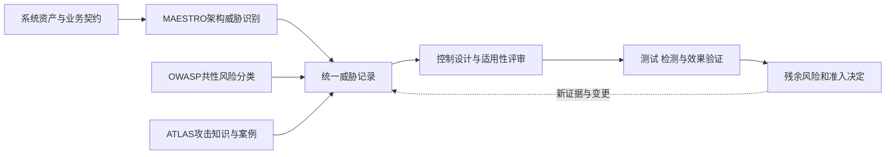

这张图表达的是本文的工作流设计。ATLAS 不执行红队，OWASP 不签发准入证书，MAESTRO 不自动生成完整威胁模型。真正的验证和风险决定由组织的工程、安全和业务流程完成。

## 2. 概念：三个框架分别提供什么

### 2.1 三框架的分工

三个框架都可能包含威胁、缓解措施和案例，不能把它们简单描述为“一个只负责风险、一个只负责架构、一个只负责攻击”。更合适的分工是强调本系列如何优先使用它们。

| 框架 | 原始定位 | 本系列主要用途 | 不能由此推导 |
|---|---|---|---|
| OWASP Agentic Top 10 2026 | 共性高影响风险与缓解实践入口 | 风险沟通、适用性检查、控制覆盖查漏 | 风险清单完整、采用控制即获得认证 |
| CSA MAESTRO | Agentic 系统的分层威胁建模方法 | 资产、架构域、信任边界及跨层路径识别 | 七层都有节点就代表威胁被穷尽 |
| MITRE ATLAS | 面向 AI 系统的对抗战术、技术及案例知识库 | 技术映射、测试假设、检测需求和事件分析 | 每个业务错误都有对应技术，贴标签即证明攻击 |

### 2.2 ATLAS 的知识对象结构

ATLAS 中的战术描述攻击者目标，技术描述实现目标的方式，子技术描述更具体的变体。缓解措施和案例不是技术层级下面的下一层，而是通过关系链接到技术和场景的知识对象。一次攻击可以跨多个战术，采用多个技术；一个技术也可能出现在不同路径中。

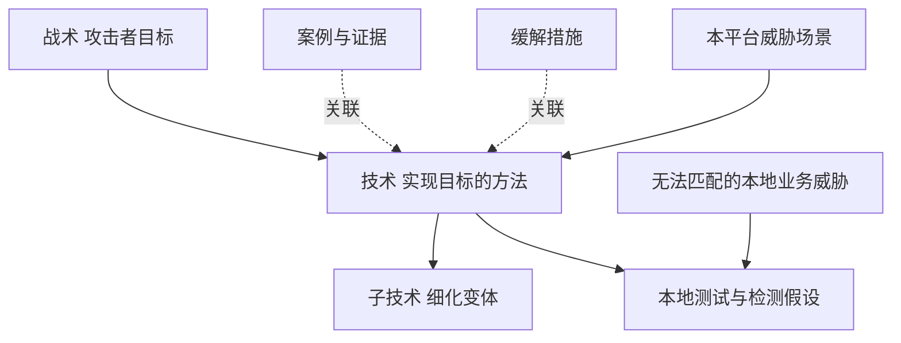

无法匹配某个技术并不是排除风险的理由。误交付、业务审批利益冲突、重复发布或费用归因错误，都可能需要本地威胁编号和独立控制。不能把它们强行解释成提示注入，以提高所谓“框架映射率”。

## 3. MAESTRO：保持官方层名，同时独立表达平台架构

### 3.1 官方七层与平台关注点

MAESTRO 原始模型使用七个层次，其中 Security and Compliance 是纵向跨层，而不是单纯位于堆栈顶端的第六个服务。本文保留英文原名，避免将本平台功能域误写成官方定义。

| 原始层级 | 英文名称 | 中文表达 | 本平台关注点，属于作者分析 |
|---|---|---|---|
| Layer 1 | Foundation Models | 基础模型 | 模型依赖、输入输出边界、供应商与模型版本 |
| Layer 2 | Data Operations | 数据操作 | RAG 来源、长期记忆、索引、业务数据与删除保留 |
| Layer 3 | Agent Frameworks | Agent 框架 | Harness、Runner、提案、上下文和 Agent Loop |
| Layer 4 | Deployment and Infrastructure | 部署与基础设施 | RuntimeInstance、资源池、Sandbox、网络和运行环境 |
| Layer 5 | Evaluation and Observability | 评估与可观测 | 回归、红队、遥测、审计关联和检测盲区 |
| Layer 6 | Security and Compliance (Vertical Layer) | 安全与合规纵向层 | 身份、委托、策略、审批、凭据、数据与审计控制 |
| Layer 7 | Agent Ecosystem | Agent 生态 | 工具与 Agent 目录、MCP/A2A 连接、跨组织协作和信任 |

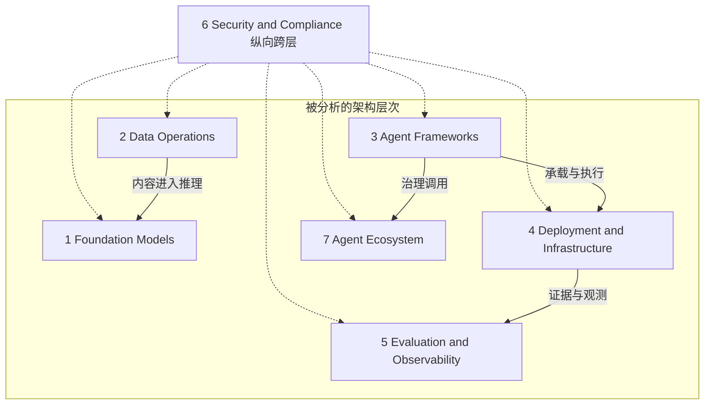

### 3.2 跨层问题与功能域投影

Agent 间通信不是官方 Layer 4。它可从 Layer 7 生态信任、Layer 3 消息解释、Layer 4 传输设施及 Layer 6 身份授权共同分析。同样，工具的业务语义、安装来源和隔离能力也不属于一个单独层能够覆盖的问题。

本系列十个顶层功能域与 MAESTRO 是多对多关系。Agent Runtime 覆盖框架承载和基础设施，数据与记忆域主要关联数据操作，身份策略域跨所有层；这些是作者对实际架构的投影，不是 MAESTRO 规定的服务拓扑。

### 3.3 证据限制

需要保留证据限制：本轮 CSA 原始文章直读受到访问限制，层名通过指向官方原文的检索索引核对，不能称为本轮完整阅读并验证了全部原文。发布或正式评审时应由能访问原文的人员复核适用版本及层名；如果团队使用不同版本或自定义分层，要单独标注，而不是混用编号。

## 4. ATLAS：以可追溯版本核验技术，而不是凭名称联想

### 4.1 本轮核验的技术映射表

本轮直接核对 MITRE 官方 ATLAS 2026.09 YAML 版本数据。技术名可能随着知识库演进变化，因此映射记录应同时保存技术 ID、当时名称、版本、证据来源和映射理由，不能只保存一个 ID。

| 技术 ID | 官方 2026.09 名称 | 本文如何使用 | 不能误用的边界 |
|---|---|---|---|
| AML.T0051 | LLM Prompt Injection | 描述恶意内容使模型偏离原指令的路径 | 不是所有错误回答、越权或污染的同义词 |
| AML.T0010 | AI Supply Chain Compromise | 描述 AI 供应链组件被攻陷的路径 | 漏洞存在或来源未知本身不能证明已经被攻陷 |
| AML.T0020 | Training Data Poisoning | 描述训练或微调数据被操纵 | 普通 RAG 检索或长期记忆污染不自动属于训练投毒 |
| AML.T0053 | AI Agent Tool Invocation | 描述攻击者利用 Agent 访问能力调用工具 | 正常授权的工具使用不能仅凭调用记录判为攻击 |
| AML.T0086 | Exfiltration via AI Agent Tool Invocation | 描述通过 Agent 工具把数据传向攻击者位置 | 合规交付或所有外部发送不能自动被判为窃取 |

这是一小组经本轮核验、适合解释平台风险的技术，不是 ATLAS 全量目录，也不宣称覆盖全部 Agent 攻击。其他技术如工具定义投毒、上下文污染和内存污染，只有进一步核对当前官方记录后才应写入具体 ID；否则先保留本地威胁分类。

训练投毒的适用性尤其需要谨慎。若平台仅调用外部模型而不参与训练，直接训练投毒的控制点通常位于供应商或上游数据链。平台应记录供应链依赖与证据要求，而不是宣称在一个入向网关中解决了所有训练安全。

### 4.2 映射流程与核验纪律

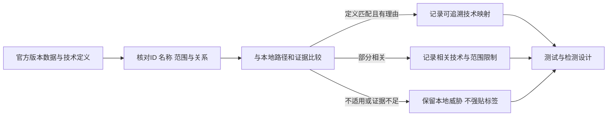

网页暂时返回 404 只说明本次读取失败，不意味着技术不存在。可以通过官方导航和官方版本数据核验，不能换用第三方解释后仍声称“逐项官方核验”。更不能把未经核对的子技术编号当作确定事实。例如 AML.T0051.002 不应被写成“Agent Tool Abuse”；本文不依赖这类未纳入本轮技术表的子技术映射。

## 5. 从资产、主体和路径产生统一威胁记录

### 5.1 威胁记录字段

威胁记录需要比“ASI01 高风险”更具体。它至少应说明攻击者能控制什么、需要哪些前置条件、跨越哪些信任边界、想影响哪类资产，以及平台中哪个动作或决定必须被保护。

沿用参考场景，平台允许读取租户 A 的统计数据、生成内部报告，经必要审批发布到租户 A 指定空间。攻击者只能修改一份可能被检索引用的外部文档，不能更改 TaskIntent、策略或审批记录。威胁是文档内容诱导 Agent 外发原始明细，而不是用户直接请求一个合法发布动作。

| 字段 | 要记录的内容 |
|---|---|
| threat_id 与版本 | 唯一威胁记录及修订历史 |
| protected_asset | 业务明细、Task 目标、凭据、产物或账本 |
| adversary_control | 攻击者能修改的文档、工具描述、消息或环境 |
| preconditions | 数据可被检索、Agent 可见工具、网络与身份范围 |
| entry_and_path | 入口、跨边界传播、权限利用与业务效果 |
| maestro_layers | 原始层名及具体资产映射，允许跨多层 |
| owasp_risks | 适用 ASI 及理由，不适用时明确记录 |
| atlas_mapping | 可核验技术、版本和证据，或本地分类 |
| controls_and_owner | 预防、检测、处置控制与责任主体 |
| test_and_detection | 测试 ID、规则 ID、观测点与预期结果 |
| residual_risk | 仍存在的风险、审批依据、期限和复审触发 |

### 5.2 攻击者能力与多对多映射

记录不应只有“被攻击系统”，还要包含“攻击者能力”。如果没有前置权限、输入路径或可见工具，一个技术标签不能形成可执行威胁。反过来，前置能力越强，越需要明确信任边界：攻击者能控制工具 Server 与只能控制检索文档是两种不同场景，不能混在同一测试结论中。

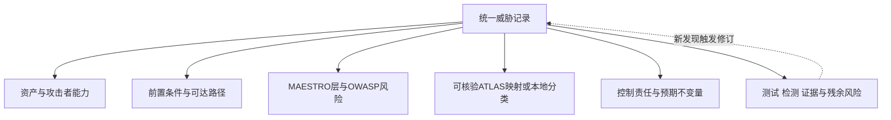

同一威胁可能对应多个 ASI、多个 ATLAS 技术和多个架构层；同一个 ASI 也可能来自许多不同路径。系统应保存映射理由和证据，不应将关系压成一个不可解释的“风险综合分”。

## 6. 方案：以明确的安全不变量设计控制

### 6.1 四段防线与安全不变量

三框架描述风险，并不直接规定平台实现。本文继续采用前序文章的模型外强制、耐久调用、统一末端门禁和事实对账，不因为新增技术标签就重新设计另一套授权流程。

安全方案可以分为四段。内容进入时保留来源、租户、数据等级和使用目的；提案形成时比较 Task 范围、动作参数和业务影响；执行前验证当前控制意图、撤销、许可和资源条件；执行后保存实际效果与用量，对未知结果查询和裁决。

| 安全不变量 | 实际控制点 | 需要的证据 |
|---|---|---|
| 外部内容不能改写 Task 授权 | TaskIntent 固定、Context 分区与提案范围校验 | Task 版本、来源、CallIntent 和拒绝理由 |
| 未登记调用不能外呼 | CallRecord/Outbox 耐久提交及执行方门禁 | 调用 ID、提交事务、Outbox 和执行领取记录 |
| 被取消 Run 不能产生新自主动作 | control_intent 保留、末端取消校验 | 取消事件与执行拒绝事件 |
| 审批只能批准固定规格 | action_digest、资源版本及执行时重授权 | Approval、AuthzDecision、许可消费 |
| 工具不能自行扩大资源范围 | ExecutionProfile、出口、文件与凭据限制 | 实际目标、资源限制与异常记录 |
| UNKNOWN 不触发盲重试 | Execution/Delivery 账本与 Reconciler | 查询证据、裁决、未决责任 |
| 结果证据链不能被旧事件替换 | ResultSelection 绑定 Run/Artifact/Acceptance | 版本选择、交付引用及迟到事件处理 |

这些控制来自本系列平台设计，不能归称为某个框架的原生保证。即使所有记录都完整，错误策略仍可能授权危险动作；即使执行隔离有效，授权范围内的数据仍可能被错误使用。因此，明确不变量之后还要验证策略和业务语义，而不止验证软件有无异常。

### 6.2 控制流与业务终态

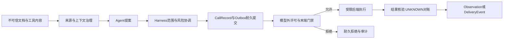

Run 期的 Observation 回到 Harness，DeliveryEvent 回交付域。拒绝、检测或人工裁决都不能直接宣布 Task 完成；Task 仍需按 ResultSelection 和 Finalization 门禁处理业务终态。

## 7. 贯穿案例：检索注入到工具介导的数据外泄

### 7.1 攻击路径与技术参照

假设文档包含与报告主题相关的正常段落，同时夹带改变发布目标的恶意指令。Agent 可能把它误当作任务要求，生成“先发送客户明细、再写报告”的工具调用。该路径可参考 AML.T0051；若攻击者借 Agent 调用合法外发工具，则还可参考 AML.T0053；若数据实际向攻击者控制位置传出，则进一步涉及 AML.T0086。

这三个技术不是每次同时成立。仅看到一段可疑文本，只能证明输入可疑；看到 Agent 提出外发工具调用，可证明出现危险提案；只有结合实际工具调用、目标身份和数据流证据，才可判断是否发生工具介导泄露。

### 7.2 受控验证场景

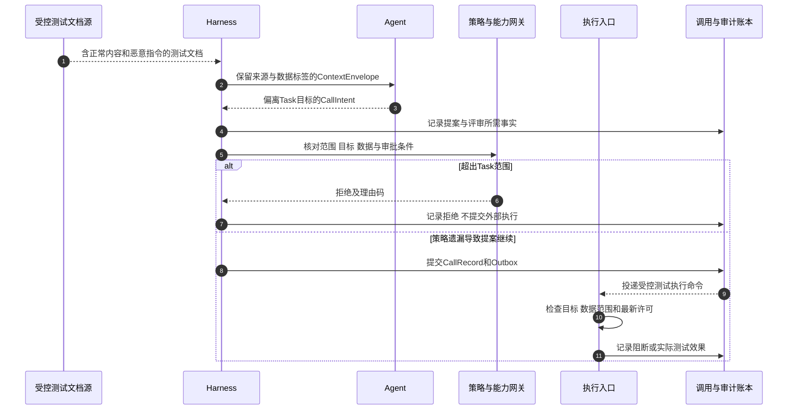

测试应至少设置两个版本的场景。第一组在完整控制开启时验证危险提案不能造成真实动作；第二组在专门授权、隔离的实验环境中模拟某个控制失效，验证其他边界和检测是否仍能工作。不能为测试检测而在生产取消 PEP 或允许真实客户数据外传。

来源标签也不是攻击检测结论。即使来自内部文档，内容仍可能被修改；即使源签名有效，也只说明完整性，不保证用途适合当前任务。模型拒绝恶意内容值得记录，但不能作为唯一安全边界。

## 8. 三方映射：从共性风险到本地控制

下表是本平台的示例分析，不是 OWASP、MITRE 和 CSA 联合发布的官方对照。ATLAS 一栏只使用已核验的五项技术，未适配部分保持空缺或本地分类，而不虚构 ID。

| OWASP 风险 | MAESTRO 主要层 | ATLAS 参照与范围限制 | 本系列控制 |
|---|---|---|---|
| ASI01 目标劫持 | 1 模型、2 数据、3 框架、6 纵向 | AML.T0051 适用于提示注入引发的劫持；其他目标偏移另建场景 | 目标契约、Context 来源、提案范围校验 |
| ASI02 工具误用 | 3 框架、4 设施、6 纵向、7 生态 | AML.T0053 适用于攻击者借 Agent 调用工具；正常误用仍需业务分析 | 能力网关、预算、执行门禁 |
| ASI03 身份权限滥用 | 6 纵向、7 生态及实际运行层 | AML.T0053 可反映某些工具访问效果，但不替代身份滥用技术分析 | 委托收敛、许可、凭据代理、重授权 |
| ASI04 供应链 | 1 模型、3 框架、4 设施、7 生态 | AML.T0010；需说明实际被攻陷组件与来源链 | 版本固定、来源证明、注册准入、停用 |
| ASI05 意外代码执行 | 3 框架、4 设施、6 纵向 | AML.T0053 仅涵盖通过 Agent 工具产生的相关路径；宿主漏洞另建模型 | 安全执行环境、资源网络边界 |
| ASI06 记忆上下文污染 | 2 数据、3 框架、6 纵向 | 注入路径可参考 AML.T0051；只有参与训练或微调时才适用 AML.T0020 | 记忆写入、衰减、隔离、回滚 |
| ASI07 通信不安全 | 3 框架、4 设施、6 纵向、7 生态 | 不为传输冒充和重放强贴本表技术；消息携带注入可关联 AML.T0051 | 对端身份、协议、消息关联与防重放 |
| ASI08 级联失效 | 多层，特别是 3、4、7 | 属于传播影响，可关联初始技术，不能单凭级联定义一个 ATLAS 技术 | Cell、限额、断路器、对账 |
| ASI09 人机信任滥用 | 3 框架、5 评估、6 纵向、7 生态 | 主要以本地人因威胁记录；若有注入起点，记录 AML.T0051 关联 | 确定性差异呈现、审批绑定、复核 |
| ASI10 失控 Agent | 3 框架、5 评估、6 纵向、7 生态 | 自主偏离可能没有攻击者或已知技术，不强行映射 | 行为监测、收权、隔离、裁决 |

数据泄露不应被隐藏在“只有十大条目”的表格之外。通过工具外泄的案例可跨 ASI02、ASI03 和 ASI06 等风险，参照 AML.T0086，同时保留敏感数据、目的、目标和使用场景。风险类型多对多不影响控制落地，影响的是需要保存映射解释。

## 9. 测试方案：把攻击知识变成可复现的验证

### 9.1 用例字段与验证流程

一个测试用例必须固定环境、策略、输入和预期，否则测试通过只能证明“这次没出事”。模型的随机性还要求考虑多轮、不同文档位置、分块结果、上下文长度和不同工具集，而不是只执行一次已知注入样例。

| 用例字段 | 示例或要求 |
|---|---|
| test_id/threat_id | 将测试关联到可追溯威胁版本 |
| framework_mapping | MAESTRO 层、适用 ASI、ATLAS ID 与版本或本地编号 |
| environment | 隔离租户、合成数据、受限凭据、受控接收端 |
| fixed_versions | AgentSpec、模型路由、策略、工具 Schema 与检测规则 |
| preconditions | 文档可检索、工具可见、读写权限和预算 |
| stimulus | 受控文本、描述符变化、异常回调或状态竞争 |
| expected_invariant | 外发范围不能超出 Task，审批不能被参数替换等 |
| expected_control | 提案校验、PDP、执行 PEP、出口或数据范围 |
| expected_detection | 可疑提案、拒绝关联、目标改变或数据流异常 |
| actual_effect | CallRecord、执行状态、接收端和制品实际变化 |
| conclusion | 样本结果、限制、残余风险与整改责任 |

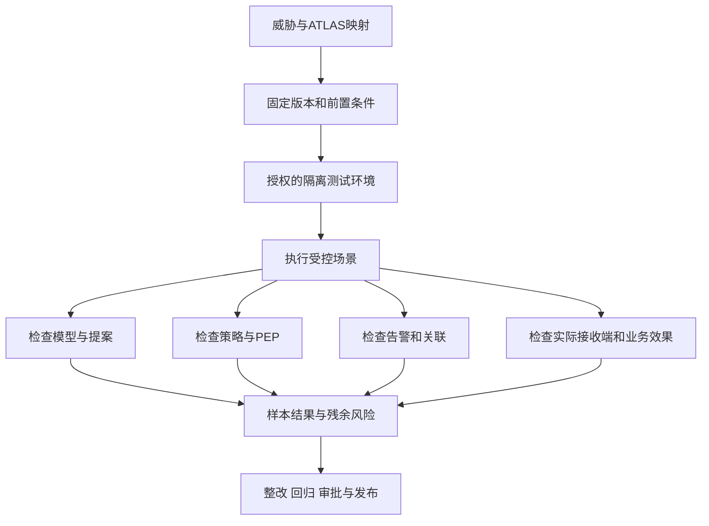

### 9.2 四类结果与测试集构成

必须区分四类结果。模型拒答证明内容层在该样本上发挥作用；PEP 拒绝证明该动作没有获得平台执行许可；检测告警证明某条规则观察到了预定信号；目标系统未发生副作用则需要结合执行记录、网络和目标端证据确认。前三者中的任一项都不能自动证明第四项。

测试集可包括正向业务、已知对抗、未知变体、状态竞争与供应链变更。正向样本用于发现过度阻断；对抗样本用于验证边界；故障样本用于检查撤销、取消、重复投递和 UNKNOWN。安全检测失败时，关键资源边界仍应保持，而不是为保证回答率放行高影响动作。

## 10. 检测方案：内容、行为、身份与业务效果联合观测

### 10.1 观测点与证据限制

ATLAS 提供攻击解释线索，但检测规则必须建立在平台实际可观测的数据上。Agent 内部完整推理、隐含信息流和所有派生关系不可验证；不能声称通过一个 TrustLabel 就能追踪全部模型内污点。

因此，检测可以组合内容与结构、调用行为、身份变化、数据流和业务事实。只观察行为可能漏掉尚未产生工具动作的污染；只扫描内容可能漏掉合法工具组合和身份滥用；只观察网络则可能无法理解被授权流量中的敏感信息用途。

| 观测点 | 典型检测假设 | 证据限制 |
|---|---|---|
| Context 与来源 | 外部内容提出与 Task 不符的操作 | 语义检测有误报漏报，不能证明恶意 |
| CallIntent 与提案版本 | 检索后出现不相关的高影响动作 | 时间相关不等于因果成立 |
| AuthzDecision 与许可 | 超范围或参数更换导致授权拒绝 | 单次拒绝也可能是正常用户错误 |
| 身份与委托 | 子 Agent 接收到超出父任务的权限 | 需要真实委托链和资源属性 |
| 出口与接收方 | 数据指向不合用途的目标 | 加密、代理、私网和第三方会限制可见性 |
| 执行与业务系统 | 发布、写入或外发已生效 | 本地 Receipt 不是独立业务证明 |
| Memory 写入 | Agent 输出升级为长期信任内容 | 正常总结与污染需结合来源和政策 |

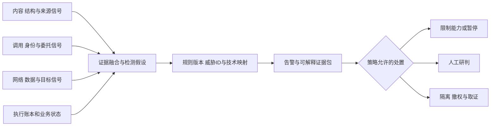

### 10.2 证据融合与处置纪律

ATLAS 战术与技术标签应作为事件分析和规则关联字段，而不是仅凭标签自动执行隔离。自动处置需要明确风险阈值、责任和回退条件，特别是会影响共享业务或高价值资源时。审计调用方必须能看到“哪些证据导致哪种处置”，而不是只看到一个黑盒安全分。

验证检测时，可以在授权的实验环境中模拟某个控制未阻断或使用受控事件回放验证规则链；这类验证不能宣称真实生产控制已被突破。检测触发率必须说明采样范围和测试方法，不能用签名命中比例替代系统抗注入能力。

## 11. 优先级与覆盖度：高影响路径先验证，不滥用综合分

### 11.1 优先级规则

测试资源有限，优先级应首先受硬性门禁约束。越权外发、审批摘要失配、取消后新动作、未知非幂等动作盲重试和关键审计丢失，若在当前场景可达，应直接成为阻断条件，不允许被低风险样本的大量通过“平均掉”。

其余场景再考虑可达性、业务影响、控制证据强度、暴露变化和验证成本。若使用数值评分，必须定义尺度、权重和阈值；本文不把多个序数等级直接相乘并称为官方风险算法。特别是“控制成熟度越高”不应在不解释方向的情况下提高风险分。

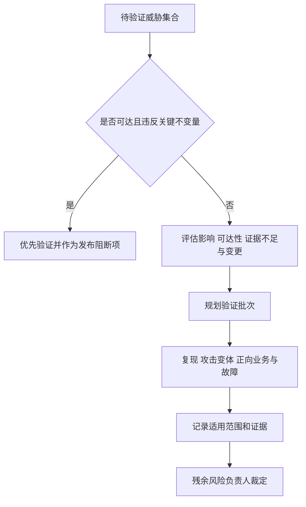

### 11.2 覆盖度多维报告

覆盖度至少需要多维报告，不能只计算“映射了多少个 ATLAS 技术”。

| 维度 | 分母必须说明 | 不能替代的结论 |
|---|---|---|
| 威胁适用性 | 已识别并评审的本地威胁 | 未发现的威胁是否存在 |
| 控制实现 | 适用场景需要的控制 | 控制是否真实有效 |
| 测试执行 | 固定版本的计划测试及变体 | 对未知攻击的防护率 |
| PEP 效果 | 明确可达且预期拒绝的测试动作 | 模型本身没有被操纵 |
| 检测效果 | 已执行的可观测对抗样本 | 不可观测攻击或零日覆盖 |
| 正向影响 | 正常任务样本和负载条件 | 全部业务不会误报 |
| 响应恢复 | 测试的处置、对账和重新准入流程 | 任意业务都可自动恢复 |

一条 ASI 风险可标为适用、部分适用或不适用；每种状态都要有理由。ATLAS 无法匹配的记录同样进入覆盖表。缺口报告的价值在于暴露盲区，而不是把所有格子填成绿色。

## 12. 技术选型：选择能兑现证据契约的能力

### 12.1 能力契约与实现类型

“支持 OWASP、ATLAS、MAESTRO”可以表示一个工具内置了风险标签或规则库，不等于它能完成威胁建模、验证平台门禁、保留执行事实和处置未知副作用。应先确定契约，再比较实现类型。

| 能力 | 可选实现类型 | 必须确认的问题 |
|---|---|---|
| 威胁登记与版本管理 | 文档/表格、需求系统、专用建模平台 | 能否保留资产、路径、映射理由、责任、版本和复审历史 |
| 攻击知识接入 | 官方版本数据快照、结构化技术索引 | 是否标明来源、版本、名称变化和未适用范围 |
| 内容与结构检测 | 规则、分类器、专用安全模型、组合检测 | 误报漏报、数据驻留、流式窗口、故障处理和版本回归 |
| 行为与身份策略 | PDP/PEP、OPA/Cedar 类引擎、企业授权服务 | 参数、目的、委托、撤销、许可与执行时强制 |
| 执行隔离 | gVisor、Kata、microVM、专用 VM、托管 Sandbox | 安全边界、设备兼容、出口、凭据和清理可验证性 |
| 规则与告警关联 | SIEM、事件流处理、序列规则、行为模型 | 实际遥测字段、延迟、基数、证据解释和处置接口 |
| 对抗测试编排 | 受控测试工具、红队平台、自研场景 Runner | 是否隔离租户与副作用，能否验证 PEP 和目标端结果 |
| 审计证据保存 | 追加式数据库、对象保留锁定、独立审计服务 | 不可篡改范围、授权调阅、脱敏、保留与恢复 |
| 风险裁决与准入 | 发布流水线、审批系统、风险登记 | 未决项是否能阻断，风险接受是否有期限和负责人 |

PoC 应验证三件事：能否阻止明确不允许的动作，能否保留用于独立复核的事实，以及失效时是否保持安全边界。只比较“命中率”或演示界面无法回答这些问题。

### 12.2 渐进落地路线

不需要强制引入某个消息平台、云资源或商业安全产品。初期可以使用版本化文档、有限技术清单、受控测试和明确 PEP 建立闭环；规模增大后再把威胁记录、规则数据和验证结果结构化。产品可以替换，威胁 ID、技术证据和控制事实不应随之丢失。

## 13. 运营方案：从新威胁到修复与重新准入

### 13.1 触发点与治理流程

三框架协同必须最终进入治理流程。触发点可以是新 Agent 或工具接入、AgentSpec 和模型路由变化、数据源变更、授权范围扩大、事故、技术通告或周期性复审。固定季度复审可以作为本平台政策，但不是声称框架官方要求每季度更新。

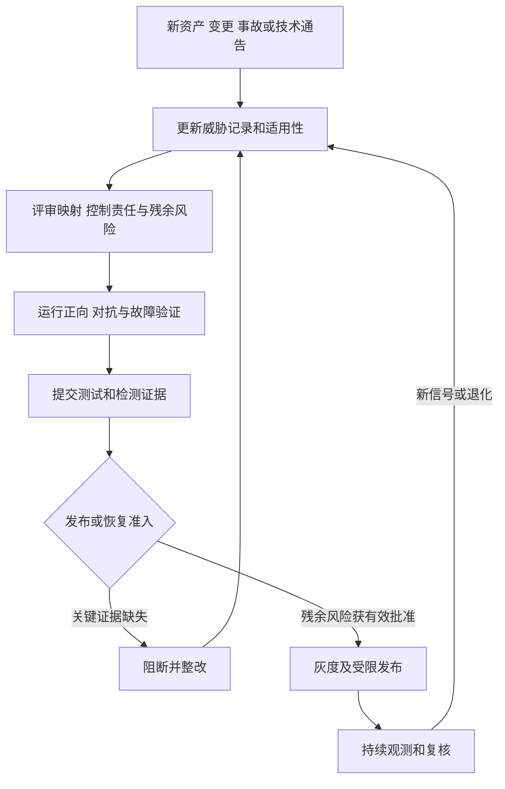

### 13.2 三类产出与事故处置

应分别保留三类产出。威胁模型说明资产、路径、适用框架及控制要求；验证报告说明固定版本、输入、测试次数、实际结果和局限；准入决定说明谁接受哪些残余风险、是否限制权限、何时复审以及恢复或撤销条件。它们可以存放在同一个工具中，但不能混成“已覆盖”的单一字段。

发生事故后，技术归类与事实裁定应分开。ATLAS 可以帮助解释路径，但具体影响需要从 Task、Run、CallRecord、Approval、Execution、Artifact、Delivery、Usage 和目标端证据重建。不能为了确认技术标签而在生产重新执行未知动作。

### 13.3 与其他专题的分工

本系列中，第 13 篇治理域处理候选规则、发布和应急，第 14 篇数据治理提供记忆、RAG、来源与保留控制；第 16 篇高并发提供调用风暴、背压与租户限额，第 17 篇高可用提供故障域、降级和恢复约束。第 18 篇运营域执行测试与检测关联，第 19 篇在生产准入检查版本化威胁报告、验证证据和风险接受。新增专题不建设另一套 Runtime 或业务状态机，只补足风险知识到控制证据的连接层。

## 14. 发布前验证与评审清单

### 14.1 验证场景清单

| 场景 | 预期事实 |
|---|---|
| 外部文档包含越界发布指令 | 模型可能产生危险提案，但提案和执行路径不允许超出 Task 范围 |
| 相同工具正常授权调用 | 不因技术名叫 Tool Invocation 就被判定攻击 |
| 任意 Memory 污染被标训练投毒 | 分类评审拒绝误贴 AML.T0020，保留正确本地威胁与注入关联 |
| Agent 版本或工具描述改变 | 威胁、测试和规则版本重新评审，不沿用过期通过记录 |
| 取消发生在 Outbox 提交后 | 消息仍可投递，外呼前门禁拒绝并保存证据 |
| 明细读取后发生外发 | 结合目标、数据和授权证据识别用途，不只依赖流量大小 |
| 在隔离环境模拟一层控制未生效 | 验证剩余边界与检测链，不改变生产权限 |
| 技术映射没有官方出处 | 不标记为已核验；记录证据不足和复核责任 |
| 场景无法匹配 ATLAS | 本地威胁继续进入控制设计与验证，不计为无风险 |
| 报告只有框架覆盖表 | 缺资产、路径、控制事实或残余风险时阻断准入 |
| 待裁决副作用或清理未完成 | Task 保持非终态，不能以安全评测通过覆盖业务未决状态 |
| 检测规则更新出现正向任务误报 | 回归或灰度阻断变更，不通过盲目收紧策略解决 |

### 14.2 评审要点与证据边界

评审时需要确认：MAESTRO 层名和平台域没有混用，ATLAS 版本与 ID 可以追溯，风险映射存在适用理由，测试不产生生产副作用，内容与行为检测互补，PEP 和目标端效果分别验证，未知结果仍有对账和裁决，风险接受有负责人和期限。

这里的“验证”是明确测试集与环境内的证据，不是对全部未来行为的数学证明。安全报告应公开测试范围与限制，而不是用样本通过率宣称“完全防注入”或“全面支持三框架”。

## 15. 总结与系列衔接

OWASP、MAESTRO 和 ATLAS 分别提供风险实践、分层建模和对抗知识，可以在本平台的统一威胁记录中协作。关键不是给每个风险贴三个标签，而是从真实资产、前置权限与路径出发，确定控制责任，并把测试、检测、业务效果和残余风险组织为可复核证据。

本篇完成了背景、概念、建模、控制方案、测试、检测、选型与运营的连接。第 9 篇负责资产、主体和边界，第 10 篇负责共性风险解读，本篇负责攻击知识与证据方法；第 12 篇零信任和第 13 篇网关治理将控制落地；第 18 篇运行可观测与对抗验证，第 19 篇实施发布准入。

最终不变量仍与前序文章一致：Agent 只提出行为建议，授权必须在模型之外强制；任何外部调用先登记后执行；未知执行与交付先对账；取消不能复活 Run；ResultSelection 不能被旧事件替换；Task 终态由业务事实和 Finalization 门禁决定。新增框架不能替代这些运行协议，也不能成为绕过它们的新理由。

## 参考资料与证据边界

[1] [OWASP Top 10 for Agentic Applications 2026](https://genai.owasp.org/resource/owasp-top-10-for-agentic-applications-for-2026/)：共性风险与缓解实践基线。

[2] [OWASP Agentic AI Threats and Mitigations](https://genai.owasp.org/resource/agentic-ai-threats-and-mitigations/)：更细化的威胁与缓解参照。

[3] [MITRE ATLAS](https://atlas.mitre.org/)：官方知识库入口。

[4] [MITRE ATLAS 官方数据导航](https://atlas.mitre.org/resources/info)：官方公开数据来源。

[5] [MITRE ATLAS 2026.09 YAML 数据](https://atlas.mitre.org/atlas-data/dist/v6/ATLAS-2026.09.yaml)：本轮直接核对五项技术 ID、名称与描述；不是 ATLAS 完整覆盖审查。

[6] [CSA：Agentic AI Threat Modeling Framework — MAESTRO（2025-02-06）](https://cloudsecurityalliance.org/blog/2025/02/06/agentic-ai-threat-modeling-framework-maestro)：七层原始模型参照。原文直读受到访问限制，层名通过官方原文检索索引核对；正式评审应复核可访问原文，不宣称本轮完整阅读全文。

[7] [CSA MAESTRO 工具仓库](https://github.com/CloudSecurityAlliance/MAESTRO)：相关工具实现参照，工具输出不能替代风险负责人评审。
