# 零信任 Agent 架构：身份、委托、授权与凭据

> **系列**：生产级 Agent 平台架构 2026 · 第 12 篇  
> **定位**：安全治理篇  
> **版本**：闭环修订版  
> **更新时间**：2026-10-12  
> **前置阅读**：第 0 篇《从模型推理到生产运行：2026 年 Agent、Harness 与 Runtime 总体架构》 · 第 2 篇《从 Task 到交付：Agent 业务闭环与领域对象设计》 · 第 4 篇《Agent Runtime：从生命周期到执行治理的完整能力模型》  
> **关键词**：零信任、工作负载身份、委托链、逐调用授权、ReleaseGrant、凭据代理、撤销

## 摘要

当 Agent 平台进入生产，安全问题从“如何守住系统边界”变成“如何验证每一次动作”。请求不再只由人发起，它可能来自定时器、回调、上游 Agent 或模型输出；动作参数由概率性推理产生；执行路径横跨用户设备、平台内部、沙箱与外部系统；内容本身还可能携带对抗性指令。在这种条件下，任何基于网络位置、注册状态、历史授权或内容扫描的默认信任，都会成为可被利用的攻击面。

本文把零信任落到 Agent 平台上，给出一个可执行的定义：**不默认信任任何主体、请求、内容、网络位置；每一次动作都必须回答“谁在动作、代表谁、依据哪份授权、使用哪份凭据、作用于哪个资源、留下哪份证据”，并且这些答案要在动作生命周期内被持续重新验证。** 文章沿七条主线展开：用七类主体身份与生命周期建立“谁是谁”；用委托链与权限收敛约束“权限从哪里来”；用 PDP/PEP 分离与策略即代码实现“逐调用判定”；用 AuthzDecision → ApprovalRecord → ReleaseGrant → 下游短期凭据 → ExecutionReceipt 的授权对象链澄清“每份许可各自代表什么”；用凭据代理、JIT 颁发、受众绑定与短时效管理“凭据如何生灭”；再把零信任延伸到网络平面与数据平面；最后用 revocation_epoch、kill switch 与全链路审计完成“信任如何收回、证据如何留存”。

零信任不是产品开关，不是一次性认证，也不存在任何开箱即零信任的产品。它是一套持续运行的判定链与证据链，必须与耐久执行、租约 fencing、末端门禁等运行机制咬合在一起才真正有效。本篇不讨论网关物理归并与 fail-open/close 矩阵（第 13 篇）、沙箱内部机制（第 8 篇）与威胁建模方法（第 9 篇）。

---

## 1. 问题背景：Agent 平台为什么天然“反零信任”

### 1.1 四种失效的默认信任

传统企业系统的安全模型建立在一组默认信任之上：内网来的请求大致可信、注册过的服务大致可信、认证过的用户长期有效、扫描过的内容大致安全。这些假设在 Agent 平台上逐一失效。

| 默认信任 | 在 Agent 平台上为什么不成立 | 典型后果 |
|---|---|---|
| 信任网络位置 | Worker、沙箱、浏览器与对端 Agent 分布在不同故障域甚至不同组织；被攻陷的内网位置反而是最好的伪装 | 横向移动、元数据端点访问、跨租户读写 |
| 信任注册身份 | 工具与 MCP Server 注册只说明登记过，不代表当前调用合法；A2A Agent Card 描述的是能力而不是凭证 | 冒用能力、参数替换、越权调用 |
| 信任历史授权 | 审批等待与长任务期间，用户权限、目标资源、数据等级与策略都可能变化，旧授权不会自动失效 | TOCTOU、凭过期权限操作、批准后资源已变 |
| 信任内容安全 | 内容扫描只能降低风险，不能证明 Observation 真实无害；网页、文档、邮件、工具返回都可能携带诱导指令 | 目标劫持、诱导二次动作、记忆污染 |

更麻烦的是，Agent 的动作发起者是“模型推理 + 平台机制”的混合体：模型产生意图，Harness 组织意图，Runtime 推进意图，执行后端完成动作。如果只在入口认证一次，之后全链路默认信任，那么任何一个环节被污染，都会把“合法身份”变成“合法破坏”的通行证。

### 1.2 一次动作要穿越多少信任边界

以参考场景“读取授权数据、生成报告、审批后发布到业务系统”为例，一次外部动作至少穿越以下边界：

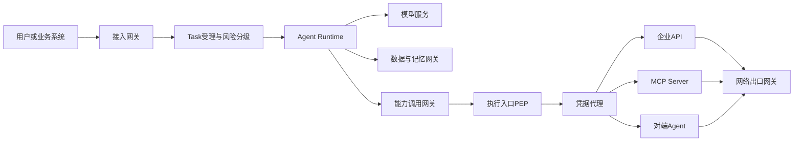

每一条箭头都是一次验证机会，而不是一次自然延伸。零信任平台把每条箭头当作独立判定点：接入处验证请求者与任务风险，装载处验证 AgentSpec 与撤销状态，调用处验证策略与委托边界，执行入口验证许可与 epoch，凭据代理验证受众与撤销，出口验证目标与内容。任何一个判定点缺失，都会形成绕过路径。

### 1.3 默认信任的代价

以下故障模式在缺乏零信任设计的平台上反复出现：

- **长期凭据 everywhere**：Agent 代码、沙箱、Checkpoint、环境变量里散落着同一把长期密钥，任一处泄露即全量泄露；
- **委托只增不减**：子 Agent 默认继承父任务全部权限，多层委托后权限远超用户本人；
- **一次授权永久有效**：授权决策被无限期缓存，权限撤销后动作照常执行；
- **批准后直接执行**：审批通过数小时后仍用旧批准执行，而目标资源与用户权限早已变化；
- **取消后动作照发**：取消意图已经持久化，但早已进入 Outbox 的旧命令仍被投递并外呼；
- **扫描即放行**：内容扫描通过就被当作可信输入，直接驱动下一轮工具调用。

这些问题的共同点不是“缺少某个安全产品”，而是缺少一条贯穿身份、委托、授权、凭据与撤销的持续判定链。这正是本篇要建立的架构。

---

## 2. 零信任原则：在 Agent 平台上的定义

### 2.1 三条原则的 Agent 化

零信任的三条经典原则在 Agent 平台上有非常具体的落点：

| 原则 | Agent 平台含义 | 可验证的落地 |
|---|---|---|
| 持续验证 | 身份与授权不是入口一次性事件，而是在装载、续租、状态提交、逐调用、执行入口与外呼前反复校验 | 每个判定点有决策日志；撤销后旧动作被拒绝并形成耐久事件 |
| 最小权限 | 每个主体只获得完成当前任务所必需的权限、凭据、数据与时间窗 | TaskIntent 授权范围、权限收敛、JIT 凭据、预算与深度限制 |
| 假设被攻破 | 任何主体、实例、凭据、内容都可能已被攻陷，架构必须支持快速收权、隔离、取证与恢复 | revocation_epoch、kill switch、实例隔离、对账与重新准入 |

### 2.2 四类不默认信任的对象

1. **主体不默认信任**：用户、Agent、Runtime 实例、工具、MCP Server、模型服务、对端 Agent，都必须持有可验证身份并逐次判定；“内部 Agent”“已注册工具”不是信任依据。
2. **请求不默认信任**：每个命令都要校验发起者身份、委托链、聚合版本与幂等键；来自内部队列的请求同样可能是旧 epoch、重复投递或已撤销的意图。
3. **内容不默认信任**：模型输出、工具返回、网页、文档、邮件、记忆条目都是数据而不是指令；内容扫描不证明可信，强制必须在授权模型之外执行。
4. **网络位置不默认信任**：内网、同集群、同 VPC 不构成信任边界；服务间通信需要身份与加密，出向默认拒绝。

### 2.3 强制点链路

零信任原则必须映射到具体强制点。Agent 平台的关键强制点包括：接入与受理、AgentSpec 装载与续租、逐调用授权、执行入口、统一末端门禁、凭据代理、网络出口。

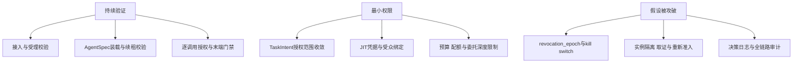

### 2.4 零信任与耐久执行的咬合

零信任在 Agent 平台上不是独立叠加的一层，而是与耐久执行机制互相咬合：

- **统一末端门禁**既是可靠性机制也是零信任强制点：外部调用先原子提交 CallRecord 与 Outbox；真正外呼前仍须校验最新 `control_intent`、revocation epoch、授权约束，并以 CAS 领取 PREPARED 记录；拒绝形成耐久事件。这意味着“取消或撤销之后，已经排队的命令也不能外呼”。
- **RunLease 与单调 epoch** 既是防双写机制也是身份强制点：当前 Worker 的新动作必须校验当前 lease；延迟命令校验 `authorized_epoch` 与 ExecutionRecord。旧身份、旧实例、旧 epoch 的动作在执行入口被拒绝。
- **AgentSpec 固定与 revocation_epoch** 既是版本机制也是供应链强制点：撤销在装载、续租、状态提交与执行入口强制校验。

因此，“部署了身份组件”不等于零信任。零信任要求这些强制点在每条路径上都不可绕过，并且在故障、接管、恢复、取消等异常路径上同样生效。同样必须强调：**不存在任何开箱即零信任的产品**；零信任是平台自身持续建设与验证的结果，产品只提供部件。

---

## 3. 主体身份体系

### 3.1 七类主体

Agent 平台上需要被识别的主体不止“用户”和“服务”两类。至少应区分七类：

| 主体 | 回答什么问题 | 典型载体 | 生命周期要点 |
|---|---|---|---|
| 用户身份 | 任务最终代表谁、权限上限是什么 | 企业 IdP 会话、OIDC 令牌、服务调用方证书 | 认证强度影响风险分级；权限变化须能传播到在途任务 |
| Agent 工作负载身份 | 这段 Agent 逻辑是谁、哪个版本、允许做什么 | 工作负载身份、AgentSpec digest 与签名 | 与 AgentSpec 版本绑定；可被 revocation_epoch 撤销 |
| Runtime 实例身份 | 当前推进 Run 的进程或实例是否合法 | 实例身份、RunLease 与 lease_epoch | 随实例创建颁发、随排空与隔离收回 |
| 工具与 MCP Server 身份 | 被调用的能力端点是谁、是否被平台核准 | 服务端身份、注册表记录、传输层凭证 | 注册不等于可信；版本与能力变更须重新核准 |
| 模型服务身份 | 推理请求发给了谁、数据流向哪里 | 服务端身份、模型路由约束 | 与数据驻留和租户策略绑定 |
| 审批人身份 | 人工批准或拒绝动作规格的是谁、委托与升级范围如何 | 企业 IdP 会话、审批工作台会话 | 与 ApprovalRecord 绑定；委托与升级策略决定其权限范围 |
| 对端 Agent 身份 | 跨平台协作的对方 Agent 是谁、能力与可信度如何 | A2A Agent Card 加服务端身份 | Agent Card 描述能力，调用仍需逐请求认证授权 |

七类身份共同构成授权与审计的基础。缺少任何一类，都会出现“动作发生了，但说不清是谁干的”的局面。

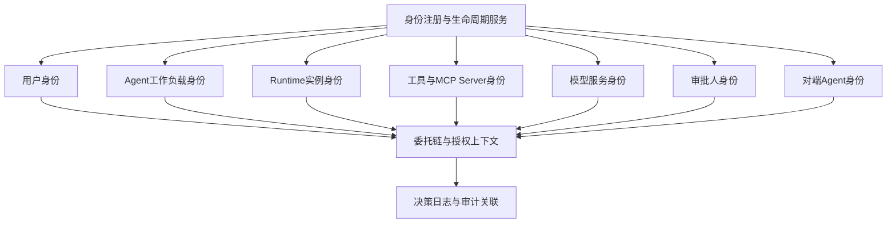

### 3.2 身份注册与生命周期

身份不是发一个 ID 就结束，而是一段持续被验证的生命周期：

1. **注册**：主体进入平台目录，携带来源证明、责任人、风险等级与允许的能力声明；Agent 注册必须绑定 AgentSpec digest 与签名。
2. **颁发**：身份凭证短时效、可轮换；工作负载身份不依赖手工分发的长期静态密钥。
3. **绑定**：身份必须与运行上下文绑定——Agent 身份绑定 AgentSpec 版本，实例身份绑定 RunLease，执行身份绑定 ExecutionRecord 与 ReleaseGrant。
4. **轮换**：凭据与证书定期轮换，轮换不中断在途任务，但旧材料按策略尽快失效。
5. **撤销**：撤销事件携带 revocation epoch 或撤销令，传播到所有强制点；被撤销身份不能通过缓存或长 TTL 凭据续命。
6. **审计**：身份的每次颁发、使用、轮换与撤销都进入决策日志，可按 tenant、task、run 回溯。

对工作负载身份的实现，可以基于 SPIFFE 这类工作负载身份框架，也可以基于云厂商的非人类身份托管能力；两者都是**可选实现**。平台层面的要求与具体实现无关：身份必须可验证、可绑定运行上下文、可撤销、可审计，且不依赖散落的长期静态密钥。

### 3.3 协议侧身份：MCP 与 A2A 的事实边界

两类协议常被误解为“接上就有身份和授权”，需要按事实表述：

- **MCP**：授权是 MCP 的可选能力而非强制前提。当 MCP 走 HTTP 传输并启用授权时，遵循 OAuth 2.1 的架构：资源服务器与授权服务器分离；客户端通过 Protected Resource Metadata 发现授权配置；授权请求与令牌请求携带 resource 参数以绑定目标资源；资源服务器校验令牌受众；Bearer 令牌仅通过 Authorization 头传递；MCP Server 不得把客户端令牌透传到上游服务。stdio 传输则采用不同的凭据边界——它依赖宿主进程对子进程的本地信任与宿主侧凭据管理，不存在 HTTP 意义上的令牌流，因此平台必须为 stdio MCP 单独定义凭据注入与隔离策略。
- **A2A**：A2A v1.0 于 2026 年春发布并进入 Linux Foundation，获得 150 多家组织支持。需要明确：Agent Card 描述的是端点能力与元数据，不是访问凭证；发现 Agent Card 不等于获得调用资格，**每一次调用仍需逐请求认证与授权**。对端 Agent 的身份可信度、能力范围与数据策略，必须由平台自身的注册、核准与逐调用授权决定。

一句话概括协议侧身份：**协议解决互操作与身份表达，平台解决信任判定与授权强制。**

---

## 4. 委托链：权限流动的唯一合法路径

### 4.1 委托链全景

Agent 平台上的权限不允许“凭空出现”，只能沿委托链逐级流动：

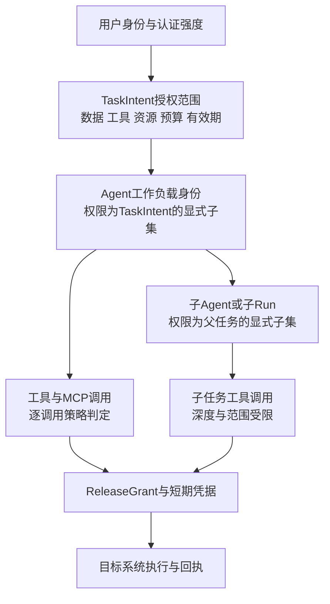

链上每一段都有不同的语义：

| 委托环节 | 权限来源 | 收敛规则 | 证据对象 |
|---|---|---|---|
| 用户 → TaskIntent | 用户自身权限与认证强度 | 授权范围显式声明：数据、工具、资源、预算、有效期 | TaskIntent 与受理记录 |
| TaskIntent → Agent | TaskIntent 授权范围 | Agent 可用权限是 TaskIntent 的显式子集，叠加 AgentSpec 能力声明 | Run 授权上下文 |
| Agent → 子 Agent | 父任务授权范围 | 子任务权限必须是父任务的显式子集，且深度预算递减 | 子 Run 授权记录 |
| Agent 或子 Agent → 工具 | 逐调用策略判定 | 每次 CallIntent 独立判定，叠加预算与风险约束 | AuthzDecision 与决策日志 |
| 工具调用 → 执行 | ReleaseGrant | 许可绑定动作摘要，nonce 原子核销 | ReleaseGrant 与 ExecutionRecord |

### 4.2 权限收敛：子任务必须是父任务的显式子集

委托最容易出错的地方是“默认继承”。正确的规则是：**子任务的权限必须是父任务授权范围的显式子集**，不存在隐式继承。显式子集意味着：

- **动作白名单取交集**：子任务可执行的动作集合由父范围与子声明求交得到，未显式授予即拒绝；
- **资源范围取交集**：子任务可访问的资源前缀、租户与数据集不得超出父范围；
- **数据等级取上限**：子任务可接触的数据敏感度不得高于父任务允许等级；
- **预算取上限**：费用、调用次数、并发与时长受父预算与子配额双重约束；
- **有效期取最短**：父范围、子范围与凭据时效叠加后取最严格者。

子集关系在两个时点校验：创建子 Run 时校验一次范围包含关系；子 Run 内每次调用仍按逐调用授权独立判定。创建时通过不代表执行时通过——父任务权限可能在子任务运行期间被撤销。

### 4.3 委托深度限制

多层委托会带来两个风险：权限语义在层层转述中失真，以及攻击者通过拉长链条寻找最弱的一环。平台应设置委托深度预算：

- 每个 Task 声明最大委托深度，默认保守；
- 每创建一层子 Run，深度预算递减并记录在授权上下文中；
- 深度耗尽后，子任务只能直接执行被授权动作，不能再委托；
- 同一层的并行子任务数量受配额约束，防止“广度爆炸”；
- 任何试图通过委托扩大权限的请求必须被拒绝并形成审计事件——委托只能收敛，不能放大。

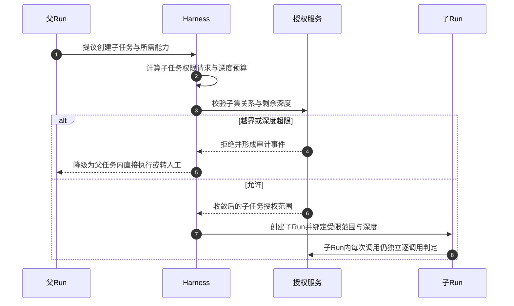

### 4.4 代表执行与令牌透传的边界

委托链上还有一个经常被混淆的问题：用户的令牌要不要交给 Agent？答案是否定的。平台应遵循两条边界：

1. **沙箱外代理持凭据代为执行优先**：高风险或需要业务凭据的动作，优先由沙箱外的受控代理持有凭据、代表任务执行，Agent 与执行环境不接触凭据本体。
2. **不得透传客户端令牌到上游**：用户或客户端的令牌不能被 Agent 原样携带去调用 MCP Server、对端 Agent 或下游 API；需要代表用户访问时，由平台凭据代理按受众与范围兑换新的短期凭据。这与 MCP HTTP 授权中“MCP Server 不得向上传递客户端令牌”的要求一致。

用户令牌一旦进入 Agent 上下文、日志或 Checkpoint，委托链就失控了：模型可能把它写进输出，工具可能把它带回外部系统，恢复流程可能把它重新装载。因此用户凭据应停留在接入与兑换环节，委托链内部流动的只能是平台签发的、受众绑定的短期材料或凭据引用。

---

## 5. 逐调用授权：PDP/PEP 与策略即代码

### 5.1 PDP 与 PEP 分离

零信任的授权判定必须把“判定点”与“执行点”分开：

- **PDP**：策略决策点。输入主体、动作、资源、委托上下文与环境属性，输出允许、拒绝或需人工审批的决策及约束。PDP 不接触业务执行。
- **PEP**：策略执行点。在真实路径上拦截请求，把判定材料交给 PDP，并按决策放行或拒绝。PEP 不做策略解释。

Agent 平台上的 PEP 至少分布在五个位置：接入与任务受理、能力调用网关、数据与记忆网关、执行入口、统一末端门禁。其中执行入口与末端门禁是最后防线：即使前序环节全部失守，外呼前仍要校验最新 `control_intent`、revocation epoch、授权约束，并以 CAS 领取 PREPARED 记录。

### 5.2 策略即代码

授权策略必须以代码化、版本化的形式管理，而不是散落在各服务的 if-else 中。策略输入至少包括：

| 策略要素 | 示例 |
|---|---|
| 主体属性 | 用户角色、Agent 工作负载身份、AgentSpec digest、实例身份、认证强度 |
| 动作属性 | 工具全限定名与版本、动作类型、可逆性、风险等级 |
| 资源属性 | 目标系统、资源版本、数据等级、租户 |
| 委托上下文 | TaskIntent 授权范围、委托深度、父任务约束 |
| 环境属性 | revocation_epoch、lease_epoch、预算余量、时间窗、来源风险 |
| 行为属性 | 近期拒绝率、异常工具序列、与行为基线的偏离 |

策略版本变更要走与代码发布相同的流程：回归测试、审批、灰度、可回滚。评测与监测系统可以生成候选策略，但不能直接扩大生产权限。

### 5.3 决策缓存的边界

逐调用判定有延迟成本，缓存是必要的优化，但必须有明确边界：

| 判定类型 | 可否缓存 | 执行时仍须验证 |
|---|---|---|
| 低风险只读、高频重复 | 可有界缓存 | 撤销状态、资源条件、委托范围仍有效 |
| 写操作、不可逆动作 | 不得缓存 | 每次重新判定并走许可与凭据流程 |
| 高风险、跨租户、敏感数据 | 不得缓存 | 每次重新判定，必要时人工审批 |
| 策略或 revocation epoch 变化后 | 缓存整体失效 | 按新策略重新判定 |

关键规则：**缓存的只是低风险的初步判定，不是执行许可。** 即使决策命中缓存，执行入口仍要验证撤销与资源条件；真正外呼前，末端门禁仍要校验最新控制意图与授权约束。缓存永远不能成为绕过撤销的通道。

### 5.4 决策日志

每次授权判定，无论允许还是拒绝，都应形成决策日志，至少包含：决策 ID、时点、策略版本、主体与委托上下文摘要、动作与资源摘要、决策结果与约束、缓存命中情况、关联的 task/run/execution。拒绝事件尤其重要——拒绝率的突变往往是被攻击或策略错误的最早信号。

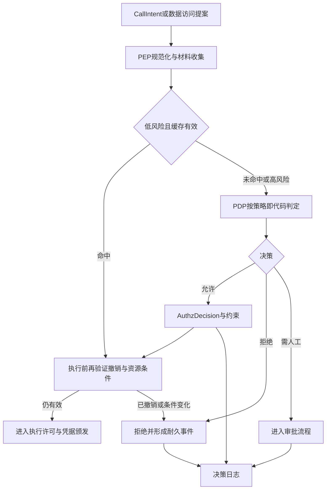

---

## 6. 授权对象链：五个对象，五种语义

### 6.1 为什么不能混成一个“已授权 Token”

授权链上存在五个经常被混用的对象。它们的签发者、语义与生命周期完全不同：

| 对象 | 语义 | 签发者 | 生命周期 | 不代表什么 |
|---|---|---|---|---|
| AuthzDecision | 某时点策略对某动作的判定与约束 | PDP | 短时有效，可被撤销推翻 | 不代表动作已被批准或已被执行 |
| ApprovalRecord | 人对规范化动作摘要与资源条件的批准或拒绝 | 审批人 | 绑定 digest 与条件，条件变化即失效 | 不代表执行许可，不是凭据 |
| ReleaseGrant | 平台签发的一次执行许可 | 平台许可服务 | 一次性，nonce 原子核销 | 不代表外部动作已发生或恰好一次 |
| 下游短期凭据 | 目标系统认可的授权材料 | 凭据代理或下游授权方 | 短时效、受众绑定 | 不代表平台侧许可仍然有效 |
| ExecutionReceipt | 执行器报告的执行状态、句柄、产物与用量 | 执行后端 | 事实记录，不可变 | 不代表外部业务效果的独立证明 |

把它们混成一个“已授权 Token”的后果是：审批被复用给不同参数的动作、许可被重放、凭据在许可失效后仍可使用、回执被当作授权证据。授权对象链的设计目标就是让每个环节只承担一种语义。

### 6.2 全链路时序

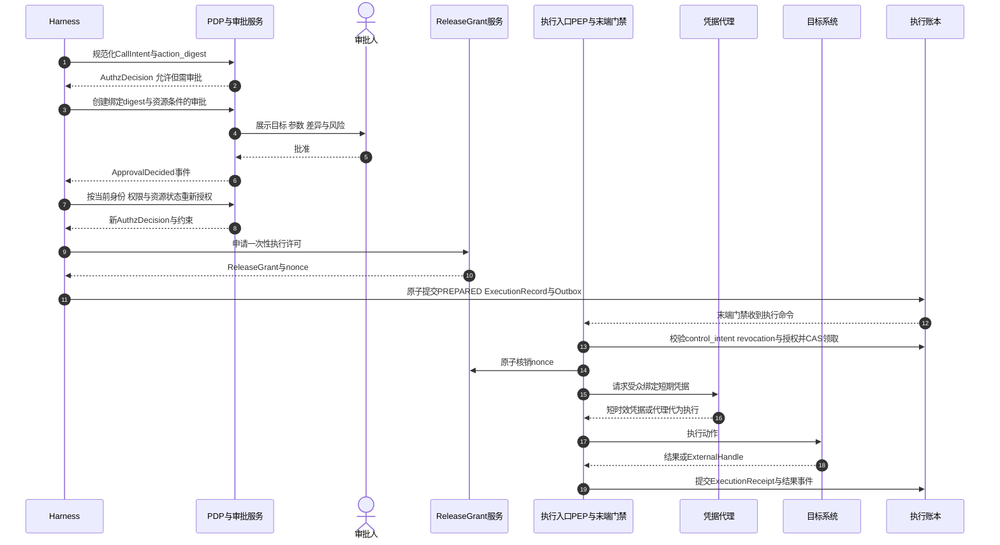

这条链路与耐久执行约定完全咬合：ExecutionRecord 与 Outbox 先原子提交，外呼前末端门禁再校验最新控制意图、revocation epoch 与授权约束并 CAS 领取 PREPARED 记录；任何拒绝都形成耐久事件，而不是静默丢弃。

### 6.3 ReleaseGrant 的能力边界

ReleaseGrant 是平台的一次执行许可，必须清醒认识它的能力边界：

- **nonce 原子核销只限制许可重放**：同一许可不能被消费两次，这解决了平台侧的重复执行入口问题；
- **它不消除 TOCTOU**：许可核销与远端动作生效之间存在时间窗，期间目标资源可能被他人修改。TOCTOU 需要结合目标服务的资源版本与条件更新来收敛——执行时携带审批所绑定的资源版本，目标服务以条件更新拒绝版本失配；
- **它不消除远端不确定性**：响应丢失、执行器故障仍会产生 UNKNOWN，需要对账而不是盲重试；
- **它不是下游凭据**：目标系统认的是 OAuth 令牌或 API 凭据，不是平台许可；两者分别签发、分别撤销。

### 6.4 审批通过后仍需重新授权

审批绑定的是规范化动作摘要与资源条件。审批通过不等于可以直接执行：等待期间用户权限可能收回、目标资源可能被修改、策略版本可能升级。因此审批通过后，执行前必须按当前身份、权限与资源状态重新授权；参数或资源条件变化导致 digest 失配时，旧批准不再适用，需要重新审批。ApprovalRecord 不是长期凭据，也不能被另一个参数不同的动作复用。

---

## 7. 凭据治理：从长期密钥到 JIT 短期材料

### 7.1 平台许可与下游凭据是两层

凭据治理的第一步是区分两层授权材料：

| 层次 | 对象 | 谁认可 | 管理方 |
|---|---|---|---|
| 平台许可层 | AuthzDecision、ApprovalRecord、ReleaseGrant | 平台策略与审计 | 平台授权与许可服务 |
| 下游凭据层 | OAuth 令牌、API 密钥、签名请求 | 目标系统 | 凭据代理兑换或下游授权方颁发 |

平台许可回答“平台允许这次动作吗”，下游凭据回答“目标系统接受这个调用者吗”。两层都必须成立，动作才能发生；两层各自独立撤销。只有一层成立的系统要么越权，要么被下游拒绝。

### 7.2 凭据代理与 JIT 颁发

Agent、Runtime 与执行环境默认不持有长期凭据。需要凭据时，由凭据代理按需颁发：

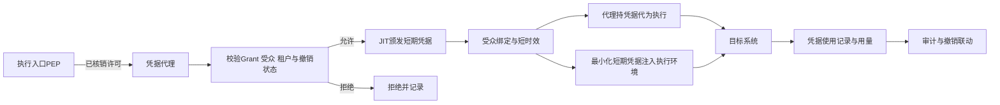

JIT 颁发的要点：

- **按需**：凭据只在动作真正要执行时颁发，不提前批量下发；
- **受众绑定**：凭据明确绑定目标服务受众，换一个受众即无效；
- **短时效**：生命周期覆盖单次动作与必要的重试窗口即可；
- **范围最小**：scope 与当前 ExecutionSpec 匹配，不颁发“全能令牌”；
- **可联动撤销**：凭据使用记录与 Grant、execution、租户关联，撤销事件可触发停止颁发与通知下游。

**与云凭据体系对接的工程参数。** 凭据代理对接主流云 STS 时必须显式建模三个参数，取默认值几乎必然出错：

| 参数 | 典型事实 | 工程纪律 |
|---|---|---|
| 有效期上限 | 腾讯云 STS 角色临时凭据默认 1800 秒、最长 7200 秒；阿里云 STS 与 RRSA 签发的实例级凭据同为小时级上限 | 系列长任务可跨小时到天。**凭据有效期必须短于单次 ExecutionAttempt**，续期在 Attempt 粒度由凭据代理重新颁发；续期失败按执行异常进入对账，不能让凭据过期表现为 UNKNOWN 被误诊为执行故障 |
| 权限收缩 | 阿里云支持 policy 会话策略把凭据权限收缩为角色权限子集（可按实例上下文模板化）；CAM 策略为静态 JSON | 云侧策略只做粗粒度资源边界；ReleaseGrant 的"一次性执行许可 + action_digest 绑定"语义必须由平台自建许可账本承载，形成"云授权在外、平台许可在内"的双层授权 |
| 身份来源 | RRSA/AssumeRoleWithOIDC（K8s 工作负载）、基于资源的服务角色（CVM/TKE/SCF 实例） | 工作负载身份与第 3 节"Runtime 实例身份"一一绑定，实例重建必须重新获取身份，不允许随镜像或快照携带 |

2026 年这类组件已有产品化实现可参照（如阿里云 ack-agent-identity 的 CredentialProvider + AgentRole/AgentRoleBinding），采用时仍按本节清单逐项核验其受众绑定与撤销联动语义。

### 7.3 执行环境中的凭据边界

执行环境是凭据暴露的高风险区。平台应遵循三条规则：

1. **沙箱外代理持凭据代为执行优先**：高风险调用优先由沙箱外的受控代理持有凭据并完成调用，沙箱内只得到结果，不接触凭据。
2. **短期令牌注入的准确表述**：当工具确实需要在执行环境内使用令牌时，应表述为“无长期密钥、最小化短期凭据暴露”——不声称零凭据，而是把凭据的时效、范围与可见性压到最小。
3. **Checkpoint 只存凭据引用不存明文**：逻辑 Checkpoint 保存的是重新兑换凭据所需的上下文与引用，不保存可长期复用的明文密钥。恢复时凭据重新颁发、重新绑定受众；已过期或已撤销的凭据不应随快照复活。

### 7.4 凭据类型与治理要求

| 凭据类型 | 用途 | 时效取向 | 受众与范围 | 撤销方式 |
|---|---|---|---|---|
| 平台 JIT 令牌 | 平台内部服务间调用 | 短时效，按调用兑换 | 绑定目标服务与租户 | 停止颁发，短 TTL 自然收敛 |
| 下游 OAuth 令牌 | 代表任务访问企业 API | 短时效，可刷新但刷新受撤销约束 | 受众绑定目标资源服务器 | 凭据代理停止刷新并通知撤销 |
| 下游 API 密钥 | 不支持 OAuth 的遗留系统 | 尽量短周期轮换 | 按系统限定用途 | 轮换计划加紧急吊销 |
| MCP 授权令牌 | HTTP MCP 的资源访问 | 遵循 OAuth 2.1 短时效实践 | resource 参数绑定 MCP 资源服务器 | 授权服务器吊销加资源服务器受众校验 |
| stdio MCP 凭据 | 宿主侧管理的本地凭据 | 由宿主策略决定，避免长期静态密钥 | 以宿主进程边界为凭据边界 | 宿主侧回收与进程隔离 |

关于 MCP 的事实需要再次明确：授权是 MCP 的可选能力。启用 HTTP 授权时遵循 OAuth 2.1——资源服务器与授权服务器分离、通过 Protected Resource Metadata 发现、授权与令牌请求携带 resource 参数、服务端校验受众、Bearer 令牌仅走 Authorization 头、不得把客户端令牌透传到上游。stdio 传输不走令牌流，采用宿主侧的凭据边界，平台必须为其单独定义注入、隔离与回收策略。

---

## 8. 网络零信任：位置不是信任，身份才是

### 8.1 内部微隔离与服务间身份

平台内部服务之间的通信同样不默认信任：

- 服务间通信采用 mTLS 或等效机制，双向验证工作负载身份，而不是仅依赖网段或集群成员资格；
- Runtime Worker、执行后端、状态服务、凭据代理之间按最小必要开放路径，形成微隔离；
- 实例身份与 RunLease 关联：一个实例只能以当前合法 lease 推进对应 Run，网络可达不等于操作合法。

### 8.2 出向默认拒绝与 Egress Proxy

Agent 平台的出向流量是数据外泄与命令控制的高风险通道。默认策略应是拒绝，放行必须显式：

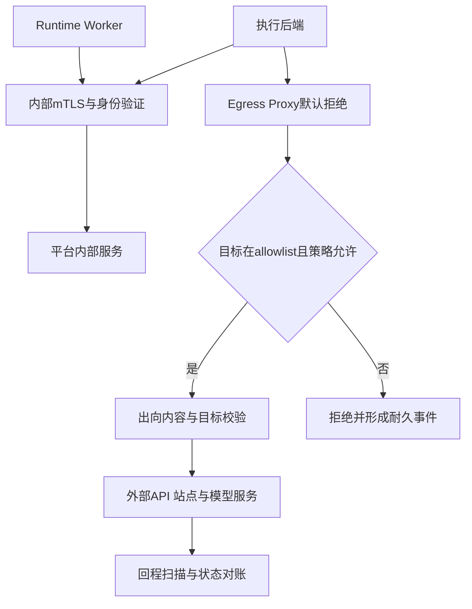

出向治理的要点：

- **allowlist 按租户与风险分级**：不同租户、不同风险等级的任务可访问的外部目标不同；
- **出口与授权联动**：执行入口拒绝的动作不应有对应的出向流量；撤销事件可触发目标域即时收紧；
- **重定向后重验**：经重定向到达的新目标重新走策略判定，防止跳转绕过（沙箱内部的出向细节见第 8 篇，本篇只定义平台级边界）；
- **元数据与内网敏感端点阻断**：云元数据端点、内部管控接口默认不可达；
- **回程同样治理**：外部返回内容经扫描与来源标记后才进入上下文，且扫描不证明可信。

### 8.3 网络验证是持续的

网络策略不是一次性配置：出向 allowlist 变更要走策略发布流程；异常出向模式进入行为监测；撤销与隔离事件联动网络收紧。网络层的目标不是“挡住外部”，而是让每一条连接都能回答“哪个身份、依据哪条策略、去往哪个目标”。

---

## 9. 数据零信任：按目的、租户与等级重新授权

### 9.1 数据访问不继承历史授权

Agent 对数据的访问必须逐次回答三个问题：为了什么目的、在哪个租户范围、数据处于什么等级。即使同一 Run 内，读取不同数据集也应独立判定；跨 Run、跨恢复的数据引用在读取时重新授权，避免旧授权随 Checkpoint 无限延续。大对象只保存摘要与受控引用，下载或发布时重新检查访问权限。

### 9.2 检索与记忆的访问控制

检索与记忆是 Agent 数据访问中最容易失控的两类：

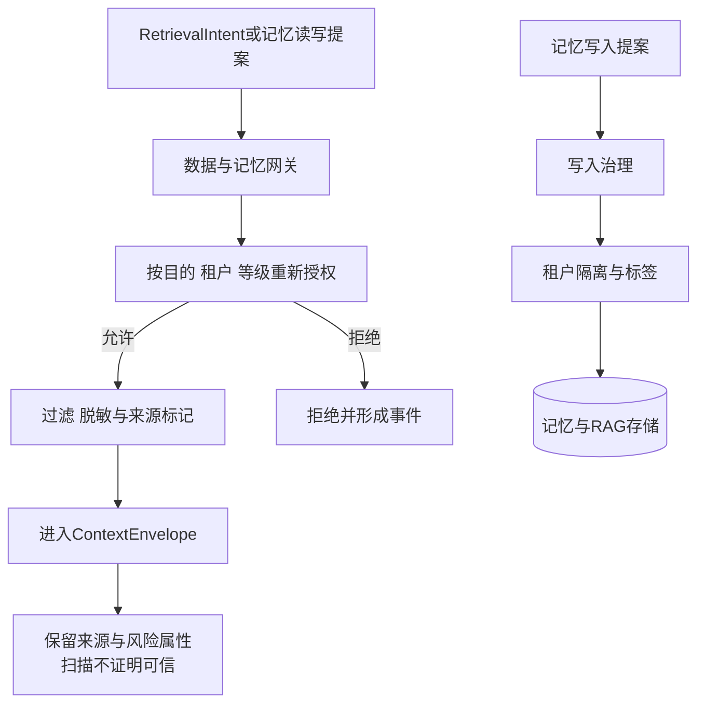

- **检索**：检索请求携带任务授权上下文，网关按租户与数据等级过滤；返回结果保留来源、密级与风险属性；检索命中不代表内容可信。
- **记忆写入**：Agent 自身输出不能未经治理自动升级为可信记忆；写入需通过来源标记、租户隔离与写入治理；被污染记忆可被隔离与回滚。
- **记忆读取**：跨会话读取记忆同样按当前任务的租户与目的重新授权；一个任务的记忆不应泄漏给另一个租户或另一个目的的上下文。

### 9.3 内容扫描的位置：在授权模型之外强制

内容扫描（注入检测、敏感信息检测、恶意指令检测）是重要的纵深手段，但必须摆正位置：**扫描不证明可信，授权强制在扫描之外独立成立。** 即使扫描全部通过，数据访问仍受目的、租户与等级约束，动作仍受逐调用授权与许可约束；反过来，即使扫描服务不可用，也不应以“跳过检测保可用”的方式释放敏感内容。Observation 进入上下文后仍保留来源与风险属性，供后续判定与审计使用。

---

## 10. 撤销与应急：信任必须可以被收回

### 10.1 撤销对象与触发源

零信任体系中可被撤销的对象不止凭据一种：

| 撤销对象 | 典型触发 | 传播路径 | 强制点 | 残余风险 |
|---|---|---|---|---|
| AgentSpec 有效性 | 供应链告警、版本被攻陷 | 控制面递增 revocation_epoch | 装载、续租、状态提交、执行入口 | 已外发动作需对账 |
| 用户授权范围 | 用户撤权、离职、权限变更 | 授权服务更新范围并通知在途任务 | 逐调用判定、恢复校验、末端门禁 | 已生效外部效果不可收回 |
| ReleaseGrant | 许可误发、任务取消 | 许可服务标记失效 | 核销时校验 | 已核销许可对应的在途动作需对账 |
| 短期凭据 | 泄露告警、租户隔离 | 凭据代理停止颁发并通知下游 | 颁发、刷新、下游受众校验 | 短 TTL 内的窗口期 |
| Runtime 实例资格 | 完整性异常、逃逸告警 | 实例隔离、lease 拒绝续租 | 续租、状态提交 | 实例上未决动作需接管对账 |
| 工具与 MCP 核准 | 能力端点被攻陷 | 注册表下线加策略拒绝 | 逐调用判定、出口 allowlist | 已发生调用需审计 |

### 10.2 revocation_epoch 与四个强制校验点

AgentSpec 固定与 revocation_epoch 是撤销机制的核心：每个 AgentSpec 携带可递增的撤销纪元，控制面撤销时递增 epoch 并发布撤销令。Runtime 在四个点强制校验适用的 revocation epoch：

1. **装载**：新 Run 装载 AgentSpec 前校验，被撤销版本拒绝装载；
2. **续租**：Worker 续租 RunLease 时校验，被撤销的 Run 不再续租；
3. **状态提交**：关键状态提交时校验，撤销后的推进被拒绝；
4. **执行入口与末端门禁**：外呼前校验，已进入 Outbox 的命令在此被拦截。

四个点缺一不可：只查装载，长任务会带着被撤销版本继续跑；只查执行入口，状态会被继续污染。撤销是安全控制，版本迁移是业务状态变换，两者不能简单等同——被撤销的 Run 默认暂停或进入失败收尾，只在存在显式迁移计划时才切换版本。

### 10.3 Kill switch 的完整语义

kill switch 常被实现成“停止调度”，这远远不够。完整的 kill switch 应同时完成：

- 阻止受影响 Agent 或租户的新 Run 与新 Step；
- 停止续租并拒绝旧 epoch 的状态提交；
- 末端门禁拒绝在途命令外呼，形成耐久的 CallRejected 或 Cancelled 事件；
- 凭据代理停止颁发并触发已发短期材料的撤销或失效；
- 网络出口按目标域收紧；
- 对在途外部动作进入对账与人工裁决，而不是假装没有发生。

### 10.4 撤销传播路径

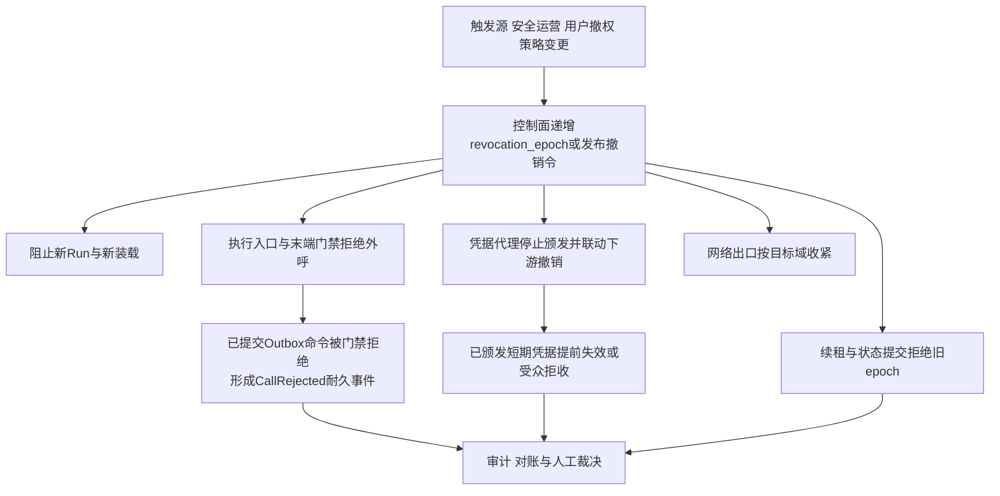

这里必须强调与取消语义的一致性：**取消是持久意图**。`control_intent=CANCEL` 一旦持久化，不能被迟到回调或普通恢复清除；取消之后，早已原子提交进入 Outbox 的旧命令仍会被投递，但统一末端门禁必须依据最新控制意图拒绝外呼，并提交耐久的拒绝事件。撤销与取消走同一条末端门禁通道——这正是“耐久调用原则”在安全侧的价值：排队不等于豁免，投递不等于可执行。

### 10.5 撤销不能回滚外部世界

撤销能收回的是“继续动作的资格”，不能收回“已经发生的动作”。外部系统可能已经执行、正在执行或不支持取消。因此撤销与应急流程必须包含：已外发动作的对账、UNKNOWN 状态的查询与人工裁决、迟到副作用的记录、费用与证据的处置。把 kill switch 当作回滚开关，是应急设计中最危险的错觉。

---

## 11. 零信任与 OWASP ASI 映射速览

第 10 篇已对 OWASP Agentic Top 10 2026 逐项展开架构化解读，本篇不重复逐项分析，只给出零信任机制与 ASI 风险类的映射速览：

| OWASP 风险类 | 本篇对应的零信任机制 |
|---|---|
| ASI01 目标劫持 | 内容不默认信任、Observation 保留来源与风险属性、授权模型外强制 |
| ASI02 工具误用 | 逐调用授权、动作与参数约束、许可一次性核销 |
| ASI03 身份与权限滥用 | 七类主体身份、权限收敛、短期凭据、执行时重验证 |
| ASI04 供应链 | AgentSpec 固定与签名、revocation_epoch、紧急停用 |
| ASI05 意外代码执行 | 执行入口 PEP、末端门禁、出向默认拒绝 |
| ASI06 记忆与上下文污染 | 数据零信任、记忆写入治理、租户隔离与重新授权 |
| ASI07 不安全的 Agent 间通信 | 对端 Agent 身份、逐请求认证授权、不透传令牌 |
| ASI08 级联失效 | 委托深度限制、预算约束、撤销传播限流 |
| ASI09 人机信任滥用 | 审批绑定动作摘要与资源条件、执行时重新授权 |
| ASI10 失控 Agent | kill switch、实例隔离、撤权、取证与重新准入 |

该映射说明：零信任不是针对某一类风险的单点方案，而是多数 ASI 风险共同依赖的底座。风险清单与应对细节以第 10 篇为准。

---

## 12. 审计：决策、核销与凭据使用的全链路可追溯

### 12.1 审计事件类别

零信任体系的审计不止“谁登录过”，而是覆盖判定与执行的全链路：

| 审计类别 | 关键内容 |
|---|---|
| 授权决策 | 决策 ID、策略版本、主体与委托上下文摘要、动作与资源摘要、结果与约束、缓存命中 |
| 审批 | 审批人、动作 digest、资源条件、决定、有效期、后续重授权结果 |
| 许可 | ReleaseGrant 颁发、nonce 核销、失效与撤销 |
| 凭据 | 颁发、受众、时效、使用记录、撤销与轮换 |
| 执行 | ExecutionRecord、CAS 领取、Receipt、UNKNOWN 与对账 |
| 撤销与拒绝 | revocation_epoch 变更、fencing 拒绝、末端门禁拒绝、CallRejected 事件 |
| 身份生命周期 | 注册、颁发、绑定、轮换、撤销 |

### 12.2 关联键

审计记录的价值在于可关联。每条记录至少应能按以下键回溯：tenant、task、run、step、attempt、invocation、instance、lease epoch、agent spec digest、execution、approval、grant、policy 版本与 trace。这样给定任何一个异常动作，都能回答“谁授权、谁审批、哪份许可、哪份凭据、哪个实例、哪个 epoch”。

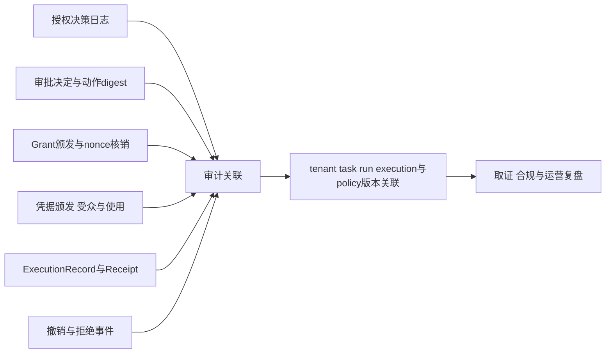

### 12.3 耐久性与隐私

审计的耐久性不能依赖普通遥测管道：遥测系统故障时，非关键样本可以有界缓冲或丢弃，但授权决策、许可核销、凭据使用与撤销拒绝这类关键审计事实必须可靠提交。同时，审计不等于无条件记录原文——敏感 Prompt、个人数据与高敏内容按数据策略脱敏或引用化，审计保留证据链而不是原始明文。

---

## 13. 常见反模式

### 13.1 内网即信任

把集群内网当作信任边界，服务间不验证身份。结果是任一组件被攻陷即可横向移动。内部通信必须验证工作负载身份，网络位置永远不是授权输入的决定因素。

### 13.2 一把长期密钥走天下

Agent、沙箱、作业共用同一把长期凭据。任一处泄露即全量泄露，且无法按租户与动作撤销。应改为 JIT 短期、受众绑定、按任务隔离。

### 13.3 子任务默认继承全部权限

子 Agent 自动获得父任务全量权限，多层委托后权限远超用户本人。委托必须显式子集、深度受限、逐调用独立判定。

### 13.4 把五个授权对象混成一个 Token

用“一个已授权 Token”同时承载决策、审批、许可与凭据语义。审批被复用、许可被重放、凭据在许可失效后仍可用。五个对象必须分开签发、分开撤销。

### 13.5 授权决策永久缓存

决策缓存不设失效条件，撤销后动作照常执行。缓存必须有界、与 revocation epoch 联动，且执行时仍验证撤销与资源条件。

### 13.6 用户令牌透传到上游

把客户端令牌原样交给 Agent 去调用 MCP 或下游 API。令牌进入上下文与日志后即失控。应由凭据代理兑换受众绑定的新材料，且不透传到上游。

### 13.7 扫描通过即放行

把内容扫描当作可信证明，扫描通过就直接驱动动作。扫描只能降低风险，授权强制必须在扫描之外独立成立。

### 13.8 撤销只改策略不查执行入口

策略更新了，但执行入口与末端门禁不校验最新撤销状态，排队中的旧命令照常外呼。撤销必须在装载、续租、状态提交与执行入口全部强制。

### 13.9 kill switch 只停调度

停止新任务调度，但不撤销凭据、不收紧出口、不对账在途动作。被攻陷的在途 Run 继续持有有效凭据。kill switch 必须是收权组合动作。

### 13.10 Checkpoint 里存明文凭据

恢复一次任务就复活一批本应失效的密钥。Checkpoint 只存凭据引用，恢复时重新兑换、重新绑定受众。

### 13.11 声称产品开箱即零信任

把采购某个网关或身份产品等同于建成零信任。零信任是平台级持续判定与证据体系，产品只提供部件，强制点完整性必须由平台自身验证。

---

## 14. 生产验证场景表

零信任架构是否成立，要用故障与对抗场景验证，而不是用架构图验证：

| 验证场景 | 预期结果 |
|---|---|
| 用户权限在审批等待期间被撤销 | 审批通过后重新授权失败，动作拒绝并形成事件 |
| 审批通过后目标资源版本变化 | digest 或资源条件失配，旧批准失效，需重新审批或条件更新 |
| 同一 ReleaseGrant 被二次消费 | nonce 原子核销拒绝重放，形成审计事件 |
| 许可核销后目标资源被他人修改 | 条件更新失败，进入 TOCTOU 处置与对账，不盲重试 |
| 取消后旧 Outbox 命令被投递 | 末端门禁按最新 control_intent 拒绝外呼，形成 CallRejected 耐久事件 |
| AgentSpec 被紧急撤销 | 新 Run 被阻止，在途 Run 续租与状态提交被拒，执行入口拦截外呼 |
| 旧 epoch Worker 接管后尝试提交 | 状态服务与执行入口拒绝旧 epoch，fencing 拒绝计数可见 |
| 子任务请求超出父任务范围 | 子集校验拒绝，形成审计事件，不创建越权子 Run |
| 委托深度超过预算 | 拒绝继续委托，允许直接执行或转人工 |
| 客户端令牌出现在 Agent 出向请求中 | 被出口策略拦截，告警并追溯来源 |
| 短期凭据在撤销事件后仍被使用 | 受众或下游校验拒绝，凭据使用记录可追溯到 grant 与 execution |
| 凭据代理不可用 | 高风险动作阻断，不以跳过凭据校验保可用 |
| 内容扫描服务不可用 | 不释放敏感内容，不通过跳过检测保可用 |
| 检索请求跨租户 | 数据网关按租户拒绝，形成事件 |
| 记忆写入试图跨租户或越级 | 写入治理拒绝并隔离可疑条目 |
| kill switch 触发后仍有出向流量 | 出口与授权联动缺陷被检出，修复前视为验证失败 |
| 被隔离实例尝试重新进入热池 | 重新准入流程拒绝，需显式修复与审批 |
| Checkpoint 恢复后尝试使用旧凭据引用 | 凭据重新兑换时按当前撤销状态判定，已撤销则拒绝 |

验证应同时检查决策日志、epoch、许可核销记录、凭据使用记录与拒绝事件序列，而不是只看动作最终是否发生。

---

## 15. 架构评审清单

### 身份与委托

- 七类主体是否都有可验证身份与生命周期管理？
- 工作负载身份是否可绑定 AgentSpec 版本并独立撤销？
- 子任务权限是否为父任务的显式子集，是否存在隐式继承？
- 委托深度与广度是否有预算并在创建与执行两个时点校验？
- 用户令牌是否被透传到上游或进入上下文与 Checkpoint？

### 授权判定

- PDP 与 PEP 是否分离，强制点是否覆盖受理、调用、数据、执行入口与末端门禁？
- 策略是否代码化、版本化，变更是否走回归与审批？
- 决策缓存是否有界并与 revocation epoch 联动？
- 高风险与不可逆动作是否禁止缓存并逐次判定？
- 允许与拒绝是否都形成决策日志？

### 授权对象链

- AuthzDecision、ApprovalRecord、ReleaseGrant、下游凭据、ExecutionReceipt 是否分开建模？
- 审批是否绑定规范化动作摘要与资源条件？
- 审批通过后执行前是否重新授权？
- ReleaseGrant 是否一次性核销，且明确其不消除 TOCTOU 与远端不确定性？
- TOCTOU 是否结合目标服务资源版本与条件更新？

### 凭据

- 是否默认无长期密钥，凭据由代理 JIT 颁发？
- 凭据是否受众绑定、短时效、范围最小？
- 高风险调用是否优先沙箱外代理持凭据代为执行？
- 需要注入时是否做到最小化短期凭据暴露？
- Checkpoint 是否只存凭据引用不存明文？
- MCP HTTP 授权是否遵循 OAuth 2.1 要求，stdio 是否有独立凭据边界策略？

### 网络与数据

- 服务间通信是否验证身份，出向是否默认拒绝？
- 出向 allowlist 是否按租户与风险分级，并与撤销联动？
- 数据访问是否按目的、租户、等级重新授权？
- 检索与记忆是否保留来源与风险属性，扫描是否被误当作可信证明？

### 撤销与应急

- revocation_epoch 是否在装载、续租、状态提交、执行入口四处强制？
- kill switch 是否同时覆盖停调度、拒续租、门禁拦截、凭据撤销与出口收紧？
- 取消后旧 Outbox 投递是否被末端门禁拒绝并形成耐久事件？
- 撤销后的在途动作是否进入对账与人工裁决？

### 审计

- 决策、审批、许可核销、凭据使用、撤销拒绝是否全量可关联？
- 关键审计事实是否独立于普通遥测管道可靠提交？
- 敏感内容是否按数据策略处理而非无条件记录原文？

---

## 16. 本篇结论与后续专题

零信任在 Agent 平台上不是一个安全组件，而是一条贯穿身份、委托、授权、凭据与撤销的持续判定链。本篇的核心结论可以归纳为：

- **身份是起点**：用户、Agent、Runtime 实例、工具与 MCP Server、模型服务、审批人、对端 Agent 七类主体都必须可验证、可绑定、可撤销、可审计；协议提供身份表达，平台负责信任判定；
- **委托必须收敛**：权限只能沿用户 → TaskIntent → Agent → 子 Agent → 工具的链条流动，子任务权限是父任务的显式子集，深度受限，委托只收敛不放大；
- **授权必须逐调用**：PDP/PEP 分离，策略即代码；缓存只优化低风险判定，执行时仍验证撤销与资源条件；
- **对象不可混用**：AuthzDecision 是策略判断，ApprovalRecord 是人对固定动作规格的决定，ReleaseGrant 是平台一次执行许可，下游凭据是目标系统认可的授权材料，ExecutionReceipt 是执行报告；nonce 核销只防许可重放，TOCTOU 要靠资源版本与条件更新；
- **凭据必须短命**：无长期密钥，JIT 颁发，受众绑定，沙箱外代理持凭据代为执行优先，Checkpoint 只存引用；
- **网络与数据同样零信任**：出向默认拒绝，内部验证身份；数据按目的、租户、等级重新授权，扫描不证明可信；
- **信任必须可收回**：revocation_epoch 在装载、续租、状态提交与执行入口强制校验；kill switch 是收权组合动作；取消与撤销之后，旧 Outbox 投递仍须被末端门禁拒绝；
- **证据必须完整**：决策、核销、凭据使用与拒绝全链路可追溯，审计耐久且尊重数据策略。

同时必须重申两条纪律：不存在任何开箱即零信任的产品；零信任也不能回滚已经发生的外部动作，应急永远要和对账一起设计。

下一篇将讨论 Agent 网关、安全治理与能力选型：八个逻辑网关如何按规模物理归并与拆分，授权与出口控制失效时 fail-open 与 fail-closed 的决策矩阵，以及网关类产品的能力评估框架。

---

## 参考资料

以下均为官方资料。动态规范会持续更新，实际实现应固定所采用的版本与访问日期。

1. [NIST SP 800-207 Zero Trust Architecture](https://csrc.nist.gov/pubs/sp/800/207/final)
2. [OWASP Top 10 for Agentic Applications for 2026](https://genai.owasp.org/resource/owasp-top-10-for-agentic-applications-for-2026/)
3. [MCP Authorization Specification（2026-07-28）](https://modelcontextprotocol.io/specification/2026-07-28/basic/authorization)
4. [Model Context Protocol Specification](https://modelcontextprotocol.io/specification)
5. [A2A Protocol v1.0 Announcement（2026 年春）](https://a2a-protocol.org/latest/blog/2026-03-12/a2a-protocol-ships-v10-production-ready-standard-for-agent-to-agent-communication/)
6. [A2A Protocol Documentation](https://a2a-protocol.org/)
7. [SPIFFE: Secure Production Identity Framework](https://spiffe.io/)
8. [SPIRE: SPIFFE Runtime Environment](https://spiffe.io/spire/)
9. [OAuth 2.1 Draft（IETF）](https://datatracker.ietf.org/doc/draft-ietf-oauth-v2-1/)
10. [RFC 9728: OAuth 2.0 Protected Resource Metadata](https://www.rfc-editor.org/rfc/rfc9728)
11. [RFC 8707: Resource Indicators for OAuth 2.0](https://www.rfc-editor.org/rfc/rfc8707)
