# Agent 网关、安全治理与能力选型

> **系列**：生产级 Agent 平台架构 2026 · 第 13 篇  
> **定位**：安全治理篇  
> **版本**：闭环修订版  
> **前置阅读**：第 0 篇《从模型推理到生产运行：2026 年 Agent、Harness 与 Runtime 总体架构》 · 第 3 篇《生产级 Agent 平台总体架构：从主链到功能域》 · 第 12 篇《零信任 Agent 架构：身份、委托、授权与凭据》  
> **关键词**：逻辑网关、物理归并、fail-open、审批服务、治理闭环、能力选型、安全档位

## 摘要

在 Agent 应用前面放几个代理，不等于拥有了安全治理。生产环境中真正导致事故的，往往不是“缺少安全组件”，而是：上游的授权结论被下游无条件沿用；网关物理归并之后策略顺序与审计无法区分；敏感出口在检测服务故障时以“可用性优先”为由放行；审批沦为无差别盖章；检测告警与阻断动作之间没有任何连接。

本文以系列第 3 篇确立的八类逻辑网关为骨架，系统化讨论 Agent 平台的安全治理层。内容包括：每类网关的输入、控制点、失败模式与不应承担的职责；网关之间在主链上的顺序与依赖；五种物理归并部署单元及其适用规模；按控制点给出的 fail-open/fail-closed 默认策略矩阵；HITL 审批服务的完整机制——绑定规范化动作摘要、参数差异展示、超时默认拒绝、审批通过仍重新授权、防审批疲劳分流与审批审计；从设计期威胁建模到策略反馈的安全治理闭环；身份与委托、策略引擎、内容检测、沙箱与隔离、出口控制、审计与可观测、评测与红队七类安全能力的选择标准与常见陷阱；按自主性、权限、数据敏感度、可逆性与暴露面划分的安全档位 S0–S3；以及 kill switch 的层级设计与应急运行手册要点。

本文的核心主张是：**网关是信任边界上的策略执行点，而不是一种设备；安全治理是覆盖设计、发布、运行、检测、响应与恢复的闭环，而不是一份产品清单。** 逻辑职责必须先清晰，物理部署才可以归并或拆分；任何归并都不得形成模型、数据或工具的旁路。零信任原则体系见第 12 篇，OWASP Agentic Top 10 逐项映射见第 10 篇，威胁建模方法见第 09 篇，安全执行环境内部机制见第 08 篇；本篇只引用其结论，不再展开。

---

## 1. 问题背景：为什么“加网关”不等于安全治理

### 1.1 三类典型失败

仍沿用系列统一场景：用户要求 Agent 读取授权数据，形成分析报告，在必要审批后发布到指定业务系统。一个团队在上线前采购了具备提示词过滤、限流和模型路由能力的“AI 网关”，并认为安全治理已经就位。随后可能出现的三类事故，恰好暴露了“有组件、无治理”的缺口：

**第一类：旁路。** MCP 工具被注册后直接连通业务写接口，调用从未经过能力授权与执行账本；Sandbox 中的代码直接使用长期业务凭据访问外网。网关部署在主链上，但主链之外还有无数条小路。问题的本质是边界按产品绘制，而不是按信任边界和事实归属绘制。

**第二类：耦合。** 所有逻辑网关被塞进同一个部署单元，认证、任务准入、模型治理、能力授权、执行门禁共享同一进程、同一变更窗口和同一故障域。一次网关升级导致全部任务阻塞；一次配置错误同时影响授权与遥测。物理归并本身不是错误，错误是归并后策略顺序、权限与审计不再可区分。

**第三类：失败语义缺失。** 内容检测服务故障时，系统选择“先放行、后追责”，敏感数据随之流出；审批人连续数周批准了全部请求，审批退化为仪式；策略引擎不可用时，高风险动作因为缓存里有一个旧判定而继续执行。这些系统只定义了正常路径的强制，没有定义失败路径的语义——每个控制点在依赖故障时究竟应该 fail-open 还是 fail-closed，从未被显式声明。

### 1.2 本篇回答的问题与边界

本篇回答六个问题：

1. 八类逻辑网关各自控制什么、不控制什么，失败时如何表现？
2. 网关在主链上谁先谁后，顺序背后的依据是什么？
3. 逻辑网关如何物理归并，归并的底线在哪里？
4. 每个控制点的默认失败策略应该是什么？
5. HITL 审批如何设计成耐久、防疲劳、可审计的服务？
6. 安全能力如何选型，安全档位如何划分，应急如何处置？

边界同样明确：本篇不重复零信任原则体系（第 12 篇）、OWASP Agentic Top 10 逐项解读（第 10 篇）、威胁建模方法（第 09 篇）和安全执行环境内部实现（第 08 篇）。本篇关注的是把这些结论落到网关、审批、闭环和选型上的工程形态。

---

## 2. 八类逻辑网关逐一深化

系列第 3 篇已经确立了八类逻辑网关：接入网关、Agent 网关、模型网关、数据与记忆网关、能力调用网关、MCP/A2A 协议网关、执行网关、网络出口网关。网关是信任边界上的策略执行点（PEP），不一定是独立的网络代理——它可以是 Runtime 内部的一段强制逻辑、一个 Sidecar、一个共享服务集群，或它们的组合。本节对每一类给出四个维度的深化：输入与控制对象、核心控制点、失败模式与默认行为、不应承担的职责。

先看统一视图：

| 逻辑网关 | 控制对象即输入 | 核心控制点 | 典型失败模式 | 不应承担 |
|---|---|---|---|---|
| 接入网关 | HTTP/API 请求与入口凭据 | 认证、WAF、协议限制、租户限流、请求规范化 | 认证依赖故障、限流失效、凭据伪造 | Agent 语义、任务风险分级、工具授权 |
| Agent 网关 | TaskIntent | Agent 路由、任务风险分级、自治等级、任务大小与范围、受理准入 | 分级失效、路由错误、受理积压 | 模型推理、物理执行、业务验收 |
| 模型网关 | ModelCallIntent | 模型路由、数据最小化、输入输出治理、预算、流式治理、用量归集 | 模型端点故障、预算击穿、敏感字段外泄 | Task 验收、工具执行 |
| 数据与记忆网关 | RetrievalIntent 与 MemoryWriteIntent | 数据授权、来源与风险属性、租户隔离、检索治理、记忆写入治理 | 授权故障、索引污染、跨租户泄漏 | 将检索结果证明为真实无害 |
| 能力调用网关 | CallIntent 与 DeliveryIntent | 工具版本、参数规范化与约束、目标、预算、审批协调、AuthzDecision | 授权故障、审批积压、参数绕过 | 直接运行任意后端、重新解释目标 |
| MCP/A2A 协议网关 | MCP 与 A2A 消息 | 本地准入目录、描述符扫描与哈希钉扎、对端认证、协议版本、OAuth 2.1 对齐 | 描述符被篡改、对端仿冒、协议降级 | 替代业务授权、全局信任准入（MCP 官方 Registry 仅为发现层）、执行账本 |
| 执行网关 | ExecutionSpec | 执行时身份、epoch、ReleaseGrant、撤销、去重、ExecutionRecord | 双写、旧 epoch、重复领取 | 重新解释 Agent 目标、决定 Task 终态 |
| 网络出口网关 | 出向连接 | 默认拒绝、目标与协议控制、受控 DNS、重定向重验、敏感出口检测、流量审计 | 出口绕过、重定向绕过、检测故障 | 完整业务语义、替代上游授权 |

八类网关在主链上的位置如下：

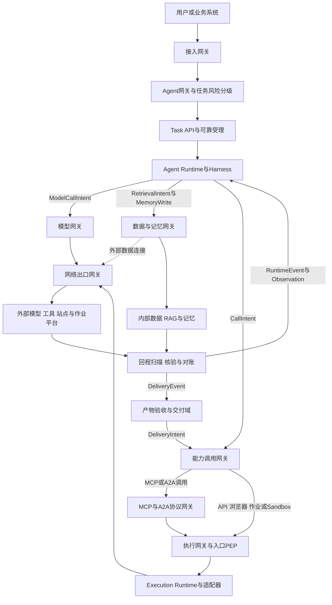

图中有三点必须强调。其一，执行网关（Execution Gateway/PEP）在逻辑上属于八类网关之一，在归属上是 Execution Runtime 对外暴露的强制入口，不存在绕过该入口直达适配器的内部通道。其二，交付并不走特殊通道：DeliveryIntent 与 CallIntent 一样经能力治理、执行网关进入 Execution Runtime，形成 ExecutionRecord，Delivery 结果再以 DeliveryEvent 回到产物验收与交付域。其三，Run 期的模型、检索和工具结果一律先经回程治理形成 RuntimeEvent 或 Observation 回到 Harness，不能由执行器直接驱动下一轮 Agent 行为。

### 2.1 接入网关

**输入与控制对象。** 用户或业务系统发起的 HTTP/API 请求、入口身份凭据、租户标识与 `client_request_id`。接入网关是平台物理边界上的第一道策略执行点。

**核心控制点。**

- 认证与入口身份：校验用户或服务身份，拒绝匿名进入高风险路径；身份结论要能向下游传递并被审计。
- WAF 与协议限制：拦截常见注入与滥用载荷，限制允许的协议、方法与载荷形态。
- 租户限流与准入：保护下游 Task 受理不被单一租户冲垮；限流是可用性保护，不是授权。
- 请求规范化：把请求整理为规范 TaskIntent 的输入形态，提取幂等键，附加 Trace 入口。

**失败模式与默认行为。** 认证依赖故障应 fail-closed：拒绝访问并返回明确错误，绝不降级为匿名放行。租户限流器故障可按声明策略采用本地近似限流或放行并告警——因为限流保护的是可用性而非授权事实。WAF 规则误杀需要白名单机制，且白名单本身必须可审计。

**不应承担。** 接入网关不理解任务语义：任务风险分级属于 Agent 网关，业务授权属于策略引擎，工具授权属于能力调用网关。让接入网关承担语义判断，会让边界策略和业务策略耦合在同一条变更链上。

**通道型接入（IM/客服/小程序）。** 当接入面是企业微信、微信公众号/客服、小程序、钉钉、飞书等消息通道时，接入网关必须内建三类通道语义，不能留给业务层打补丁：

- **渠道身份模型**：通道凭证（AppSecret/Token/EncodingAESKey）+ 回调地址 + IP 白名单构成渠道身份；通道侧消息 ID（如微信 msg_id）必须映射为受理幂等键 client_request_id，否则通道重推会造成重复受理。
- **双段交付**：公众号/微信客服存在被动回复超时（约 5 秒）与客服消息窗口（48 小时）约束，长任务无法在一次被动回复内完成。接入网关要把这类任务建模为"即时兜底回复 + 窗口内异步触达"的两段式交付，与第 2 篇 Delivery 模型的通道 UNKNOWN 对账衔接；文件类产物在通道侧通常是"先传媒体库、再发消息引用"的两步提交，中间态必须显式建模。
- **群聊授权映射**：群聊场景下"群成员→租户主体"的触发权限需要显式规则，不能以"在群里"作为授权依据。

通道方限流、审核驳回与账号封禁是独立于平台可用性的依赖故障模式，应进入第 17 篇的依赖故障矩阵并预设降级通道（如 App 内通知、邮件）。

### 2.2 Agent 网关

**输入与控制对象。** 规范化后的 TaskIntent。Agent 网关控制“什么任务可以进入、交给哪个 Agent、以多大的自主性运行”。

**核心控制点。**

- Agent 路由：根据任务类型选择对应的 AgentSpec 族与版本策略。
- 任务风险分级：依据自主性、权限、数据敏感度、可逆性与暴露面给出初始档位，作为后续安全档位（第 9 节）的输入。
- 自治等级：决定该任务允许免审批的动作范围、预算上限与截止时间。
- 任务大小与范围：校验数据范围、交付对象是否在申报边界内。
- 受理准入：拒绝超出平台申报能力的请求，避免“什么任务都接”。

**失败模式与默认行为。** 分级失效时应向高档位 fail-closed——宁可让任务走更严格的路径，也不能走更宽松的路径。路由错误通常源于控制面版本配置错误，因此路由规则本身要有版本、灰度与回滚。受理积压时应背压或有界拒绝，而不是放宽准入条件。

**不应承担。** 模型推理、物理执行与业务验收。Agent 网关也不应把风险分级当作一次性结论：Run 过程中 Agent 请求升权或扩大范围时，必须重新经过能力调用网关的授权与审批。

### 2.3 模型网关

**输入与控制对象。** Harness 转交的 ModelCallIntent，包括目标模型约束、上下文引用与预算引用。

**核心控制点。**

- 模型路由：按风险档位、数据驻留要求、能力与成本选择模型端点；降级切换时数据驻留、工具权限与验收标准保持不变。
- 数据最小化：脱敏、去标识与字段裁剪，防止敏感字段随上下文进入外部模型。
- 输入输出治理：提示侧与响应侧的内容检测、载荷大小限制；流式增量标记为 provisional，不承载权威状态。
- 预算与配额：Token 与费用硬约束，超限阻断或按策略降级。
- 用量归集：模型 UsageRecord 提交用量结算与资源治理域，与业务事实分离。

**失败模式与默认行为。** 模型端点故障触发重试或降级，但重试可能产生费用且响应非确定，须遵守第 6 篇确立的重试语义。预算超限必须阻断。检测服务故障时，普通内容可按声明策略降级并标记“未检测”，敏感内容 fail-closed。

**不应承担。** Task 受理、工具执行与业务验收。模型响应不是业务事实，模型网关也不负责证明响应内容正确。

### 2.4 数据与记忆网关

**输入与控制对象。** RetrievalIntent 与 MemoryWriteIntent，即对业务数据、RAG 索引、短期上下文与长期记忆的读写提案。

**核心控制点。**

- 数据授权：按租户、行级与目的授权重新验证；访问大对象时重新授权，避免旧授权随 Checkpoint 无限延续。
- 来源与风险属性：检索结果保留来源、时效与风险标记，随 Observation 进入上下文。
- 租户隔离：索引、命名空间与查询路径的隔离校验。
- 检索治理：范围、成本与去重控制，防止 Agent 以检索名义全量拖取数据。
- 记忆写入治理：Agent 自身输出不得未经审核自动升级为可信记忆；写入需来源校验、可衰减、可隔离、可回滚。

**失败模式与默认行为。** 授权依赖故障 fail-closed，拒绝读写。索引污染（记忆与上下文污染是 OWASP ASI06 的核心场景）依赖来源标记、写入治理与回滚能力控制，而不是寄希望于“检测出污染内容”。跨租户泄漏属于最高优先级安全事件，应触发隔离与取证。

**不应承担。** 数据与记忆网关不能把检索结果证明为真实无害——内容检测只降低风险。业务数据的权威仍在数据所有者系统，网关不负责业务数据的正确性。

### 2.5 能力调用网关

**输入与控制对象。** CallIntent 与 DeliveryIntent。它是“Agent 想做什么”与“平台允许做什么”之间的语义闸门。

**核心控制点。**

- 工具版本与描述符校验：只允许已注册、已签名、未被撤销的能力版本。
- 参数规范化与约束：先把参数规范化为可审计的摘要，再做授权；不允许“先授权、后改参”。
- 目标与预算校验：目标系统、资源条件、预算余额逐项验证。
- 审批协调：策略判定需要人工审批时，创建绑定摘要的 ApprovalRequest（第 6 节）。
- AuthzDecision 获取与 ExecutionSpec 形成：结合当前主体、资源条件、委托边界与撤销状态形成策略判定，再组装执行规格。

**失败模式与默认行为。** 授权 fail-closed 并形成耐久拒绝事件。审批积压由超时默认拒绝兜底。参数校验失败直接拒绝，不进入后续链路。

**不应承担。** 能力调用网关不直接运行任何后端——物理执行一律移交执行网关；它也不重新解释 Agent 目标，不把模型输出直接视为已授权动作。交付同样经此网关：DeliveryIntent 携带选定的 ResultSelection 证据链进入同一条治理路径，这是“交付经同一执行链”约定的落点。

### 2.6 MCP/A2A 协议网关

**输入与控制对象。** MCP 消息与 A2A 消息。协议网关只处理对应协议的流量，不是 API、浏览器与 Sandbox 的必经点。

**核心控制点。**

- 企业本地准入目录：允许使用的 MCP Server 与远端 Agent 注册在企业自有的准入目录中，经过评审、分类与责任人绑定。必须澄清：准入目录是企业平台能力，不是协议自带的能力。MCP 官方 Registry（registry.modelcontextprotocol.io，2025-09 起 preview）提供发现与命名空间验证，但不做执行治理与信任背书，不能替代企业准入评审。
- 描述符扫描与哈希钉扎：工具描述符与 Agent Card 在准入时经过安全扫描，并以摘要钉扎；运行期加载的描述符必须与钉扎摘要一致。工具描述本身就是攻击面——被篡改的描述可以诱导模型误用工具。
- 对端认证与消息治理：双向身份、协议版本约束、重放防护与能力协商。
- OAuth 2.1 对齐：MCP 的 HTTP 授权规范与 OAuth 2.1 对齐，这是可选能力，在启用 HTTP 传输时适用。它覆盖的是客户端到 MCP Server 这一协议边界，不替代下游业务授权、参数级策略与 ExecutionRecord。
- 传输凭据边界：stdio 等传输采用与 HTTP 不同的凭据边界，不能把 HTTP 令牌语义直接套用到 stdio 连接上。

**失败模式与默认行为。** 描述符摘要不匹配时拒绝加载并告警；对端认证失败拒绝连接；协议版本不兼容时按策略降级或拒绝，不允许静默降级到不安全版本。

**不应承担。** 协议网关不替代业务授权，不承担全局信任准入（MCP 官方 Registry 仅为发现层），不替代执行账本。MCP 调用经协议适配后仍要进入执行网关，形成 ExecutionRecord；A2A 的 Agent Card 只描述端点与能力，实际调用仍需逐请求认证授权。

### 2.7 执行网关

**输入与控制对象。** ExecutionSpec 与授权引用。执行网关是物理动作发生前的最后一道逻辑闸门，也是 Execution Runtime 的强制入口。

**核心控制点。**

- 执行时身份与 epoch 校验：当前 Worker 同步提交的动作必须匹配当前 RunLease；经 Outbox 耐久调度的延迟命令则校验 ExecutionRecord 中的 `authorized_epoch`、摘要、ReleaseGrant 与撤销版本，并以 CAS 唯一领取 PREPARED 记录。
- 统一末端门禁：真正外呼前，无论命令何时进入 Outbox，都必须校验最新 `control_intent`、revocation epoch、授权约束与记录状态。取消或撤销后拒绝的调用必须形成耐久的 CallRejected/Cancelled 事件；已经开始的调用记录 PENDING/UNKNOWN 与用量，进入对账或收尾，不能伪装成“从未调用”。
- 去重与账本：ExecutionRecord 是外部副作用的平台侧事实，幂等键与唯一领取防止重复执行登记。
- 凭据约束：下游使用短期、受众绑定凭据；高风险场景由沙箱外代理持凭据代为执行。

**失败模式与默认行为。** 账本不可用时 fail-closed，不执行任何可能产生副作用的动作。旧 epoch 提交被 fencing 拒绝。重复领取被 CAS 拒绝并记录。

**不应承担。** 执行网关不重新解释 Agent 目标，不决定 Task 终态（终态由 Finalization 门禁决定），也不保证外部副作用恰好一次——它保证的是平台执行许可的唯一消费与耐久记录。

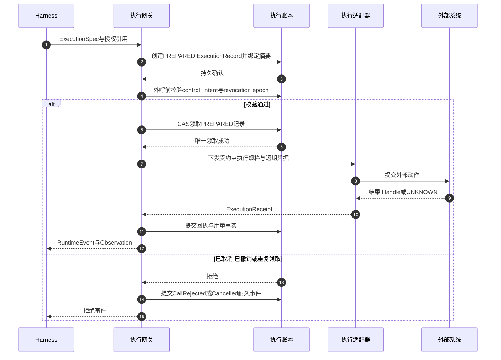

### 2.8 网络出口网关

**输入与控制对象。** 所有需要外部网络的出向连接：外部模型调用、外部工具与站点访问、外部数据连接、远程作业通道。

**核心控制点。**

- 默认拒绝：未申报的目标与协议一律拒绝；allowlist 按租户、Run 与风险档位细分。
- 受控 DNS 与元数据阻断：防止 DNS 隧道、云元数据端点与私网探测。
- 重定向重验：重定向后的新目标必须重新验证，防止 allowlist 域名跳转到任意目标。
- 敏感出口检测：对携带敏感内容的出站载荷做内容级检测。检测失败应阻断或受限，不得先流出再追责。
- 流量审计：连接元数据与必要内容审计进入耐久审计通道。

**失败模式与默认行为。** 出口策略服务故障 fail-closed。敏感出口检测故障 fail-closed：阻断敏感出口，或降级到仅允许非敏感目标。出口绕过（例如 Sandbox 或浏览器直连外网）属于架构缺陷，必须在网络策略层覆盖所有执行器。

**不应承担。** 网络出口网关不理解完整业务语义，也不能替代上游授权。它是最后一道物理边界，不是唯一防线：把安全全部押在出口名单上，等于承认上游所有控制点都可以被绕过。

---

## 3. 网关之间的顺序与依赖

八类网关不是并列的过滤器堆叠，顺序本身承载语义。

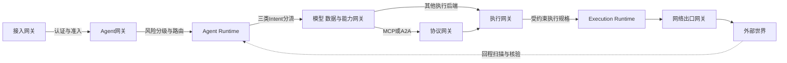

顺序背后的四条原则：

**原则一：廉价拒绝在前。** 认证、协议限制与限流在边界完成成本最低。一个未认证请求在接入网关被拒绝，只消耗一次握手；若让它进入 Runtime 再拒绝，已经消耗了任务受理、状态写入与调度资源。

**原则二：语义先于物理。** Agent 网关先回答“这是什么任务、风险多高”；模型、数据与能力网关再回答“这个意图是否被允许”；协议网关完成协议适配；执行网关最后回答“此刻是否仍然允许物理发生”。越靠近物理动作，判断越依赖实时事实（撤销、预算、许可），而不是上游的静态结论。

**原则三：最靠近物理动作的网关独立复核。** 执行网关不信任上游任何结论。即使能力调用网关已经授权、审批已经通过，执行网关仍要校验执行时身份、epoch、ReleaseGrant 与 revocation epoch。上游结论是输入，不是豁免。

**原则四：出口是最后边界，不是唯一防线。** 网络出口网关位于链路末端，是因为网络层无法理解业务语义，只能做目标、协议与内容级强制。若平台只建设出口控制，等于把全部安全押在“名单正确”这一个假设上。

依赖关系汇总如下：

| 网关 | 前置条件 | 依赖的控制面事实 | 输出 |
|---|---|---|---|
| 接入网关 | 无 | 身份体系、租户配置、WAF 策略 | 已认证请求 |
| Agent 网关 | 接入认证通过 | AgentSpec 目录、风险分级策略、版本撤销状态 | 已分级的 Task |
| 模型、数据、能力网关 | Run 已启动且 Intent 已产生 | 策略、预算、版本、审批、撤销状态 | 受治理请求或耐久拒绝 |
| 协议网关 | 能力治理通过且协议匹配 | 准入目录、描述符摘要、对端身份 | 协议适配后的调用 |
| 执行网关 | 授权、审批与 Grant 就绪 | 执行账本、revocation epoch、control_intent | 执行事实或耐久拒绝 |
| 网络出口网关 | 执行规格已下发 | 出口策略、检测策略 | 放行连接或阻断 |

还有两点横向依赖必须说明。其一，所有网关共同依赖控制面的身份、策略、版本与撤销事实；控制面故障不应导致运行面自动扩大权限——已运行 Task 要么使用固定且仍有效的版本继续，要么按策略暂停或降级。其二，回程路径同样受治理：外部结果经回程扫描与核验后形成 RuntimeEvent 或 Observation 回到 Harness，DeliveryEvent 回到交付域；不存在由工具回调直接唤起模型、由 MCP 结果直接生成下一次工具调用的旁路。

---

## 4. 物理归并：五种部署单元

逻辑职责必须清晰，物理部署可以归并。系列第 3 篇给出的五种部署单元是归并的参考形态：

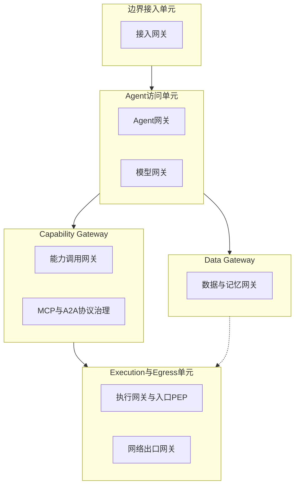

| 部署单元 | 归并的逻辑网关 | 适用规模 | 拆分信号 |
|---|---|---|---|
| 边界接入单元 | 接入网关 | 所有规模 | 入口流量激增，需要独立扩缩与独立故障域 |
| Agent 访问单元 | Agent 网关与模型网关 | 小到中规模 | 流式吞吐、模型路由与会话准入特性分化，模型网关独立 |
| Data Gateway | 数据与记忆网关 | 中规模及以上 | 数据授权 QPS、索引规模与检索成本成为瓶颈 |
| Capability Gateway | 能力调用网关与 MCP/A2A 协议治理 | 中规模及以上 | 协议类型激增，协议层需要独立扩缩、独立升级 |
| Execution 与 Egress 单元 | 执行网关与网络出口网关 | 所有规模 | 执行账本与出口策略变更频率分化，可再拆分 |

按规模的三个演进阶段：

- **阶段一，单进程或小规模。** 边界接入与 Agent 访问归并，能力与执行归并，甚至可以同进程部署。但 ExecutionRecord、统一末端门禁与 UNKNOWN 语义不能省略；高风险代码执行仍须与业务进程隔离。规模小不是省略事实协议的理由。
- **阶段二，中规模。** 五个部署单元成型，模型网关可暂留 Agent 访问单元。此阶段的关键是把策略顺序与审计事件源显式标注，为将来拆分保留接缝。
- **阶段三，大规模多租户。** 五个单元全部独立，模型网关单列，按 Cell 组织故障域。跨 Cell 控制面只分发签名版本与策略，不在故障时自动扩权。

归并的铁律是四个“可区分”：

1. **策略顺序可区分**：归并后认证、分级、授权、门禁的执行顺序仍然明确，不因组件合并而乱序或跳过；
2. **权限可区分**：不同逻辑职责使用不同的服务身份与最小权限，一个单元被攻陷不等于所有职责被攻陷；
3. **审计可区分**：审计事件携带逻辑网关标识，能够回答“这个决定是哪一层、依据哪个策略版本做出的”；
4. **变更与故障域可区分**：一次变更的影响范围可界定，一个逻辑职责的故障不拖垮其他职责。

把所有职责塞进一个“AI 网关”并不能消除边界，只会让变更、扩缩与故障影响相互耦合——边界还在，只是从图上移到了事故报告里。

---

## 5. fail-open 与 fail-closed 矩阵

每个控制点都必须显式声明依赖故障时的行为。声明之前，用三个问题判定：

1. 该控制点故障是否意味着授权事实缺失？是，则 fail-closed；
2. 放行是否造成不可逆外部副作用或数据流出？是，则 fail-closed；
3. 该数据是否承担结算或证据责任？是，则不得丢弃，只能有界缓冲与补投。

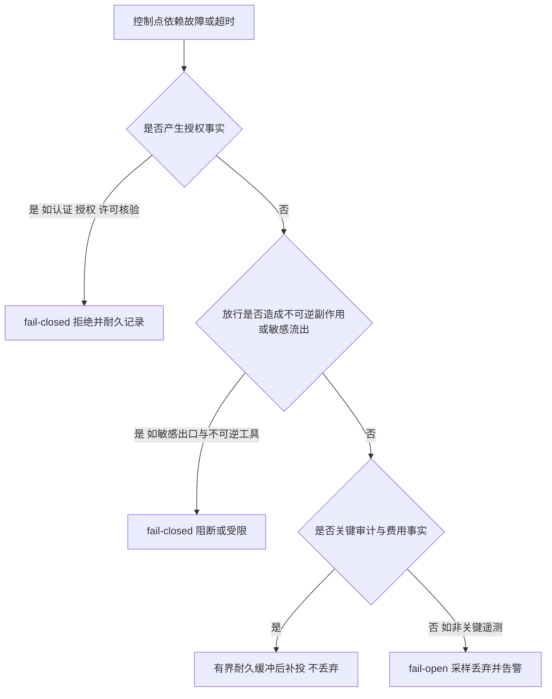

按控制点的默认策略矩阵：

| 控制点 | 默认策略 | 故障时行为 | 理由 |
|---|---|---|---|
| 接入认证 | fail-closed | 拒绝访问，返回明确错误，不降级匿名 | 身份是全部后续决定的前提 |
| 租户限流 | 可配置，倾向 fail-open | 本地近似限流或放行并告警 | 限流是可用性保护，不是授权事实 |
| 任务风险分级 | 向高档位 fail-closed | 默认按高档位走严格路径 | 分级失效应更严格而非更宽松 |
| 模型路由与预算 | fail-closed 或默认受控路由 | 阻断超预算调用 | 预算是硬约束 |
| 数据授权 | fail-closed | 拒绝检索与写入 | 授权事实缺失 |
| 能力授权 AuthzDecision | fail-closed | 拒绝并形成耐久拒绝事件 | 授权事实缺失 |
| 策略判定缓存 | 仅限低风险判定 | 敏感动作执行前仍验证当前主体、资源条件、委托边界与撤销状态 | 缓存不代表当前撤销状态 |
| 审批超时 | 默认拒绝 | 提交 TimeoutDenied 耐久事件 | 审批语义是明确的人类决定，沉默不是同意 |
| ReleaseGrant 核验 | fail-closed | 拒绝执行 | 执行许可必须唯一消费 |
| revocation epoch 核验 | fail-closed | 拒绝并触发撤销处置 | 撤销是安全控制 |
| 普通内容检测 | 按声明策略 fail-open 并告警 | 有界重试，标记未检测 | 检测只降低风险，普通路径可声明权衡 |
| 敏感出口检测 | fail-closed | 阻断或受限，不得先流出再追责 | 数据流出不可逆 |
| 出口默认拒绝策略 | fail-closed | 拒绝连接 | 最后物理边界 |
| 重定向重验 | fail-closed | 重验失败即阻断 | 防止 allowlist 绕过 |
| 非关键遥测 | fail-open | 有界缓冲或丢弃样本 | 遥测不是业务事实 |
| 关键审计、执行与费用事实 | 不得丢弃 | 本地耐久缓冲与补投 | 结算与证据责任 |

三条补充纪律：

- fail-open 不等于无治理。任何 fail-open 都必须伴随告警、采样补偿与事后审计，且只允许出现在不产生不可逆后果的控制点上。
- fail-closed 必须给出后续路径。拒绝之后，Run 按策略进入拒绝、重规划、暂停或失败收尾，而不是无限挂起；错误语义要能让上游区分“策略拒绝”与“依赖故障”。
- 降级不得以绕过安全为代价。模型降级、资源降级、区域降级时，数据驻留、工具权限、验收标准与敏感出口控制保持不变。

---

## 6. HITL 审批服务

审批是人对“固定动作规格”的决定，不是对 Agent 的笼统信任投票。审批服务应是独立的耐久服务，而不是 Harness 里的一个内联判断：它需要持久队列、审批人路由、超时定时器、撤销通道与审计账本。

### 6.1 审批请求的生命周期

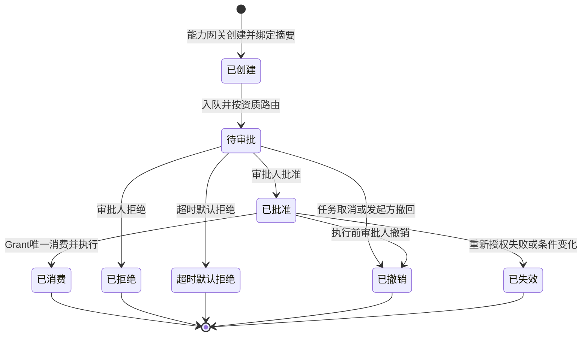

审批队列的设计要点：

- **耐久性**：ApprovalRequest 是耐久事实，服务重启不丢失、不重复发送；
- **路由**：按风险档位、动作类型与审批人资质路由；高风险动作要求更高资质或双人复核；
- **去重**：同一动作摘要不重复发起请求；重复提交幂等返回既有请求；
- **升级**：长时间未处理时按升级链转交，而不是静默等待超时。

### 6.2 绑定摘要与差异展示

ApprovalRequest 必须绑定**规范化动作摘要与资源条件**：动作类型、目标系统、参数摘要、数据范围、预算影响与有效时间窗口。审批只对该摘要有效，这带来两条硬规则：

- 执行时参数与已批准摘要不一致，摘要校验失败即拒绝，需要重新审批；
- 审批展示必须包含**参数差异**：相对原始请求或上一版本的变化、确定性风险展示（金额、范围、可逆性）与来源证据。这是防人机信任滥用（OWASP ASI09）的核心手段——审批人看到的必须是将要执行的，而不是 Agent 描述的。

### 6.3 超时、撤销与重新授权

- **超时默认拒绝**：审批超时产生 TimeoutDenied 耐久事件。沉默不是同意；需要更长窗口时应显式延长，而不是默认放行。
- **撤销**：审批人在执行发生前可以撤销批准；撤销立即生效并进入审批账本。
- **审批通过仍重新授权**：批准只是对固定动作规格的人类决定，不是权限的永久授予。执行前，能力网关仍要就当前主体、资源条件、委托边界与撤销状态向策略引擎重新授权；审批后权限已变化或资源条件已变化的，拒绝执行并记录 STALE。

完整流程如下：

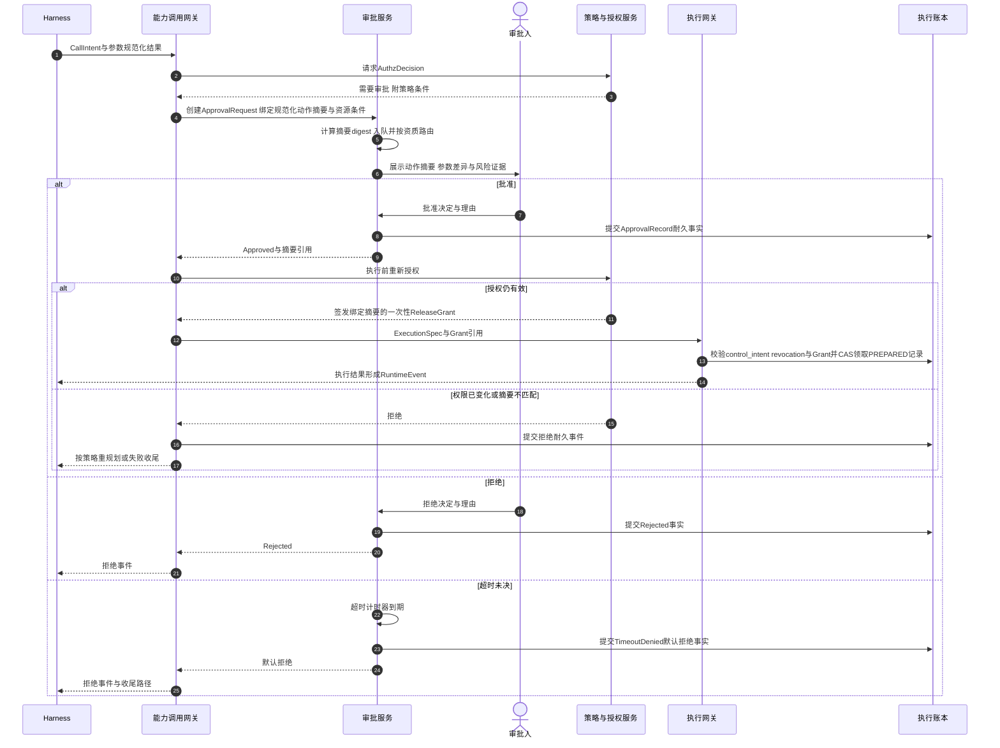

### 6.4 防审批疲劳的分流设计

审批疲劳是安全机制的自我腐蚀：当审批人每天面对上百个低风险请求，批准会退化为肌肉记忆，真正危险的请求反而被淹没。分流的原则是**减少审批数量，而不是降低审批质量**：

- **低风险预授权**：对固定动作类型加固定资源条件的低风险动作，策略可以预先批准一个有效期内的授权模板；模板条件必须机器可校验、可审计、可撤销。条件一旦变化，自动回退普通审批。
- **同质动作批量审批**：同一摘要模式下的批量动作可以聚合展示、一次决定，但每个动作仍保留独立的可追溯记录。
- **配额与频率限制**：单位时间内单一 Agent 可发起的审批请求有上限，防止 Agent 以请求数量淹没审批人。
- **档位分流**：低风险走预授权或单人审批，中风险单人加资质校验，高风险双人或高资质审批。

预授权不是免审批，而是把审批前移到策略制定时刻——策略本身经过评审、版本化与灰度，其批准范围比单次审批更窄而不是更宽。

### 6.5 审批审计

审批审计至少记录：审批人身份与资质、决定时刻、审批请求版本、动作摘要 digest、参数差异快照、决定依据与理由、以及后续消费情况——哪一个 ExecutionRecord 消费了该 Grant，或该 Grant 因何失效。审计使“谁在什么条件下批准了什么、最终发生了什么”可以被完整重建。

---

## 7. 安全治理闭环

网关与审批是运行时强制，但安全治理必须覆盖全生命周期。闭环的七个阶段如下：

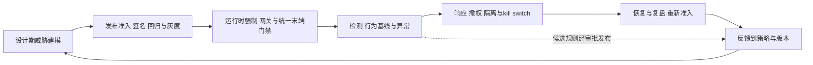

| 阶段 | 关键活动 | 输出事实 | 常见错误 |
|---|---|---|---|
| 设计期威胁建模 | 资产与信任边界梳理、Agent 特有威胁分析（方法详见第 09 篇） | 威胁清单与控制映射 | 一次性建模，不随版本与能力变化更新 |
| 发布准入 | AgentSpec 签名、回归评测、安全回归、灰度计划、SBOM/AIBOM | 签名版本与发布清单 | 以进度压力跳过回归与灰度 |
| 运行时强制 | 八类网关强制、统一末端门禁、执行时重新授权 | 授权与执行事实 | 以告警代替阻断 |
| 检测 | 行为基线、异常工具序列、出口异常、权限拒绝率、内容检测命中 | 告警与风险评分 | 告警不与响应动作连接 |
| 响应 | 撤权、暂停、隔离、kill switch、证据保留 | 响应动作记录 | 只停进程，不对账在途副作用 |
| 恢复与复盘 | 修复、回归、重新准入、复盘报告 | 重新准入记录 | 恢复无门禁，直接回到生产 |
| 反馈到策略 | 候选规则与版本经审批与灰度后发布 | 策略版本 | 评测与检测结果直接扩大生产权限 |

几个关键衔接点：

- **检测到响应**：行为基线偏离、出口目标异常、权限拒绝骤增、预算速率异常等信号应映射到分级响应动作——提高审批档位、收紧出口策略、暂停 Run 并撤权、隔离实例取证，直至触发 kill switch（第 10 节）。告警本身不是控制。
- **响应到恢复**：被隔离或撤权的 Agent 不能自动回到生产。重新准入需要修复证据、回归结果与显式批准，与发布准入走同一套门禁。
- **复盘到策略**：事件复盘产生候选策略与候选规则，但评测和检测只能生成候选，不能直接扩大生产权限；任何候选变更仍需回归、审批与分阶段发布。

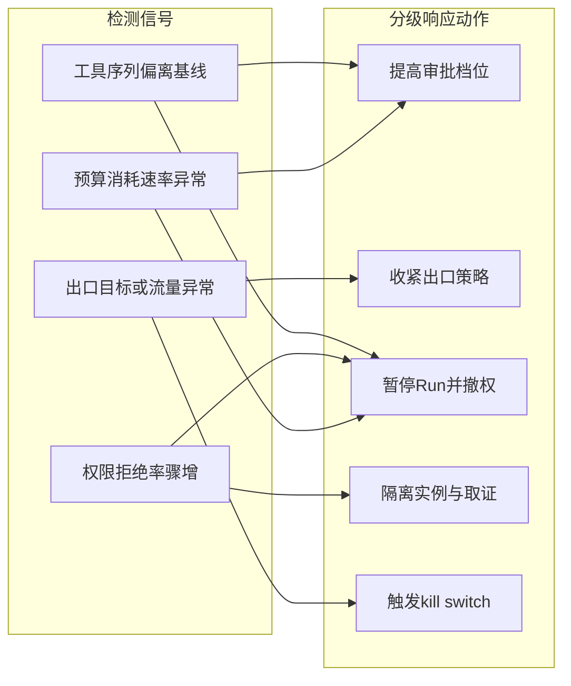

### 7.1 合规与标准在闭环中的位置

治理闭环需要对接外部法规与标准，但必须先区分其性质与约束力：

| 文件 | 性质 | 关键事实 |
|---|---|---|
| EU AI Act 及 Omnibus Regulation EU 2026/1744 | 法律条例 | 义务按系统类别与条款分阶段适用；Omnibus 条例于 2026-07-27 生效，将附件 III 高风险系统相关义务延至 2027-12-02 |
| 网信办《智能体规范应用与创新发展实施意见》 | 政策文件 | 2026-05 发布，提供方向性引导与要求，不是行政法规本身 |
| TC260《智能体系统开发安全指南》 | 国家标准征求意见稿 | 截至 2026-09 为征求意见稿，不是已正式发布标准 |
| OWASP Agentic Top 10 2026 | 行业风险分类 | 风险清单与实践入口，不是合规认证 |

三条纪律：

1. “2026 年 8 月全面适用”是对 EU AI Act 时间线的不准确表述。其义务按系统类别和条款分阶段适用，Omnibus 条例还调整了部分时间点，合规规划应以官方文本的最新时间线为准。
2. 法律义务、政策文件、征求意见稿与行业清单的约束力不同。合规映射应分别标注：法定义务、推荐性标准参照、内部基线，不能混为一谈。
3. 部署了网关、审计或评测平台，不意味着自动获得任何认证或满足全部法律要求。涉及高风险场景的平台，应由法务与合规专业团队结合具体司法辖区评估。

---

## 8. 安全能力选型

### 8.0 选型总原则

与系列第 0 篇的技术选型立场一致：先定义能力契约，再选择产品。本节不指定任何商业产品为必选，只按能力类别给出选择标准、候选类型与常见陷阱。每个候选都应回答四个问题：**它负责什么，它不负责什么，失败时如何退化，哪些事实仍需外部系统承载。**

选型还要预先回答两个经常被忽略的问题：失败时平台如何退化（该能力的 fail-open/fail-closed 语义必须写入合同与运维手册）；退出成本有多高（策略、审计与配置是否可导出，是否被专有格式锁定）。

### 8.1 身份与委托

- **选择标准**：用户身份与工作负载身份分离；委托链可表达、可审计（用户 → TaskIntent 授权范围 → Agent 工作负载身份 → 执行身份）；短期凭据与受众绑定；撤销可传播到下游；与企业 IdP 集成。
- **候选类型**：企业 IAM 与 IdP 平台、工作负载身份框架、符合 OAuth 2.1/OIDC 的授权服务、云原生身份服务。
- **常见陷阱**：长期凭据与共享服务账号；把“持有令牌”等同“获得授权”；委托链断裂——Agent 以用户名义行动却实际拥有超出该用户的权限；凭据进入 Checkpoint 或日志。

### 8.2 策略引擎

- **选择标准**：ABAC 表达能力（主体、资源、参数、环境条件）；委托与撤销语义；决策时延与本地加速方式；决策可审计、可回放；策略版本化、灰度与回滚。
- **候选类型**：OPA/Cedar 类通用策略引擎、企业统一授权服务、小规模场景下的嵌入式策略库。
- **常见陷阱**：把策略缓存当作当前决定——缓存只能优化低风险判定，敏感动作执行前必须验证当前主体、资源条件、委托边界与撤销状态；策略与业务代码深度耦合导致无法独立变更；策略变更没有版本与审计。

### 8.3 内容检测

- **选择标准**：覆盖输入、输出与出口三个位置；多模态能力；自定义规则与行业词表；时延与吞吐；失败语义可声明（能否按控制点配置 fail-open/fail-closed）；命中结果可审计。
- **候选类型**：模型供应方内置安全能力、专业内容安全服务、规则引擎与关键词体系、人审队列作为兜底。
- **常见陷阱**：把检测通过当作内容无害的证明——内容检测只降低风险；敏感出口检测配置成 fail-open，先流出再追责；用内容检测替代授权与出口控制。

### 8.4 沙箱与隔离

内部机制见第 08 篇，此处只给选型视角。

- **选择标准**：攻击者能力假设；系统调用兼容性；设备与 GPU 需求；租户隔离等级；Checkpoint 能力；启动时延与成本；运维复杂度。
- **候选类型**：强化容器、rootless 容器、gVisor、Kata Containers、microVM、完整虚拟机、语言级 Sandbox、托管 Sandbox 服务。
- **常见陷阱**：只看启动速度选型；认为沙箱等于零凭据——沙箱内不应保存长期业务凭据，高风险调用优先由沙箱外代理持凭据代为执行，若必须注入短期令牌，应明确为“最小化短期凭据暴露”；用沙箱替代执行账本与授权。

### 8.5 出口控制

- **选择标准**：默认拒绝能力；目标与协议级控制；受控 DNS；重定向后重验；TLS 可见性策略与合规边界；按租户与 Run 的身份标记。
- **候选类型**：专用出口代理集群、云原生出口控制组件、服务网格出口层、边界网络策略设备。
- **常见陷阱**：只管理出站域名清单而不做重定向重验；执行器绕过——Sandbox、浏览器或作业执行器直连外网；把出口控制当作唯一防线，替代上游授权。

### 8.6 审计与可观测

- **选择标准**：耐久审计账本与业务事实关联（tenant、task、run、execution、approval、policy、trace）；敏感数据脱敏策略；保留期与防篡改（WORM）；SIEM 集成；遥测采用 OpenTelemetry GenAI 语义约定时固定所采用版本。
- **候选类型**：追加式审计数据库与对象归档、企业日志与 SIEM 平台、可观测平台。
- **常见陷阱**：用 Trace 代替审计——Trace 可采样、可过期，不能承载许可消费、审批与结算证据；以“全链路审计”名义无条件记录敏感 Prompt 与结果；关键审计与费用事实依赖普通遥测管道，遥测故障即丢失。

### 8.7 评测与红队

- **选择标准**：Golden Set 管理与版本化；影子运行与回归对比；自动化红队能力（注入、目标劫持、工具误用、越权尝试等场景）；结果到候选变更的流程是否与发布门禁打通；评测环境与生产环境的差异是否可说明。
- **候选类型**：评测框架与回归平台、红队服务与对抗测试集、影子运行与在线对比机制。
- **常见陷阱**：评测结果直接扩大生产权限——评测和检测只能生成候选规则或版本，仍需回归、审批与分阶段发布；红队只在发布前做一次，不随能力变化持续进行；以评测分数替代生产验证场景（第 12 节）。

---

## 9. 安全档位 S0–S3

安全档位把“这个 Agent 需要多严格的控制”从主观讨论变成按维度判定的结论。判定维度五个：自主性、权限、数据敏感度、动作可逆性、外部暴露面。

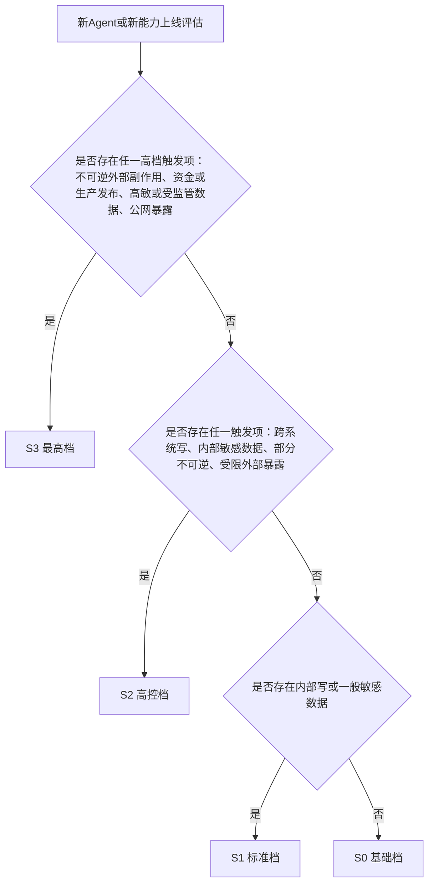

上图是从高档到低档的快速判定入口，属简化表达；最终档位以五维度表取最高（木桶原则）为准，任一维度达到高档即整体不低于该档。

档位特征：

| 维度 | S0 | S1 | S2 | S3 |
|---|---|---|---|---|
| 自主性 | 只读问答与建议 | 流程内低风险动作 | 跨系统动作 | 外部不可逆动作 |
| 权限 | 只读 | 内部受限写 | 跨系统写 | 外部、资金或生产发布 |
| 数据敏感度 | 公开或低敏 | 内部一般 | 内部敏感 | 高敏或受监管数据 |
| 可逆性 | 完全可逆 | 可逆 | 部分不可逆 | 不可逆 |
| 暴露面 | 仅内部 | 仅内部 | 内部加受限外部 | 公网暴露 |

判定规则采用木桶原则的反向形式——**任一维度达到高档，整体不低于该档**。例如只读但访问内部敏感数据的 Agent 至少 S2；访问高敏或受监管数据则直接进入 S3；对外发布内容并可能产生资金影响的 Agent 直接 S3。档位由 Agent 网关的风险分级在受理时初始化，由资产域在发布评审时确认；档位变更必须走评估与审批，不能由 Agent 在运行中自行升档。

每档最低控制要求（可以增加，不得减少）：

| 控制项 | S0 | S1 | S2 | S3 |
|---|---|---|---|---|
| 身份与授权 | 入口认证与数据授权 | 加逐调用授权 | 加高风险动作审批 | 双人或高资质审批，执行前重新授权 |
| 执行控制 | 只读接口 | ExecutionRecord 与预算 | 加 Sandbox 与出口检测 | 强隔离、专用出口、凭据代理 |
| 内容治理 | 输出来源标记 | 加输出检测 | 加敏感出口检测 fail-closed | 全链路检测与人审兜底 |
| 检测与响应 | 基础审计 | 加行为基线 | 加异常告警与撤权预案 | 实时阻断、kill switch 就绪与专项值守 |
| 发布准入 | 基础回归 | 加安全回归 | 加红队准入 | 灰度、双签与应急演练记录 |
| 审计保留 | 常规保留 | 常规保留 | 延长保留 | 防篡改长期保留与取证就绪 |

档位的价值在于一致性：同一个平台里，相似风险的 Agent 承受相似的控制强度；新增控制时有据可依，削减控制时有审批可查。

---

## 10. kill switch 与应急运行手册

### 10.1 kill switch 的层级

kill switch 不是一个全局按钮，而是一组按作用层级区分的紧急控制：

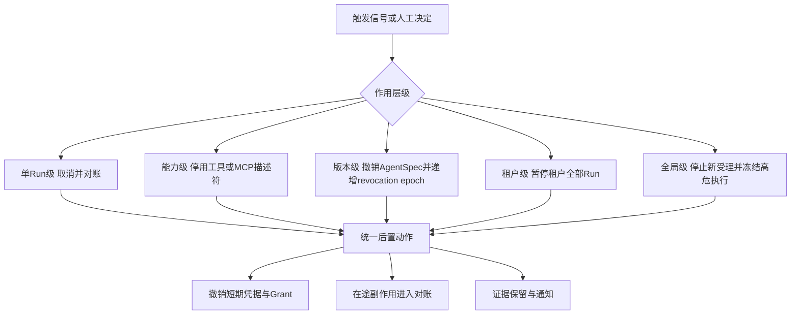

各层级与既有机制的对应关系：单 Run 级对应持久取消意图（`control_intent=CANCEL`）与取消专用对账；能力级对应能力目录撤销，使后续授权与描述符校验失败；版本级对应第 4 篇的 `revocation_epoch` 递增——阻止新 Run、暂停受影响在途 Run、撤销工具与网络权限；租户级与全局级则是受理与调度层的紧急闸口。统一末端门禁保证：即使停止命令与已提交 Outbox 的命令竞争，外呼前校验最新 `control_intent` 与 revocation epoch 仍会拒绝执行，并形成耐久拒绝事件。

必须澄清的边界：**kill switch 能停止新的平台动作，不能回滚已经发生的外部副作用。** 已发生或结果未知的动作进入对账与收尾；把 kill switch 当作“撤销一切”的按钮，会在应急时产生错误的安全感。

### 10.2 触发条件

- 行为基线严重偏离：异常工具序列、目标偏移信号持续命中；
- 完整性与逃逸告警：沙箱逃逸、镜像或 AgentSpec 完整性校验失败；
- 凭据泄漏或滥用迹象；
- 费用或调用量异常飙升且无法解释；
- 合规指令或重大生产事故联动。

触发可以是自动检测信号，也可以是人工决定；自动触发必须有防误报的确认窗口或分级生效机制，但确认窗口不能长到让损害扩大。

### 10.3 动作顺序与运行手册要点

标准动作顺序：**停新 → 冻在途 → 撤凭据 → 对在途 → 留证据 → 通报。**

1. 停止新动作：阻断新 Run、新执行与新受理（按层级）；
2. 冻结在途：受影响 Run 进入暂停或取消，释放可释放资源但保留状态；
3. 撤销凭据：短期凭据、ReleaseGrant、委托关系；
4. 对账在途副作用：按 ExecutionRecord 与 ExternalHandle 逐项确认已发生、未发生或未知；
5. 证据保留：审计、账本、现场快照按取证要求保存，隔离实例不重新入池；
6. 通报：按预案通知安全、业务与受影响方。

运行手册（runbook）至少包含：

- **角色分工**：指挥人、操作人、通报人、记录人，以及各自的授权边界；
- **决策矩阵**：哪类信号触发哪个层级的 kill switch，谁有权决定，确认窗口多长；
- **操作清单**：每个层级的具体命令与校验点，避免应急时临场发挥；
- **传播时延目标**：从触发到各执行点生效的时间上限，并纳入演练度量；
- **演练要求**：定期演练并记录实际生效时间、误报与遗漏；
- **误报处置与重新准入**：误触发后的恢复路径；真实事件后的重新准入必须经过修复证据、回归与显式批准，与发布准入同一门禁。

---

## 11. 常见反模式

### 11.1 一个“AI 网关”包办一切

认证、任务准入、模型治理、能力授权、执行门禁全部塞进一个产品或一个进程。边界没有消失，只是从架构图移进了事故报告：变更相互耦合、故障相互传染、审计无法区分决定来源。

### 11.2 用网络策略代替语义治理

只开放端口和域名清单，就认为工具调用已被治理。网络策略不理解“这次调用的参数是否在批准摘要内”“这个 Grant 是否已被撤销”。语义强制必须在能力调用与执行层完成。

### 11.3 敏感出口 fail-open

检测服务故障时选择“先放行、后追责”。数据流出不可逆，追责不能替代控制。敏感出口检测失败必须阻断或受限。

### 11.4 审批疲劳与盖章式审批

所有动作都走同一条审批流，审批人每天批准上百个请求，审批退化为仪式。解法不是取消审批，而是低风险预授权分流、批量审批与档位路由。

### 11.5 审批通过即永久授权

把 ApprovalRecord 当作长期令牌，执行时不再验证当前主体与资源条件。审批只对固定动作摘要有效，执行前仍须重新授权。

### 11.6 以检测代替强制

行为监测产生告警，但没有任何阻断动作与之连接。检测的价值在于驱动响应；告警不连接响应的系统，只是更昂贵的日志。

### 11.7 选型清单即安全架构

采购了身份平台、策略引擎与沙箱产品，却没有定义能力契约、失败语义与事实归属。产品提供组件，架构提供边界；先有边界，产品才有落点。

### 11.8 kill switch 只停进程

紧急停止后不对账在途副作用、不撤销凭据、不保留证据。外部动作可能已经发生；停止进程只是应急的第一步。

### 11.9 安全档位靠协商而非判定

档位由项目重要性、上线压力或声音大小决定，而不是按自主性、权限、数据敏感度、可逆性与暴露面判定。结果是高风险 Agent 低配运行，低风险 Agent 过度设防。

### 11.10 归并后审计不可区分

物理归并本身合法，但归并后无法回答“这个拒绝是哪一层、依据哪个策略版本做出的”，事故复盘与合规举证同时失效。

---

## 12. 生产验证场景表

安全治理架构的正确性同样要靠故障条件下的行为证明。以下场景应纳入上线前验证与定期回归：

| # | 验证场景 | 预期事实 |
|---|---|---|
| 1 | 认证服务不可用 | 接入网关拒绝高风险访问，不降级匿名，返回明确错误 |
| 2 | 策略引擎不可用 | 高风险动作 fail-closed 阻断；低风险动作按声明策略执行并告警 |
| 3 | 审批请求超时 | 默认拒绝，TimeoutDenied 耐久事件，Run 按策略收尾或重规划 |
| 4 | 审批通过后权限被撤销 | 执行前重新授权拒绝执行，旧批准不生效，形成拒绝记录 |
| 5 | 执行参数与已批准摘要不一致 | 摘要校验失败即拒绝，需要重新审批 |
| 6 | 敏感出口检测服务故障 | 敏感出口被阻断或受限，不出现先流出再追责 |
| 7 | MCP 描述符被篡改 | 哈希钉扎校验失败，拒绝加载与调用，形成审计事件 |
| 8 | 旧 epoch Worker 提交执行 | 执行网关 fencing 拒绝，形成耐久拒绝事件 |
| 9 | 取消发生在命令已进入 Outbox 之后 | 末端门禁按最新 control_intent 拒绝外呼，形成 CallRejected/Cancelled 耐久事件 |
| 10 | kill switch 触发版本撤销 | 新 Run 被阻止，受影响在途 Run 暂停，凭据被撤销，在途副作用进入对账 |
| 11 | 出口重定向到非 allowlist 域 | 重验阻断，连接与重定向链被记录 |
| 12 | 归并部署的策略与审计审查 | 策略顺序、权限、审计事件源与变更范围均可区分 |
| 13 | 非关键遥测管道故障 | 有界缓冲或样本丢弃；关键审计、执行与费用事实不丢失 |
| 14 | 预授权条件发生变化 | 低风险预授权自动失效，回退普通审批 |
| 15 | 低风险请求洪峰冲击审批队列 | 分流与配额生效，高风险请求不被淹没，队列有界且可升级 |
| 16 | 交付被策略拒绝 | DeliveryIntent 经同一执行链被拒，形成拒绝事实，不产生旁路交付 |

验证应同时检查状态、事件序列、审计记录与账本事实，而不是只看最终回答是否正确。

---

## 13. 架构评审清单

### 职责与边界

- 八类逻辑职责是否全部存在，各自输入、控制点与失败语义是否明确？
- 每类网关“不应承担”的职责是否被遵守，是否存在职责越界？
- 执行网关是否同时是 Execution Runtime 的强制入口，且无内部绕行通道？

### 顺序与旁路

- 主链顺序是否符合廉价拒绝在前、语义先于物理、末端独立复核的原则？
- 是否存在模型、数据或工具绕过 Harness 与执行账本的路径？
- 交付是否经同一执行链，DeliveryEvent 是否回到交付域？
- Run 期结果是否一律经回程治理形成 RuntimeEvent 或 Observation？

### 物理归并

- 归并后策略顺序、权限、审计与变更范围是否仍可区分？
- 归并单元的故障域与扩缩模型是否经过评估？

### 失败语义

- 每个控制点的 fail-open/fail-closed 是否显式声明并有测试覆盖？
- 授权与敏感出口是否 fail-closed？审批超时是否默认拒绝？
- 关键审计与费用事实是否不依赖普通遥测管道？

### 审批

- ApprovalRequest 是否绑定规范化动作摘要与资源条件？
- 审批展示是否包含参数差异与风险证据？
- 审批通过是否仍执行前重新授权？撤销是否即时生效？
- 是否存在防疲劳分流，且预授权条件机器可校验、可撤销？

### 治理闭环

- 威胁建模、发布准入、运行时强制、检测、响应、恢复与策略反馈是否全部闭合？
- 检测信号是否映射到分级响应动作？重新准入是否与发布准入同一门禁？
- 合规映射是否区分法律义务、政策文件、征求意见稿与行业清单？

### 选型与档位

- 每类安全能力是否先定义能力契约再选型，是否回答四问？
- 安全档位是否按五维度判定，任一维度高档即整体高档？
- 每档最低控制要求是否落实且只增不减？

### 应急

- kill switch 是否分层级，触发条件、决策权与动作顺序是否成文？
- 是否演练并度量传播时延？误报处置与重新准入路径是否存在？

只要存在未声明失败语义的控制点、不可区分的归并审计、盖章式审批或只告警不阻断的检测，就不能认为安全治理已经闭环。

---

## 14. 本篇结论与后续专题

本文把 Agent 平台的安全治理层整理为一条主线：**以八类逻辑网关为策略执行点，以顺序与归并规则保证不可旁路，以 fail-open/fail-closed 矩阵定义失败语义，以耐久审批服务约束人的决定，以治理闭环连接设计、发布、运行、检测、响应、恢复与反馈，以能力契约指导选型，以安全档位分配控制强度，以分层 kill switch 兜底应急。**

几个可以长期成立的结论：

- 网关是职责，不是设备。逻辑职责清晰后，物理部署可以随规模归并或拆分；判断归并是否合法的标准是四个“可区分”，而不是进程数量。
- 安全治理的难点不在正常路径，而在失败路径。每个控制点都必须回答“依赖故障时怎么办”，授权与敏感出口永远 fail-closed，审批超时永远默认拒绝。
- 审批的价值来自其严格性。绑定摘要、差异展示、重新授权与防疲劳分流，共同防止审批退化为仪式。
- 检测不连接响应就没有控制力，响应不反馈策略就没有进化力。闭环的每个环节都要有输出事实。
- 选型先定义能力契约与失败语义，再谈产品；安全档位按维度判定，不按协商分配。

下一篇将进入数据视角，讨论 Agent 平台的数据、记忆、产物与费用：短期上下文与长期记忆如何分治，Artifact 如何受管理流转，交付记录如何区分已发布、已发送与已确认，以及用量结算与资源治理域如何独立承载费用事实。

---

## 参考资料

以下均为官方资料。动态规范和文档会持续更新，实际实现应固定所采用的版本与访问日期。

1. [OWASP Top 10 for Agentic Applications for 2026](https://genai.owasp.org/resource/owasp-top-10-for-agentic-applications-for-2026/)
2. [OWASP Agentic AI Threats and Mitigations](https://genai.owasp.org/resource/agentic-ai-threats-and-mitigations/)
3. [MCP Authorization Specification（2026-07-28）](https://modelcontextprotocol.io/specification/2026-07-28/basic/authorization)
4. [A2A Protocol v1.0 Announcement（2026 年春）](https://a2a-protocol.org/latest/blog/2026/03/12/a2a-protocol-ships-v10-production-ready-standard-for-agent-to-agent-communication/)
5. [Regulation (EU) 2026/1744（EUR-Lex）](https://eur-lex.europa.eu/eli/reg/2026/1744/oj/eng)
6. [EU AI Omnibus Enters into Force](https://digital-strategy.ec.europa.eu/en/news/ai-omnibus-enters-force)
7. [《智能体规范应用与创新发展实施意见》相关发布](https://www.cac.gov.cn/2026-05/08/c_1779979789472520.htm)
8. [TC260《智能体系统开发安全指南（征求意见稿）》通知](https://www.tc260.org.cn/tc260/tzgg/202609/e5b82ae7aca244d19d36b39575cbb458.shtml)
9. [OpenTelemetry GenAI Semantic Conventions Repository](https://github.com/open-telemetry/semantic-conventions-genai)
