# Agent 的数据、记忆、产物与费用

> **系列**：生产级 Agent 平台架构 2026 · 第 14 篇  
> **定位**：数据篇  
> **版本**：闭环修订版  
> **前置阅读**：第 0 篇《从模型推理到生产运行：2026 年 Agent、Harness 与 Runtime 总体架构》 · 第 2 篇《从 Task 到交付：Agent 业务闭环与领域对象设计》 · 第 3 篇《生产级 Agent 平台总体架构：从主链到功能域》  
> **关键词**：记忆治理、RAG、Artifact、ResultSelection、Usage、Settlement、FinOps

## 摘要

Agent 平台跑起来之后，真正难长期管住的往往不是模型能力，而是数据：对话历史算什么、记忆算什么、证据算什么、账单算什么；它们归谁所有、保留多久、谁能删除、谁该付费。这些问题在 Demo 阶段全部被塞进一个“会话记录”里，一旦进入生产，就会同时引爆安全、合规、审计和成本四类事故。

本文以系列第 3 篇确立的数据与记忆域、产物验收与交付域、用量结算与资源治理域三个独立顶层功能域为骨架，系统讨论 Agent 平台的数据侧架构。内容包括：九类数据的分类、所有者与保留策略；上下文工程的数据侧——ContextEnvelope 组装、引用传递、重新授权与压缩时的来源保留；记忆体系——短期、长期与共享记忆的边界，写入治理、信任评分、衰减与过期、投毒隔离与回滚、跨租户隔离、自输出回灌禁令与删除权；RAG 治理——来源准入、索引时校验、检索时授权、信任加权与投毒应急；产物生命周期——不可变版本、ArtifactManifest、派生关系、大产物引用传递与归档删除；验收与交付的数据证据——AcceptanceRecord、ResultSelection、DeliveryRecord 与证据等级；用量与费用——追加式 Usage、去重、预算预留、Settlement、供应方对账、未决责任与 FinOps 归因；以及删除权与审计保留冲突的协调机制。

本文的核心主张是：**Agent 平台的数据不是一种叫“会话记录”的资产，而是一组拥有不同所有者、信任等级、保留策略与删除语义的领域事实；记忆必须被治理，产物必须有证据链，费用必须有账本。** 状态持久化与账本基础域只提供持久化能力，不拥有业务语义；检索结果经过扫描不证明真实无害；未知费用保留未决责任而不是静默归零。零信任授权体系见第 12 篇，网关实现见第 13 篇，弹性资源见第 15 篇，可观测遥测见第 18 篇；本篇只引用其结论，不再展开。

---

## 1. 问题背景：数据治理是 Agent 平台的隐性成本

仍沿用系列统一场景：用户要求 Agent 读取授权数据，形成分析报告，在必要审批后发布到指定业务系统。一个团队在上线初期把所有信息写进同一张“会话表”：用户输入、模型回复、工具返回、检索片段、Agent 自己总结的“经验”、生成的报告文本、模型 Token 数。系统运行三个月后，会依次遇到下面这些事故。

**第一类：记忆投毒。** Agent 在一次任务中把网页内容总结为“经验”写入长期记忆；这段内容里嵌有攻击者构造的指令。此后所有引用该记忆的任务都带着被污染的前提运行。这正是 OWASP Agentic Top 10 2026 中 ASI06 Memory and Context Poisoning（记忆与上下文污染）的典型形态：污染不发生在模型权重里，而发生在平台自己维护的记忆与上下文数据里。更隐蔽的版本是 bootstrap poisoning——Agent 的输出未经审核就被回灌为可信记忆，错误在多轮自我强化中被放大成“事实”。

**第二类：上下文越权。** 检索结果、历史会话和共享知识被不加区分地拼进模型上下文。某个用户的会话摘要里残留了另一租户的业务数据；某个 Agent 读取了它当前授权范围之外的知识库片段。上下文组装一旦变成“能拿到就拼进去”，授权边界就在数据侧被绕过了。

**第三类：产物无证据。** 报告生成在一段聊天消息里，没有版本、没有摘要、没有扫描状态。验收拒绝后重新生成，旧版本被覆盖；交付时不知道发出去的到底是哪一版；三个月后审计要求出示“当时交付的内容及其验收证据”，平台拿不出来。

**第四类：费用无账本。** 用量直接从模型响应里取数写进缓存计数器，重复投递造成重复计费；供应方账单晚到一个月，调整无处落地；一次执行结果未知的调用，其费用被悄悄记成零。月底对账时，平台账单与供应方账单相差百分之十几，没有人能解释差异来自哪里。

**第五类：删除与保留打架。** 用户行使删除权，要求删除个人相关数据；同一批数据里既有应当删除的记忆内容，又有审计要求保留的审批与交付证据。系统要么一刀切全删，破坏审计链；要么一刀切不删，违反个人信息保护的最小化与保留期限原则。

这五类事故有一个共同根因：**平台把性质完全不同的数据当成了同一种东西。** 交互数据、运行状态、上下文、记忆、知识、业务数据、产物、审计、用量，分别具有不同的所有者、信任等级、保留期限和删除语义。本篇的任务，就是把它们逐一拆开，给出每一类数据的治理规则，以及它们之间的协调协议。

---

## 2. 数据分类与所有权

### 2.1 九类数据资产

Agent 平台至少存在九类数据。每一类都必须回答四个问题：谁是领域所有者、存在哪种持久化基础、保留多久、以什么语义被删除或归档。

| 数据类别 | 内容 | 领域所有者 | 典型持久化能力类别 | 保留策略取向 |
|---|---|---|---|---|
| 交互数据 | Session 消息、用户输入、Agent 回复草稿 | 接入与任务域中的会话服务 | 会话存储与事件历史 | 短中期，随会话目的结束可清理 |
| 运行状态 | Task、Run、Step、Attempt、ExecutionRecord | 各自领域所有者，见第 3 篇 | 事务状态库、执行账本、Checkpoint | 跟随业务终态与审计需要 |
| 上下文 | ContextEnvelope、短期工作摘要、Observation | Agent Runtime 中的 Harness/Context 服务 | 状态引用与受控对象存储 | 随 Run 生命周期，压缩不丢来源 |
| 记忆 | 长期用户记忆、Agent 记忆、共享知识条目 | 数据与记忆域 | 数据库、索引与对象存储能力类别 | 受信任评分、衰减、过期与删除权约束 |
| RAG 知识 | 知识源、文档版本、索引与权限属性 | 数据与记忆域 | 文档存储、向量索引等能力类别 | 随来源准入与版本治理 |
| 业务数据 | Agent 被授权读取的企业业务数据 | 原业务系统，平台只做受权访问 | 企业既有数据系统 | 遵循源系统策略，平台不留副本 |
| 产物 | Artifact 内容、ArtifactManifest、派生关系 | 产物验收与交付域 | 对象存储与事务状态库 | 受保留策略、验收与交付证据约束 |
| 审计 | 授权决定、审批、许可消费、执行与交付证据 | 各决定所有者加审计归集 | 追加式审计账本与归档 | 长期保留，优先于一般删除请求 |
| 用量 | UsageRecord、SettlementRecord、Reservation | 用量结算与资源治理域 | 追加式用量账本与结算库 | 保留至对账与争议期结束 |

两个边界必须反复强调：

第一，**状态持久化与账本基础域只提供持久化，不拥有业务语义。** 事务存储、事件、Outbox、定时器、对象存储和归档是基础能力；Task 什么时候算完成、记忆什么时候该过期、产物什么时候能删，这些语义分别属于接入与任务域、数据与记忆域、产物验收与交付域。基础域因为保存了某条记录，并不自动获得对它的处置权。

第二，**数据流与状态流分离，遥测与事实分离。** Artifact、大型工具结果和数据集通过对象引用流转，不复制进所有事件和模型上下文；Trace、Metric、Log 用于观测，可以采样和过期，授权决定、验收、交付和结算等业务事实不能只存在于普通遥测管道中。这一结论在第 3 篇已经确立，本篇在每一类数据中具体化。

### 2.2 所有权与引用关系

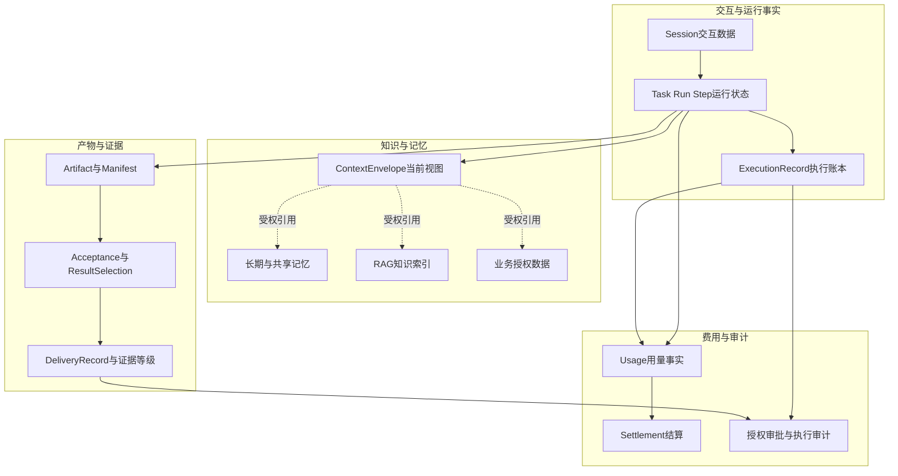

图中的虚线全部是“受权引用”而不是“复制拥有”：上下文对记忆、知识和业务数据的每一次访问都要经过数据与记忆网关的授权，访问时重新验证当前身份、任务范围与撤销状态。实线则是事实归属：运行产生产物，产物进入证据链，证据链与用量最终汇入审计与结算。

### 2.3 分级是治理的前提

九类数据的敏感度差异极大。建议按“泄露影响 × 可修复性”建立数据等级，并让等级直接驱动保留、加密、访问与删除策略：

| 等级 | 典型数据 | 访问默认 | 删除语义 |
|---|---|---|---|
| 高敏感 | 个人身份信息、凭据痕迹、未公开业务数据 | 逐次授权加审计 | 删除权优先，保留例外须显式记录 |
| 中敏感 | 业务报告、记忆条目、知识源内容 | 租户与角色范围 | 按保留策略与来源处置 |
| 低敏感 | 运行状态摘要、用量聚合、遥测样本 | 运营可见 | 按周期清理 |
| 证据类 | 审批、验收、交付、结算记录 | 审计角色可见 | 审计保留期内不可删 |

分级不是一次性打标，而是随流转继承：产物继承其来源数据的最高等级，记忆继承写入内容的等级，摘要继承原文等级。等级只能被显式降级决定下调，不能因为“只是摘要”就自动降级。

---

## 3. 上下文工程的数据侧

上下文工程常被理解为 Prompt 技巧，但在生产平台里，它首先是一个数据组装与授权问题：当前这一步 Agent 能看到什么、以什么形式看到、看到的内容来自哪里、信任等级如何。

### 3.1 ContextEnvelope 是当前视图，不是全量 Session

系列约定：**ContextEnvelope 是当前 Step 可见内容与引用集合，不是全量 Session。** 这个定义排除了两种常见错误：一是把整个会话历史原样塞给模型，导致预算失控、越权内容和过期信息混入；二是把上下文当成 Session 的只读投影，导致压缩、授权和来源治理无处下手。

一个受治理的 ContextEnvelope 至少包含以下分区，每个分区携带独立的预算与来源属性：

| 分区 | 内容 | 来源属性 | 预算优先级 |
|---|---|---|---|
| 任务契约 | 目标、范围、验收条件、截止与预算 | TaskIntent 固定引用 | 最高，不可压缩 |
| AgentSpec 引用 | Prompt、工具描述符、模型路由的版本固定引用 | 版本注册中心 | 最高 |
| 短期工作摘要 | 本 Run 已完成步骤与关键结论的摘要 | 压缩事件与原文引用 | 高 |
| Observation 列表 | 经回程治理的模型、检索与工具结果 | 来源、信任与风险标签 | 高 |
| 检索引用 | RAG 结果的摘要与受权引用 | 知识源版本与信任评分 | 中 |
| 记忆引用 | 记忆条目的摘要与受权引用 | 信任评分与衰减状态 | 中 |
| 产物引用 | 大产物的摘要、digest 与受权引用 | ArtifactManifest | 中 |
| 预算元数据 | 各分区 Token 预算、已用与剩余 | 组装器记录 | 伴随 |

组装是确定性过程：给定 Run 状态、任务契约和预算，组装器按优先级填充各分区，超预算时按策略压缩或降级，全部决策记录为压缩事件。模型看到的内容因此是可重建、可审计的，而不是某次运行时偶然拼出来的字符串。

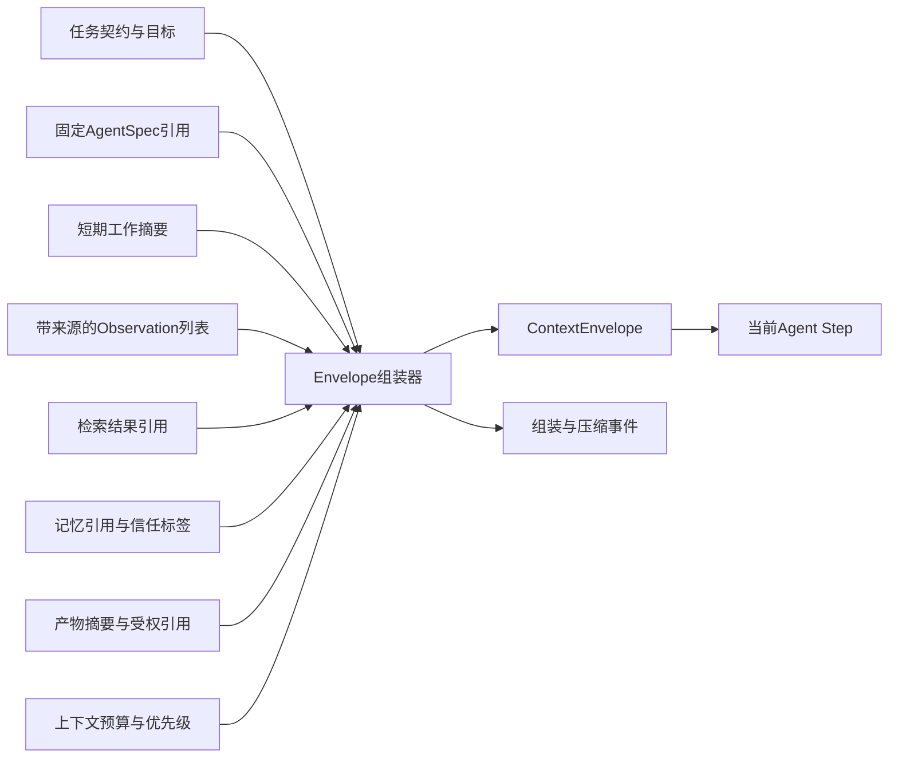

### 3.2 引用传递与重新授权

大对象——数据集、报告、模型输出附件、工具返回的大结果——不进入 Envelope 正文，只传递摘要与受权引用。这带来三个直接收益：事件与状态体积可控；权限随访问时点重新判定；内容扫描可以在访问路径上强制执行。

关键是**访问时重新授权**。组装时有效的授权，到 Step 真正读取内容时可能已经过期：用户权限被撤销、数据等级被上调、租户策略变化。因此引用不携带长期令牌，只携带资源标识与访问意图；真正读取时由数据与记忆网关按当前身份与策略重新判定。

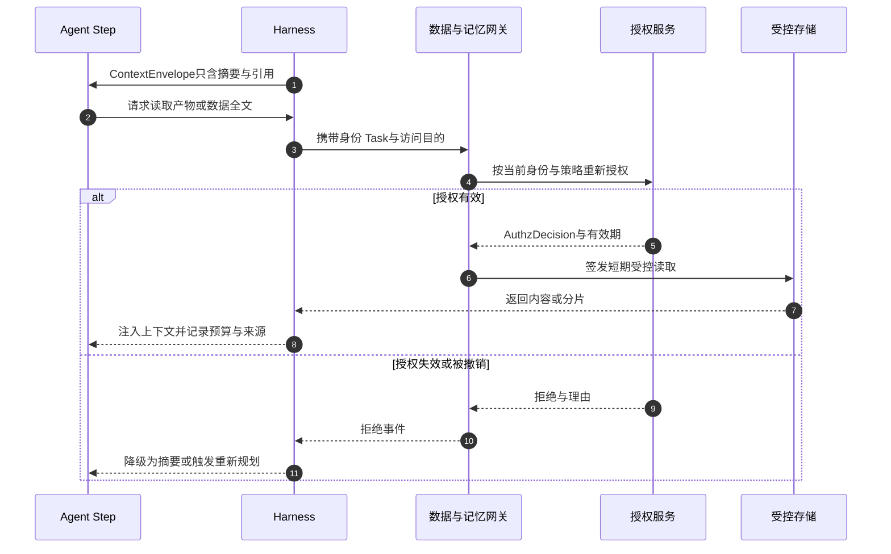

重新授权的失败路径必须显式设计：降级为摘要继续、暂停等待重新授权、或终止当前 Step。绝不能因为“之前授权过”就放行，也不能因为授权服务短暂不可用就对高敏感数据默认放行。

### 3.3 压缩必须保留来源

上下文预算有限，长任务必然触发压缩：历史轮次被摘要化、工具大结果被引用化、过期 Observation 被淘汰。压缩的数据侧风险在于：**摘要会洗掉来源与风险属性。** 一段来自不可信网页的内容，被摘要成流畅的陈述句后，在后续轮次里看起来与平台自身结论毫无区别——这正是上下文污染的温床。

因此压缩遵守三条硬规则：

1. **摘要保留来源与风险属性。** 每条摘要携带原始来源引用、信任等级与风险标签；压缩只改变表达形式，不改变信任语义。
2. **压缩是可追溯事件。** 压缩器记录被压缩对象的引用、压缩策略版本与压缩前后摘要，使审计可以还原“当时 Agent 看到了什么”。
3. **淘汰不等于删除。** 从 Envelope 淘汰的内容仍保留在其原始所有者处，按各自保留策略处置；上下文预算行为不充当任何数据的删除机制。

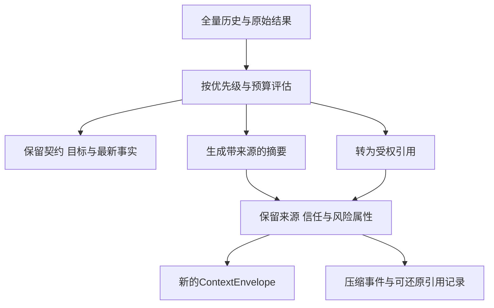

### 3.4 上下文不是记忆

最后一个数据侧边界：内容进入上下文，不等于进入记忆。Envelope 里的任何分区——包括 Agent 自己刚生成的结论——要成为跨会话记忆，必须走第 4 节的记忆写入治理流程。上下文是“此刻可见”，记忆是“长期可信”，两者之间的门必须显式存在。

---

## 4. 记忆体系：写入治理与生命周期

记忆是 Agent 平台最容易被低估、也最容易被污染的数据资产。本节给出记忆的边界划分、写入治理、信任评分、衰减过期、隔离回滚、租户隔离与删除权的完整规则。

### 4.1 短期、长期与共享记忆的边界

| 记忆层 | 范围 | 生命周期 | 所有者 | 典型内容 |
|---|---|---|---|---|
| 短期记忆 | 单个 Run 或 Session | 随运行结束压缩或清理 | Agent Runtime 的 Context 服务 | 工作摘要、中间结论、待办引用 |
| 长期记忆 | 跨会话，绑定用户或 Agent | 受衰减、过期与删除权约束 | 数据与记忆域 | 用户偏好、任务经验、确认过的事实 |
| 共享记忆 | 团队或租户范围 | 受准入与变更治理约束 | 数据与记忆域加租户管理员 | 团队约定、领域术语、流程知识 |

边界规则有三条：

- **短期记忆升级必须过门。** 短期内容要成为长期或共享记忆，必须作为一次显式写入请求通过治理流程，不存在“会话结束自动沉淀”的隐式通道。
- **共享记忆的写入权限高于长期记忆。** 影响一个团队的条目需要更强的审核与变更审计，读取范围也要显式授权给成员与 Agent。
- **记忆层不互相冒充。** 用共享记忆存放某个用户的私人偏好，或用短期缓存承载长期事实，都会让保留与删除策略失效。

### 4.2 写入治理：来源、审核与信任评分

每一条记忆写入都从一个 MemoryWriteIntent 开始，经过固定的治理管线。管线的核心是三个属性：**provenance（来源）、信任评分、租户命名空间。**

来源记录必须回答：这条记忆由谁在什么任务中基于什么内容写入。典型来源类型包括用户显式输入、人工确认的 Agent 提案、Agent 自输出候选、外部内容派生、系统迁移导入。来源类型直接决定审核路径与初始信任分。

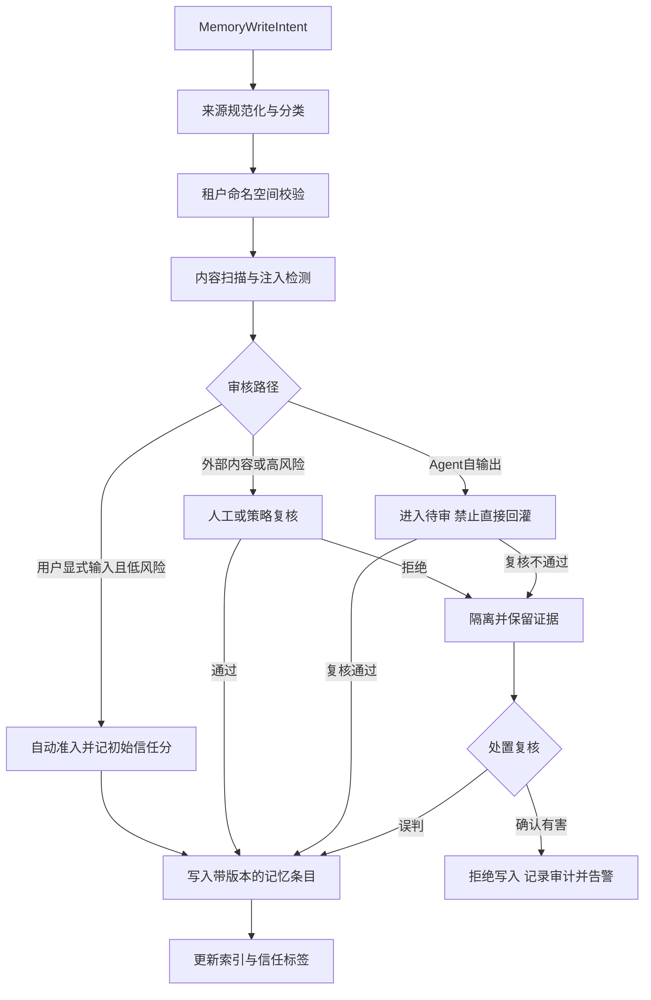

信任评分是一个可解释的复合值，至少考虑：来源类型权重、是否经人工确认、历史引用后的结果质量、衰减系数。评分不是用来“免审”的，而是用来决定检索加权、展示标注与复核周期。**信任标签表达来源与风险，不是免审标签。**

### 4.3 自输出回灌禁令

防 bootstrap poisoning 的规则必须写成平台级硬约束：**禁止 Agent 自输出未经审核回灌可信记忆。** 具体展开为：

- Agent 在 Run 中产生的结论、摘要、计划，只能以“候选”身份进入待审队列，初始状态不可被检索为可信内容；
- 候选记忆被人工或策略确认后才激活，确认动作本身记录为审计事实；
- 允许自动化确认的场景必须由租户策略显式开启，并限定内容类别与风险等级；高风险类别永远保留人工确认；
- 候选记忆之间不允许互相确认，防止多个自输出条目形成自我背书的闭环。

这条规则没有可用性折中空间。让 Agent “自己记住自己说过的话”看似提升连续性，实际是把每一次幻觉与每一次注入都变成持久化资产。

### 4.4 衰减与过期

记忆的价值与风险都随时间变化。衰减机制包括：

| 机制 | 触发 | 效果 |
|---|---|---|
| 时间衰减 | 写入或最后确认后的时长 | 信任分按曲线下降，低于阈值转衰减态 |
| 访问衰减 | 长期未被有效引用 | 降低检索权重，进入过期候选 |
| 冲突消解 | 新事实与旧条目冲突 | 旧条目降权或标记待复核，不静默删除 |
| 策略过期 | 租户设定的保留期限到达 | 进入过期态，按清理流程处置 |

衰减不是删除。衰减态条目仍可被带标注地检索出来供人工复核；只有过期清理与删除权执行才真正移除条目，并留下墓碑记录。

### 4.5 状态机与隔离回滚

记忆条目的生命周期用显式状态机管理：

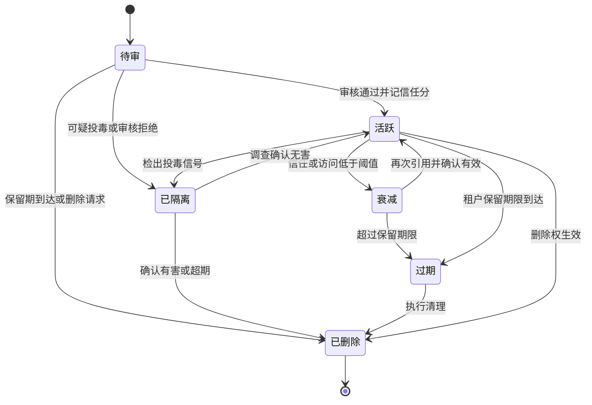

当检出可疑投毒时，隔离必须快于分析：先停止条目参与检索，再做影响面分析。回滚依赖两个前提——记忆条目带版本、索引支持按版本重建。应急流程如下：

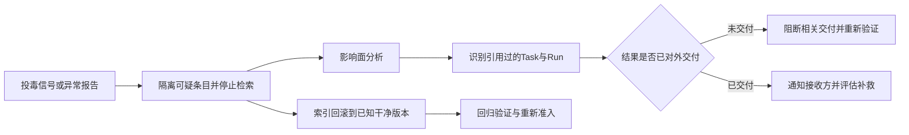

影响面分析的输出不是日志，而是处置清单：哪些 Run 的上下文引用过该条目、哪些产物基于这些 Run、哪些交付已经发生。这与第 7 节的证据链直接衔接——正因为 ResultSelection 固定了 Run 与 Artifact 版本，投毒影响才能被精确定位到具体交付，而不是模糊的“可能受影响”。

### 4.6 跨租户隔离

多租户平台的记忆隔离是强制项，不是优化项：

- 每条记忆条目绑定租户命名空间，检索请求只能命中本租户命名空间；
- 共享记忆是租户内显式授权的结果，不是默认可见；平台级知识若要跨租户共享，必须脱敏并走独立准入流程；
- 索引、缓存与向量存储按租户键隔离，清理与删除操作以命名空间为单位执行；
- 隔离验证纳入生产准入测试：构造跨租户检索请求，预期全部被拒绝并留下审计。

### 4.7 删除权与保留例外

个人信息保护的一般原则——最小化、目的限定、保留期限、删除权——在记忆域的具体含义是：用户有权要求删除与其相关的记忆内容，平台必须能够识别删除范围并执行。但删除权不与审计保留硬碰硬，而是按数据角色拆分处理：

- **记忆正文与个人内容**：执行删除或不可逆匿名化；
- **引用该记忆的业务事实**：保留最小必要字段，将个人内容替换为墓碑引用；
- **审计与证据**：在审计保留期内保留，显式记录保留原因、期限、责任人与访问控制；
- **派生索引与缓存**：随主条目删除同步清理，并验证无跨租户残留。

删除请求本身也是审计事实：谁在何时请求删除了哪个范围、哪些内容被删除、哪些内容因何种例外被保留。第 9 节给出统一的协调流程。

---

## 5. RAG 治理：从来源准入到投毒应急

RAG 把外部知识注入 Agent 的推理过程，本质上是把“平台之外的内容”变成“影响决策的输入”。它的治理强度应当与记忆写入同级，而不是被当成普通的搜索功能。

### 5.1 全生命周期治理管线

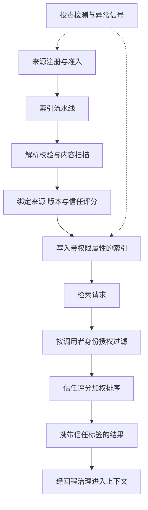

**来源准入。** 每个知识源必须注册：来源类型、责任方、更新方式、风险等级、准入审批。未注册来源不进入索引流水线。外部抓取、用户上传、第三方 feed 是三类风险显著不同的来源，不能共用同一准入策略。

**索引时校验。** 文档解析后经过结构校验、内容扫描与敏感数据处理，再绑定来源、文档版本与信任评分写入索引。索引条目携带权限属性，决定哪些租户、角色与 Agent 可以检索到它。来源文档更新时产生新版本，旧版本保留至回滚窗口结束。

**检索时授权。** 检索不是“查到就给”。数据与记忆网关按调用者的当前身份、Task 范围与知识条目的权限属性过滤结果；授权失效的内容即使语义上最相关也不返回。这一控制点属于第 13 篇定义的数据与记忆网关职责，本篇只强调其数据侧语义。

**信任评分加权。** 信任评分参与排序与配额：高信任来源优先，低信任来源降权、限量或强制带标注。加权参数本身受版本管理与灰度发布约束，避免一次调参改变全平台的知识信任格局。

必须重申系列约定：**检索结果经扫描不证明真实无害；信任标签表达来源与风险，不是免审标签。** 扫描能拦截已知恶意模式，不能判定业务真实性；一条完全“干净”的文档仍然可以包含错误数据或精心构造的诱导内容。进入上下文的结果一律作为带来源的 Observation 对待，Agent 对其执行动作时仍受能力授权与验收约束。

### 5.2 投毒检测与应急

RAG 投毒的信号通常出现在四个层面：

| 信号层面 | 典型信号 | 检测方式 |
|---|---|---|
| 来源层 | 某来源更新频率突增、内容风格突变 | 来源行为基线对比 |
| 索引层 | 新条目与既有知识冲突、嵌入聚类异常 | 冲突检测与聚类分析 |
| 检索层 | 低信任条目命中率异常上升 | 检索统计监测 |
| 运行层 | 引用某文档的任务失败率、拒绝率、异常动作上升 | 任务结果关联分析 |

应急动作按影响面升级：隔离单个文档、暂停整个来源、索引回滚到干净版本、排查受影响任务。应急的前提与记忆域相同——版本化索引与证据链让“回滚”与“影响面分析”成为可执行操作，而不是口头承诺。

### 5.3 RAG 与记忆的边界

RAG 知识是“平台管理的资料”，记忆是“平台沉淀的经验”。两者的治理管线相似，但所有权与删除语义不同：知识源可以整体下架与替换，记忆条目必须逐条处理删除权；知识来自外部文档，记忆来自交互与运行的沉淀。把它们混存在同一个索引里，会让两类保留与删除策略互相污染。

---

## 6. 产物生命周期

Agent 的输出不是聊天文本，而是受管理的 Artifact。第 2 篇已经给出 Artifact 的领域定义，本篇聚焦其数据生命周期：创建、验证、发布、交付、归档与删除。

### 6.1 ArtifactManifest：产物的数据身份证

每个 Artifact 版本伴随一份 ArtifactManifest，字段与系列约定一致：

| 字段 | 说明 | 治理作用 |
|---|---|---|
| artifact_id 与 version | 不可变版本标识 | 证据链锚点 |
| 内容摘要 digest | 内容哈希 | 交付与对账的一致性依据 |
| 大小与类型 | 体积与媒体类型 | 预算、扫描与存储策略 |
| 来源 | 产生它的 task、run、step 与输入数据引用 | 溯源与投毒影响分析 |
| 扫描状态 | 安全扫描、敏感数据与质量验证状态 | 发布门禁 |
| 可见性 | 租户、角色与接收方范围 | 访问时授权 |
| 保留策略 | 保留期限、归档与删除规则 | 生命周期收尾 |

产物内容不可变：版本一经创建，内容只读；任何修改都产生新版本。Manifest 本身的变更，例如扫描状态从“待扫描”变为“通过”，以追加事件记录，不覆盖历史。

### 6.2 状态机

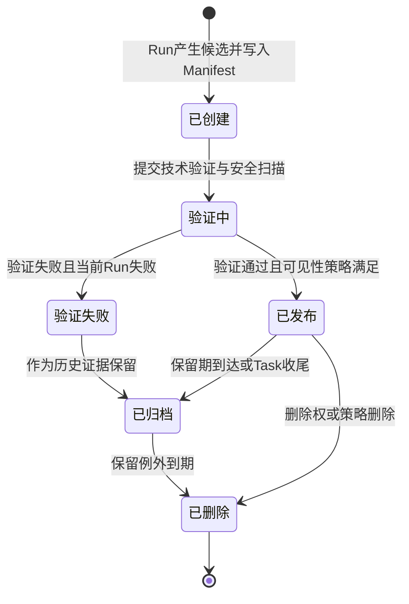

几点说明：验证失败不删除产物，而是让它以失败候选的身份进入归档路径——验收拒绝后的修复需要对照旧版本，审计也需要看到“当时生成了什么、为什么没通过”。“已交付”不是 Artifact 自身的状态，交付事实记录在引用 ResultSelection 的 DeliveryRecord 中；产物是否已经交付、交付到哪一级证据，通过证据链查询得出。

### 6.3 版本与派生关系

修复创建 Repair Run，Repair Run 产生新版本 Artifact，新旧版本之间记录派生关系：

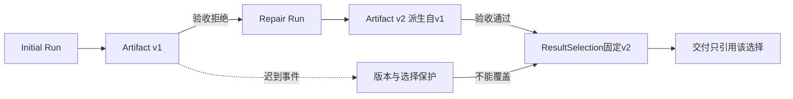

派生关系记录 parent 版本、派生原因与复用的中间产物引用。它支撑三件事：审计可以沿派生链还原修复历史；投毒影响分析可以沿来源链定位所有派生产物；成本归因可以把修复消耗关联到原始任务。

**迟到旧版本事件不能覆盖选择**是硬规则：一旦 ResultSelection 固定了 v2，v1 的迟到验收、迟到扫描结果或迟到交付请求只能作为新事实记录，不能改变当前选择，更不能触发对 v1 的交付。

### 6.4 大产物的引用传递

大产物——数据集、模型权重、视频、压缩包——遵守与上下文相同的引用原则：

- 事件、状态与 ContextEnvelope 中只保存 Manifest 摘要与受权引用，不复制内容；
- 下载、发布或交付时重新检查访问权限，签发短期受控读取；
- 跨系统流转以 digest 校验一致性，接收方验证摘要后才确认接收；
- 中间产物与最终产物分开标记保留策略，中间产物可以在 Run 收尾时清理，被 ResultSelection 引用的版本不行。

### 6.5 归档与删除

归档是存储层级与访问模式的变更，不是证据的消失：归档产物仍可经审批恢复读取，Manifest 与证据链保持在线。删除则受三重约束——保留策略到期、无未决引用、无审计保留例外。被 ResultSelection、审计或法律保留引用的产物，其删除请求转为“标记待删”，例外到期后由清理流程执行，并留下 CleanupRecord。

---

## 7. 验收与交付：作为数据的证据链

验收与交付在第 2 篇已经作为业务闭环展开，本篇从数据角度补齐：证据对象本身也是数据资产，它们的结构、关联与保留决定了平台能否回答“当时到底交付了什么、凭什么”。

### 7.1 三类证据对象

| 对象 | 记录什么 | 关键绑定 |
|---|---|---|
| AcceptanceRecord | 技术验证或业务验收的决定与证据 | 同一 Artifact 版本 |
| ResultSelectionRecord | 固定采用的 Run、Artifact 版本与 Acceptance 证据链 | task_id 与聚合版本 |
| DeliveryRecord | 交付动作的状态与证据等级 | ResultSelectionRecord |

AcceptanceRecord 分两类：技术验证记录格式、Schema、来源覆盖、确定性规则与安全扫描结果；业务验收记录负责人对同一 Artifact 版本的通过或拒绝决定。自动质量评测可以作为证据附在 AcceptanceRecord 上，但除非 Task 政策明确允许，不自动等同业务接受。

### 7.2 ResultSelection：证据链的锚点

Task 在进入交付前创建 ResultSelectionRecord，固定 `task_id、selected_run_id、selected_artifact_id/version/digest、技术验证记录、适用的业务 acceptance_id 或免人工验收的政策依据、选择策略版本`。它的意义在于把三条原本可能漂移的线绑成一个事实：

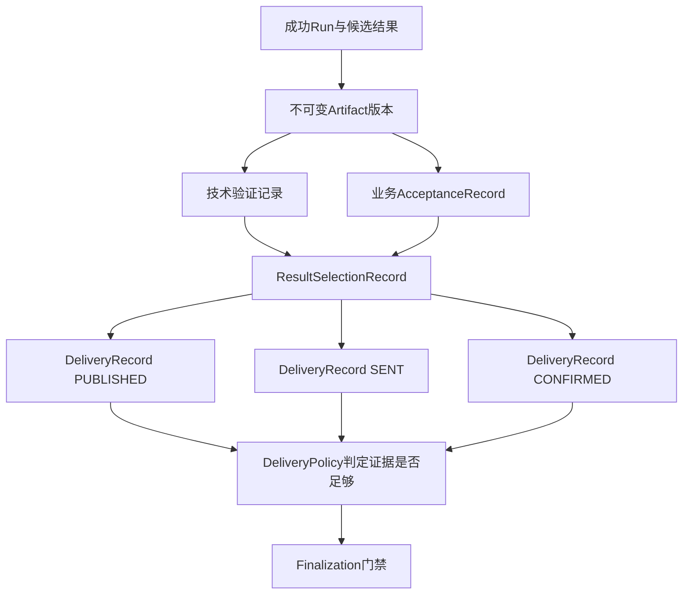

更换选择必须产生新的 ResultSelectionRecord 并显式替代旧选择；已开始的旧 Delivery 需要取消、对账或保留为历史，不能静默改绑到新 Artifact。

### 7.3 交付证据等级

DeliveryRecord 成功时记录 evidence_level，三级语义不可互相替代：

| 等级 | 含义 | 不能证明 |
|---|---|---|
| PUBLISHED | 产物已发布到受管理位置 | 接收方已获取 |
| SENT | 交付渠道已接受发送请求 | 最终送达或已被接受 |
| CONFIRMED | 目标系统或人工确认收到 | 接收方认可内容质量 |

Task 的 DeliveryPolicy 声明哪一级证据足以完成交付。把“生成了文件”写成“业务已经收到并接受”，是交付数据建模中最常见的虚报。

交付结果未知时，DeliveryRecord 进入 UNKNOWN 并对账。对账的关键约定是：**Delivery 对账始终绑定原 ResultSelection，只能恢复 Delivery 或进入交付终态，不能重新执行 Agent。** 交付失败重试的是交付本身，不是重跑模型与产物生成；只有产物失效或验收政策要求时，才走 Repair Run 路径。

### 7.4 证据的保留

验收与交付证据的保留跟随 Task 审计需要：Task 进入终态后，ResultSelection 与其引用的 Acceptance、Delivery、Artifact Manifest 在审计保留期内保持可查询。证据对象不因产物内容被删除权处理而消失——内容可以匿名化或移除，但“某时某刻交付了某 digest 的产物、验收决定是什么”这一事实保留。这正是第 9 节删除协调的基础。

---

## 8. 用量与费用

费用是 Agent 平台最容易被“先跑起来再说”的领域，也是最容易积累隐性债务的领域。系列约定：**Usage 是追加式事实，Settlement 核对消费与调整；未知费用保留未决责任，不静默归零。**

### 8.1 Usage：追加式用量事实

UsageRecord 由各产生点追加写入，平台内至少四个采集点：模型网关记录输入输出 Token 与供应商调用 ID；Execution Runtime 记录 Sandbox、浏览器、GPU、远程作业与第三方 API 用量；交付域记录交付渠道与传输用量；存储与归档服务记录产物占用。

每条 UsageRecord 携带归因键与去重键：

| 键 | 作用 |
|---|---|
| 供应方调用 ID | 与供应方账单对齐 |
| execution_id | 关联逻辑执行事实 |
| producer_event_id | 生产侧事件去重 |
| tenant_id、task_id、run_id | 业务归因 |
| agent_id 与版本、模型与路由、资源池 | FinOps 归因 |

去重规则：按供应方调用 ID、execution_id 与 producer_event_id 的组合去重，重复投递只保留一条；但**去重不拒绝调整**——供应方晚到的更正以新的调整事件追加，不修改原 Usage 记录。追加式账本的价值正在于此：任何时刻的账单都可以从事实重算，任何差异都可以追溯到具体事件。

### 8.2 预算预留与 Settlement

预算从受理开始：可靠受理事务包含预算预留 Reservation；预留失败则受理拒绝。Run 与 Step 在预留额度内获得分配，超预算触发阻断、降级或人工追加——具体策略属于任务风险分级的一部分。

Settlement 记录五类动作：预留、消费、释放、调整、未决登记。

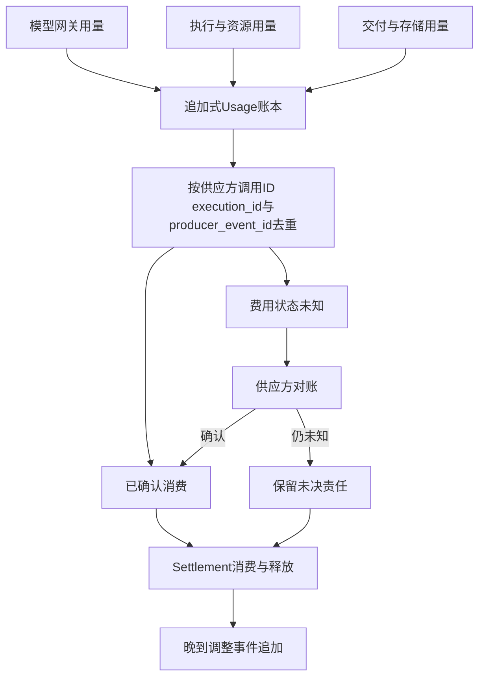

Task 收尾时，未使用额度释放，已确认消费结算，未知费用登记为未决项。未知费用来自两类场景：执行结果 UNKNOWN 导致计费状态不可确认；供应方只提供了部分用量、其余待对账。

### 8.3 供应方对账与调整

供应方账单几乎总是晚于 Run 结束，且可能包含更正。对账协议如下：

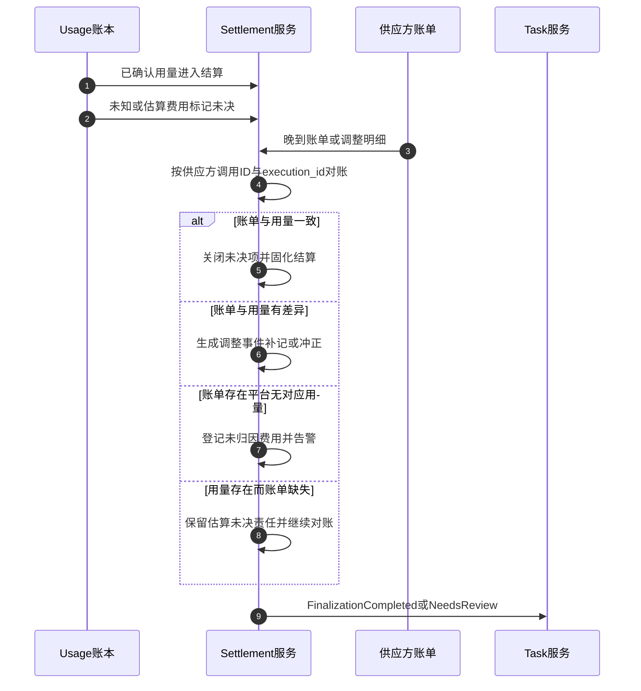

调整事件与原 Usage 分离，保证三件事：原事实不被篡改；差异可以按期间重算；争议发生时平台与供应方各执一份可对质的账本。

### 8.4 未决责任与 Finalization 门禁

未决费用分两档：

- **非阻断未决项**：金额有上界、风险可接受、已显式披露。Task 政策允许时，Task 可以带着这类未决项进入业务终态，未决项转入后台对账队列。
- **阻断性未决项**：涉及财务准确性、额度风险或金额无上界。Finalization 门禁返回 NeedsReview，Task 保持非终态，进入人工处置。

这与第 3 篇的终态协议一致：用量结算与资源治理域只返回 FinalizationCompleted 或 FinalizationNeedsReview，不能自行改变 Task 状态；Task 服务固化 terminal_disposition，终态只能与固定的成功、失败或取消意图一致。**把未知费用静默记成零**因此不是一个实现细节问题，而是破坏终态语义的建模错误：它让“完成”不再可信，也让对账差异永远无法归因。

### 8.5 FinOps 归因

用量事实携带的归因键支撑五个维度的成本视图：

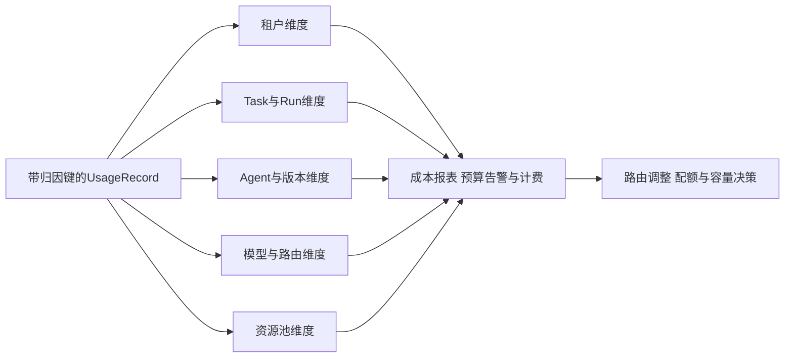

| 维度 | 回答的问题 | 典型动作 |
|---|---|---|
| 租户 | 谁在消费，配额是否健康 | 计费、配额与限流调整 |
| Task 与 Run | 单任务成本，修复与重试占比 | 预算策略与修复上限调整 |
| Agent 与版本 | 哪个版本更贵，贵在哪里 | 发布决策与回滚依据 |
| 模型与路由 | 模型选择与降级策略的成本影响 | 路由策略灰度 |
| 资源池 | Sandbox、浏览器、GPU 等资源水位与单价 | 容量与弹性决策，见第 15 篇 |

共享成本的摊分必须显式声明规则，例如平台公共开销按用量比例摊入租户；摊分规则版本化，避免月度报表之间口径漂移。成本视图的消费方是运营决策，其数据来自用量账本的只读副本或聚合，不反向修改账本事实。更完整的成本运营与 SLO 结合见第 18 篇。

---

## 9. 保留、删除与审计的协调

前面各节分别给出了每类数据的保留与删除语义，本节处理它们相遇时的冲突：删除权要求删，审计要求留，未决责任要求可追溯。

### 9.1 冲突的典型形态

| 冲突 | 错误处理 | 正确处理 |
|---|---|---|
| 用户请求删除记忆，但该记忆被已交付任务引用 | 全删，破坏证据链 | 删除个人内容，保留去标识化的事实骨架 |
| 审计保留期内收到删除请求 | 以审计为由拒绝一切删除 | 拆分数据角色，可删部分立即删除 |
| 产物保留期到达，但存在未决费用 | 直接删除产物 | 未决责任优先，删除转为待删标记 |
| 会话历史到期清理，但其中含待审记忆候选 | 连同候选一起清理 | 候选先走完审核或显式作废 |

### 9.2 协调流程

协调的核心是**先按数据角色分类，再分别适用规则**，而不是对一整条 Task 数据做单一决定：

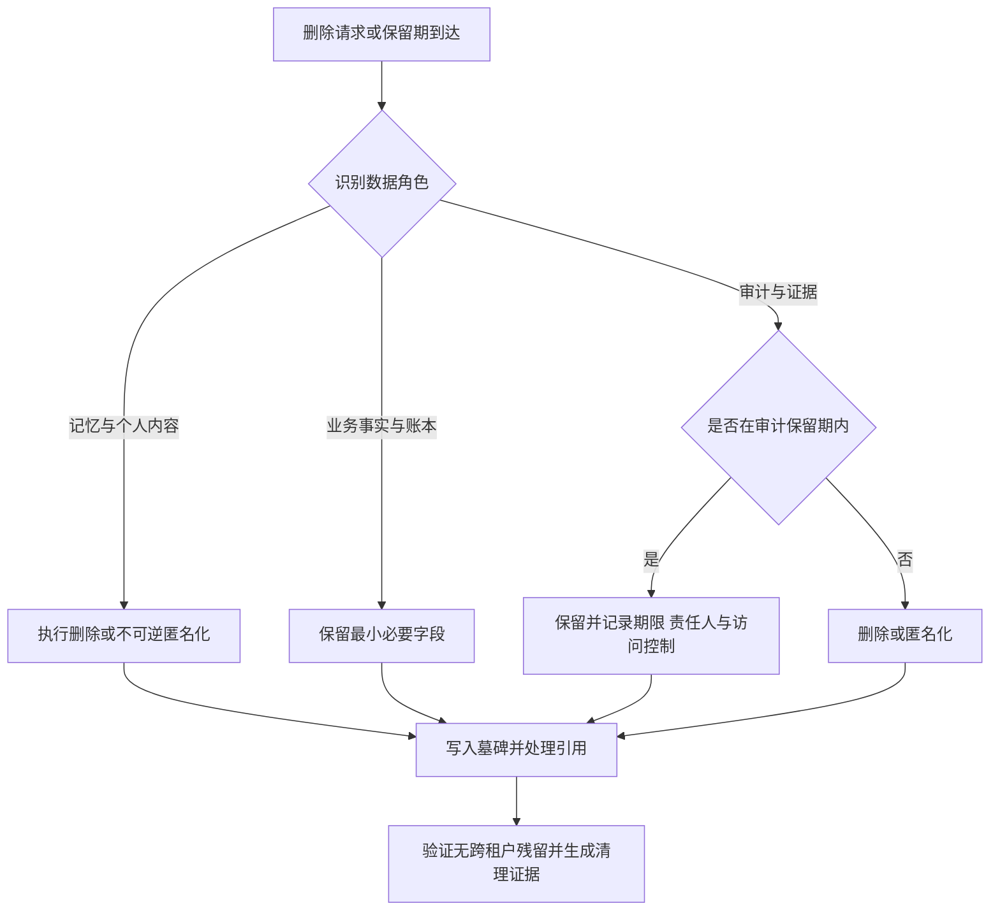

几条关键规则：

1. **删除作用于内容，事实保留骨架。** “某用户在某时删除了某范围数据”本身是审计事实；被删除内容在账本中替换为墓碑引用，骨架字段足以支撑对账与追责，不足以还原个人内容。
2. **保留例外必须显式。** 任何以审计、法律保留或未决责任为由的继续保留，都要记录原因、期限、责任人与访问控制。存在没有期限的“永久保留例外”，等于没有删除权。
3. **删除是跨所有者的协调动作。** 记忆归数据与记忆域、产物归产物验收与交付域、用量归用量结算与资源治理域；清理由资源治理域按第 2 篇的 CleanupRecord 协议协调各所有者执行，Task 服务消费完成事实。部分资源因例外继续存在时，CleanupRecord 记录隔离与待处理责任，而不是标记“全部清理成功”。
4. **个人信息保护按一般原则落地。** 最小化：上下文与记忆只保留任务目的所需；目的限定：为 A 任务采集的数据不为 B 目的复用；保留期限：每类数据有声明的期限与到期动作；删除权：可识别范围、可执行、可验证。本文不引用具体法条编号，也不声称满足某部特定法律；实际合规义务应由企业结合自身适用法规评估。

### 9.3 删除的可验证性

删除权最大的风险是“声称删了”。平台应为每次删除保留可验证证据：删除范围清单、各所有者的执行结果、墓碑与引用处理记录、跨租户残留验证结果。这些证据本身按审计保留期管理。换言之，**证明删除发生的记录，比被删除的内容活得更久**——这是删除权与审计保留能够共存的结构性答案。

---

## 10. 常见反模式

### 10.1 会话表包办一切

Session 历史同时充当记忆、审计、账单与产物存储。结果是：删除任何一类数据都会破坏其他三类；保留策略无法分别声明；会话关闭即丢失业务事实。交互数据只承载交互，业务事实必须落入各自领域对象。

### 10.2 Agent 自输出直接回灌可信记忆

Agent 的结论未经审核成为长期记忆，幻觉与注入被持久化并在后续任务中自我强化。自输出只能作为候选进入待审，禁止自动升级为可信内容。

### 10.3 把“已扫描”当成免审标签

检索结果与记忆条目通过扫描后被视为可信。扫描只降低已知风险，不证明业务真实性；信任标签表达来源与风险等级，进入上下文的内容仍然是带来源的 Observation，动作仍受授权与验收约束。

### 10.4 大对象塞进上下文与事件

产物全文、大数据集被复制进模型上下文、事件和状态记录，导致预算失控、权限随复制扩散、扫描无法在访问点强制。大对象一律摘要加受权引用，访问时重新授权。

### 10.5 压缩洗掉来源

摘要化后的内容失去来源与风险属性，在后续轮次中与平台自身结论无法区分。压缩必须保留来源、信任与风险属性，并记录可追溯的压缩事件。

### 10.6 迟到事件覆盖结果选择

旧 Artifact 版本的迟到验收或交付请求改变了当前 ResultSelection，导致交付版本与验收版本不一致。选择只能被新的显式选择替代，迟到事件只作为新事实记录。

### 10.7 用量直接当账单

模型响应中的用量直接作为结算依据，重复投递重复计费，晚到调整无处落地。Usage 与 Settlement 分离，去重按稳定键，调整以追加事件落地。

### 10.8 未知费用静默归零

执行结果未知的调用按零费用结算，终态看似干净，对账时差异无法解释。未知费用保留未决责任，阻断性未决项由 Finalization 门禁拦截。

### 10.9 删除权与审计硬碰硬

要么以删除权为由删除证据，要么以审计为由拒绝一切删除。正确做法是按数据角色拆分：内容删除或匿名化，事实骨架与审计证据按各自规则保留。

### 10.10 向量库或缓存承担权威状态

把索引、缓存当成记忆或费用的唯一权威。索引可以从来源重建，缓存可以失效；权威事实必须落在具备事务与审计能力的存储中，索引与缓存只是派生视图。

---

## 11. 生产验证场景表

数据与费用侧的架构是否成立，需要用故障与对抗场景验证。以下场景应纳入生产准入测试：

| 验证场景 | 预期事实 |
|---|---|
| Agent 尝试把自输出直接写入可信记忆 | 写入被转为待审候选，直接回灌被拒绝并留审计 |
| 记忆条目被注入恶意指令后触发隔离 | 条目立即停止参与检索，引用过它的任务被识别并处置 |
| 索引回滚到干净版本 | 回滚后检索结果与干净版本一致，受影响交付清单完整 |
| 跨租户检索请求 | 全部被拒绝，命名空间隔离验证通过并留审计 |
| 授权撤销后 Step 请求读取引用内容 | 重新授权拒绝，降级为摘要或重新规划，不放行 |
| 上下文压缩后审计还原 | 可按压缩事件还原当时可见内容与来源属性 |
| 验收拒绝后修复 | 旧 Artifact 保留，Repair Run 产生新版本与派生记录 |
| ResultSelection 固定 v2 后收到 v1 迟到验收 | 选择不被覆盖，v1 不发生交付 |
| 交付回执丢失 | Delivery 进入 UNKNOWN，按渠道句柄对账，不盲目重发 |
| 同一用量事件重复投递 | 按供应方调用 ID execution_id producer_event_id 去重只结算一次 |
| 供应方晚到调整账单 | 生成调整事件，原 Usage 不被修改，期间账单可重算 |
| 执行结果未知的调用收尾 | 费用登记为未决责任，不静默归零 |
| 存在阻断性未决费用的 Task 收尾 | Finalization 返回 NeedsReview，Task 保持非终态 |
| 删除权请求命中已交付任务数据 | 个人内容删除或匿名化，证据骨架与审计保留并记录例外 |
| 产物保留期到达但存在未决引用 | 删除转为待删标记，例外到期后执行并留 CleanupRecord |
| 记忆删除后检查索引与缓存 | 派生视图同步清理，无跨租户残留 |

---

## 12. 架构评审清单

### 数据分类与所有权

- 九类数据是否各有明确的领域所有者、保留策略与删除语义？
- 状态持久化与账本基础域是否只提供持久化，未越界持有业务语义？
- 数据等级是否随流转继承，摘要与派生物是否继承来源等级？

### 上下文数据侧

- ContextEnvelope 是否被实现为当前 Step 的可见内容与引用集合，而非全量 Session？
- 大对象是否只传摘要与受权引用，访问时是否重新授权？
- 压缩是否保留来源、信任与风险属性，压缩事件是否可审计？
- 上下文内容进入记忆是否必须经过显式写入门？

### 记忆治理

- 每条记忆是否具备来源、信任评分与租户命名空间？
- Agent 自输出是否被禁止未审核回灌可信记忆？
- 衰减、过期、隔离与回滚是否有显式状态机与版本化索引支撑？
- 删除权是否可识别范围、可执行、可验证，保留例外是否显式记录？

### RAG 治理

- 知识源是否全部注册准入，未注册来源是否被拒绝索引？
- 索引条目是否携带来源、版本、信任评分与权限属性？
- 检索是否按调用者身份授权过滤，信任评分是否参与加权？
- 投毒检测信号与应急动作是否演练过，包括索引回滚与影响面分析？

### 产物与证据

- Artifact 是否不可变版本并伴随完整 ArtifactManifest？
- ResultSelection 是否固定 Run、Artifact 版本与 Acceptance 证据链？
- 迟到旧版本事件是否无法覆盖选择或触发旧版本交付？
- DeliveryRecord 是否区分 PUBLISHED、SENT、CONFIRMED 并由 DeliveryPolicy 判定充分性？
- 交付 UNKNOWN 是否对账处理，且对账只恢复 Delivery？

### 用量与费用

- Usage 是否追加式采集并按稳定键去重，调整是否以新事件落地？
- 预算预留是否在受理事务内完成，超预算是否有显式策略？
- 未知费用是否保留未决责任，阻断性未决项是否被 Finalization 门禁拦截？
- FinOps 归因是否覆盖租户、Task、Agent、模型与资源池维度，摊分规则是否版本化？

### 保留、删除与审计

- 删除请求是否按数据角色拆分处理，而不是单一整体决定？
- 保留例外是否记录原因、期限、责任人与访问控制？
- 删除与清理是否产生可验证证据，包括跨租户残留验证？

只要存在未经治理的记忆回灌、没有证据链的交付、静默归零的未知费用、或无法验证的删除，就不能认为平台的数据与运营侧已经闭环。

---

## 13. 本篇结论与后续专题

生产级 Agent 平台的数据侧可以概括为一句话：

> **让每一类数据回到自己的领域：交互归会话，事实归账本，经验归受治理的记忆，知识归受准入的索引，产物归不可变的证据链，费用归追加式的账本；删除与保留按数据角色协调，而不是互相绑架。**

具体而言，本篇确立了十条规则：

- 九类数据各有所有者，状态持久化与账本基础域只提供持久化，不拥有业务语义；
- ContextEnvelope 是当前 Step 的可见内容与引用集合，大对象引用传递，访问时重新授权；
- 压缩保留来源与风险属性，淘汰不等于删除，上下文不是记忆；
- 记忆写入必须带来源与信任评分，Agent 自输出禁止未审核回灌，防止 bootstrap poisoning；
- 记忆按状态机管理衰减、过期、隔离与删除，索引版本化支撑投毒回滚与影响面分析；
- RAG 从来源准入到检索授权全程治理，扫描不证明真实无害，信任标签不是免审标签；
- Artifact 不可变版本加 ArtifactManifest，ResultSelection 固定证据链，迟到事件不能覆盖选择；
- 交付区分 PUBLISHED、SENT、CONFIRMED，UNKNOWN 必须对账，对账只恢复 Delivery；
- Usage 追加式去重，Settlement 管理预算与调整，未知费用保留未决责任，终态由 Finalization 门禁把关；
- 删除权与审计保留按数据角色拆分协调，删除留证据，例外有期限。

数据侧的边界清晰之后，下一篇将转向计算侧：Agent 平台的弹性资源架构，讨论模型、浏览器、GPU、Sandbox 与批作业资源池如何独立建模、按信号扩缩，并与本篇的用量归因和成本反馈衔接。可观测、审计与 FinOps 的运营闭环，将在第 18 篇展开。

---

## 参考资料

以下均为官方资料。动态规范和文档会持续更新，实际实现应固定所采用的版本与访问日期。

1. [OWASP Top 10 for Agentic Applications for 2026](https://genai.owasp.org/resource/owasp-top-10-for-agentic-applications-for-2026/)
2. [OWASP Agentic AI Threats and Mitigations](https://genai.owasp.org/resource/agentic-ai-threats-and-mitigations/)
3. [OpenTelemetry GenAI Semantic Conventions Repository](https://github.com/open-telemetry/semantic-conventions-genai)
4. [CloudEvents Specification](https://github.com/cloudevents/spec)
5. [Temporal Workflow Execution](https://docs.temporal.io/workflow-execution)
6. [Google ADK Sessions](https://adk.dev/sessions/)
