# Agent 平台弹性资源架构：资源池、容量与扩缩

> **系列**：生产级 Agent 平台架构 2026 · 第 15 篇  
> **定位**：规模与可靠性篇  
> **版本**：闭环修订版  
> **前置阅读**：第 0 篇《从模型推理到生产运行：2026 年 Agent、Harness 与 Runtime 总体架构》 · 第 3 篇《生产级 Agent 平台总体架构：从主链到功能域》 · 第 4 篇《Agent Runtime：从生命周期到执行治理的完整能力模型》  
> **关键词**：资源池、容量建模、扩缩信号、热池、等待经济学、多租户配额

## 摘要

把 Agent 平台部署到 Kubernetes 上并配置一个基于 CPU 利用率的自动扩缩，是很多团队对“弹性资源架构”的全部理解。这种理解在生产中会迅速失效：Agent 负载的瓶颈几乎从不在 Worker 的 CPU 上，而在模型并发配额、沙箱冷启动时间、浏览器上下文内存、GPU 卡数和外部作业平台队列这些彼此独立、持有时间相差数个数量级的异构资源上。一个 Run 可能在同一分钟内先后消耗模型并发槽、沙箱实例和浏览器上下文，随后因为等待审批进入 WAITING 数小时——此时它不占用任何逻辑 Worker，却可能仍保留着远程作业槽和外部句柄。

本文建立 Agent 平台的弹性资源架构：把逻辑 Worker 池、模型并发池、浏览器池、远程作业与 GPU 池、沙箱池和交付通道建模为六类独立资源池，各自拥有不同的资源单位、持有时间、扩缩信号与故障语义；用统一的 acquire/renew/release/cancel/inspect 接口和 ExecutionProfile 对接供给与需求；用 Little's Law 作为平均稳态估算工具并明确其不能保证 P99 与突发；用队龄、首 Token 延迟、热池命中率、成本消耗速率等信号驱动带迟滞与冷却窗口的扩缩决策；用热池、镜像预热、快照启动和清理流水线压缩沙箱冷启动；用等待经济学回答 WAITING 状态下什么该释放、什么必须保留、什么必须超时回收；并在按量、预留、抢占式资源之间做出与风险匹配的采购组合，配合多租户配额、公平与饥饿防护、池级 bulkhead 控制故障半径。

贯穿全文的约定与系列一致：状态与计算分离，Run 状态独立于实例存活；WAITING 先原子提交等待条件再释放 RunLease 与 Harness Worker，回调只入队；资源池不理解业务目标，不根据工具输出追加 Agent 步骤；沙箱热池只复用经过清理验证的干净环境；会话数、活跃 Run、模型并发与沙箱并发必须分开建模。Kubernetes、虚拟机、Serverless 与托管 Runtime 均为候选实现，本文按能力优先，不指定必选产品。

---

## 1. 问题背景

### 1.1 Agent 负载与传统服务的四个根本差异

传统在线服务的弹性问题相对单纯：请求同质、实例同质、持有时间短、容量单位统一。CPU 和内存利用率能够大致反映压力，水平扩容在分钟级生效就足以覆盖多数突发。Agent 平台打破了其中每一条假设：

- **资源异构**。推进一个 Run 需要的不是单一计算资源，而是一组异构资源的组合：模型推理槽、代码执行沙箱、浏览器上下文、GPU 卡、远程作业队列、交付通道配额。这些资源的供给方、计费方式、启动时间和故障模式完全不同，任何单一信号都无法代表整体压力。
- **持有时间跨五个数量级**。一次模型调用的槽位持有以秒计，一次沙箱执行以分钟计，一个远程训练作业以小时计，而等待审批的 Run 可以挂起数小时到数天。同一个“并发”一词在不同池里含义完全不同。
- **等待是一等公民**。WAITING 状态的 Run 不消耗逻辑 Worker，却可能保留外部作业槽、沙箱工作区和外部句柄。把等待当作“不占资源”会漏掉成本与泄漏风险；把等待当作“占用 Worker”则会浪费最宝贵的调度容量。
- **成本结构随用量形态变化**。模型按 Token 计费，GPU 按卡时计费，沙箱按实例时长计费，交付通道按消息量计费。容量决策同时是成本决策，弹性系统必须能感知费用消耗速率，否则一次失控的重试风暴或热池超配就是一次预算事故。

### 1.2 为什么 CPU 利用率不是 Agent 平台的扩缩信号

Harness Worker 在多数时间里做的事情是：提交状态、等待模型流式响应、等待工具回执、等待回调。它的 CPU 利用率通常很低，而平台可能已经因为模型并发配额耗尽、沙箱热池见底或作业队列积压而实际瘫痪。反之，一次 CPU 密集的代码执行发生在沙箱里而不是 Worker 里，扩 Worker 毫无意义。因此本文的核心立场是：

> **每类资源池用自己的信号扩缩自己的容量；全局只用配额、预算和故障域协调，不存在一个统一的“集群利用率”信号。**

### 1.3 容量必须分开建模

这是系列自总纲起就确立的约定，本篇将其展开为完整方法：

- 在线会话数不等于活跃 Run 数：大量会话并不产生任务；
- 活跃 Run 数不等于逻辑 Worker 并发：WAITING 的 Run 不占 Worker；
- 逻辑 Worker 并发不等于模型并发：一个 Worker 在某一时刻通常只发起有限的模型调用，而模型侧还受供应方速率限制；
- 模型并发不等于沙箱并发、浏览器上下文或 GPU 请求：它们由不同的 ExecutionSpec 触发，持有时间和回收方式都不同；
- 等待状态不占逻辑 Worker，但可能保留外部资源与句柄：这部分占用必须被显式记账，而不是从容量模型中消失。

### 1.4 本篇范围与非目标

本篇回答：资源池如何建模、接口与 Profile 如何定义、容量如何估算、扩缩信号与决策如何设计、热池如何运转、等待的资源经济学如何权衡、成本与弹性如何取舍、多租户如何治理、资源故障域如何切分。请求级背压与队列机制细节属于第 16 篇高并发专题；多可用区容灾与 RPO/RTO 属于第 17 篇；沙箱内部的隔离与安全机制属于第 08 篇，本篇只讨论沙箱池的水位、预热与复用。

---

## 2. 资源池模型

### 2.1 资源池全景

Agent 平台的资源面可以画成一张全景图：任务经配额准入和有界队列进入调度，逻辑 Worker 池承载 Run 推进，Worker 在执行当前 Step 时按需向各专业资源池申请资源，所有池的容量与成本信号汇聚回来驱动扩缩与准入调整。

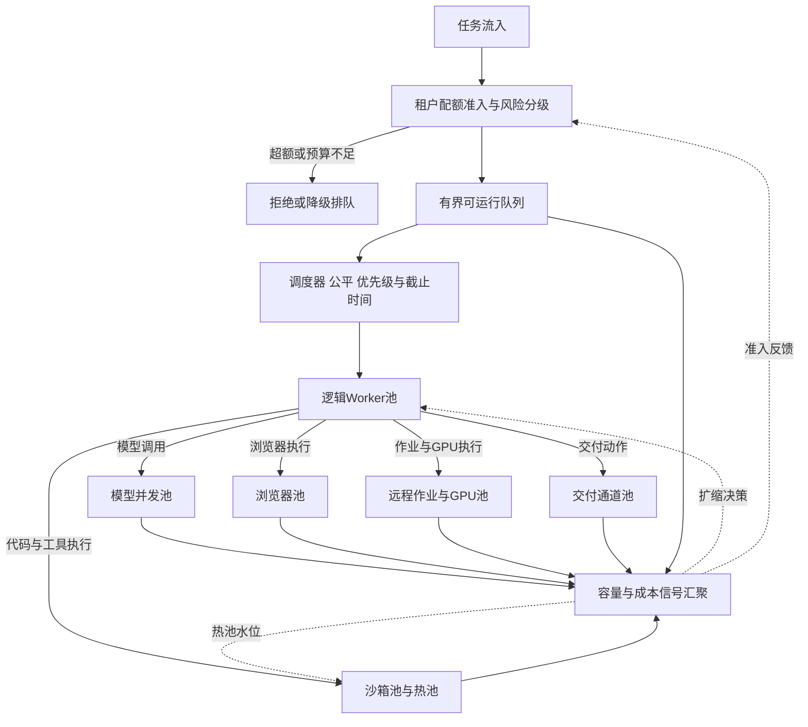

这张图有三个要点：其一，资源池位于执行面，Worker 通过 Execution Runtime 申请资源，而不是直接操作实例；其二，信号汇聚是全局的，但执行动作是按池独立的；其三，准入层消费反馈信号，容量不足时先收紧准入而不是让队列无限增长。

### 2.2 六类资源池

| 资源池 | 资源单位 | 典型持有时间 | 容量约束来源 | 扩缩特征 | 故障语义 |
|---|---|---|---|---|---|
| 逻辑 Worker 池 | Harness Worker 或一次 Invocation 处理槽 | 秒到分钟，按事件批次 | 队列深度与 Run 推进速率 | 无状态水平扩展，弹性快 | 崩溃由租约接管，Run 状态不丢 |
| 模型并发池 | 模型请求槽、并发数与 Token 预算 | 秒到分钟 | 供应方速率限制或自建推理容量 | 受外部配额或 GPU 限制，弹性慢 | 超时可能已计费，重试需预算校验 |
| 浏览器池 | 浏览器实例与上下文 | 分钟级 | 内存与 CPU、目标站点限制 | 有状态，上下文用后即毁 | 上下文残留带来跨租户泄漏风险 |
| 远程作业与 GPU 池 | 作业槽位、GPU 卡或显存份额 | 分钟到小时 | 作业平台队列、GPU 库存 | 启动慢、成本高、弹性受限 | 作业状态在外部，需查询与对账 |
| 沙箱池 | 容器、microVM 或虚拟机实例 | 秒到小时 | 镜像启动时间、节点库存 | 热池加冷启动，弹性中等 | 必须清理验证后才可复用 |
| 交付通道池 | 消息发布、通知与投递通道配额 | 秒级 | 通道方速率限制与审核策略 | 跟随通道容量，平台侧轻 | 投递 UNKNOWN 需按通道对账 |

> **与总纲资源分类的映射**：总纲把资源分为计算、模型、浏览器、作业、隔离、API/MCP 与交付通道七类。本文六类池中，模型、浏览器、作业、沙箱（隔离）与交付通道五类与总纲一一对应；总纲的"计算"在本文化解为逻辑 Worker 池（无状态事件计算）与远程作业/沙箱池（有状态或隔离计算）两类；总纲的"API/MCP 调用通道"容量并非独立资源池——普通 API/MCP 调用的并发与限流由沙箱池、Worker 池与执行网关共同约束，只有承载"交付"语义的通道才单列为交付通道池。

下面分别说明各池的关键设计点。

**逻辑 Worker 池**是唯一“理解 Run 推进”的池。它承载 Harness 与 Runner 的事件处理：领取 RunLease、装载状态、推进一轮事件循环、提交结果。Worker 本身无状态，崩溃后由新 Worker 接管租约继续推进，因此它是所有池里扩缩最快、故障代价最低的一类。它的关键容量问题不是 CPU，而是“队龄”——可运行 Run 从入队到取得租约的等待时间。WAITING 语义的正确实现决定了这个池的效率：等待审批、远程作业或长定时器时，先原子提交 WAITING 与等待条件，释放 RunLease 与 Worker，回调只入队，新 Worker 重新取 lease 推进。如果等待不释放 Worker，逻辑 Worker 池会被长尾等待全部占满，表现为“CPU 很低但任务不动”。

**模型并发池**的容量单位不是实例而是并发槽与 Token 预算。使用外部模型服务时，容量上限由供应方的速率与并发配额决定，平台侧能做的是请求整形、优先级路由、降级路由与排队；使用自建推理时，容量由 GPU 与推理框架的批处理能力决定，扩缩以卡或副本为单位，速度远慢于 Worker。模型池的独特之处在于：请求即使超时或被取消，供应方也可能已经计费，因此重试与降级都必须经过预算校验，扩缩与成本信号强耦合。

**浏览器池**的资源单位是浏览器上下文而非进程。一个实例可以承载多个隔离上下文，但每个上下文都消耗可观内存，并可能残留 Cookie、存储与登录态。因此浏览器池的回收语义是“上下文用后即毁”，实例可以复用，上下文必须销毁；跨租户复用上下文是不可接受的。

**远程作业与 GPU 池**的持有时间最长，且真实状态存在于外部作业平台。平台持有的只是 ExternalHandle 与查询、取消责任。GPU 资源的约束维度也最复杂：卡数、显存、拓扑与镜像准备都会影响可调度性。这个池的扩缩往往不是“平台想扩就能扩”，而是受库存、采购周期和作业平台配额约束，容量规划必须提前做。

**沙箱池**是 Agent 平台最有特色的资源池：执行不受信代码需要强隔离，强隔离环境的创建又很慢，于是产生了热池、快照启动与清理复用这一整套机制。第 6 节专门展开。

**交付通道池**容易被遗漏。产物发布、消息通知、邮件与 IM 投递都有通道侧速率限制、审核策略与回执语义。交付动作同样经过 Execution Runtime 与执行账本，通道配额应作为独立容量维度管理，交付 UNKNOWN 按第 3 篇的对账语义处理。

### 2.3 池的边界原则

资源池的边界约定与第 4 篇一致，这里从资源架构角度重申其理由：

- **资源池不理解业务目标**。池只认识 ExecutionProfile 与 ExecutionSpec：能力要求、资源限额、隔离等级、截止时间。它不知道当前 Run 要完成什么业务，也不应该知道。
- **资源池不根据工具输出追加 Agent 步骤**。沙箱看到 stdout、浏览器看到网页内容、作业看到日志，都不构成发起新动作的理由。任何后续步骤只能由 Harness 在消费 Observation 后产生新的 Intent，再走治理链下发。这是防止执行面绕过主链的底线。
- **池对上的承诺是资源语义而非业务语义**：acquire 成功表示资源已绑定，不表示动作会成功；release 表示资源归还，不表示副作用已回滚；cancel 表示停止请求已发出，不表示外部动作已撤销。

这些边界让每个池可以被独立替换、独立扩缩、独立测试。Kubernetes 节点池、虚拟机集群、Serverless 容器或托管 Runtime（例如 AgentCore Runtime 这类候选实现）都可以作为某类池的底层实现，只要它满足对应的接口与故障语义。

---

## 3. 资源池通用接口与 Profile

### 3.1 通用接口

所有资源池对 Execution Runtime 暴露同一组接口，与第 4 篇 Runtime 能力模型中的定义保持一致：

| 接口 | 目的 | 关键输入 | 成功返回 | 失败语义 |
|---|---|---|---|---|
| acquire | 申请资源并绑定租户与 Run | profile、tenant、run、deadline | resource_handle 或明确的排队位次 | 显式拒绝或有界等待，绝不无限阻塞 |
| renew | 延长资源持有 | resource_handle | 新的到期时间 | 返回收回预告，调用方必须准备释放 |
| release | 归还资源 | resource_handle 与清理状态 | 回收确认 | 回收失败进入清理对账，不静默吞掉 |
| cancel | 取消在途执行 | execution_handle | 取消状态与残留用量 | 取消结果 UNKNOWN 时进入对账 |
| inspect | 查询资源与执行状态 | execution_handle | 状态、用量与健康信息 | 查询失败不改变资源状态 |

除这五个操作接口外，每个池还必须暴露四类**信号**：能力声明（支持哪些 Profile）、配额状态（租户与全局剩余）、健康度（错误率、延迟、实例状态）与费用信号（单位成本与当前消耗速率）。信号是扩缩决策与准入控制的输入，第 5 节展开。

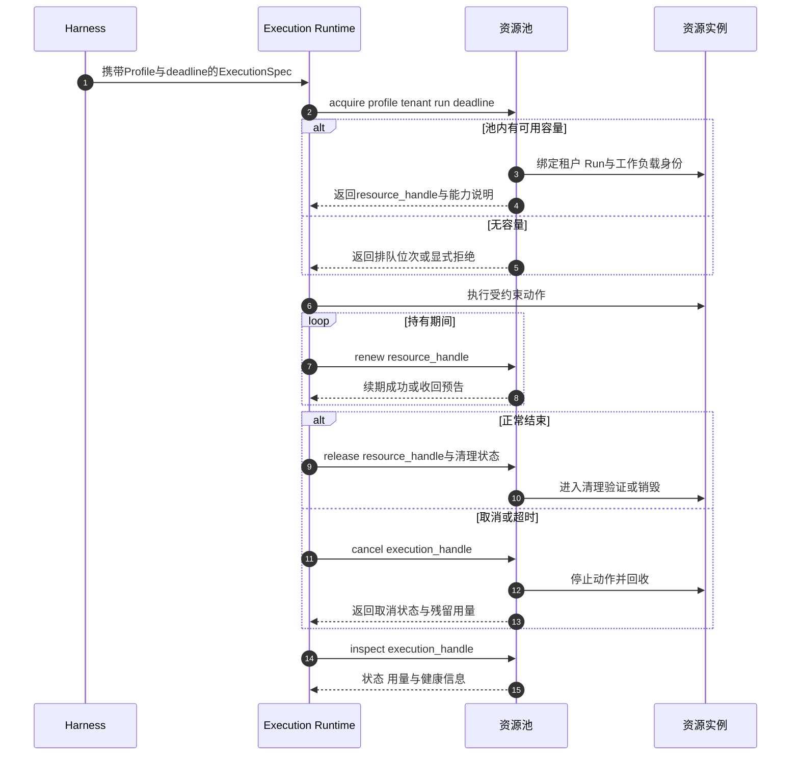

接口设计有几条必须遵守的纪律：

1. **acquire 必须有 deadline 且有界等待**。资源不足时返回排队位次或显式拒绝，让调度侧决定等待、替代还是降级；无限阻塞会把资源短缺放大为 Worker 饥饿。
2. **renew 是显式持有契约**。长持有资源不靠“默认永久占用”，而靠周期续租；续租失败即收到收回预告，调用方必须提交状态并释放。这与 RunLease 的租约思想同构：平台里不存在无主的永久资源。
3. **release 携带清理状态**。调用方告知池该实例发生过什么级别的状态写入（只读、工作区写入、网络会话建立等），池据此决定清理深度。清理验证属于第 6 节的热池机制。
4. **cancel 不承诺外部撤销**。取消是平台侧意图，外部系统可能不支持取消或动作已完成；残留用量照常记账，结果 UNKNOWN 进入对账。
5. **inspect 是无副作用查询**。接管、对账和超时回收都依赖它，它的可用性应高于执行路径本身。

### 3.2 ExecutionProfile：需求侧资源画像

ExecutionProfile 是绑定在 ExecutionSpec 上的资源需求声明，由 AgentSpec 中的资源要求与执行时治理约束共同确定。它回答“这次执行需要什么样的资源”，而不是“去哪台机器”。

| 字段组 | 内容 | 示例 |
|---|---|---|
| 能力要求 | 执行类型、运行时、设备需求 | 代码执行 Python、浏览器交互、GPU 作业 |
| 隔离等级 | 与租户风险等级匹配的隔离要求 | 共享池、租户专用、强隔离单机 |
| 资源限额 | CPU、内存、磁盘、时长、输出上限 | 2 核、4GiB 内存、600 秒、输出 50MB |
| 网络策略 | 入站与出站约束 | 无入站、默认拒绝出站、出口白名单 |
| 生命周期 | 最大持有时间、是否可续租、回收策略 | 最大持有 30 分钟、可续租一次 |
| 成本属性 | 计费单位、预算引用、可抢占性 | 按分钟计费、可被高优先级抢占 |
| 数据驻留 | 区域与数据驻留约束 | 限定区域内执行 |

三类典型 Profile 示例：

| Profile | 能力要求 | 隔离等级 | 生命周期 | 适配池 |
|---|---|---|---|---|
| 轻量代码执行 | Python 运行时、只读根加独立工作区 | 共享热池、租户绑定 | 最大 10 分钟、超时即收 | 沙箱池热池 |
| 浏览器交互 | 无头浏览器、受控出站 | 上下文独占、用后即毁 | 最大 20 分钟 | 浏览器池 |
| GPU 训练作业 | GPU 卡、大磁盘、长时限 | 租户专用或作业平台隔离 | 小时级、可续租、可抢占标记 | 远程作业与 GPU 池 |

### 3.3 Profile 与池的匹配

匹配器根据 Profile 的能力、隔离等级、区域约束与各池的注册信息、健康度和水位选择目标池。匹配发生在执行时，但候选范围由控制面预先约束，不允许运行中的 Agent 临时扩大资源要求。

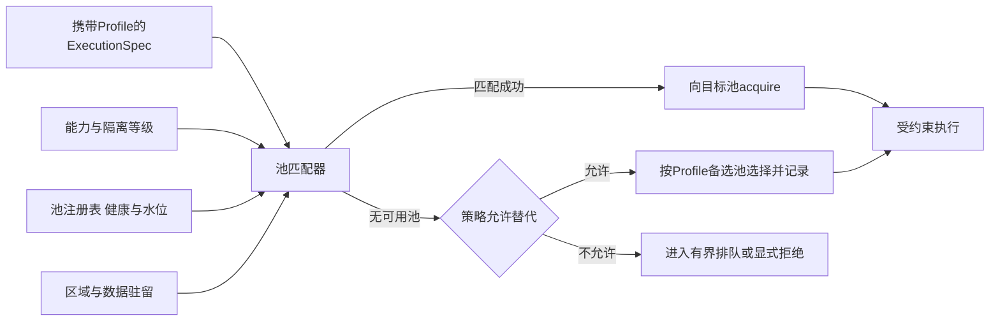

匹配规则要显式记录在执行账本中：哪个 ExecutionSpec 被路由到哪个池、是否发生替代、替代理由是什么。这既是审计要求，也是容量分析的原始数据——“某类 Profile 长期排队”是扩池或改 Profile 的直接依据。

---

## 4. 容量建模

### 4.1 容量维度分离

把容量拆成互不替代的维度，是 Agent 平台容量规划的第一步。每个维度有自己的观测信号，任何两个维度之间的固定换算比例都是假象。

| 容量维度 | 含义 | 易被混淆为 | 独立观测信号 |
|---|---|---|---|
| 会话数 | 在线交互上下文数量 | 活跃 Run 数 | 会话活跃分布，多数会话不产生任务 |
| 活跃 Run 数 | 处于非终态的 Run 数量 | Worker 需求 | Run 状态分布，含 RUNNING 与 WAITING |
| 逻辑 Worker 并发 | 持有 RunLease 推进中的 Worker 数 | 活跃 Run 数 | 租约等待时间与队龄 |
| WAITING Run 数 | 等待审批、作业或回调的 Run | 不占任何资源 | 等待时长分布与保留资源清单 |
| 模型并发 | 进行中的模型请求槽 | 请求 QPS | 首 Token 延迟、Token 速率、配额余量 |
| 沙箱并发 | 已绑定使用中的沙箱实例 | 热池水位 | 命中率、冷启动率与排队 |
| 浏览器上下文数 | 使用中的浏览器上下文 | 浏览器实例数 | 上下文内存与存活时长 |
| 作业与 GPU 槽位 | 被占用的作业槽与 GPU 卡 | 作业提交速率 | 外部队列长度、显存占用 |

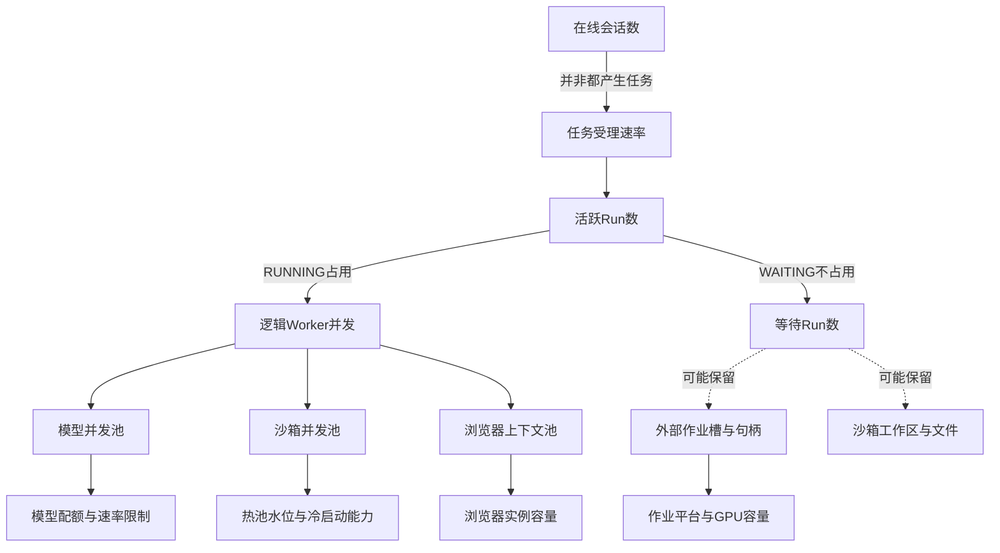

一个常见的规划错误是拿“日活会话数”直接推导 Worker 数量。正确的链条是：会话数乘以任务产生率得到任务到达率；任务到达率乘以平均 Run 时长得到活跃 Run 的均值；活跃 Run 中 RUNNING 的比例才决定 Worker 并发需求；而模型、沙箱、浏览器需求又要从 Step 级别的调用频率单独推导。每一层转换都有自己的比例系数，都必须用生产数据校准。

### 4.2 Little's Law：平均稳态估算

容量估算的基本工具是排队论中的 Little's Law。其表述必须严谨：**在稳态系统中，长期平均被占用的资源数约等于到达率乘以平均占用时间**，即：

> 活跃数 ≈ 到达率 × 平均占用时间

对 Agent 平台的每个资源池，这个公式给出平均水位：模型池平均并发 ≈ 模型调用到达率 × 平均单次调用时长；沙箱池平均占用 ≈ 沙箱 acquire 到达率 × 平均持有时长；作业槽平均占用 ≈ 作业提交速率 × 平均作业时长。

举例说明（数字仅为方法演示，不代表任何产品性能）：

| 资源池 | 到达率 | 平均占用时间 | 平均占用估算 | 备注 |
|---|---|---|---|---|
| 模型调用槽 | 每秒 20 次 | 6 秒 | 约 120 并发 | 长尾调用可达分钟级，需另留余量 |
| 沙箱 acquire | 每秒 5 次 | 90 秒 | 约 450 实例 | 复用率与热池决定实际配置 |
| 浏览器上下文 | 每秒 2 次 | 150 秒 | 约 300 上下文 | 内存才是真实约束维度 |
| 远程作业槽 | 每秒 0.5 次 | 20 分钟 | 约 600 槽位 | 受作业平台容量与预算双重约束 |

同时必须明确 Little's Law 的适用边界：

- **它是平均稳态估算**。公式成立的前提是系统长期稳定，结论描述的是长时间平均，不是任意时刻的瞬时值。
- **它不能保证 P99**。平均占用 120 并发不回答“99 分位时刻需要多少并发”。占用时间的分布形状决定尾部并发，平均数会系统性低估长尾。
- **它不能应对突发**。营销活动、定时批量任务、重试风暴都会在短时间内让到达率数倍于均值，稳态公式对突发窗口内的积压没有预测力。
- **它不能替代负载测试**。容量配置应在稳态估算之上叠加突发系数与长尾余量，再用接近真实负载模型的压测验证，包括混合 AgentSpec、真实上下文大小与真实的池间依赖。

### 4.3 到达率、占用时间与长尾

Agent 负载的占用时间分布几乎都是重尾的：绝大多数模型调用在数秒内完成，少数复杂推理或降级重试会拖到分钟级；绝大多数沙箱执行在几分钟内结束，少数数据处理任务会逼近最大时限。容量规划要分别处理三段：

1. **均值段**用 Little's Law 定基线，决定稳态成本；
2. **突发段**用历史峰值到达率与弹性速率的差值定缓冲，决定需要预留多少“来不及扩出来”的容量；
3. **长尾段**用占用时间的 P99 而非均值定上限，因为尾部占用会长期扣住资源，挤压后续请求。

一个实用经验是：对持有时间短、弹性快的池（Worker、模型请求整形层），突发缓冲可以小一些，让弹性跟上；对持有时间长、弹性慢的池（GPU、作业槽、强隔离沙箱），必须按长尾占用预留更多固定容量，因为突发来临时根本来不及扩。

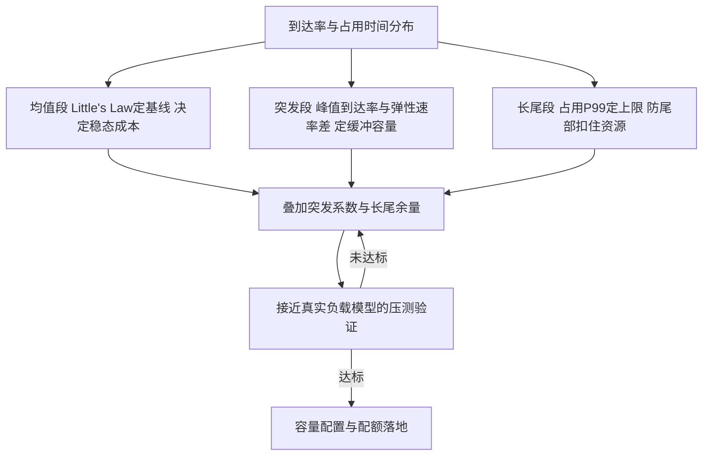

三段法的产出不是单个数字，而是一个带验证回路的配置过程：基线、缓冲与上限叠加后必须经过压测确认，未达标则回到估算修正参数。

### 4.4 按租户与风险分级配额

容量模型最后要落到配额上。配额分两层：

- **准入配额**在任务受理时检查：租户并发 Run 上限、提交速率、预算余额。它决定任务能否进入队列，属于第 3 篇接入与任务域的职责。
- **运行时配额**在资源 acquire 时检查：每租户在每类池的并发上限、每任务的资源上限、每风险等级的池访问权限。它决定资源能否被取得，属于本篇资源池的职责。

| 配额层 | 作用对象 | 示例 | 超限处理 |
|---|---|---|---|
| 平台级 | 全局容量护栏 | 全局并发与总预算上限 | 拒绝新准入并告警 |
| 租户级 | 租户并发、速率、预算 | 并发 Run 上限 200 | 有界排队或显式拒绝 |
| Agent 级 | 单个 AgentSpec 版本 | 高风险 Agent 并发 20 | 降级路由或拒绝 |
| 任务级 | 单个 Task 资源上限 | 沙箱实例不超过 5 个 | 拒绝超限 ExecutionSpec |
| 风险等级 | 按任务风险分级 | 高风险任务仅可用专用隔离池 | 路由到隔离池或拒绝 |

风险分级与配额的结合是重点：高风险任务（不受信代码执行、敏感数据访问、不可逆外部动作）不仅授权更严格，资源上也应进入隔离程度更高的池，并配置更紧的并发上限与更短的持有上限。配额因此不只是容量工具，也是安全工具。

---

## 5. 扩缩信号与决策

### 5.1 信号清单

系列自总纲起确立的弹性信号清单，在本篇落到具体池与误用警示：

| 信号 | 所属池或环节 | 说明什么 | 常见误用 |
|---|---|---|---|
| 队龄 | 可运行队列 | 调度延迟与容量缺口 | 只看队列长度，忽略优先级差异 |
| 活跃 Run 数 | Runtime 全局 | 逻辑负载水平 | 与 Worker 需求直接画等号 |
| 模型首 Token 延迟与 Token 速率 | 模型并发池 | 模型侧压力与退化 | 只盯错误率，忽略渐进变慢 |
| 沙箱热池命中率 | 沙箱池 | 预热是否跟上需求 | 盲目追求高命中率忽略成本 |
| GPU 显存与利用率 | GPU 池 | 硬件饱和程度 | 利用率高不等于队列健康 |
| 外部作业排队长度 | 作业平台 | 外部容量缺口 | 与平台自身队列混淆 |
| 费用消耗速率 | 全局 | 预算压力与异常消耗 | 只在月度账单后才复盘 |
| 租约等待时间 | Worker 池 | Worker 供给缺口 | 与模型延迟混为一谈 |
| 交付通道拒绝率 | 交付通道 | 通道侧限流 | 与业务投递失败混淆 |
| 清理流水线速率 | 沙箱池回收侧 | 复用速率与"只出不进"风险 | 只看命中率、忽略回收吞吐 |

几点关键判断：

- **队龄是 Worker 池的第一信号**。它直接度量“用户感知的等待”，比队列长度更能反映真实压力，因为它天然包含了优先级与公平性的影响。
- **模型池要看延迟而不只是成功率**。供应方限流往往先表现为首 Token 延迟上升和 Token 速率下降，随后才是显式拒绝。等错误率告警再扩容已经晚了。
- **热池命中率是沙箱池的复合信号**。命中率下降可能因为需求上涨、清理流水线变慢或模板变更导致批量重建，三种原因的处置完全不同，需要结合冷启动原因细分。
- **费用消耗速率是负反馈信号**。它不驱动扩容，而是约束扩容与收紧准入，是弹性系统与 FinOps 的接口。

### 5.2 扩缩反馈回路

扩缩系统本身是一个控制回路：信号采集、状态估计、策略决策、动作执行、再反馈。必须按控制回路来设计，就要回答稳定性问题——迟滞、冷却与步长缺一不可。

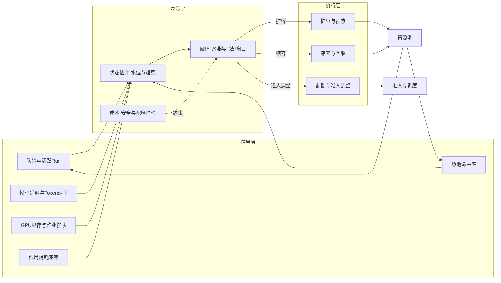

### 5.3 决策规则

**阈值加迟滞**。扩容阈值与缩容阈值必须分开，且中间留出迟滞带。例如沙箱热池在命中率低于目标且冷启动排队超过阈值时扩容，在水位持续高于上限且命中率富余时缩容。若扩缩共用一个阈值，系统会在阈值附近持续震荡。

**观察窗口与冷却窗口**。每个决策都要求信号在观察窗口内持续成立（例如连续三个采样周期），动作执行后进入冷却窗口，冷却期内同方向不再重复动作。扩容冷却防止重复超调，缩容冷却防止来回抖动。两类冷却应独立设置：扩容冷却通常短（尽快响应压力），缩容冷却通常长（避免缩了又扩）。

**步长策略**。扩容按比例或按批（一次补充热池一批实例），缩容按小步渐进并优先回收最空闲、最低成本的实例。对启动慢的池，扩容步长要覆盖“下一次突发”，因为扩出来之前压力不会等你。

**快扩慢缩**。这是非对称原则：扩容路径尽量快（预热、缓冲、快速镜像分发），缩容路径必须慢（确认无在途持有、完成清理、过冷却）。Agent 负载的突发往往来自一次任务触发的连锁工具调用，来得快且不可预测，缩容节省的成本永远不该以错过突发为代价。

**预测与计划扩容**。对已知模式（工作日早高峰、定时批量评测、营销活动），用计划任务提前扩容和预热，而不是等信号触发。预测扩容不取代反应式扩缩，而是把可预测的部分从反应式路径里拿走。

**抢占式与降级联动**。当成本护栏或库存约束触发时，决策层可以抢占低优先级可中断任务（先 Checkpoint 再释放），或把新请求路由到降级 Profile。降级必须保持数据驻留、工具权限与验收标准不变，这是总纲确立的约束。

### 5.4 分池扩缩特征汇总

| 资源池 | 主要扩容信号 | 主要缩容信号 | 弹性速度 | 冷却与注意事项 |
|---|---|---|---|---|
| Worker 池 | 队龄、活跃 Run | 队龄持续低位 | 快 | 缩容冷却短，但需确认租约交接完成 |
| 模型并发池 | 首 Token 延迟恶化、排队 | 并发持续低位 | 取决于供应方或 GPU | 配额变更可能延迟生效，需提前申请 |
| 浏览器池 | 上下文等待时间 | 空闲实例占比 | 中 | 缩容回收必须先毁上下文 |
| 作业与 GPU 池 | 作业排队、显存饱和 | 空闲卡与成本信号 | 慢 | 抢占式实例有收回风险，需可中断设计 |
| 沙箱池 | 命中率下降、冷启动排队 | 水位高且命中率富余 | 中 | 清理流水线速率是扩缩瓶颈 |
| 交付通道 | 拒绝率与限流 | 通道用量低位 | 跟随通道方 | 通道配额变更需供应方流程 |

---

## 6. 热池与预热

### 6.1 为什么沙箱需要热池

强隔离执行环境的冷启动包含：调度节点、拉取或定位镜像、创建隔离边界、初始化运行时、挂载工作区。完整冷启动对秒级响应的交互任务是难以接受的。热池的思路是：提前创建并初始化一批“干净的空白环境”，请求到达时直接绑定租户与 Run 使用，把冷启动成本从请求路径移到后台流水线。

热池不是简单的“多开一些容器”。它是一套包含模板管理、预热、绑定、回收、清理验证与销毁的完整生命周期系统，且每个环节都有安全约束——这正是第 8 篇安全执行环境与本篇资源架构的交界面。

### 6.2 热池生命周期

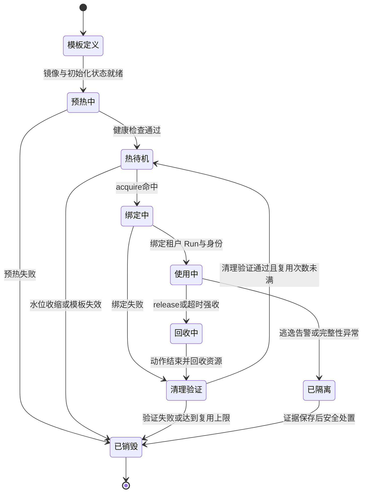

生命周期的关键约束与系列约定一致：

- **预热的是干净环境**。热待机实例不绑定任何租户，只包含模板定义的共享初始化状态：基础镜像、运行时依赖、预置工具链。
- **绑定即租户化**。acquire 命中后，实例绑定具体租户与 Run，注入工作负载身份。此时才重新初始化凭据、随机源与外部连接——模板快照里绝不包含任何凭据、密钥材料或可识别租户的状态。
- **复用必须过清理验证**。使用后的实例经过进程清理、文件系统重置、网络会话断开、随机源重置，并通过验证检查后才允许回到热待机。验证失败一律销毁，不降级复用。
- **隔离实例不回池**。出现逃逸告警或完整性异常的实例进入隔离，保存证据后销毁，永远不重新进入热池。

### 6.3 热池水位模型

水位控制是热池的核心运营问题。水位过低，命中率下降，请求走冷启动，延迟恶化；水位过高，闲置实例持续计费，成本失控。

| 参数 | 含义 | 设置依据 |
|---|---|---|
| 最低水位 | 热待机实例下限 | 基线到达率与冷启动时间，保证最差情况延迟 |
| 目标水位 | 常态维持水位 | 命中率目标与成本预算的平衡点 |
| 最高水位 | 热待机实例上限 | 成本上限与节点库存 |
| 预热批量 | 单次补充数量 | 冷启动并发能力与镜像分发带宽 |
| 最大闲置时长 | 热待机允许闲置时间 | 成本与模板新鲜度，过期实例轮换销毁 |

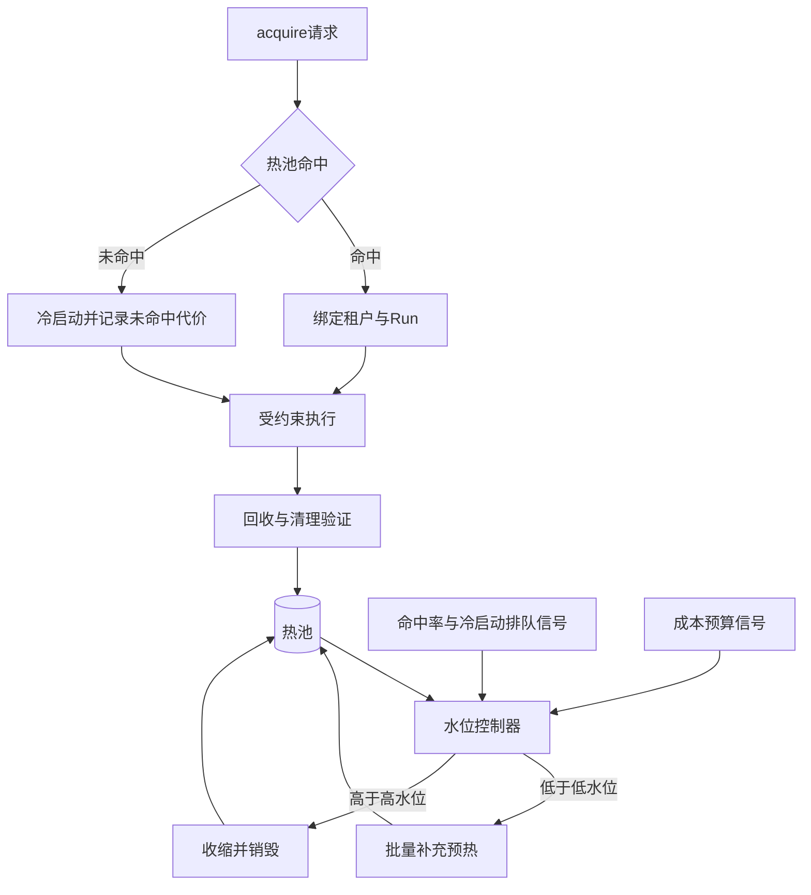

命中率目标不是越高越好。把命中率从 95% 提到 99.5% 所需的常备水位往往不成比例地上升，因为要为突发留余量。正确的做法是为不同 Profile 设置不同目标：交互型、延迟敏感的执行给高命中率；批量、可容忍冷启动的执行允许低命中率甚至纯冷启动。命中率与未命中代价（冷启动延迟乘以频次）和持有成本三者一起看，才是完整的水位决策。

### 6.4 镜像预热与快照启动

**镜像预热**解决“拉镜像”这段冷启动：把 Profile 使用的固定摘要镜像预先分发到候选节点或镜像缓存层。镜像必须按不可变摘要与签名管理（第 8 篇），预热只是提前分发，不是放松验证。模板更新时，预热流水线先于热池切换完成新镜像分发，避免切换时刻的批量冷启动。

**快照启动**进一步把“初始化运行时”这段也省掉：对 microVM 或支持检查点的容器运行时，可以从一个已完成初始化的快照恢复实例。快照机制必须遵守与热池相同的安全边界：

- 快照只包含可共享的初始化状态：操作系统状态、运行时加载完成、依赖就绪；
- 快照不包含凭据、租户数据、随机数状态与活动连接；
- 从快照恢复后，绑定阶段重新初始化凭据、重置随机源、重建受控连接；
- 快照本身是受管理资产，有版本、摘要与撤销机制，模板失效时对应快照批量退出热池。

### 6.5 清理流水线与复用速率

热池的实际供给能力不只取决于预热速度，还取决于**回收侧的清理流水线速率**。一个实例的完整周转是：热待机 → 绑定使用 → 回收 → 清理验证 → 热待机。如果清理验证耗时过长或失败率高，热池会“只出不进”，水位被持续抽干，表面看是需求上涨，实际是复用速率下降。

清理流水线的运营要点：

- 清理与验证要计时并单独监控，清理 P99 变慢是热池退化的先行指标；
- 清理失败率上升通常指向模板变更或某类负载的异常残留，应触发模板审查而不是简单加水位；
- 每个实例设置复用次数上限，达到上限强制销毁重建，防止残留累积与内核态资源泄漏；
- 清理流水线本身要有容量冗余，它是热池的“回收泵”，泵停了池就干了。

---

## 7. 等待经济学

### 7.1 WAITING 的资源语义

系列约定：等待审批、远程作业或长定时器时，Runtime 先原子提交 WAITING 状态与等待条件，释放 RunLease 与 Harness Worker；回调、定时器或审批事件到达后只入队，新 Worker 重新领取 lease 推进 Run。本节回答这个约定背后的资源问题：WAITING 到底释放了什么，保留了什么，代价是什么。

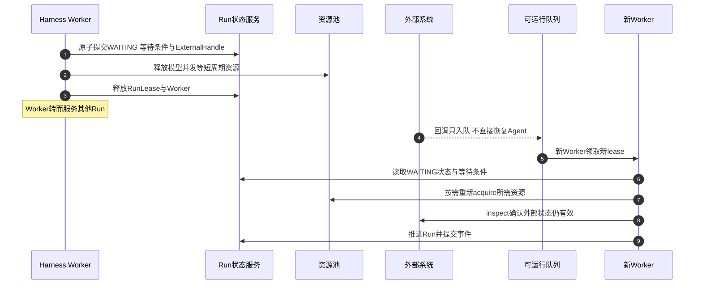

### 7.2 释放什么，保留什么

| 对象 | WAITING 时是否释放 | 说明 |
|---|---|---|
| Harness Worker | 释放 | 最宝贵的调度容量，新 Worker 重新取 lease 推进 |
| RunLease | 释放 | 避免长期租约过期与接管混乱 |
| 模型并发槽 | 释放 | 等待期间不存在进行中的模型请求 |
| ExternalHandle | 保留 | 查询、对账与取消责任必须持久存在 |
| 远程作业槽 | 视作业状态 | 运行中的作业继续占用并计费 |
| 沙箱工作区 | 视策略 | 按恢复成本决定保留还是回收后重建 |
| 定时器与回调注册 | 保留 | 耐久唤醒条件，独立于任何实例存活 |
| 预算预留 | 保留或部分释放 | 由结算策略决定，未决责任必须可查 |

这里的关键判断是**恢复成本与持有成本的权衡**。沙箱工作区若保留，恢复快但持续计费且占用池容量；若回收，省钱但恢复时要重建环境、重新装载依赖，甚至重放部分确定性步骤。平台应为每类 Profile 声明默认策略，并允许按任务价值覆盖：高价值长任务可以付费保留工作区，低价值任务一律回收。

### 7.3 保留外部资源的成本与风险

WAITING 保留的外部资源带来三类问题，必须被显式管理：

1. **成本持续发生**。运行中的远程作业、保留的沙箱工作区、占用的 GPU 卡都在计费。用量结算与资源治理域必须把 WAITING 期间的资源占用照常记账，否则“等待免费”的错觉会鼓励无限期等待。
2. **句柄泄漏**。WAITING 的 Run 如果被遗忘——回调丢失、定时器失效、审批链接过期——它保留的外部资源就成了无主资产。每个保留的 ExternalHandle 都必须有属主（对账器）、有检查周期、有最大等待时限。
3. **状态漂移**。等待数小时后，外部世界已经变化：作业平台升级、目标系统数据变更、审批所依据的事实过期。因此恢复推进不是简单继续，而是按第 4 篇 Resume 语义重新验证版本、权限、预算与外部状态，必要时重新授权或转人工裁决。

### 7.4 超时与强制回收

等待必须有分级时限，且时限到期要有确定动作：

| 时限类型 | 作用对象 | 到期动作 |
|---|---|---|
| 等待超时 | WAITING 状态本身 | 按策略延长、转人工或转失败收尾 |
| 资源空闲超时 | 保留但无活动的外部资源 | 回收资源并保留句柄与恢复路径 |
| 最大持有时长 | 单个 ExternalHandle 总寿命 | 强制回收并裁定 Run 处置 |
| 续租失败 | renew 被拒的资源 | 提交状态后立即释放，不硬占 |

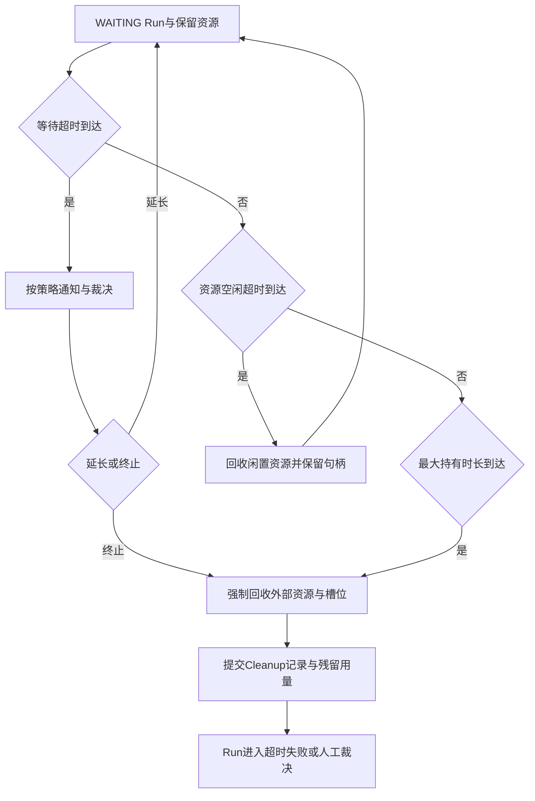

强制回收的两条纪律：其一，回收资源不等于取消外部动作，运行中的作业可能仍在外部执行，迟到结果按取消与对账语义处理；其二，回收必须留下 Cleanup 记录与用量事实，让结算闭环完整——资源可以强制收走，账不能赖掉。

---

## 8. 弹性与成本权衡

### 8.1 三类资源获取方式

| 获取方式 | 成本 | 可用性风险 | 适用池与负载 | 典型约束 |
|---|---|---|---|---|
| 预留或长约 | 单价低 | 风险低，容量固定 | 稳态 Worker、基线模型容量、热池基线 | 承诺期与容量锁定，需按基线谨慎核定 |
| 按量 | 单价较高 | 受库存与配额影响 | 突发 Worker、沙箱冷启动补充、临时浏览器容量 | 库存波动与速率限制 |
| 抢占式或竞价 | 单价最低 | 有被收回风险 | 可中断批处理、评测影子运行、低优先级回填 | 必须具备 Checkpoint、重排队与幂等能力 |

组合策略的一般原则：**基线用预留，突发用按量，可中断路径用抢占式**。判断某类负载能否使用抢占式资源，不看它“重不重要”，而看它“被打断后能否安全恢复”：有逻辑 Checkpoint、步骤可重入、外部副作用可查询或有界重试的负载可以放在抢占式资源上；正在执行不可逆外部动作的窗口则不应被抢占——抢占时机必须与执行安全点协调，先提交状态再释放资源。

### 8.2 突发缓冲

弹性再快也有启动时间，突发缓冲回答的是“扩容到位之前靠什么扛”。缓冲容量可以按下式理解：

> 缓冲 ≈ 突发超出基线的速率 × 弹性到位时间

缓冲的形态因池而异：Worker 池的缓冲是少量常备冗余实例；沙箱池的缓冲就是热池本身高于均值的水位；模型池的缓冲是与供应方约定的弹性配额或多供应方路由；GPU 池的缓冲往往只能靠预留，因为现买卡来不及。缓冲是花出去的真金白银，它的规模应由“可接受的队龄退化”反推：允许突发时排队 30 秒，就可以少留一部分缓冲；要求突发无感，缓冲就得加厚。这是 SLO 与成本的直接兑换。

### 8.3 成本信号与预算护栏

费用消耗速率是弹性系统的负反馈输入，接入方式与第 3 篇用量结算与资源治理域对齐：

- 受理时做预算预留，超额任务不进入队列；
- 运行时按 UsageRecord 归集模型、沙箱、GPU 与通道消耗；
- 消耗速率超过阈值时，决策层依次采取：收紧低优先级准入、降低热池目标水位、抢占可中断任务、对可降级 Profile 选择更经济的池；
- 预算护栏触发的任何降级都不得绕过安全检查与验收标准，这是总纲确立的底线。

### 8.4 降级顺序

成本压力下的降级应有显式顺序，且每一级都可观测、可回退：

1. 停止计划外预热，热池降至最低水位；
2. 低优先级与可中断任务让出资源，先 Checkpoint 后释放；
3. 新任务按 Profile 降级路由到更经济的池或更小的模型档位；
4. 收紧准入配额，延长非关键任务的排队；
5. 仅保留关键租户与关键风险通道的保障容量。

降级顺序要预先演练并写进运行手册。临时拍板的降级往往先砍错东西——比如砍掉清理流水线容量，导致热池复用率崩塌，最终更贵。

---

## 9. 多租户资源治理

### 9.1 配额模型

多租户平台的资源治理分四层，层层收紧：

- **准入层**：租户并发与速率配额，防止单一租户的请求洪水进入队列；
- **分级层**：按任务风险等级决定可用池与隔离等级，高风险任务进入专用隔离池；
- **预算层**：预算预留不足不受理，避免运行到一半因欠费中断留下未决副作用；
- **获取层**：每租户在每类池的运行时并发上限，acquire 时强制检查。

### 9.2 公平与优先级

队列内的公平由调度器实现（机制见第 4 篇 Scheduler，本篇关注其资源含义）：加权公平保证各租户按权重获得推进机会，每租户并发上限防止单个租户占满 Worker，优先级类区分交互任务与批量任务。资源面的对应约束是：每租户在每类资源池的持有上限必须与队列权重一致，否则队列里公平了、资源上又被单租户垄断。

优先级设计要避免一个陷阱：优先级只应影响排队顺序与抢占顺序，不应放大资源配额。高优先级租户可以获得更快的调度，但不能因此突破其沙箱并发上限——否则优先级就成了配额后门。

### 9.3 饥饿防护

公平机制的失效形态是饥饿：低优先级队列永远轮不到。防护手段有三个，应同时具备：

1. **队龄提升**：请求在队列中等待超过阈值后自动提升有效优先级，保证任何请求的等待时间有上界；
2. **最低保障**：每租户保留最小保障容量（哪怕只有一个并发），保障容量不被高优先级抢占；
3. **抢占可恢复**：高优先级抢占低优先级资源时，被抢占方必须先到达安全点并提交 Checkpoint，抢占后进入重新排队而不是失败。

饥饿防护要有指标：按租户与优先级分组的队龄分布是核心 SLO 之一，任何租户的 P99 队龄持续恶化都应告警，而不是等用户投诉。

### 9.4 噪声租户与行为治理

资源治理还要处理“合法但昂贵”的行为：某个租户的 Agent 陷入低效循环，不断发起沙箱执行却毫无产出。这类行为在配额内合法，却消耗共享容量。处置路径与用量结算域联动：消耗速率异常触发行为审查，审查结论可以是收紧该租户配额、降低其优先级、或按第 0 篇运营闭环转人工处置。资源信号（持有时间异常、重试率异常、成本异常）是这类检测的原始输入。

---

## 10. 资源故障域

### 10.1 池级 bulkhead

资源面的故障域设计目标是：一类池的故障不拖垮其他池，一个池的抖动不转化为全局雪崩。基本手段是 bulkhead——每类池独立的容量、独立的队列、独立的扩缩控制与独立的失败策略：

- 沙箱池耗尽时，acquire 快速失败或进入该池自己的有界排队，Worker 转而推进不需要沙箱的 Step，或把 Run 挂回队列，而不是阻塞 Worker 空等；
- 模型池限流时，降级路由与排队只影响模型相关 Step，浏览器与作业执行不受牵连；
- 交付通道故障时，交付动作进入重试队列，不阻塞 Run 的技术验证与验收。

池级 bulkhead 的前提是第 2 节的边界原则：池只暴露统一接口，调用方不依赖池的内部实现，任何一个池整体不可用时，调用方得到的是明确的失败语义而不是悬挂。

### 10.2 租户隔离

租户间的资源隔离按风险分级选择强度：

| 隔离模式 | 机制 | 适用 | 代价 |
|---|---|---|---|
| 共享池加配额 | 同池内按配额与公平调度隔离 | 低风险常规负载 | 最低，但存在噪声邻居 |
| 逻辑分队列 | 独立队列与水位，共享实例池 | 中风险或重点租户 | 中等，调度复杂度上升 |
| 专用池 | 租户独占实例池或节点池 | 高风险、强合规要求 | 高，容量利用率下降 |
| Cell 划分 | 租户归属独立 Cell，含 Worker、池与局部队列 | 大规模多租户平台 | 最高，控制面需跨 Cell 分发版本与策略 |

隔离强度是安全与成本的权衡，应由租户风险等级与合规要求驱动，而不是“越隔离越好”。共享池模式下必须配齐配额、公平与饥饿防护；专用池模式下要防止容量碎片化，允许在租户空闲时回收预留。

### 10.3 故障池隔离与恢复

一个池出现异常（健康检查失败、错误率飙升、底层节点批量故障）时的标准处置：

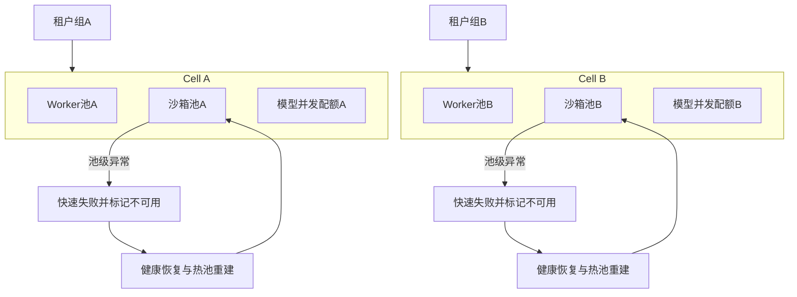

恢复流程的要点：

1. **标记不可用并快速失败**：新的 acquire 立即得到明确失败，调度侧切换到替代池、有界排队或挂起，杜绝请求在故障池上堆积；
2. **在途资源进入对账**：故障池上已绑定的资源按 ExecutionRecord 与 ExternalHandle 逐个确认状态，UNKNOWN 走对账流程；
3. **恢复需要连续健康**：健康检查必须连续多次通过才允许池重新服务，防止抖动池在可用与不可用之间震荡；
4. **热池重建是恢复的一部分**：沙箱池恢复后需要重新预热到目标水位，这段时间的容量缺口要由冷启动与准入收紧共同承担；
5. **被隔离实例不回池**：因安全告警隔离的实例走销毁路径，恢复的只是池的服务能力，不是问题实例。

多可用区之间的容灾、RPO/RTO 目标属于第 17 篇范围；本篇的故障域只覆盖资源面自身的切分与恢复。

---

## 11. 与调度的衔接

第 4 篇定义了 Scheduler：它决定何时、由哪个 Worker 推进哪个 Run，输入包括可运行队列、租户配额、优先级与队龄、AgentSpec 与资源 Profile、Worker 健康与资源水位。本篇定义的资源池是调度的供给侧对应物，两者职责互补而不重叠：

| 职责 | Scheduler（第 4 篇） | 资源池（本篇） |
|---|---|---|
| 决定哪个 Run 由哪个 Worker 推进 | 是 | 否 |
| 租户公平、优先级与饥饿防护的排队语义 | 是 | 提供配额状态与持有数据 |
| 物理资源的 acquire/renew/release | 通过 Execution Runtime 调用 | 是 |
| 水位、预热与扩缩执行 | 消费信号做准入与调度决策 | 产生信号并执行扩缩 |
| 理解业务目标 | 否 | 否 |

衔接处的三条规则：

- **资源不足反馈给调度而不是阻塞 Worker**。acquire 返回排队位次或拒绝时，Scheduler 决定把 Run 挂回队列、选择替代池还是按策略降级；Worker 不空等。
- **资源信号是调度输入**。热池水位、模型配额余量、GPU 空闲等信号进入调度决策，避免把 Run 调度到注定拿不到资源的境地。
- **调度不越过执行入口**。Worker 推进 Run 时仍通过 Execution Gateway 与 Execution Runtime 申请资源，执行账本、许可校验与 fencing 语义不因资源压力而绕过。

队列机制、背压与准入的完整细节在第 16 篇高并发专题展开。

---

## 12. 常见反模式

### 12.1 只看 CPU 扩缩

Worker 的 CPU 很低，平台却因为模型配额耗尽而停摆。异构资源池必须用各自的信号扩缩，全局 CPU 利用率对 Agent 平台几乎没有信息量。

### 12.2 把会话数当并发容量

用日活会话数推导 Worker 数与模型并发，忽略了会话到任务、任务到 Run、Run 到各池占用的多层转换。每一层都要单独测量与建模。

### 12.3 WAITING 占住 Worker

等待审批的 Run 持有租约和 Worker 数小时，逻辑 Worker 池被等待占满，新任务全部排队。WAITING 必须先提交等待条件再释放 Worker，这是系列反复强调的约定。

### 12.4 沙箱不经验证复用

清理失败或验证失败的实例被放回热池“凑水位”，导致残留进程、文件或会话被下一个租户命中。验证失败的实例只能销毁。

### 12.5 模板快照里放凭据

为了“恢复更快”，把凭据、登录态或随机源放进快照。快照是共享资产，任何租户相关状态都只能在绑定后注入，凭据与随机源必须重新初始化。

### 12.6 资源池自作主张

沙箱根据 stdout 决定再跑一段代码，浏览器根据页面内容决定再点一个按钮。资源池只执行受约束的 ExecutionSpec，后续步骤只能由 Harness 产生。

### 12.7 扩缩没有冷却与迟滞

阈值附近反复扩缩，实例抖动，成本飙升，预热流水线被折腾垮。迟滞带、观察窗口与独立冷却是控制回路稳定性的最低要求。

### 12.8 大租户饿死小租户

没有最低保障与队龄提升，高优先级大租户长期占满容量。公平不是平均，而是“有上限的优先加上有底线的保障”。

### 12.9 抢占式资源跑不可恢复任务

把无 Checkpoint、正在执行不可逆外部动作的负载放在随时被收回的实例上。抢占式资源只属于可中断、可重入、可对账的负载。

### 12.10 用平均容量承诺 P99

拿 Little's Law 的平均估算对外承诺延迟 SLO。平均数不回答尾部，P99 承诺必须来自长尾建模加真实负载测试。

---

## 13. 生产验证场景表

| 验证场景 | 预期结果 |
|---|---|
| 流量突增至稳态三倍 | 队龄上升在 SLO 内，扩容触发，无 Worker 饥饿与无限排队 |
| 扩缩信号在阈值附近抖动 | 迟滞与冷却窗口阻止实例震荡，无扩缩翻转风暴 |
| 热池被突发抽干 | 冷启动接管并记录未命中代价，请求有界等待，Worker 不被阻塞 |
| 清理验证失败 | 实例销毁不回池，失败计数与原因可查，触发模板审查 |
| 模板快照包含凭据或租户状态 | 预热被拒绝或实例被隔离，绑定后凭据与随机源重新初始化 |
| WAITING Run 等待审批八小时 | 不占用 Worker 与租约，恢复时重新验证权限与外部状态后推进 |
| WAITING 保留的远程作业超时 | 强制回收资源，Cleanup 与残留用量入账，Run 进入超时处置 |
| 单租户打满其配额 | 其他租户最低保障容量不受影响，队龄 SLO 不恶化 |
| 低优先级队列长期排队 | 队龄提升生效，等待时间有上界，无无限饥饿 |
| 沙箱池整体故障 | acquire 快速失败，Run 走替代池或有界排队，Worker 池不被拖垮 |
| 抢占式节点被收回 | 抢占前到达安全点并提交 Checkpoint，Run 重新排队后无损恢复 |
| 成本消耗速率超预算 | 准入收紧或优先级调整生效，安全检查与验收标准不被绕过 |
| 模型供应方限流 | 模型池排队或降级路由，Worker 不被无限阻塞，预算校验生效 |
| 池健康检查抖动恢复 | 连续健康后才重新服务，无可用状态震荡 |
| 回调丢失的 WAITING Run | 对账器按周期检查句柄，最大等待时限到期后强制处置，无无主资源 |
| 交付通道限流 | 交付动作进入重试队列，Run 验收不被阻塞，通道拒绝率触发告警 |

---

## 14. 架构评审清单

### 资源池模型

- 六类资源池是否独立建模，各自有明确的资源单位与持有时间？
- 会话、活跃 Run、Worker 并发、模型并发、沙箱并发是否分开度量？
- 资源池是否只理解 Profile 与 ExecutionSpec，不理解业务目标？
- 池是否承诺资源语义而非业务语义，cancel 是否不承诺外部撤销？

### 接口与 Profile

- acquire/renew/release/cancel/inspect 是否齐备且失败语义明确？
- acquire 是否有 deadline 与有界等待，是否存在无限阻塞路径？
- ExecutionProfile 是否覆盖能力、隔离、限额、网络、生命周期、成本与驻留？
- 池匹配与替代是否记录在执行账本中？

### 容量建模

- 是否用 Little's Law 做平均稳态估算，并明确其不保证 P99 与突发？
- 突发系数与长尾余量是否有依据，是否经过负载测试验证？
- 准入配额与运行时配额是否分层，风险分级是否影响池选择？

### 扩缩决策

- 每类池是否有独立的主扩缩信号，是否避开 CPU 误区？
- 扩缩阈值是否有迟滞带，扩缩冷却是否独立设置？
- 是否具备计划扩容与预测扩容，是否快扩慢缩？
- 费用消耗速率是否作为负反馈接入决策？

### 热池与预热

- 热池生命周期是否覆盖预热、绑定、回收、清理验证、隔离与销毁？
- 模板快照是否只含共享初始化状态，凭据与随机源是否绑定后重新初始化？
- 水位是否有最低、目标、最高与闲置轮换参数？
- 清理流水线是否有独立容量与监控，复用是否有次数上限？

### 等待与成本

- WAITING 是否释放 Worker 与租约，保留资源是否全部有属主与时限？
- 等待超时、资源空闲超时与最大持有时长是否分级且动作确定？
- 预留、按量、抢占式的组合是否与负载可恢复性匹配？
- 突发缓冲规模是否由弹性到位时间与队龄 SLO 反推？

### 多租户与故障域

- 配额、公平、优先级与饥饿防护是否同时具备？
- 优先级是否只影响顺序而不放大配额？
- 租户隔离强度是否由风险分级驱动？
- 池级 bulkhead 是否保证单池故障不拖垮全局？
- 故障池是否快速失败、连续健康才恢复、隔离实例不回池？

---

## 15. 本篇结论与后续专题

Agent 平台的弹性资源架构可以概括为五条主线：

> **资源分池建模，各池用自己的信号扩缩自己的容量；统一接口与 Profile 对接供需；容量用平均稳态估算打底、用突发与长尾余量加固、用负载测试验证；热池与清理流水线决定沙箱的响应速度；WAITING 释放最宝贵的 Worker，却必须为保留的外部资源记账、设时限、留属主。**

弹性不是“能自动加减机器”这么简单。它是容量模型、扩缩控制回路、热池运营、等待经济学、成本权衡与多租户治理的合力。任何一环缺失，平台都会在某个意外时刻暴露：要么成本失控，要么突发瘫痪，要么租户互相伤害，要么资源泄漏成无主资产。

同时必须重申本篇的边界：资源池保证的是资源语义，不是业务语义。acquire 成功不等于动作成功，release 不等于副作用回滚，扩缩到位也不等于任务可靠——任务可靠仍由状态与计算分离、租约与 fencing、执行账本与对账共同保证。

后续专题中，第 16 篇展开高并发场景下的请求级背压、有界队列与准入控制细节；第 17 篇讨论多可用区容灾、故障切换与 RPO/RTO；第 18 篇把本篇产生的容量、成本与质量信号纳入可观测、审计、评测与 FinOps 的运营闭环。

---

## 参考资料

以下均为官方或学术资料。动态文档会持续更新，实际实现应固定所采用的版本与访问日期。

1. [John D. C. Little, "A Proof for the Queuing Formula: L = λW", Operations Research, 1961](https://pubsonline.informs.org/doi/10.1287/opre.9.3.383)
2. [Kubernetes Horizontal Pod Autoscaling](https://kubernetes.io/docs/tasks/run-application/horizontal-pod-autoscale/)
3. [Kubernetes Autoscaler（Cluster Autoscaler）Repository](https://github.com/kubernetes/autoscaler)
4. [KEDA: Kubernetes Event-driven Autoscaling Documentation](https://keda.sh/docs/latest/)
5. [Amazon Bedrock AgentCore Runtime](https://docs.aws.amazon.com/bedrock-agentcore/latest/devguide/runtime-how-it-works.html)
6. [Google ADK Agent Runtime](https://adk.dev/runtime/)
7. [CloudWeGo Eino ADK Agent Runner and Extension](https://www.cloudwego.io/docs/eino/core_modules/eino_adk/agent_extension/)
8. [Temporal Workflow Execution](https://docs.temporal.io/workflow-execution)
9. [LangGraph Durable Execution](https://docs.langchain.com/oss/python/langgraph/durable-execution)
10. [Firecracker: Lightweight Virtualization for Serverless Applications, NSDI 2020](https://www.usenix.org/conference/nsdi20/presentation/agache)
11. [OpenTelemetry GenAI Semantic Conventions Repository](https://github.com/open-telemetry/semantic-conventions-genai)
