# 高并发 Agent 平台：队列、公平、背压与负载验证

> **系列**：生产级 Agent 平台架构 2026 · 第 16 篇  
> **定位**：规模与可靠性篇  
> **版本**：闭环修订版  
> **更新时间**：2026-10-12  
> **前置阅读**：第 0 篇《从模型推理到生产运行：2026 年 Agent、Harness 与 Runtime 总体架构》 · 第 4 篇《Agent Runtime：从生命周期到执行治理的完整能力模型》  
> **关键词**：有界队列、租户公平、准入控制、背压、负载验证、尾延迟

## 摘要

高并发是 Agent 平台最容易产生“看起来能跑、压上去就崩”错觉的领域。Demo 阶段的并发问题通常用“加线程、加重试”解决；进入生产后，压力会同时出现在三个完全不同的层面：入口请求并发、运行中并发和外部依赖占用。三者的持有时间、扩缩信号和治理手段互不相同，任何一层失控都会把故障传导到其余层：入口洪峰冲垮受理事务，运行中并发耗尽逻辑 Worker，外部依赖占用则让大量 Run 悬在模型配额、浏览器实例或审批等待上。

本文的核心观点是：**高并发治理不是让系统“尽量多接”，而是把无界压力转化为有界队列、显式拒绝、公平调度和可传导的背压，并且在任何并发水平下保持正确性不变量不降级。** 具体包括：

- 用入口队列、Run 队列和资源等待队列构成有界队列拓扑，所有队列声明容量、队龄、截止时间和溢出策略；
- 用分租户队列、加权公平、最大并发、队龄提升和预算配额实现租户公平，并以饥饿监控兜底；
- 用“入口 QPS 配额→租户并发配额→任务级预算→资源池水位”四级准入链路控制进入量，任一级越限优雅拒绝并返回重试指引，而不是静默排队；
- 让背压从模型流式输出、执行回执一路传导到事件提交与准入水位，慢消费者只影响展示增量流，耐久事件流不因流式拥塞丢失；
- 用负载画像、压测指标、尾延迟与突发测试、容量回归构成负载验证闭环，容量分开建模，Little's Law 只做平均估算，P99 只能来自固定负载模型下的实测。

本篇不讨论资源池与容量规划的具体建模（第 15 篇）、多可用区容灾（第 17 篇）和可观测体系（第 18 篇），只聚焦高并发本身的队列、公平、背压与验证方法。

---

## 1. 问题背景：高并发不是“加机器和加重试”

最小 Agent 应用的并发模型非常简单：一个请求进来，调用模型，执行工具，返回结果。并发上限约等于进程能开的协程数。这个模型在生产中会迅速失效，原因不是单点性能不够，而是 Agent 任务具有三个普通 Web 请求不具备的特征：

1. **任务时长跨度极大**。同一个平台同时承载秒级的问答式短任务、分钟级的工具编排任务和小时级的审批长任务。短任务要求低调度延迟，长任务要求高吞吐和资源释放，两者对队列和 Worker 的诉求相反。
2. **关键路径上有不可压缩的外部依赖**。模型推理有并发与 Token 配额，浏览器上下文、Sandbox 实例和远程作业有实例上限，下游 API 有限流，审批依赖人的响应速度。这些依赖不会因为平台扩容而变快。
3. **每一步都伴随耐久状态写入**。Run 状态、CallRecord、Outbox、Usage 都需要权威提交。并发越高，状态提交路径越成为共享瓶颈，而这条路径恰恰不允许用“丢弃”来缓解压力。

因此，常见的三种直觉解法在生产中都会反噬：

| 直觉解法 | 表面效果 | 生产后果 |
|---|---|---|
| 无限排队，来多少接多少 | 拒绝率为零，看起来容量充足 | 内存队列无界增长，队龄失控，任务在截止时间后才被执行，等于批量生产无效工作 |
| 水平扩容解决一切 | Worker 数量线性增加 | 下游模型配额和执行池没有同步扩容，队列只是从入口移到资源等待处，Worker 全部阻塞在等待上 |
| 高峰期跳过门禁保可用 | 短期吞吐上升 | 绕过统一末端门禁的外呼不受 control_intent 与 revocation 约束，取消和撤销失效，安全事故与重复副作用同时出现 |

高并发设计的正确目标应当显式写成四条：

- **有界**：每一段缓冲都有容量上限和溢出策略，系统在任何时刻的内存占用和队龄是可预估的；
- **公平**：单个租户、单个任务或单个优先级不能无限制挤占他人份额；
- **可拒绝**：超过承载能力时明确拒绝并给出重试指引，而不是静默排队或静默丢弃；
- **正确性不降级**：并发再高，CAS、幂等、fencing 和末端门禁的语义保持不变。后文第 11 节会把这组不变量单独列出。

这也解释了为什么本篇反复强调“容量分开建模”：用任何单一指标代表“平台并发”，都会在压力来临时暴露错误。

---

## 2. 三种压力源：请求并发、运行中并发与外部依赖占用

高并发压力必须按来源拆开治理。Agent 平台的压力源可以归为三类：

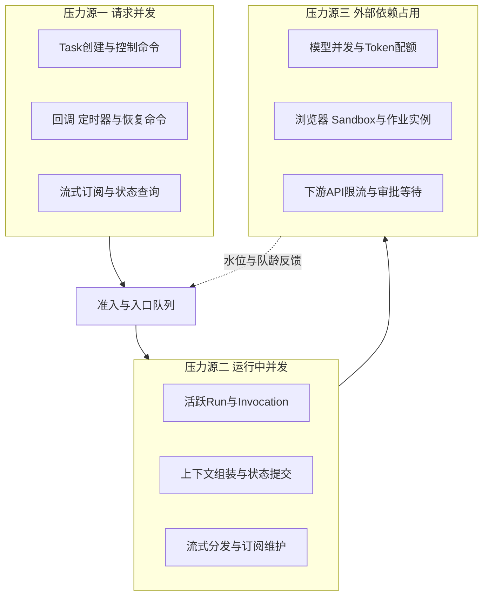

### 2.1 请求并发

请求并发指单位时间到达平台的入口请求数，包括 Task 创建、Cancel/Pause/Resume 控制命令、工具与作业回调、定时器触发、流式订阅建立和状态查询。它的特点是**到达速率高、单次处理时间短**，压力集中在接入网关、受理事务和状态库写入路径。

治理请求并发的关键不是把每个请求都处理完，而是区分两类请求：

- **受理类请求**必须形成耐久事实或明确拒绝。Task 创建要原子提交 Task、首个 Run、预算预留和 Outbox；控制命令要持久化为 control_intent。这类请求不能因高峰被静默丢弃。
- **订阅与查询类请求**可以降级。流式订阅可以限制每连接缓冲，查询可以返回快照加游标而不是实时推送。

请求并发的第一道治理是入口 QPS 配额与幂等受理：相同租户和幂等键的重复提交不重复创建 Task，超配额请求直接拒绝并返回重试指引。

### 2.2 运行中并发

运行中并发指同一时刻处于推进状态的 Run 数量，即持有 RunLease、正在执行 Invocation 的那部分。它的压力落在逻辑 Worker 槽位、状态库连接、上下文内存和事件提交路径上。与请求并发不同，运行中并发的持有时间由任务本身决定，从秒到分钟不等。

用排队论的平均关系做直觉估计时，活跃 Run 数约等于受理速率乘以平均运行时长，即 Little's Law 的 L = λW 形式。**这只适用于平均值估算**；P99 队龄、突发下的调度延迟无法从平均值推导，只能靠负载测试。

运行中并发治理的要点在第 8 节展开：Worker 并发槽位必须与下游模型池、执行池配额联动，否则扩容 Worker 只是把排队从 Run 队列搬到资源等待队列。

### 2.3 外部依赖占用

外部依赖占用是 Agent 平台最特殊的一类压力：Run 并没有在消耗平台 CPU，却长期占用着稀缺资源。典型形态包括：

- 模型服务的并发请求数与 Token 配额；
- 浏览器上下文、Sandbox 实例、GPU 作业槽位；
- 下游业务 API 的限流窗口；
- 审批等待、远程作业等待，时长可达小时级。

这一类压力的治理原则在第 4 篇已经确立：**等待外部系统的 Run 进入 WAITING，先原子提交状态、等待条件和 ExternalHandle，再释放 RunLease 与逻辑 Worker；回调到达只负责把 Run 重新入队，由新 Worker 重新领取 lease 推进。** 本节补充并发视角的推论：

1. WAITING Run 的数量可以远大于活跃 Run 数，它消耗的是状态库存储与定时器规模，不是 Worker。容量建模时必须把二者分开；
2. 外部依赖的饱和度是准入信号。模型池水位高时继续调度新 Run 只会加深资源等待队列，应在第四级准入处收紧；
3. 外部依赖故障时的积压具有长尾效应。下游恢复后，积压的回调会形成二次洪峰，需要入口侧的回调配额承接。

### 2.4 三种压力源的对照

| 压力源 | 占用资源 | 典型持有时间 | 主要信号 | 治理手段 |
|---|---|---|---|---|
| 请求并发 | 网关、受理事务、状态库写路径 | 毫秒级 | 入口 QPS、受理延迟、拒绝率 | 入口配额、幂等受理、有界入口队列 |
| 运行中并发 | Worker 槽位、连接、内存、提交路径 | 秒到分钟 | 活跃 Run、调度延迟、提交延迟 | Worker 槽位、租户最大并发、队列分离 |
| 外部依赖占用 | 模型配额、执行实例、下游限流、人的时间 | 秒到小时 | 池水位、等待队列深度、WAITING 占比 | 水位准入、WAITING 释放、回调入队 |

三类压力不同比例放大：一次营销活动可能让请求并发上涨一个数量级，而运行中并发只随受理量温和增长；一次模型供应商限流则几乎不影响请求并发，却让外部依赖占用瞬间打满。

---

## 3. 有界队列：拓扑、队龄与溢出策略

队列是高并发系统的缓冲器，也是故障的放大器。无界队列把“现在的过载”翻译成“未来的队龄灾难”：任务等到截止时间过期才被执行，消耗资源后产出无效结果。因此本节的第一原则是：**平台内所有队列必须有界，且溢出策略显式声明。**

### 3.1 队列拓扑

Agent 平台的队列按职责分为三层，外加两个特殊缓冲：

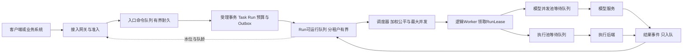

| 队列 | 位置与职责 | 耐久性 | 有界方式 | 溢出策略 |
|---|---|---|---|---|
| 入口命令队列 | 网关之后、受理之前，承接创建、控制与回调命令 | 耐久 | 容量上限加截止时间 | 拒绝并返回重试指引 |
| Run 可运行队列 | 分租户维护待调度 Run | 耐久 | 租户配额与总容量 | 上游准入收紧，越限拒绝受理 |
| 资源等待队列 | 模型池、执行池前的等待 | 耐久或可重建 | 池容量推导 | 超时回退、转 WAITING 或拒绝 |
| Outbox | 与状态原子提交的待发布命令与事件 | 耐久事实 | 不以普通队列对待 | 提交侧背压，见第 6 节 |
| 订阅分发缓冲 | 展示增量流的每订阅缓冲 | 内存，provisional | 每订阅有界 | 合并、截断、断开 |

两个关键澄清：

- **Outbox 不是普通队列。** 已与状态原子提交的 Outbox 条目是耐久事实，Publisher 不因后续 lease epoch 变化而丢弃它。Outbox 积压不能靠“丢消息”解决，只能靠发布吞吐扩容或提交侧背压（第 6.4 节）。
- **订阅分发缓冲不是事实载体。** Token 增量与进度文本标记为 provisional，可合并、截断或丢弃；权威状态以耐久事件流为准。

### 3.2 有界原则

1. **每个队列显式声明容量、所有者和溢出策略**。容量可以是条数、字节数或二者取小；没有声明容量的队列视为架构缺陷。
2. **耐久队列与内存队列分离**。内存队列只承载可从耐久来源重建的内容，例如从 Run 状态重建可运行条目；进程重启不丢耐久事实。
3. **队列条目必须携带 deadline 与入队时间**。调度器在领取前检查截止时间，已过期条目直接按“过期拒绝”处理并记录事件，不再消耗 Worker 与下游配额。
4. **队列水位是准入与背压的输入**。Run 队列深度、资源等待队列深度和 Outbox 滞后都反馈给准入链路，形成全局稳定回路。
5. **入队不等于受理**。对客户端而言，只有受理事务提交成功才算受理成功；仅进入入口队列不构成任何承诺。

### 3.3 队龄与截止时间

队龄（条目在队列中等待的时长）是高并发平台最诚实的健康指标之一。平均队龄上升往往早于任何错误率上升出现。截止时间治理包含三条规则：

- **deadline 随任务传播**：从 TaskIntent 的截止时间派生，进入每个队列条目、ExecutionSpec 和外部调用超时，避免“任务已过期但各环节仍按各自默认超时运行”；
- **过期即拒绝执行**：调度器发现条目过期时，提交过期事件并释放资源。执行一个已过期任务通常意味着消耗配额产出无效结果，比拒绝更糟；
- **队龄提升反哺公平**：队龄超过阈值的条目获得调度优先级提升，防止低优先级任务在持续高压下无限饥饿，见第 4.4 节。

### 3.4 溢出策略

队列到达容量上限时的行为只有三类合法选择，且必须按队列预先声明：

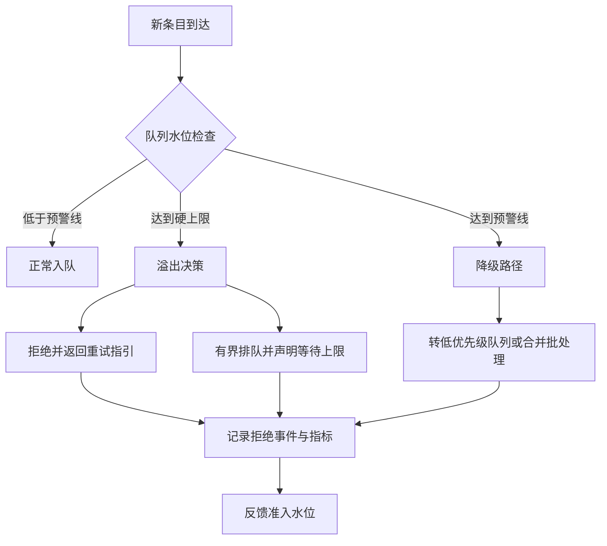

| 策略 | 语义 | 适用场景 | 风险与约束 |
|---|---|---|---|
| 拒绝 | 返回明确错误与重试指引，不占用任何队列 | 入口命令队列、受理路径 | 客户端必须能处理拒绝；需防重试风暴 |
| 降级 | 转低优先级、合并为批处理或转离线窗口 | 可延迟任务、展示类增量 | 降级语义必须对调用方显式可见 |
| 有界排队 | 进入有上限、有超时的等待 | 资源等待队列等明确声明处 | 等待上限必须小于任务 deadline 余量 |

需要特别强调：**“静默排队”不属于合法溢出策略。** 四级准入链路中任一级越限，都应优雅拒绝而不是把请求压入一个无人承诺的等待区——这正是第 5 节准入控制的出发点。

---

## 4. 优先级与租户公平

多租户 Agent 平台的高并发问题，一半是容量问题，一半是分配问题。分配不公的典型症状是：总容量并未耗尽，但某个租户的任务全部饥饿，或某个高优先级通道把资源全部吸走。系列约定的调度公平机制为：**分租户队列、加权公平、最大并发、队龄提升、预算配额**。本节逐一展开并补充优先级反转防护与饥饿监控。

### 4.1 分租户队列与加权公平

调度器不为全平台维护单一全局队列，而是按租户维护独立队列，再以加权公平方式在队列间分配调度机会：

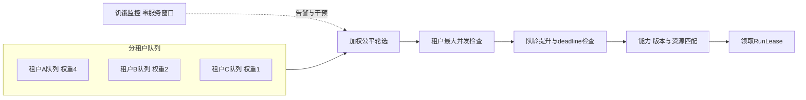

设计要点：

- **权重来自契约而非流量**。权重由租户等级、商务协议或内部核算决定，不随请求量自动放大，否则大租户天然获得全部容量；
- **加权公平分配的是调度机会，不是结果**。某租户队列为空时，其份额可临时借给其他队列，但该租户有新条目时能立即拿回份额；
- **权重变更走配置治理**。权重调整影响全局分配，应可审计、可回滚。

### 4.2 最大并发：公平的硬边界

加权公平解决“分多少”，最大并发解决“最多占多少”。即使某租户权重很高或队列很长，其同时持有的 Worker 槽位、模型并发和执行池配额仍受硬上限约束：

| 限制对象 | 目的 | 越限行为 |
|---|---|---|
| 租户活跃 Run 数 | 防止单租户占满 Worker | 超出部分留在租户队列，不挤占他人 |
| 租户模型并发 | 防止单租户打满模型配额 | 超出部分进入该租户资源等待 |
| 单 Run 资源持有 | 防止单任务占用过多实例 | 超限的并行调用排队或拒绝 |
| 单优先级总份额 | 防止优先级通道互相吞噬 | 各优先级保留最低保障份额 |

最大并发与准入链路的第二级（租户并发配额）是同一语义在两个时点的执行：准入时拒绝越限受理，调度时拒绝越限领取。二者必须使用同一份配额事实，避免“受理时没超、调度时超了”的双账本。

### 4.3 优先级与优先级反转防护

优先级表达的是业务紧迫度，典型划分为四档：

| 优先级 | 典型任务 | 调度语义 | 约束 |
|---|---|---|---|
| P0 交互 | 用户等待中的短任务 | 优先领取，保障调度延迟 | 不承诺抢占已运行任务 |
| P1 常规 | 标准业务任务 | 加权公平正常份额 | 受最大并发约束 |
| P2 批量 | 定时批量处理 | 低峰窗口与剩余容量 | 可被降级与延迟 |
| P3 离线 | 评测、回填、实验 | 仅使用空闲份额 | 饥饿可接受，队龄只监控 |

> **与安全档位的区分**：这里的 P0–P3 是**调度优先级**（P0 最高），与第 13 篇的**安全档位 S0–S3**（S0 最低档、S3 最高档）是两套正交维度：优先级决定"谁先跑"，安全档位决定"跑得多严"。高安全档位（S3）的任务不自动获得高优先级（P0），反之亦然；两者的判定与变更也分别走调度策略与安全评估两条路径。

优先级机制的经典陷阱是**优先级反转**：高优先级任务等待的某个资源，正被低优先级任务持有。在 Agent 平台的典型形态是：P0 任务需要某个执行池实例，而池中实例全部被 P2 长任务占用，P0 反而排在 P2 之后。防护手段按代价从低到高：

1. **容量分区**：为高优先级保留专用份额或专用池，从物理上避免共享竞争。代价是资源利用率下降，是最稳妥的默认选择；
2. **队龄提升兜底**：被阻塞的高优先级条目随队龄提升有效优先级，最终越过占用者；
3. **受控抢占**：将低优先级任务暂停并让出资源，见第 9.2 节。抢占有 Checkpoint 与重排队成本，且不能抢占已经发起的外部调用，只能作为最后手段。

不存在无成本的抢占。平台应优先用分区与配额消除反转，而不是依赖运行时强抢。

### 4.4 队龄提升

队龄提升是饥饿的最终防线：条目等待超过阈值后，其有效优先级按规则上调，直到获得调度。实现上的三个约束：

- 提升规则全局统一且可解释，例如“队龄超过阈值一档，有效优先级提升一级”，阈值本身是规划参数，应按负载实测校准而不是拍脑袋设定；
- 提升只影响调度顺序，不绕过最大并发与准入配额，否则队龄提升会变成新的不公平来源；
- 提升事件可观测。一个条目被提升了多少次、在哪个队列等待多久，是调度公平性的直接证据。

### 4.5 饥饿监控

公平机制是否有效，最终由监控回答。最小指标集：

| 指标 | 含义 | 告警语义 |
|---|---|---|
| 分租户调度延迟 P99 | 可运行到领取 Lease 的时延 | 某租户显著偏离全体分布 |
| 分队列最大队龄 | 各租户与优先级队列的最老条目 | 超过阈值即潜在饥饿 |
| 零服务窗口 | 某租户队列非空但连续未被服务的时长 | 超过阈值必须人工干预 |
| 队龄提升次数 | 触发提升的条目数量 | 持续上升说明权重或容量失配 |
| 份额借出借入 | 各租户实际份额与名义权重偏差 | 长期单向偏离说明权重失真 |

饥饿监控的意义在于：**公平算法的缺陷不会表现为错误，只会表现为某些租户“一直很慢”。**

---

## 5. 准入控制：四级链路与优雅拒绝

队列和公平解决“进来之后怎么排”，准入控制解决“放多少进来”。系列约定的四级准入链路为：**入口 QPS 配额→租户并发配额→任务级预算→资源池水位准入；任一级越限优雅拒绝而非静默排队。**

### 5.1 四级准入链路

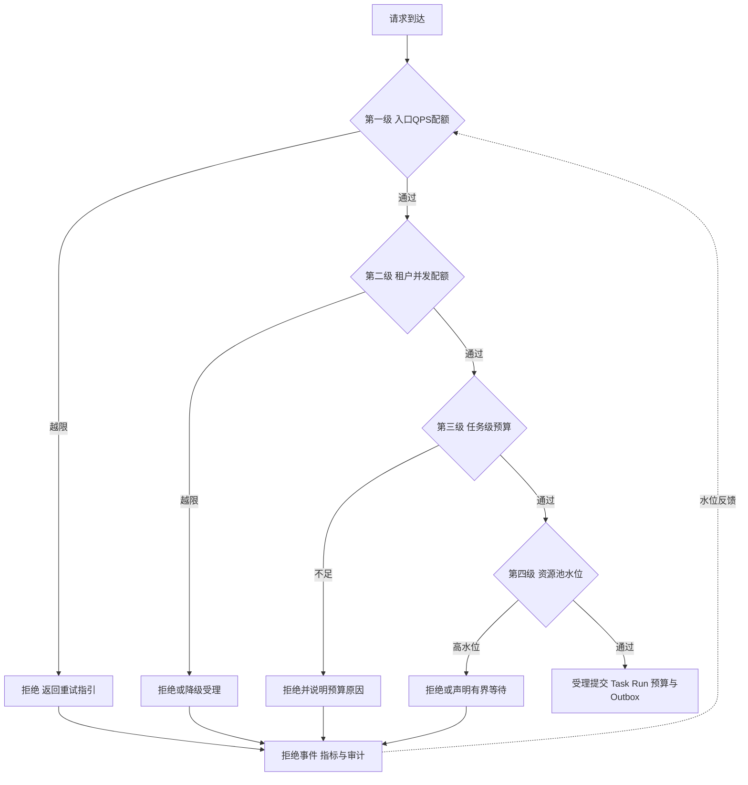

| 级别 | 保护对象 | 判定信号 | 越限行为 |
|---|---|---|---|
| 入口 QPS 配额 | 网关与受理路径 | 分租户分接口的速率 | 直接拒绝，返回重试指引 |
| 租户并发配额 | Worker 与状态库 | 活跃 Run 与配额差 | 拒绝新受理或降级受理 |
| 任务级预算 | 费用与资源总量 | Token、步数、时长、金额预算 | 拒绝并说明预算原因 |
| 资源池水位 | 模型池与执行池 | 池利用率与等待队列深度 | 拒绝或进入声明的有界等待 |

四级之间的关系是**串联且逐级收窄**：前一级通过不代表后一级通过，任何一级越限都终止受理链路。各级的判定应尽量在受理事务开始前完成，避免“事务开到一半才拒绝”浪费状态库写能力。

### 5.2 优雅拒绝语义

拒绝是准入的一等公民，其信息结构必须完整：

- **原因码**：区分配额越限、预算不足、水位过高、依赖不可用，客户端据此选择行为；
- **重试指引**：是否允许重试、建议的退避时间或重试窗口。重试指引是建议而非承诺，不构成任何时延保证；
- **幂等键保留**：明确告知客户端保留原幂等键重试，避免重试变成重复创建；
- **降级选项**：若存在降级路径，如转批量窗口或降低交互档位，作为可选项返回，由调用方显式选择。

拒绝语义的三条纪律：

1. **拒绝必须显式可见**。静默排队、无限重试、超时不响应都是伪装成可用的失败；
2. **拒绝必须留痕**。每次拒绝写入指标与审计，拒绝率是容量规划的核心输入，而不是需要掩盖的失败率；
3. **拒绝要防重试风暴**。客户端无退避地立即重试会把拒绝变成新的洪峰，平台应在重试指引中给出退避建议，并在入口配额中把重试流量计入。

### 5.3 与预算的联动

任务级预算是准入与运行的共同约束。受理时按任务声明预检预算并预留，运行时按 Usage 消耗结算，二者联动规则：

- 受理时预算不足直接拒绝，不进入队列；
- 运行中预算耗尽时，Run 按预算策略进入收尾或等待追加，而不是继续消耗后拒付；
- 预算消耗速率可作为准入信号：某租户预算消耗异常加速时，可提前收紧其受理速率，避免费用失控与资源挤占叠加。

预算预留、消耗与结算的完整语义属于费用闭环（第 0 篇结算闭环、第 14 篇数据与费用专题），本篇只强调其在高并发下的准入职责。

### 5.4 配额实现与故障降级

配额判定可以在本地近似，也可以集中精确，二者取舍：

| 实现方式 | 特点 | 适用 |
|---|---|---|
| 本地近似配额 | 每节点持有份额，判定快，总量有误差 | 入口 QPS 等允许小幅超卖的层 |
| 集中精确配额 | 单一账本，判定有网络往返 | 租户并发、预算等必须精确的层 |
| 混合 | 本地预领份额，定期与中心对账 | 高 QPS 且需总量控制的层 |

配额服务自身故障时的降级方向必须显式决策：**高风险动作宁可错拒，不可错放**；低风险只读类请求可以容忍短暂放行并事后对账。无论选择哪个方向，都要写入平台策略并演练。

### 5.5 准入不是门禁的替代品

准入控制过滤的是流量，不是合法性。通过四级准入的请求，在真正发起模型、数据或工具调用前，仍须经过统一末端门禁：校验最新 control_intent、revocation epoch、授权约束，并以 CAS 领取已登记的调用记录。**高并发不是绕过门禁的理由；恰恰因为高并发下取消、撤销与接管更频繁，末端门禁的每次校验才更不可省略。** 准入让系统“接得住”，门禁让系统“做得对”，两者缺一不可。

---

## 6. 背压：从模型流式到事件提交的传导

背压（backpressure）回答的问题是：当下游处理不过来时，压力如何向上游传导，使系统以受控方式变慢而不是崩溃。Agent 平台的背压链条比普通服务更长——从模型流式输出开始，经过审查、事件提交、Outbox 发布，直到订阅分发与客户端。

### 6.1 背压传导链

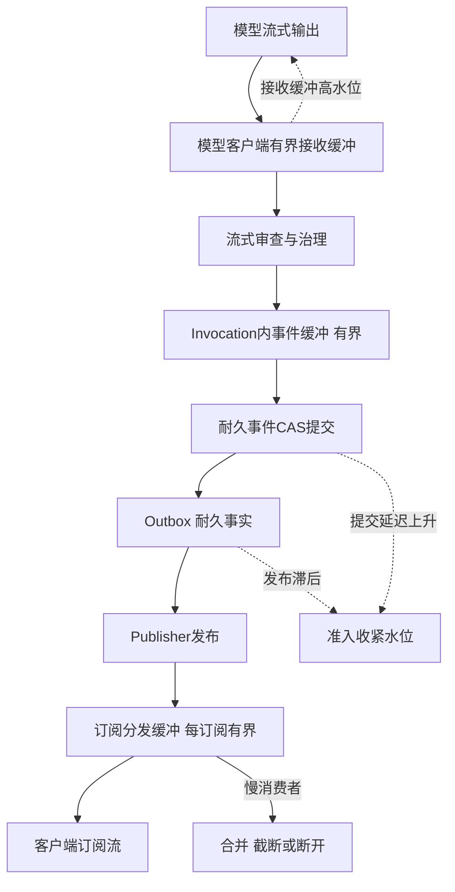

这条链上有三个不同性质的段：

1. **模型到 Invocation 段**：模型输出速率可能超过审查与处理速率。接收缓冲有界，缓冲高水位时向模型侧传导——降低请求并发、收缩流式窗口，而不是让缓冲无限膨胀；
2. **提交段**：耐久事件必须 CAS 提交后才能成为事实。提交延迟上升是全局信号，应反馈到准入链路收紧新 Run 调度，而不是靠丢弃事件缓解；
3. **分发段**：订阅缓冲是 provisional 的有界内存缓冲，慢消费者只影响自己这一路，合并、截断或断开都不影响耐久事件流。

### 6.2 有界缓冲一览

| 缓冲位置 | 内容 | 有界依据 | 溢出行为 | 上游传导 |
|---|---|---|---|---|
| 模型接收缓冲 | Token 增量 | 每 Invocation 上限 | 阻塞读取或收缩窗口 | 降低模型并发领取 |
| 审查管道缓冲 | 待审分块 | 管道级数乘每级上限 | 暂停读取上游 | 同上 |
| 事件提交缓冲 | 待提交 RuntimeEvent | 每 Invocation 上限 | 提交完成前不读取新事件 | 提交延迟反馈准入 |
| Outbox | 已提交待发布 | 耐久事实不丢弃 | 发布侧扩容或提交侧限流 | 滞后反馈准入 |
| 订阅分发缓冲 | 展示增量 | 每订阅上限 | 合并、截断、断开 | 仅影响该订阅 |
| 回调接收缓冲 | 外部结果事件 | 入口配额加有界队列 | 拒绝并要求重投 | 回调配额反馈 |

### 6.3 慢消费者策略

展示增量流的慢消费者处理沿用第 4 篇确立的约定，并在高并发下强化：

- **合并**：Token 增量按时间或大小窗口合并后发送，高频进度只保留最新值；
- **截断**：缓冲达到上限时丢弃最旧的可丢弃增量，保留最新快照与耐久事件游标；
- **断开**：持续落后的订阅被主动断开，客户端凭游标重连，先取权威快照再接续增量；
- **客户端断开默认只结束订阅，不取消 Run**。是否取消由显式持久化的 CancelRunCommand 决定，不依赖连接关闭的瞬时信号。

关键不变量：**关键耐久事件不因流式拥塞丢失。** StepStarted、ToolCallCommitted、RunPaused、ArtifactCreated 这类事件走耐久事件流，订阅通道的任何拥塞、合并与断开都不影响其提交与可重放性。

### 6.4 提交侧背压：全局稳定回路

背压链条中最容易被忽视的是提交侧。当状态库写入变慢、Outbox 发布滞后时，如果准入不收紧，新的 Run 会持续涌入，把提交路径彻底压垮。正确的回路是：

1. 监测耐久事件提交延迟与 Outbox 滞后；
2. 超过预警线时，第四级准入（资源池水位）自动收紧，减少新 Run 受理与调度；
3. 已受理 Run 继续推进，但其新事件的产生速率随提交确认节奏自然放缓——Worker 在提交确认前不读取下一批事件；
4. 恢复后准入逐步放开，避免闸门全开造成二次冲击。

这个回路把“下游变慢”翻译成“上游变慢”，是系统以受控方式降速的核心机制。

### 6.5 背压的红线

背压是速率控制，不是语义豁免。以下行为在任何压力下都不允许：

- 为缓解压力跳过流式审查或内容治理；
- 为降低提交延迟绕过 CAS 或末端门禁；
- 以“缓冲满了”为由丢弃耐久事件或 Outbox 条目；
- 把背压转嫁为静默丢弃任务——丢弃必须表现为显式拒绝或显式失败事件。

---

## 7. 批处理与管道化

批处理与管道化是提高吞吐的常规手段，但在 Agent 平台中，它们的边界由正确性与隔离要求决定，而不是由性能单方面决定。

### 7.1 模型请求批处理的边界

平台侧把多个模型请求合并提交（而非依赖模型服务内部的连续批处理）时，必须遵守三条边界：

1. **不跨租户合并**。不同租户的请求不进入同一批上下文，避免隔离边界在批处理层被击穿；
2. **不跨安全档位合并**。不同风险等级、不同数据驻留要求的请求分批处理，批次整体继承其中最严格的约束；
3. **批次是故障单元**。一批请求共享的失败域要显式评估：批次级超时、批次级重试必须落到单请求幂等键上，不能整批盲目重发。

模型服务内部的 continuous batching、KV Cache 复用属于模型推理服务的职责，平台不应假设其存在，也不应试图代替模型服务做请求合并决策。平台侧批处理的合理场景主要是：同租户、同优先级、相近 deadline 的非交互请求，以及评测与回填类离线流量。

### 7.2 流式审查与转发流水线

模型流式输出在到达订阅者之前通常要经过分块、治理审查与多路分发。把它组织为流水线而非串行大块处理：

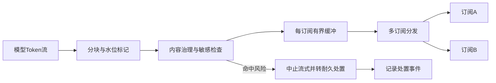

流水线设计要点：

- **每级有独立有界缓冲**，级间以水位传导，任何一级变慢只回压到上一级；
- **审查命中不阻塞其他订阅的耐久事实**。命中风险时中止该 Run 的流式输出并转入耐久处置流程，这是 Run 级事件，不是分发层的局部异常；
- **大对象不进管道**。Artifact 与大文件只传引用，避免单个大载荷阻塞整条流水线（队头阻塞）。

### 7.3 事件批量提交与单事件耐久性的权衡

这是批处理中最容易犯错的地方。必须区分两个层面：

| 层面 | 是否允许批量 | 约束 |
|---|---|---|
| 权威提交 | 保持事务边界不变 | 状态、CallRecord 与 Outbox 的原子提交语义不因批量优化而合并或拆散 |
| 传输与复制 | 允许批量 | 批量只影响投递效率，不改变每条事件的耐久语义 |
| 展示增量 | 自由批量合并 | provisional，可丢弃 |

换言之：**批量提交优化的是“一次事务携带多少内容”，不能改变“每个耐久事件要么完整提交、要么不存在”的事实。** 把多个 Run 的状态变更塞进一个大事务，会放大锁竞争与失败回滚范围；把本应原子的一组变更拆开提交，会制造中间状态。两者都破坏正确性。

批量化的真实代价清单：

- 批量越大，单条事件的提交延迟尾部越高；
- 批量事务失败时，批内所有条目一起回滚，重试放大；
- 批量窗口内崩溃，未提交部分全部丢失——这正是耐久事件必须逐条或按原子组提交的原因；
- 批量让“事件顺序”与“提交顺序”分离，消费者必须按事件序号而非到达顺序处理。

### 7.4 管道化与队头阻塞

管道化（多个阶段重叠执行）的收益取决于最慢一级。Agent 平台常见的队头阻塞来源：

- 单个超长上下文请求占住模型池槽位；
- 单个大 Artifact 传输占住分发通道；
- 单个慢状态库事务占住提交路径。

对策与队列治理一致：按大小与时长分流、为短小条目设快速通道、把大对象转为引用传递。管道化不是消除排队，而是让排队发生在正确的、有界的位置。

---

## 8. Worker 与并发度

### 8.1 逻辑 Worker 并发模型

系列中的 Worker 是**逻辑概念**：一个 Worker 槽位代表“一个正在持有 RunLease 并推进 Invocation 的执行单元”，而不是一个操作系统线程或一个进程。这个抽象带来三条推论：

1. **Worker 并发度等于同时推进的 Invocation 数**。调大并发度就是允许更多 Run 同时处于 RUNNING；
2. **WAITING 不占 Worker**。Run 进入 WAITING 时先提交状态与等待条件，再释放 Lease 与槽位；回调、定时器或审批事件到达后只把 Run 重新放入可运行队列，由新 Worker 重新领取 lease 推进。回调线程直接恢复 Agent 是明确禁止的反模式；
3. **Worker 可替换**。任一 RuntimeInstance 退出，其槽位由其他实例接管，Run 状态独立于实例存在。

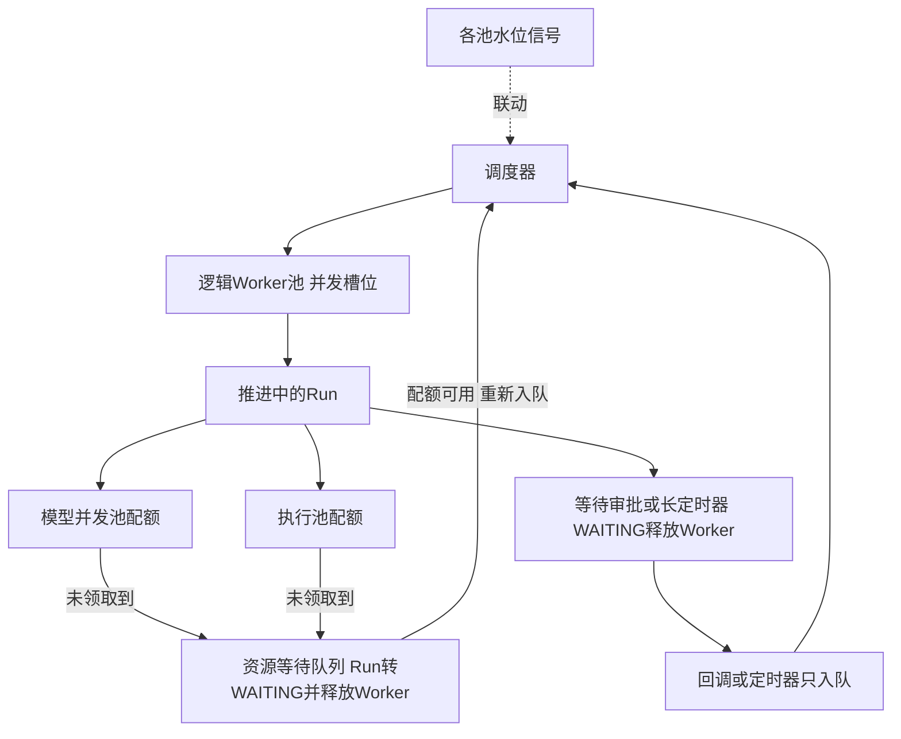

### 8.2 模型并发池与执行池的配额联动

Worker 并发度不是孤立参数。一次 Run 推进可能需要模型并发、执行池实例、状态库连接等多种资源，**可推进并发的上界受各资源配额约束，具体瓶颈取决于 Run 的资源组合分布，需按画像实测标定**。以下为规划假设示例，用于说明联动关系，具体数值必须以实测为准：

| 资源 | 规划假设示例 | 说明 |
|---|---|---|
| Worker 槽位 | 200 | 逻辑并发上限 |
| 模型并发池 | 120 | 供应商配额或自建容量 |
| 执行池实例 | 80 | 浏览器与 Sandbox 合计 |
| 状态库写连接 | 60 | 提交路径共享 |

按此假设，有效推进并发受限于最小项，继续把 Worker 槽位加到 400 不会提升吞吐，只会让更多 Run 堵在资源等待队列。联动规则：

- **调度器按下游余量发放工作**：模型池水位高时减少领取需要模型调用的 Run，而不是领取后再去排队；
- **配额变更同步评估**：模型供应商配额变化、执行池扩缩容，都应触发 Worker 并发度与准入水位的重新校准；
- **等待即释放**：领取资源失败且预计等待较长时，Run 转 WAITING 释放 Worker，避免 Worker 持有槽位空转。

### 8.3 连接池管理

连接池是高并发下最隐蔽的瓶颈，其症状典型表现为“CPU 不高、队列不深，但调度延迟持续上升”。Agent 平台至少涉及四类连接池：

| 连接池 | 风险 | 治理 |
|---|---|---|
| 状态库连接 | 提交路径争用，事务排队 | 连接数与 Worker 槽位匹配，获取超时显式化 |
| 模型服务连接 | 长流式连接长期占用 | 流式连接与短请求分池，空闲回收 |
| 消息组件连接 | 发布与消费共用导致互相阻塞 | 发布、消费分池，消费滞后独立告警 |
| 下游工具连接 | 单租户慢下游拖垮共享池 | 按池或按租户隔离，熔断与超时 |

连接池纪律：

- 每个池声明容量、获取超时与空闲策略，获取超时是背压信号而不是可无限等待的阻塞；
- 共享池必须有隔离手段，防止单一慢租户或慢下游耗尽全部连接；
- 连接健康检查与 keepalive 明确配置，避免“连接活着但对端已断”的半开状态在高峰期集中爆发。

### 8.4 并发度调整的治理

并发度参数（Worker 槽位、池配额、连接数）是互相咬合的一组值，调整任何一个都应评估整组联动：并发度配置应集中管理并版本化，每次调整附带预期影响与回滚值，并以第 10 节的负载验证确认效果，而不是只看瞬时吞吐。

---

## 9. 长任务与短任务混跑

### 9.1 混跑的问题本质

长任务与短任务共享同一套队列和 Worker 时，长任务持有槽位的时间长，短任务即使权重相同也要排在其后；若长任务数量占优，短任务的 P99 调度延迟会先于任何告警阈值恶化。解决思路不是让长任务变快，而是**让两类任务分队列、分容量分区运行，共享底层资源池但互不阻塞调度路径**。

### 9.2 队列分离与路由

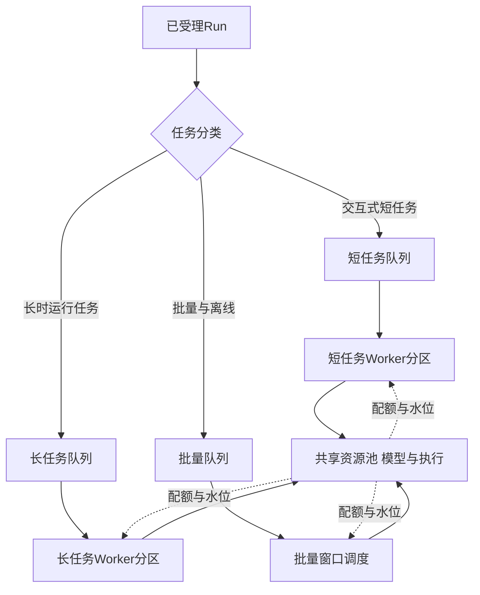

| 队列 | 任务特征 | 调度目标 | 资源策略 |
|---|---|---|---|
| 短任务队列 | 秒级、用户等待中 | 最低调度延迟 | 专用 Worker 份额，优先模型配额 |
| 长任务队列 | 分钟到小时级 | 吞吐与资源释放 | 独立分区，WAITING 及时释放 |
| 批量队列 | 离线、可延迟 | 成本与低峰利用 | 剩余容量，可整体延后 |

分类依据来自任务声明与历史画像：预期时长、是否含审批、是否交互、工具调用比例。分类错误（长任务混入短队列）要有监测指标兜底，例如“短任务队列中出现运行时长超阈值的 Run”。

### 9.3 抢占策略

抢占是高并发下为高优先级任务临时夺取资源的机制，其语义在第 4 篇已定义为 Preempt：形成 Pause 或重新排队，而不是终止。抢占的完整成本必须被显式评估：

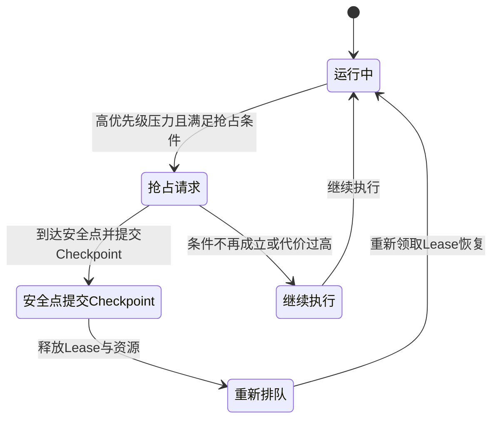

抢占的约束清单：

- **只在安全点抢占**：耐久事件已提交、Checkpoint 已持久化、在途外部动作已有 ExecutionRecord 或 UNKNOWN 记录；
- **已发起的外部调用不可抢占**：模型调用与工具调用一旦外呼，只能等待结果或对账，抢占只能停止“下一步”；
- **抢占有代价**：被抢占任务的 Checkpoint、重排队、上下文重新装载都是成本，频繁抢占会同时拖慢两个优先级；
- **优先用分区替代抢占**：容量分区能消除大多数反转场景，抢占只作为分区不足时的兜底。

### 9.4 WAITING 占比治理

长任务平台的隐藏容量杀手是“名义上在运行、实际在等待”的 Run 长期占用 Worker。治理指标与手段：

| 指标 | 含义 | 治理动作 |
|---|---|---|
| WAITING 占比 | WAITING Run 与全部非终态 Run 之比 | 持续上升说明等待类任务增多，检查定时器与回调链路 |
| 等待释放率 | WAITING Run 成功释放 Worker 的比例 | 低于目标说明存在“假 WAITING”仍占槽位 |
| 回调到重调度延迟 | 回调入队到新 Worker 领取的时延 | 上升说明回调洪峰或队列失衡 |
| 审批停留时长 | 等待审批的分布 | 长尾推动审批提醒与超时策略，而非平台侧硬等 |

纪律重申：审批、远程作业、长定时器场景必须走“提交 WAITING 状态与 ExternalHandle→释放 Lease→回调只入队→新 Worker 重新领取”的标准路径。任何为了“省一次重新装载”而让 Worker 挂着等待的实现，都会在高并发下把 Worker 池变成等待池。

---

## 10. 负载验证方法论

容量分开建模回答了“算什么”，负载验证回答“怎么证明”。本节给出从负载画像到容量回归的完整方法论。核心立场：**未经实测的具体 QPS 与时延数字不构成任何承诺；示例容量一律只是规划假设。**

### 10.1 负载画像

压测结果只在负载画像与生产一致时才有意义。Agent 平台的负载画像至少包含：

| 维度 | 内容 | 获取方式 |
|---|---|---|
| 任务类型分布 | 短交互、长任务、批量、含审批任务的比例 | 生产统计或业务预期 |
| 上下文大小分布 | 输入 Token、引用 Artifact 大小的分位 | 生产采样 |
| 工具调用比例 | 每 Run 平均工具调用次数与类型分布 | 生产统计 |
| 流式订阅比例 | 需要实时订阅的 Run 占比与订阅时长 | 生产统计 |
| 突发形态 | 平稳、周期性、尖峰、重试风暴 | 业务场景枚举 |
| 租户集中度 | 头部租户流量占比 | 生产统计 |
| 外部依赖条件 | 模型配额、下游限流的压测环境设定 | 显式声明 |

负载画像应版本化管理：每次压测记录所用画像版本，容量结论只对声明的画像成立。

### 10.2 压测指标

压测观测的指标与第 4 篇的 Runtime SLO 一一对应，高并发场景下重点关注：

| 指标 | 测量边界 | 高并发下的意义 |
|---|---|---|
| 受理延迟 | 请求到达到受理事务提交或拒绝 | 入口路径是否成为瓶颈 |
| 调度延迟 | Run 可运行到领取 Lease | 公平与队列健康，分租户分优先级观测 |
| 事件提交延迟 | 事件产生到权威提交确认 | 提交路径背压的早期信号 |
| 队龄 | 各队列条目等待时长分布 | 比错误率更早出现的过载信号 |
| 拒绝率 | 分级拒绝次数与原因分布 | 准入是否按设计生效 |
| 资源等待深度 | 模型池与执行池等待队列 | 配额联动是否合理 |
| WAITING 释放率 | WAITING 释放 Worker 的比例 | 长任务资源效率 |
| 流式断流与合并率 | 订阅质量 | 慢消费者策略是否生效 |

所有指标都要看分布而不是均值：P50 正常而 P99 恶化是高并发故障的标准前兆。

### 10.3 尾延迟与突发测试

四类必做测试：

1. **阶梯加压**：负载逐级上升，找到每级指标的拐点，确定各级准入阈值的合理位置；
2. **尖峰测试**：短时数倍于常态的突发，验证入口配额、有界队列与拒绝语义是否按设计工作，重点观察拒绝是否携带重试指引、重试是否引发二次洪峰；
3. **持续饱和测试**：长时间维持在拐点附近，观察队龄、内存、连接数是否稳定，验证背压回路是否让系统“稳定地慢”而不是“缓慢地崩”；
4. **带故障加压**：在加压同时注入局部故障，例如模型池部分不可用、状态库写入变慢，验证降级与准入收紧是否联动。

关于平均值与尾延迟的纪律再次强调：**Little's Law 只能用于平均容量估算**；P99 只能来自固定负载模型下的实测，不能由平均值外推，也不能用各阶段 P99 简单相加。

### 10.4 容量回归

负载验证不是一次性活动，而是回归机制：

- **固定基线**：以某次实测结果为容量基线，记录负载画像、环境配置与指标分布；
- **变更触发回归**：平台版本升级、AgentSpec 变更、配额调整、依赖变化后，重跑关键压测场景；
- **回归门禁**：关键指标相对基线显著退化时阻断发布，退化判定标准在基线建立时一并定义；
- **规划假设显式修订**：每次回归后更新容量文档中的规划假设，标注实测依据与适用条件。

---

## 11. 高并发下的正确性不变量

高并发优化的所有手段——批处理、管道化、近似配额、缓冲合并——都不得触碰正确性边界。以下不变量在任何并发水平下必须保持：

| 不变量 | 机制 | 高并发下的保持方式 | 验证方法 |
|---|---|---|---|
| 同一 Run 单一推进者 | RunLease 加 CAS 提交 | 提交路径校验 epoch，不因压力跳过 | 双 Worker 并发推进测试 |
| 调用记录幂等领取 | CallRecord CAS 领取 | Outbox 重复投递时领取仍唯一 | 重复投递压测 |
| fencing 拒绝旧持有者 | 状态库与末端门禁双重校验 epoch | 门禁校验不并入可缓存的快速路径 | 旧 epoch 外呼测试 |
| 末端门禁不被绕过 | 外呼前校验 control_intent、revocation、授权 | 门禁校验与配额判定分离，不共享降级开关 | 高并发下取消竞争测试 |
| Outbox 耐久事实 | 与状态原子提交 | 发布滞后只触发提交侧背压，不丢弃 | 发布方故障注入 |
| 耐久事件不丢失 | 耐久流与展示流分离 | 订阅拥塞只影响 provisional 流 | 慢消费者加故障注入 |
| 受理幂等 | 幂等键去重 | 重复提交洪峰下去重仍生效 | 重复受理压测 |
| 安全门禁不降级 | 授权、审查、门禁独立于限流 | 降级预案显式排除门禁组件 | 降级演练 |

一个典型的高并发竞争场景及其正确行为：

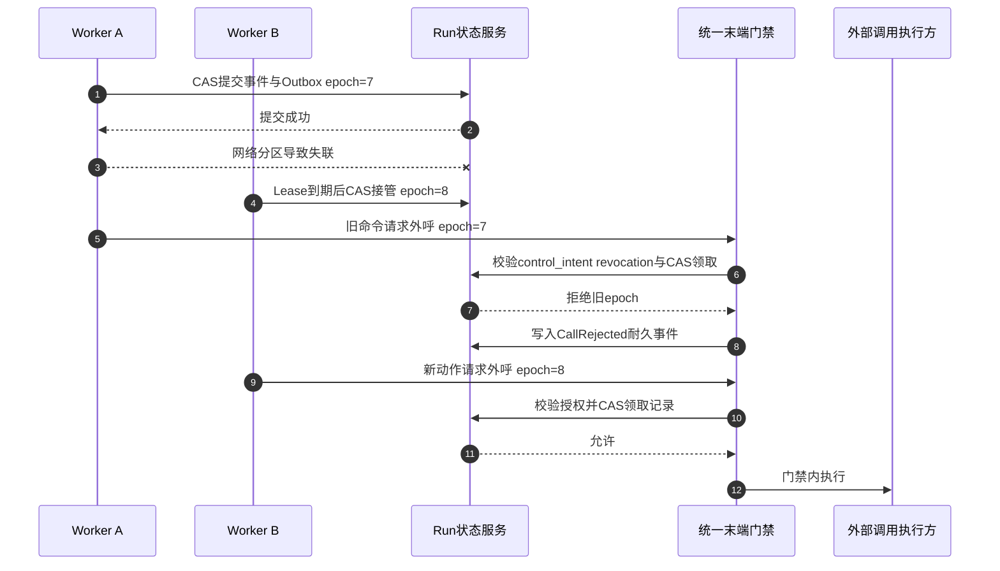

该场景中值得注意的三点：旧 Worker 的已提交 Outbox 条目不会被 Publisher 丢弃，但外呼被门禁拒绝并形成耐久的 CallRejected 事件；新 Worker 的接管不依赖“旧 Worker 已死”的假设，只依赖 epoch 的单调性；整个过程没有任何一步因为“系统正忙”而跳过校验。

**并发不得降低安全门禁**是这一切的总纲。降级可以改变流量（准入收紧、展示流降级、批量延后），但不能改变每个外呼动作的合法性判定。授权与出口控制不可用时阻断高风险动作，而不是放行，这一原则在第 0 篇已确立，在高并发语境下只是被更频繁地考验。

---

## 12. 常见反模式

1. **无界队列与静默排队**：用“先排队再说”掩盖过载，越限请求被压入无人承诺的等待区，客户端得到超时而不是可操作的拒绝，队龄与内存同时失控。
2. **以零拒绝率为唯一容量目标**：为维持零拒绝无限预留资源，或修改统计口径。拒绝率是容量信号，突发时应当上升且携带指引。
3. **高峰期绕过末端门禁**：为吞吐跳过 control_intent 与 revocation 校验，取消与撤销在高压下集体失效，重复副作用与安全事件同时出现。
4. **回调线程直接推进 Run**：外部回调绕过入队与 Lease 领取，直接恢复 Agent 循环，产生双写与状态竞争。
5. **WAITING Run 占用 Worker**：为省重新装载成本让 Worker 挂起等待审批，高峰期 Worker 池退化为等待池。
6. **把耐久事件并入传输批量**：为降低 IOPS 把多个原子提交合并成一个大事务，失败回滚范围与提交尾延迟同时放大。
7. **单接口压测代替混合负载**：只压 Task 创建接口，忽略创建、回调、订阅、取消混合时的相互挤占，生产一混合就崩。
8. **用平均值承诺 P99**：以平均调度延迟推导尾延迟结论，或以各阶段 P99 相加作为端到端承诺。
9. **只有优先级没有队龄提升**：高优先级通道长期吸走容量，低优先级任务饥饿且无人察觉。
10. **共享连接池无隔离**：单一慢租户或慢下游耗尽连接池，全平台提交延迟上升而 CPU 指标一切正常。
11. **拒绝后无退避重试**：客户端拿到拒绝立即原速重试，把拒绝变成新洪峰，入口配额被重试流量吃满。

---

## 13. 生产验证场景表

| 验证场景 | 预期事实 |
|---|---|
| 入口洪峰达到配额上限 | 越限请求被拒绝并返回重试指引，受理事务不被冲垮，重试计入配额 |
| 单租户提交量激增 | 该租户超出最大并发的部分留在自身队列，其他租户调度延迟不受显著影响 |
| 低优先级队列持续高压 | 队龄提升按规则生效，饥饿监控无零服务窗口告警 |
| 模型池水位打满 | 第四级准入收紧，新 Run 减少调度，资源等待队列有界且不占 Worker |
| 客户端批量断开流式订阅 | 订阅结束，Run 不被隐式取消，耐久事件提交不受影响 |
| 订阅者持续过慢 | 该订阅被合并、截断或断开，其他订阅与耐久事件流正常 |
| 状态库写入变慢 | 事件提交延迟上升触发准入收紧，系统受控降速，无事件丢失 |
| Outbox 发布方故障恢复 | 积压条目全部发布，已提交事实无丢弃，无重复逻辑步骤 |
| 审批等待数小时的长任务占比上升 | WAITING 释放率保持目标水平，Worker 池不被等待占用 |
| 高优先级突发抢占低优先级 | 抢占发生在安全点，被抢占任务 Checkpoint 完整并可恢复 |
| 双 Worker 并发推进同一 Run | 旧 epoch 的状态提交与外呼均被拒绝，fencing 计数可观测 |
| 取消与 Outbox 发布竞争 | 命令仍被投递，门禁按最新 control_intent 拒绝外呼并写入 CallRejected |
| 批量事件提交中进程崩溃 | 未提交批量整体不存在，已提交事件完整，无中间状态 |
| 容量回归对比基线 | 关键指标无显著退化，或退化被门禁拦截并归因 |

---

## 14. 架构评审清单

### 队列与准入

- 平台内是否所有队列都有界，且容量、队龄、截止时间和溢出策略显式声明？
- 入口队列、Run 队列、资源等待队列的职责与耐久性是否分开？
- 四级准入链路是否完整，任一级越限是否优雅拒绝而非静默排队？
- 拒绝响应是否包含原因码、重试指引与幂等键保留说明？
- 拒绝是否留痕并作为容量信号，而非被掩盖的失败？

### 公平与优先级

- 是否分租户队列并采用加权公平，权重是否来自契约且可审计？
- 租户最大并发是否同时约束受理与调度两个时点？
- 是否存在优先级反转风险，分区、队龄提升与抢占的优先级排序是否合理？
- 饥饿监控指标是否覆盖分租户调度延迟、最大队龄与零服务窗口？

### 背压与批处理

- 背压是否从模型流式一路传导到准入水位？
- 每级缓冲是否有界，慢消费者是否只影响自身订阅？
- 耐久事件与展示增量是否分流，关键耐久事件是否不因流式拥塞丢失？
- 批量优化是否保持权威提交的事务边界与单事件耐久语义？
- 批处理是否遵守不跨租户、不跨安全档位的边界？

### Worker 与资源

- Worker 并发度是否与模型池、执行池、连接池配额联动评估？
- WAITING 是否释放 Worker，回调是否只入队？
- 连接池是否声明容量与获取超时，是否有租户或池级隔离？

### 长短任务与负载验证

- 长短任务是否分队列分分区，分类错误是否有监测兜底？
- 抢占是否只在安全点发生，且已发起的外部调用不可抢占？
- 负载画像是否版本化，压测是否覆盖混合负载、突发与带故障加压？
- 容量基线与回归门禁是否建立，规划假设是否标注实测依据？

### 正确性

- 高并发下 CAS、幂等领取、fencing 是否全部保持？
- 末端门禁是否与限流降级解耦，任何压力路径是否都无法绕过？
- 降级预案是否显式排除授权、审查与门禁组件？

---

## 15. 本篇结论与后续专题

高并发 Agent 平台的治理能力，可以归纳为一组互相咬合的机制：

- **三种压力源分开治理**：请求并发靠入口配额与幂等受理，运行中并发靠 Worker 槽位与公平调度，外部依赖占用靠水位准入与 WAITING 释放；
- **一切缓冲有界**：每段缓冲声明容量、队龄、截止时间与溢出策略，溢出只有拒绝、降级和声明的有界等待三种合法选择；
- **公平是显式工程**：分租户队列、加权公平、最大并发、队龄提升和饥饿监控共同保证“总容量未耗尽时没有人被饿死”；
- **准入先于排队**：四级准入链路让过载在受理之前被拒绝，拒绝携带重试指引并留痕；
- **背压是回路不是开关**：从模型流式到事件提交再到准入水位的传导链，让系统以受控方式变慢；
- **吞吐优化有正确性边界**：批处理与管道化不得改变权威提交语义，不得跨租户与安全边界；
- **容量靠验证不靠推导**：负载画像、压测指标、尾延迟与突发测试、容量回归构成闭环，平均值只用于估算，P99 只来自实测。

这些机制的共同指向是：**在高并发下，平台变慢可以接受，变错不可接受。** 队列可以深，队龄不能失控；请求可以拒绝，事实不能丢失；吞吐可以下降，门禁不能绕过。

下一篇将进入高可用与容灾专题，讨论多可用区部署、故障域划分、Run 接管与状态复制如何在可用区间保持本篇确立的全部不变量；可观测体系如何为本篇的队龄、拒绝率与饥饿监控提供测量基础，将在第 18 篇展开。

---

## 参考资料

以下均为官方资料或经典文献。动态规范和文档会持续更新，实际实现应固定所采用的版本与访问日期。文中所有容量示例均为规划假设，不构成任何性能承诺。

1. [OWASP Top 10 for Agentic Applications for 2026](https://genai.owasp.org/resource/owasp-top-10-for-agentic-applications-for-2026/)
2. [MCP Specification](https://modelcontextprotocol.io/specification)
3. [A2A Protocol v1.0 Announcement（2026 年春）](https://a2a-protocol.org/latest/blog/2026/03/12/a2a-protocol-ships-v10-production-ready-standard-for-agent-to-agent-communication/)
4. [Google ADK Event Loop](https://adk.dev/runtime/event-loop/)
5. [CloudWeGo Eino ADK Agent Runner and Extension](https://www.cloudwego.io/docs/eino/core_modules/eino_adk/agent_extension/)
6. [Temporal Workflow Execution](https://docs.temporal.io/workflow-execution)
7. [LangGraph Durable Execution](https://docs.langchain.com/oss/python/langgraph/durable-execution)
8. [Amazon Bedrock AgentCore Runtime](https://docs.aws.amazon.com/bedrock-agentcore/latest/devguide/runtime-how-it-works.html)
9. [OpenTelemetry GenAI Semantic Conventions Repository](https://github.com/open-telemetry/semantic-conventions-genai)
10. [John D. C. Little, A Proof for the Queuing Formula: L = λW, Operations Research, 1961](https://pubsonline.informs.org/doi/10.1287/opre.9.3.383)
