# 高可用 Agent 平台：故障域、降级与容灾

> **系列**：生产级 Agent 平台架构 2026 · 第 17 篇  
> **定位**：规模与可靠性篇  
> **版本**：闭环修订版  
> **更新时间**：2026-10-12  
> **前置阅读**：第 0 篇《从模型推理到生产运行：2026 年 Agent、Harness 与 Runtime 总体架构》 · 第 4 篇《Agent Runtime：从生命周期到执行治理的完整能力模型》 · 第 6 篇《持久执行、Checkpoint 与副作用对账》  
> **关键词**：故障域、依赖故障矩阵、降级阶梯、Cell、多可用区、混沌演练、SLO

## 摘要

Agent 平台的高可用不是“多部署几个副本”就能回答的问题。一个 Run 可能持续数小时，期间依赖模型供应商、策略引擎、凭据代理、状态库、消息队列、对象存储和多种执行后端；任何一个依赖失效时，平台都必须回答三个问题：**哪些任务受影响、现在应该做什么、恢复之后如何证明事实没有丢失也没有重复。** 进程故障有第 6 篇的租约接管与副作用对账兜底，但可用区故障、区域灾难、共享依赖全挂和备份失效，需要另一层架构来承接。

本文建立五层故障域模型：实例与进程、可用区、区域、依赖服务、控制面，并说明每层故障的影响面为什么不能互相推导；给出覆盖模型供应商、PDP 与策略、凭据代理、数据与记忆、消息队列、权威状态库、对象存储、执行后端、遥测九类依赖的故障矩阵，明确每类的默认行为、降级策略与禁止动作；把第 13 篇的 fail-open/fail-closed 矩阵深化为可复用的决策框架；定义接管与恢复 SLO 的时间构成与度量口径；给出 L0 全自主到 L4 优雅拒绝的降级阶梯及其触发、决策与恢复协议；以 Cell 架构控制故障传播半径，并约束跨 Cell 控制面只分发签名版本与策略、不自动扩权；按能力层级讨论多可用区与同城、异地容灾，说明状态复制方式与 RPO 的真实关系；最后以备份恢复、混沌演练和 SLO 错误预算把上述机制闭环到发布准入。

本篇的事实纪律：**RPO 与 RTO 只给定义与方法，不给未经实测的承诺数字**；多可用区、同城与异地容灾按能力层级表述；不指定任何必选产品。事件溯源不自动提供 RPO=0——事件的耐久性同样取决于提交与复制方式，这是本篇反复强调的边界。

队列与背压在第 16 篇展开，资源池扩缩在第 15 篇展开，安全事件响应在第 13 篇展开，本篇不重复。

---

## 1. 问题背景：单点协议撑不起系统级故障

第 4 篇与第 6 篇已经建立了单 Run 维度的可靠性协议：RunLease 加单调 epoch 的 fencing 保证同一时刻只有一个有效持有者推进 Run；状态与 Outbox 原子提交后即为耐久事实；UNKNOWN 必须对账；接管者先读历史并对账在途动作再决定继续。这套协议能够承接**单实例故障**：Worker 崩溃、Pod 被驱逐、进程假死，接管者拿到新 epoch，读取 Checkpoint 与事件，对账在途 Execution，Run 继续推进。

但生产平台的故障不止于此。把视角拉高，会出现一组单 Run 协议回答不了的问题：

| 故障场景 | 单 Run 协议能否承接 | 缺什么 |
|---|---|---|
| 单个 Worker 崩溃 | 能 | 租约接管与对账已覆盖 |
| 模型供应商全部端点不可用 | 部分 | 在途调用对账可覆盖，但新任务怎么办、降到哪一级没有定义 |
| 权威状态库主切换 | 部分 | 写中断窗口内的受理、提交、续租行为需要统一定义 |
| 整个可用区失效 | 不能 | 实例、队列、状态副本同时丢失，接管者本身也在故障域内 |
| 区域灾难 | 不能 | 需要异地状态复制、切换决策与数据丢失范围评估 |
| 控制面不可用 | 不能 | 版本分发、策略下发、凭据轮换停摆，运行面行为需要预先定义 |
| 备份从未演练，恢复失败 | 不能 | 需要恢复演练与实测口径 |

这些场景的共同点是：**故障发生在“承接故障的机制”所在的层。** 租约接管依赖状态库，状态库故障时接管本身失效；对账依赖外部查询，模型供应商全挂时对账查询也超时；Cell 内恢复依赖控制面分发版本，控制面故障时 Cell 必须能用本地缓存的签名版本继续运行。因此高可用架构的第一原则是：**每一层的恢复机制必须位于该层故障域之外，或者在该层故障时有预先声明的退化行为。**

第二个常见误区是把可用性承诺压成一个数字。“五个九”“分钟级切换”“零数据丢失”这类表述如果不区分故障范围，就只是营销语言。单实例故障的恢复时间、单可用区故障的恢复时间、区域灾难的恢复时间，三者由完全不同的机制决定，量级也不同。本篇的全部 RPO/RTO 讨论都按故障范围分别定义，并且只给定义与方法：**承诺数字必须来自本平台的实测与演练，不能来自供应商文档或他平台案例。**

第三个误区是把“事件溯源”“Outbox”“多副本”等机制直接翻译成 RPO=0。第 6 篇已经说明事件溯源只提供状态重建的表达；本篇进一步明确：**事件是否耐久，取决于事件提交所在事务的复制方式。** 异步复制下事件同样可能丢失尾部；只有提交路径采用同步多数派确认，已提交事实才不随主切换丢失。机制名字不提供保证，提交与复制方式才提供保证。

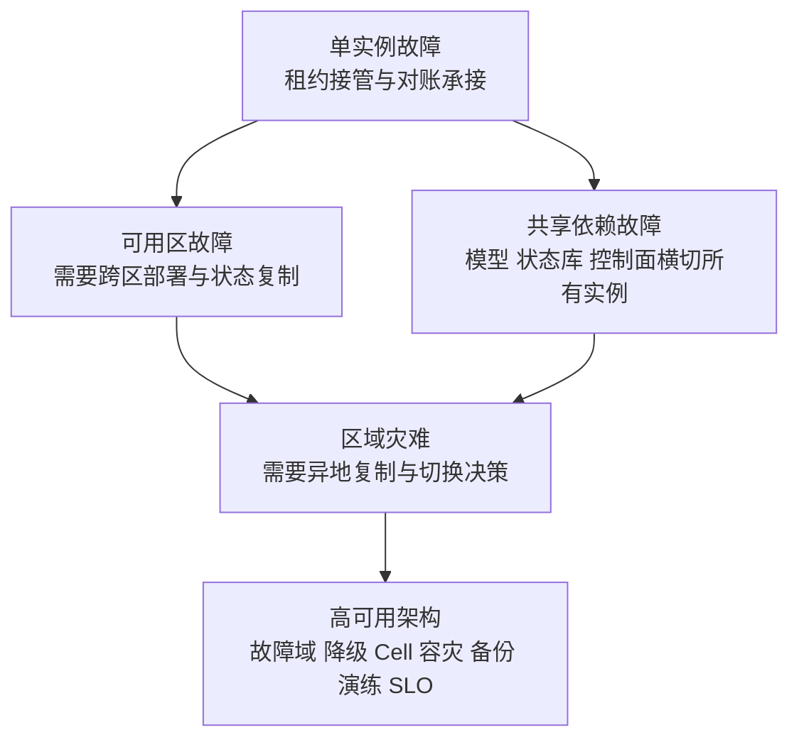

本篇的结构对应这七个构件：故障域模型回答“故障发生在哪里、影响什么”（第 2 节）；依赖故障矩阵与 fail-open/fail-closed 框架回答“依赖失效时每个控制点做什么”（第 3、4 节）；接管与恢复 SLO 回答“恢复要多久、按什么口径度量”（第 5 节）；降级阶梯回答“能力不足时如何有序收缩自治”（第 6 节）；Cell 架构回答“如何把爆炸半径切小”（第 7 节）；多可用区与容灾、备份恢复回答“大范围故障与数据丢失如何兜底”（第 8、9 节）；混沌演练与 SLO 体系回答“如何证明以上全部真实有效”（第 10、11 节）。

---

## 2. 故障域模型

### 2.1 五层故障域

故障域（Failure Domain）是一组会因同一原因同时失效的组件。划分故障域的目的不是画组织架构图，而是回答：**当某个域失效时，哪些能力同时消失，哪些恢复机制仍然可用。** Agent 平台至少需要识别五层故障域：

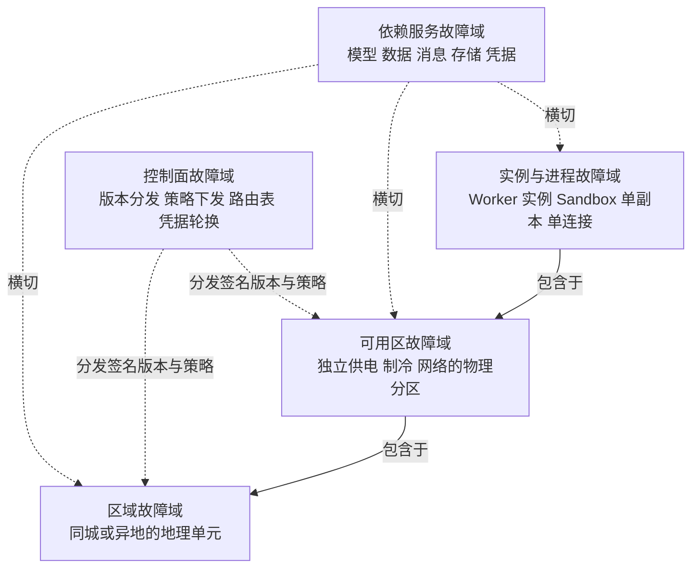

五层的关键差异：

| 故障域 | 典型故障原因 | 同时丢失的东西 | 仍然可用的恢复机制 |
|---|---|---|---|
| 实例与进程 | 崩溃、OOM、宿主机故障、部署错误 | 该实例上的 Invocation、内存状态、持有的 RunLease | 权威状态库、Outbox、其他实例的接管能力 |
| 可用区 | 断电、网络隔离、机房事故 | 该区内全部实例、队列副本、状态副本 | 其他可用区的实例与状态多数派 |
| 区域 | 大范围灾害、骨干网中断 | 该区域全部计算与本地状态 | 异地副本、备份、控制面（若在异地） |
| 依赖服务 | 供应商故障、配额耗尽、协议变更 | 对应能力（推理、授权、存储、传输） | 平台自身状态与对账协议；替代依赖（若已配置） |
| 控制面 | 控制面组件故障、分发错误、凭据过期 | 新版本发布、策略变更、撤权能力 | 运行面已缓存的签名版本与既定策略 |

两个结构性结论必须强调：

**第一，依赖服务故障域是横切的。** 一个外部模型供应商同时服务所有可用区、所有 Cell：它故障时，没有任何“换个可用区重试”可以规避。同理，共享的权威状态库、共享的策略服务都是横切故障域。Cell 可以隔离平台自身组件的故障，却隔离不了共享依赖——这正是第 3 节依赖故障矩阵必须独立于故障域模型存在的原因。

**第二，恢复机制必须与被恢复对象分域。** 状态库是接管的依据，所以状态库副本必须跨可用区分布；对账器依赖外部查询，所以外部查询不可用时对账要有超时升级路径；控制面分发版本，所以运行面必须能凭本地缓存的签名版本继续运行一个声明的窗口。每声明一项高可用能力，都要追问：它的依据在哪个故障域？

### 2.2 每层故障的影响面

影响面分析要落到系列领域对象上：故障影响的是哪些 Task 的受理、哪些 Run 的推进、哪些 ExecutionRecord 的在途责任。

**实例与进程故障。** 影响面限于该实例正在处理的 Invocation 与其持有 lease 的 Run。已提交的 RunEvent、CallRecord 与 Outbox 是耐久事实，不受影响；未提交的提案随进程消失，由事件重新唤醒后重放。在途外部动作按第 6 篇协议处理：有 ExecutionRecord 的对账，无登记的不存在（因为耐久调用原则禁止先斩后奏）。这是唯一可以由单 Run 协议完全承接的故障层。

**可用区故障。** 影响面是该区内的全部实例与局部副本。此时要注意三类“半死状态”：区内 Worker 可能并未崩溃只是网络隔离——它们仍可能尝试提交状态，fencing 的 epoch 校验是唯一防线；区内状态副本失联，写路径需要多数派重新确认；区内队列副本丢失，Outbox Publisher 需要切换到存活副本继续投递。可用区故障的正确处置不是“杀掉区内一切”，而是**让存活侧的接管与 fencing 自然生效**，并在恢复后对隔离期间可能发生的行为做对账。

**区域故障。** 影响面扩展到区域内容灾机制本身。此时恢复依据只剩异地副本与备份，RPO 取决于复制方式（第 8.3 节），RTO 取决于切换机制与验证流程。区域故障中最危险的不是丢计算，而是**切换决策**：何时宣布区域不可用、谁有权决定、切换前是否评估数据丢失范围——这是治理问题，不是技术问题。

**依赖服务故障。** 影响面按依赖的能力映射：模型故障影响所有需要推理的 Step；策略服务故障影响所有需要授权判定的控制点；凭据代理故障影响所有需要短期凭据的外部动作。关键区别在于：**依赖故障时平台自身状态通常完好**，因此处置重心不是恢复，而是降级——在依赖恢复前把自治程度收缩到与可用能力匹配的水平（第 6 节）。

**控制面故障。** 影响面是“变化”本身：新版本无法发布、策略无法更新、撤销无法下发。运行面按既定版本与策略继续运行是常态，这要求 AgentSpec、策略包、路由表都以签名版本缓存在 Cell 本地，且缓存有效期经过声明。控制面故障期间必须禁止的行为是：**以“控制面不可用”为由绕过版本校验或扩大权限**——系列约定明确，跨 Cell 控制面只分发签名版本与策略，不在故障时自动扩权。

### 2.3 故障域设计原则

1. **先列共享，再谈隔离。** 任何被两个以上故障域共享的组件（状态库、模型网关、策略服务、DNS、凭据服务）都是潜在的全局故障源，必须先识别再决定其自身的多域部署方式。
2. **恢复链路的每一环标注故障域。** 接管依赖状态库，状态库依赖多数派，多数派依赖跨区网络——链条上最弱的一环决定恢复能力。
3. **影响面以领域对象表达。** “三个服务受影响”不是影响面；“该 Cell 内所有 RUNNING Run 的推进暂停、所有 PREPARED Execution 的外呼延迟”才是。
4. **故障域边界必须演练验证。** 声明的边界（例如“两个副本在不同可用区”）与真实的边界（例如“两个副本其实共享同一上游存储集群”）可能不一致，只有注入故障才能分辨。

---

## 3. 依赖故障矩阵

第 3 篇确立了平台的功能域与主链，第 13 篇按网关给出了失败模式与默认行为。本节把视角从“网关控制点”切换到“被依赖的系统”，对九类依赖逐一给出故障模式、默认行为、降级策略与禁止动作。矩阵的总原则来自系列约定：**授权与敏感出口 fail-closed；非关键遥测可 fail-open；UNKNOWN 必须对账；降级不绕过安全控制。**

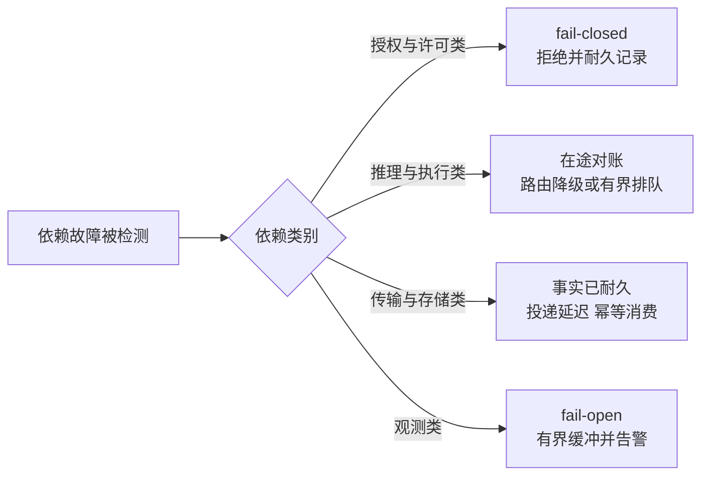

### 3.1 矩阵总览

| 依赖 | 故障时的事实状态 | 默认行为 | 降级策略 | 禁止动作 |
|---|---|---|---|---|
| 模型供应商 | 在途调用 PENDING 或 UNKNOWN | 对账已计费事实，重试受预算约束 | 备选路由、模型降档、降级阶梯 | 超时推断失败、无预算无限重试 |
| PDP 与策略 | 授权事实缺失 | fail-closed，耐久拒绝事件 | 低风险判定可用签名缓存（声明 TTL） | 用过期缓存放行敏感动作 |
| 凭据代理 | 新凭据无法签发 | 新外部动作暂停，Run 等待或改期 | 已签发短期凭据自然到期 | 回退长期凭据或静态密钥 |
| 数据与记忆 | 读取失败或写入不可靠 | 读失败标记未获取；写失败拒绝 | 只读问答降级、来源显式标注 | 编造数据、写入未校验存储 |
| 消息队列 | 投递延迟或重复 | Outbox 持久事实不受损，恢复后幂等消费 | 有界积压、按优先级投递 | 丢弃 Outbox 行、跳过幂等 |
| 权威状态库 | 写路径中断 | 受理与状态提交拒绝，续租失败进入等待 | 多数派恢复后接管与对账 | 绕过事务写、降级为无事实受理 |
| 对象存储 | 产物与快照读写失败 | 验证与交付阻断，Run 按策略等待 | 元数据与内容分离处置 | 把读写失败当作产物不存在 |
| 执行后端 | 外呼结果未知概率上升 | UNKNOWN 对账，能力级降级 | 停用该类工具、收紧自主性 | 对不可逆动作盲重试 |
| 遥测 | 观测数据缺失 | fail-open，有界缓冲或采样丢弃 | 关键事实走独立耐久通道 | 遥测阻塞状态提交、审计混入普通遥测 |

下面逐类展开矩阵中最重要的判断。

### 3.2 模型供应商

模型是 Agent 平台最典型的“横切共享依赖”：全部 Cell、全部可用区可能同时失去推理能力。故障形态包括端点超时、限流、配额耗尽、响应质量塌陷与供应商整体不可用。

**默认行为。** 在途模型调用按第 6 篇的模型对账协议处理：ModelCallRecord 处于 PENDING 或 UNKNOWN 时，按 provider_call_id 查询或等待账单窗口，已计费未响应的补记用量、响应按丢失处理；未决费用显式保留，不静默归零。模型调用不产生业务副作用，重试本身安全，但**重试消耗 Token 与预算，必须受调用预算与截止时间约束**——供应商故障期间的无限重试既是费用黑洞，也会在供应商恢复瞬间形成请求洪峰。

**降级策略。** 按三级展开：其一，AgentSpec 允许的备选模型路由，切换时保持数据驻留、工具权限与验收标准不变（第 13 篇约定）；其二，模型降档，例如从大参数模型切换到小参数模型，此时应重新评估输出质量门禁，必要时提高技术验证的抽样比例；其三，进入降级阶梯（第 6 节），把新任务收缩到 L2 仅 HITL、L3 只读问答或 L4 优雅拒绝。排队等待供应商恢复只适用于有明确恢复预期的短时故障，且排队必须有界并受 Task 截止时间约束。

**禁止动作。** 不得把模型超时推断为“本次推理失败且无费用”；不得因模型不可用而跳过内容治理或输出校验；不得让模型降档静默改变高风险动作的审批要求。

### 3.3 PDP 与策略

策略引擎（PDP）提供 AuthzDecision，是授权链的核心。它故障时的问题是：**授权事实缺失，平台还能做什么？**

**默认行为。** 系列约定明确：授权依赖故障 fail-closed。无法取得当前策略判定的调用，拒绝并形成耐久拒绝事件（CallRejected），而不是“按上次结果放行”。拒绝事件必须进入执行账本与审计，使策略故障窗口内的行为事后可追溯：哪些动作被挡、挡了多少、持续多久，都应是可查询的事实。

**缓存的边界。** 完全禁止缓存在工程上不现实：低风险只读判定可以基于签名的策略快照做本地判定，但必须满足三个条件——缓存的是**签名的策略版本**而非零散判定结果；TTL 经过显式声明并与撤销时效匹配；**敏感动作、写动作、不可逆动作永不使用缓存判定**，执行前必须取得当前判定。第 13 篇已指出“策略引擎不可用时高风险动作靠旧缓存继续执行”是典型事故形态，本节把它固化为矩阵规则。

**与审批的关系。** 审批服务不可用时，待审批动作停留在 WAITING，不产生批准；审批超时默认拒绝（系列约定）。不存在“审批系统挂了所以自动通过”的路径。

### 3.4 凭据代理

凭据代理负责签发受众绑定的短期凭据（第 0 篇授权链的倒数第二环）。它故障时，**已签发且未到期的凭据仍然有效**，新签发中断。

**默认行为。** 需要新凭据的外部动作无法组装 ExecutionSpec，外呼暂停；Run 按策略等待或释放 Worker 后改期唤醒。凭据代理自身的高可用（签发服务的多副本、密钥材料的冗余）属于该服务的职责，平台侧只定义“签发不可用”时的行为。

**降级策略。** 短期凭据到期前的窗口内，动作照常执行；窗口耗尽后，依赖该凭据的能力整体降级。凭据轮换失败要区分“新凭据签发失败”与“旧凭据撤销失败”：前者暂停新动作，后者是安全事件，应按第 13 篇的撤权流程处置，必要时主动终止依赖该凭据的在途动作。

**禁止动作。** 严禁因凭据代理不可用而回退到长期凭据、静态密钥或“先用共享账号顶上”。这类回退会把一次可用性故障升级为权限治理事故，且事后清理成本远高于等待恢复。

### 3.5 数据与记忆

数据与记忆网关背后是业务数据、RAG 索引与长期记忆存储。故障形态分读与写两类。

**读失败。** 检索不可用时，Agent 的正确行为是**显式标注“未获取到授权数据”**，而不是用缓存旧数据或模型自身知识冒充当前事实。若任务目标依赖实时数据（例如“读取最新报表生成分析”），数据不可用应使 Step 失败或 Run 暂停，由任务策略决定等待还是失败收尾；若任务允许基于历史快照，则快照的时间戳与来源必须进入上下文与产物元数据。

**写失败。** 记忆写入与业务写入 fail-closed：写入目标不可用时拒绝写入并记录，不得把待写内容暂存在不受治理的本地路径等待“以后补写”——那会制造绕过写入治理的旁路。记忆写入还应遵守第 0 篇的治理要求：来源、授权与风险属性随写入一起持久化，写入失败不产生半条记忆。

**索引污染与故障的区分。** 索引不可用是可用性问题，索引内容被污染是安全问题（OWASP ASI06）。两者的处置路径不同：前者降级与等待，后者隔离、回滚与取证。矩阵只覆盖前者，后者归第 13 篇的安全事件响应。

### 3.6 消息队列

消息队列在本系列中的定位非常明确：**它是事件运输，不是权威状态。** 状态与 Outbox 在同一事务提交后即为耐久事实，队列故障损失的是投递时效，不是事实本身。

**默认行为。** 队列不可用时：Outbox 行在状态库中累积，发布延迟指标告警；受理路径不受影响（只要状态库可写）；事件消费方暂停消费，恢复后按 event_id 幂等消化重复投递。队列恢复的瞬间通常伴随积压洪峰，消费端必须保持幂等与有界并发，避免把积压转化为对下游的冲击。

**降级策略。** 积压期间按消息性质分级：耐久命令（外呼、定时器）优先，事实事件次之，纯通知类可以延迟或合并。若队列长期不可用且状态库健康，平台可以声明“投递降级窗口”：Run 推进因事件无法传递而暂停，但事实完整性不受损——这正是“事实先于投递”的价值。

**禁止动作。** 不得因队列故障把 Outbox 改道写入其他非事务存储；不得为清积压而跳过消费端幂等；不得把“消息没投递”当作“取消已完成”（第 6 篇约定：Publisher 丢弃消息不等于取消完成）。

### 3.7 权威状态库

权威状态库是整套持久执行协议的地基：受理事务、聚合版本、RunLease、Outbox、执行账本都在其中。它的故障是全平台最严重的内部故障。

**默认行为。** 写路径中断时，平台必须诚实地停止制造新事实：受理拒绝（返回可重试错误，不假装受理成功）、状态提交失败（Worker 无法推进，续租失败后释放控制权）、对账结论暂缓落库。**任何“状态库不可用但先记在内存里”的实现都是在制造未来的对账灾难。** 读路径要区分主读与副本读：涉及 lease、版本与 Outbox 的读取必须走主或走多数派校验，副本只用于观测与报表，防止复制延迟导致旧版本状态被当作当前状态。

**主切换窗口。** 主切换期间存在一个写中断窗口，窗口内的三类行为需要定义：已提交未确认的事务（对调用方表现为 UNKNOWN，按提交方协议重试或放弃）；已确认未复制到多数派的事务（取决于复制方式，见第 8.3 节）；切换瞬间两个节点都自认为主的脑裂窗口（由 fencing token 与多数派校验兜底，旧主的写入被拒绝）。切换完成后，全部 Worker 的 lease 续租会自然失败并重新竞争接管，第 6 篇的恢复协议在此生效：**接管者先对账在途，再决定推进**——状态库切换期间外部世界可能已经发生了动作，这些动作只能靠 ExecutionRecord 与外部查询确认，不能靠状态库自己“想起来”。

**禁止动作。** 不得在状态库故障时降级为“无状态受理”（先答应再补事实）；不得手工改库“修复”状态而绕过 Reducer 与版本校验；不得把副本提升为主而不评估数据丢失范围。

### 3.8 对象存储

对象存储承载产物、Checkpoint 大对象、快照镜像与审计归档。它的故障影响面比状态库小，但恢复周期可能更长。

**默认行为。** 产物写入失败时，Artifact 不成立，技术验证无法通过，Run 按策略重试或失败；产物读取失败时，交付阻断，DeliveryRecord 保持未提交或进入 UNKNOWN 对账——**不得把读写失败解释为“产物不存在”而触发重新生成**，那会重复消耗模型与执行资源，甚至重复产生业务动作。

**设计建议。** 把“产物的元数据与事实”和“产物的内容字节”分开：ArtifactManifest（摘要、版本、引用、验证状态）随权威状态库提交，内容字节在对象存储。这样对象存储故障时平台仍知道“存在一个暂时不可读的产物 v3”，恢复后按摘要校验继续交付，而不是从零重建事实。Checkpoint 同理：CheckpointRef 与摘要在状态库，大对象在对象存储；对象存储不可用时恢复退化为“从事件重放”，慢但正确。

### 3.9 执行后端

执行后端包括 API 与 MCP 适配器、浏览器池、远程作业与 Sandbox 池。它们的故障有两类：池级故障（整类执行能力不可用）与目标系统故障（外部业务系统本身失效）。

**池级故障。** 该类 ExecutionSpec 无法落地：PREPARED 记录保持待领取，SUBMITTING 记录按响应丢失进入 UNKNOWN。处置分两步：对账在途（第 6 篇协议），以及能力级降级——在执行适配器注册表中标记该类能力不可用，使 Harness 规划时不再选择该类工具，或把涉及该类工具的任务降到 L1（收紧工具）以上等级。池恢复后，PREPARED 记录按末端门禁重新领取，UNKNOWN 记录按对账结论处置。

**目标系统故障。** 外部业务系统失效时，平台侧的正确姿态是**区分“明确失败”与“未知”**：目标返回明确拒绝或未执行证据的，可以按重试预算安全重试；响应丢失的进入 UNKNOWN，先对账再决定。对不支持幂等与查询的不可逆目标，矩阵规则与第 6 篇一致：禁止自动重试，转人工裁决，并收紧同类动作的自主性。

### 3.10 遥测

遥测是唯一被系列约定明确允许 fail-open 的依赖：非关键遥测可以在故障时有界缓冲、采样或丢弃。但这条许可有三条硬边界：

1. **关键事实不走普通遥测管道。** 授权决定、许可消费、ExecutionRecord、Acceptance、Delivery、Settlement 是业务事实，必须写入权威账本；审计记录按保留要求写入独立的耐久存储。普通 Trace、Metric、Log 管道故障时，这些事实的提交不受影响。
2. **有界缓冲必须真的有限。** 遥测缓冲无界增长会把遥测故障转化为内存故障，最终拖垮状态提交——缓冲满时按声明策略丢弃非关键样本并告警，而不是阻塞业务线程。
3. **SLO 计算不依赖单一遥测源。** 可用性类 SLO 的事实来源应是权威状态与账本（第 11 节），遥测只作辅助与排障入口。遥测故障期间 SLO 报表可以缺失，但业务事实不能缺失。

---

## 4. fail-open 与 fail-closed 决策框架

第 13 篇给出了按控制点的默认策略矩阵，本节给出产生那张矩阵的决策框架，使新增控制点时不必逐案争论。

### 4.1 四个决策要素

每个控制点的失败语义由四个要素决定：

| 要素 | 问题 | 偏向 fail-closed 的答案 |
|---|---|---|
| 事实属性 | 故障是否意味着授权事实缺失？ | 是：认证、授权、许可核验、撤销校验 |
| 放行后果 | 放行是否造成不可逆副作用或数据流出？ | 是：敏感出口、不可逆工具、资金动作 |
| 可纠错性 | 放行错误能否被事后对账消除？ | 否：无查询能力的不可逆动作 |
| 保护对象 | 该控制点保护的是安全事实还是可用性？ | 可用性：限流、熔断、非关键遥测 |

决策顺序是固定的，任一环节命中 fail-closed 即终止：

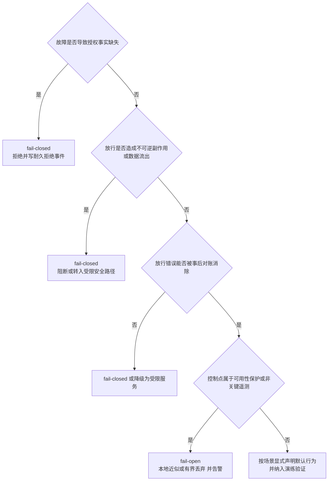

### 4.2 三条补充规则

**规则一：fail-closed 的输出必须是事实，不是沉默。** 拒绝要产生耐久的 CallRejected 事件与审计记录，包含拒绝原因、控制点、依赖故障标识与时间。沉默的 fail-closed 与故障本身一样危险：运营侧看到的是“任务变慢了”，却不知道是依赖故障在挡——这正是把可用性事故拖成信任事故的常见路径。

**规则二：stale-while-revalidate 只属于低风险判定。** 缓存旧判定继续服务（事后重验）的模式只能用于同时满足三个条件的控制点：不涉及授权事实、不产生不可逆副作用、错误可被事后发现并纠正。典型可用场景是低风险内容的展示排序、非敏感检索的缓存命中；典型禁用场景是 ReleaseGrant 核验、revocation epoch 校验、敏感出口检测——这些控制点的“旧判定”在语义上就是错误判定。

**规则三：失败语义必须声明、可查、被演练。** 每个控制点在接入评审时登记其 fail 行为（fail-closed / fail-open / 降级路径）、声明依据（四要素的答案）与验证方式。混沌演练通过“使该依赖不可用”来验证声明为真。未声明失败语义的控制点不得进入生产主链——第 13 篇把这类问题称为“失败语义缺失”，本节把它变成发布准入条件。

### 4.3 与降级阶梯的关系

fail-open/fail-closed 决定的是**单个控制点在依赖故障瞬间的行为**；降级阶梯决定的是**平台在持续故障下的自治水平**。两者是时间轴上的接力：控制点的 fail 行为撑过故障的第一分钟，若依赖在声明窗口内未恢复，降级阶梯接管，把任务流量收缩到与剩余能力匹配的水平。控制点 fail-closed 拒绝率持续上升，本身就是降级阶梯最重要的触发信号之一（第 6.2 节）。

---

## 5. 接管与恢复 SLO

第 6 篇给出了恢复的四步协议：租约接管、读取历史、对账在途、决定继续或裁决。本节定义这一协议的时间构成、检测机制与度量口径——**恢复能力如果不被度量，就只是希望。**

### 5.1 租约到期检测

接管的前提是“发现旧持有者不再推进”。检测机制有三种，通常组合使用：

| 检测方式 | 机制 | 特点 |
|---|---|---|
| 到期扫描 | 独立扫描器周期性查找 expires_at 已过的 lease | 实现简单，延迟含扫描周期；扫描器自身需多活与选主 |
| 心跳超时 | 续租失败计数超过阈值即判失联 | 对网络抖动敏感，需与 fencing 配合容忍误判 |
| 主动移交 | 排空、发布、缩容时显式交还 lease | 计划内路径，延迟最低，不覆盖崩溃 |

检测延迟由 lease TTL 剩余时间与扫描周期共同决定，这里存在一个必须显式权衡的矛盾：**TTL 短则接管快，但误判概率高**——GC 停顿、网络抖动、时钟偏差都可能让活着的 Worker 被判定失联。系列约定对此的答案是：**安全性不依赖检测的准确性。** 误判发生时，旧 Worker 仍然存活并尝试提交，单调 epoch 的 fencing 会在状态写入事务与执行入口处拒绝它；它已发出的外部动作不因 lease 失效而失效，由接管者对账确认。**Lease 失效不等于远端动作失败**——这条约定把“检测不准”从正确性问题降级为效率问题：最坏情况是一次多余的接管与对账，而不是双写或丢动作。

### 5.2 接管流程

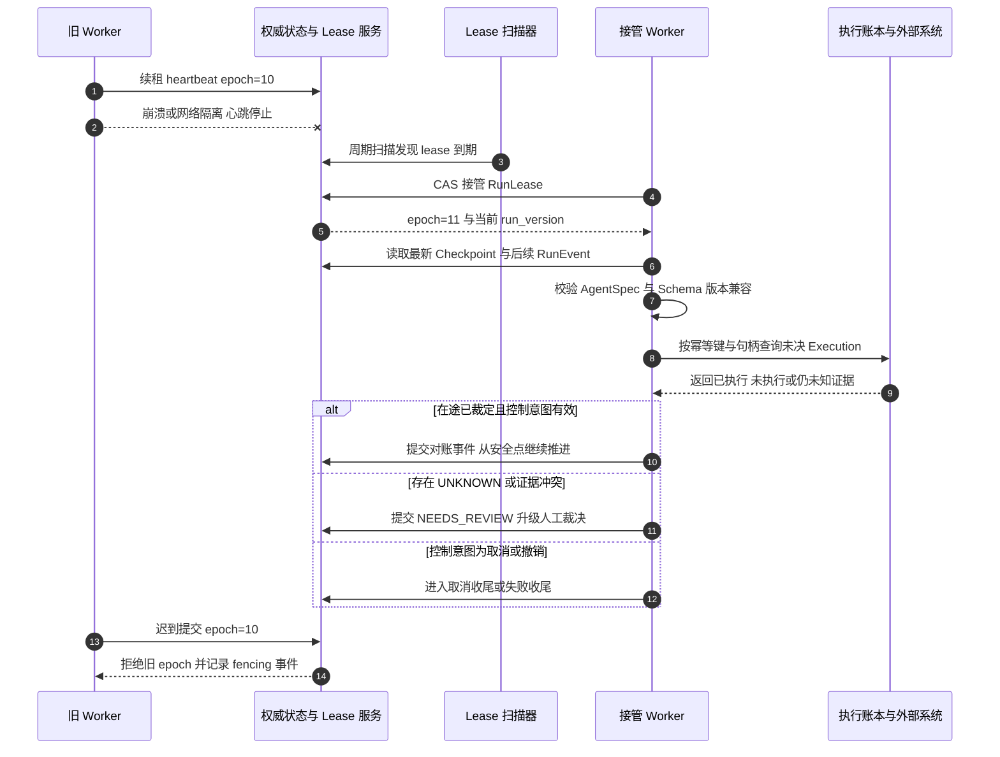

流程中三个容易出错的细节：

1. **接管者获得的是新 epoch，不是旧 Worker 的内存。** 旧 Worker 未提交的提案、未发出的外呼、本地缓存的上下文都不在移交范围内；接管者拥有的一切来自权威状态、Checkpoint 与事件。
2. **对账先于推进，包括对“看起来没事”的 Run。** 一个 Run 可能停留在两个外部动作之间、没有任何未决记录——这是最好的情况，但结论必须由扫描未决记录得出，不能由“没看到异常”得出。
3. **延迟命令按 ExecutionRecord 校验，不按原 lease。** Run 进入 WAITING 并释放 lease 后，此前耐久调度的命令仍必须被执行：执行方校验记录中的 authorized_epoch、ExecutionSpec 摘要、ReleaseGrant、撤销版本与当前 control_intent，并 CAS 领取记录（第 4、6 篇约定）。接管流程不得把这些命令当作旧 Worker 的遗留物清理。

### 5.3 恢复验证

接管完成不等于恢复完成。恢复验证是恢复流程的出口门禁，至少核对五项：

| 验证项 | 内容 | 不通过的去向 |
|---|---|---|
| 版本兼容 | agent_spec_digest 与 Checkpoint Schema 可被当前 Runtime 装载 | 显式迁移或失败收尾，不静默恢复 |
| 授权重验 | 用户委托、工具与数据权限、审批适用性仍然有效 | 拒绝继续、重新授权或收尾 |
| 在途对账 | 全部 PENDING、UNKNOWN、CANCELLING 记录有结论或已升级裁决 | 保持未决，Run 不得推进过该点 |
| 控制意图 | control_intent 与 revocation epoch 为最新 | 取消收尾或撤销处置 |
| 预算与期限 | 剩余预算与截止时间允许继续 | 失败收尾或人工裁决 |

### 5.4 接管时间构成与恢复 SLO

接管时间必须拆开度量，否则“平均接管很快”会掩盖“长尾对账失控”：

| 时间段 | 决定因素 | 优化手段 |
|---|---|---|
| 检测延迟 | TTL、扫描周期、时钟偏差容忍 | 在保证误判可容忍的前提下收紧 TTL；扫描器多活 |
| 接管竞争 | 候选 Worker 数量与退避策略 | 分区认领，避免全体扫描同一批 lease |
| 状态装载 | Checkpoint 新鲜度与事件尾部长度 | 周期性 Checkpoint 控制尾部规模 |
| 在途对账 | 外部系统查询能力与响应时间 | 按风险分级并行查询；不可查询者直接升级裁决 |
| 决策出口 | 证据完整性 | 裁决台工具化，减少人工往返 |

据此定义三个恢复 SLO 口径：

- **接管时间**：lease 到期到接管者完成恢复验证、可安全推进（或明确升级裁决）的时间。注意口径是“可安全推进”，不是“拿到 lease”——把拿到 lease 记为接管完成，会让指标好看而事故照旧（第 6 篇已警告）。
- **恢复成功率**：故障 Run 中在声明窗口内完成接管并恢复推进（含有序进入裁决）的比例；长期滞留 NEEDS_REVIEW 且无人处置的记为未恢复。
- **对账消解时间**：UNKNOWN 产生到终态或人工裁决结论落库的时间，按动作风险等级分组。

这三个口径与第 11 节的平台级 SLO 挂钩：恢复成功率是“执行成功率”的分母修正项，对账消解时间决定 Finalization 门禁前 Task 的滞留时长。

---

## 6. 降级阶梯与自治等级联动

依赖故障持续超过声明窗口，或错误预算快速消耗时，平台不应继续以全自主姿态运行。**降级阶梯定义平台在能力受损时如何有序收缩自治程度**，它是 fail-open/fail-closed 的时间轴接力，也是 OWASP ASI08 级联失效的工程对策：与其让故障通过自动重试与自主决策放大，不如主动收缩。

### 6.1 五级阶梯

| 等级 | 名称 | 允许的行为 | 禁止的行为 |
|---|---|---|---|
| L0 | 全自主 | 按 AgentSpec 全量工具与既定审批策略自主推进 | 无（正常态） |
| L1 | 收紧工具与高危强制审批 | 仅白名单工具；全部高危动作强制人工审批；重试预算收紧 | 新增自主外呼类别 |
| L2 | 仅 HITL | 每步外部动作需人工确认；规划结果先展示后执行 | 未经确认的任何外部写动作 |
| L3 | 只读问答 | 只读检索与问答；产物仅限分析草稿，不触达外部系统 | 一切外部副作用与业务写入 |
| L4 | 优雅拒绝 | 明确告知当前能力受限，受理可延期的请求并排队或预约 | 假装正常服务、静默丢弃请求 |

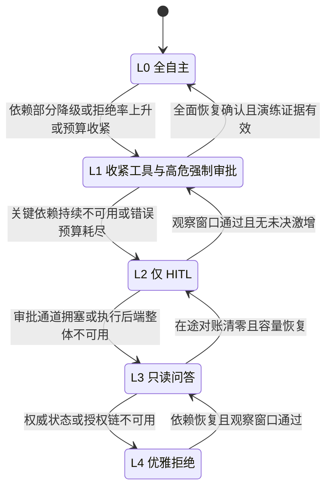

等级语义的三点澄清：

1. **降级收缩的是自治，不是安全。** 每一级都完整保留授权校验、内容治理、审计与 fencing。L2 的 HITL 是在既有授权链上叠加人工确认，不是用人工确认替代授权；L3 的只读问答仍要过数据授权与敏感内容治理。**降级不绕过安全控制是系列硬约定**——以“都降级了还查什么权限”为由跳过控制点，是把可用性事件升级为安全事件。
2. **L4 不是宕机。** 优雅拒绝意味着受理层仍然可用：返回明确的受限说明、可重试时间预期，对可延期请求登记排队或预约。拒绝本身也要持久记录，作为 SLO 事实与恢复后补受理的依据。
3. **等级作用于任务流量，不推翻已持久化的事实。** 降级不取消已受理 Task 的在途责任：未决 UNKNOWN 仍要对账，取消意图仍要收尾，Finalization 门禁仍要执行。降级影响的是“新动作的自主程度”，不是“旧责任的存续”。

### 6.2 触发条件

触发信号分四类，按证据强度排列：

| 信号类别 | 示例 | 说明 |
|---|---|---|
| 依赖健康 | 模型端点全挂、状态库写中断、凭据代理不可用 | 由依赖故障矩阵直接映射到建议等级 |
| 控制点拒绝率 | fail-closed 拒绝事件速率超过声明阈值 | 拒绝率是“能力受损”的最早可测信号 |
| 错误预算 | SLO 错误预算消耗速率超过阈值 | 与第 11 节联动，预算耗尽自动收紧 |
| 行为异常 | 目标偏移、异常工具序列、级联重试 | 安全信号，可触发定向降级（特定 Agent 或租户） |

触发必须带**范围**：全局、Cell 级、租户级或 Agent 级。模型供应商全挂是全局触发；单 Cell 状态库故障是 Cell 级触发；某 Agent 行为异常只降级该 Agent。范围错误是降级事故的常见来源——把局部故障放大为全局降级，等于让无关租户为单点故障买单。

### 6.3 决策权限

| 决策 | 权限 | 约束 |
|---|---|---|
| 自动降级一档（如 L0 到 L1） | 平台按声明规则自动执行 | 规则版本化、可审计、可回滚 |
| 跨多档降级与 L4 | 值班负责人决定，双人复核 | 附触发证据与预期恢复条件 |
| 全局降级 | 更高级别运营负责人 | 事后复盘强制 |
| 定向降级（单租户或单 Agent） | 平台自动或安全运营 | 与安全事件响应流程衔接 |
| 恢复升级 | 见 6.4，不允许自动跳级 | 每级恢复独立确认 |

自动降级规则必须声明三要素：触发阈值、生效范围、自动失效条件。没有自动失效条件的降级规则会把平台永久钉在低等级——“降级容易恢复难”的另一面是“没人记得还在降级”。

### 6.4 恢复条件

恢复不是依赖恢复的瞬间动作，而是逐级确认的过程：

1. **依赖恢复确认**：依赖健康信号回到正常区间，且持续一个声明的观察窗口（避开抖动与假恢复）；
2. **对账清零**：降级窗口内积累的 UNKNOWN 与未决裁决处理到声明水位——带着大量未决责任恢复全自主，等于让新动作与旧责任竞争；
3. **容量确认**：降级期间积压的任务会在恢复瞬间涌入，恢复前确认受理、调度与执行容量能够吸收，必要时分批放开；
4. **逐级升级**：L4 到 L3、L3 到 L2 逐级进行，每级观察一个窗口；不允许从 L4 直接跳回 L0——跳级恢复失去了在中间等级验证“半自主路径是否正常”的机会；
5. **恢复记录**：每次升级记录决策人、证据与时间，与降级记录配对存档。

### 6.5 与安全档位的联动

第 13 篇按自主性、权限、数据敏感度、可逆性与暴露面把任务分为安全档位 S0–S3。降级阶梯与安全档位的联动规则是：**安全档位决定降级容忍度。** 高敏感度、不可逆动作占比高的任务，在 L1 就应收紧到仅白名单，在 L2 直接暂停而不是等待 HITL 确认（审批通道本身可能正是拥塞点）；低敏感只读任务可以在 L3 继续提供价值。联动产物是一张“档位 × 等级”的行为矩阵，作为降级规则的声明依据，避免降级时临场发挥。

---

## 7. Cell 架构

第 3 篇提出：大规模部署可将一组 Task API、Harness Worker、Execution Runtime、局部队列和配额组成 Cell，租户或 Task 归属特定 Cell，控制单点故障的传播范围。本节把 Cell 从概念展开为可运维的架构。

### 7.1 为什么需要 Cell

横向扩展的朴素形态是“所有组件一个大池子”：统一队列、统一 Worker 池、统一状态库。它的故障特征是**全局共振**——一个租户的异常重试打满队列，所有租户一起饿死；一次状态库慢查询拖住全部 Worker；一个坏版本被所有实例同时装载。Cell 的本质是**把共振切成局部震荡**：故障被限制在单个 Cell 内，其他 Cell 的受理、调度与执行不受影响。

Cell 同时是运维单元：发布可以按 Cell 灰度，容量可以按 Cell 规划，演练可以按 Cell 隔离爆炸半径。

### 7.2 Cell 划分与归属路由

划分维度按优先级：

1. **合规与数据驻留优先。** 不同驻留要求的租户必须分 Cell，这是硬约束而非优化；
2. **租户归属。** 大租户独占 Cell，中小租户按容量与风险画像分片归组；同一租户的 Task 默认同 Cell，避免跨 Cell 的上下文与权限拼接；
3. **任务类型。** 长时批处理与交互式短任务可分 Cell，防止长任务占满调度资源后拖垮交互时延。

归属路由是控制面维护的权威映射：`tenant_id 到 cell_id`，Task 在受理时按归属进入对应 Cell。**归属变更是受治理的迁移操作**：需要容量评估、审批与迁移窗口，不是改一行配置。Task 在途期间不迁移 Cell——迁移一个带着未决 Execution 的 Run 等于在运动战中换引擎；确需迁移时，先按第 6 篇协议把 Run 收敛到安全点并裁定在途动作。

### 7.3 Cell 内组件

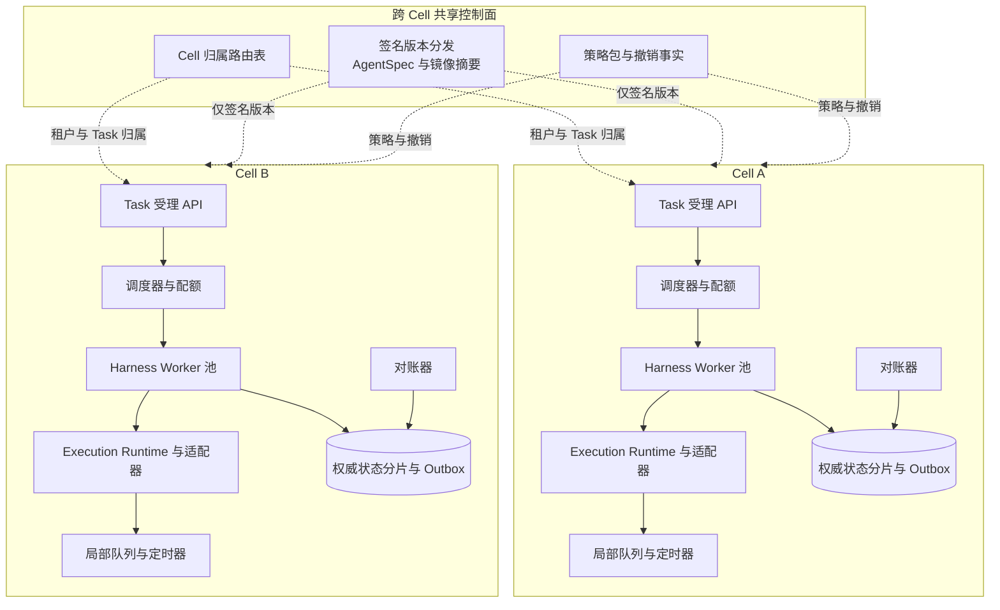

Cell 内是一整套可独立运行的最小闭环：受理、调度、执行、状态、队列、对账。设计要点：

- **状态分片按 Cell 隔离。** Cell A 的状态库故障不产生 Cell B 的写压力；分片方式（独立实例或逻辑分库）按规模选择，但故障隔离必须真实有效；
- **队列与定时器局部化。** Outbox Publisher、定时器、对账扫描都在 Cell 内闭环，避免全局队列成为共振通道（队列与背压的细节见第 16 篇）；
- **执行适配器池按 Cell 部署，外部目标系统仍是共享依赖。** Cell 隔离的是平台组件，隔离不了外部业务系统——对后者的保护靠第 3 节的依赖故障矩阵；
- **Cell 间不互相调用推进逻辑。** 跨 Cell 的只有控制面分发与必要的聚合报表，任何“Cell A 的 Worker 帮 Cell B 推一下”的旁路都会重新打通故障传播。

### 7.4 Cell 故障处置

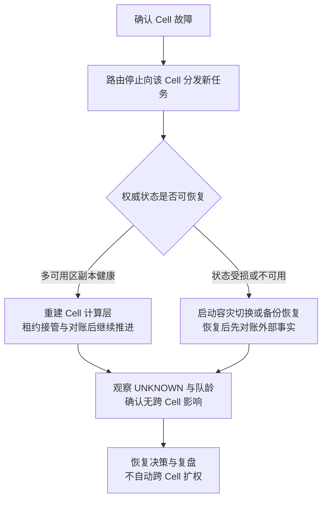

处置规则逐条说明：

1. **先止血再恢复。** 路由层停止向故障 Cell 分发新任务，向调用方返回可重试错误或按策略改期；其他 Cell 不受影响是 Cell 架构的核心承诺，必须用指标（跨 Cell 错误率无上升）验证。
2. **状态可恢复时，恢复的是计算不是事实。** 状态分片的多可用区副本健康时，重建 Worker 池后按第 5 节流程接管与对账；已提交事实原样存在，Outbox 继续投递。
3. **状态受损时走容灾或备份。** 按第 8、9 节流程评估数据丢失范围，恢复后必须对账：恢复点之后的外部世界可能已经发生了动作，平台认知落后于现实的部分只能靠 ExecutionRecord 与外部查询补齐。
4. **不自动吸收。** 故障 Cell 的租户不应被自动切到邻近 Cell：邻近 Cell 的容量按其自身租户规划，突然吸收流量可能引发二次故障（noisy neighbor 的灾难版）。确需疏散时，按预案逐个租户评估容量并显式迁移。
5. **不自动扩权。** Cell 故障不是放宽控制的理由：版本校验、策略强制、审批要求全部保持；控制面不可用时按本地缓存的签名版本运行，而不是“先不校验了”。

### 7.5 跨 Cell 共享控制面

控制面是唯一的跨 Cell 共享层，其职责被刻意限制为**分发事实**：签名的 AgentSpec 与镜像摘要、策略包与撤销事实、归属路由表。约束来自系列约定：

- **只分发签名版本与策略，不参与运行推进。** 控制面故障时 Cell 继续运行，靠的是本地缓存的签名版本与声明的缓存有效期；
- **不在故障时自动扩大权限。** 控制面不可用期间，撤销无法下发是真实风险，对策是撤销事实的高可用分发与 Cell 侧“撤销不可确认时向严格方向处置”（暂停可疑版本的新 Run），而不是跳过校验；
- **控制面自身的变更受最严格治理。** 路由表与策略包的错误分发会同时命中所有 Cell，因此控制面变更必须灰度（按 Cell 分批）、可回滚、带签名与版本号。

控制面可用性目标与运行面分开声明：控制面短时不可用（Cell 凭缓存运行）是可接受事件，控制面长期不可用（缓存过期、无法撤销）是重大事件——两者的告警阈值与响应级别不同。

---

## 8. 多可用区与容灾

本节按能力层级讨论部署形态，不指定产品，也不给未经实测的数字承诺。核心是讲清楚：**每一层能力由什么机制提供，机制的边界在哪里，RPO/RTO 由什么决定。**

### 8.1 能力层级

| 层级 | 部署形态 | 承接的故障 | 状态机制 | 典型代价 |
|---|---|---|---|---|
| 层级一 | 单可用区多实例 | 实例与进程故障 | 单主状态库加备份 | 低；可用区故障即服务中断 |
| 层级二 | 同城多可用区 | 单可用区故障 | 状态跨区复制，多数派提交 | 中；跨区时延影响提交延迟 |
| 层级三 | 同城多可用区加异地备份或冷备 | 区域灾难（可接受较长恢复） | 跨区复制加异地备份 | 中高；异地恢复需演练 |
| 层级四 | 异地双活或多活 | 区域灾难（要求快速接管） | 异地状态复制加流量切换 | 高；一致性与切换复杂度显著上升 |

选择层级的依据不是“越高越好”，而是业务对各级故障的实际容忍度：Task 的业务截止时间、在途副作用的资金属性、监管对数据驻留与恢复能力的要求。层级每升一级，复杂度与成本非线性上升；用层级二的投入声称层级四的能力，是容灾领域最典型的虚假承诺。

### 8.2 单可用区故障

层级二的基本盘是：**计算无状态化横铺多区，状态与消息跨区复制。**

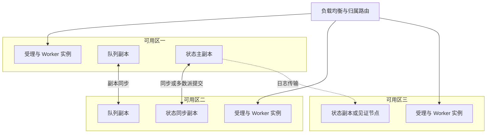

单区失效时的行为分解：

- **计算层。** 故障区实例丢失，存活区实例接管 lease。接管量与故障区承载的活跃 Run 成正比——这要求容量规划时确认：任一可用区失效后，存活区能否吸收全部负载（N 减一容量准则）；
- **状态层。** 多数派在存活区时，写路径在主切换窗口后恢复；窗口内的行为按第 3.7 节定义处置。若多数派恰好落在故障区（例如三区部署故障两区），写路径不可用，平台进入“只读或拒绝”状态，这是层级二的能力边界，必须预先声明；
- **消息层。** 队列副本跨区，存活副本继续投递；Outbox 的耐久性不依赖队列，只依赖状态库；
- **在途动作。** 故障区 Worker 发出的外呼可能已在远端生效，接管者按第 5 节流程对账——**可用区故障只是把单实例接管放大为批量接管，协议不变。**

单区故障的恢复目标应按“受理恢复”“推进恢复”“对账清零”三个口径分别度量：受理可用性通常最先恢复（路由与存活区实例即可），Run 推进次之（依赖状态写路径），对账清零最后（依赖外部查询）。把三者混成一个 RTO 会同时高估和低估真实能力。

### 8.3 状态复制方式与 RPO 的关系

RPO（Recovery Point Objective）回答：**恢复后，最近多长时间的事实可能丢失。** 对 Agent 平台，丢失的事实意味着“受理过但查不到”“外呼过但账本无记录”，其后果远比普通业务数据严重。RPO 由提交与复制方式决定，与“是否用了事件溯源”“是否用了 Outbox”无关：

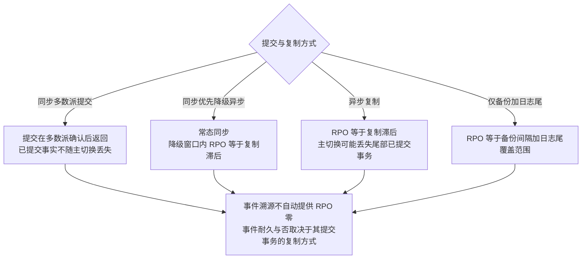

逐条说明：

- **同步多数派提交。** 事务在多数派确认后才向调用方返回提交成功。主切换时，任何“已对调用方承诺”的事实都已在多数派上存在，不丢失；可能丢失的只有尚未返回确认的在途事务——对调用方而言那是 UNKNOWN，按幂等键重试或放弃。这是把 RPO 收敛到“未确认窗口”的唯一方式，代价是每次提交等待跨区确认。
- **同步优先、故障降级异步。** 常态同步，副本不可达时降级为异步继续服务。必须显式声明：降级窗口内的提交在随后主切换中可能丢失，以及降级本身的告警与恢复流程。**未声明的静默降级异步是隐性 RPO 劣化**——运营以为仍是同步保护，实际已不是。
- **异步复制。** 提交返回不等待副本，RPO 等于切换时刻的复制滞后。滞后的量由负载与网络决定，不是常数；任何把异步复制表述为“准实时所以约等于零丢失”的说法都缺乏事实依据。
- **备份加日志尾。** RPO 等于最近备份点加可重放日志的覆盖范围，通常作为最后一道防线而非主恢复手段。

**事件溯源与 Outbox 的澄清。** 事件溯源把状态表达为事件序列，Outbox 把消息与状态同事务提交——两者解决的是“事实如何表达与传递”，不解决“事实写在哪里才算耐久”。事件写在异步复制的库上，RPO 就是复制滞后；事件写在同步多数派的库上，已提交事件才不丢。同理，Outbox 行与状态同事务提交意味着**两者同生共死**：状态丢了 Outbox 也丢（事实从未对调用方成立），不会出现“状态在而 Outbox 丢”或反过来的撕裂——这正是原子提交在容灾语境下的价值。

### 8.4 区域灾难与异地容灾

区域灾难下，同城多可用区整体不可用，恢复依据只剩异地副本或备份。异地容灾按能力分三层：

| 能力层 | 机制 | 能力边界 |
|---|---|---|
| 异地备份 | 定期全量与日志归档异地保存 | 恢复走备份流程，RPO 与 RTO 均由恢复作业决定，适合可接受较长中断的场景 |
| 异地热备 | 异地维护复制副本与待命计算，不承接流量 | 切换需要提升副本与拉起计算，RPO 取决于异地复制方式（通常为异步），RTO 取决于切换演练成熟度 |
| 异地多活 | 多区域同时承接流量，状态按一致性协议同步或分区 | 能力最强，复杂度最高；写冲突、一致性与切换治理成本显著上升 |

两个事实纪律重申：其一，异地复制受物理时延约束，跨地域同步提交在多数场景不可行，因此异地 RPO 通常由异步复制滞后决定——**这不是工程不努力，是物理约束**；其二，区域切换的 RTO 由“决策加切换加验证”共同决定，其中决策（何时宣布区域失效）往往是最大变量，必须写入预案并演练，而不是留给事故现场的临场判断。

### 8.5 切换与回切

**切换的前提是评估。** 异步复制下切换必然面对“尾部事实可能丢失”的问题，切换决策必须回答：丢失窗口内受理的 Task 怎么办？答案只能是预案化的：调用方按幂等键重试可重建受理事实；已外呼未记录的动作在恢复后靠对账确认；无法确认的进入人工裁决。**切换不是把问题消灭，而是把问题转换为已定义好的处置流程。**

**回切比切换更难。** 异地运行期间产生了新事实，原区域恢复后存在双向差异。回切前必须建立反向复制并完成差异对账，确认两侧事实收敛；直接“切回去”会丢弃异地期间的事实。回切还应避开业务高峰，并保留随时停止的能力。

**切换必须演练。** 未演练的切换预案在真实事故中的表现几乎必然劣于纸面：DNS 与路由的生效时间、证书与凭据在新区域的可用性、依赖服务的区域亲和、控制面在新区域的可达性，都是只有演练才能暴露的问题。

### 8.6 数据一致性取舍

容灾设计的本质是在一致性、可用性与恢复复杂度之间做显式取舍。Agent 平台的特殊性在于：**它有对账机制兜底认知差异，但没有机制兜底事实丢失。** 由此得出三条取舍原则：

1. **宁可短暂不可写，不可静默丢事实。** 多数派不可达时拒绝写入（受理返回可重试错误），优于降级单点写入后丢失——前者损失可用性，后者损失事实完整性并制造对账黑洞；
2. **丢失范围必须可测量。** 切换后应能回答“丢失窗口多长、影响哪些租户与 Task”，这要求复制滞后有持续度量，而不是事后估计；
3. **一致性缺口交给对账，不交给想象。** 恢复点与外部世界的差异，统一走 ExecutionRecord 对账与人工裁决协议；任何“应该没丢什么”的推断都不能替代按记录核对。

---

## 9. 状态耐久与备份恢复

容灾解决“故障时继续服务”，备份解决“事实受损后重建”。两者互补：容灾副本会忠实地复制一次误删除或逻辑损坏，**备份加时间点恢复是对抗逻辑错误的最后防线。**

### 9.1 备份对象与策略

| 对象 | 内容 | 方式要点 | 保留考虑 |
|---|---|---|---|
| 权威状态 | Task、Run、Execution、Approval、Settlement 等聚合与事件 | 全量加快照或日志尾，支持时间点恢复 | 覆盖最长业务追溯期 |
| Outbox 归档 | 已发布 Outbox 行的审计归档 | 随状态备份或独立归档 | 与审计要求对齐 |
| 产物 | Artifact 内容与 Manifest | 对象存储版本化加跨区域复制 | 按交付与合规保留期 |
| 审计 | 授权、审批、许可、执行与裁决记录 | 独立耐久存储，WORM 防篡改 | 法定或合规要求的最长期 |
| Checkpoint 大对象 | 逻辑 Checkpoint 的内容体 | 随产物存储策略，可再生者允许丢失 | 短于 Run 追溯期即可 |
| 控制面数据 | 归属路由表、策略包、版本清单 | 签名后独立备份 | 与版本保留对齐 |

策略要点：

- **备份是签名与校验过的事实。** 每次备份记录校验和与恢复验证结果；没有校验和的备份在恢复时不可信；
- **加密与权限。** 备份包含业务事实与审计，其访问控制不低于生产库；备份介质的权限审计同样纳入安全治理；
- **备份窗口与 RPO 声明挂钩。** 平台声明的最后一道防线 RPO 由备份间隔与日志尾覆盖决定，声明必须与实际策略一致。

### 9.2 恢复演练

**未经演练的备份等于没有备份。** 演练分三级，成本与置信度递增：

| 级别 | 形式 | 验证内容 |
|---|---|---|
| 桌面推演 | 按预案走读恢复步骤与决策点 | 流程完整性、职责分工、决策权限 |
| 沙箱恢复 | 在隔离环境从备份恢复到指定时间点 | 备份可恢复性、恢复作业正确性、工具可用 |
| 全量演练 | 按容灾预案执行真实切换或恢复作业 | 真实 RPO 与 RTO、跨团队协作、依赖联动 |

恢复演练中 Agent 平台特有的验证项：

1. **恢复点校验。** 恢复出的状态通过完整性检查：聚合版本连续、事件序号无空洞、Outbox 与状态一致；
2. **恢复后对账。** 恢复点必然落后于外部世界的现实，恢复流程必须包含“扫描恢复点附近的 ExecutionRecord 并按外部查询对账”——这与接管对账是同一协议，只是范围更大；
3. **终态与门禁复核。** 恢复后 Finalization 门禁重新生效：处于收尾或 NEEDS_REVIEW 的 Task 保持非终态直至门禁裁定，不因恢复作业被批量“清理”成终态；
4. **实测记录。** 每次演练记录实际耗时、数据缺口与流程缺陷，作为 RPO/RTO 承诺的唯一依据，并回馈预案修订。

### 9.3 备份、容灾与安全事件的交叉

备份还服务于一类容灾不覆盖的场景：勒索与恶意篡改、内部误操作、逻辑缺陷批量污染。这类事件的恢复不是“切到副本”（副本可能同样被污染），而是**从干净备份点重建加对账**，且恢复前必须确认入侵路径已封堵——与安全事件响应流程（第 13 篇）衔接。审计存储的 WORM 属性在此尤为关键：它是唯一可能幸存的、未被篡改的事实来源。

---

## 10. 混沌演练

架构声明的高可用与真实的高可用之间，只隔着故障注入。混沌演练的目标不是“证明系统不会挂”，而是**在受控条件下验证：声明的故障域真实存在、声明的降级路径真实生效、声明的恢复协议真实可执行。**

### 10.1 五个核心剧本

**剧本一：模型全挂。** 使全部模型端点不可用（演练环境可用故障注入代理拦截）。预期行为：在途 ModelCallRecord 进入 PENDING 或 UNKNOWN 并按对账协议处置，不出现“超时即失败”的状态跳变；备选路由按 AgentSpec 声明生效或明确无备选；降级阶梯在声明窗口内触发，新任务按 L2 至 L4 处置；恢复后无重复计费（Usage 按 producer_event_id 去重）。通过标准的关键一条：**没有任何 Run 因模型不可用而被标记为业务失败终态，除非任务策略明确如此定义。**

**剧本二：状态库主切换。** 强制状态库主切换。预期行为：写中断窗口内受理返回可重试错误而非假受理；Worker 续租失败后按 fencing 拒绝旧主与旧 epoch 的迟到提交；切换完成后接管与对账按第 5 节流程完成；无重复 Step、无重复外呼。度量：写中断窗口长度、接管时间分布、fencing 拒绝事件数。

**剧本三：单区失效。** 隔离或下线一个可用区的全部实例。预期行为：路由与负载均衡将流量收敛到存活区；状态多数派继续服务（验证多数派确实跨区）；故障区承载的 Run 完成批量接管；受理可用性与推进恢复时间达到声明口径；存活区容量不发生过载级联。这个剧本同时验证 N 减一容量假设——很多平台正是在这里发现“规划里的冗余”其实不存在。

**剧本四：执行池故障。** 使某类执行后端（Sandbox 池或浏览器池）整体不可用。预期行为：该类 SUBMITTING 记录进入 UNKNOWN 并对账；适配器注册表标记能力不可用，Harness 不再规划该类工具或触发能力级降级；其他类型执行不受影响；池恢复后 PREPARED 记录按末端门禁重新领取，不出现绕过门禁的直接外呼。

**剧本五：消息积压。** 暂停事件消费方制造积压。预期行为：Outbox 行累积并触发发布延迟告警，状态提交不受影响（事实在库不在队）；恢复消费后幂等消化重复投递，无重复逻辑 Step 与重复副作用；积压洪峰不击穿下游（消费并发有界）。该剧本验证的是第 3.6 节的论断：队列故障损失时效，不损失事实。

### 10.2 通过标准

所有剧本共用一组硬标准，任一条不满足即判定不通过：

| 标准 | 判定方式 |
|---|---|
| 无重复外部副作用 | ExecutionRecord 数量与外部系统记录核对 |
| 无事实丢失 | 受理、提交、Outbox 与账本完整性核对 |
| UNKNOWN 全部进入对账 | 无“超时自动转失败”的状态跳变 |
| fencing 生效 | 旧 epoch 提交被拒绝且留下事件 |
| 安全控制未被绕过 | 降级窗口内授权、审批、出口控制记录完整 |
| 恢复口径达标 | 接管时间、恢复成功率按第 5 节口径度量 |
| 无跨 Cell 传播 | 非故障 Cell 的错误率与队龄无异常上升 |

### 10.3 演练安全

生产环境演练必须控制爆炸半径：选择低峰窗口或专用演练 Cell；注入点可一键回滚；演练前确认备份有效（演练本身不应成为事故源）；涉及真实外部系统的剧本用影子目标或演练专用端点替代。演练产生的 UNKNOWN 与对账是预期产物，但应打标隔离，避免混入真实运营案件。

### 10.4 频率与发布准入挂钩

| 触发 | 演练要求 |
|---|---|
| 平台重大版本发布 | 通过剧本二与剧本三，作为发布准入证据 |
| 新执行后端接入 | 通过剧本四的单后端版本 |
| 新模型路由接入 | 通过剧本一的降级路径验证 |
| 状态复制方式变更 | 通过剧本二加数据丢失范围测量 |
| 常态化 | 核心剧本按季度轮转，全链路演练按年 |

把演练结果变成发布门禁的一部分，回答的是第 0 篇提出的生产准入问题：**生产级不是由架构图的复杂度证明的，而是由故障条件下的行为证明。** 演练报告（场景、时间、度量、缺陷、修复）与版本一起归档，成为可审计的准入证据链。

---

## 11. SLO 体系

SLO 把前述全部机制压缩为可运营的数字契约。Agent 平台的 SLO 必须分阶段定义，因为“平台可用”在不同阶段意味着完全不同的事。

### 11.1 五个核心 SLO

| SLO | 测量边界 | 成功判据 | 失败归因要点 |
|---|---|---|---|
| 受理可用性 | 请求到达到持久受理或明确拒绝 | 在声明时延内返回受理结果或可重试错误 | 区分状态库故障、路由故障与调用方错误 |
| 调度可用性 | Run 可运行到 Worker 取得 lease | 在声明时延内完成调度 | 区分队列积压、容量不足与 lease 竞争 |
| 执行成功率 | Run 推进到技术验证通过 | 按平台归因口径计算 | 剔除业务拒绝、模型质量与用户取消 |
| 恢复成功率 | 故障 Run 接管到可安全推进 | 恢复验证五项全部通过 | 区分接管失败、对账未决与版本不兼容 |
| 交付成功率 | DeliveryRecord 提交到满足交付政策 | 达到政策要求的证据等级 | 区分渠道故障与平台侧故障 |

五个 SLO 的设计要点：

**事实来源是账本，不是遥测。** 受理结果来自 Task 事实，调度来自 lease 事件，执行与交付来自 Run 与 DeliveryRecord 状态，恢复来自对账与验证事件。第 3.10 节的规则在此闭环：遥测故障时 SLO 报表可以延迟，SLO 事实不受影响。

**执行成功率必须做归因切分。** Agent 任务的失败天然混杂三类原因：平台故障（接管失败、状态异常）、模型与内容原因（输出不达标、验证失败）、业务原因（验收拒绝、用户取消）。把三者混在一个成功率里，结果要么是平台为模型质量背锅，要么是平台故障被业务失败淹没。建议以“平台归因执行成功率”为发布门禁指标，全口径成功率作为产品指标另行观察。

**恢复成功率以对账为口径。** 与第 5.4 节一致：拿到 lease 不算恢复，恢复验证通过才算；长期滞留裁决且无处置的计为未恢复。这个口径让“恢复能力”无法被表面数字粉饰。

**交付成功率保持 ResultSelection 语义。** 交付失败的重试仍引用既定 Selection（第 2 篇约定），SLO 统计按 delivery_intent 去重，避免同一交付意图的重试被重复计数。

### 11.2 错误预算

每个 SLO 的目标值与统计窗口确定后，错误预算即目标与百分之百之间的差额。运营规则：

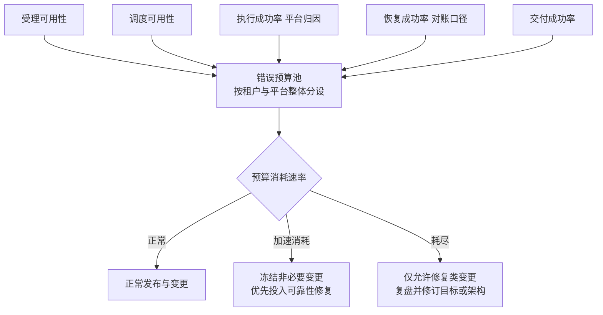

- **预算消耗速率比余额更重要。** 短时间内快速消耗（即使余额尚存）说明系统处于不稳定态，应提前触发冻结，而不是等耗尽；
- **预算与降级阶梯联动。** 第 6.2 节已把错误预算消耗速率列为降级触发信号：预算加速消耗时自动降档，是比人工判断更快更一致的响应；
- **租户维度分设。** 大租户的预算独立核算，避免单租户的异常流量烧掉全局预算后牵连所有租户——这与 Cell 的隔离目标一致。

### 11.3 发布门禁

SLO 与错误预算最终要咬合到变更管理：

| 门禁条件 | 说明 |
|---|---|
| 错误预算未耗尽 | 耗尽时仅允许修复类变更 |
| 相关混沌剧本通过 | 见第 10.4 节的触发映射 |
| 恢复 SLO 无劣化趋势 | 接管时间与对账消解时间的回归比较 |
| 失败语义声明完整 | 新增控制点的 fail 行为已登记并可演练 |

门禁的意义在于把可靠性从“事后复盘话题”变成“事前准入条件”：没有演练证据的容灾方案不能上线，没有失败语义声明的网关不能进主链，没有归因口径的成功率不能用来宣布“稳定运行”。

---

## 12. 常见反模式

| 编号 | 反模式 | 后果 | 正确做法 |
|---|---|---|---|
| 1 | 把 lease 失效当作远端动作失败，接管后直接重试 | 重复不可逆副作用 | Lease 失效只是接管信号，先对账在途再推进 |
| 2 | 用单一数字承诺全局 RPO 与 RTO | 承诺与真实能力脱节，事故时失信 | 按故障范围分别定义，数字来自实测演练 |
| 3 | 声称事件溯源或 Outbox 自动等于 RPO 零 | 异步复制下尾部事实照样丢失 | RPO 由提交与复制方式决定，显式声明 |
| 4 | 降级时关闭授权校验或内容治理“保可用” | 可用性事件升级为安全事件 | 降级收缩自治，不收缩安全控制 |
| 5 | 控制面故障时运行面自动放宽版本或权限校验 | 撤销与治理失效，攻击面扩大 | 凭签名缓存运行，向严格方向处置 |
| 6 | Cell 故障时自动把租户切到邻近 Cell | 二次故障与容量级联 | 按预案逐租户评估容量并显式疏散 |
| 7 | 备份从未演练，恢复时才发现不可用 | 最后防线失效 | 分级演练，实测记录作为唯一承诺依据 |
| 8 | 区域切换不评估数据丢失范围直接执行 | 丢失窗口内的责任无人认领 | 切换前评估，丢失按预案化流程处置 |
| 9 | 授权点 fail-open 使用过期策略缓存 | 已撤销权限继续生效 | 敏感控制点永不使用 stale 判定 |
| 10 | 遥测与业务事实共用管道，遥测积压阻塞状态提交 | 观测故障转化为事实故障 | 关键事实走独立耐久通道，遥测 fail-open |
| 11 | 把拿到 lease 记为接管完成 | 恢复 SLO 虚假繁荣，长尾对账失控 | 以恢复验证通过与在途对账为口径 |
| 12 | 混沌演练只在测试环境做，且不与发布挂钩 | 生产行为从未被验证 | 受控生产演练，结果作为发布准入证据 |

---

## 13. 生产验证场景表

以下场景应纳入发布准入与常态化演练，预期结果均可由账本与事件序列客观核对：

| 验证场景 | 预期结果 |
|---|---|
| 单 Worker 崩溃且持有未决 UNKNOWN | 接管者读取记录并对账，不盲重试，不复用失败假设 |
| 两个 Worker 因误判短暂双活 | 旧 epoch 的状态提交与新动作被 fencing 拒绝并留痕 |
| 模型全部端点不可用 | 在途调用对账，降级阶梯触发，无超时即失败的状态跳变 |
| 策略引擎不可用 | 敏感动作 fail-closed 并产生耐久拒绝事件，低风险按声明缓存处置 |
| 凭据代理不可用 | 新外部动作暂停，无长期凭据回退，已签发凭据到期自然失效 |
| 状态库主切换 | 写中断窗口内无假受理，切换后接管与对账完成，无重复 Step |
| 单可用区整体失效 | 存活区吸收流量，批量接管完成，非故障 Cell 无异常上升 |
| 执行池整体故障 | 该类能力降级，UNKNOWN 对账，恢复后按门禁重新领取 |
| 消息消费停滞造成积压 | Outbox 不丢事实，恢复后幂等消费，无重复副作用 |
| 控制面不可用 | Cell 凭签名缓存版本运行，无自动扩权，撤销不可确认时向严格处置 |
| 从备份恢复到指定时间点 | 恢复点校验通过，恢复后对账启动，Finalization 门禁保持非终态裁定 |
| 区域切换演练 | 丢失范围可测量，切换后受理与推进按口径恢复，回切经差异对账 |
| 降级期间收到高危动作请求 | 按当前等级强制审批或拒绝，授权与审计完整 |
| 降级恢复期 | 逐级升级，每级观察窗口通过，对账清零后才回到 L0 |
| 错误预算耗尽 | 非必要变更被冻结，仅修复类变更放行并有记录 |

---

## 14. 架构评审清单

### 故障域与影响面

- 五层故障域是否逐一识别，横切共享依赖是否列全？
- 每项恢复机制是否位于被恢复对象的故障域之外，或有声明的退化行为？
- 影响面是否以 Task、Run、ExecutionRecord 的表达落地？

### 依赖故障与失败语义

- 九类依赖是否各有默认行为、降级策略与禁止动作的声明？
- 每个控制点的 fail-open/fail-closed 语义是否登记、可查、被演练验证？
- 授权、许可、撤销类控制点是否全部 fail-closed 且拒绝产生耐久事件？
- 审批超时是否默认拒绝，是否存在任何“自动通过”路径？

### 接管与恢复

- lease 检测的 TTL 与扫描周期是否权衡过误判成本？
- 接管是否严格执行读历史、对账在途、决定出口？
- 恢复 SLO 是否以可安全推进与对账完成为口径，而非拿到 lease？
- 延迟命令是否按 ExecutionRecord 与 authorized_epoch 校验？

### 降级阶梯

- L0 至 L4 的触发条件、决策权限、恢复条件是否成文？
- 降级是否保持全部安全控制生效？
- 恢复是否逐级进行并带观察窗口与对账清零条件？
- 降级与安全档位 S0 至 S3 的联动矩阵是否存在？

### Cell 架构

- 租户与 Task 归属是否有权威路由，且在途不迁移？
- Cell 内是否闭环受理、调度、执行、状态、队列与对账？
- Cell 故障是否不自动疏散、不自动扩权？
- 控制面是否只分发签名版本与策略，且自身变更受灰度与回滚约束？

### 多可用区与容灾

- 部署处于哪个能力层级，边界是否声明（例如多数派丢失时只读或拒绝）？
- 状态复制方式与 RPO 的关系是否如实表述，是否存在静默降级异步？
- 区域切换是否有决策权限、丢失评估与回切对账流程？
- 切换与回切是否经过真实演练？

### 备份与演练

- 权威状态、Outbox、产物、审计、控制面数据是否各有备份策略与保留声明？
- 备份是否定期做沙箱恢复与时间点恢复演练？
- 五个核心混沌剧本是否覆盖当前架构，通过标准是否含无重复副作用与 fencing 生效？
- 演练结果是否作为发布准入证据归档？

### SLO 与门禁

- 五个核心 SLO 的测量边界与归因口径是否明确？
- SLO 事实是否来自权威账本而非普通遥测？
- 错误预算是否与变更冻结、降级阶梯联动？

---

## 15. 本篇结论与后续专题

高可用不是组件冗余的副产品，而是一组显式协议的运行结果。本篇的结论可以归纳为六条主线：

**故障域先于可用性承诺。** 实例、可用区、区域、依赖服务、控制面五层故障域各有影响面，恢复机制必须位于被恢复对象的故障域之外；横切的共享依赖不受 Cell 与可用区隔离保护，必须单独治理。

**依赖故障有矩阵，控制点有失败语义。** 九类依赖的默认行为由事实属性、放行后果、可纠错性与保护对象四要素推导：授权与敏感出口 fail-closed 并留下耐久拒绝事件，非关键遥测 fail-open 且有界，审批超时默认拒绝；失败语义必须声明、可查、被演练验证。

**恢复是度量出来的能力。** 接管时间拆为检测、竞争、装载、对账、决策五段，恢复成功率以对账完成为口径；Lease 失效只是接管信号，不是动作失败的证据。

**降级收缩自治，不收缩安全。** L0 到 L4 的阶梯有明确的触发、决策与恢复协议，逐级降、逐级回，每一级都完整保留授权、审批与审计。

**Cell 切小爆炸半径，控制面只分发事实。** 租户与 Task 归属 Cell，Cell 内闭环运行；跨 Cell 控制面只分发签名版本与策略，故障时不自动扩权、不自动疏散。

**容灾与备份按事实纪律表述。** RPO 由提交与复制方式决定，事件溯源与 Outbox 不自动提供零丢失；多可用区、同城与异地按能力层级声明边界；承诺数字只来自本平台的演练实测；备份必须演练，恢复后必须对账。

当每个故障域都有域外的恢复机制，每个依赖都有声明的失败语义，每次降级都保留安全控制，每次切换都经过演练与对账，Agent 平台才能在模型会超时、机房会断电、供应商会宕机的现实世界里，把“任务会继续被负责任地推进”作为可验证的承诺。

下一篇进入运营视角：可观测、审计、评测与 FinOps——本篇的 SLO 事实来源、审计耐久性与错误预算，将在那里展开为完整的运营闭环。

---

## 参考资料

以下均为官方资料。动态文档会持续更新，实际实现应固定所采用的版本与访问日期。

1. [Google SRE Workbook: Service Level Objectives](https://sre.google/workbook/service-level-objectives/)
2. [Google SRE Workbook: Managing Incidents](https://sre.google/workbook/managing-incidents/)
3. [Google SRE Book: Availability Table](https://sre.google/sre-book/availability-table/)
4. [OWASP Top 10 for Agentic Applications for 2026](https://genai.owasp.org/resource/owasp-top-10-for-agentic-applications-for-2026/)
5. [Temporal Worker Failure and Replication](https://docs.temporal.io/encyclopedia/temporal-servers)
6. [PostgreSQL Continuous Archiving and Point-in-Time Recovery](https://www.postgresql.org/docs/current/continuous-archiving.html)
7. [CloudEvents Specification](https://github.com/cloudevents/spec)
8. [Amazon Bedrock AgentCore Runtime](https://docs.aws.amazon.com/bedrock-agentcore/latest/devguide/runtime-how-it-works.html)
9. [Google ADK Event Loop](https://adk.dev/runtime/event-loop/)
10. [LangGraph Durable Execution](https://docs.langchain.com/oss/python/langgraph/durable-execution)
