# Agent 可观测、审计、评测与 FinOps

> **系列**：生产级 Agent 平台架构 2026 · 第 18 篇  
> **定位**：运营篇  
> **版本**：闭环修订版  
> **前置阅读**：第 0 篇《从模型推理到生产运行：2026 年 Agent、Harness 与 Runtime 总体架构》 · 第 2 篇《从 Task 到交付：Agent 业务闭环与领域对象设计》 · 第 4 篇《Agent Runtime：从生命周期到执行治理的完整能力模型》  
> **关键词**：可观测、审计、评测、红队、FinOps、OTel GenAI、行为监测

## 摘要

Agent 平台进入生产之后，运营团队会反复回答四类性质完全不同的问题：**任务现在卡在哪里**（观测）、**这个动作当时谁批准、许可是否被消费、证据还在不在**（审计）、**新版本发布后行为是变好还是变坏**（评测）、**这个月翻倍的模型账单是谁花的、值不值**（FinOps）。这四类问题经常被塞进同一套“日志平台”里解决，结果是：授权决定被采样丢弃、审计记录与普通日志混存且可被改写、评测靠上线后看客诉、成本是一笔无法归因的糊涂账。

本文的核心主张是：**运行观测、业务事实与安全审计是三层不同性质的数据，它们共享同一套关联体系，但存储、耐久性、篡改防护与消费方式必须分开设计。** Trace、Metric、Log 用于排障与趋势，可以采样、延迟、过期；授权决定、许可核销、ExecutionRecord、Approval、Delivery、Settlement 是业务事实，必须落在耐久事件流与账本上；安全审计证据必须写入不可篡改存储并按保留策略管理。在三层之上，本文给出以耐久事件为审计主干、以 Trace 为排障视图的事件骨架；对齐仍在演进的 OpenTelemetry GenAI 语义约定并给出版本固定策略；建立覆盖授权、审批、许可、凭据、执行回执与版本策略变更的审计体系；定义分阶段时延、队龄、注入拦截率、HITL 通过率、预算水位、热池命中率、恢复成功率、fencing 拒绝数、UNKNOWN 数量与裁决时长的指标体系与告警分级；说明行为基线、异常信号与安全响应的联动；给出 Golden Set、影子运行、线上抽样、自动化红队到候选变更的评测闭环；以及成本采集、归因、预算、对账与优化杠杆的 FinOps 体系；最后给出从耐久事件重放还原事故现场的标准调查流程。

本篇的事实纪律：**OpenTelemetry GenAI 语义约定按“持续演进、需固定版本”表述，不将其描述为已稳定标准**；不指定任何必选商业可观测产品，一律按能力类别（Trace 后端、指标、日志、审计存储、评测平台）表述；评测与红队只产生候选变更，不直接扩权；未知费用保留未决责任，不静默归零。

高可用与容灾在第 17 篇展开，安全治理闭环与撤权、隔离机制在第 13 篇展开，数据分类、记忆与产物治理在第 14 篇展开，本篇只引用其结论。

---

## 1. 问题背景：四类运营问题，四种数据性质

一个典型的事故场景可以说明问题。某租户的报告发布任务运行了三小时仍未交付。运营团队需要同时回答：

- 任务卡在哪个 Step？是模型慢、审批等待还是工具超时？——需要调用链、指标和日志；
- 两小时前那次“发布到业务系统”的动作，是谁批准的？ReleaseGrant 是否被消费？执行回执是什么？——需要授权与执行的耐久事实；
- 上周刚把 Prompt 升到 v3，v3 在发布前的回归评测里表现如何？是不是它导致了行为变化？——需要评测证据与版本关联；
- 这个租户本月费用已经接近预算上限，这次长任务还要继续烧钱吗？——需要用量、预算与归因。

这四类问题对应的数据性质完全不同：

| 问题 | 需要的数据 | 数据性质 | 典型错误 |
|---|---|---|---|
| 卡在哪里、为什么慢 | Trace、Metric、Log | 观测数据，可采样、可延迟、可过期 | 把观测数据当事实，采样后无法还原关键路径 |
| 谁授权、许可是否消费、回执是什么 | AuthzDecision、ApprovalRecord、ReleaseGrant、ExecutionRecord | 业务事实，必须耐久、可问责 | 把授权决定当普通日志，过期或采样后无法举证 |
| 新版本是否让行为变差 | Golden Set、影子对比、抽样复核、红队结果 | 评测证据，只产生候选变更 | 评测结果直接上线，或红队发现直接自动扩权修复 |
| 钱花在哪、是否超限 | UsageRecord、SettlementRecord、预算水位 | 账务事实，需去重、对账、保留未决责任 | 把未去重的 Usage 直接当账单，重复计费 |

第一类数据丢失一些样本，损失的是排障效率；后三类数据丢失或被篡改，损失的是问责能力、发布安全和财务准确性。因此，**用一个“大而全”的遥测管道承载全部四类数据，不是简化架构，而是把最高要求的数据放到最低保障的存储上。**

第二个常见问题是关联断裂。观测系统里有 trace_id，业务系统里有 task_id，审计系统里有审批单号，财务系统里有账单行，四套 ID 互不关联。事故发生时，团队只能靠人肉拼接时间线：从告警找到 run，从 run 找到执行记录，从执行记录找到审批，从审批找到策略版本。任何一环断裂，调查就退化为猜测。

第三个问题是闭环缺失。评测发现某类注入拦截率下降，却没有通路把发现变成受控的策略候选；行为监测发现费用突增，却没有与预算阻断联动；事故复盘产出改进项，却没有回归验证和灰度发布承接。观测、审计、评测、FinOps 如果只产出报表而不产出受治理的行动，平台就只是“看得见”，而不是“运营得下去”。

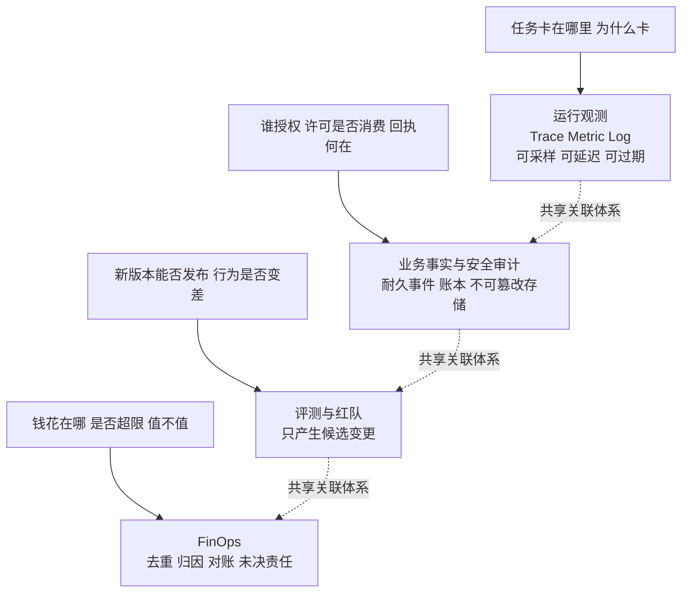

本篇的结构：第 2 节定义可观测三层及其不可互相替代的关系；第 3 节给出关联模型与以耐久事件为主干的事件骨架；第 4 节对齐 OTel GenAI 语义约定并给出版本固定策略；第 5 节建立审计体系；第 6 节定义指标体系与告警分级；第 7 节讨论行为监测与安全响应联动；第 8 节给出评测闭环；第 9 节展开 FinOps；第 10 节给出事故调查的标准重放流程。

---

## 2. 可观测三层：运行观测、业务事实、安全审计

### 2.1 三层定义

**第一层：运行观测。** 回答“系统现在运行得怎么样”。包括 Trace（一次 Invocation 或一段 Run 的调用链视图）、Metric（聚合后的趋势与水位）、Log（排障细节）。这一层服务于工程师和 SRE，消费方式是查询、看图、告警。它的合法性约束是宽松的：可以采样、可以延迟写入、可以按 TTL 过期、可以在遥测平台故障时丢弃非关键样本。第 17 篇已经确立降级原则：遥测平台故障时可以有界缓冲或丢弃非关键遥测，但关键审计、执行与费用事实不能一起丢弃。

**第二层：业务事实。** 回答“系统已经发生了什么业务事件”。这是第 2 篇建立的领域对象世界：Task/Run/Step/Attempt 的状态转移、ExecutionRecord 与回执、ApprovalRecord、AcceptanceRecord、ResultSelectionRecord、DeliveryRecord、UsageRecord、SettlementRecord、CleanupRecord。这些事实以耐久事件流的形式追加记录，是状态重建、去重、对账和结算的依据。它的合法性约束是严格的：不可采样、不可静默过期、消费者必须按 event_id 幂等。

**第三层：安全审计。** 回答“谁在什么条件下做了什么决定，证据是否可信”。它是业务事实中与安全问责相关子集的强化形态：授权决定（AuthzDecision）、审批决定（ApprovalRecord）、ReleaseGrant 的签发与核销、凭据的签发使用撤销、执行回执与 UNKNOWN 裁决、版本与策略变更、撤权与隔离动作。这一层的额外要求是**不可篡改与可举证**：写入 append-only 或具备 WORM 能力的存储（按能力类别选型），哈希链或签名锚定，保留策略与调阅控制。

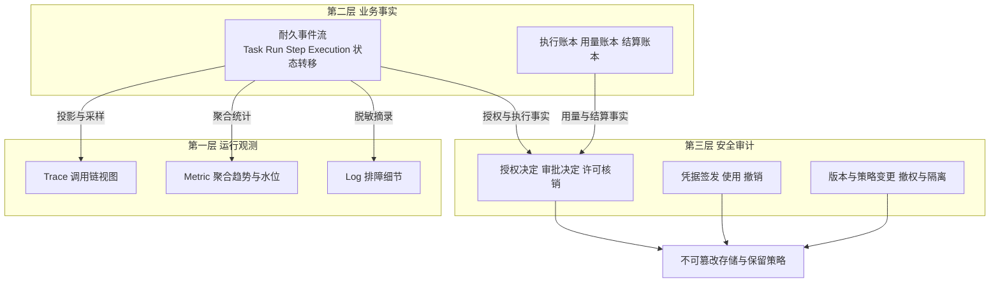

### 2.2 三层关系：共享关联，分存分治

三层不是三套孤立系统，而是同一事实世界的三种视图，必须满足：

1. **事实先于观测。** 耐久事件先可靠提交，再由投影器生成 Span、指标和日志。顺序反过来（先打点、后补事实）就会出现“Trace 显示成功、账本里没有记录”的分裂。
2. **观测是投影，不是来源。** Trace 和指标可以从事件流重新生成；审计记录不能从 Trace 反推，因为 Trace 可能已被采样或过期。
3. **审计是事实的强化子集，不是另一套事实。** 审计事件必须与业务事件共享 event_id 与关联 ID，否则审计证据无法与业务过程对齐。

三层不可互相替代的原因：

| 维度 | 运行观测 | 业务事实 | 安全审计 |
|---|---|---|---|
| 回答的问题 | 现在怎么样 | 已经发生了什么 | 谁批准、证据何在 |
| 写入方 | SDK、探针、投影器 | Runtime、网关、账本服务 | 策略点、审批服务、凭据服务、控制面 |
| 耐久性 | 可丢失、可过期 | 必须耐久、可重放 | 必须耐久且不可篡改 |
| 采样 | 允许且必要 | 不允许 | 不允许 |
| 篡改防护 | 无特殊要求 | 访问控制 | append-only、WORM、哈希链或签名 |
| 主要消费者 | 工程师、SRE、告警 | 状态机、对账器、结算、评测 | 安全、合规、事故调查、监管调阅 |
| 故障时的降级 | 有界缓冲后可丢弃非关键样本 | 不可丢弃，阻断或排队 | 不可丢弃，宁可阻断高风险动作 |

一个常见误区是“审计日志也是日志，放进同一个日志平台就行”。普通日志平台的保留策略、访问权限和存储语义都按排障场景设计：会被滚动覆盖、可被运维改写、没有完整性证明。把授权决定存进去，等于把举证责任寄托在“没有人恰好改过这条日志”上。三层不可互相替代，正是本篇全部机制设计的出发点。

### 2.3 脱敏是三层共同的前置约束

第 14 篇确立了数据分类与保留策略。对可观测体系而言，脱敏不是日志层的补丁，而是三层写入前的统一关卡：Prompt 原文、模型输出、工具参数中的敏感内容按数据分类处理——默认只记录摘要、哈希、长度、分类标签与对象引用；需要原文时走受控调阅并留下调阅记录。**“全链路审计”不能成为无条件记录原文的理由**；恰恰相反，无差别记录原文会同时制造数据泄露风险与存储成本失控。第 5.4 节展开审计侧的脱敏策略。

---

## 3. 关联模型与事件骨架

### 3.1 全链路 ID 体系

第 2 篇与第 4 篇已经定义了平台的 ID 体系。可观测、审计、评测与 FinOps 全部复用这一体系，不新造平行 ID：

| 标识 | 稳定范围 | 在观测与审计中的作用 |
|---|---|---|
| `tenant_id` | 租户 | 一切归因、配额、隔离与调阅的第一维度 |
| `task_id` | Task 全生命周期 | 业务问责与结算的聚合根 |
| `run_id` | 单次运行 | 关联 AgentSpec 版本、预算与用量 |
| `step_id` + `plan_revision` | Run 内逻辑步骤 | 定位逻辑进度与计划版本 |
| `attempt_id` | 单次调度尝试 | 区分重试、接管与基础设施故障 |
| `invocation_id` | 单次入口唤醒 | Trace 的宿主，关联 Instance 与响应流 |
| `instance_id` + `lease_epoch` | RuntimeInstance 与租约 | 识别双写、接管与 fencing 事件 |
| `agent_spec_digest` | 不可变版本 | 评测回归、事故重放的版本锚点 |
| `execution_id` + `business_action_key` | 跨 Attempt 稳定 | 外部副作用去重与对账的主键 |
| `approval_id` / `grant_id` | 审批与许可 | 授权链证据 |
| `policy_version` | 策略版本 | 解释“当时为什么这样判定” |
| `trace_id` / `span_id` | 单次或关联 Trace | 排障视图，不承担去重与问责 |

两条铁律重申：**TraceID 用于排障，业务 ID 用于去重与问责**；跨审批、跨恢复的长任务可以生成新的 Trace，通过 Trace Link 关联前序 Trace，而不是把数小时的生命周期压成一棵无限增长的 Trace。

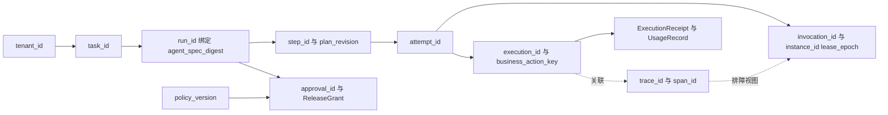

### 3.2 耐久事件流是审计主干，Trace 是排障视图

事件骨架的规则只有一条主链：**所有事实先成为耐久事件，观测信号是事件的投影。**

事件信封沿用第 2 篇的定义：`event_id`、`tenant_id`、`aggregate_type/id/version`、`correlation_id`、`causation_id`、`occurred_at`、`schema_version`、`actor/producer`、payload 与安全标签。可观测体系在此之上补充两个要求：

1. **每个事件携带足够的关联 ID**，使任一事件都能独立定位到 tenant/task/run/step/attempt/invocation/instance/epoch/spec/execution/approval/policy/trace，而不依赖查询时的外部拼接；
2. **事件分类打标**，决定其投影与审计去向。

| 事件类别 | 示例 | 投影到观测 | 进入审计存储 |
|---|---|---|---|
| 运行类 | RunStarted、StepCompleted、RunPaused | Span、时延指标 | 否（摘要可选） |
| 授权类 | AuthzDecided、ActionApproved、GrantConsumed | 计数指标 | 是 |
| 执行类 | ExecutionSubmitted、ReceiptRecorded、ExecutionUnknown | Span、错误指标 | 关键动作是 |
| 账务类 | UsageRecorded、SettlementAdjusted | 成本指标 | 涉及调整与未决时是 |
| 治理类 | SpecPublished、PolicyChanged、Revoked、Quarantined | 变更事件流 | 是 |
| 展示类 | Token 增量、进度文本 | 有界缓冲，不入主干 | 否 |

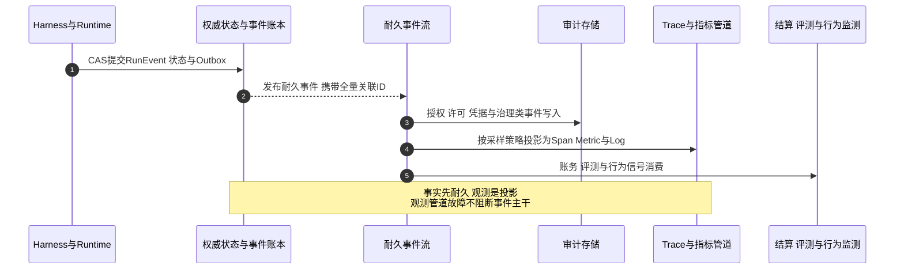

这个骨架带来三个直接收益：

- **事故可重放**：事件区间加上固定的 AgentSpec 版本，即可在影子环境重建决策过程（第 10 节）；
- **审计可对账**：审计存储中的记录数与事件主干中的对应类别事件数应可周期性核对，差异即缺口；
- **观测可降级**：Trace 管道故障时，投影器可以滞后追补；事件主干不受影响。

### 3.3 评测与 FinOps 也是事件的消费者

评测体系消费运行类与质量类事件做线上抽样复核；FinOps 消费账务类事件做归因与对账；行为监测消费全部类别提取信号。它们都不新造事实，只消费与派生。这条约束避免了平台出现“第二套账本”。

---

## 4. OTel GenAI 对齐：统一命名，固定版本

### 4.1 为什么要对齐，以及事实纪律

OpenTelemetry 为 GenAI 场景定义了语义约定，统一模型调用、Agent 执行与工具调用的 Span 命名与属性（如 GenAI 系统名、请求模型、操作名、token 用量等属性族）。对齐的收益是明确的：探针与后端解耦、跨团队口径一致、便于按能力类别选择 Trace 后端与指标存储。

但必须明确其成熟度事实：**OTel GenAI 语义约定仍在持续演进，属性名、Span 结构与覆盖范围都可能随版本变化，尚未成为稳定标准。** 生产平台的正确姿势不是“等它稳定”，也不是“直接按最新版接入”，而是**固定所采用的版本**，把约定当作平台内部契约管理。本篇提及的属性名仅示意，实际以固定版本的官方文本为准。

### 4.2 Span 结构与对象模型映射

在固定版本下，Agent 平台的 Span 树与系列领域对象的推荐映射如下：

| Span | 对应领域对象 | 关键属性示意 |
|---|---|---|
| `invoke_agent` | Invocation / Run 的一段 | run_id、invocation_id、agent_spec_digest、tenant |
| 规划/推理段 | Step 内逻辑阶段 | step_id、plan_revision |
| 模型调用 span | ModelCallRecord | gen_ai 系统名、请求模型、响应模型、input/output tokens、供应方调用 ID |
| `execute_tool` span | Attempt 对 ExecutionRecord 的一次提交 | 工具全限定名与版本、execution_id、结果状态 |
| 外部调用子 span | 下游 API/MCP/浏览器/作业 | 目标、时延、错误码 |
| Trace Link | 跨审批、跨恢复关联 | 前序 trace_id |

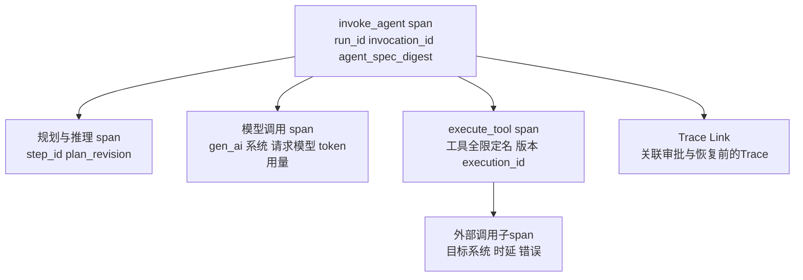

三条映射纪律：

1. **Span 不承载事实语义。** 模型调用 span 上的 token 属性用于观测与成本估算；真正的用量事实以 UsageRecord 为准，结算以 Settlement 为准。Span 丢了可以接受，账本丢了不行。
2. **业务 ID 进属性，不进指标标签。** execution_id、task_id 这类高基数 ID 写入 Span 属性与事件字段；指标只按 tenant、agent、model、资源池等低基数维度聚合，否则指标存储会被基数爆炸压垮。
3. **长任务不压成一棵 Trace。** 审批等待数小时后恢复，创建新 Trace 并用 Link 关联；Trace 的边界服从 Invocation 与恢复点，不服从业务生命周期。

### 4.3 版本固定策略

| 环节 | 策略 |
|---|---|
| SDK 与探针 | 锁定语义约定与 SDK 版本，随构建清单记录 |
| 遥测元数据 | 每条管道标注所采用的 semconv 版本，查询端按版本解释属性 |
| 升级流程 | 新版本约定按候选变更对待：影子对比、回归验证、审批、灰度，与 AgentSpec 发布同轨 |
| 兼容窗口 | 查询、告警规则与仪表盘同时理解新旧属性名的过渡期，显式声明 |
| 审计豁免 | 审计记录使用平台自定义的稳定字段命名，不跟随 semconv 演进漂移 |

最后一条尤其重要：**审计与账本字段的命名权在平台自己手里。** semconv 用于观测投影层；把审计 Schema 绑定到一个仍在演进的约定上，等于让外部社区的 breaking change 直接冲击举证能力。

---

## 5. 审计体系：事件清单、不可篡改存储、保留与脱敏

### 5.1 审计事件清单

审计范围覆盖“授权决策、审批决定、许可核销、凭据、执行回执、版本与策略变更、安全响应、敏感数据访问”八组事实：

| 组 | 审计事件 | 关键字段 |
|---|---|---|
| 授权决策 | AuthzDecided（允许与拒绝） | 主体、资源、条件、policy_version、结果、原因 |
| 审批决定 | ApprovalDecided | approval_id、action_digest、审批人、有效期、拒绝或过期原因 |
| 许可核销 | GrantIssued、GrantConsumed、GrantRejected | grant_id、绑定动作摘要、核销的 execution_id、单次消费证据 |
| 凭据 | CredentialIssued、CredentialUsed、CredentialRevoked | 受众、scope、expiry、使用位置（不记录密钥本体） |
| 执行回执 | ExecutionSubmitted、ReceiptRecorded、ExecutionUnknown、AdjudicationDecided | execution_id、幂等键、回执、UNKNOWN 裁决人与依据 |
| 版本与策略变更 | SpecPublished、PolicyChanged、RevocationEpochBumped | 新旧版本 digest、发布人、审批引用、生效范围 |
| 安全响应 | RunSuspended、PermissionRevoked、InstanceQuarantined | 触发信号、决策人、影响范围、证据引用（机制见第 13 篇） |
| 敏感数据访问 | 高敏数据读取、导出、跨租户调阅 | 数据分类、主体、目的、授权引用 |

清单的完整性本身也要被审计：周期性将事件主干中各类别事件计数与审计存储入库计数对账，出现缺口即触发完整性告警。

### 5.2 不可篡改存储与保留

按能力类别表述，审计存储需要具备：

- **追加写**：记录一经写入不可修改、不可删除，更正只能以新增更正记录表达；
- **完整性锚定**：哈希链、周期签名或外部锚定，使任意篡改可被检测；
- **WORM 能力**：对法律保留级别的记录，采用具备一次写入多次读取能力的存储层级；
- **保留分级**：按数据分类与合规要求设定保留期；到期销毁本身也是审计事件；法律保留可冻结销毁（第 14 篇的删除权与审计保留冲突协调机制同样适用）；面向国内生产环境时，等保 2.0 三级要求安全审计记录留存不少于六个月且防未授权删改，应作为保留分级的下限锚点写入保留策略表；
- **调阅控制**：审计数据的读取、导出、调阅需要授权，且调阅行为本身写入审计——审计者也要被审计。

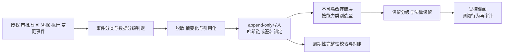

### 5.3 保留与调阅

| 数据 | 建议保留策略取向 | 说明 |
|---|---|---|
| 授权与审批决定 | 长保留 | 问责与监管调阅的基础 |
| 许可核销与执行回执 | 长保留 | 与副作用对账、结算争议直接相关 |
| 凭据使用记录 | 中长保留 | 只记元数据，永不记密钥本体 |
| 版本与策略变更 | 长保留 | 事故重放需要“当时的规则” |
| 运行类事件明细 | 中保留后可归档 | 归档后仍可恢复，但查询时延声明清楚 |
| Trace 与高容量日志 | 短保留 | 排障用途，过期合法 |

调阅流程应当产品化：调查人按 task/run/execution 申请调阅，系统聚合事件区间、审计记录、Trace 与指标快照形成证据包，全程留痕。

### 5.4 脱敏策略

脱敏由数据分类驱动，在写入观测与审计管道之前完成：

| 内容 | 默认处理 | 升级条件 |
|---|---|---|
| Prompt 与模型输出原文 | 不进入普通日志与 Trace；仅记录长度、哈希、分类标签 | 安全调查需要时，经审批调阅受控副本 |
| 工具参数中的敏感字段 | 字段级掩码或替换为引用 | 同上 |
| 凭据与令牌 | 永不记录本体，只记 ID、受众与有效期 | 无 |
| 业务数据载荷 | 记录对象引用与摘要 | 按数据分类分级 |
| 审批展示过的差异与摘要 | 随 ApprovalRecord 保留 | 已按展示时脱敏规则处理 |

要点是：**脱敏发生在产生侧与写入门禁，而不是查询侧。** 先全量落盘再指望查询时过滤，既挡不住权限绕过，也省不下存储成本。

---

## 6. 指标体系：分阶段度量与告警分级

### 6.1 指标清单

指标按“业务结果—运行效率—安全治理—成本”四层组织。以下为平台级最小必要集，各指标均以 tenant、agent、模型、资源池等低基数维度聚合：

| 指标 | 定义与口径 | 层级 | 关注点 |
|---|---|---|---|
| 分阶段时延 | 受理、调度、模型首 token、工具执行、技术验证、交付各段分开度量 P50/P95/P99 | 运行 | 各段独立度量，不用端到端单值掩盖瓶颈 |
| 队龄 | 可运行 Run 从入队到取得租约的等待时长 | 运行 | 调度公平性与容量水位的最早信号 |
| 注入拦截率 | 内容检测与策略对注入类输入的拦截数/检出总数 | 安全 | 下降可能意味着检测退化或攻击变形 |
| HITL 通过/拒绝率 | 审批通过与拒绝占比、审批时延、超时默认拒绝数 | 安全 | 拒绝率骤升提示 Agent 行为漂移；全量通过提示审批疲劳 |
| 预算水位 | 租户/Task 预算的预留、消费与剩余比例 | 成本 | 达到阈值触发限流、降级或拒绝 |
| 热池命中率 | Sandbox、浏览器、实例等资源热池命中比例 | 运行 | 命中率下降推高冷启动时延与成本（第 15 篇） |
| 恢复成功率 | Resume 与接管后成功继续推进的比例 | 运行 | 衡量 Checkpoint 与对账机制的真实有效性 |
| fencing 拒绝数 | 旧 epoch 状态提交或执行提交被拒绝的次数 | 安全 | 非零是常态，激增提示双写、抖动或租约配置失当 |
| UNKNOWN 数量与裁决时长 | 处于 UNKNOWN 的执行数量、平均与 P95 裁决时长 | 业务 | 积压意味着未决副作用与未决责任在累积 |
| 任务验收拒绝率 | 业务验收拒绝占比 | 业务 | 质量趋势，评测闭环的输入 |
| 交付证据等级分布 | PUBLISHED/SENT/CONFIRMED 占比 | 业务 | 防止把“已发送”误报为“已确认” |
| 单位任务成本 | 按 Task 类型归一的成本 | 成本 | 优化杠杆效果的度量基线 |

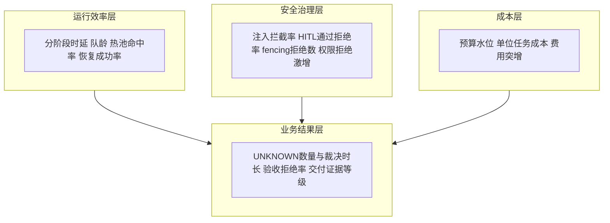

### 6.2 告警分级

告警必须分级，且每级有明确的响应人与动作。无分级的告警等于没有告警：

| 级别 | 触发示例 | 响应要求 |
|---|---|---|
| P0 安全与事实完整性 | 审计入库缺口、不可篡改存储完整性校验失败、疑似越权执行、凭据泄露信号、结算账本不一致 | 立即响应，安全值班介入，可触发撤权与隔离（第 13 篇） |
| P1 SLO 与业务连续性 | UNKNOWN 积压超阈、恢复成功率跌破阈值、预算超限未处置、交付失败率突增 | 当日响应，运行值班定位并处置 |
| P2 趋势与效率 | 队龄抬升、热池命中率下降、单位成本上升、审批时延变长 | 周期评审，进入容量或优化议程 |
| P3 观测质量 | 探针缺失、semconv 版本漂移、指标断点 | 平台自维护，限期修复 |

三条告警纪律：

1. **告警绑定事实来源。** P0/P1 告警应能一键跳转到对应的事件区间、Trace 与审计记录，而不是只有一行阈值越界文本；
2. **告警本身是事件。** 告警触发、认领、处置、关闭写入事件流，供复盘与行为监测消费；
3. **阈值版本化。** 阈值与规则随策略版本管理，修改走变更流程，避免“悄悄调宽阈值掩盖问题”。

### 6.3 指标口径治理

指标比看上去更容易失真。口径治理至少包括：指标定义文档化并版本化；采样只允许作用于观测层，凡是从事实聚合的指标（如 UNKNOWN 数量）必须基于事件主干而非采样流；同一指标只有一个权威生产者；仪表盘标注口径版本与数据延迟。

---

## 7. 行为监测：基线、异常信号与安全响应联动

### 7.1 基线建立

行为监测的前提是“知道正常长什么样”。基线按 AgentSpec 版本、租户、任务类型分别建立，并随版本演进而更新——**基线本身也是版本化对象**：新版本 Agent 发布后，旧基线不能直接沿用，应经历一段观察期形成新基线，否则每次发布都会产生一轮误报。

基线内容包括：工具调用序列分布、每任务模型调用次数与 token 分布、外部目标访问分布、权限拒绝率、费用分布、运行时长分布。

### 7.2 异常信号

检测规则关联第 11 篇的`threat_id`、可核验的 ATLAS 技术及版本（若适用）、观测字段、关联窗口、预期证据和响应政策。技术映射是研判线索，不是仅凭一次调用或告警即可断言攻击的依据；没有适用 ATLAS 技术时继续保留本地检测假设。

系列确立的六类核心异常信号及其处置入口：

| 信号 | 数据来源 | 初步处置 |
|---|---|---|
| 目标偏移 | 计划修订频率、步骤与目标契约的偏离、输出与 TaskIntent 的差异 | 降低自主性、要求确认，写入安全案件 |
| 异常工具序列 | 工具调用序列与基线的偏差、高危工具组合出现 | 暂停相关 Step、转 HITL |
| 权限拒绝激增 | AuthzDecision 拒绝计数突增 | 可能是探测或越权尝试，联动安全调查 |
| 出向异常 | 出口网关的目标、端口、流量偏离 allowlist 与基线 | 阻断并隔离执行环境（第 8、12、13 篇） |
| 费用突增 | Usage 速率与预算水位 | 触发预算阻断或降级（第 9 节） |
| fencing 拒绝 | 旧 epoch 提交被拒 | 区分基础设施抖动与双写攻击，结合租约事件研判 |

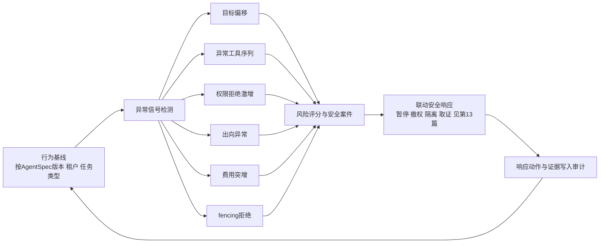

### 7.3 与安全响应的联动

行为监测只负责发现与评分，**不自动扩权、不自动改写策略**。处置链路遵循第 13 篇的安全治理闭环：

1. 信号聚合为风险评分，达到阈值生成安全案件；
2. 案件按安全档位（S0–S3）决定自动化程度：低档位可自动暂停 Run、收紧租约；高档位动作（撤权、隔离 Instance、吊销 AgentSpec）由值班安全人员确认或按预案执行；
3. 所有响应动作——包括自动执行的——写入审计，附触发信号与证据引用；
4. 处置结束后走重新准入流程：修复、回归、灰度，而不是直接恢复原状。

两个边界必须守住：其一，行为监测的误报成本是打断业务，因此阈值与评分要可回放、可申诉；其二，监测数据本身含大量行为细节，其存储与调阅同样受数据分类约束。

---

## 8. 评测体系：从 Golden Set 到候选变更

### 8.1 评测的定位

评测回答“行为质量是否在变好”，它的输出是**证据与候选变更**，不是权限，也不是发布决定。任何评测与红队结论都必须经过回归、审批、灰度才能影响生产——这是系列从总纲开始反复强调的运营闭环纪律。

评测体系由五个机制组成，覆盖发布前、发布中与发布后：

| 机制 | 时机 | 数据 | 是否产生副作用 |
|---|---|---|---|
| Golden Set 回归 | 每次候选变更发布前 | 版本化用例库 | 否 |
| 影子运行 | 灰度前与灰度中 | 生产流量镜像 | 否（写动作 dry-run 或不执行） |
| 线上抽样复核 | 持续 | 生产输出按风险分级抽样 | 否 |
| 自动化红队 | 周期性 + 重大变更前 | 攻击场景库 | 仅在隔离环境 |
| 人工评审 | 高风险变更 | 上述机制的差异样本 | 否 |

### 8.2 Golden Set 与回归门禁

Golden Set 是版本化用例库，每条用例至少包含：输入与上下文约束、期望满足的条件（可以是确定性断言、规则检查或评审标准）、适用的 Agent 类型与风险档位、用例来源（历史事故、红队发现、业务样本）。

回归门禁规则：候选变更（Prompt、工具描述、策略、模型路由、AgentSpec）在发布前必须跑完适用 Golden Set；通过率、关键用例结果与上一版本对比，出现关键用例退化即阻断发布。门禁本身是发布流水线的一部分，其结果作为发布审批的证据引用。

Golden Set 的治理：用例增删需要评审并记录原因；被“训练针对”的用例要定期轮换（防止 Agent 优化方向过拟合评测集）；事故复盘与红队发现必须回流为新用例——**这是评测体系与事故调查、红队之间的显式接口**。

### 8.3 影子运行与线上抽样

影子运行把生产流量镜像给候选版本执行，对比两版输出与行为：模型调用次数、工具序列、成本、输出差异。影子运行必须无副作用——写类动作以 dry-run 执行或完全跳过，影子环境使用隔离的数据视图与只读凭据。影子结果只用于对比决策，不进入交付链路。

线上抽样复核按风险分级设定抽样率：高风险任务（不可逆外部动作、高敏数据）抽样率显著高于只读任务。复核方式可以是确定性校验、模型辅助评审或人工复核；复核发现的质量问题回流为 Golden Set 用例或安全案件。抽样复核使用的输出内容按第 5.4 节脱敏规则处理。

### 8.4 自动化红队

红队以第 11 篇《攻击知识库与三框架协同》的统一威胁记录为输入：MAESTRO 定位架构资产与跨层攻击路径，OWASP Agentic Top 10 2026（第 10 篇）标注风险类别，MITRE ATLAS 提供经官方资料核验的技术及战术参考。三者是多对多的作者映射，不是官方认证或强制执行顺序。无法匹配 ATLAS 的业务风险保留本地威胁编号，不能为满足覆盖率强行贴标签。

每个红队用例记录 threat_id、官方技术 ID 与证据来源（若适用）、AgentSpec/策略版本、前置权限、受控输入、预期阻断点、检测信号、执行记录和残余风险。只在授权的隔离环境使用合成数据与受限工具；模型拒答、PEP 拦截、行为告警和实际业务副作用是四个不同结果，需要分别度量。系列的四类核心场景如下：

| 场景 | 攻击意图示例 | 验证的控制点 |
|---|---|---|
| 目标劫持 | 在数据载荷与网页内容中注入指令，诱导 Agent 偏离 TaskIntent | 指令与数据分区、回程扫描、目标偏移检测 |
| 工具误用 | 诱导合法工具以越界参数调用、组合出危险序列 | 能力调用网关、参数约束、逐调用授权、预算 |
| 记忆投毒 | 向长期记忆或 RAG 注入恶意内容，观察跨会话影响 | 写入治理、来源信任、隔离与回滚（第 14 篇） |
| 越权委托 | 诱导 Agent 将权限转授子 Agent 或外部 Agent | 委托边界、短期许可、执行时重验证 |

红队在隔离环境执行，使用合成的租户与凭据；执行频率为周期性加重大变更前触发。红队发现产出三类结果：可复现的攻击样本（入库为 Golden Set 负例）、控制点缺陷报告（进入修复与回归）、风险接受记录（无法短期修复时显式记录责任人与期限）。**红队报告不直接触发生产策略变更，更不允许自动化“修复”直接扩权或改策略。**

### 8.5 评测结果到候选变更的流程

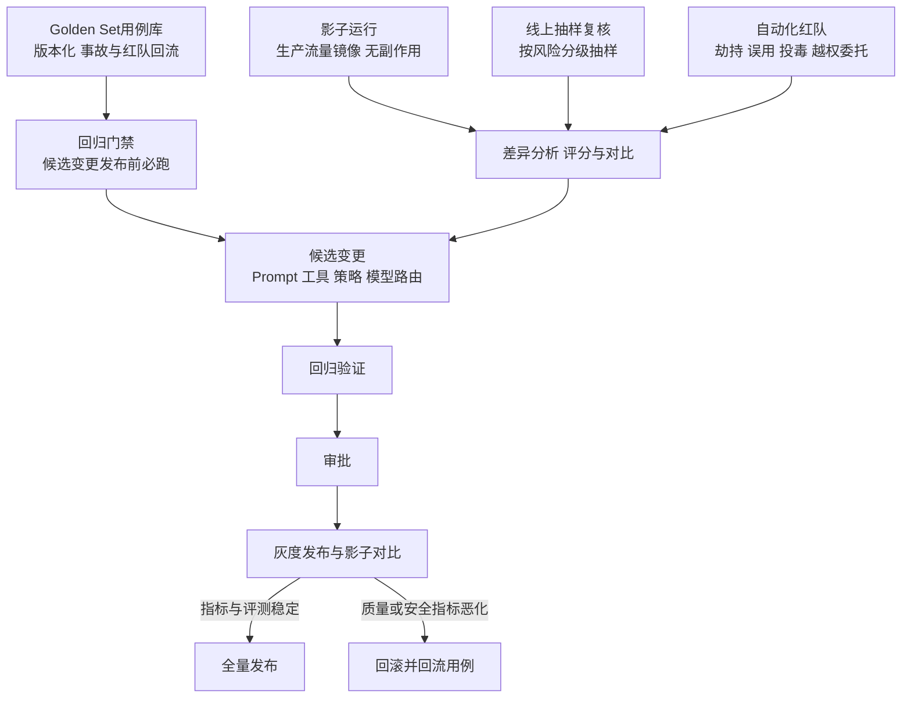

评测平台按能力类别表述需要具备：用例与数据集管理、执行编排（含隔离环境与影子模式）、多策略评分（确定性断言、规则、模型评审、人工评审）、版本对比与回归门禁集成。选型时同样适用第 0 篇的四问：它负责什么、不负责什么、失败时如何退化、哪些事实仍需外部系统承载——评测平台不承载发布决定，发布决定属于变更管理流程。

---

## 9. FinOps：成本采集、归因、预算、对账与优化

### 9.1 成本采集与去重

用量事实的建模在第 2 篇与第 14 篇已经确立：UsageRecord 追加式记录模型 token、Sandbox 计算、浏览器、GPU、远程作业、存储与交付用量；Settlement 负责预算预留、消费、退款、释放与调整。本篇强调运营侧的三条纪律：

1. **去重键三件套**：供应方调用 ID、execution_id、producer_event_id。重复用量不重复计费；晚到的合法调整以新增调整事件表达，不改写原 Usage；
2. **未知费用不静默归零**：收费状态未知的调用（例如响应丢失的模型调用）保留未决责任，进入供应方对账；是否阻断 Task 终态由政策决定；
3. **估算与结算分口径**：实时成本看板允许是基于费率的估算，但要显式标注；对账后的结算值才是财务口径。两套口径的差异本身是监控项。

### 9.2 归因

归因维度固定为：**租户 / Task / Agent / 模型 / 资源池**。归因在事件产生时完成（UsageRecord 携带全量关联 ID），而不是月末摊派。共享成本（平台级缓存、热池空闲、控制面开销）单独归类为“平台公摊”，不强行摊入单个 Task——强行摊派会制造虚假的成本信号。

| 归因视角 | 回答的问题 | 典型动作 |
|---|---|---|
| 租户 | 谁在消费、是否接近配额 | 配额、计费、商务沟通 |
| Task | 单任务成本是否合理 | 预算调整、任务类型优化 |
| Agent | 哪个 Agent 版本更省 | 评测与成本联合决策 |
| 模型 | 大小模型的性价比 | 模型路由策略 |
| 资源池 | 热池规模与利用率是否匹配 | 池化参数调整（第 15 篇） |

### 9.3 预算与告警

预算生命周期：预留（Task 受理时）→ 消费（Usage 确认后）→ 调整（供应方晚到账单、退款）→ 结算与释放。水位阈值触发分级动作：

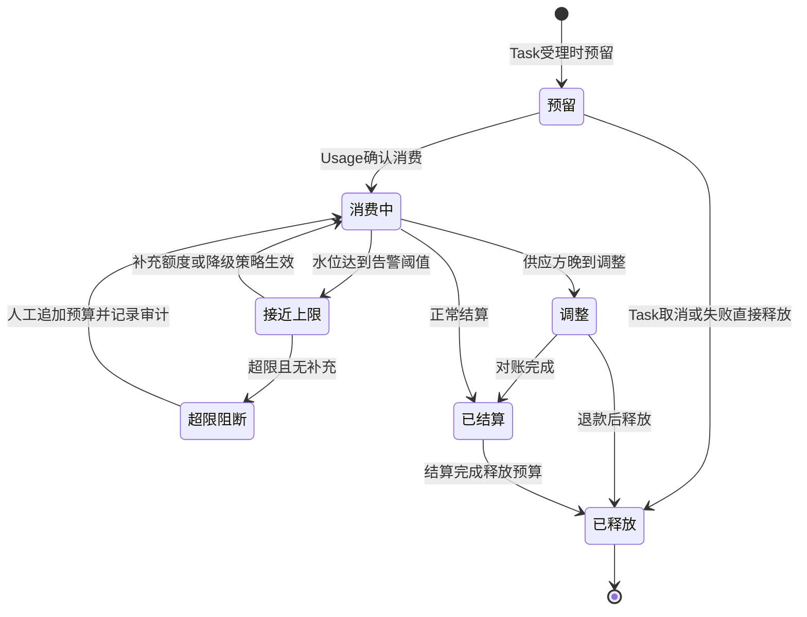

| 水位 | 动作 |
|---|---|
| 预警线 | 通知租户与运营，进入观察 |
| 限流线 | 降低该租户新任务优先级、限制高成本模型路由 |
| 阻断线 | 拒绝新任务或要求显式追加预算；在途任务按政策完成当前 Step 后暂停 |
| 超限处置 | 追加预算、终止任务、或按降级阶梯收缩自治（第 17 篇），任何一条都必须留痕 |

费用突增同时是行为监测信号（第 7.2 节）：速率异常可能来自攻击者诱导的高频调用，预算阻断因此也是安全控制。

### 9.4 供应方对账

对账流程：周期性拉取供应方账单 → 按供应方调用 ID 与 UsageRecord 匹配 → 差异分类（漏记、多记、费率差异、晚到调整）→ 生成 Settlement 调整事件 → 无法裁定的差异保留未决责任并立案。对账差异率、未决责任金额与账龄是 FinOps 的一级指标。

### 9.5 优化杠杆

| 杠杆 | 机制 | 必须同时评估的代价 |
|---|---|---|
| 模型路由 | 低风险步骤路由到小模型，高风险步骤保留大模型 | 质量回归：路由策略变更走评测门禁 |
| Prompt 与结果缓存 | 复用重复前缀与确定性结果 | 隔离与时效：缓存键必须含租户与授权上下文，防止跨租户命中与过期授权延续（第 14 篇） |
| 池化与热池 | 预热 Sandbox、浏览器与实例，减少冷启动 | 空闲成本与命中率平衡，按指标调参 |
| 批量化与调度错峰 | 非实时任务合并、低峰执行 | 时延 SLO 与队龄影响 |

每个杠杆都是候选变更：上线前回归、审批、灰度，上线后以单位任务成本与质量指标联合验证。**成本优化不允许以绕过安全检测、降低验收标准或削弱审计为代价。**

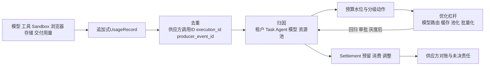

---

## 10. 事故调查：从耐久事件重放还原现场

### 10.1 标准流程

事故调查的质量取决于事件骨架的完整性。标准流程分六步：

1. **定界**：从告警或报告确定影响面——哪些 tenant、task、run、时间区间；
2. **取事件**：按业务 ID 从耐久事件流提取事件区间，形成时间线主干；
3. **补视图**：用 trace_id 关联 Trace 与日志（若仍在保留期），补充调用链细节；用指标快照补充当时水位；
4. **取证据**：从审计存储调取授权、审批、许可、凭据与变更记录，回答“当时谁允许、依据什么策略版本”；
5. **重放**：在影子环境以事件区间加固定 AgentSpec 版本重放决策点，验证假设；
6. **认定与改进**：产出事实认定、责任判定与候选改进；改进项进入回归、审批、灰度流程，关键发现回流 Golden Set 与红队场景库。

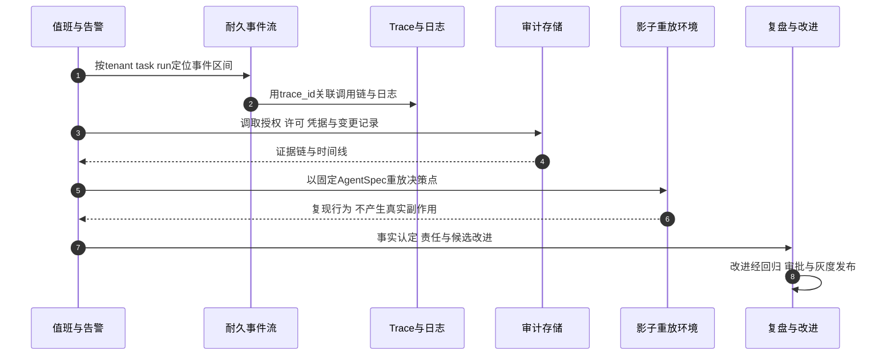

### 10.2 重放的规则与边界

重放是 Agent 平台事故调查区别于传统系统的关键能力，也是最容易被滥用的能力：

- **重放环境必须无副作用**：隔离数据视图、只读或 dry-run 凭据、出口阻断；重放产生的任何“执行”都不允许触达生产外部系统；
- **重放依赖版本锚点**：AgentSpec digest、策略版本、计划版本、事件 Schema 版本缺一不可；这再次说明版本变更审计不是合规摆设，而是调查基础设施；
- **重放不等于完全复现**：模型输出具有随机性，外部状态已经变化。重放的目标是复现决策逻辑与路径，验证“在哪一步、依据什么事实走错了”，而不是逐 token 复现输出；
- **写动作不在重放中补执行**：调查发现的漏执行、错执行，通过补偿任务或人工裁决处理（第 2 篇），不借重放通道偷偷补做。

### 10.3 证据包与调查 SLA

证据包标准内容：事件区间原文与哈希、审计记录、Trace 与日志摘录（脱敏后）、指标快照、涉及的版本与策略快照、重放记录与结论。证据包本身写入审计存储，保证调查结论可追溯、可复核。

调查按影响分级设定时限：涉及资金、高敏数据或越权的事故优先；每个调查以“事实认定清楚、改进项有归属、回流用例完成”为关闭标准，而不是以“服务已恢复”为关闭标准。

---

## 11. 常见反模式

### 11.1 审计住进遥测管道

把授权决定、许可核销写进普通日志平台，享受同样的采样率与 TTL。事故调查时发现关键证据已过期或被采样丢弃。审计必须走独立的不可篡改存储与保留策略。

### 11.2 以“全链路审计”为名无差别记录原文

Prompt 与输出原文全量落盘，美其名曰可追溯，实际制造泄露面与成本黑洞，还让真正重要的审计记录淹没在数据噪音里。默认脱敏、受控调阅才是可举证的正确形态。

### 11.3 用 TraceID 做业务去重与问责

Trace 会因审批等待、恢复接管而切换，采样会丢 Trace。去重靠 execution_id 与业务幂等键，问责靠业务 ID 体系，TraceID 只排障。

### 11.4 把 OTel GenAI 约定当稳定标准直接硬编码

属性名写死在告警规则、账单脚本与审计查询里，约定一次演进全线失效。正确做法是固定版本、元数据标注、升级走回归。

### 11.5 高基数 ID 进指标标签

把 task_id、execution_id 塞进指标维度，指标存储基数爆炸，最后连水位图都查不出来。业务 ID 进事件与 Span 属性，指标只留低基数维度。

### 11.6 评测结果直接发布

“评测分数涨了 3 个点，直接全量”。评测只证明候选变更在已知用例上的表现，发布还需要审批与灰度观察；跳过灰度的发布把回归风险直接暴露给全量用户。

### 11.7 红队发现触发自动修复

红队脚本发现一条绕过，平台自动给网关加一条规则并扩权。攻击者可以借此探测并诱导策略变化。红队输出必须经过人工评审、回归与审批。

### 11.8 Usage 直接当账单

未去重、未对账的用量直接出账：重试产生重复计费，供应方晚到调整无处安放。Usage 是事实采集，Settlement 才是账务处理。

### 11.9 告警无分级、无归属

几百条规则全部同等优先级，值班在告警海里麻木；或者告警触发后没有跳转证据的通路，定位全靠手工。告警必须分级、绑定证据来源、有明确响应人。

### 11.10 行为监测只报不联

异常信号生成了仪表盘和周报，却没有与暂停、撤权、预算阻断联动，攻击与失控在“已观测”状态下持续。监测的价值在联动，不在报表。

### 11.11 成本优化绕过质量与安全回归

为省钱把高风险步骤也路由到小模型、把缓存键里的授权上下文省掉。成本杠杆必须与评测、隔离策略一起回归验证。

### 11.12 事故调查靠记忆与截图

没有可重放的事件骨架，复盘依赖当事人的聊天记录和截图，结论无法复核。事件主干、版本锚点与证据包是调查能力的基建。

---

## 12. 生产验证场景表

| 验证场景 | 预期结果 |
|---|---|
| Trace 管道整体故障 | 事件主干与审计写入不受影响；恢复后投影器追补 Span 与指标 |
| 审计存储完整性校验失败 | 触发 P0 告警与调查；能定位到被破坏或缺失的区间 |
| 事件主干与审计存储周期对账 | 计数一致；出现缺口时产生完整性告警与补录流程 |
| 敏感 Prompt 出现在普通日志检索中 | 视为缺陷：写入门禁应已脱敏，出现即告警并整改 |
| 调阅一条审计记录 | 调阅行为本身被记录，含主体、目的与授权引用 |
| 重复 UsageRecord 到达 | 按供应方调用 ID、execution_id、producer_event_id 去重，只结算一次 |
| 供应方晚到账单调整 | 产生新增调整事件与 Settlement 调整，不改写原 Usage |
| 租户预算越过阻断线 | 新任务被拒绝或降级，在途任务按政策收尾，动作全部留痕 |
| Golden Set 关键用例退化 | 发布门禁阻断候选变更，无论人工评价多高 |
| 影子运行中候选版本试图写外部系统 | 被隔离层阻断；影子环境不产生真实副作用 |
| 红队复现一条注入绕过 | 生成案件与负例用例；策略修复经回归、审批、灰度后生效，不自动扩权 |
| 授权隔离环境中模拟一层控制未阻断 | 检测规则仍关联 threat_id 与版本，记录告警和目标端效果；不更改生产门禁、不宣称验证覆盖全部攻击 |
| 行为基线检测到费用突增 | 触发预算与限流动作，并生成安全案件供研判 |
| fencing 拒绝激增 | 告警关联到具体 instance 与 lease epoch，可区分抖动与双写 |
| UNKNOWN 执行超过裁决时限 | 升级告警并进入人工裁决；裁决记录完整可查 |
| 事故后要求还原某次发布的授权链 | 能在时限内产出证据包：事件区间、审批、许可、凭据、策略版本 |
| 以固定 AgentSpec 重放事故区间 | 影子环境复现决策路径，无任何生产副作用 |
| semconv 版本升级 | 新旧属性兼容窗口内告警与查询正常，升级走回归与灰度 |

---

## 13. 架构评审清单

### 三层与事件骨架

- 运行观测、业务事实、安全审计是否分存分治，各自有独立的耐久性与保留策略？
- 授权、许可、凭据、审批事实是否明确排除在可采样遥测之外？
- 耐久事件流是否为审计主干；Trace 是否只是投影与排障视图？
- 事件是否携带全量关联 ID，能否独立定位 tenant/task/run/step/attempt/invocation/instance/epoch/spec/execution/approval/policy/trace？
- 遥测平台故障时，关键审计与账务事实是否仍可靠提交？

### OTel 对齐

- 是否固定了 semconv 与 SDK 版本，并在遥测元数据中标注？
- 审计与账本字段命名是否独立于 semconv 演进？
- 高基数业务 ID 是否只出现在事件与 Span 属性，而非指标标签？

### 审计

- 审计事件清单是否覆盖授权、审批、许可核销、凭据、执行回执、版本策略变更与安全响应？
- 存储是否具备 append-only/WORM 能力与完整性锚定；更正是否以新增记录表达？
- 保留分级、法律保留与到期销毁是否有记录？
- 调阅是否受控且调阅行为本身被审计？
- 脱敏是否在写入侧完成；原文调阅是否有审批与留痕？

### 指标与告警

- 是否覆盖分阶段时延、队龄、注入拦截率、HITL 通过/拒绝率、预算水位、热池命中率、恢复成功率、fencing 拒绝数、UNKNOWN 数量与裁决时长？
- 告警是否分级、有响应人、可跳转证据？
- 阈值与规则变更是否走变更流程并留痕？

### 行为监测

- 基线是否按 AgentSpec 版本、租户、任务类型建立并版本化？
- 六类异常信号是否都有数据源与处置入口？
- 监测信号是否与暂停、撤权、隔离、预算阻断联动；响应动作是否写入审计？

### 评测

- Golden Set 是否版本化，事故与红队发现是否回流为用例？
- 回归门禁是否阻断关键用例退化的发布？
- 影子运行是否确保无副作用；线上抽样是否按风险分级？
- 红队四类核心场景是否周期性执行；其输出是否严格走候选变更流程？

### FinOps

- 去重三键是否落实；未知费用是否保留未决责任？
- 归因五维度是否在事件产生时完成；公摊成本是否单独归类？
- 预算水位是否有预警、限流、阻断的分级动作并留痕？
- 供应方对账差异率与未决账龄是否被监控？
- 优化杠杆是否经过质量与安全回归？

### 事故调查

- 是否能在时限内按业务 ID 产出完整证据包？
- 影子重放环境是否无副作用、版本锚点是否齐全？
- 调查结论是否回流为用例、红队场景与受控变更？

---

## 14. 本篇结论与后续专题

Agent 平台的可观测与运营体系不是一套仪表盘，而是一组关于“事实如何被记录、被证明、被改进”的架构决定。本篇的结论可以归纳为十条：

- 运行观测、业务事实、安全审计三层分存分治，共享关联体系，不可互相替代；
- 耐久事件流是审计主干，Trace 是投影与排障视图，事实先于观测；
- 全链路 ID 体系中，TraceID 排障、业务 ID 去重与问责，长任务用 Trace Link 而非巨型 Trace；
- OTel GenAI 语义约定持续演进，生产使用必须固定版本；审计与账本命名权保留在平台侧；
- 审计覆盖授权、审批、许可、凭据、回执与变更，写入不可篡改存储，脱敏在写入侧完成；
- 指标体系覆盖运行、安全、业务与成本四层，告警分级且绑定证据；
- 行为监测以版本化基线为锚，六类异常信号与安全响应联动，监测只发现、不扩权；
- 评测与红队只产生候选变更，一律经回归、审批、灰度才能影响生产；
- FinOps 以去重后的 Usage 为基础、Settlement 为账务处理，归因五维度、预算分级动作、对账保留未决责任；
- 事故调查依靠事件重放与版本锚点还原现场，重放无副作用，结论回流评测与变更闭环。

当观测能回答“现在怎么样”、审计能证明“当时发生了什么”、评测能约束“变更是否安全”、FinOps 能说明“钱花得值不值”，Agent 平台才具备持续运营的资格。下一篇将收束全系列：从参考架构走向生产落地，讨论技术选型、部署模式与生产准入的完整方法。

---

## 参考资料

以下均为官方资料。动态规范持续演进，实际实现应固定所采用的版本与访问日期。

1. [OpenTelemetry GenAI Semantic Conventions](https://opentelemetry.io/docs/specs/semconv/gen-ai/)
2. [OpenTelemetry Semantic Conventions Repository](https://github.com/open-telemetry/semantic-conventions)
3. [OpenTelemetry Traces Signal](https://opentelemetry.io/docs/concepts/signals/traces/)
4. [OpenTelemetry Metrics Signal](https://opentelemetry.io/docs/concepts/signals/metrics/)
5. [W3C Trace Context](https://www.w3.org/TR/trace-context/)
6. [CloudEvents](https://cloudevents.io/)
7. [OWASP Top 10 for Agentic Applications for 2026](https://genai.owasp.org/resource/owasp-top-10-for-agentic-applications-for-2026/)
8. [NIST SP 800-92 Guide to Computer Security Log Management](https://csrc.nist.gov/publications/detail/sp/800-92/final)
9. [FinOps Foundation Framework](https://www.finops.org/framework/)
