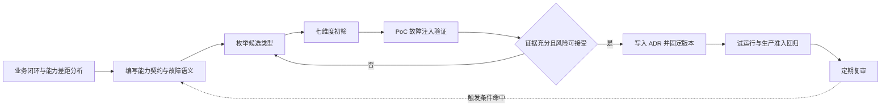
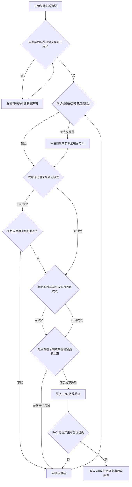
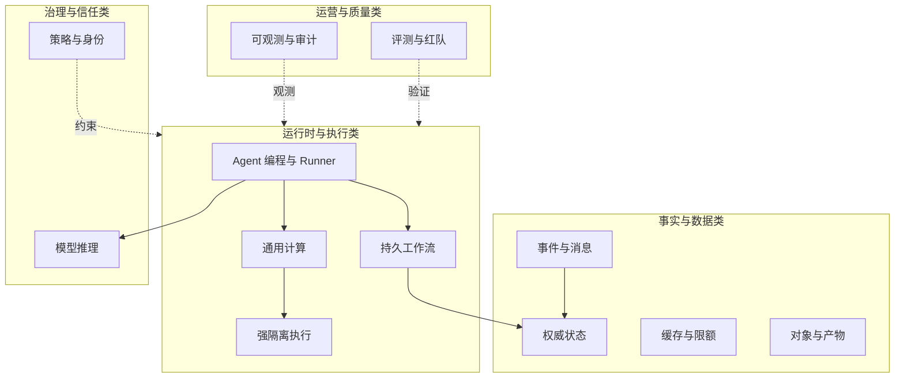
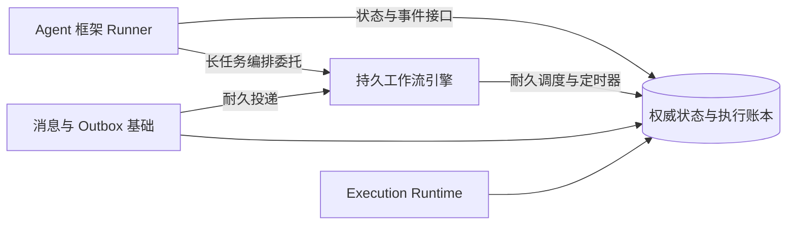
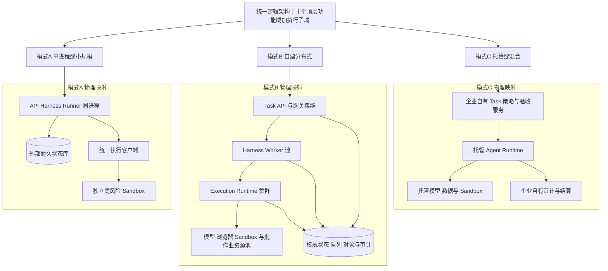
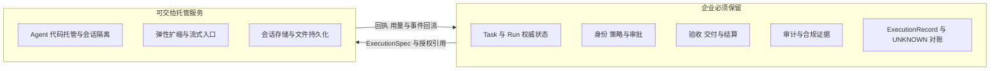
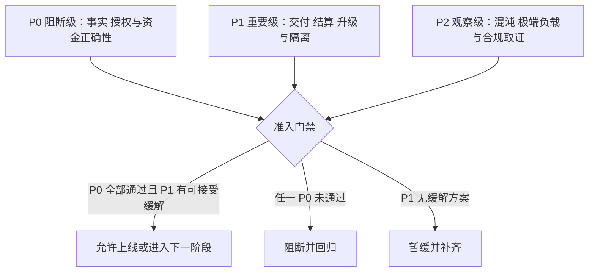
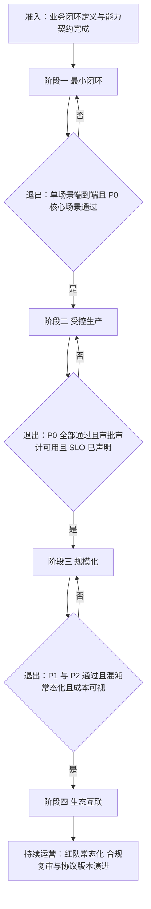
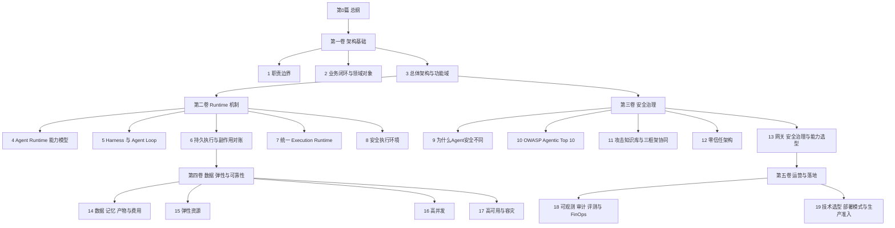
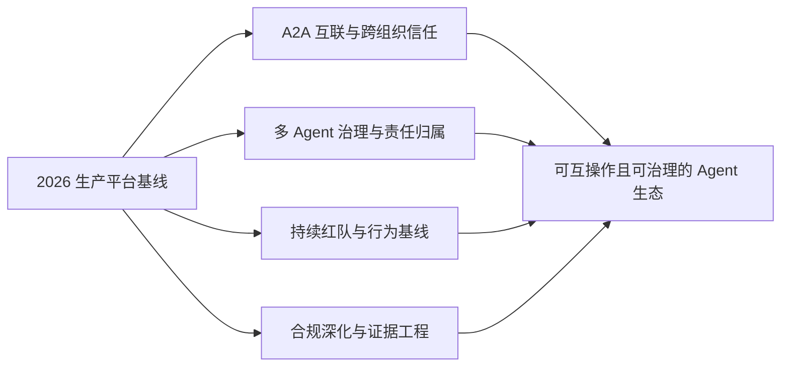

# 技术选型、部署模式与生产准入

> **系列**：生产级 Agent 平台架构 2026 · 第 19 篇（收官）  
> **定位**：落地篇  
> **版本**：闭环修订版  
> **前置阅读**：第 0 篇《从模型推理到生产运行：2026 年 Agent、Harness 与 Runtime 总体架构》 · 第 3 篇《生产级 Agent 平台总体架构：从主链到功能域》 · 第 4 篇《Agent Runtime：从生命周期到执行治理的完整能力模型》  
> **关键词**：技术选型、部署模式、生产准入、上线路线图、系列总结

## 摘要

此前总纲和 18 篇专题分别回答了生产级 Agent 平台的职责边界、领域对象、总体架构、Runtime 机制、持久执行、执行后端、安全威胁建模、OWASP 风险映射、攻击知识库与三框架协同、零信任、网关治理、数据与费用、弹性、并发、高可用和可观测等问题。但对大多数团队而言，最后的落地难题往往集中在三件事上：**如何在众多框架、引擎和托管服务中做出不后悔的选型；如何把统一逻辑架构映射到与自身规模和团队能力匹配的物理部署；如何用可验证的故障事实而不是架构图来证明系统可以上线。**

本文给出这三件事的完整方法。选型部分坚持系列一贯立场——能力优先于产品：先写出能力契约与故障语义，再枚举候选类型，用功能契合、故障语义、运维成本、锁定风险、合规、社区与商业支持、团队能力七个维度初筛，用故障注入式 PoC 取证，最后以架构决策记录固化结论并定期复审。随后按 Agent 编程与 Runner、持久工作流、事件与消息、权威状态、缓存与限额、通用计算、强隔离执行、模型推理、对象与产物、策略与身份、可观测与审计、评测与红队十二个能力域，逐一给出能力要求、候选类型、关键选择问题与常见陷阱。

部署部分把十个顶层功能域加一个 Execution Runtime 执行子域的逻辑架构，映射到单进程或小规模、自建分布式、托管或混合三种模式，明确每种模式的保留项与可简化项——小规模可以归并部署单元，但不得省略耐久状态、ExecutionRecord 与 UNKNOWN 语义——并给出从单进程走向分布式的七步迁移顺序。生产准入部分把全系列的关键验证场景汇总为 P0、P1、P2 三级测试套件，作为发布门禁。上线路线图把演进划分为最小闭环、受控生产、规模化、生态互联四个阶段，每阶段给出准入条件与退出标准。最后回顾全系列 20 篇地图，沉淀核心不变量清单，并展望 A2A 互联、多 Agent 治理、持续红队与合规深化。

本文不指定任何必选商业产品。所有候选都以类型出现，所有结论都以能力契约和故障证据为依据。

---

## 1. 问题背景

### 1.1 选型发生在营销叙事与工程现实的交界处

2026 年的 Agent 技术供给空前丰富：多个开源框架提供 Runner、事件循环、中断恢复和 Checkpoint 抽象；持久工作流引擎把耐久状态机和定时器变成现成能力；云厂商推出托管 Agent Runtime，把会话隔离、弹性扩缩、身份和流式输出作为服务提供；沙箱、浏览器、GPU 和模型推理各有专门的托管选项。供给丰富本应降低落地门槛，实际却经常放大选型风险——因为每一类供给的官方能力描述都是真实的，而**每一项真实能力被放大解读后都可能变成错误的平台承诺**。

系列第 4 篇已经用一张表说明过这种差距：Google ADK 的 Runner 与 Event Loop 真实存在，事件中的 state_delta 经事件处理后提交也是真实机制，但恢复能力依赖持久化 Session 与 Event 的实现，流式 partial 事件不是耐久状态；Eino ADK 提供 CheckPointStore 扩展，但跨进程是否耐久由 CheckPointStore 的具体实现决定；LangGraph 提供 thread 与 checkpointer 快照，恢复基于节点重放，而 thread_id 不是安全隔离或租户授权边界；Temporal 以 Event History Replay 提供耐久执行，但 Activity 的外部副作用仍需幂等和对账；AgentCore Runtime 提供托管承载、会话隔离、弹性、身份、流式与观测，但 Agent Loop 由用户代码实现，持久文件系统需要显式配置。这些边界不是对产品的贬低，而是选型的基本事实：**框架、引擎和托管服务各自交付一段能力，平台能力必须由平台自己补齐。**

### 1.2 三类典型选型失误

系列贯穿全文的三类失误，在落地阶段会以更高代价重演：

1. **以组件清单代替架构。** “消息队列加大数据库加容器平台加某框架”回答了拥有什么，却没有回答 Task 何时算可靠受理、谁持有权威状态、UNKNOWN 由谁对账、终态由谁提交。组件清单无法被验证，架构契约可以。
2. **以框架能力等同平台能力。** 把框架的 Checkpoint 抽象直接宣传为业务可恢复，把托管会话隔离直接等同工具权限治理。一旦故障发生，缺失的能力会以事故形式补课。
3. **以托管服务代替治理责任。** 托管可以承担代码承载、弹性与会话管理，但 Task 权威状态、审批、验收、结算、审计和外部副作用对账仍然是企业的责任。把责任一并“托管”出去，等于放弃了对业务事实的控制。

### 1.3 选型错误的代价不对称

不同能力域的替换成本差异巨大。权威状态库承载 Task、Run、ExecutionRecord、Approval、Settlement 等全部事实，迁移意味着数据搬迁、语义核对和双写过渡；消息系统的顺序、回放和延迟语义深度嵌入 Outbox 与调度逻辑；隔离层的选型决定了镜像、网络和资源限制的整套工程。相比之下，缓存、可观测后端和评测工具的替换成本低得多。**选型投入应与替换成本成正比**：对高替换成本的能力域，必须走完整的契约、PoC 和决策记录流程；对低替换成本的能力域，可以快速选择、快速替换。

### 1.4 本文结构

本文依次回答四个问题：怎么选（第 2 节方法论）、选什么（第 3 节分能力域）、怎么部署（第 4 节三种模式）、凭什么上线（第 5 节生产准入测试套件与第 6 节上线路线图）。第 7 节回顾全系列并沉淀核心不变量，第 8 节展望演进方向。

---

## 2. 选型方法论

### 2.1 能力契约优先：先写契约，再看产品

能力契约是对一个能力域的四份书面承诺，必须在接触任何候选产品之前完成：

- **能力要求**：该能力域必须提供的功能，用系列术语精确表达。例如权威状态必须支持事务、条件更新和版本化聚合，而不是含糊的“高可靠存储”。
- **故障语义**：该能力域在故障时允许发生什么、禁止发生什么。例如消息系统允许重复投递，但消费侧必须幂等；缓存允许丢失，但安全策略判定不得因缓存失效而默认放行。
- **接口契约**：与相邻能力域的交互协议，包括同步还是异步、谁先提交、谁确认谁。
- **非职责声明**：明确该能力域不承担什么。这是系列反复使用的手法——第 0 篇对 Agent、Harness、Runtime、模型服务、执行后端的职责表，本质上就是五份非职责声明。

选型评审时，每个候选必须回答第 0 篇提出的四个问题：**它负责什么，它不负责什么，失败时如何退化，哪些事实仍需外部系统承载。** 回答不了第三和第四个问题的候选，无论功能清单多长都不应进入短名单。

### 2.2 先枚举候选类型，再落具体产品

类型级枚举避免被单一厂商叙事锚定，也避免团队视野局限。同一个能力域通常存在多类实现路线：自建、开源、托管、复用企业既有基础设施。每一类路线在运维成本、锁定风险和团队能力上的得分完全不同。落具体产品是初筛之后的事，而且同一能力域允许保留“组合方案”——例如用 Agent 框架承载 Runner，用持久工作流引擎承载长任务编排，用事务数据库承载权威状态，三者各取所长，这正是第 3.1 节要讨论的组合模式。

### 2.3 七个评估维度

| 维度 | 核心问题 | 典型证据 |
|---|---|---|
| 功能契合 | 能力契约中的必需项覆盖率多少，缺口能否由上层机制补齐 | 功能对照表，缺口清单与补齐方案 |
| 故障语义 | 故障时退化行为是否与契约一致，是否可控可声明 | 故障注入测试结果，官方故障模型文档 |
| 运维成本 | 部署、升级、扩缩、备份、监控所需人力与工具链 | 团队现有经验，同类系统运维记录 |
| 锁定风险 | 数据格式、API、协议是否可迁出，退出成本多大 | 导出能力，标准化程度，替代方案存在性 |
| 合规 | 数据驻留、审计、保留删除、认证资质是否满足约束 | 合规需求清单逐项核对 |
| 社区与商业支持 | 版本节奏、安全响应、长期维护信号是否健康 | 发布记录，漏洞响应时长，贡献者结构 |
| 团队能力 | 团队是否具备用好和排障该候选的技能 | 既往项目经验，培训与招聘成本 |

七个维度不是简单打分求和。**故障语义与合规具有一票否决属性**：故障退化不可控的候选会污染整条主链；不满足数据驻留等强制约束的候选无论多优秀都出局。其余维度用于在合格候选之间比较。

### 2.4 PoC 验证：用故障事实取证

PoC 的目标不是跑通演示路径，而是为能力契约中的关键断言取证。合格的 PoC 至少包含：

- **正常路径**：验证接口契合与基本性能；
- **故障注入**：杀进程、断网、制造超时、重复投递、撤销权限，观察退化行为；
- **恢复验证**：故障后状态是否可恢复，未决动作是否可查询，是否产生重复副作用；
- **规模抽样**：在接近生产的负载剖面下抽样验证延迟与吞吐，而不是峰值压测；
- **运维演练**：实际执行一次升级、一次备份恢复、一次扩缩容。

PoC 的退出标准是书面的：哪些断言被证实，哪些被证伪，哪些无法验证需要带入生产观察期。无法验证不等于通过。

### 2.5 决策记录：ADR 固化与复审触发

每个能力域的选型结论以架构决策记录固化，至少包含：背景与能力契约摘要、候选清单与初筛结果、PoC 证据与链接、最终决策与理由、已知后果与接受的风险、**复审触发条件**。复审触发条件是 ADR 中最容易被遗漏的部分，建议显式写明，例如：候选出现改变故障模型的重大版本变化、规模增长十倍、合规约束变化、出现重大安全事件、团队能力结构变化。ADR 不是存档仪式，它让“为什么当初这么选”在两年后仍可审计，也让复审有据可依。

### 2.6 选型决策流程

把上述步骤串成可执行的决策流程：

而每一个能力域进入流程后，内部的判定逻辑可以表达为下面的选型决策图。它也是本文推荐团队在评审会上直接使用的检查顺序：

### 2.7 方法论层面的反模式

- **跑分驱动选型**：只看吞吐和延迟基准，不看故障语义与运维成本，基准数字无法带入生产。
- **简历驱动选型**：为技术新颖性选择团队无法驾驭的系统，故障时无人能排障。
- **大爆炸选型**：试图一次性选定全部能力域。正确做法是按依赖顺序逐域决策，先权威状态与消息，后计算与隔离。
- **只选不复审**：选型结论永不回顾，直到某次事故才被动发现假设早已失效。

---

## 3. 分能力域选型

本节按十二个能力域逐一展开。每个能力域给出能力要求、候选类型、关键选择问题与常见陷阱。能力域与系列文章的对应关系如下表，便于交叉阅读：

| 能力域 | 主要关联文章 | 选型焦点 |
|---|---|---|
| Agent 编程与 Runner | 第 4、5 篇 | 事件模型、中断恢复、状态接口 |
| 持久工作流 | 第 6 篇 | 耐久语义、重放与幂等 |
| 事件与消息 | 第 6 篇 | 耐久投递、Outbox、顺序与回放 |
| 权威状态 | 第 2、6 篇 | 事务、条件更新、故障范围 |
| 缓存与限额 | 第 12、15、16 篇 | 授权缓存边界、资源配额与准入精度 |
| 通用计算 | 第 15 篇 | 弹性、可移植性、运维 |
| 强隔离执行 | 第 8 篇 | 隔离强度、兼容性、启动时延 |
| 模型推理 | 第 3、13 篇 | 数据驻留、容量、用量对账 |
| 对象与产物 | 第 14 篇 | 耐久、权限、保留与 WORM |
| 策略与身份 | 第 12、13 篇 | 委托、撤销、执行时生效 |
| 可观测与审计 | 第 18 篇 | 事实与遥测分离、审计耐久 |
| 评测与红队 | 第 10、11、18 篇 | 风险分类、攻击知识映射、回归、影子与红队常态化 |

### 3.1 Agent 编程与 Runner

**能力要求。** 该能力域提供 Agent 的编程抽象与事件循环承载：事件模型与 RuntimeEvent 语义；中断与恢复抽象；可插拔的状态与会话接口；流式输出且区分耐久事件与展示增量；Hook 与扩展机制；版本固定支持。它必须能把 Agent 产出的 ModelCallIntent、RetrievalIntent、CallIntent 与 AnswerDraft 交给 Harness 治理链，而不是直接发起调用。

**候选类型。**

| 候选类型 | 官方能力可支持的部分 | 平台仍需明确的边界 |
|---|---|---|
| Google ADK | Runner 协调 Agent、SessionService 与 Event，事件中的 state_delta 经事件处理后提交 | 恢复依赖持久化 Session 与 Event 的实现，流式 partial 事件不是耐久状态，跨 Worker 租约与副作用去重需平台自建 |
| Eino ADK（CloudWeGo，Go） | ChatModelAgent（ReAct Loop+Middleware）、Workflow Agents（Sequential/Loop/Parallel）、DeepAgents（PlanTask+TaskTool 子任务委托）、TurnLoop（Push/Preempt/Stop）、Runner 事件迭代、中断、Resume 与 CheckpointStore 扩展；ADK 自 v0.5.0 引入，采用时须固定 v0.9.x 等实际版本 | 跨进程耐久性由 CheckPointStore 实现决定，Cancel 不等于回滚外部动作，多副本租约 fencing 与多可用区高可用需平台自建 |
| LangGraph | 图执行、thread 与 checkpointer 状态快照、基于重放的恢复 | 节点可能从开头重放，外部副作用必须幂等，thread_id 不是安全隔离或租户授权边界 |
| Claude Agent SDK | query()/ClaudeSDKClient 承载 agent loop、内置工具、subagents、hooks、4 种 permission modes、sessions 恢复 | 会话恢复是客户端侧语义，跨进程耐久 Task、租约、企业授权与副作用对账需平台自建；permission modes 只到工具粒度，达不到 action_digest 级审批 |
| OpenAI Agents SDK / Agents API（beta） | Agents SDK：Agent/Tool/Handoff/Guardrail/Sessions/Tracing 原语（2026-09 起进入维护期）；Agents API：托管会话、编排、上下文压缩与恢复，环境可选 openai_hosted/self_hosted | 托管形态把状态机与恢复让渡给供应方；Task 终态、审批、验收、结算、ExecutionRecord 与 UNKNOWN 对账必须平台自建；托管产品生命周期风险见 4.4 节 |
| 其他框架或自研 | 可完全贴合平台事件模型与治理链 | 事件模型、恢复、扩展机制全部自建，长期维护成本高 |

**关键选择问题。** 状态接口是否可插拔并指向耐久实现？中断恢复依赖什么存储，进程重启后能否继续？流式增量与耐久事件是否分流，慢消费者会不会阻塞推进？AgentSpec 版本能否固定到 Run？扩展点能否挂接审批、预算、回程扫描等治理 Hook？语言栈与团队能力是否匹配？

**常见陷阱。** 把框架 Runner 直接当成分布式 Runtime，默认它提供租约、接管与跨可用区恢复；把 thread_id 或 session_id 当作租户隔离边界；把内存 Session 当作耐久状态；在框架升级时未固定事件与状态 Schema，导致在途 Run 无法恢复。

**低代码编排平台的定位分支。** Coze（含 Coze Studio 开源版）、Dify、腾讯 ADP 工作流等可视化编排平台是该能力域之外的另一种形态，选型时按三分支判定：其一，**低风险场景直接使用**——接受其领域语义边界，不强行对齐本系列对象模型；其二，**作接入与编排前端**——画布产物经系列任务受理接口进入平台，权威状态机、ExecutionRecord 与验收结算在平台侧自建，编排平台不持有业务事实；其三，**二开对齐系列语义**——默认不推荐：画布上的人工审核节点要等价于 ApprovalRecord + WAITING_APPROVAL + 审批后重授权，循环/并行节点的外部调用要纳入 ExecutionRecord 与末端门禁，工作流版本要遵守在途 Run 钉版原则，在其原生领域模型（Bot/工作流/插件）上补丁式实现这些语义，会形成两套相互竞争的推进系统，正是第 1 篇的反模式。若业务确需该分支，必须先在 PoC 中验证审批、取消与故障注入场景，再写 ADR 固化放弃的治理点与补偿控制。

框架与持久工作流、权威状态之间是组合关系而非替代关系，典型组合如下：

### 3.2 持久工作流

**能力要求。** 为分钟到天级的长任务提供耐久状态机：安全点暂停与恢复；定时器与延迟唤醒；明确的恢复语义；Activity 或子任务协调；执行可见性与运营查询。它服务的是耐久调用原则——逻辑推进不依赖任何单进程存活。

**候选类型。** Temporal 或 Cadence 类工作流引擎，提供 Event History 与定时器，恢复基于历史重放；数据库状态机加 Outbox，用事务表表达状态、用 Outbox 驱动推进，简单直接且与权威状态同库；基于消息系统的自研调度，灵活但需要自建租约、fencing 与可见性。

**关键选择问题。** 恢复机制是历史重放还是快照恢复，对代码确定性有什么要求？Activity 的外部副作用如何保证幂等与对账？定时器的精度、规模与延迟消息能力如何？多租户配额与公平调度是否支持？引擎自身升级与版本管理是否平滑？自建方案的租约与 fencing 是否有成熟实现？

**常见陷阱。** 把 Event History Replay 当作外部副作用的恰好一次保证——重放恢复的是逻辑状态，Activity 已经发生的远端动作不会回滚；工作流代码引入非确定性导致重放分叉；把工作流引擎当权威业务数据库使用，业务事实散落在引擎内部；低估自建调度方案的运维与正确性成本。

### 3.3 事件与消息

**能力要求。** 为 Outbox、命令分发与结果事件提供耐久投递：至少一次投递与消费侧幂等假设；明确的顺序语义；保留与回放窗口；延迟消息或定时器支持；与权威状态事务配合完成 Transactional Outbox。

**候选类型。** 日志型消息系统如 Kafka 类，回放与吞吐见长；业务消息系统如 RocketMQ 类，提供延迟消息与事务消息；Pulsar 类提供分层存储与多租户；RabbitMQ 类传统 Broker 路由灵活；云消息服务降低运维；小规模下数据库 Outbox 加轮询发布也是合格实现。

**关键选择问题。** 顺序保证到什么粒度，分区或队列模型与 Run 聚合如何对齐？延迟消息与定时器的精度和上限？回放窗口多长，能否支撑对账？与状态库的 Outbox 事务如何原子化？消费组再平衡时的重复投递窗口多大？

**常见陷阱。** 把消息系统当权威状态库——消息可以重复、延迟、乱序，当前 Task、Run、Execution 状态仍需要聚合与版本规则；假设恰好一次投递而不在消费侧做幂等；Outbox Publisher 不做去重，重发布产生重复命令；用消息保留期代替审计保留期。

### 3.4 权威状态

**能力要求。** 为全部领域事实提供事务基础：事务与条件更新，支持 CAS 与乐观锁版本；聚合版本化以支撑 fencing；复制、故障切换与声明的 RPO、RTO；分区、归档与保留策略；审计字段与变更追溯。

**候选类型。** PostgreSQL、MySQL 及其高可用部署是最常见的起点；云关系数据库提供托管运维与跨可用区复制；分布式 SQL 数据库在规模与水平扩展需求出现后进入视野。

**关键选择问题。** 条件更新与行级版本是否可靠支持，这是租约与 fencing 的地基？主从切换时的数据丢失窗口是多少，能否满足受理与账本的要求？账本类大表的分区与归档方案是否提前设计？Schema 演进与在线迁移工具链是否成熟？

**常见陷阱。** 用读副本做 fencing 判定，旧数据放行旧 epoch 的提交；账本表没有分区与归档规划，一年后成为性能黑洞；把授权决定、许可消费等事实只写进缓存或遥测管道；Schema 版本不受控，Checkpoint 与事件重放因结构漂移失败。

### 3.5 缓存与限额

**能力要求。** 为低风险判定、策略查询和配额控制提供低延迟路径：策略与元数据缓存；租户与 Agent 配额计数；明确的故障降级语义——哪些判定缓存失效时阻断，哪些可以放行；热 Key 与过载保护。

**候选类型。** Redis 兼容内存服务及其托管形态；进程内本地缓存用于只读元数据；专用限流服务或网关内置限流用于精确配额。

**关键选择问题。** 配额需要近似还是精确语义，误差能否被预算机制兜底？缓存故障时安全类判定是 fail-open 还是 fail-closed，由谁声明？缓存与权威状态的一致性窗口多大，敏感动作执行前是否重新验证？

**常见陷阱。** 用 Redis 计数器充当唯一执行账本——缓存可丢失，去重窗口内的重复执行将不可追溯；安全策略缓存故障时默认放行，绕过授权；只依赖缓存中的授权结论，不在执行时验证撤销状态与 revocation_epoch。

### 3.6 通用计算

**能力要求。** 承载 Worker、网关与执行适配器的计算底座：弹性扩缩与调度亲和；可移植性以控制锁定；故障域声明；与隔离、GPU 等专用资源池的协作接口。

**候选类型。** Kubernetes 类容器编排，生态与弹性成熟；虚拟机，隔离与合规边界清晰；Serverless 容器，免运维但受超时与冷启动约束；托管 Agent Runtime，直接提供承载、会话隔离与弹性。

**关键选择问题。** 长任务的持有时间与平台超时限制是否匹配？节点故障域与 Pod 驱逐策略对 Run 接管的影响？异构资源如 GPU 的调度能力？从一个底座迁出的成本——镜像、编排清单、身份与网络策略是否可移植？

**常见陷阱。** 把 Kubernetes 当作 Agent 业务状态机——它负责资源编排，不提供 Task、Run 语义；Serverless 超时截断长任务且未形成 UNKNOWN 记录；选择托管底座时未确认数据驻留与退出路径。

### 3.7 强隔离执行

**能力要求。** 为不受信代码、浏览器脚本与高风险工具提供隔离执行：与攻击者能力模型匹配的隔离强度；系统调用与依赖兼容性；资源限制粒度；启动时延与热池策略；设备与 GPU 需求；与逻辑 Checkpoint 的配合；成本与运维复杂度可控。

**候选类型。** 强化容器与 rootless 容器，兼容性好隔离中等；gVisor 用户态内核，隔离增强且启动较快；Kata Containers 轻量虚拟机；Firecracker 类 microVM，支持快照恢复；腾讯 Cube（2026-04 以 Apache 2.0 开源的 KVM microVM 沙箱服务，支持快照克隆、兼容 E2B SDK、可私有化部署）；完整虚拟机，隔离最强成本最高；托管 Sandbox 服务（如 FC Agent Sandbox、ACS Agent Sandbox），免运维但需逐项确认兼容边界；语言级 Sandbox 只适合受限脚本。

**关键选择问题。** 假设的攻击者能力是什么——能否加载内核模块、能否触达宿主网络？目标工具链的系统调用兼容性如何？冷启动时延是否满足任务剖面？租户等级是否要求独享内核或独享宿主？逃逸告警之后的隔离、取证与凭据撤销流程是否已经定义？

**常见陷阱。** 只看启动时延单指标选型，忽略兼容性与隔离强度；认为进了沙箱就不需要出口治理——沙箱限制本地计算，不限制远端副作用；把物理快照当成业务回滚，误以为恢复快照能撤销已经发生的远程交易。

### 3.8 模型推理

**能力要求。** 提供受治理的模型调用：数据驻留与合规边界；容量与限流；流式响应；用量记录与对账接口；模型版本固定与路由降级；多供应方切换能力。

**候选类型。** 外部模型服务 API，能力迭代快；云托管推理，合规与容量选项丰富；自建 GPU 推理池，数据不出域且成本可控但运维重。

**关键选择问题。** 数据出境与驻留约束是否满足？用量数据能否与平台 UsageRecord 对账，差异如何处理？限流与配额超限时的降级路径？模型版本能否固定，回滚是否可行？单一供应方故障时路由策略是什么？

**常见陷阱。** 单一供应方且无路由降级，供应方故障即平台故障；用量只信单次响应，不做账单对账，未知费用没有未决责任；模型版本漂移不固定，同一 AgentSpec 在不同时间行为不一致；把模型服务的可用性承诺直接转写成平台 SLO。

### 3.9 对象与产物

**能力要求。** 承载 Artifact、Checkpoint 大对象与审计归档：耐久性；细粒度授权且访问时重新验证；生命周期与保留策略；WORM 与防删除用于审计；加密与密钥管理；跨区域复制选项。

**候选类型。** 对象存储及其托管形态是默认选择；分布式文件系统适合需要 POSIX 语义的执行环境；受控文件服务用于交付场景。

**关键选择问题。** 授权粒度能否到对象前缀或对象级，下载与发布时能否重新鉴权？保留与删除策略能否满足合规保留与删除权？大对象的校验和、来源与扫描状态如何随 ArtifactManifest 管理？

**常见陷阱。** 把产物内容塞进数据库字段或消息体，导致复制放大与上下文污染；产物访问沿用旧授权不重新检查；临时工作区文件没有保留与清理策略，长期累积成为数据治理负债。

### 3.10 策略与身份

**能力要求。** 支撑零信任授权链：工作负载身份与用户委托；ABAC 策略表达与版本化；审批与一次性执行许可的账本支持；撤销的实时生效；决策低时延与决策审计。

**候选类型。** OPA、Cedar 类策略引擎作为 PDP；企业 IAM 与目录服务提供身份与委托源；Workload Identity 与工作负载身份框架提供服务间认证；凭据代理服务负责短期受众绑定凭据的签发。

**关键选择问题。** 撤销能否在执行时生效——策略缓存命中时是否仍校验 revocation_epoch 与撤销状态？PDP 不可用时高风险动作是否阻断？策略版本化与回滚是否可审计？委托链能否从用户贯穿到 Execution 身份？

**常见陷阱。** 把一次授权决定当作长期有效，审批通过后不再重验；策略缓存绕过撤销检查；决策只有结果没有证据，事后无法解释为什么放行；把 ReleaseGrant 与下游业务凭据混成一个令牌管理。

### 3.11 可观测与审计

**能力要求。** 坚持系列第 18 篇确立的事实与遥测分离：Trace、Metric、Log 用于排障与趋势；授权决定、许可消费、ExecutionRecord、Acceptance、Delivery、Settlement 属于业务事实，必须存于耐久账本。需要 GenAI 语义约定统一模型与 Agent 遥测命名，需要审计的独立耐久与防篡改。

**候选类型。** OpenTelemetry 生态加各类后端；商业 APM 平台；自建审计账本与归档管道。三者通常组合使用：遥测用生态方案，审计自建。

**关键选择问题。** 采用的语义约定版本是否固定，升级如何回归？审计与遥测是否物理分离，遥测平台故障会不会丢审计？保留期是否满足合规与取证需求？敏感 Prompt 与结果的记录策略是否经过数据治理评审？

**常见陷阱。** 用 Trace 代替审计——Trace 可采样可过期，不能承载许可消费与结算证据；审计耐久性依赖普通遥测管道，遥测故障即证据丢失；为全链路审计无条件记录敏感原文。

### 3.12 评测与红队

**能力要求。** 支撑运营闭环：Golden Set 与回归评测；影子运行与灰度对比；自动化红队与攻击场景库；线上抽样与人工标注；评测结果到候选变更的受控通道。

**候选类型。** 自建评测平台贴合业务验收语义；开源评测框架提供现成指标与数据集管理；商业评测与红队服务提供攻击场景与报告能力。

**关键选择问题。** 评测环境与生产的能力边界是否一致——同样的策略、同样的门禁？评测产生的候选规则与版本如何进入回归、审批与灰度，而不是直接改生产？红队场景库是否随 OWASP Agentic Top 10 等风险分类更新？

**常见陷阱。** 评测系统直接修改生产策略或扩大权限，绕过发布审批；红队一次性演练后束之高阁；用离线评测分数代替业务验收——Run 成功不等于 Task 完成，评测通过也不等于交付合格。

---

## 4. 三种部署模式

### 4.1 逻辑架构不变，物理映射可变

系列第 3 篇确立了十个顶层功能域与 Execution Runtime 执行子域的逻辑架构：接入与任务、Agent 资产与版本、Agent Runtime、身份策略与审批、模型服务、数据与记忆、产物验收与交付、用量结算与资源治理、状态持久化与账本基础、可观测评测与运营，以及属于 Agent Runtime 内部的执行子域。逻辑职责不随部署规模变化；变化的是物理映射。三种模式的分野在于：**哪些域归并部署、哪些域独立扩缩、哪些域交给托管服务，以及无论怎么变，哪些事实与门禁必须保留。**

### 4.2 模式 A：单进程或小规模

**适用场景。** 验证最小业务闭环、内部低风险场景、日任务量在百到千级。Agent、Harness 与 Runner 可以同进程，逻辑网关可以归并为进程内拦截器。

**保留项——规模小不等于可以省略：**

| 保留项 | 原因 |
|---|---|
| 外部耐久状态库承载 Task、Run 与 ExecutionRecord | 进程重启不得丢失业务事实，内存与本地文件都不合格 |
| ExecutionRecord 与 UNKNOWN 语义 | 一次外部写动作的结果未知就足以造成重复副作用，与规模无关 |
| 幂等受理与 client_request_id | 客户端重试是常态，重复受理直接产生重复预算与重复任务 |
| Outbox 或等价的耐久投递 | 进程内直调在崩溃时会丢命令，数据库 Outbox 加轮询即可满足 |
| 验收与 Finalization 门禁 | Run 成功不等于 Task 完成，最小闭环也必须区分技术验证与业务终态 |
| 高风险代码执行的独立隔离 | 同进程执行不受信代码等于放弃隔离，至少使用独立进程或容器 |
| 最小审计：授权决定、许可消费、执行与结算事实 | 缺失审计的小系统一旦出事无法取证，补录不可能 |

**可简化项：**

| 可简化项 | 简化方式 | 边界 |
|---|---|---|
| 八类逻辑网关 | 归并为进程内中间件链 | 策略顺序、拒绝理由与审计仍须可区分 |
| Worker 池 | 单 Worker 顺序消费 | 队龄与积压必须有告警 |
| 定时器 | 数据库扫描轮询 | 扫描周期与漏扫补偿要明确 |
| 可观测后端 | 本地日志加基础指标 | 关键事实仍写耐久账本，不写遥测 |
| 资源池 | 浏览器与 Sandbox 按需创建 | 高风险 Sandbox 仍独立部署 |
| Cell 与多可用区 | 暂不实施 | 声明单故障域事实，不夸大可用性 |

### 4.3 模式 B：自建分布式

**适用场景。** 多租户、多 Agent、任务量与并发持续增长，需要独立扩缩与故障域控制。典型形态：Task API 与网关集群承接受理；Harness Worker 池推进 Run；Execution Runtime 集群独立扩缩；模型、浏览器、GPU、Sandbox 与批作业各成资源池；权威状态、队列、对象与审计构成事实基础。

**保留项即全集**：十个功能域的逻辑职责全部保留，八类网关可以按协议、权限与故障域逐步拆分。**可简化空间很小**，主要是时序上的——协议网关可以先归并后拆分，GPU 池可以后置建设，Cell 化可以在规模化阶段再实施。

自建分布式的两个关键工程决策：其一，**每个 Run 只有一套权威推进语义**，Worker 池扩容不引入第二套状态机；其二，**资源池不理解业务目标**，浏览器、Sandbox 与批作业只执行受约束的 ExecutionSpec，不根据输出自行追加步骤。大规模部署可进一步把一组 Task API、Worker、Execution Runtime、局部队列与配额组成 Cell，租户或 Task 归属特定 Cell，控制单点故障的传播范围。

### 4.4 模式 C：托管或混合

**适用场景。** 希望把承载与弹性交给托管服务，同时保留业务治理责任。典型形态是以托管 Agent Runtime 承载 Agent 代码与会话，企业自建 Task、策略、审批、验收、交付、结算与审计。

托管边界的确认必须逐项进行：

| 能力 | 托管服务可能承担 | 企业仍须保留 |
|---|---|---|
| Agent 代码承载与会话隔离 | 实例生命周期、会话级隔离、流式入口 | AgentSpec 版本固定、撤销与 revocation_epoch 策略 |
| 弹性与扩缩 | 实例扩缩、冷启动管理 | 容量模型、配额与公平、成本归因 |
| 会话存储与文件持久化 | 会话记录、显式配置后的持久文件系统 | 业务 Run 的 Checkpoint、Task 恢复与外部副作用对账 |
| 身份与观测入口 | 工作负载身份接入、基础遥测 | 授权链、决策审计、业务事实账本 |
| Agent Loop | 由用户代码与所选框架实现 | Harness 治理、审批、预算、回程扫描与 UNKNOWN 处理 |

需要再次强调系列第 4 篇的边界：托管 Runtime 的会话存储与文件持久化不等于业务 Run 的 Checkpoint 与 Task 恢复；“支持 Checkpoint”不能自动理解为业务可恢复；“隔离会话”不能自动理解为工具权限与外部副作用已治理。选型时应把上表作为合同级核对清单，逐项要求供应方给出书面能力说明与故障语义。

同一核对清单适用于 2026 年已商用的其他托管形态，但各样本的托管深度不同，核对侧重随之变化：

| 托管样本 | 托管范围自述 | 核对侧重 |
|---|---|---|
| AWS Bedrock AgentCore | 承载、会话隔离、弹性、身份、流式与观测 | Agent Loop 由用户代码实现，平台治理落点保留完整 |
| 阿里云百炼 Managed Agents | 会话、沙箱、**工具执行**与事件流（Agent/Environment/Session/Event 模型，Agent 版本自动递增） | 工具执行已托管时，pending_call 级挂起/恢复事实如何回流企业账本；在途 Session 能否钉住旧 Agent 版本 |
| OpenAI Agents API（beta） | 托管 harness（会话、编排、上下文压缩与恢复），环境可选 openai_hosted/self_hosted，vaults 凭据代理 | 状态机托管给供应方后，企业侧 Run/Step/Attempt 语义的重建成本；其前身 Assistants API 的退役已证明生命周期风险 |

**托管事件流的取证保留项。** 托管 Runtime 多以 SSE 或事件查询端点暴露执行过程，其保留期、不可篡改性与跨会话对账能力通常无公开承诺。**托管事件流必须在企业侧网关持久化副本，托管侧事件查询端点不构成审计存储**；否则第 18 篇的审计主干与 UNKNOWN 对账将失去数据源。

**托管产品生命周期本身即锁定风险。** OpenAI Assistants API 从宣布弃用到 2026-08-26 关停仅约一年；Agent Builder 发布约 14 个月后宣布将于 2026-11-30 关停；腾讯元器宣布 2026-11-09 停服，经其分发到公众号与客服渠道的智能体随之失效。凡采用托管会话或托管分发通道承载状态与触达，ADR 中必须写明退出路径（数据可导出、会话可重建、语义可迁移、分发通道可替换），并把“托管产品弃用公告”列为 ADR 强制复审触发条件。

### 4.5 演进路径：从单进程到分布式的迁移顺序

部署模式的演进不是推倒重来，而是按依赖顺序逐步把逻辑职责物理化。推荐七步迁移顺序：

| 步骤 | 迁移动作 | 触发信号 | 验证标准 |
|---|---|---|---|
| 1 | Task、Run、ExecutionRecord 进入事务数据库，建立幂等键与聚合版本 | 立项即应满足 | 受理幂等与双 Worker 场景的 P0 子集通过 |
| 2 | 引入 Outbox 与独立发布，替换进程内直调 | 崩溃丢命令、命令与状态不一致 | 重复投递不产生重复逻辑步骤 |
| 3 | API 与 Worker 分离，引入租约与调度 | 受理延迟被长任务拖垮 | 接管与 fencing 场景通过 |
| 4 | Execution Runtime 独立为统一末端门禁 | 执行路径增多、旁路风险出现 | 所有副作用经执行入口，UNKNOWN 对账通过 |
| 5 | 浏览器、Sandbox、GPU、批作业独立资源池 | 资源争抢、隔离等级分化 | 各池独立扩缩与配额生效 |
| 6 | 模型、数据、能力、出口网关拆分，控制面独立 | 策略变更频繁、审计要求提高 | 网关故障不互相传染，控制面故障不扩权 |
| 7 | Cell 化、多可用区与容灾演练 | 租户规模与可用性承诺提高 | 按声明故障范围恢复，未决动作可追溯 |

每一步迁移都必须重跑对应的生产准入场景。**迁移顺序的意义在于：每一步结束时系统都处于可验证的完整状态，而不是只在最终形态才第一次可用。**

---

## 5. 生产准入测试套件

### 5.1 分级原则

生产级不是由架构图复杂度证明的，而是由故障条件下的行为证明的。本套件汇总全系列各篇的验证场景，按三级管理：

- **P0 阻断级**：涉及事实正确性、授权正确性与资金正确性。任一 P0 未通过即阻断上线，不允许带病运行。
- **P1 重要级**：涉及交付、结算、升级与隔离的完整性。允许在书面缓解措施与明确期限下有条件通过，但必须在下一里程碑前清零。
- **P2 观察级**：混沌、极端负载与合规取证演练。以常态化为目标，阶段三规模化前至少完成首轮；涉及敏感数据或外部不可逆副作用的场景，其关键单项（如敏感出口失效、通道封禁演练）应在首次上线前完成。

### 5.2 P0 场景清单

本系列设计的 P0 准入同时检查测试结果和威胁建模交付物，不是声称三个框架本身要求某个认证。必须提供版本化威胁报告：系统资产与信任边界、MAESTRO 官方层级及跨层路径、OWASP 风险适用/不适用理由、可核验 ATLAS 映射或本地业务威胁编号、控制责任人、测试与检测证据、残余风险、应急方案及风险接受记录。ATLAS 无法匹配不等于风险不存在；风险负责人应独立裁定是否准入。

| 编号 | 场景 | 注入方式 | 预期事实 |
|---|---|---|---|
| P0-0 | 威胁报告与控制验证 | 缺失任一关键资产、边界或高影响路径证据 | 暂缓上线；补齐第 11 篇方法产生的威胁记录、测试结果、残余风险和审批 |
| P0-1 | 受理幂等 | 受理响应丢失后以相同幂等键重复提交 | 不重复创建 Task，不重复预留预算，返回同一 task_id |
| P0-2 | 重复命令消费 | Outbox 发布确认丢失导致命令重投 | 消费侧幂等，不形成重复逻辑 Step |
| P0-3 | 双 Worker 竞争 | 制造租约过期使两个 Worker 同时推进 | 状态提交拒绝旧 epoch，执行入口拒绝未登记动作，fencing 拒绝数可观测 |
| P0-4 | 审批竞争 | 批准、超时、取消近乎同时到达 | ApprovalRecord 只有一个有效决议，迟到批准不复活 Run |
| P0-5 | 授权撤销 | 审批通过后撤销用户委托或工具权限 | 执行前重新授权，拒绝旧批准，产生耐久拒绝事件 |
| P0-6 | UNKNOWN 对账 | 外部动作已成功但回执丢失 | 进入 UNKNOWN，对账确认后记录真实副作用，不盲目重试 |
| P0-7 | 非幂等工具 | 对不支持幂等与查询的工具制造超时 | 禁止自动重试，转待裁决或降低自主性 |
| P0-8 | 取消与迟到副作用 | 取消后远程作业仍然完成 | 记录迟到副作用与用量，进入取消收尾，不恢复 Run 推进 |
| P0-9 | 统一末端门禁 | Cancel 或撤销发生在 Outbox 提交后、外呼前 | 末端门禁按最新 control_intent 与 revocation_epoch 拒绝外呼，产生可审计拒绝事件 |
| P0-10 | 安全检测不可用 | 使必要安全检测服务失效 | 不释放敏感内容，不通过跳过检测保可用性 |
| P0-11 | 旧 Artifact 迟到事件 | Repair Run 选定 v2 后注入 v1 的迟到验收或发布事件 | ResultSelection 不被旧版本事件覆盖，不交付旧 Artifact，迟到事件仅作事实记录 |

### 5.3 P1 场景清单

| 编号 | 场景 | 注入方式 | 预期事实 |
|---|---|---|---|
| P1-1 | 交付失败 | 产物生成成功后使交付通道失败 | 仅重试 Delivery，不重复生成产物，不重复业务动作，ResultSelection 保持不变 |
| P1-2 | 交付 UNKNOWN | 交付响应丢失 | 按渠道消息 ID 或目标记录对账，不盲目重发 |
| P1-3 | 结算去重 | 注入重复 UsageRecord | 去重后只结算一次，未知费用保留未决责任 |
| P1-4 | 清理完整性 | 在凭据撤销、资源释放、数据清理任一环节制造失败 | Finalization 门禁返回 NeedsReview，Task 保持非终态并创建人工处置事件 |
| P1-5 | 版本升级 | Runtime 或 AgentSpec 滚动升级 | 旧实例排空，在途 Run 固定原 AgentSpec，新 Run 使用新版本 |
| P1-6 | 沙箱资源耗尽与逃逸告警 | 压满资源并触发逃逸告警 | 限制影响范围，撤销凭据，隔离实例并保留证据，不重新进入热池 |
| P1-7 | AgentSpec 紧急撤销 | 递增 revocation_epoch 撤销版本 | 阻止新 Run，受影响在途 Run 暂停并撤权，装载与续租校验生效 |
| P1-8 | Resume 时权限已撤销 | 暂停期间撤销权限后恢复 | 不恢复动作，进入拒绝、暂停或收尾 |
| P1-9 | Checkpoint 不兼容 | 升级导致 Checkpoint Schema 不兼容 | 显式迁移或失败收尾，不静默使用错误状态 |

### 5.4 P2 场景清单

| 编号 | 场景 | 注入方式 | 预期事实 |
|---|---|---|---|
| P2-1 | 单可用区故障 | 切断一个可用区 | 按声明的故障范围、RPO 与 RTO 恢复，未决动作可追溯 |
| P2-2 | 共享依赖故障 | 状态库主从切换、消息集群滚动重启 | 受理有界失败或降级，不产生脏写，恢复后对账闭环 |
| P2-3 | 极端负载与背压 | 十倍设计流量 | 有界排队、公平调度与明确拒绝，不雪崩不绕过安全控制 |
| P2-4 | 长尾审批与截止时间 | 审批等待跨越数天并触发截止时间 | 等待不占用逻辑 Worker，截止后按策略收尾 |
| P2-5 | 混沌演练常态化 | 定期随机注入故障 | 演练结果纳入趋势指标，回归问题进入发布准入 |
| P2-6 | 合规证据链抽查 | 指定任一历史 Task | 能还原受理、授权、审批、执行、验收、交付、结算、清理完整证据链 |

### 5.5 执行组织与判定

测试环境必须与生产同构到足以代表关键路径：相同的权威状态 Schema、相同的门禁顺序、相同的策略版本。每个场景的验证不能只看最终回答是否正确，必须同时检查状态快照、事件序列、lease epoch、ExecutionRecord 数量、Usage 与审计关联。套件应自动化并纳入发布流水线：P0 每次发布必跑，P1 每个里程碑必跑，P2 按计划演练。**没有证据就不应宣称零丢失、金融级或任意外部操作恰好一次。**

---

## 6. 上线路线图

### 6.1 阶段总览

上线不是一次事件，而是四个阶段的受控演进。每阶段有明确准入条件与退出标准，退出标准全部由生产准入测试套件中的场景背书。

| 阶段 | 目标 | 典型部署模式 | 核心建设 |
|---|---|---|---|
| 一 最小闭环 | 单一场景端到端可用 | 模式 A | 耐久状态、幂等受理、技术验证 |
| 二 受控生产 | 授权、审批与事实闭环可审计 | 模式 A 向 B 过渡 | 审批、UNKNOWN、审计、验收与 Finalization |
| 三 规模化 | 多租户多场景稳定运行 | 模式 B 或 C | 分布式、资源池、SLO 与成本可视 |
| 四 生态互联 | 跨 Agent 与跨组织协作 | 任意模式加协议网关 | MCP 与 A2A 治理、持续红队 |

### 6.2 阶段一：最小闭环

**准入条件**：业务闭环定义完成——目标、授权范围、验收条件、交付政策与截止时间有书面契约；能力契约覆盖权威状态、消息与执行三个高替换成本域；选型 ADR 已记录。

**建设重点**：以模式 A 跑通参考场景的只读与低风险路径；Task、Run、ExecutionRecord 进入耐久状态库；幂等受理与 Outbox 就位；运行结果先经过技术验证再谈交付。

**退出标准**：在隔离测试环境单场景端到端完成；P0-0 威胁报告、P0-1、P0-2、P0-6 通过；进程重启不丢任务；团队能够解释每一条异常路径的出口。这一阶段尚不授予真实生产权限，首次生产接入必须达到阶段二全部 P0 门禁。

### 6.3 阶段二：受控生产

**准入条件**：阶段一退出标准达成；高风险动作清单与审批策略定义完成；审计字段与保留策略通过数据治理评审。

**建设重点**：审批与 ReleaseGrant 账本；授权链与执行时重验证；UNKNOWN 对账与人工裁决通道；验收、ResultSelection 与 Finalization 门禁；结算与清理闭环；开始 API 与 Worker 分离。

**退出标准**：P0 全部通过；授权、审批、执行、结算事实可审计；SLO 已声明并有度量；第一个真实业务方完成受控接入。

### 6.4 阶段三：规模化

**准入条件**：阶段二稳定运行一个完整周期；容量模型与成本预算建立；按第 4.5 节顺序启动分布式迁移。

**建设重点**：Execution Runtime 独立与资源池化；网关拆分与控制面；租户配额与公平调度；可观测与 FinOps 体系；混沌演练纳入例行。

**退出标准**：P1 全部通过，P2 完成首轮；按声明故障范围完成恢复演练；成本可归因到租户与 Agent；在途 Run 的版本升级与撤销流程经过实战验证。

### 6.5 阶段四：生态互联

**准入条件**：阶段三退出标准达成；协议网关与准入目录方案通过安全评审。

**建设重点**：MCP 与 A2A 互联治理。注意协议的真实边界：MCP 授权是可选能力，启用 HTTP 时采用 OAuth 2.1，其覆盖的是客户端到 MCP Server 的协议边界，不替代下游业务授权与 ExecutionRecord；A2A v1.0 以 Agent Card 描述 Agent 端点与能力，实际调用仍需逐请求认证授权，对端治理与准入目录是企业平台能力而非协议自带。跨组织互联必须建立对端身份、签名消息、协议版本协商与重放防护。

**退出标准**：互联调用全部经协议网关与执行账本；对端撤销与降级路径验证通过；持续红队覆盖注入、工具误用与 Agent 间通信风险。

---

## 7. 系列总结与核心不变量

### 7.1 全系列地图回顾

本系列以“总纲—基础—Runtime—安全—规模—运营”的递进结构，用 20 篇文章完成了从概念到落地的完整闭环。全系列地图如下：

| 篇 | 标题 | 回答的中心问题 |
|---|---|---|
| 0 | 总纲 | 为什么 Demo 不能直接进生产，共同术语与主链是什么 |
| 1 | 职责边界 | Agent、Harness、Runtime 与执行后端各负责什么、不负责什么 |
| 2 | 业务闭环与领域对象 | Task 何时算完成，领域对象如何承载事实 |
| 3 | 总体架构 | 十个功能域与八类网关如何组织成一条不可旁路的主链 |
| 4 | Agent Runtime | Instance、Invocation 与 Run 如何区分，生命周期如何治理 |
| 5 | Harness 与 Agent Loop | 上下文、循环与 Hook 如何组织确定性控制 |
| 6 | 持久执行 | 如何恢复逻辑状态而不重复未知副作用 |
| 7 | 统一 Execution Runtime | 多执行后端如何经统一末端门禁与账本治理 |
| 8 | 安全执行环境 | 隔离强度、兼容性与成本如何权衡 |
| 9 | 为什么 Agent 安全不同 | Agent 安全的资产、主体与信任边界有何不同 |
| 10 | OWASP Agentic Top 10 | 十类风险如何映射为架构控制 |
| 11 | 攻击知识库与三框架协同 | OWASP、MITRE ATLAS、MAESTRO 如何分工协同，攻击知识如何转化为测试与检测 |
| 12 | 零信任架构 | 授权链如何从用户贯穿到下游凭据 |
| 13 | 网关与安全治理 | 网关能力如何选型，治理如何不被旁路 |
| 14 | 数据、记忆、产物与费用 | 数据与产物如何治理，费用如何结算 |
| 15 | 弹性资源 | 状态与计算分离后如何独立扩缩 |
| 16 | 高并发 | 队列、公平与背压如何设计 |
| 17 | 高可用与容灾 | 故障范围、接管与降级如何声明 |
| 18 | 可观测、审计、评测与 FinOps | 遥测与事实如何分离，运营闭环如何形成 |
| 19 | 本篇 | 如何选型、部署并通过生产准入 |

### 7.2 核心不变量清单

系列文章中的技术选项可以随生态演进而变化，但以下不变量贯穿全部 20 篇，是判断任何架构、选型与实现是否合格的基本标尺：

| 不变量 | 含义 | 典型反例 |
|---|---|---|
| 受理成功不等于执行成功 | Task 被可靠创建只是闭环起点 | 把受理 200 当作任务完成通知用户 |
| Run 成功不等于 Task 完成 | 技术验证通过只是候选结果，终态需验收、交付、结算与清理共同决定 | 模型输出正常即置 Task 为完成 |
| Receipt 不等于外部效果 | ExecutionReceipt 是执行器的报告，不是下游业务的独立证明 | 凭回执认定发布已生效 |
| Checkpoint 不等于回滚远端 | 逻辑快照恢复运行状态，不能撤销已发生的远程交易 | 用快照回滚承诺撤销支付 |
| 扫描不等于可信 | 内容检测降低风险，不能证明 Observation 真实无害 | 扫描通过即注入模型上下文作为指令 |
| Lease 失效不等于动作未发生 | fencing 阻止旧 Worker 产生新动作，不能推断远端请求未送达 | 租约过期即判定工具调用失败并重试 |
| 授权允许不等于动作已发生 | AuthzDecision 与审批是许可，不是执行证明 | 审批通过即写入交付记录 |
| 框架不等于平台 | 框架提供编程抽象，租约、账本、验收与治理由平台补齐 | 宣传框架 Checkpoint 等于业务可恢复 |
| 消息系统不等于权威状态 | 消息可重复延迟乱序，聚合与版本规则不可缺位 | 从队列重建 Task 当前状态 |
| 缓存不等于执行账本 | 缓存可丢失，去重与许可消费必须耐久 | 用 Redis 计数作为唯一去重依据 |
| Trace 不等于审计 | 遥测可采样可过期，授权与结算事实必须耐久 | 从 Trace 里找审批证据 |
| 模型输出不等于授权动作 | Intent 必须经 Harness 治理与末端门禁才能成为物理动作 | 模型决定后直接调用生产接口 |
| Sandbox 不等于 Runtime | 沙箱只是执行后端，生命周期、状态与恢复由 Runtime 负责 | 把工具全画进沙箱并让沙箱驱动流程 |

### 7.3 结语

回顾全系列，生产级 Agent 平台的建设可以概括为一句话：**为不确定的推理建立确定的执行边界和事实协议。** Agent 定义行为，Harness 组织与约束行为，Runtime 承载并驱动行为，执行后端在最小权限内完成动作，业务系统通过验收、交付、结算与审计确认真正发生了什么。选型决定用什么工具承载这套协议，部署模式决定以什么形态承载，生产准入决定是否有资格承载。三者都通过，平台才从“会调用工具的模型”变成可运行、可治理、可恢复的生产系统。

---

## 8. 演进展望

### 8.1 A2A 互联与跨组织协作

A2A v1.0 把跨 Agent 通信推进到稳定协议阶段，Agent Card 描述能力、逐请求认证授权为互联提供了基础。下一步的难点不在协议本身，而在跨组织信任：对端 Agent 的身份如何验证、能力声明如何审计、调用如何纳入本方执行账本与预算、对端故障与撤销如何传播。可以预期企业级准入目录、对端评级与协议网关会成为平台标配。

### 8.2 多 Agent 治理

单 Agent 的治理机制在多 Agent 场景下会面临放大效应：委托链变长、责任归属变模糊、级联失效概率上升。多 Agent 治理需要在保留单 Agent 全部不变量的前提下，增加 Agent 间消息签名、能力协商、传播限制与联合预算。OWASP Agentic Top 10 中不安全的 Agent 间通信与级联失效两类风险将成为治理重点。

### 8.3 持续红队与行为基线

红队从一次性演练走向持续化：攻击场景库随风险分类更新，影子环境自动回放新型攻击，行为基线检测目标偏移与异常工具序列。评测与红队的输出只能作为候选变更，仍须经过回归、审批与灰度——这条纪律在多 Agent 与互联场景下更加重要。

### 8.4 合规深化

监管环境处于分阶段落地过程中，性质必须准确区分：欧盟方面，AI Act 经 Omnibus 调整，Omnibus Regulation (EU) 2026/1744 于 2026-07-27 生效，附件 III 高风险系统相关义务延至 2027-12-02 适用；国内方面，网信办等部门 2026 年 5 月发布的智能体规范应用与创新发展实施意见属于政策文件，TC260 于 2026 年 9 月发布的智能体系统开发安全指南仍处于征求意见稿阶段，尚非正式标准。法律义务、政策导向、征求意见与行业实践具有不同效力，平台的合规策略应分别映射：高风险场景按义务标准建设证据链，政策与征求意见稿作为方向性输入跟踪。部署了网关、审计与评测不等于自动满足任何法律要求，合规证据工程——保留什么、谁能访问、如何还原——将成为平台能力的一部分。

面向国内生产环境，两项已生效义务必须进入准入清单，不能等“监管演进”：一是**等级保护 2.0**，生产平台通常需按等保三级建设，其审计要求（安全审计记录留存不少于六个月、覆盖用户行为与重要安全事件、防止审计记录被未授权删除或篡改）直接对应第 18 篇的不可篡改存储与保留分级；二是**生成式 AI 服务备案**（《生成式人工智能服务管理暂行办法》），面向公众提供生成式 AI 服务的平台须履行备案、训练语料合法性、生成内容标识与投诉处置义务，Agent 的自主外发内容同样落入标识与处置范围。云侧操作审计（如阿里云 ActionTrail、腾讯云操作审计类服务）与平台自建审计账本是互补关系：前者证明“谁动了云资源”，后者证明“谁授权了哪次业务动作”，准入评审时两者都要能出具。

### 8.5 协议与标准的成熟

MCP 授权规范、A2A 版本兼容、OpenTelemetry GenAI 语义约定都在快速演进。成熟的做法是固定所采用的版本、把版本写入 AgentSpec 与 ADR、在升级时走回归与灰度。标准解决互操作，平台能力仍然要自己建设——这是本系列从第一篇到最后一篇始终如一的立场。

---

## 9. 参考资料

以下均为官方资料。动态规范与文档会持续更新，实际实现应固定所采用的版本与访问日期。

1. [OWASP Top 10 for Agentic Applications for 2026](https://genai.owasp.org/resource/owasp-top-10-for-agentic-applications-for-2026/)
2. [OWASP Agentic AI Threats and Mitigations](https://genai.owasp.org/resource/agentic-ai-threats-and-mitigations/)
3. [MCP Authorization Specification（2026-07-28）](https://modelcontextprotocol.io/specification/2026-07-28/basic/authorization)
4. [A2A Protocol v1.0 Announcement（2026 年春）](https://a2a-protocol.org/latest/blog/2026/03/12/a2a-protocol-ships-v10-production-ready-standard-for-agent-to-agent-communication/)
5. [Google ADK Event Loop](https://adk.dev/runtime/event-loop/)
6. [CloudWeGo Eino ADK Agent Runner and Extension](https://www.cloudwego.io/docs/eino/core_modules/eino_adk/agent_extension/)
7. [LangGraph Durable Execution](https://docs.langchain.com/oss/python/langgraph/durable-execution)
8. [Temporal Workflow Execution](https://docs.temporal.io/workflow-execution)
9. [Amazon Bedrock AgentCore Runtime](https://docs.aws.amazon.com/bedrock-agentcore/latest/devguide/runtime-how-it-works.html)
10. [OpenTelemetry GenAI Semantic Conventions Repository](https://github.com/open-telemetry/semantic-conventions-genai)
11. [Regulation (EU) 2026/1744（EUR-Lex）](https://eur-lex.europa.eu/eli/reg/2026/1744/oj/eng)
12. [EU AI Omnibus Enters into Force](https://digital-strategy.ec.europa.eu/en/news/ai-omnibus-enters-force)
13. [《智能体规范应用与创新发展实施意见》相关发布](https://www.cac.gov.cn/2026-05/08/c_1779979789472520.htm)
14. [TC260《智能体系统开发安全指南（征求意见稿）》通知](https://www.tc260.org.cn/tc260/tzgg/202609/e5b82ae7aca244d19d36b39575cbb458.shtml)
15. [CloudEvents Specification Repository](https://github.com/cloudevents/spec)
